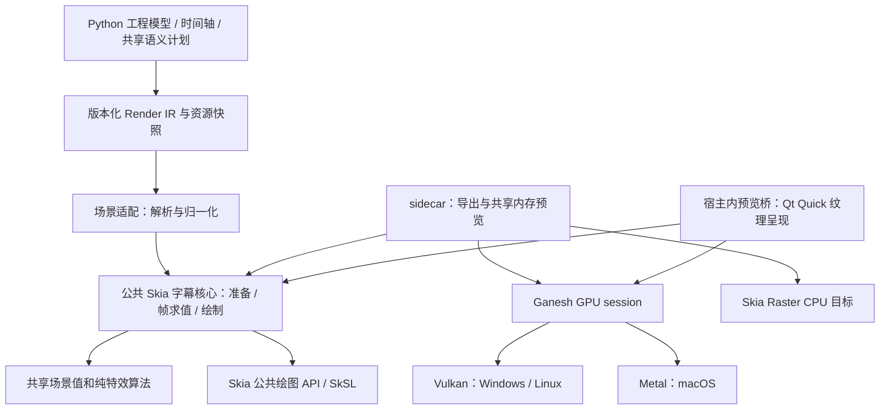

# 字幕渲染：Skia 跨平台后端架构与迁移实施计划

> 创建：2026-11-14；现状核对基线：`main` / `0c5b6264`。
>
> 状态：**实现已推进到 P04 的实验字幕闭环，生产默认仍为 D2D，完整迁移尚未完成；以逐项勾选及第 14 节证据为准。**
>
> 用户已明确目标：Windows、Linux 使用 Vulkan，macOS 使用 Metal；字幕绘制核心使用完全相同的源码；完整承接当前字幕渲染能力，最终替代 Direct2D。
>
> 用户补充：最终 CPU fallback 使用 **Skia CPU Raster**，不回退 QPainter；迁移对照为 **D2D GPU → Skia GPU**，CPU 验收对照为 **Skia CPU ↔ Skia GPU**，不建立 QPainter 画面对照。
> 文档最初建立时已清理前期 Skia 探针；当前已交付 P00 的清单和 GPU 采集工具，执行结果与未通过项见第 14 节。不得把“文档已写好”“P00 输入已采集”或“前期 OpenGL 试验通过”记作正式 Skia 后端已完成。

## 0. 接手方式与权威顺序

### 0.1 每次接手先做什么

1. 阅读 [AGENTS.md](../AGENTS.md)，执行 `git submodule status`、`git status --short`，确认当前源码和用户改动。
2. 阅读本文件的目标、职责表、阶段依赖和当前阶段；只推进依赖已满足的任务。
3. 核对实际代码与本文件的基线差异。本文描述的“当前代码”是上述提交的快照，不能覆盖后续已经完成的实现。
4. 在本文件中原地维护任务状态、实际提交、验证命令、结果和剩余问题。不要另建一套并行计划或不断追加实验报告。
5. 在当前分支开发，不创建新分支，不修改 SUG submodule 源码。发版是后续独立任务，不能因完成某个阶段就自行发版。

### 0.2 冲突如何处理

权威顺序：**用户当前明确指示 → AGENTS.md 当前约束 → 已核实的产品语义及测试证据 → 本实施计划 → 历史设计文档中的旧快照。**

尤其注意两处已经过时的历史说法：

- 旧 GPU 文档中的“G6 已停止、入口硬关闭”不代表当前状态。当前 Windows 交互会话默认启用 G6 DirectComposition，失败回退 G5。
- “CPU QPainter 永久作为正确性 oracle”不再成立。当前 GPU 是主渲染口径；布局争议仍按 `layout_semantics` 判断，不能把 D2D 的任何现状都自动认定正确。
- 当前代码仍保留 QPainter fallback，但用户已明确最终目标为 Skia Raster。本文要求在迁移完成后退役 QPainter **字幕渲染**路径；这不要求删除 Qt UI 绘图或用于展示像素的 QImage。

相关背景材料：

- [字幕渲染模块需求](字幕渲染模块-需求设计.md)
- [GPU 后端历史与 N3 逆向](字幕渲染-GPU后端逆向与实施计划.md)
- [N3 导入范围](N3项目导入兼容性与实施计划.md)
- [布局与 N3 语义](字幕布局-N3对齐改造计划.md)
- [SUG / Python 走字差异](SUG与字幕渲染模块-Python走字差异.md)
- [C++ sidecar 历史](字幕渲染核心C++化方案.md)

## 1. 最终交付与范围

### 1.1 必须实现的结果

| 维度 | 交付要求 |
|---|---|
| Windows | 原生 Vulkan 硬件 GPU 渲染；正式预览、导出和打包可用 |
| Linux | 原生 Vulkan 硬件 GPU 渲染；X11、Wayland 分别验收预览集成 |
| macOS | 原生 Metal 硬件 GPU 渲染；正式预览、导出和应用包可用 |
| 公共核心 | 字体几何、布局投影、走字、动画、粒子、装饰、图层绘制使用同一组源码；没有操作系统分支 |
| 功能 | 完整承接当前已支持的字幕能力及参数组合，不以基础文字演示替代完整迁移 |
| 兼容 | 现有 `.yurika`、`.sug`、`.lrc`、`.n3proj` 继续消费原有模型与导入规则 |
| 预览 / 导出 | 消费同一语义快照和公共绘制入口；保持同一时刻的字幕内容与布局一致 |
| 最终维护 | 三平台统一到 Skia；GPU 失败/关闭时回退 Skia CPU Raster；D2D 与 QPainter 字幕绘制路径在验收后退役 |
| 对照基线 | D2D GPU 对照 Skia GPU；Skia CPU 对照 Skia GPU；不以 QPainter 生成参考画面 |

初始硬件验收架构：Windows x64、Linux x64、macOS arm64。macOS x86_64、Linux arm64 等构建不得因“同源码”自动标为已支持；需要单独构建、打包和运行记录。若当前产品承诺了其他架构，在 P00 一并列为必须交付，不得静默缩减。

### 1.2 “一比一”是什么

**严格一致：** 项目字段解释、`legacy` / `n3_1074` 布局语义、行与假名锚点、字符和角色尺寸规则、显隐窗口、时间偏移、逐字区间、走字方向、动画阶段、粒子种子、组合图层顺序、预览与导出关系。

**完整覆盖：** 全局与逐行覆盖、角色、主副轨、上下假名、标题、导唱符、指示灯、音量柱、背景带、全部已支持的入退场 / 唱字 / 粒子 / 走字线能力。

**单独评估：** 抗锯齿、像素覆盖、模糊核和描边边缘。不能要求跨引擎每个像素机械相等，也不能用“引擎差异”豁免布局错位、缺层、缩小光晕或丢失效果。误差指标和视觉标准必须在对照前确定。

“核心同源码”不等于任意驱动上的位级像素一致，也不等于没有平台适配代码。平台代码必须被限制在设备、资源交接、同步、呈现和系统资源发现边界。

### 1.3 不在本次范围内

- 不重写编辑器、撤销系统、工程存储、SUG、N3 导入或整个 Python UI。
- 不改为 ASS/libass，不改动“离屏字幕层 + ffmpeg rawvideo”导出主方向。
- 不新增现有产品明确不支持的功能，例如 30fps 原样输出、假名独立字体、AVI。
- 假名继续沿用日文字体族，英数字体可独立；底层字体能力不能擅自扩大 UI/工程承诺。
- 预览性能以真实工程的 1080p、60 Hz 请求为主，同机对照现有 D2D。120fps 数据用于诊断，导出继续验证现有 60/120fps 帧序。4K 基准不纳入本次迁移。
- 不为了统一后端而同步重写视频解码和音频时钟。预览宿主若需要调整背景合成，只修改呈现适配，保留背景与音频产品语义。
- 不长期维持“Windows 永远 D2D，其他平台永远 Skia”的两套功能实现。

## 2. 当前架构证据与具体改动面

以下是需要解决的已核实耦合，不是对现有 Windows 实现的泛化否定。

| 当前位置 | 当前职责 / 事实 | 迁移时的最小处理 |
|---|---|---|
| `krok_helper/subtitle_render/engine/layout/plan/` | 已有共享不可变语义计划，包含行窗口、分页、lane、时间区间等 | 继续作为宿主语义编排的事实源，不在 Skia 侧复制分页与窗口规则 |
| `engine/layout/plan/orchestrator.py`、`engine/layout/line/qt_geometry.py` | P05.3 已移除 orchestrator 对 Qt 逐字区间的隐式调用，现有调用者显式传旧 resolver；新快照端口可用 | P05.4 仍需将规范度量真正用于最终 IR，不能误认为换个 resolver 就已完成全部布局迁移 |
| `engine/render/render_ir.py`、`native/protocol.py` | IR、字体资源、角色 / 粒子 / 布局表已有去重与解析 | 复用协议入口，必要时小范围扩展并版本化；不创建另一套工程模型 |
| `native/subtitle_renderer/src/backends/qt/gpu_scene_projection.cpp` | 协议到 native 场景投影仍引用 Qt 字体、行布局和 ruby helper，不是纯字段拷贝 | 分离纯投影与旧几何兼容；P05 完成度量替换后收口；禁止 Skia 包含 Qt 后端私有头 |
| `src/model/render_types.h` | 混合场景值、后端诊断、帧结果、窗口目标等多种概念 | 按实际消费者渐进提取类型；不再给单个共享头无限追加字段 |
| `src/backends/render_backend.h` | 同时包含离屏渲染、呈现、窗口消息等接口 | 公共绘制核心不继承此接口；由薄的 sidecar 适配器兼容现有调用 |
| `src/runtime/gpu_backend_runtime.cpp` | 直接构造 `Direct2DGpuBackend`，有 WARP 专属选择语义 | 构造放到明确的后端工厂，软件设备策略与后端身份分开 |
| `src/runtime/gpu_preview_worker_pool.cpp` | 容器和共享资源逻辑直接使用 D2D 类型，不只是工厂里耦合 | 保留 D2D 旧路径；为 Skia 明确 session / 线程策略，不能只替换构造表达式 |
| `src/backends/direct2d/d2d_backend_configure.cpp` | 同时承担字体、几何、排版与多类资源装配 | Skia 从开始就分开字体、布局、素材、画笔和准备过程 |
| `src/backends/direct2d/d2d_backend_render.cpp`、`d2d_backend_internal.h` | 绘制、效果、资源、状态之间有较大共享面 | 不照搬为 `skia_backend_render.cpp` + 超大私有头 |
| `src/backends/direct2d/d2d_fx.*` | 多数粒子 / 几何 / 噪声 / 图样算法可独立；少量矩阵 API 绑定 D2D | 提取纯算法，由 D2D 和 Skia 共用，不复制出 `skia_fx` 镜像 |
| `src/backends/direct2d/native_preview_surface.*` | D3D11 / DXGI / DComp / HWND 呈现 | 限定为 Windows 旧 presenter；不把 HWND 当三平台窗口协议 |
| `native/subtitle_renderer/CMakeLists.txt` | 当前直接编入 D2D，非 Windows 直接失败 | 条件编入后端，增加公共 core / GPU / 宿主适配 target |
| `frontend/preview/preview_async.py`、`engine/renderer.py` | 预览调度、导出、回退和 native 路径选择 | 只增加能力选择与适配，保留用户时间轴、输出和取消语义 |
| Windows/macOS 构建脚本、release workflow | Windows 已收集 sidecar；macOS 尚无同等 Skia GPU 产品链路 | 明确收集库、Qt 插件、签名和运行时；补 Linux 构建入口 |

### 2.1 前期验证能说明什么

前期实验在 Windows OpenGL 上证明了 Skia GPU 路径可用；现有纯 C++ 特效核可以脱离 D2D 编译；原生字体轮廓、几何动画、粒子和烈焰图样合成可以运行。原生样例完成过 1,444 帧及倒序像素一致检查。

它没有证明完整 IR 兼容、完整布局、全部效果、Vulkan、Metal、三平台呈现、正式导出或打包。曾使用的 Aseprite Skia m124 预编译包不是正式依赖方案。Qt 绘图命令回放还包含预先生成的栅格效果，不能拿回放耗时当完整后端性能。

这些探针及专用依赖 / 产物已在本次文档任务中清理；后续从生产 target 和可维护测试继续，不依赖已删除的本机绝对路径。

## 3. 架构决策：同一核心、不同入口、明确的资源所有者

### 3.1 依赖图



箭头表示依赖 / 调用方向。`CORE` 不能依赖 `EX`、`HOST`、Qt、GPU 原生头或 IPC；纯特效算法不能反向依赖绘制器。

### 3.2 为什么不能只有“sidecar 加三个子窗口实现”

Windows 当前通过子 HWND 呈现，不能据此假设 macOS 的视图对象、Qt 对象指针或 Wayland surface 可以跨进程照传。跨进程纹理共享还涉及不同操作系统的句柄、同步和销毁协议，不能偷偷塞进字幕核心。

本计划采用两个产品入口，共用一个核心：

1. **sidecar 入口**：负责导出和 G5 型共享内存预览；拥有自己的 GPU session。先用它建立稳定的完整链路，保留进程隔离和导出故障恢复。
2. **宿主内直接预览入口**：作为 Qt Quick 原生模块加载到 PyQt 宿主，使用同一个核心，在 Qt 渲染线程上完成 GPU 纹理交接。Qt Quick 只承担呈现容器，不使用 Shapes 重写字幕效果。

两个入口不是两套效果实现。sidecar 可以选择 owned GPU 或 Raster 目标；CPU fallback 通过 Raster 输出像素到现有共享内存/像素显示容器。无需启动 Qt Quick GPU 场景图，也不调用 QPainter 字幕绘制。

宿主入口的拟定实现是一个很薄的 C++ QML 类型，由现有 Widgets 预览区域承载。只传场景快照、资源描述和时间请求，不传 Python 对象到渲染线程，不依赖 Python 每帧计算字形 / 粒子 / 图层。

**这是需要 P03 验证的设计，不是已验证事实。**

**P03.6 修订（2026-11-14，有实测证据）**：宿主内直画入口不是叠在旧 `QGraphicsView` 上的透明层，而是替换预览画布内容的一块不透明 `QQuickWidget` 画布：背景（视频经现有 Python `QMediaPlayer` 输出到 QML `VideoOutput`、图片、纯色、黑边）与 Skia 字幕在同一 Quick 场景合成，Widgets 控件正常叠放其上。原因与否决证据见 P03.6。P09.4 因此需在 Quick 画布内承接背景合成语义（contain/cover、图片序列、前黑/后黑分段与过渡），并保持与导出一致。 Qt 提供 Vulkan / Metal 纹理包装接口，不等于 Skia Ganesh 可以直接写入 Qt 当前命令缓冲。P03 必须实证设备一致性、提交顺序、image layout、同步、纹理寿命、嵌入预览、背景合成与窗口销毁；不能靠一张正确截图宣告解决。

如果 P03 证明所选公共接口在 Qt 6.11.0 下不可行，应在本文件修订宿主呈现适配设计并保留问题证据，不把平台分支塞进核心，也不把 G5 回读长期冒充 G6 同等交付。sidecar 离屏迁移可继续，最终直画验收不可勾选。

### 3.3 主要模块及所有权

| 模块 | 唯一负责 | 可以依赖 | 不能负责 |
|---|---|---|---|
| 宿主语义计划 | 源数据、时间偏移、页面 / lane、显示窗口、角色归一化、粒子 burst 规划 | 领域模型、度量接口 | GPU 设备、每帧绘图 |
| 场景适配 | JSON / Qt 配置转成经过验证的 typed scene | 协议、场景值 | 再定义分页、默认样式或效果公式 |
| 字体与度量 | 字体快照、face / axes / simulations、shaping、cluster 映射、规范度量 | 字体字节、Skia、固定的 FreeType / HarfBuzz | 枚举平台字体目录、决定页面时间 |
| 几何准备 | 行 / 字符 / ruby / 导唱符位置和不可变路径 | 语义 scene、规范度量 | 改写已经解析的时间区间、按行内容改变页级网格 |
| 帧求值 | 给定 scene 和 t，得到活跃图层、变换、裁切、粒子状态 | 纯算法、准备好的几何 | 看系统时钟、读文件、创建 GPU device |
| Skia 绘制 | 把帧状态画到给定 `SkCanvas` | 公共 Skia API、预备资源 | 创建窗口、发 IPC、选择 Vulkan / Metal |
| CPU Raster 目标 | 创建 CPU `SkSurface`、像素存储与交付 | core、Skia Raster、像素契约 | 另一套字体/布局/效果算法、GPU 初始化 |
| GPU session | context、GPU surface、上传、提交、同步、回读与 context 资源 | Ganesh 和所选原生 API | 字体 fallback、逐字时间与产品样式规则 |
| 宿主预览桥 | Qt 线程同步、纹理包装、背景叠放、时间请求与呈现 | core、GPU adapter、Qt Quick | 另一份字幕 layout / effect 实现 |
| sidecar 适配 | 现有命令、generation、共享内存、取消、诊断与 session 调度 | core、GPU adapter、runtime | 核心私有缓存和字形算法 |

### 3.4 不为“解耦”制造额外框架

- 不引入通用渲染命令虚拟机、每个 path 一个虚接口、万能 manager 或服务定位器。
- `SkCanvas` 已经是绘图边界，不再包一套与其逐方法同构的跨平台画布接口。
- 只为真实变化建立接口：度量来源、GPU session、素材读取、帧交付。普通纯函数和不可变数据不必虚拟化。
- 不同时建设 Ganesh / Graphite 两套执行模型。初期统一 Ganesh Vulkan / Metal；版本选择在 P01 锁定。
- 不复制所有旧模型。提取已有场景类型时保持一个定义，必要的过渡包含只为现有调用者服务，并记录退役条件。
- 不通过 `dynamic_cast` / backend 名称判断，让字体、效果、排版内部选择 Windows / Linux / macOS 行为。

## 4. 文件与构建边界

下面是目标职责布局，**不是要求第一天创建全部目录和空文件**。在对应阶段引入有真实代码和消费者的模块。

```text
native/subtitle_renderer/
  cmake/                         # Skia 导入、平台选源、依赖指纹
  src/
    model/                       # 共享场景值；与窗口/传输结果分离
    effects/                     # 后端无关纯算法；从既有 d2d_fx 渐进提取
    scene/                       # 协议到共享场景的投影
    backends/
      direct2d/                  # 过渡期保持可运行
      qt/                        # 迁移期旧实现，最终退役字幕绘制；不被 Skia core 包含
      skia/
        skia_backend.*           # 薄 sidecar facade，不放布局和特效公式
        core/
          scene_prepare.*        # 准备流程编排
          frame_evaluate.*       # 确定性帧状态编排
          frame_draw.*           # 图层绘制编排
          fonts/                 # face、shaping、glyph metrics / outline
          layout/                # 主字/ruby/竖排/锚点的几何投影
          paint/                 # fill、stroke、glow、shadow、clip
          elements/              # title、band、signal、scanline 等绘制组件
          assets/                # 不可变图片帧、sprite、资源标识
        gpu/
          ganesh_session.*       # 后端共同的 Ganesh surface / submit 契约
          vulkan/                # Vk context、布局/屏障/同步、拥有或借用设备
          metal/                 # .mm；设备、纹理、提交与寿命
        raster/                  # CPU surface/像素交付；调用同一 core
    preview/qt_skia/              # 宿主 QML 模块，Qt/Vulkan/Metal 纹理交接
    runtime/                     # 工厂、队列、取消、帧仓、进程级编排
    protocol/                    # JSON 和版本检查
    diagnostics/                 # 中立诊断投影
  tests/                         # 新增的 native 纯逻辑和公共核心测试
```

### 4.1 建议 target 与依赖约束

| target（拟定） | 内容 | 依赖限制 |
|---|---|---|
| `subtitle_scene` | 场景值、纯算法、通用几何数值 | 标准库；不链接 Qt、Skia GPU 或平台 SDK |
| `subtitle_skia_core` | 字体、CPU 准备、帧求值、SkCanvas 绘制 | `subtitle_scene`、Skia 公共 core/effects、字体依赖；无 Qt、Vulkan/Metal 头 |
| `subtitle_skia_gpu` | Ganesh session 与平台资源 | Skia Ganesh + Vulkan 或 Metal；不包含 UI 和协议 |
| `subtitle_skia_raster` | CPU surface、像素存储与交付 | core、Skia Raster；不能依赖 GPU adapter、Qt Quick 或 GPU loader |
| `subtitle_scene_adapter` | Qt/JSON 配置投影到 scene | Qt Core、必要的 Qt Gui 颜色/值适配、scene；不能包含具体后端私有头或执行字形绘制 |
| `subtitle_skia_backend` | sidecar 到公共 core 与执行目标的桥 | core、raster、可选 GPU、既有中立后端接口 |
| `subtitle_skia_preview` | 宿主内 QML 模块 | core、GPU、scene adapter、Qt Quick；不得链接导出流水线 |
| `krok_subtitle_renderer` | 现有可执行程序 | runtime、protocol、启用的后端；无宿主 UI 依赖 |

叶子目录不必各有独立库。target 的意义是让编译器约束依赖，而不是增加构建层级。

Skia GPU 库与 core API 可能来自同一静态包；“core 不依赖 GPU”指它不访问 GPU 原生接口、可在不初始化设备时完成准备和纯逻辑测试。构建检查不能只看链接库名称下结论，应同时检查包含路径、对象依赖和符号。

### 4.2 文件规模与入口规则

1. 一个模块按“为什么变化”划分：字体匹配变化不应要求改动画绘制；窗口同步变化不应触碰 ruby 布局。
2. `configure` 只组织“验证 → 字体/素材准备 → 几何 → 不可变 scene → 原子发布”，不内联各阶段算法。
3. `render` 只组织“选择快照 → 求值 → 图层绘制 → 提交/交付”，不解析 JSON、不枚举字体。
4. 不创建包含全部缓存、全部 helper 和所有可变状态的 `skia_backend_internal.h`。
5. 单文件约 400 行作为审视提示，超过 800 行必须记录职责为何仍内聚，或拆出有明确所有者的子模块；行数不是硬性正确性指标，禁止机械切碎函数来满足数字。
6. 私有头不跨模块引用。只有实际需要跨边界的契约放公共头；禁止为了绕开依赖规则把所有内容搬进 `common.h` / `utils.h`。
7. 新增一种粒子运动只应触及纯算法、必要规格及测试；新增一种平台 presenter 只应触及 GPU/Qt 适配及构建；新增一个产品字段才需要模型/序列化/解析等直接消费者。

### 4.3 架构检查进入测试

- 检查 core / scene / effects 中不存在 Qt、Windows、D2D、D3D、Vulkan、Metal、Objective-C 平台头和 OS 宏分支。
- 检查 core 不导入 protocol、runtime、preview、D2D/Qt 后端私有头。
- 在不同平台导出编译命令，确认 core 选用同一组源码；平台适配文件差异不算核心差异。
- 用实际编译和 target 依赖检查为主，简单文本扫描为辅；不只写会被包含链轻易绕过的正则断言。
- 架构检查失败作为持续集成失败处理，不能在每次新效果加入时临时扩大允许列表。

## 5. 数据、时间、字体与资源契约

### 5.0 协议与能力模型（2026-11-25 根治，取代逐项能力协商）

逐项能力协商在组合门禁解除后成为主要缺陷来源：350 个能力标记在 Python 声明、native
合同与渲染分支三处重复编码，Python 的声明条件只要比实际需要窄，native 就拒绝整个场景
（例如“角色矢量导唱符缺少角色唱字能力声明”），扩维随机扫描 1800 组合中 4.8% 命中。
解除门禁时又把报错改为 `(void)0` 空判断（native 78 处、Python 27 处），配套声明条件却未放宽。
根治后的约束：

1. **单一协议版本。** sidecar 与 IR 构建器同源发布，握手只核对 `skia_protocol`
   （Python `skia_process.SKIA_PROTOCOL`，C++ `scene::kSkiaProtocolVersion`）；度量请求同样只带
   这一版本。IR、度量或帧协议的任何变化只递增这一个数字。ready 不再携带能力名列表与逐项
   `*_schema`，客户端不再逐项检查。
2. **Python 是唯一的模式决策方。** `required_features` 与 `skia_layout.*_schema` 只表示
   Python 依据场景数据选定的绘制模式和数据格式；native 读取并执行，**不做交叉校验，不因
   其组合拒绝场景**。
3. **native 只校验数据。** `validateSkiaIrEnvelope` 由 1504 行缩为只检查 IR 版本、必需对象、
   数值范围和引用存在（如导唱符 ID 必须在字形表中）；渲染层 39 处声明一致性报错与依赖声明的
   间接报错一并删除，场景校验 `validateSkiaScene` 按“全部画笔与装饰已实现”执行，只拒绝无效数据。
4. **真正未实现的输入单处拒绝。** 如彩色 emoji、未验证的复杂文字码位、竖排行内角色等，
   在一处以明确信息拒绝，并在 D2D 对照验证后再放开。
5. **不再引入交叉校验或空判断。** 新功能不得新增“声明 X 必须同时声明 Y”的检查，也不得以
   `(void)0 /* composition gate lifted */` 或 `pass  # Composition gate lifted` 保留空分支。
   画面正确性由实际 D2D GPU 对照与随机组合扫描验证。

测试随之调整：38 个旧 sidecar 握手测试合并为一个协议版本测试；伪造能力或 schema 并断言拒绝的
变体删除，伪造墨迹、字宽、度量身份、坐标等数据的变体保留。根治前后 4400 余项 Skia 测试中所有
画面断言（含 D2D 实拍对照）均保持通过，失败的仅为上述拒绝断言。

根治后的首轮 D2D 验收：扩维随机扫描 3000 组合中 2985 个可配置，余下 15 个均为“注音标在被替换型导唱符覆盖的字上”。GPU 在绘制后的文字中查找注音底字，被替换的字已成占位符，该组注音省略；Skia 原按原始歌词查找仍会绘制。现改为在绘制文字中查找（横排与竖排共用 `upper_ruby_targets(rendered=...)`），其中 10 个与 D2D 实拍一致，另 5 个差异来自同组合内其他特效叠加。对根治前被拒绝的 86 个组合整体做 D2D 实拍对照：一致 24 个（28%），同一生成器下从未被拒绝的 60 个组合一致 36 个（60%）。即部分旧门禁挡住的是“绘制路径存在但未对齐”的组合，高频项为“角色/调色板取色的火焰或气泡形扫字线 + Utopia/整字放大唱字”：Python 与 native 的形状调色板条件仍要求唱字动画为无，形状被静默跳过。这一类按数据条件逐项修正并以 D2D 对照验收。
已修正首项：形状调色板（角色/提亮/跟随取色的火焰与气泡）不再要求唱字动画为无，整字放大的形状扫字线同时接受气泡与调色板取色；Python `procedural`/`zoom_shape` 与 native `shapePalette`/`zoomScanlineShape` 同步放宽，反向行的形状仍保持原条件。最小复现 36 组中火焰/气泡 + Utopia/整字放大的全部不一致消除，新增 8 项实际 D2D 对照回归。
改用抗锯齿不敏感的分级（明显不一致：任一帧单侧缺失、实心 IoU<0.85、透明度总量差>10% 或实心像素改色>3%）做 1180 组成对 D2D 扫描，覆盖旧门禁涉及的唱字、出入场、粒子、装饰、注音、方向、导唱符、角色与扫字线维度：一致 132、轻微 991（多为基础场景小字号边缘）、明显 57。最大一簇（约 35 组）是火焰/气泡扫字线叠加任意出入场或唱字粒子时形状被跳过，Python `shape`/`solid_shape` 与 native `scanlineShape`/`solidShape` 改为不再要求静止行或无粒子后全部降为轻微；另修正角色光晕在 Utopia 退场时按本组可见单元静止框裁剪（同 D2D 逐样式光晕组）。剩余明显项：竖排唱字/粒子（按 P05.7 预期几何验收，不作 D2D 比较）；羽毛/音符退场叠加唱字粒子时 D2D 跳过退场使文字整行保留，疑为 D2D 缺陷，未照搬；Utopia 入场 + 注音在分段终点帧 D2D 晚一帧切换；半透明入场帧 IoU 落在阈值附近属指标误报；形状扫字线 + 位图导唱符待查。


### 5.1 三层数据，不建立第二套业务模型

1. **Render IR / 共享 scene**：完整的已归一化产品语义；来自现有宿主计划和序列化。
2. **PreparedScene**：不可变的字体 / 素材引用、字形 cluster 映射、行与 ruby 几何、静态绘制资源；不持有窗口或 `VkDevice` / `MTLDevice`。
3. **FrameState**：由 `PreparedScene + t_ms` 得到的临时可见项、变换、裁切和粒子状态；不包含 JSON，也不把每个像素动作编码成新的通用命令协议。

几何路径使用 `SkPath` 等公共对象可以直接留在 core 内。不要为避免 Skia 类型而手写另一套 path 树。GPU 纹理、surface 和 context 缓存放 session，不能藏进可跨设备复用的 PreparedScene。

### 5.2 接口形状（示意，不是已存在的 API）

```cpp
PreparedScene prepareScene(const RenderScene& scene,
                           const FontCatalogSnapshot& fonts,
                           const AssetSnapshot& assets);
FrameState evaluateFrame(const PreparedScene& scene, TimeMs t);
void drawFrame(SkCanvas& target,
               const PreparedScene& scene,
               const FrameState& frame);
```

core 不创建 device、不 submit、不 readback、不 present。调用方负责在正确 session/thread 上提供有效目标。实际实现可以合并帧求值与绘制的临时存储，接口不要求每帧分配巨大对象。

GPU 目标使用 Ganesh surface 的 canvas，CPU 目标使用 Raster surface 的 canvas；`prepareScene`、`evaluateFrame`、`drawFrame` 必须是同一份实现。任何只支持 GPU 的原生纹理或 shader 扩展都不得直接成为 core 的必需输入。

### 5.3 时间与语义不变量

- 只使用请求给出的 `t_ms` / frame index，不读取墙钟，不用“上一帧累加”决定粒子或图片帧。
- 显隐区间的端点包含规则、前黑/后黑、多轨时间偏移、pause/checkpoint 必须沿用当前权威逻辑，不在 adapter 再加一次偏移。
- 已解析的 `resolved_intervals` 是帧执行层的输入，Skia 不能按自己测得的新字宽擅自重新分配时间。
- 页级网格不能由当前行内容临时决定。ruby 和导唱符影响哪些范围，按 `layout_semantics` 和现有用户决策执行。
- layout / paint / viewport 变换顺序必须有固定契约；正文、假名、扫描线图片是否随 Utopia 变换不能凭实现方便决定。
- 预览缩放只改变约定的逻辑/物理投影，不偷偷改字号基准、粒子速度、时间轴或导出结果。

### 5.4 字体和度量：先保兼容，再消除隐式平台差异

字体进入核心时应已解析为内容标识，而不是让每个平台再次凭 family 字符串猜一个 face：

```text
FontResourceId = 字体内容摘要 + face index
FontInstanceId = FontResourceId + 规范化 axes + simulations + shaping 配置
GlyphRun       = glyph ids + positions + clusters + 原歌词单元映射
```

- 继续复用当前 OpenType 字体快照机制；保留 face、字重、模拟粗斜体、轴值、fallback 原因等信息。
- 统一采用锁定版本的 FreeType / HarfBuzz 路径处理规范度量和复杂文本；平台字体发现只负责生成资源快照。
- 不用 `SkFont::textToGlyphs` 的逐码点映射充当完整 shaping。覆盖组合字符、连字、variation selector、emoji 序列、韩文与混合角色；走字仍必须映射回项目的歌词单元。
- 不全局启用 / 禁用连字来“看起来差不多”；用现有字幕单元和语义决定 shaping 边界，并测试跨角色 / 跨计时单元的行为。
- 字体不存在时保留用户可解释的 fallback；同一字体文件存在的三平台必须使用同一字体实例。不能承诺未安装同一字体时画面自动一致，也不能擅自分发系统商业字体。
- 不按 `wchar_t` 长度或单个 UTF-16 code unit 推进字符；Windows 和 Unix 的宽字符大小不同。协议使用明确 UTF-8，内部 cluster / scalar 单位必须命名清楚。

当前宿主语义计划中有 Qt 字宽参与时间区间和页面偏移计算。P05 的顺序必须是：

1. 先用既有共享计划作为基线，隔离度量读取点，不重写时间与分页规则。
2. 在 core 提供无需 GPU 初始化的**批量度量能力**：输入字体实例、文本单元、样式和语义版本，输出 ink/advance/baseline/cluster 等值与字体指纹。
3. 由配置层一次性取回 `LayoutMetricSnapshot`，缓存后注入宿主共享计划；扩展当前仍直接调用 Qt 测量的入口。
4. 用同一份度量生成已解析区间和布局语义，再序列化最终 IR，准备 native scene。不能先画一帧再反向修时间。
5. sidecar 导出与宿主内预览使用同一度量实现和快照签名。配置期允许批量往返，播放热路径禁止逐字符 IPC 或 Python 度量。
6. Skia CPU 与 GPU 共用 native 度量和 PreparedScene；没有 GPU 也必须能启动度量与 Raster。Skia native 组件缺失或 ABI 不匹配应作为安装/加载错误明确报告，不能在最终产品中悄悄改走 QPainter 或 Qt 字体度量。

这里新增的是一个度量提供边界，不是第二套分页器。若因兼容校准仍需 Qt 度量作为参考，应记录过渡项、准确作用范围和移除门槛，不能把平台差异藏在 core 中。

### 5.5 像素、颜色和素材

- 内部约定一个显式 RGBA / premultiplied 表示及颜色空间；初始采用与现有产品相符的 SDR/sRGB 输出语义，不顺手迁移整套线性光合成。
- BGRA / RGBA、straight / premultiplied、上下方向、stride、DPR、裁切范围均是显式元数据，不根据平台猜测。
- 转换只发生在素材入口、GPU 目标适配、共享内存或编码出口；不能每个元素各做一次不一致的 unpremultiply。
- 0 alpha 的 RGB、细描边、半透明发光、PNG 和两种透明 MOV 都要专项检查。播放器黑底不代表 alpha 导出错误。
- 动画素材的帧选择使用项目时间及素材帧时长，支持随机 seek；首次解码、磁盘读取和大尺寸重采样不得出现在每帧绘制函数。
- Python 负责当前路径解析 / `preset:` 语义，native 素材读取边界消费规范化资源标识及路径，不自行再定义工程目录回退规则。
- 可以保留小尺寸原生 CPU 图样生成后上传的方式；“GPU 后端”不要求所有 CPU 准备都改成 shader。必须报告生成 / 上传成本，不能退回整帧 QPainter 后仍标为完整 GPU 迁移。

## 6. GPU session、并发、缓存与失败处理

### 6.1 设备选择与所有权

- Windows/Linux 只创建 Vulkan Ganesh context，macOS 只创建 Metal Ganesh context。OpenGL、MoltenVK、SwiftShader 不计入本计划的硬件 GPU 验收。
- sidecar session **拥有**设备和提交队列；宿主预览 session 在 P03 验证后**借用** Qt 所在设备及兼容队列。两种所有权必须使用不同构造入口 / 明确类型，不能依靠析构时猜测。
- 不能把 session A 创建的 GPU `SkImage` / surface 随意交给 session B。只有 CPU 路径和素材字节等明确可共享的资源可以跨 session 复用。
- 宿主内预览不自行创建另一个设备后把 texture handle 交给 Qt。若确需不同设备，必须有经过验证的显式共享协议，不能作为默认路径。
- Vulkan image 的 layout、queue family、使用范围、release/acquire 和 semaphore/fence；Metal texture 与 command buffer/queue 的使用顺序，都由 GPU/Qt 适配层负责。
- 原生 texture 的包装对象与底层 texture 分别拥有生命周期。Qt 纹理 wrapper 被销毁，不意味着底层 GPU 对象自动安全释放。

### 6.2 单 owner 线程起步

第一版每个 session 只有一个 GPU owner 线程。CPU 字体 / 几何 / 素材准备可以并行，但只能发布不可变结果，不能从准备线程调用同一个 Ganesh context。

不要直接把当前“多个 D2D backend + shared device resources”照搬成多个 Ganesh context 共用一个未同步队列。第一版优化依次是：缓存准备、减少重复绘制、有限在途帧、异步回读；只有测得瓶颈后才增加多 session，并证明设备资源和队列同步正确。

runtime 队列拥有任务生命周期和取消策略；session 拥有 GPU 对象；core 不拥有 worker 池。不得在 Skia 后端内部再创建一个外层 runtime 不知道的无限任务池。

### 6.3 配置发布和帧身份

帧至少关联：

```text
execution_target + execution_epoch + scene_revision + resource_revision + device_epoch
+ request_generation + t_ms + frame_index + viewport_revision
```

- 字段分别表达配置、素材、设备和请求身份，不用一个不断变化的整数代替全部概念。
- GPU → Raster 切换时推进 execution epoch，丢弃不匹配执行目标的缓存/迟到帧；Raster 的 device epoch 明确标为不适用，不能与仍在途的 GPU 帧混淆。
- `configure` 准备在旁路完成，通过验证后原子发布；失败保留上一份有效 scene 或明确失败，不发布半初始化对象。
- paint-only、geometry、font、asset、viewport 更新的失效范围分开。改变颜色不得必然整轨排版；更换字体也不能沿用旧字形缓存。
- 准备结束时重新检查 revision/generation，已被新配置淘汰的结果不可覆盖当前 scene。
- 呈现必须检索指定身份和时间的帧，不能“仓里没有就拿最新纹理顶上”。取消后的迟到帧不得重新上屏。
- sidecar generation 与宿主 presenter 的帧身份语义保持一致；不要求两种入口共享实际 GPU 资源。

### 6.4 每种缓存都要有主人和预算

| 缓存 | 所有者 | key 至少包含 | 失效 / 回收原则 |
|---|---|---|---|
| 字体实例 / shaping | 字体模块 | 内容摘要、face、axes、simulations、文本、方向、shaping 配置 | 字体注册/移除、内容或配置变化；有界 |
| 规范度量快照 | 配置层 | 字体指纹、文本单元、样式、语义版本 | 只供匹配的布局计划复用 |
| 布局 / 几何 | scene prepare | 语义计划签名、字体度量、逻辑尺寸、相关装饰几何 | 不因纯颜色变化失效；实际字体变化必须失效 |
| CPU 素材帧 | asset 模块 | 资源身份、内容/变更签名、帧号、解码参数 | 有界 LRU；动态图片不能每个 t 各存一张 |
| GPU 上传 / 画笔 / 中间层 | session | device epoch、素材/paint revision、目标约定 | context 内有效；resize 与 device lost 定向清理 |
| 可呈现帧仓 | 交付/presenter | 完整帧身份、目标大小和像素约定 | 固定容量、租约 pin；GPU 使用完成后归还 |

必须同时统计 Skia 自身 cache 和应用分配的纹理 / 中间层，避免只限制 Skia cache，却让外部 texture 无限增长。共享计数时标明是否存在重复计量。

**pin 不等于不可管理：** 缓存满且全部对象暂被在途帧引用时，执行有界背压 / 减少预读 / 丢弃过时预览请求；导出等待有界可回收槽。不能永久持锁重试逐出，也不能把一个永远无法逐出的 dead key 留在队头，使整个渲染器逐渐楔死。

每帧不应增长的计数必须纳入长时间测试：glyph 数、paint 数、upload 数、scratch 数、在途帧、未完成租约。不能只检查内存是否低于某个巨大上限。

### 6.5 销毁和恢复顺序

正常关闭：

1. 停止接收请求、取消未开始任务、使当前 generation 失效。
2. 在正确线程停止 presenter 消费，解除 Qt 回调，等待有界的交付 / GPU 完成条件。
3. 释放帧租约、Qt texture wrapper、render target、GPU 素材和 scratch。
4. 释放 Ganesh context。
5. 仅对拥有的 device/queue 执行销毁；借用的 Qt device 不得释放。
6. 释放 CPU scene/asset/font 快照；停止并回收 worker；最后销毁所属 Qt 对象和窗口。

Qt scene graph invalidation、窗口隐藏/重建、DPR 切换和设备丢失都是正式状态转换，不能只在进程退出时处理。

- sidecar GPU 卡死：沿用心跳、超时、终止进程与有限重试；不能无限重启。
- 宿主内 GPU 桥故障：可恢复错误转回 shared-memory / CPU 路径，明确记录原因。原生崩溃或驱动在调用内永久挂住并不保证能在进程内恢复。
- **进程隔离取舍必须记录：** 宿主内直画会使这条路径的 native 故障影响主程序，不能宣称仍保留 sidecar 的全部崩溃隔离。P03 必须评估；不可接受时需要另行完成跨进程 GPU 交付设计，不能掩盖风险。

### 6.6 诊断字段

至少报告：编译版本、Skia revision / build fingerprint、后端族、执行目标 `gpu|raster`、实际 GPU API（Raster 为无）、硬件/软件设备、适配器/驱动、owned/borrowed、core/IR/资源语义版本、字体来源、fallback 原因、帧身份、队列长度、丢帧、缓存命中/逐出、GPU/CPU 内存、准备/求值/绘制/提交/回读/IPC/呈现耗时。

渲染目标回退原因与缺字字体回退原因使用不同字段和所有者；不能用一个 `fallback=true` 混淆“仍在 GPU 但换了字体”和“已转 CPU Raster”。

区分 CPU 记录时间和 GPU 实际完成时间。硬件验收不允许以软件设备、fallback 或 `skip` 冒充通过。

### 6.7 最终回退链：Skia GPU → Skia CPU Raster

1. 用户关闭 GPU，或 GPU API/设备不可用时，选择 Skia Raster。发生可恢复 GPU 错误时，按有界策略重建或转 Raster，保留相同 scene、t 和输出格式。
2. Raster **不是软件 Vulkan / WARP / SwiftShader**，不创建 Ganesh GPU context。CPU-only 构建必须能在没有 Vulkan SDK/loader/驱动或 Metal device 的环境运行全部字幕效果。
3. GPU 模块使用可选加载或其他经实测可行的依赖隔离；不能让进程因为强制导入缺失的 `vulkan-1.dll` 等 GPU 库而在进入 CPU fallback 之前退出。
4. 所有效果都使用 CPU/GPU 共用的 SkCanvas/SkSL/图像滤镜能力；P01 和 P07 检查所选 Skia 构建中的 Raster/RuntimeEffect 能力。不得为 CPU 再复制一套特效公式。
5. PreparedScene 保存可被 Raster 消费的路径、字体与素材来源，不只保留 GPU texture。GPU 缓存失效不应使 CPU 没有可画素材。
6. GPU 不可用的预览使用 Raster 像素显示路径，可由 QImage 承载结果；QImage 是帧容器，不负责生成字幕。不得因 Qt Quick 也无法初始化 GPU 而使 fallback 失效。
7. CPU 与 GPU 共享时间轴、随机种子和配置失效规则。CPU 运行较慢时通过有界降频/丢弃过时预览请求处理，不能省略粒子、发光等效果；导出允许变慢但必须完整。
8. CPU/GPU 同场景的数值语义必须一致；画面按第 10 节的边缘/blur 容差验收。Raster 性能单独统计，不能拿它冒充 GPU 通过。
9. 原生 CPU 组件自身无法加载不是“无 GPU”。最终应给出明确中文诊断，修复包/依赖问题，不保留隐藏的 QPainter 第二回退。

## 7. 阶段依赖与里程碑

```text
P00 功能与对照基线
  -> P01 可复现依赖/三平台最小 GPU 与无 GPU Raster
  -> P02 公共类型/纯算法/生产边界
  -> P03 三平台最小宿主纹理交接（高风险早验证）
  -> P04 正式 IR -> sidecar -> GPU/Raster 预览/导出最小闭环
  -> P05 字体、规范度量、完整布局
  -> P06 完整基础绘制
  -> P07 全部动画/走字/粒子
  -> P08 标题/导唱/背景带/多轨组合补齐
  -> P09 正式直接预览与宿主集成
  -> P10 全格式正式导出
  -> P11 稳定性/性能/架构验证
  -> P12 打包、切换与 D2D 退役
```

P01/P03 的“某平台无法验证”要标注具体原因，允许继续不依赖它的公共功能，但不能关闭该平台的门槛，也不能在 P12 宣称三平台完成。P05 不通过，不应通过调整图片误差阈值硬推进后续效果。

| 里程碑 | 含义 | 不能据此宣称 |
|---|---|---|
| M0：P01–P03 | GPU API 和模块/宿主边界具备可行证据 | 完整字幕后端已完成 |
| M1：P04–P06 | 真实工程静态与基础走字链路稳定 | 全部动画兼容 |
| M2：P07–P08 | 完整绘制能力和组合样例覆盖 | 三平台产品体验、稳定性已通过 |
| M3：P09–P11 | 正式预览/导出/长时间运行通过 | 可以忽略打包和升级兼容 |
| M4：P12 | 三平台包验证并达到退役条件 | 未验收的架构或设备也支持 |

## 8. 可逐步执行的任务清单

每个任务完成时记录实际代码/测试位置和验证结果。阶段回退首先恢复后端选择或对应适配，不撤销无关产品改动。

### P00：功能与参考基线

**目的：** 明确“全部能力”是什么，避免迁移越写越偏。

- [x] P00.1 核对当前提交后的变化，更新第 2 节证据位置。
- [x] P00.2 以第 9 节为初始矩阵，枚举实际模型字段、属性入口、IR、D2D 分支与已有测试；列出不能遗漏的组合。
- [x] P00.3 从现有 corpus、回归 fixture 和可合法存储的真实工程中建立固定样本。敏感工程只记录本地执行方式，不提交用户媒体。
- [x] P00.4 固定字体内容身份、素材身份、画布、帧率、时间点和预览缩放，保存 D2D 基线图和几何/时间诊断；基线产物放测试产物目录，不把大批图片塞进源码。
- [x] P00.5 区分“D2D GPU 既有行为与产品语义的分歧”“N3/legacy 语义问题”“迁移新回归”；不生成 QPainter 参考图；已知差异建成命名用例。
- [x] P00.6 定义静帧、连续片段、随机 seek、全格式导出和长时间运行集合；确认没有加入用户已明确不做的 4K 补测。

**交付物：** 原地补全的能力矩阵、可复用 fixture / corpus 入口、版本化比较结果格式。

**门槛：** 每项已支持能力都有验收入口；没有以“复杂效果以后再说”省略功能。此阶段不改变生产默认后端。

### P01：依赖锁定与三平台最小硬件 GPU

**目的：** 把生产依赖、GPU 能力与 OpenGL 试验分开。

- [x] P01.1 选择同时具备所需 Ganesh Vulkan / Metal / RuntimeEffect 能力的官方 Skia revision；锁定 commit、依赖 commit/hash、编译器、SDK、GN 参数、CPU 架构和运行时。固定官方 m150 `29d30fe30aa2e86c44302297d063dd3190c2c880`，详见 `native/subtitle_renderer/skia.lock.json`。
- [x] P01.2 建立机器可读依赖锁和统一构建驱动 `scripts/build_skia_renderer.py`。下载包与 GN/Ninja 二进制分别校验 SHA-256，源码使用固定 Git commit；DEPS 校验上游 Git blob，避免 CRLF/LF 差异。仅显式导入四个 complete_static_lib 归档。
- [x] P01.3 Windows 固定 clang-cl 21.1.8 + 产品构建树使用的 MSVC 14.50.35717 STL/SDK + `/MD`；SDK 10.0.26100.0，兼容 Qt 6.11.0 的 MSVC 动态运行时策略。P01 的目标不链接 Qt；跨 Qt 对象边界与宿主模块 ABI 仍须在 P03 实测。
- [x] P01.4 CMake 以 `KROK_BUILD_LEGACY_SIDECAR` 控制原 Windows sidecar，保持原 Windows 默认构建；Skia 通过 `KROK_BUILD_SKIA` 独立启用，core、GPU、Raster 分开。仅 Metal target 启用 Objective-C++。
- [ ] P01.5 Windows/Linux owned Vulkan、macOS owned Metal 已实现并完成相同场景的绘制/回读；Windows 为真硬件，Linux 为 llvmpipe，macOS 两种架构为 Apple Paravirtual。Linux/macOS 真机硬件验收仍待完成，不关闭平台门槛。 macOS arm64 真硬件已通过（2026-11-14，Apple M4 Pro / macOS 26.6.2，见 §14.6）；Linux 原生硬件 Vulkan 仍待验证。
- [x] P01.6 增加实际 API/adapter/driver/软件设备诊断；Windows 真硬件通过，Linux CPU Vulkan 与 hosted 虚拟 Metal 在要求硬件时均正确拒绝，不做整帧 fallback。
- [ ] P01.7 三平台相同小样例已执行，构建/软件/虚拟/硬件结果分别记录；Windows 硬件通过，Linux/macOS 尚缺真机硬件结果，见 §14.5/§14.6。 macOS arm64 真硬件已通过（2026-11-14，Apple M4 Pro / macOS 26.6.2，见 §14.6）；Linux 原生硬件结果仍缺。
- [x] P01.8 增加 build fingerprint；依赖/参数变化必须使缓存失效；Windows Vulkan、CPU-only 与 Linux CPU-only 已完成干净构建/缓存复用；native 头变化强制全清。其余平台构建结果继续单独记录。
- [x] P01.9 Raster 目标调用同一 core；Windows/Linux CPU-only 已实际运行。Windows 两种构建中的 Raster 均在指定不存在的 Vulkan loader 时通过，GPU 同条件明确失败；RuntimeEffect/滤镜、Unicode 字体/输出路径、重复帧通过。后续完整字幕能力的 Raster 验收不由此关闭。

**交付物：** 可重复构建入口、锁定依赖、owned GPU session、Raster 目标、正式测试 target 中的 GPU/CPU 冒烟。

**门槛：** 本机 Windows 真正 Vulkan 成功；Linux Vulkan / macOS Metal 有明确运行状态；不能把 `MakeGL` 或旧 Aseprite 包结果用于通过本阶段。

### P02：公共类型、纯算法与生产入口边界

- [x] P02.1 按实际消费者分组 scene、字体/素材、paint、粒子、窗口、像素与诊断类型；删除旧总括头并更新所有消费者。28 个既有模型定义的字段/顺序/默认值不变；能力类型仅追加 API/执行目标字段。
- [x] P02.2 提取 `scene/paint_projection`、`style_projection`、`line_layout_projection`，由旧 adapter 实际调用；不包含 Qt backend 私有头。字体/ruby 测量和兼容编排留在旧 adapter，P05 后收口。
- [x] P02.3 `effects` 拥有确定性几何、噪声、粒子族、扫字线图样和图片装饰，命名空间中立；`d2d_fx` 仅保留原生矩阵转换。D2D 与 Skia core 的能力场景调用同一粒子求值实现。
- [x] P02.4 独立 `subtitle_scene`、`subtitle_scene_adapter`、`subtitle_session_runtime`、`subtitle_skia_backend`；递归包含检查、实际 CMake code model 和无 Qt/Skia 的 Linux 编译检查边界。
- [x] P02.5 类型化 `Direct2DOptions` / `SkiaOptions` 工厂及 `BackendSelection`；WARP 只属于 D2D，Skia 使用明确 GPU/Raster 目标。D2D 仍调用原构造器并保留原 worker/共享设备/预热策略。
- [x] P02.6 单 owner 创建/调用/销毁，1 个未完成任务额度、拒绝过量提交；复用取消/发布与准入规则。测试取消、异常后额度恢复、1,500 次连续任务、并发关闭和初始化失败。
- [x] P02.7 `SkiaBackend` 只桥接能力/诊断与 owned session，不包含布局/特效公式。字幕 configure/render 明确报 P04 未实现；不复用 D2D 私有预热方法，不伪装 fallback 成功。
- [x] P02.8 D2D 已按匹配工具链干净重建；129 场景 600 张前后参考帧逐像素一致，135 项协议与 6 项 D2D GPU 回归通过。原有乱序回访微差仍未豁免，详见 §14.7。

**门槛：** D2D 行为不回归；纯算法不依赖 Qt/D2D；Skia core 的依赖检查开始生效；runtime 不要求 Skia 提供 D2D 私有预热和共享资源方法。

### P03：尽早证明宿主 GPU 呈现边界

**目的：** 不等完整效果迁完才面对跨进程窗口和 GPU 互操作问题。

- [x] P03.1 在 Qt 6.11.0 原生 SDK 构建一个最小 Qt Quick 模块，确认 PyQt 宿主可以加载；补齐现有只安装 qtbase 的构建入口所需 Qt Quick 模块。Windows x64 已验证：`build_skia_renderer.py --qt-root` 构建 QML 模块 `Krok.SubtitleSkia`（`SkiaSubtitleItem : QQuickRhiItem`，MODULE 插件，QRhi 经 `Qt6::GuiPrivate`），PyQt6 6.11.0 宿主加载通过（`tests/test_subtitle_skia_preview.py`）；Qt 身份只进入本项目 native 指纹，不触发 Skia 重编；冒烟脚本补装 `qtdeclarative`。Linux gcc_64、macOS arm64/x64 的 Qt 6.11.0 SDK 构建及 PyQt 加载现已复验，详见 §14.8；Linux 真硬件门槛仍保留。
- [x] P03.2 在创建任何 Qt Quick 窗口/控件前选择 Windows/Linux Vulkan、macOS Metal；检查实际 `graphicsApi()`，拒绝悄悄使用 Windows 默认 D3D 或 OpenGL。宿主侧 `frontend/preview/quick_graphics_api.py` 负责选择与校验；`SkiaSubtitleItem` 在渲染线程按 `QRhi::backend()` 判定并经 `graphicsBackend` / `graphicsBackendAccepted` 回报，不接受时不绘制。实测（Windows x64，PyQt6 6.11.0）：`createWindowContainer` 内的 `QQuickView` 实际运行 Vulkan，`QVulkanInstance` 由 Qt 自行创建（PyQt6 未暴露该类，宿主无需创建）；强制 D3D11 时组件与宿主均拒绝。macOS Metal 与 Linux xcb/Wayland Vulkan 均已复验（§14.8）。Linux 还需在任何顶层 Widgets/Quick 窗口创建前请求 swap interval 0；设置责任在启动适配层，不在字幕 core。
- [x] P03.3 用 Skia 在同设备可用纹理绘制透明移动图样；实现 Vulkan / Metal 各自的设备借用与纹理包装，公共图样绘制代码不变。**Vulkan 已完成（Windows x64 实测）；Metal 已实现（`skia/gpu/metal_borrowed.*`，借用 Qt 的 MTLDevice/MTLCommandQueue 包装 MTLTexture），CI 托管 Mac（虚拟 Metal，arm64/x64）与真机 Apple M4 Pro 绘制检查均通过。** 设备所有权定为“Skia 借用 Qt 的设备”：`skia/gpu/vulkan_borrowed.*`（无 Qt 依赖）以 Qt 的 instance/device/queue 建 Ganesh context，**不声明任何可选特性与扩展**，Skia 只用核心 Vulkan，从而不依赖 Qt 未公开的设备启用集；所有调用在 Qt 渲染线程，与 Qt 同队列同线程提交。`SkiaSubtitleItem` 每帧包装 `colorTexture()` 的 VkImage，绘制 core 的 `drawMotionProbe`（仅依赖请求时间），提交并转到 `SHADER_READ_ONLY_OPTIMAL` 后 `setNativeLayout` 通知 Qt。实测透明图样正确合成在 QML 黑底上（覆盖 21%，400ms 两次截图变化 35%），无 CPU 回读。同步正确性的验证见 P03.4/P03.5。
- [x] P03.4 证明 GPU 提交顺序。Ganesh 若使用自己的命令缓冲，必须建立与 Qt sampling 的明确顺序；不得照抄 Qt 原生例子就假设 Skia 也写入 Qt 当前 command buffer。**Vulkan 已证明（Windows x64）；Metal 依据 Qt 6.11.0 `qrhimetal.mm`：帧命令缓冲区在 `endFrame()` 才 commit、全文件无显式 enqueue，Skia 在 `render()` 内 commit 必先入队；Qt 纹理为 Private 存储、默认 tracked hazard tracking，Metal 自动排序写后读；真机 Apple M4 Pro 上预览画面正确且随时间更新。** Skia 不写入 Qt 的 command buffer，而在 `render()` 内用自己的 command buffer 立即提交到同一 VkQueue，Qt 本帧采样该纹理的命令在帧末才提交，提交顺序天然在后。显式依赖由 Skia 自身的 barrier 建立（读 m150 源码确认）：flush 末尾转 `SHADER_READ_ONLY_OPTIMAL` 时 dstStage=`FRAGMENT_SHADER`、dstAccess=着色器读，覆盖其后 Qt 的片段采样（RAW）；下一帧按 Qt 报告的布局包装，转回颜色附件的 srcStage=`FRAGMENT_SHADER`，等待上一帧采样完成（WAR）。Qt 记录的布局与实际一致，故 Qt 不再插入冲突的转换。
- [x] P03.5 验证 Vulkan layout / queue family 与屏障、Metal 队列顺序和 wrapper 寿命；启用可用的验证层，处理所有同步/lifetime 错误。**Vulkan 已验证（Windows x64，Vulkan SDK 1.4.363.1）；Metal 在 CI 托管 Mac 上以 `MTL_DEBUG_LAYER=1` 运行预览测试通过（虚拟设备与真机 Apple M4 Pro 均通过）。**Metal 调试层生效已有正面对照**：`krok_metal_validation_probe` 在计算编码器上以越界偏移绑定缓冲区——只有验证层的 `MTLDebug*` 编码器代理检查该参数；`test_metal_preview_under_active_api_validation`（`KROK_METAL_VALIDATION=1`）要求探针不开层时正常退出、开层后被 `MTLDebug*` 断言中止，再在同一环境（错误为 assert 模式）运行绘制预览。CI 两种架构及干净机器复验均通过（[43563309723](https://github.com/karaoke-studio/karaoke-studio/actions/runs/43563309723)）。首版探针用零尺寸纹理，CI 证明 Metal 框架无论是否开层都会拦截（`MTLTextureDescriptorInternal`），不能作为对照，已替换。 Khronos 验证层（Core、Synchronization、Object lifetime、Thread safety）下运行 120+ 帧并中途 resize 重建纹理：零同步冲突、零 lifetime 错误；Skia 自持设备的冒烟同样零告警。测试屏蔽第三方隐式层（`VK_LOADER_LAYERS_DISABLE=~implicit~`），并以验证层的 `CURRENT-VALIDATION-ENABLED`（含 Synchronization）为正面对照（`tests/test_subtitle_skia_preview.py`，`KROK_VULKAN_VALIDATION=1` 时运行）。唯一报告的 `VUID-VkImageCreateInfo-initialLayout-12478` 经 API dump 归属于 Qt 6.11.0 QRhiVulkan 自己以 PREINITIALIZED+OPTIMAL 创建的 `QQuickRhiItem` 颜色纹理（用途 COLOR_ATTACHMENT|SAMPLED|TRANSFER_SRC|TRANSFER_DST，尺寸随组件），Skia 只包装不创建；测试按精确 VUID 列为 Qt 侧已知项，其余任何报告均失败。API dump 层挂载时进程退出阶段曾段错误，未挂载时均正常退出，暂记为调试层自身问题。
- [x] P03.6 在实际 Widgets 预览容器测试透明字幕、视频/静态背景、黑边、裁切、旋转、缩放、鼠标事件与布局层叠；不要只测独立窗口。**Windows 已验证；Mac（CI 43570585410，arm64/x64）视频、静态图与裁切均通过；WSLg 的显式 xcb/Wayland 也通过。** CI/验收脚本在隔离环境安装 `imageio-ffmpeg==0.6.0`，因此不再以缺少系统 ffmpeg 跳过 Mac 视频项。 结论：直画预览是**一块不透明的 Quick 画布**（`QQuickWidget`，正常层叠），黑边、背景与 Skia 字幕都在其中合成，悬浮播放窗的标题栏/传输条等控件照常叠在其上；画布 `WA_TransparentForMouseEvents`，输入落到下层面板，现有视频交互过滤器不变。视频仍由**现有 Python `QMediaPlayer`** 经 `setVideoOutput` 输出到 QML `VideoOutput`，播放器与时钟不重写。被否决方案及证据：在旧 `QGraphicsView` 上叠透明 `QQuickWidget`——正常层叠时透明处变黑、挡住背景；`WA_AlwaysStackOnTop` 时透明正确但盖住同窗口所有控件（实测 170/320 被盖），且 `setMask` 不生效（197/320）；`createWindowContainer` 的原生子窗口在 Windows 不能半透明叠在父窗口内容上。实测（真实 `PreviewPlayerWindow`）：Vulkan 下 4:3 视频 contain 加黑边、半透明字幕叠在播放中的视频上、传输条在上且命中正确。`tests/test_subtitle_skia_preview.py::test_quick_canvas_composites_background_and_subtitles_under_widgets` 覆盖静态图、溢出裁切（等同 KeepAspectRatioByExpanding）与 Python 播放器驱动的视频。旋转：预览容器本身不旋转；字幕视口的缩放/旋转/偏移属于 core 绘制（P06/P08），不在宿主层。图片序列、前黑/后黑分段与透明度过渡留给 P09.4；DPR/隐藏/重建已在 P03.7 补验。
- [x] P03.7 测试实际渲染循环、隐藏/重建、resize、进程内模拟 DPR 变化、scene graph invalidation 和关闭；选定生命周期流程的资源在创建线程释放。Windows、WSLg 双窗口系统、macOS arm64/x64 CI 均通过（§14.8）。QQuickWidget 实际在 GUI 线程渲染；QQuickView 的 basic/threaded 对照分别核对线程。隐藏保留 Qt device、释放场景图及 Skia 借用资源；完整设备释放通过关闭并重建整个宿主验证。同一存活 QQuickView 强制销毁并恢复 QRhi 的探针仍有同步错误，未验收；后续设备丢失恢复按 P09/P11 继续验证。
- [x] P03.8 在 WSLg 分别强制 `QT_QPA_PLATFORM=xcb` / `wayland`，断言子进程实际平台名，各完成图像/视频/生命周期与 Vulkan 同步验证。使用真实窗口系统，不使用 Xvfb 代替 Wayland。当前设备为 llvmpipe 软件 Vulkan，不能关闭 P01 的 Linux 真硬件门槛。默认 FIFO 下的隐藏重现卡住及启动前配置条件见 §14.8。
- [x] P03.9 已记录宿主内故障影响范围与工程选择（§14.8）：继续宿主内直画，同时保留 sidecar 的导出/隔离入口。P09 必须提供初始化失败回退及可选 G5/Raster 显示路径；不能宣称 Python 异常处理可恢复 native 崩溃或在驱动内永久阻塞。生产切换仍受 P09/P11/P12 门槛约束。

**门槛：** 核心无平台分支；实际 API 与要求一致；字幕目标正常路径不回读 CPU、不经整帧 QImage 交付；同设备纹理交接和销毁有证据。这里的“零回读”只指字幕呈现链路，不自动承诺视频解码全程零拷贝。

### P04：真实 IR 到 sidecar 的最小闭环

- [x] P04.1 独立 Skia sidecar 复用 schema 3、configure / frame / diagnostics / cancel 与 ring；启动后先做版本化选择。无效 schema、未知 `required_features`、缺失导唱符引用显式失败，失败配置保留上一有效场景。
- [x] P04.2 `PreparedScene` 准备真实字体路径，GPU/Raster 调用同一 `draw`；已实现静态实色与基础走字。限 legacy 单行居中底对齐、可打印 ASCII、静态字体快照；其他布局、shaping、描边、装饰、注音和动画明确拒绝，详见 §14.9。
- [x] P04.3 实现 RGBA straight / BGRA premultiplied、sRGB、top-left 和 stride 元数据，复用 ring 的 generation/frame/slot 检查。Unix 使用 Qt POSIX native IPC key，解决 Mac 默认 System V 分配限制；含 1080p 单帧及短导出验收，未补 4K。
- [x] P04.4 测试真实保存并重新加载的 `.yurika` + LRC 简单场景，经项目控制器/加载器、正式 IR、G5 预览和原有 ffmpeg 导出器输出 1.5 秒 MP4。是自动化生成的受支持工程，不代表已有完整歌曲工程已兼容。
- [x] P04.5 诊断和导出日志报告实际 API、设备、硬件标记、请求/实际目标及 fallback 原因；`fallback=none` 初始化失败直接失败。
- [x] P04.6 启动声明 backend、IR schema、selection version、编译执行目标、profile 和像素格式；客户端确认后才发送 `select_backend`，旧 sidecar 不进入配置。
- [x] P04.7 D2D 保持默认。Skia 使用独立可执行文件/解析入口和实验环境开关；预览/导出仍尊重现有 GPU 勾选，Skia 会话关闭 GPU 选择 Raster。
- [x] P04.8 相同 IR 完成 GPU/Raster 随机 seek、RGBA/BGRA、透明度和输出对照；Vulkan loader 注入失败、CPU-only 请求 GPU、产品 G5/MP4 的关闭 GPU及初始化失败均覆盖，不调用 QPainter 字幕绘制。

**门槛：** 在产品实际调用路径里成功，而非另一个绕过前端、协议、资源解析和导出器的 demo。

### P05：字体、规范度量与完整几何

- [ ] P05.1 实现字体内容身份、face/axes/simulations 和 fallback 资源消费，覆盖应用内注册字体和本地化 family 名称。字体实例、度量资源和单行绘制已消费显式资源；显式单元级矢量 fallback 产品接入见 §14.32，完整字体链与字体校准尚未完成，见 §14.10/§14.11。
- [ ] P05.2 实现 shaping 与歌词单元 / ruby checkpoint 的 cluster 映射；覆盖 CJK、Latin、韩文、emoji、组合字符和缺字。歌词单元 UTF-8 cluster、显式 fallback 度量和矢量字形绘制已接入；分段注音单元见 §14.30，单元级绘制回退链见 §14.32，完整 emoji 与 Unicode/跨字体边界仍待完成。
  - [x] Windows 正文使用既有单色符号字体匹配原样 `grapheme_fallback`，见 §14.347。
- [x] P05.3 提供不需要 GPU 初始化的批量度量；为宿主计划引入可注入的度量快照，解除 orchestrator 对 Qt 度量的隐式直连。原调用者显式传旧 resolver，正式 Skia IR 的规范度量切换仍属 P05.4，见 §14.10。
- [ ] P05.4 保留同一份时间/分页/窗口规则；用规范度量重新生成最终 IR，不让 native 再重分配 resolved intervals。legacy / n3_1074 单行、多行网格、跨页碰撞/填充和智能水平布局已接通，见 §14.11/§14.13/§14.15–§14.17；ruby 等完整布局与 D2D 画质验收仍未完成。
- [ ] P05.5 横排、角色混排、主字/英数字体、stretch、粗斜体、字间距、空格、AllowBiting、N3 边距逐项对照。主字/英数独立实例见 §14.12；单行锚点与轮廓精度见 §14.13；行内角色字体和实色子集见 §14.14。完整 N3 布局、角色复杂外观与严格画质门槛仍待完成。
- [ ] P05.6 完成上/下 ruby、reading parts、空 pause、checkpoint、对齐、锚点、角色假名和 lower ruby 跟随规则。基础实色上注音已接入产品（§14.24）；下方注音的纯语义、规范几何与终端探针见 §14.25–§14.27，基础实色产品接入见 §14.28，空读音/短语标记兼容见 §14.29，part 局部字形与单元级 NFC 子集见 §14.30，单个独立非间距附加符见 §14.34，含注音轨道中的反向行见 §14.38；完整注音组合尚未验收。
- [ ] P05.7 完成竖排、RTL/逆序走字、标点/小假名位置、导唱符几何与共享页级网格；保留 semantic 版本区别。正文正向文本的横排反向走字子集见 §14.36，含源注音/下方读音轨道的反向行及其 GPU 镜像终点见 §14.38；单码点正文的右至左排列子集见 §14.42，已验证多码点计时单元的右至左扩展见 §14.44，假名/日文标点单元见 §14.46，完整 RTL 与竖排仍待完成。
  - [x] legacy 与 N3 的右至左上注音，正文有描边、普通走字，可叠加实色光晕，见 §14.282。
  - [x] 同一竖排列上的多组直立注音，按正文范围安放并保留各组时钟，见 §14.141。
  - [x] 单轨竖排可混用正反走字，正向行保留注音，反向行沿用现有注音选择规则和镜像正文时钟，见 §14.314。
  - [x] 竖排上注音的小假名、顿号和句号字位，见 §14.142。
  - [x] 竖排上注音的日文引号、长音符和波浪号旋转，见 §14.144。
  - [x] 统一列宽的多列实色正文，验证列序、列距、换页和整页横移，见 §14.146。
  - [x] 多列竖排的单组实色注音和正文描边，列间距按整轨注音槽预留，见 §14.315。
  - [x] 单列实色竖排正文、小假名、标点、英数和无墨迹单元，见 §14.50–§14.52。
  - [x] 基础直立竖排注音和实色横排矢量导唱符，见 §14.55–§14.57。
  - [x] 单列正向竖排的 Utopia 唱字，覆盖正文与右侧注音的缩放、纵向走字和实色光晕，见 §14.311。
  - [x] 前置矢量导唱符与上注音、普通 Utopia、实色双描边和光晕，见 §14.151。
  - [ ] 多列竖排及其页级网格、复杂注音、其余 RTL 字形和导唱符组合仍待验收。
  - 竖排按产品预期验收。以[字幕渲染需求](字幕渲染模块-需求设计.md)和[布局约定](字幕布局-N3对齐改造计划.md)为起点，明确字形方向、标点与小假名位置、列序与列距、注音锚点及走字时序的预期，并用独立用例断言几何和时钟。现有 Direct2D 竖排尚未做完，其画面仅用于核对已确认正确的行为。Skia Vulkan、Metal 与 Raster 用同一组预期验证结果。
- [x] P05.8 测试字体更换/注册/移除后关联 key 失效；无 GPU 时 Raster 与规范度量仍可用，CPU/GPU 使用相同字体和几何结果。字体内容变化、应用内注册/移除和预览重准备见 §14.37/§14.40。2026-11-20 在 Windows 和 WSL Wayland 各复验 11 项通过，覆盖主字、注音、角色字体与预览重准备、GPU loader 缺失、独立 Raster 和度量快照一致性。
- [ ] P05.9 在三平台相同字体资源上比较规范度量、cluster、时间区间和关键锚点，单独记录不同系统缺字 fallback 的环境差异。
  - [x] 相同字体资源的 98 份规范样本，在 Windows、WSL X11/Wayland 和 macOS 双架构逐字节一致，见 §14.349。
  - [x] 三平台用同一字体的实例、glyph/cluster、时间区间和最终几何对照，见 §14.38 和 §14.126 的产品证据。
  - [ ] 补系统字体缺失时的差异矩阵，覆盖彩色和位图字形、真实跨字体缺字及平台字体目录。

**门槛：** 几何与时间断言先通过。不能用整张图 SSIM 较高掩盖字体错 face、字宽、ruby 或计时错误；不能为追求更“自然”的 shaping 擅自更改现有逐字效果语义。

### P06：完整基础绘制与合成

- [ ] P06.1 实现 before/after 的正文、描边、二重描边、装饰 paint；严格遵守启用开关，含 N3 `UseEdge2`。
  - [x] 正向单列竖排正文的实色双描边，含旋转标点和半透明保护，见 §14.147。
  - [x] 正向单列竖排的一组上注音支持独立实色双描边，见 §14.148。
  - [x] 反向单列竖排正文的实色双描边，见 §14.149。
  - [x] 多列竖排正文的实色双描边与重叠页面让位，见 §14.150。
  - [x] 基础横排正文的第一、第二道实色描边，含前后实色与 `UseEdge2`，见 §14.53–§14.54。
  - [x] 横排正文行内角色各自的前后实色双描边，见 §14.216。
  - [x] 横排角色双描边与上注音、下方罗马音组合，见 §14.217。
  - [x] 静态正向横排主字单/双描边与实色上注音、下方罗马音，见 §14.92。
  - [x] 同一范围的注音自身单/双实色描边，含脚本宽度、透明度和走字，见 §14.93。
  - [ ] 角色、装饰及注音与高级画笔和动画的组合仍需补齐。
- [ ] P06.2 实现实色、横/纵渐变、分层渐变、图片填充、角色局部/主字共享渐变范围和对应坐标系。
  - [x] 正向横排基础正文的横向、纵向和分层渐变与唱前/唱后切换，见 §14.86。
  - [x] 同一范围的两道描边渐变、正文与描边渐变组合及半透明保护，见 §14.88。
  - [x] 正向横排基础正文和双描边的静态 PNG 填充，含渐变混搭及缺失素材回退，见 §14.90。
  - [x] 横排正文角色各自的渐变和半透明图片填充，含实色双描边，见 §14.218。
  - [x] 横排角色画笔与独立实色的上下读音，见 §14.220。
  - [x] 上注音继承角色渐变和图片，可在注音自身与对应角色正文的横向范围之间切换，见 §14.221。
  - [x] 正向横排正文的渐变、图片填充与独立实色上注音及光晕，见 §14.132。
  - [x] 同一画笔搭配普通 Utopia 唱字，含正文半透明图片与双描边，见 §14.178。
  - [x] 普通走字和 Utopia 中的上注音渐变，支持独立和共用横向范围，见 §14.179。
  - [x] 普通走字和 Utopia 中的上注音图片填充，含透明及素材缺失回退，见 §14.180。
- [ ] P06.3 实现 glow/shadow、前后半径/偏移/浓度、外扩边界；不能把旧多级光晕直接换成默认 blur 后假设等价。
  - [x] 正反向竖排正文的唱字缩放阴影，含仅唱前阴影与 200% 放大，见 §14.350。
  - [x] 正向竖排上注音的唱字阴影，含双列、扫字带和整行出入场，见 §14.351。
  - [x] 正向单列竖排正文的静态光晕与纵向走字，见 §14.152。
  - [x] 反向单列竖排正文的静态光晕及整行淡化，见 §14.169。
  - [x] 正向单列竖排正文的静态阴影，含与光晕的前后态切换，见 §14.153。
  - [x] 反向单列竖排正文的静态阴影及整行淡化，见 §14.170。
  - [x] 同向多列竖排正文的静态光晕和阴影，含双描边，见 §14.174。
  - [x] 同向多列竖排装饰按各列显示窗独立淡化，见 §14.175。
  - [x] 正反混合竖排列保留独立走字方向和装饰淡化，见 §14.176。
  - [x] 正向单列竖排的一组上注音可使用独立静态阴影与光晕，见 §14.154。
  - [x] 正向同列多组上注音独立绘制双描边、阴影和光晕，见 §14.177。
  - [x] 正向横排正文和上注音的继承或独立实色阴影，支持普通 Utopia 唱字及双描边，见 §14.102。
  - [x] 正向横排正文与上注音静态及普通 Utopia 唱字光晕，含继承、独立半径和浓度、多组上注音，见 §14.104–105。
  - [x] 正向横排下方罗马音的独立或继承实色光晕，含普通 Utopia 唱字，见 §14.162。
  - [x] 同一范围的下方罗马音实色阴影，含与光晕的唱前、唱后切换，见 §14.163。
  - [x] 下方罗马音的光晕与阴影随普通 Utopia 整行入退场，见 §14.171。
  - [x] 正向横排普通走字与整字变色的下方罗马音光晕、阴影随整行入退场，见 §14.171。
  - [x] 下方罗马音的光晕与阴影随整字变色，见 §14.172。
  - [x] 静态正向横排实色正文的唱前/唱后阴影、偏移和双描边剪影，见 §14.96。
  - [x] 静态正向横排的正文角色独立实色光晕，含渐变、图片填充及双描边，见 §14.222。
  - [x] 上注音按角色准备独立光晕，可与复杂填充、标题和副轨同场渲染，见 §14.223。
  - [x] 正向横排角色正文与上注音使用纵向渐变光晕，含整行淡化，见 §14.268。
  - [x] 同一范围支持横向渐变和分层色带光晕，含英数独立描边与上注音横向范围选择，见 §14.273。
  - [x] 基础正向横排的正文和上注音可直接使用渐变光晕，含整行淡化，见 §14.274。
  - [x] 同一范围的静态唱前/唱后多级光晕与阴影交替，见 §14.97。P00 的低透明边缘仍有待复核样本。
- [ ] P06.4 固定主字/ruby/导唱符/装饰层顺序、clip 与 transform 顺序；重叠字符和紧密咬合专项检查。
- [ ] P06.5 校准 SDR、sRGB、premultiplied、透明边缘与纹理方向，锁定具体 GPU format 和颜色空间配置，并记录在数据契约中。
- [ ] P06.6 建立受控的 scratch/layer 重用和 paint 缓存；同一帧不受前一帧使用历史影响。
- [ ] P06.7 每项单独及“角色＋ruby＋图片/渐变＋双描边＋发光”组合比较。
  - [x] 正向横排普通走字的独立英数首描边，与角色渐变、图片、双描边和上注音光晕组合，见 §14.263。
- [ ] P06.8 Skia Raster 与 Skia GPU 的全部静态 paint/clip/alpha/滤镜对照；不得引用 GPU-only texture 导致 Raster 缺图。

**门槛：** 所有静态画面能力可用，预览与导出静帧一致；临时图层和 paint 数不随固定场景播放持续增长。

### P07：全部出入场、唱字、粒子和走字线

本阶段分波完成，每波先补确定性状态测试，再补实际画面比较；使用共享纯算法和相同快照。

- [ ] P07.1 基础显隐、fade、slide、rise、char_fade、char_drip、spin_flip；全局/逐行覆盖、时长零值和阶段重叠规则。
  - [x] 无阴影、无光晕的横排上注音 Utopia 退场，见 §14.300。
  - [x] Utopia 退场时上注音可独立使用实色光晕，正文限无装饰，见 §14.301。
  - [x] 正向横排上注音的 Utopia 退场中，正文和上注音可分别或同时使用实色光晕，见 §14.304。
  - [x] 正向横排上注音的 Utopia 入场可随正文或独立使用实色光晕，见 §14.418。
  - [x] 右至左横排 Utopia 唱字、上注音和实色光晕随整行淡化、横移和升降，见 §14.299。
  - [x] 正向横排普通走字的整行淡化，组合角色渐变、图片画笔、双描边和上注音，见 §14.266。
  - [x] 同一整行淡化组合叠加正文、上注音实色光晕和独立英数描边，见 §14.267。
  - [x] 正向单列竖排正文与上注音的静态装饰随整行淡入淡出，见 §14.155。
  - [x] 正向横排 Utopia 唱字与整行淡变、横移、升降叠加，含上注音，见 §14.112。
  - [x] 右至左上注音的整行淡化、横移和升降，覆盖 Utopia、普通走字、整字变色及相应实色装饰，见 §14.299。
  - [x] 正向横排的实色正文、上注音阴影与整行淡化、横移和升降，含普通走字、整字变色及唱前唱后交替装饰，见 §14.310。
  - [x] 正向横排逐字淡入与上注音、光晕及 Utopia 唱字交接，见 §14.119。
  - [x] 正向横排逐字淡出与上注音、双描边、光晕，含原样的低透明度暗尾，见 §14.380。
  - [x] 正向横排同一行逐字淡入、淡出与上注音及光晕，见 §14.381。
  - [x] 正向横排逐字翻转退场与上注音、双描边、光晕及普通 Utopia 唱字，见 §14.134。
  - [x] 正向横排逐字翻转入场与上注音、双描边、光晕及普通 Utopia 唱字，见 §14.374。
  - [x] 正向横排同一行同时使用逐字翻转入场和退场，见 §14.377。
  - [x] 正向横排整行淡入或升入，接带上注音的逐字翻转退场，见 §14.379。
  - [x] 正向横排逐字淡入，接带上注音的逐字翻转退场，见 §14.383。
  - [x] 正向横排逐字翻转入场，接带上注音的逐字淡出，见 §14.384。
  - [x] 正向横排整行淡入或升入，接带上注音的逐字淡出，见 §14.385。
  - [x] 已验收整行淡化、横移、升降和基础逐字淡化，见 §14.58–§14.60。
  - [x] 已验收正向、无描边横排正文的逐字滴落和翻转，以及该范围的零时长，见 §14.62。
  - [x] 已验收该范围内逐字滴落、翻转与唱字重叠的动态走字前沿，见 §14.64。
  - [x] 已验收逐字滴落/翻转和不透明实色单描边、双描边的组合，含唱字重叠，见 §14.69。
  - [x] 已验收整行淡化、横移及升降与正向横排实色双描边、上注音和下方罗马音同场，见 §14.95。
  - [x] 正向横排正文的 Utopia 入退场，含不透明双描边、整字放大缩回叠加和空单元交接，见 §14.100。
  - [ ] 逐字变换的半透明描边、注音等组合及其跨平台验收仍待完成。
  - [x] 带上注音和实色光晕的单段逐字滴落入场或退场，原样样本的暗部外缘差异见 §14.419。
  - [x] 正向横排上注音随单段逐字滴落入场或退场，含实色描边和唱字，见 §14.416。
- [ ] P07.2 tracking/wave/scatter/converge/stretch/glow、noise、assemble/dissolve；处理字符中心、行中心、geometry 与 glow 的联合变换。
  - [x] 正向竖排单列、双列及上注音的整字放大，正文和读音使用各自走字时钟，见 §14.340。
  - [x] 反向竖排正文的 Utopia 与整字放大，覆盖上注音来源抑制和正文光晕，见 §14.342。
  - [x] 正向竖排 Utopia 或整字放大叠加整行淡化、横移和升降，含双列及上注音光晕，见 §14.344。
  - [x] 正向横排无描边正文的字距展开、波浪、散开和收拢，含不同入退场时长和走字重叠，见 §14.76。
  - [x] 字距展开与波浪入场叠加上注音、双描边、光晕和普通 Utopia，见 §14.135。
  - [x] 拼接入场、消散退场与上注音、双描边、光晕和普通 Utopia，见 §14.136。
  - [x] 六种粒子退场与上注音、双描边、光晕和普通 Utopia，见 §14.137。
  - [x] 散开与收拢退场，正文和上注音各自绕规范轴心变换，见 §14.138。
  - [x] 拉伸退场与上注音、双描边、光晕和普通 Utopia，见 §14.139。
  - [x] 同一行按局部覆盖组合波浪入场和散开退场，见 §14.140。
  - [x] 拉伸入场与上注音组合，按各读音单元的中心缩放，见 §14.143。
  - [x] 辉光入退场与上注音组合，复用同一读音轴心，见 §14.145。
  - [x] 正向横排无描边正文的拉伸、辉光及其入退场背层，见 §14.78。
  - [x] 正向横排实色正文的噪声遮罩、拖影及入退场回跳，见 §14.84。
  - [x] 正向横排的噪声出入场与上注音、光晕及普通 Utopia 唱字叠加，见 §14.126。
- [ ] P07.3 普通 wipe/no_wipe、反向、共享计时块、空 pause、角色边界、Utopia、ruby Utopia、zoom_pulse、stroke_flash，含完成后的外层释放与下一字符接管。实色正向横排 no_wipe 子集见 §14.35；完整方向/特效组合仍待验收。
  - [x] 正文、注音走字和光晕源按像素分割，修复半透明画笔的走字细缝，见 §14.303。
  - [x] 轴对齐走字边界经过像素中心时统一像素归属，经典星光下方的正文色一致，见 §14.354。
  - [x] 横排反向普通走字和整字变色正文的阴影、光晕与双描边，可在两相之间交替装饰，见 §14.308。
  - [x] 横排反向正文装饰与整行淡入淡出、横移和升降组合，见 §14.310。
  - [x] 反向单列、全反向多列与正反混合竖排正文的装饰整字变色，见 §14.293。
  - [x] 正向多列竖排各列独立整字变色，支持实色光晕、阴影及唱前唱后交替装饰，见 §14.292。
  - [x] 正向单列竖排整字变色时在唱前、唱后分别使用光晕和阴影，见 §14.290。
  - [x] 正向单列竖排正文与上注音的整字变色、实色阴影，见 §14.289。
  - [x] 正向单列竖排正文与上注音的整字变色、实色光晕，见 §14.288。
  - [x] 右至左上注音按单元完成时刻整字变色，可叠加实色光晕，见 §14.287。
  - [x] 右至左上注音与 Utopia 唱字、不透明实色描边及光晕，覆盖 P00 `rtl` 原样，见 §14.284。
  - [x] 正向横排实色正文的 Utopia 唱字放大和整字放大，含不透明双描边与缩回尾段，见 §14.99。
  - [x] Utopia 唱字放大与横排上注音、下方罗马音及其描边，见 §14.101。
  - [x] 普通 Utopia 唱字的角色渐变、图片填充、双描边和上注音，见 §14.224。
  - [x] Utopia 唱字与正文、上注音的角色光晕，包含 P00 原样的复杂多轨场景，见 §14.225。
  - [x] 正向横排实色正文的唱字描边闪光，含原描边宽度、双描边与独立逐字时钟，见 §14.79。
  - [x] 正向横排整字缩放和整字变色与上注音、光晕、描边闪光叠加，见 §14.116–117、§14.120。
- [ ] P07.4 全部已支持粒子种类与伴生层、sprite 覆盖、双色/跟随字体/复用配色、数量/速度、front/back、geometry/decor、逐字锚点及整行锚点。
  - [x] 正向竖排的唱字星光与经典星光，覆盖逐字发射、上注音、正式浮窗和导出，见 §14.353。
  - [x] 正向竖排普通走字的唱字音符、爱心和涟漪，覆盖逐字发射、上注音、正式浮窗和导出，见 §14.355。
  - [x] 正向竖排 Utopia 和 Zoom Pulse 搭配两种星光、音符、爱心或涟漪，保持逐字发射锚点，见 §14.356。
  - [x] 正向竖排唱字花瓣、羽毛和两种雪花，覆盖上注音和唱字缩放，见 §14.357。
  - [x] 正向竖排唱字闪电和火焰，保留前后层、逐字时钟及火焰的逐簇发射，见 §14.358。
  - [x] 竖排无注音正文的唱字粒子与单层或双层描边同场，含反向走字及正式浮窗，见 §14.368。
  - [x] 竖排的唱字粒子与正文光晕或阴影、上注音阴影同场，见 §14.370。
  - [x] 正反向竖排整字变色与唱字粒子使用独立的变色和发射时钟，见 §14.371。
  - [x] 反向竖排的唱字粒子和字格时钟一起由下往上，含 Zoom Pulse 和正式浮窗，见 §14.359。
  - [x] 正向竖排唱字粒子随整行淡化、横移和升降，覆盖粒子退场尾迹，见 §14.360。
  - [x] 正向竖排高亮带与独立的唱字粒子同场，含 Zoom Pulse 和正式浮窗，见 §14.362。
  - [x] 星光、爱心、花瓣、羽毛入场与无阴影、无光晕的正向横排上注音，见 §14.280。
  - [x] 花瓣入场接星光或涟漪退场，与双描边、上注音和普通走字同场，见 §14.389–§14.390。
  - [x] 爱心、花瓣入场与正向横排正文实色光晕和上注音同场，见 §14.280。
  - [x] 星光、涟漪、音符入场与正向横排正文实色光晕和上注音同场，首毫秒的透明度取整差异见 §14.417。
  - [x] 闪电退场与上注音、独立光晕及普通 Utopia，见 §14.156。
  - [x] 火焰退场的粒子层与上注音横向拉伸，见 §14.157。
  - [x] 火焰入场的粒子伴生层、上注音显形和横向拉伸，见 §14.158。
  - [x] 闪电入场与上注音显形、双描边、光晕及普通 Utopia，见 §14.159。
  - [x] 同一横排上注音行交替使用火焰和闪电作入退场，见 §14.160。
  - [x] 同一横排上注音行以火焰入场配火焰退场，或以闪电入场配闪电退场，见 §14.295。
  - [x] 同一横排上注音行拼接入场、消散退场，支持普通走字、Utopia 和实色光晕，见 §14.296。
  - [x] 无阴影、无光晕的同类爱心、花瓣、羽毛在同一行入场和退场，见 §14.297。
  - [x] 正向横排无装饰正文和上注音可交叉选择爱心、花瓣、羽毛作入退场，验收三档速度，见 §14.297。
  - [x] 花瓣入场和唱字火焰共用一行上注音，入场和唱字各自变速，见 §14.305。
  - [x] 花瓣入场、唱字火焰与 Utopia 实色扫字带及跟随粒子同场，见 §14.306。
  - [x] 无装饰的花瓣入场、Utopia 扫字星光、唱字火焰与音符退场同场，见 §14.328。
  - [x] 原样 `particles_speed_50` 和 `particles_speed_200` 的发光与入退场、唱字火焰、扫字星光同场，见 §14.329。
  - [x] 镂空雪花退场与上注音及实色发光，见 §14.331。
  - [x] 水波纹退场与上注音、实色光晕和极低透明度尾帧，见 §14.332。
  - [x] 羽毛、镂空雪花和实心雪花入场与上注音和实色光晕，见 §14.333。
  - [x] 已移植的实色唱字粒子与正向横排上注音、普通 Utopia、光晕叠加，见 §14.110–111。
  - [x] 正向横排基础正文的实色唱字星光，覆盖单色、双色和仍在行显示窗内的末字尾迹，见 §14.63。
  - [x] 旧版唱字星光、唱字星光速度变化和显示窗结束时仍存活的粒子，见 §14.67。
  - [x] 实色唱字音符、附点音符和爱心，含预设粒子数、原速与变速，见 §14.70。
  - [x] 实色唱字水波纹的背层、环洞、速度、显示窗与回跳，见 §14.71。
  - [x] 实色唱字花瓣、羽毛、镂空雪花和实心雪花，含变速及回跳，见 §14.72。
  - [x] 实色唱字闪电和火焰及其前后层，含闪电三种轮廓、火苗半影、背光、烟、余烬和火星，见 §14.73。
  - [x] 原样 P00 水波纹场景通过画面预算，含此前超预算的光晕边缘采样，见 §14.114、§14.120。
- [ ] P07.5 普通高亮带、color/brighten/role、宽度与亮度/发光；与 Utopia/zoom_pulse/ruby 联动。
  - [x] 正向竖排整字放大叠加实色、提亮或随歌词取色的扫字带，含上注音、双列正文及正式浮窗，见 §14.341。
  - [x] 反向竖排正文的 Utopia 或整字放大叠加实色、提亮或随歌词取色的扫字带，见 §14.346。
  - [x] 正向竖排唱字扫字带同场整行入退场，含上注音和光晕，见 §14.348。
  - [x] 上注音正向实色扫字带，含硬边、柔边、暂停与回跳，见 §14.106。
  - [x] 普通 Utopia 唱字下正文和上注音的实色扫字带，见 §14.108。
  - [x] 普通走字与 Utopia 的下方罗马音高亮带，见 §14.173。
  - [x] 下方罗马音高亮带随整行淡化、横移及升降，支持普通走字与 Utopia，见 §14.173。
  - [x] 同一范围的高亮带随整行滑入滑出、升降及淡化，见 §14.164。
  - [x] 正向普通走字的实色高亮带、上注音和光晕随整行淡化、横移及升降，见 §14.164。
  - [x] 扫字带与正文和上注音光晕叠加，含独立色、提亮、跟随唱前或唱后，见 §14.109。
  - [x] 已验收正向横排无柔化实色高亮带，含停顿、DPR、双描边与已验证入退场组合，见 §14.61。
  - [x] 已验收同一范围内的带内柔化与半宽钳制，见 §14.65。
  - [x] 已验收普通带的跟随唱前/唱后、底色提亮和实色角色取色，见 §14.66。
  - [x] 正向竖排普通走字的实色扫字带支持提亮及跟随唱前、唱后色，见 §14.334。
  - [x] 反向竖排正文支持同三种扫字取色模式，见 §14.338。
  - [x] 正向竖排 Utopia 可让缩放正文和注音分别使用三种扫字取色模式，见 §14.339。
  - [x] 横排反向高亮带的硬边、柔化及底色提亮，见 §14.75。
  - [x] 正向横排实色高亮带与描边闪光、普通 Utopia、整字缩放及上注音联动，见 §14.118。
  - [x] 正向横排基础走字的实色角色取色与上注音、双描边、光晕叠加，见 §14.122。
  - [ ] 渐变或图片角色取色及其动画组合仍待验收。
- [ ] P07.6 烈焰、水泡、自定义静态/动画图片走字线；图片选帧、缩放、偏移、tint/stroke/decor、素材缺失回退规则。
  - [x] 正向横排独立实色烈焰棒和水泡，与上注音、光晕、普通 Utopia 一同绘制，见 §14.123。
  - [x] 正向横排实色 PNG/GIF 扫字线，覆盖缩放、位移、描边、光晕、GIF 选帧与素材缺失，见 §14.124。
  - [x] 烈焰、水泡、GIF 扫字线随整行出入场，见 §14.165。
  - [x] 正向普通走字的烈焰、水泡和 GIF 扫字线也支持整行出入场，见 §14.165。
  - [x] 同一范围的异形扫字线与唱字粒子同场，见 §14.166。
- [ ] P07.7 扫字线粒子沿锋面发射、reverse、emit 窗口、换字拖尾；分别验证粒子速度与该类不使用 time_scale 的规则。
  - [x] 正向竖排高亮带的装饰粒子沿字格纵轴发射，支持与独立唱字粒子同场，见 §14.363。
  - [x] 反向竖排高亮带的装饰粒子沿字格由下往上发射，支持与独立唱字粒子同场，见 §14.364。
  - [x] 正向竖排高亮带、扫字粒子和独立唱字粒子一起随整行出入场，见 §14.366。
  - [x] 正向竖排的实色扫字带独立跟随正文和注音沿 Y 轴推进，含柔化，见 §14.321。
  - [x] 单列和双列的正向竖排实色扫字带可与正文、上注音的实色发光及阴影叠加，见 §14.322。
  - [x] 无注音的竖排正文可反向推进实色扫字带，含柔化、发光及阴影，见 §14.323。
  - [x] 同一竖排轨道可组合带上注音的正向扫字与正文反向扫字，见 §14.335。
  - [x] 正向竖排扫字带可与整行淡化、滑动及上升出入场共用，见 §14.324。
  - [x] 正向竖排 Utopia 唱字时，实色扫字带跟随正文和注音各自的走字锋面，见 §14.325。
  - [x] 正向横排实色扫字线六种粒子、发射窗、只缩放拖尾的速度和回跳，见 §14.74。
  - [x] 横排反向扫字粒子按演唱顺序绑定字格，覆盖右侧先发、换字拖尾和回跳，见 §14.75。
  - [x] 正向实色唱字粒子与扫字线粒子同场，保留两套时钟、调速和前后层，见 §14.80。
  - [x] 正向横排六种扫字线粒子与上注音、双描边和光晕同场，见 §14.121。
  - [x] 正向高亮带、上注音、唱字火焰和扫字星光同场，含两档速度，见 §14.167。
- [ ] P07.8 入口前的提前粒子、正文结束后的粒子、页面切换、提前退场、前黑/后黑、seek 跳过出生时刻等边界。
  - [x] 单行横排实色花瓣、羽毛及两种雪花的正文窗前后独立粒子和回跳，见 §14.81。
  - [x] 单行横排实色星光、水波纹、音符、爱心的窗外粒子，以及拼接与消散的窗内裁剪，见 §14.83。
  - [x] 单行横排实色火焰、闪电的入退场、伴生层和独立尾奏，见 §14.85。
- [x] P07.9 三平台运行同一份 SkSL RuntimeEffect。粒子环与扫字线带内柔化已经过 Windows Vulkan、WSL Vulkan 和 macOS 托管 Metal 的产品验证。对应物理设备门槛见 P14，详见 §14.86、§14.106、§14.126。
- [ ] P07.10 按 t 独立渲染、顺序渲染、倒序渲染和随机顺序渲染比较；重配/清缓存前后结果不依赖历史。
  - [x] 已接通的 48 个 P00 原样动画场景，229 个时刻在 WSL X11 Vulkan 和 Skia Raster 各自覆盖上述顺序。重配后逐时刻与新进程冷启动结果逐帧哈希一致。后续新增组合仍须纳入。
  - [x] Windows Vulkan 和 Skia Raster 对原样 **120 个画质通过场景、548 个时刻**逐目标复验。顺序、倒序、乱序、同进程重配与新进程逐帧一致，见 §14.361。
- [ ] P07.11 所有动画、粒子、SkSL、图样和装饰在 Raster 运行，并只对照 Skia GPU；单独统计 CPU 耗时，不降低画面能力。

**门槛：** 第 9 节所有现有动画与效果项目覆盖，并验证组合。只测粒子中心坐标或矩阵不算画面迁移完成。

#### D2D GPU 兼容收口（2026-11-22）

工作范围以 Windows D2D GPU 实际绘制的结果为准。起点 `d7445fc6` 的 129 个固定场景中，122 个通过两组画面对照，1 个竖排按预期几何单独验收，6 个原样出入场配置仍受阻。另有 10 个本机工程能在 D2D GPU 出帧而被 Skia 拒绝。

截至 `4a906b9e`，上述六个固定场景均已出帧并完成专项测试。首帧透明度取整和暗部外缘的原始画质数据见 §14.417–§14.419。

1. 先收口固定场景。按共有执行路径分别处理上注音和光晕下的星光、涟漪与音符入场、Utopia 入场、逐字滴落入退场。检查入场开端、退场临界时刻与随机定位。
2. 按已确认的 D2D 功能组合归并修正。导唱符、扫字线、角色描边和读音分别覆盖实际生效的时刻。复用固定夹具，针对缺失的交互补回归。
3. 以功能和对应的可复现测试决定是否交付人工测试。工程可作为定位或抽样来源。缺少指定字体的工程跳过。
4. 每批运行受影响的 pytest，以原有预算执行 1080p D2D GPU 对 Vulkan、Vulkan 对 Raster 的画质对照。阶段收口复跑固定基准，集中复验相应的 Metal、X11 和 Wayland 路径。功能及对应测试完成后交用户人工体验。

保留当前生产默认与 D2D 实现。D2D 未绘制的彩色字体、竖排图片扫字线和竖排行背景带等能力不属于本轮。竖排既有专项按预期几何验收。

追加盘点按产品可设置的绘制能力归并。先用有效配置复现 Skia 拒绝，再用 D2D GPU 确认对应效果实际出帧。相同能力在 Python 和 C++ 的校验合并计数，伪造协议、非法配置与缺字体另行记录。已修复的条目包括角色复杂描边（§14.420）、粒子入场仅开启上注音光晕、同一带上注音行同时启用逐字滴落入场和退场、上注音横向渐变描边。两项出入场修复用固定夹具在 1080p 对照 D2D GPU、Skia Vulkan 与 Skia Raster 共 8 帧，Windows 相关 17 项通过。上注音横向渐变复用注音局部范围或正文角色范围，覆盖走字前主描边和走字后二重描边，三种后端对照共 8 帧，Windows 相关 6 项通过。追加盘点仍在进行。

基线提交 `0804a397` 复跑了 **82 个**固定拒绝用例。保持测试字体注册，重走产品配置，并用同一时间点采样 D2D GPU。81 个仍被产品配置拒绝。其中 2 个故意缺图片资源，7 个与 D2D 对照帧完全相同，21 个还缺少只改变目标效果的有效对照。其余 **51 个**样例的 D2D 输出与对照帧存在差异。关闭一组效果能检测到差异，也需要逐项确认其中每层效果是否实际生效。

| 有 D2D 画面差异的拒绝样例 | 个数 |
| --- | ---: |
| 位图导唱符的摆放、独立装饰、方向、动图和读音组合 | 9 |
| 逐字变换的方向、扫字线、角色、整字变色和半透明描边 | 6 |
| 下方注音的渐变填充和渐变装饰 | 2 |
| 能量过渡与唱字粒子、描边或其他退场组合 | 3 |
| 扫字线的外形、方向、角色、唱字与粒子组合 | 12 |
| 唱字粒子与整行出入场 | 3 |
| 上注音与出入场、唱字和扫字线组合 | 5 |
| 矢量导唱符与方向、描边和读音组合 | 5 |
| 竖排读音单元及其组合 | 6 |

以上是该基线固定用例的样例数。同一功能有多个用例。后续验证只关闭被核查的效果并对照相同时间点。D2D 接受配置、走回退或渲染其余字幕都不足以判定效果已支持。竖排按预期几何验收，D2D 忽略的竖排扫字线等设置排除在迁移缺口之外。

第二批补齐普通横排扫字线的角色渐变、下方注音独立渐变填充、行内位图导唱符的实色光晕及正文图片/渐变的整行淡化。扫字线沿走字前沿重绘，读取角色的走字后画笔。导唱符继续使用独立图片框与同一计时，覆盖插入和替换两种放置。下方注音支持本组与正文横向范围，保留原有带粒子扫字线的纵向渐变协议。Windows 相关 17 项通过，固定夹具对照 D2D GPU、Vulkan 与 Raster 共 29 帧。WSL X11 与 Wayland 各 16 项通过、2 项 Windows 专用跳过，WSL 原生测试 3 项通过；整行渐变/图片淡化的 WSL 复验待补。

第三批补齐正文实色时的独立上注音渐变和图片填充、歌词位图导唱符两相动图，以及逐字滴落/翻转时的半透明描边。动图锚点来自已解析的源协议，光晕使用当前帧的透明度。逐字变换保留保护半透明填充的描边环并与字形一起变换。Windows 相关 29 项通过，新增固定夹具对照 D2D GPU、Vulkan 与 Raster 共 18 帧，包含动图换帧边界和逐字变换的走字交接。

第四批补齐实色来源下的火焰、水泡配色、图片或渐变正文与固定颜色扫字线、横排右至左扫字线、无正文描边的右至左上注音和静态右至左下方注音。用普通带作火焰、水泡的控制组，直接确认 D2D 绘制了带以外的轮廓。底色提亮为零时，字形高亮与外围火焰各自遵循 D2D 实画行为。右至左走字以最终方向计算扫字前沿，罗马音使用其正文单元范围摆放。Windows 对照覆盖新增场景及旧有回归。

第五批验证了无独立装饰的横排右至左位图导唱符和实色矢量导唱符，以及静态罗马音的独立渐变阴影。Windows 相关 11 项通过，新增 D2D GPU、Vulkan 与 Raster 对照共 19 帧。罗马音阴影的实色与渐变对照都复现了同一条原有差异：唱前和唱后阴影配不同横向偏移时，4110 ms 的正在走字帧下沿差 3px，超过现有 2px 阈值。两相使用同一偏移的渐变阴影已通过原画质门槛。WSL X11 和 Wayland 复验第四批及此前关联项各 28 通过、8 项 Windows 专用跳过，原生 CTest 3 项通过。

第六批验证了位图导唱符的实色阴影，以及普通横排唱字粒子与整行淡化或位移的组合。D2D 实画对照分别只关闭图片装饰和唱字粒子，确认阴影轮廓与入退场内的粒子均实际绘制。Windows 相关 14 项通过，新增对照 12 帧。粒子的原始时钟沿用源 IR，整行变换同时应用于字幕和粒子。

第七批补齐横排反向图片扫字线、原图扫字线的跟随配色高亮、火焰和闪电过渡的实色正文双描边、静态行内矢量导唱符的实色双描边。图片扫字线改用真实素材复测，原先两个无素材用例只验证了 D2D 的默认带回退。Windows 专项测试分别 15 项和 12 项通过，新增 D2D GPU、Vulkan 与 Raster 对照共 21 帧。WSL 对第五、六批及涉及的旧路径，X11、Wayland 各 33 项通过、13 项 Windows 专用跳过，原生 CTest 3 项通过。

第八批补齐火焰入场接淡出、火焰和闪电过渡与独立唱字星光，以及横排反向走字时位图导唱符和带描边、光晕正文同排。入退场保留 D2D 的 12 位透明度量化，覆盖退场末段的低透明度帧。Windows 相关 28 项通过，新增 D2D GPU、Vulkan 与 Raster 对照共 17 帧；控制组分别关闭淡出、唱字星光和反向走字。

第九批补齐正向横排静态正文的实色阴影与扫字线，并保留上注音独立阴影。Windows 相关 8 项通过。三种后端对照覆盖 5 帧，D2D 分别关闭正文阴影和扫字线时均有可见变化。

第十批补齐静态正向横排正文和上注音的渐变阴影。上下方注音与正文的阴影绘制使用同一份每相画笔配置。专项对照覆盖 5 帧，D2D 单独将正文或上注音的渐变改成实色时，两者均有明显画面差异。Windows 专项 12 项、原生 CTest 3 项通过，复验覆盖位图、扫字线及下方注音阴影。

第十一批补齐静态横排反向走字的唱字粒子，包含与扫字线粒子同场。只有扫字线粒子使用反向飞散标记，两层都使用反向走字的最终单元锚点。Windows 专项 4 项通过，同场场景用 D2D GPU、Vulkan 与 Raster 对照 8 帧，并分别关闭两层验证 D2D 的实际输出。

第十二批补齐静态正向横排的普通扫字线穿过矢量导唱符和行内角色。用同一短句验证两种单元各自被实际高亮，结束后扫字线消失。Windows 专项 9 项通过，D2D GPU、Vulkan 与 Raster 对照 8 帧。第七至第十批的 WSL 增量复验在 X11、Wayland 各通过 39 项、跳过 19 项 Windows 专用对照，原生 CTest 3 项通过。

第十三批修正静态正向横排注音阴影的唱前与唱后裁切坐标，恢复 D2D 所使用的前一相平移。原先罗马音 4110 ms 下沿的 3px 差异已通过既有画质门槛。实色与渐变分别以不同唱前、唱后偏移复验，新增对照共 8 帧。

第十四批对齐整字变色时的扫字线行为。D2D 会跳过普通高亮带，横排扫字线粒子仍按独立时钟出帧。Skia 按同样方式绘制，窗口与粒子时间保持原值。三种后端对照 8 帧，并单独关闭粒子和高亮带验证各自是否生效。Windows 相关 13 项通过，另复验两种罗马音阴影偏移。

第十五批补齐正向横排实色正文的逐字滴落、翻转与普通固定色扫字线。高亮沿着行的走字前沿重绘当前字形，按原行墨迹范围裁切，即使字形仍在入场位移中。1080p 固定夹具覆盖 8 帧，Windows 相关 8 项通过，包含既有逐字变换对照。

第十六批补齐静态正向横排的位图导唱符与下方罗马音。罗马音在原歌词中确定注音归属，使用插入图片后的已测量单元时钟与索引绘制。Windows 相关 9 项通过，覆盖缺失组合能力时保留旧场景，以及 5 帧 D2D GPU、Vulkan、Raster 的 1080p 对照。

第十七批补齐静态竖排矢量导唱符。矢量墨迹居中放到固定单元，走字用原单元框。Windows 实物素材覆盖正反走字，D2D GPU、Vulkan 与 Raster 共对照 12 帧。另用协议用例核对单元框、定位与拒绝后的场景保留。WSL 对第十一至十五批及关联路径增量复验，X11、Wayland 各 46 项通过、22 项 Windows 专用跳过，原生 CTest 3 项通过。

第十八批补齐静态竖排位图导唱符。图片居中于歌词单元，正反走字均在图框内切换唱前与唱后图片。Windows 相关 7 项通过，使用两张可区分的图片对照 D2D GPU、Vulkan 与 Raster 共 12 帧。另将两项已支持的能量过渡拒绝测试改成独立唱字星光时钟回归，两项通过。

第十九批补齐竖排上注音中的拉丁字母、数字和片假名间隔号。它们按现有竖排字形度量和独立读音时钟绘制。Windows 相关 8 项通过，D2D GPU 对照使用同一行中分别带拉丁字母和间隔号的两段读音。

第二十批补齐带上注音的火焰扫字线底色提亮，以及含位图导唱符的反向行保留原注音数据时的渲染。D2D 反向行有无该注音数据的 5 帧完全相同。Skia 保留数据并裁去不参与渲染的注音组。Windows 相关 10 项通过，新增加 11 帧三后端对照。

第二十一批补齐角色实色取色扫字线与 Utopia 唱字、整字放大的组合。两个夹具分别验证带上注音和单独的整字放大，D2D GPU、Vulkan 与 Raster 对照共 12 帧，Windows 相关 10 项通过。WSL 对第十六至十九批及相关路径复验，X11、Wayland 各 52 项通过、28 项 Windows 专用跳过，原生 CTest 3 项通过。

第二十二批补齐静态竖排导唱符和上注音组合。原歌词负责选定注音目标，插入导唱符后使用最终单元的度量、时钟和索引。Windows 相关 8 项通过，矢量与位图各以同一注音夹具对照 5 帧 D2D GPU、Vulkan 与 Raster。

第二十三批补齐竖排上注音的假名组合浊点与半浊点。读音字形按每个计时单元做 NFC，原文单元与边界用于寻帧和验收。Windows 相关 21 项通过，Meiryo 对照覆盖能组成预组字形和需保留两个字形的读取；同时校正此前仍期望已支持的横排右至左罗马音及竖排拉丁字母注音被拒绝的测试。

第二十四批确认 D2D 的竖排时行内角色样式和下方罗马音设置均不产生额外绘制。Skia 的渲染投影使用竖排行样式，保留上注音和项目中的原角色、罗马音设置。D2D 控制组的 7 帧字节完全相同，随后对照 Skia Vulkan 与 Raster；Windows 关联复验 6 项通过。

第二十五批按 D2D 实画忽略 Skia 尚无绘制路径的竖排异形扫字线。保留竖排正文、上注音与装饰，已支持的竖排普通高亮带继续绘制。关闭火焰和扫字线粒子后，D2D 的 6 帧完全相同，Skia 两种目标通过对照。Windows 关联 16 项通过。另补齐普通横排正文的 Utopia 入场与固定色扫字线，8 帧对照覆盖入场与走字重叠，Windows 关联 6 项通过。

第二十六批补齐静态横排反向走字时的 Utopia 唱字放大和固定色扫字线。D2D 分别关闭唱字放大或扫字线，两个控制组均有画面变化。三种后端对照 8 帧，连同既有 Utopia 入场相关测试共 8 项通过。

第二十七批补齐静态正向横排罗马音的独立图片填充，使用两相独立画笔与固定于画布的纹理坐标。用带透明度的实际纹理与缺素材的实色回退确认 D2D 确实绘制纹理，再做 1080p 三后端对照 4 帧。Windows 图片专项 2 项通过，并复查渐变和阴影。WSL 对第二十至二十五批及相关路径复验，X11、Wayland 各 59 项通过、33 项 Windows 专用跳过，原生 CTest 3 项通过。

第二十八批补齐正向横排逐字变换与整字变色的组合。逐字滴落或旋转期间按单元结束时刻切换唱色，继续使用动画后的轮廓。以普通分割走字为控制组，验证 D2D 的整字行为和 Skia Vulkan、Raster 在 1080p 重叠帧的表现。Windows 专项及相关回归 10 项通过。

第二十九批补齐静态正向横排前置矢量导唱符与下方罗马音及其光晕。注音目标沿用原歌词单元，布局和走字使用插入导唱符后的坐标及区间。D2D 关闭罗马音的控制帧确认实际绘制，D2D GPU、Skia Vulkan、Raster 三者对照 5 帧，连同矢量和位图导唱符邻近用例共 10 项通过。

第三十批对齐 D2D 对竖排逐字出入场及唱字描边闪光的处理。渲染时关闭这些特效，保留排程确定的显示窗、整行动画和工程参数。实际 D2D 的滴落入场、闪电退场、唱字描边闪光对照 6 帧逐像素一致，Skia Vulkan 与 Raster 通过原画质条件。Windows 专项和相关竖排回归 12 项通过。

第三十一批补齐普通正文在反向走字及右至左布局中的逐字滴落和翻转。变换按演唱顺序推进，走字裁切取整以物理行起点为基准。反向翻转与右至左滴落各做 8 帧 1080p 对照，分别以关闭入场为 D2D 控制，并覆盖缺能力拒绝后保留场景、乱序取帧及相关扫字线回归。两组 Windows 运行分别 5、9 项通过。

第三十二批补齐静态正向横排行首图片导唱符的渐变阴影。横向渐变的范围包含图片宽度，纵向范围使用正文墨迹，图片原始 Alpha 作为阴影遮罩。D2D 实画以关闭图片装饰作对照，分别核对全帧和图片独有阴影区域。Windows 专项及相关阴影测试 6 项通过。

第三十三批补齐正向横排上注音整字放大和整行出入场。使用透明正文隔离读音，以关闭整行动画和改为普通 Utopia 放大作 D2D 控制。淡入及上升退场共 9 帧通过三后端画质对照，Windows 专项和邻近回归 10 项通过。此前第二十六至三十二批及相关路径的 WSL X11、Wayland 复验各 53 项通过、44 项 Windows 专用跳过，原生 CTest 3 项通过。

第三十四批补齐普通实色行内角色、行首和行内矢量导唱符的横排逐字变换。每个单元继续使用自己的字体度量、配色、时钟和变换轴心。角色滴落及两种矢量导唱符翻转各 8 帧通过三后端画质对照，Windows 专项及邻近回归共 11 项通过。

第三十五批补齐竖排正文的扩展标点和有矢量字形的多码点单元。横箭头及括号按 D2D 转向，全角逗号和句点按同一角落偏移，单个歌词单元仍使用一个竖排列格和时钟。D2D 实画夹具覆盖右箭头、全角逗号、双字单元和希腊字母，Windows 专项及邻近回归共 13 项通过。上注音继续使用独立的读音布局能力。

第三十六批补齐竖排逐列 X 偏移。正文与上注音共同移动，沿用页槽位选取规则。D2D 实画确认横排的右至左选项在竖排时被忽略，两个选项组合的对照使用两列不同偏移、6 个采样时刻。Windows 专项与邻近回归 5 项通过。

第三十七批补齐正向横排上注音在整字放大时的噪声入退场。以透明正文隔离上注音，分别关闭噪声和改为普通 Utopia 放大作 D2D 控制组。三后端对照 9 帧，连同协议拒绝、乱序取帧和竖排拉丁读音产品入口等回归，Windows 共 11 项通过。

第三十八批补齐正向横排的矢量导唱符阴影。行首和行中矢量轮廓共用正文的唱前唱后阴影层，保留描边参与的遮罩。D2D 对照单独检查行首导唱符区域出现阴影，再做 6 帧、三后端画质对照。Windows 阴影和导唱符回归共 93 项通过。

第三十九批把已通过单轨验收的上注音整字放大叠加整行出入场、噪声出入场接到多轨入口。两轨位置重叠、使用不同注音单元和时钟。关闭副轨的 D2D 控制确认副轨在叠加区实际绘制，淡入和噪声两组各 7 帧通过三后端对照，Windows 多轨与单轨回归 6 项通过。

第四十批补齐带正文、上注音光晕和实色角色扫字线的整行出入场。D2D 按首字开始时刻裁剪淡入窗口，控制组在淡入段验证透明度，在走字段验证扫字线。正向横排的固定夹具共 8 帧通过三后端画质对照，相关的光晕和角色扫字线回归也已通过。

以 `afe9475b` 复跑固定基准的 128 个合成场景，Windows 硬件 Vulkan 全部配置成功。采样 597 帧，121 个场景满足两组原画质预算，7 个场景共 8 个采样时刻超预算。竖排为 1500、2600ms 的 D2D 差异，使用独立竖排几何用例核验。其余六个场景是 §14.417–§14.419 已记录的逐字滴落、Utopia、星光、涟漪、音符入场或退出的低覆盖边缘。Utopia 301ms 同时影响 D2D 对 Vulkan 和 Vulkan 对 Raster，因此共有 9 次比较超差。复验维持原预算。

第四十一批补齐静态正向横排正文与上注音的独立图片阴影。阴影轮廓继续使用对应阶段的偏移和计时，图片沿画布坐标平铺。分别替换两层图片画笔作为 D2D 控制，1080p 三后端对照 7 帧通过。Windows Skia sidecar 及直画模块干净重建，图片和渐变阴影相关 4 项通过。

第四十二批补齐静态正向横排行首图片导唱符的图片阴影。复用正文纹理的画布坐标和图片 Alpha 遮罩，分别核对全帧与只由图片产生的阴影。D2D GPU、Skia Vulkan、Raster 对照 5 帧通过，Windows 相关 10 项通过。第三十五至四十一批及相邻路径在 WSL X11、Wayland 各 11 项通过、15 项 Windows 专用跳过，Windows 与 WSL 原生 CTest 各 3 项通过。

第四十三批补齐静态正向横排罗马音的独立图片阴影。复用阴影层自己的唱前唱后偏移、裁切顺序和画布纹理坐标。D2D 的缺素材回退作控制，实际纹理 4 帧通过三后端对照。Windows 相关 5 项通过，并验证缺能力或非法纹理缩放不得替换当前场景。

第四十四批对齐带导唱符的竖排行遇到横排唱字放大、扫字线和唱字粒子时的行为。D2D 开关这些设置的 6 帧逐像素相同，Skia 保留导唱符及歌词单元的普通走字、位置和工程参数。Windows 相关 18 项通过。第四十三批后的 Windows Quick 时钟及直画、离屏 GPU、导出管道回归 3 项通过。

第四十五批补齐竖排图片导唱符在普通走字时的实色光晕和阴影。离屏合成范围包含图片实际装饰，反向走字已开始但图片尚未唱到时，按 D2D 用所在列的范围裁切唱前部分。未修正时 1080p 对照出现明显的光晕上缘截短及反向阴影侧缘过宽，修正后正向光晕、反向阴影各 6 帧通过三后端原画质条件，Windows 相关 13 项通过。

第四十六批补齐带上注音和正文、读音光晕的实色角色取色扫字线粒子。只关闭扫字线粒子的 D2D 控制保留高亮和光晕，确认差异来自独立粒子层。1080p 三后端对照 7 帧通过，Windows 相关 6 项通过。

第四十七批补齐实色火焰形扫字线与整字放大、上注音和光晕的组合。火焰位置沿正文原走字前沿，而文字高亮跟随当前变换后的轮廓。D2D 分别切换为普通高亮带和 Utopia 唱字作为控制，1080p 三后端 8 帧对照通过，Windows 相关 5 项通过。

第四十八批补齐行内矢量导唱符与同一行上注音。以单独移除导唱符、单独移除注音为 D2D 控制，1080p 三后端 6 帧通过。旧工程中找不到样式的导唱符角色沿用该行样式，工程保留原标签，D2D 开关此标签的 4 帧逐像素一致。Windows 相关 6 项通过。第四十二至四十七批及相邻路径在 WSL X11、Wayland 各 10 项通过、13 项 Windows 专用跳过，Windows 与 WSL 原生 CTest 各 3 项通过。

第四十九批补齐普通正向横排行首矢量导唱符及行内图片导唱符同场。两者各自使用素材、度量及走字区间。D2D 分别关闭一种导唱符确认两层实际出帧，1080p 三后端对照 5 帧通过。Windows 导唱符和协议邻近回归共 21 项通过。

第五十批补齐反向走字时无独立装饰图片导唱符与正文 Utopia 唱字放大。文字按反向单元时钟做变换，图片继续在原框内按该单元的时钟走字。D2D 关闭 Utopia 的控制确认动画实际生效，1080p 三后端对照 6 帧通过，Windows 相关 7 项通过。

第五十一批补齐普通横排反向 Utopia 唱字放大与实色行内角色。角色字体及颜色归属原单元，反向走字时钟按既有规则分配。D2D 分别关闭 Utopia 和移除角色样式，1080p 三后端 7 帧通过原画质条件，Windows 相关 6 项通过。

第五十二批补齐多轨重叠时下方罗马音的独立图片阴影。每轨保留自己的走字时钟、唱前唱后画笔与合成顺序。D2D 的缺图控制使阴影回到实色，1080p 三后端 7 帧通过原画质条件，Windows 相关 5 项通过。

第五十三批补齐静态竖排行首矢量导唱符的实色光晕和阴影。复用竖排正文的轮廓装饰和走字裁切，保留导唱符的单元几何。D2D 关闭装饰后确认导唱符所在区域有差异；正向光晕、反向阴影各 6 帧通过 1080p 三后端原画质条件，Windows 相关 6 项通过。

第五十四批补齐静态正向横排行首位图导唱符的渐变光晕。以所在行的渐变坐标在图片像素上采样，用图片 Alpha 形成剪影后再按原尺度模糊。D2D 仅关闭图片自己的装饰作控制，覆盖唱前纵向渐变和唱后横向渐变，1080p 三后端 6 帧通过原画质条件。Windows 相关 10 项和原生 CTest 3 项通过，协议测试也验证重配失败后保留原画面。

第五十五批补齐静态实色竖排同列重叠上注音。两个读音组分别走字，重叠时按源顺序绘制，正文时钟由首个覆盖的读音组决定。用 Meiryo 检查实际 Windows 竖排度量，对照组分别移除一条读音。1080p 三后端 7 帧通过原画质条件，Windows 相关 6 项通过。第五十一至五十四批关联路径在 WSL X11、Wayland 各 10 项通过、17 项 Windows 专用跳过，原生 CTest 3 项通过。

第五十六批允许反向 Utopia 唱字放大与同一轨的正向上注音行共存。反向行按 D2D 保留源注音数据、绘制时省略该行注音；删除反向注音的 D2D 控制帧逐像素相同，分别删除正向注音、停用反向放大的控制帧有可见变化。三后端 7 帧通过原画质条件，Windows 相关 13 项通过。

第五十七批补齐静态正向横排普通走字的行内角色实色阴影。每个角色正文用其唱前、唱后的独立颜色和偏移，统一沿本行走字前沿裁切。D2D 控制只关闭角色阴影，1080p 三后端 7 帧通过原画质条件，Windows 相关 6 项通过。

第五十八批补齐静态横排反向走字中的火焰和水泡扫字线。复用反向走字前沿和原形态渲染，分别以固定色火焰、跟随唱后颜色的水泡对照 D2D。以普通高亮带作控制，两种形态各 5 帧通过 1080p 三后端原画质条件，Windows 相关 4 项通过。

第五十九批补齐标题的行内角色实色光晕和阴影，覆盖双描边与标题淡入退场。首次对照发现角色光晕漏乘标题淡化透明度，已接入与正文光晕一致的标题窗透明度。D2D 分别移除角色装饰确认实际绘制，光晕与阴影各 8 帧通过 1080p 三后端原画质条件，Windows 相关 11 项通过。

第六十批补齐静态右至左横排行首位图导唱符的实色阴影和光晕。关闭图片自身装饰后，正文继续绘制装饰。两种装饰及其各自的关闭控制，共 24 个 1080p 采样通过三后端原画质条件，Windows 相关 7 项通过。

第六十一批补齐正向横排普通走字的行内角色渐变和图片阴影。横向渐变沿角色墨迹，图片锚定画布，唱前、唱后使用独立颜色和偏移。D2D 控制只关闭角色阴影，实色及唱前渐变、唱后平铺图片的两组各 7 帧通过 1080p 三后端原画质条件。Windows 相关 9 项及原生 CTest 3 项通过。

第六十二批补齐静态横排反向走字和右至左排版中的渐变、图片正文及两道描边。画笔坐标取实际字形范围或画布坐标，走字只改变裁切方向。D2D 以替换正文填充为实色作控制，两种方向各 8 帧通过 1080p 三后端原画质条件，Windows 相关 3 项通过。

第五十五至六十二批的相关路径在 WSL X11、Wayland 各 14 项通过、16 项 Windows 专用跳过，原生 CTest 3 项通过。覆盖 Quick 浮窗直画、离屏 Vulkan 和导出管道对照。WSL 使用软件 Vulkan。

第六十三批补齐静态横排反向走字和右至左排版实色双描边，覆盖半透明正文及内圈。关闭描边的 D2D 控制确认外圈可见，两种方向各 7 帧通过 1080p 三后端原画质条件。Windows 相关 5 项通过，包含渐变及图片画笔回归和 Quick 至导出链路。

第六十四批补齐标题主样式的图片阴影及该标题行内角色的横向渐变阴影。角色渐变沿该角色的墨迹范围，主样式的图片锚定画布，阴影随标题淡入淡出。分别替换两种阴影画笔的 D2D 控制有可见差异，1080p 三后端 8 帧通过原画质条件，Windows 相关 8 项通过。

第六十五批补齐多轨叠放时正文与上注音的图片阴影。两轨共享图片资源，每轨保留自己的显示时间和走字进度。分别关闭正文及上注音纹理的 D2D 控制有可见差异，1080p 三后端 7 帧通过原画质条件，Windows 相关 5 项通过。128 个固定合成场景重新通过 Windows 硬件 Vulkan 配置，画质统计仍以第四十批的完整采样为准。

第六十六批补齐静态右至左横排的图片导唱符与上注音。图片走字用自己的时钟，读音锚定对应正文单元。分别移除读音和图片的 D2D 控制确认两层实际绘制，1080p 三后端 6 帧通过原画质条件，Windows 相关 8 项通过。

第六十三至六十六批在 WSL 增量复验，X11、Wayland 各 14 项通过、17 项 Windows 专用跳过，原生 CTest 3 项通过。

第六十七批接通正向横排角色阴影的基础整行出入场。在原有角色阴影层上复用整行变换及透明度，纹理仍锚定画布。D2D 分别关闭角色阴影、关闭整行动画，1080p 对照覆盖上移入场、稳态、淡出共 9 帧。Windows 相关 4 项通过，含浮窗直画到导出对照。缺少组合能力时明确拒绝，保留此前场景。

第六十八批补齐横排反向 Utopia 唱字放大的实色双描边。两道描边按放大后的字形重建轮廓并保护半透明正文和内圈，走字裁切取反向单元的前沿。D2D 关闭 Utopia 的控制确认放大实际生效，1080p 三后端 7 帧通过原画质条件，Windows 相关 5 项通过。

第六十九批补齐静态正向横排中行内角色的正文阴影和独立上注音阴影。两层各用自己的颜色、偏移和走字裁切。D2D 分别关闭正文和读音阴影确认实际绘制，1080p 三后端 7 帧通过原画质条件，Windows 相关 7 项通过。

第七十批补齐普通自上而下单列竖排正文的纵向渐变、分层色带和图片画笔。竖向渐变使用整列单元框，图片锚定画布。唱前纵向渐变和唱后图片各经实色 D2D 控制验证，1080p 三后端 7 帧通过原画质条件。Windows 相关 5 项通过。

第六十七至七十批在 WSL 增量复验，X11、Wayland 各 14 项通过、18 项 Windows 专用跳过，原生 CTest 3 项通过。

第七十一批扩展到多列竖排与正反走字共存。唱前分层色带沿每列单元框，唱后横向渐变沿该列的已放置字形轮廓。两列 D2D 画面通过实色控制和 1080p 七帧原画质对照，Windows 相关 4 项通过。

在 `4712b420` 复跑 128 个固定合成场景的完整画面对照。全部场景成功渲染，共 597 帧；121 个场景满足原画质预算，7 个超差场景的 8 个采样时刻、9 次比较与第四十批完全相同。画质预算沿用原值。

第七十二批补齐静态竖排的描边画笔。两道描边和半透明正文保持原有遮罩保护，纵向渐变沿列框，平铺图片锚定画布。以保持相同描边宽度的实色 D2D 绘制作控制，1080p 三后端 7 帧通过原画质条件，Windows 相关 7 项通过。

第七十三批补齐正向横排 Utopia 唱字放大时行内角色的实色阴影。角色阴影随自己的字形和偏移变换，仍用两相走字边界。D2D 分别关闭角色阴影和 Utopia，两个控制均有可见变化，1080p 三后端 7 帧通过原画质条件，Windows 相关 5 项通过。

第七十四批补齐横排反向 Utopia 的实色光晕，覆盖唱前唱后的不同半径和浓度。使用既有浮点中间表面后，Vulkan 与 Raster 在 450ms 的低透明度边缘也达到原画质预算。关闭光晕的 D2D 控制确认效果实际绘制，1080p 三后端 7 帧通过，Windows 相关 5 项通过。

第七十五批补齐无独立装饰头像同排时的反向 Utopia 正文双描边。头像沿原图框走字，正文及两道描边跟随唱字变换。保留源注音，绘制时略过反向行读音。D2D 仅删除反向注音的数据时整帧一致，停止唱字放大则有可见差异。1080p 三后端 7 帧通过原画质条件，Windows 相关 6 项通过。

第七十六批补齐无注音正向横排 Utopia 唱字的渐变、图片正文与双描边。复用上注音场景已用过的变换与描边保护，透明纹理仍锚定画布。D2D 分别关闭 Utopia 和替换正文画笔为实色，1080p 三后端 8 帧通过原画质条件，Windows 相关 4 项通过。

第七十七批补齐头像开启实色光晕时的反向 Utopia 和双描边。头像与独立光晕仍在原图片坐标中绘制，正文缩放后绘制自己的轮廓和光晕。单独关闭头像装饰的 D2D 控制确认图片光晕可见，原拒绝配置转为 1080p 三后端 7 帧正向验证。Windows 相关 9 项通过。

第七十一至七十七批的 WSL 增量复验在 X11、Wayland 各 14 项通过、22 项 Windows 专用跳过，原生 CTest 3 项通过。

第七十八批补齐无注音反向横排 Utopia 的渐变、图片正文和双描边。纹理沿用画布坐标，走字裁切和放大按反向单元时钟推进。D2D 用关闭 Utopia 和改为实色两组控制，1080p 三后端 8 帧通过原画质条件，Windows 相关 5 项通过。

第七十九批补齐无注音静态正向横排 Utopia 唱字放大时的独立唱字粒子。保留原来的发射时钟和未放大的锚点，以双色星光为代表。D2D 分别关闭粒子和 Utopia 确认两者实际绘制，1080p 三后端 7 帧通过粒子区域与全画面误差检查，Windows 相关 8 项通过。

第八十批将无注音正文唱字粒子扩展至反向 Utopia。正文按反向单元时钟缩放，粒子继续沿反向走字的原锚点发射。两项 D2D 控制分别关闭粒子和 Utopia，1080p 三后端 7 帧通过粒子区域与全画面误差检查，Windows 相关 5 项通过。

第八十一批补齐无注音正向横排 Zoom Pulse 与独立唱字粒子的组合。复用既有缩放曲线、发射时钟和未缩放的锚点。D2D 分别关闭粒子和 Zoom Pulse 可见画面变化，三后端 7 帧 1080p 对照通过。Windows 正向、反向、跳时及上注音相关 10 项通过。

第八十二批补齐无注音正向横排 Zoom Pulse 的图片与渐变正文，以及保护正文的双描边。缩放沿用现有逐字轴心，填充复用 Utopia 的画笔坐标。D2D 单独关闭缩放和改变正文画笔均可见差异，三后端 8 帧 1080p 对照通过，Windows 相关 5 项通过。

第八十三批补齐原先拒绝的右至左横排图片导唱符与 Utopia、上注音、双描边及实色光晕组合。用三项控制分别关闭头像光晕、上注音及 Utopia，确认 D2D 三项效果都实际绘制。三后端 7 帧 1080p 对照通过，Windows 相关 7 项通过。

第八十四批接通无注音右至左正文普通走字时的独立唱字粒子。发射时钟保持原文字顺序，粒子沿最终排版的字格锚点绘制。D2D 关闭双色星光时画面可见变化，三后端 7 帧 1080p 对照通过，Windows 相关 5 项通过。WSL 软件 Vulkan 的 X11、Wayland 各 19 项通过、23 项 Windows 专用项跳过，原生 3 项 CTest 通过。

第八十五批补齐多列竖排使用独立布局的列距与边距。消费已有行级布局和列号，依各自布局定位。固定双列场景核对原点的位移和两列均可见，三后端 6 帧 1080p 对照通过，Windows 含常规分页、列偏移及控制字符保护的相关 8 项通过。

以 `7a264920` 在 Windows 硬件 Vulkan 上复跑 128 个固定合成场景，全部完成配置与绘制，采样 597 帧。121 个场景满足两组原画质预算，7 个场景在 8 个时刻共 9 次比较超差。与 `4712b420` 的结果逐场景、时刻和对照类型相同。双架构 macOS 已提交 [CI 复验](https://github.com/karaoke-studio/karaoke-studio/actions/runs/45154833478)。

第八十六批补齐正向无注音双描边正文在 Utopia 唱字时的独立双色星光。D2D 分别关闭粒子和 Utopia 均有画面差异。1080p 三后端 7 帧通过原画质预算。粒子轮廓额外检查记录两个时刻各有一个像素在蓝色覆盖阈值 60 附近相差 3 个色阶。Windows 本批专项和相关标题、唱字粒子回归共 9 项通过。

第八十七批补齐静态正向横排普通走字的唱字粒子继承配色方案。实色和纵向渐变按精灵本地坐标绘制，二重描边按外描边、内描边、填充的顺序叠合。D2D 分别关闭描边和使用实色填充可见差异，音符的三后端 7 帧 1080p 对照通过，Windows 相关 10 项与原生 3 项 CTest 通过。

第八十八批补齐同一粒子继承配色方案的阴影。阴影沿行坐标偏移，保持精灵的缩放、旋转及双描边轮廓。D2D 只关闭阴影时有可见差异，音符三后端 7 帧 1080p 对照通过。Windows 相关 7 项与原生 3 项 CTest 通过，新增音符用例也可在 Vulkan 或 Metal 对照 Raster。

第八十八批在 WSL 软件 Vulkan 的 X11、Wayland 各通过 23 项，含音符的继承画笔和阴影，原生 3 项 CTest 通过。

第八十九批补齐唱字粒子的横向渐变。以规范字格确定整行跨度，按粒子当前位置取色，保持 D2D 的 1/32 分段与各层独立色标。音符同时使用横向渐变填充与描边，1080p 三后端 7 帧通过原画质预算，Windows 相关 8 项与原生 3 项 CTest 通过。

第九十批补齐唱字粒子的图片画笔。复用场景图片缓存，纹理在精灵坐标中平铺，随粒子运动和变换。D2D 单独把图片填充换成实色时画面可见变化，图片音符的三后端 7 帧 1080p 对照通过，Windows 相关 9 项通过。

第九十批在 WSL 软件 Vulkan 的 X11、Wayland 各通过 25 项，原生 3 项 CTest 通过。覆盖静态图片、横向渐变、阴影、双描边的音符画笔，以及浮窗、离屏和导出对照。

macOS [双架构复验](https://github.com/karaoke-studio/karaoke-studio/actions/runs/45154833478) 的 Metal/Raster 构建与浮窗步骤通过。两种架构的产品套件各通过 2,461 项，余下两处断言仍要求拒绝现在已按 D2D 行为处理的竖排配置。已更新测试核对横排方向和逐字淡入设置在竖排的实际效果、时间窗、注音及画面。修订后的相关回归在 Windows、WSL X11、WSL Wayland 各通过 8 项。

第九十一批补齐唱字涟漪沿扩散半径的渐变与分层取色。用原有 1/32 分段选色，Vulkan 与 Raster 在逐环叠合前统一透明度取整。两种取色各采样 7 帧 1080p，三后端通过原画质预算，Windows 相关 7 项通过。包含第九十批与竖排测试修订的 [macOS 双架构 CI](https://github.com/karaoke-studio/karaoke-studio/actions/runs/45161644401) 已启动。

该 macOS 复验在 `f36cc270` 全部通过。arm64 和 x64 各完成 2,467 项产品测试及 57 项浮窗测试，跨架构度量和两项应用包验证也通过。Metal 来自托管虚拟设备。

第九十二批补齐正向横排普通走字的唱字火焰、闪电继承配色方案。保留既有粒子层和时间，通过独立纵向渐变、双描边及只关闭描边、只替换渐变的 D2D 对照，两种效果各 7 帧 1080p 通过三后端原画质预算。Windows 相关 6 项通过。

第九十三批补齐唱字精灵本地分层画笔。复用既有分层着色的色标和硬边，在粒子坐标内随精灵变换。使用三段不同颜色的音符，1080p 三后端 7 帧通过原画质预算。Windows 相关 11 项通过，包含涟漪取色、音符、火焰、闪电和整行淡化扫字线。

第九十四批补齐正向横排普通走字的双描边正文叠加独立唱字粒子。D2D 分别关闭正文描边与粒子都有画面变化。双色星光在 7 个 1080p 采样时刻通过三后端画质对照，Windows 相关 6 项与原生 3 项 CTest 通过。

矢量导唱符去掉整轨能力白名单。能力声明仍用于握手、数据结构及实际绘制路径，导唱符仅按所在行的形状、排版及效果声明能力。D2D GPU、Skia Vulkan 与 Raster 的专项测试覆盖带描边的前置导唱符与淡入分属两行，以及同一行同时启用导唱符、描边和淡入两种情况。后续交互按实际共享裁剪、时钟、变换或叠放顺序核对，避免用整个字幕轨的能力集合决定某一行是否可绘制。

图片导唱符去掉宿主和原生端的整轨白名单。前置图片沿已有绘制路径与整行淡入合成，三后端对照四个时刻。矢量和图片用例都确认实际入场时长为 600ms 并验证透明度变化；图片布局版本、素材及单元几何继续在各自入口校验。

移除英数独立首层描边、行内角色画笔以及多轨和标题来源的剩余整源白名单。英数描边和角色描边分别与现有视口偏移做三后端对照；两个有相同英数描边、各自计时的轨道复用独立绘制路径。标题与多轨仍校验来源结构和共同资源，单轨子场景仍校验实际画笔、几何与布局版本。Windows 相关 20 项通过。

以上五类整源限制移除后，WSL 的 X11、Wayland 路径各 13 项相关测试通过，原生 CTest 3 项通过。自定义指示灯沿用整行淡入淡出的透明度层，合成范围包含正文轮廓以外的灯。Windows 15 项相关测试通过，新增对照确认方灯在实际淡入、淡出中都可见，其位置与透明度和 D2D GPU 一致。

宿主和原生投影允许浮在行上的指示灯与行背景带同时绘制。固定场景确认灯覆盖背景、背景带布局不随灯变化，D2D GPU、Skia Vulkan 与 Raster 的灯位置误差不超过 1 像素。行内音量柱扩展背景带的范围，需要独立核对其布局。

行内矢量导唱符的描边复用正文的整行淡入和位移，去掉仅允许静止行的校验。Windows 使用相同的歌词场景核对前置导唱符、行内导唱符淡入和滑入，三个用例均通过 D2D GPU、Skia Vulkan 和 Raster 对照。指示灯、背景带和导唱符相关回归另有 18 项通过。

整行滑动和升降复用同一合成变换，自定义指示灯与音量柱随行移动及淡化。Windows 11 项相关测试通过，包括滑入和上移退场期间的信号位置与透明度三后端对照。此前的导唱符、背景带及指示灯淡入淡出改动已在 WSL X11、Wayland 各通过 6 项，包含浮窗直画、离屏和导出，原生 CTest 3 项通过。

自动及角色外观指示灯在正文透明度层关闭后绘制，只继承正文入场位移和透明度，保留自身倒计时。新增产品用例核对角色外观方灯随正文滑入，并在正文上移退场期间保持位置及透明度。Windows 干净重建后相关 27 项和原生 CTest 3 项通过。

行背景带复用行内音量柱已解析的宽度和锚点，取正文行盒与含描边、偏移的柱组范围的并集。移除宿主和原生投影的拦截。Windows 专项 16 项通过，固定场景在倒计时推进前后均覆盖音量柱，三后端的背景带边缘相差不超过 1 像素。

行背景带允许矢量导唱符、图片导唱符及行内角色。矢量轮廓纳入正文墨迹，角色描边纳入外扩范围，头像保留行内占位并沿用自身图片盒。三个独立场景的背景带边缘通过 D2D GPU、Skia Vulkan 和 Raster 对照，Windows 共 19 项相关测试通过。

唱字描边闪光直接使用当前矢量导唱符或角色字的实际轮廓及计时，撤除宿主和原生投影的字符类别限制。两个独立场景对照脉冲开始、衰减及结束，Windows 6 项专项通过。

指定颜色的图片扫字线可使用有矢量导唱符和角色字的横排正文前沿，保持图片在文字上方的绘制顺序。Windows 相关 3 项通过，四个采样时刻用 D2D 开关对照确认图片实际绘制，再比对 Vulkan 和 Raster。

自动指示灯和音量柱从本行首个可绘制单元取装饰样式。选择了固定角色方案时优先取该方案。角色字的样式只参与本单元的绘制，灯与柱留在其宿主行层。Windows 15 项专项通过，分别核对角色字开头的灯、柱，以及矢量导唱符在角色字之前时灯取哪一套配色。

竖排沿用 D2D 的产品行为，指示灯、音量柱、行背景带在渲染时不生效，保留工程中的设置。逐项用开关相等的 D2D 画面确认行为，再验 Skia Vulkan 与 Raster。Windows 竖排与相关横排专项 8 项通过。

噪声出入场在整行绘制后应用遮罩，因此矢量导唱符和行内角色沿用同一遮罩与时钟。宿主及原生投影撤除两类字符拦截。Windows 噪声出入场测试 10 项通过，包括两类新增场景的三后端对照。

行背景带允许动画素材携带保存的着色设置。与 D2D 一致，单帧素材执行静态着色，多帧素材使用本帧原色。Windows 22 项相关测试通过，含 GIF 逐帧、回跳、透明度与预设背景带。

右至左横排的行背景带直接沿用最终文字框。使用两侧留白不同的测试场景，确认背景带的位置和宽度在扫过不同歌词时保持稳定，与 D2D GPU 的边缘相差不超过 1 像素。Windows 5 项背景带专项通过。

右至左横排的指示灯和音量柱沿用现有行锚点。同一行同时挂载两者，按 D2D 规则为柱组留宽后把灯放到文字锚点。Windows 5 项专项通过，新增场景确认两个信号均实际绘制。

以上局部限制改动至 `40672fc9` 在 WSL 软件 Vulkan 的 X11、Wayland 各通过 17 项，覆盖浮窗直画、离屏和导出，原生 CTest 3 项通过。

背景带沿用已支持的行出入场窗口。整行动画复用正文位移和透明度，噪声等由其他阶段绘制的出入场使用背景带自身的缓动。去掉背景带独立维护的动画名单。静态自定义背景图直接交给既有解码器，移除 PNG 后缀拦截。Windows 相关 8 项通过，含噪声入退场的背景带透明度及 BMP 对照。

正向横排既有唱字粒子可使用矢量导唱符和角色字的最终单元锚点。指定颜色的火焰扫字线也复用图片扫字线的行前沿。Windows 相关 8 项通过，粒子仍按既有画质预算对照。D2D 与 Skia 的矢量导唱符粒子在内部较高透明度阈值有个别边缘差异，记录于本组测试，其余覆盖、范围与误差指标通过。

正向横排矢量导唱符阴影复用整行出入场合成，去掉只允许静止行的条件。用有前置及行内导唱符的固定场景检查非零 600 毫秒淡入，三后端对照通过。Windows 17 项专项通过。

矢量导唱符与注音共用既有整行合成。前置导唱符和下方注音、行内导唱符和上方注音分别复验静态及实际 600 毫秒淡入，Windows 三后端 4 项通过。此前至 `7bfbb624` 的 WSL 针对性回归在 X11、Wayland 各通过 22 项，Windows 和 WSL 原生 CTest 各通过 3 项。

复用现有注音测试字体，为上述两种淡入路径补充可移植用例。Windows 和 WSL 的 X11、Wayland 各通过 2 项，WSL 原生 CTest 3 项通过。

唱字描边闪光继承整行合成的位移和透明度，合成范围覆盖伸出字形的闪光。Windows 5 项专项通过，新增用例包含最后一字仍在闪光时开始整行淡出，分别核对开关差异、脉冲轮廓和峰值。

正向横排的图片导唱符与下方注音复用整行出入场。Windows 专项 5 项通过，覆盖前置头像和下方注音的实际淡入、静态对照、缺少协议能力时保留上一场景。

逐字淡入淡出的字幕行可挂指示灯和音量柱。两者复用过渡曲线，并按自身单元数计算错峰。灯跟随逐灯入场，音量柱也跟随逐柱退场。Windows 干净构建后 9 项专项通过，新增场景分别核对三盏灯和三根柱的错峰淡入。

带实色描边的角色字直接使用已有逐字变换轮廓路径。Windows 专项 7 项通过，新增用例核对拥有两道实色描边的角色字在滴落过程中与 D2D 的画面。

灯和柱的滴落、翻转复用逐字变换数学，枢轴取各自矩形的中心。Windows 三后端用例分别对照方灯翻转、音量柱滴落及已有错峰淡入，共 4 项通过。几何变换采用 1080p 样本，以既有覆盖率预算检验。

指示灯可随整行噪点入场进入同一离屏合成。Windows 噪点专项 11 项通过，新增样本以独立颜色确认灯和字都进入噪点遮罩，并与 D2D GPU 对照。

指示灯的收拢入场和音量柱的波浪入场复用逐字几何曲线，按灯或柱的数量计算各自错峰。Windows 的 6 个三后端信号用例通过，新增用例分别验证入场时的横向和纵向位移。

正向横排的带描边行内矢量导唱符可复用逐字变换。外描边按 D2D 的外扩填充轮廓随字变换，保留内描边的设备空间笔宽。Windows 专项 15 项通过，含双描边的翻转入场、走字重叠、翻转退场、既有静态描边与 Utopia 前置导唱符。

外扩轮廓使用各平台已有的 Skia 描边加填充路径。Windows 4 项专项通过，新增样本包含带孔轮廓和反绕向的独立轮廓。WSL 原生 CTest 3 项通过，X11 和 Wayland 各 12 项通过，覆盖同一导唱符、图片导唱符淡入、六个信号单元场景和浮窗直画。

装饰指示灯和音量柱可用走字放大曲线，沿各自的倒计时或填充时钟缩放。音量柱的闪烁段继续使用原有亮度时钟。音量柱和歌词收拢退场共享正文与柱组的联合中心，灯仍按自身倒计时熄灭。Windows 专项通过四个三后端用例，覆盖装饰灯和柱的放大、逐柱收拢，以及歌词散射时保持点灯。

图片导唱符与下方注音按同一行的最终注音组检查。反向头像行按 D2D 省略本行注音，仍可与同轨别行的下方注音同时保留。Windows 3 项专项通过，含两行实际渲染对照，以及同一行的静态和淡入能力校验。

矢量导唱符也按自身行的注音组检查。Windows 4 项专项通过，覆盖反向图片和矢量导唱符与别行下方注音共存，以及同一行的上注音或下方注音与矢量导唱符共同淡入。

装饰指示灯的填充可复用字幕渐变画笔，渐变范围包含整组槽位。矢量灯按 D2D 的局部画笔坐标取色。Windows 两个三后端用例通过，分别验证方灯和星形灯逐个熄灭时，其余灯保留原来的颜色。

信号单元的动画校验检查实际需要的绘制能力。粒子类过渡复用已有的单元透明度与位移曲线，指示灯只消费入场分量。Windows 的指示灯配花瓣入场、音量柱配粒子消散退场两个三后端用例通过。

上述批次复验通过，WSL 原生 CTest 3 项通过，X11 和 Wayland 各 22 项通过，覆盖不同歌词行的注音、装饰灯的渐变与放大、柱体退场、粒子和浮窗直画。

Utopia 入场曲线由歌词、指示灯和音量柱共享。信号各按自己的单元数计算错峰，围绕各自的几何中心缩放。Windows 13 项专项通过，含两种信号的入场和既有歌词 Utopia 动画。

音量柱复用 Utopia 的旋转、缩放和位移曲线，按柱数把退场起点均分在演唱时间内。柱体围绕自身中心缩放后旋转。Windows 7 项专项通过，含柱体退场、灯柱入场和既有歌词动画。

指示灯和音量柱复用逐字过渡的光晕绘制。灯保留每盏自己的入场顺序，柱体与歌词的光晕先于正文合成。Windows 6 项专项通过，涵盖零正文透明度时的灯光回声、柱体拉伸退场光晕及既有歌词光晕。信号单元的独立出入场名单已移除。

指示灯和音量柱只校验实际绘制的画笔层。保存在样式中的未启用描边和装饰画笔可继续保留。Windows 两个三后端用例分别核对灯和柱的渐变描边、装饰关闭时的实色结果。

扫字线按宿主行的最终注音组声明和验证，允许反向火焰扫字线与另一行的上下注音共存。Windows 新增的两行三后端对照通过，既有上下注音和反向火焰扫字线专项 30 项通过。

装饰音量柱可使用上下分色填充，唱前和唱后取色共用整组柱的同一分界。Windows 新增三后端对照及 5 个既有音量柱用例通过。

Utopia 信号动画、信号光晕、上下分色及按行扫字线复验通过。WSL 原生 CTest 3 项通过，X11 和 Wayland 各 11 项通过，含浮窗直画路径。

指示灯的两道描边可独立使用渐变，共用整组槽位坐标和每盏灯的动画。Windows 5 项专项通过，新增场景同时核对两道颜色方向不同的描边。

音量柱的内外描边复用柱组纵向画笔坐标，各自支持渐变和上下分色。Windows 10 项专项通过，含两道柱体渐变描边、指示灯描边、柱体分色和既有外观模式。

音量柱的横向画笔使用柱组和正文最左角色墨迹的联合范围。自动配色的宿主行同步拓宽该角色的横向画笔范围，指定配色时正文仍使用本身范围。Windows 13 项专项通过，含两种配色入口与真实 D2D GPU 对照。

灯和柱的阴影复用各自的渐变画笔坐标与偏移轮廓。Windows 8 项专项通过，新增场景验证实际阴影取色，同时复验关闭阴影与描边、柱体分段取色、两道描边的画面。

渐变填充、描边和阴影批次在 WSL 的 X11 和 Wayland 各通过 10 项，原生 CTest 3 项通过。

灯和柱的光晕把渐变写入模糊源。灯复用当前槽位的取色坐标，柱体按填充阶段选择画笔。Windows 8 项专项通过，含实际着色光晕、阴影和横向渐变对照。

灯和柱可复用缓存的纹理填充。纹理按 D2D 的画笔原点处理整行位移和信号自身变换。Windows 4 项专项通过，覆盖灯的滴落、柱体滑入以及已有渐变光晕，并单独对照纹理区域的像素。

信号的内外描边、阴影和光晕源也可复用纹理画笔。Windows 8 项专项通过，新增用例分别覆盖带纹理的灯描边和光晕、柱体描边和阴影，并复验渐变装饰和纹理填充。

右至左横排的静态行可同时绘制图片导唱符和下方注音。Windows 11 项专项通过，包含实际 D2D GPU 对照、纵横方向相关场景，以及缺少协议能力时保留上一场景。

标题中的行首与行内矢量导唱符可使用标题的实色双描边。标题淡化期间复用 D2D 的外扩填充轮廓，保持笔画在各层透明度下的交叠。Windows 6 项专项通过，含有无描边的标题导唱符及既有标题角色。

右至左静态行的矢量导唱符与下方注音组合通过实际 D2D GPU 对照。连同已有正向导唱符和图片能力校验，Windows 6 项专项通过。

标题只校验启用的描边、填充和装饰画笔。关闭图层时，保存的渐变可以与导唱符共存。Windows 10 项专项通过，包括关闭图层前后同帧逐像素一致、标题矢量导唱符和角色画笔。

标题中使用图片导唱符时，正文仍可应用实色双描边。Windows 11 项标题专项通过，覆盖行首图片、行内图片与正文双描边、图片和矢量导唱符混用。

纹理信号和导唱符批次在 WSL 的 X11、Wayland 各通过 14 项，原生 CTest 3 项通过。

正向普通行的行内矢量导唱符按所属角色的字号测量轮廓，并使用对应的唱前、唱后画笔。Windows 5 项专项通过，含实际 D2D GPU 对照、已有 Utopia 行首导唱符及缺少协议能力时保留上一场景。

正向行内矢量导唱符与上、下注音可共用整行淡化。原生校验按最终布局中该行的注音组处理。Windows 7 项专项通过，包括实际 D2D GPU 对照。

正向无装饰位图导唱符可使用经典逐字旋转和滴落。图片保持布局矩形，只继承该单元的透明度。Windows 14 项位图专项通过，新增旋转入场与退场的实际 D2D GPU 对照，并检查图片只改变透明度。

右至左位图导唱符的装饰与注音按所在行处理。位图和矢量可共用一行的右至左布局和注音，矢量导唱符也可在行内沿用角色的 Utopia 唱字和整行淡化。Windows 14 项专项通过，含实际 D2D GPU、Vulkan、Raster 对照。

逐字变换按本行最终注音组检查。轨道上的罗马音不会拦截另一行带描边的矢量导唱符旋转入场。Windows 对照覆盖双行渲染、既有方向性动画、位图透明度和矢量描边。

移除矢量导唱符的通用行首限制。行内符与正文共用描边、渐变、静态或整行入场光晕，扫字线检查实际依赖的高亮能力。Windows 16 项导唱符和扫字线专项通过，含实际 D2D GPU 对照。此前的逐字变换与位图、导唱符和浮窗批次在 WSL X11、Wayland 各通过 12 项，原生 CTest 3 项通过。

行内矢量导唱符使用所属角色的阴影画笔和偏移。Windows 5 项角色阴影用例通过，包含实际 D2D GPU 对照和关闭阴影的对照帧。

正向走字的行内矢量导唱符在右至左排布时也保留角色字号和独立唱前、唱后画笔。Windows 正向和右至左两项实际 D2D GPU 对照通过。

固定画笔的淡化 Utopia 扫字线和粒子按矢量单元处理，导唱符可放在行内。渐变描边、固定扫字线、星光和雪花沿用原有着色和时钟。Windows 10 项高亮和导唱符专项通过，新增行内位置的 D2D GPU、Vulkan、Raster 对照。

噪声入退场的注音限制按所在行的最终注音组判定。带罗马音的行可与另一行的噪声入场及 Utopia 同轨。Windows 5 项噪声专项通过，包括实际 D2D GPU 对照、上注音和整字放大的既有用例。

描边闪光沿用正文轮廓，并按 D2D 的顺序绘制在下方注音之前。Windows 11 项闪光专项通过，覆盖实际 D2D GPU 对照、闪光衰减及缺少绘制能力时保留上一场景。

竖排位图和矢量导唱符可共用整行动画。Windows 14 项竖排导唱符专项通过，新增位图淡入淡出、矢量横移入场和上移退场的实际 D2D GPU 对照。

普通 Utopia 唱字时，正向行内矢量导唱符与正文共用唱字粒子锚点和时钟。Windows 12 项唱字粒子专项通过，包括实际 D2D GPU 对照和既有的渐变、扫字线回归。

右至左图片导唱符的独立阴影可与本行注音共存。逐字旋转也只检查实际启用的装饰，图片保留默认允许装饰的设定时仍可参与。Windows 9 项位图专项通过，包括实际 D2D GPU 对照。

反向走字中的行内矢量导唱符保留自己的角色字号和画笔。Windows 4 项专项通过，覆盖正向、右至左、反向以及既有反向唱字角色的实际 D2D GPU 对照。

右至左带上注音的图片导唱符，以及反向走字行的图片与正文，都可继承整行淡化。Windows 8 项专项通过，新增实际 D2D GPU 对照同时检查反向行对注音的既有省略行为。

右至左上注音按所在行检查角色和动画，同轨另一行可独立绘制带角色画笔的矢量导唱符。Windows 21 项右至左专项通过，含双行场景的实际 D2D GPU 对照。

右至左上注音和角色导唱符可分属同一行的不同单元。右至左高亮带也可扫过行内矢量导唱符。Windows 11 项专项通过，实测高亮进入导唱符墨迹。此前的跨行角色与注音、竖排导唱符动画、淡化扫字线及浮窗直画批次在 WSL X11、Wayland 各通过 21 项，原生 CTest 3 项通过。

普通扫字线与行内矢量导唱符复用已启用的实色阴影层。Windows 7 项扫字线专项通过，含实际 D2D GPU 对照和分别关闭高亮与阴影的对照帧。

行内矢量导唱符的逐字旋转入场可与整行淡出退场共用同一行。Windows 9 项逐字动画专项通过，包括两个动画阶段的实际 D2D GPU 对照。

唱字粒子按所在行选择正文和注音的锚点及协议布局。带罗马音的行与另一行的 Utopia 唱字粒子可同轨。反向走字的行内位图可用所属角色的字号缩放。Windows 8 项专项通过，含这两个场景的实际 D2D GPU 对照。

粒子出入场按各行的显示窗口和时钟处理。轨道中的粒子协议版本取实际所需最高版本。Windows 9 项专项通过，新增同轨音符、爱心与另一行花瓣的实际 D2D GPU 对照，并复验上注音粒子和反向位图。

矢量导唱符纳入正文阴影轮廓，可同时使用唱前渐变和唱后纹理画笔。Windows 11 项阴影专项通过，含实际 D2D GPU 对照。此前的粒子、反向头像角色字号及混合入退场批次在 WSL X11、Wayland 各通过 9 项，原生 CTest 3 项通过。

正向行内矢量导唱符使用正文的渐变和纹理填充、描边及整行淡化。Windows 8 项专项通过，包括实际 D2D GPU 对照。

方向性画笔依据同一行的最终路径。右至左行内矢量导唱符使用正文的渐变和纹理双描边，反向走字使用原有实色双描边。Windows 9 项方向和淡化专项通过，包含实际 D2D GPU 对照。

正向行内矢量导唱符可与下方罗马音同时参与 Utopia 唱字。Windows 9 项注音与导唱符专项通过，含实际 D2D GPU 对照。

位图导唱符的 Utopia 入退场沿用逐字透明度，图片保持布局矩形。退场时钟将位图计作可见后继单元。角色描边只校验实际启用的画笔。Windows 8 项专项通过，含两项实际 D2D GPU 场景及既有反向位图、角色画笔回归。

行背景带按当前独立阴影、描边和发光开关绘制，旧工程保留的边缘类型字段不会触发拒绝。Windows 14 项背景带专项通过，包括跨两行的实际 D2D GPU 对照。

横排位图和矢量导唱符可在带下方罗马音的行中使用整字变色。Windows 两个新增场景均通过实际 D2D GPU 对照，覆盖位图唱前唱后图的交接。

反向行内矢量导唱符可使用正文的唱前阴影和唱后光晕。反向渐变和纹理画笔按当前行检查，同轨上注音不会拦住另一行。Windows 18 项反向专项通过，含实际 D2D GPU 对照。

描边闪光只给有路径的单元准备图层。位图保持原画，下一歌词字照常发光。普通走字的实色下方注音可随整行一起噪声入场。Windows 10 项专项通过，包括实际 D2D GPU 对照。

反向 Utopia 唱字中的行内矢量导唱符沿用角色字号、画笔及已有双描边路径。Windows 11 项专项通过，含实际 D2D GPU 对照。此前的位图透明度、反向画笔、背景带、描边闪光、噪声和浮窗批次在 WSL X11、Wayland 各通过 13 项，原生 CTest 3 项通过。

标题的行首与行内矢量导唱符均继承对应角色的画笔与字号，和正文渐变、角色描边共用现有绘制层。Windows 标题相关 9 项通过，含 D2D GPU、Skia Vulkan 与 Raster 对照。

标题矢量导唱符与实色阴影或光晕共用既有装饰层。Windows 标题相关 9 项通过，含 D2D GPU、Skia Vulkan 与 Raster 对照。

正文渐变行的淡入和实色扫字线只检查本行注音，同轨其他行可以继续显示上注音。Windows 梯度相关 6 项通过，D2D GPU 控制确认停用效果只影响目标歌词行。

标题的图片导唱符使用自身角色字号，保留图片尺寸、边距和免装饰设置。Windows 新增角色尺寸用例及已有标题导唱符用例通过，含 D2D GPU、Skia Vulkan 与 Raster 对照。原生 CTest 3 项通过。

整字变色使用正文及两道描边的渐变画笔，并经切换前、边界和切换后抽帧确认。无描边 Utopia 唱字保持行渐变和画布图片的固定坐标，只变换字形，同轨其他行可保留上注音。Windows 26 项专项和原生 CTest 3 项通过，画面对照包含实际 D2D GPU。

无行内角色的图片标题沿用独立实色阴影和光晕，免装饰图片仍只绘制图像。Windows 4 项标题装饰用例按 D2D GPU 对照通过。

静态横排标题的图片导唱符沿用独立图像层，正文横向渐变包含图片横向跨度，纵向描边渐变只取矢量字形墨迹。Windows 8 项专项通过，含 D2D GPU、Skia Vulkan 与 Raster 对照。上批整字变色、Utopia 行画笔与浮窗直画在 WSL 软件 Vulkan 的 X11 与 Wayland 各通过 12 项，原生 CTest 3 项通过。

标题图片只并入自身角色的横向渐变域，各角色的纵向渐变继续共用矢量字形墨迹范围。Windows 6 项专项通过，含 D2D GPU 对照及音量柱横向渐变回归，原生 CTest 3 项通过。

标题图片的实色阴影、光晕与同角色文字走各自绘制层，免装饰图片独立跳过装饰。Windows 9 项专项通过，含原有歌词头像阴影对照，原生 CTest 3 项通过。

横排图片导唱符与正文渐变一起沿用整行淡入，布局和画笔坐标保持一致。Windows 6 项专项通过，包含实色与渐变两支的 D2D GPU 对照。

横排歌词的图片导唱符和文字分别使用所属角色的实色阴影。D2D GPU 关闭图片装饰的控制确认头像阴影实际生效，Windows 6 项专项与原生 CTest 3 项通过。

未绑定布局的标题按对应字符角色计算字间距，已绑定布局的标题继续使用该布局的字间距。Windows 14 项专项通过，含多行和 D2D GPU 对照。

静态正向横排的渐变正文与阴影、光晕组合使用同一套绘制层，标题和歌词无需凭图片或矢量导唱符类型筛选整行。Windows 9 项专项通过，含 D2D GPU 对照，原生 CTest 3 项通过。

无注音的 Utopia 唱字行可叠加逐字滴落/翻转、几何与粒子出入场（`p07_singing_character_transform`）：过渡窗口内由过渡占有单元姿态（`geometryOwnsPose`），窗口外回到唱字放大；注音路径特有的粒子采样仍只由 `rubyGeometryComposition` 控制。无注音右至左行开放 Utopia 唱字（`p07_rtl_singing_scale`）。带阴影/光晕的唱字过渡仍拒绝（wave_in 加光晕时光晕质量缺约三成）。组合探针中同一过渡在普通走字下的既有偏差（滴落/翻转/平移入场中段、converge/glow_out 尾帧、snow 入场 MAE 5.4、assemble 首帧与 dissolve 尾帧）与 Utopia 版数值完全相同，未计入本项。Windows 1089 项相关回归与 14 项新增专项通过（含 D2D GPU 对照），原生 CTest 3 项通过。

无注音正文的逐字几何过渡（tracking/wave/stretch/glow_in、scatter/converge/stretch_out）可带一重或二重描边（`p07_outlined_character_geometry`），描边路径与正文共用逐单元变换。glow_out 加描边的尾帧光晕仍与 D2D 偏差较大（IoU 0.91），继续拒绝。Windows 584 项相关回归通过，含 12 项描边几何 D2D GPU 对照。

#### 组合门禁批量解除（2026-11-24）

按用户要求不再逐组合白名单放行：Python IR 的 27 处、C++ 的 50 余处“仅支持某组合/缺少组合能力”拒绝改为放行，各层按 D2D 方式叠加。保留的拒绝仅限数据与协议校验（非有限值、区间与索引、字体/度量快照、画笔数据格式、粒子数值与时钟、schema 范围）以及确未实现的画笔类型。为支撑放行，渲染侧做了以下通用化：

- 几何过渡在其窗口内占有单元姿态（`geometryOwnsPose`），不再区分是否带注音、扫字线或整字放大。
- 有逐字过渡的注音行默认写出 `fade_owner`，注音组跟随归属单元的透明度与几何姿态；翻转轴心、几何轴心、滴落边界、整字放大轴心按 IR 是否给出决定对应组合，不再与 C++ 的组合推断互相校验。Utopia 入场/退场的注音跟随不再要求另一侧无动画、无粒子或无装饰。
- 正文阴影在单元处于过渡姿态或半透明时按逐单元姿态绘制（原仅 Utopia 行）。
- 注音与下方注音的渐变、图片、阴影、光晕画笔对所有走字模式、竖排及整行动画开放；共享横向渐变缺正文范围时退回注音自身墨迹范围。
- 过渡行上的唱字粒子保留其自身 sweep；火焰须为唱字火焰 sweep，下落类须为 0。

组合探针（17 个维度，含注音开关）：两两组合接受率由 31% 升至 100%（4774/4774），1500 个随机多特效组合由 11% 升至 99.6%（剩余 6 个为粒子行盒与版面轴心数据缺失）。对 300 个新放行组合做 D2D GPU 逐帧扫描：明显不一致（缺图、alpha 质量差超过 10% 或 IoU 低于 0.85）由 121 个经上述修正降至 41 个（一致 207、轻微偏差 52），无崩溃；第二轮修正见下文。原断言组合拒绝的测试改为删除该断言或移除已放行的变异参数；格式错误类拒绝断言保留。Windows Skia 全部测试除 4 项既有失败（反向与空单元在 DPR 1.5 共享资源下的走字前沿，HEAD 上同样失败）外全部通过，原生 CTest 3 项通过。

第二轮按 D2D 实际画面修正组合缺陷（同日），均为通用规则，不按组合放行：

- 注音组不再按“每行一种过渡”二选一：翻转、滴落的注音分类不再要求另一侧无动画、无粒子、无阴影或特定走字模式；Utopia 入场/退场注音不再要求 Utopia 走字，也不再排除下方注音行，退场注音在 Utopia 布局锚点上姿态化。
- Utopia 退场的跟随完成时刻按 D2D 夹到注音跨度末字（IR 新增 `utopia_exit_first`），注音覆盖的各字同时退场。
- 下方注音与上注音一样跟随归属单元（D2D 对上下注音不作区分），不再在正文退场后残留。
- 注音阴影使用注音本身的姿态、透明度、入场缩放与 Utopia 退场轨迹（`ReadingMotion`），不再静止绘制。
- 光晕按 D2D 规则：形状类几何过渡（tracking/wave/glow/stretch/scatter/converge/flame）中已变换的单元退出编组光晕且无独立光晕；翻转/滴落单元先模糊再施加姿态（原仅在注音也翻转/滴落时如此），角色光晕层同样适用。
- 整字变色（no_wipe）行的正文阴影在过渡中同样跟随单元姿态。

同一 300 组合 D2D 扫描：明显不一致 41 → 7（一致 242、轻微 51），无崩溃，剩余 7 个均为竖排。其中 5 个各帧 IoU 恒定约 0.4：“竖排 + 上注音”两行场景在无任何特效时列间距即与 D2D 相差约 118px，该组合在解除门禁前已放行，属既有竖排多列布局差异（P05.7），不是组合门禁问题；另 2 个为竖排阴影/光晕在部分过渡帧的偏差。Skia 全部测试除 4 项既有失败外通过；`test_real_lower_product_matches_d2d[1.5-*-legacy]` 在 8 进程并行负载下偶发超出 1px 预算，串行复跑通过。

第三轮修正竖排多列注音列距（同日）：D2D 的竖排注音预留按行计算（`verticalRubyAllowance` 仅在本行有注音时非零），同时用于本行的列基准与列间距；Skia 原按整轨最大注音槽对每列预留，无注音的另一列因此被多推开一个注音槽（实测 118px）。现改为逐行预留，最终布局与分页碰撞几何共用同一逐行值，“竖排 + 上注音”两行场景列位与 D2D 逐像素对齐。`test_vertical_ruby_columns_keep_lane_pitch_and_independent_readings` 的断言随之改为无注音行保持裸列、有注音行保持各自列距。同一 300 组合扫描：明显不一致 7 → 2（一致 243、轻微 55），剩余 2 个均为竖排唱字粒子（花瓣、闪电），D2D 按 §14.355 设计省略竖排粒子而 Skia 绘制，属既有有意差异，不是组合缺陷。

第四轮扩展探针维度（同日）：在原 17 个维度外加入唱字/入退场粒子的取色模式与层级、上下注音描边的实色/横纵渐变/拼色画笔、正文拼色与渐变描边。1200 个随机组合的配置接受率由 30% 升至 99.8%（两组独立随机样本），剩余 2–3 个为竖排 Utopia 扫字线注音原点与反向行渐变注音描边的能力声明。按 D2D 通用化：

- 粒子画笔对每个粒子生效，不再要求静态正向横排行；入退场的星光、像素组装/溶解、点火/闪光/灰烬粒子同样接受画笔。
- 上注音渐变/拼色描边对 RTL、反向、整字放大、扫字线、角色、过渡和竖排开放（竖排渐变跨度为所属正文单元框，与 D2D 一致）；下方注音描边按自身样式的描边画笔绘制，横向渐变跨正文行，拼色使用拼色色阶（IR 新增 `lower_outline_gradient`，能力 `p06_lower_ruby_outline_gradient`，下方注音拼色填充/阴影的色阶同步修正）。
- 注音几何过渡（tracking/wave/stretch/glow/scatter/converge）按相位分类，不再要求另一相位无动画、无唱字粒子、非整字放大或无阴影；整字放大与几何过渡的注音轴心分开存放。
- 整字放大在退场过渡中继续缩回并乘入退场姿态（D2D `zoomShrinkOverlay`），已变换单元因此退出编组光晕。
- Utopia 入场与退场同在时注音保留入场缩放；Utopia 入场的注音光晕按缩放后的注音路径绘制；整字放大行的注音入场按字形中心缩放。
- 角色光晕按行的物理走字方向裁剪（原 RTL/竖排角色光晕的前后相位反了）。
- 横排反向/RTL 行的姿态化正文阴影按物理走字方向裁剪（原仅竖排生效）。
- 翻转/滴落与几何过渡分处入场和退场时，注音同时保留两类姿态数据，翻转/滴落窗口外才应用逐单元几何轴心。
- D2D 不绘制竖排粒子：竖排上无法锚定的粒子组直接省略，不再拒绝整个场景；IR 给出的版面单元轴心在任何行上都接受。
- 下方注音光晕计入逐字滴落与 Utopia 退场注音光晕的能力检查。
- 标题的渐变光晕、图片导唱符旁的渐变/图片阴影不再拒绝，沿用正文画笔层（标题与角色 6 组按 D2D 严格光晕对照通过）。
- 角色阴影不再限定静态正向横排；某行所有单元的角色都无阴影时，行级阴影不再作为回退重新出现（原标题 `GPU` 行在 D2D 无阴影、Skia 有阴影）。
- 正文渐变/图片阴影不再限定静态正向横排：姿态化阴影按行坐标绘制同一着色器，RTL、反向、竖排、整字放大、Utopia、翻转、几何过渡、角色均与 D2D 一致。

第五轮（探针再加入图片导唱符与正文阴影/光晕画笔，1500 组接受率 80% → 99.8%）：

- 图片导唱符不再按横排位置、RTL/竖排/反向、下方注音或行动画拒绝，只检查版本化能力；导唱符与 D2D 一样只继承所属单元的透明度、不随逐字变换移动，收散的运动中心包含导唱符框。
- 渐变光晕不再排除下方注音和唱字缩放；图片导唱符的渐变光晕对任何行生效（任一渐变光晕能力即可声明）。
- 下方注音光晕支持渐变画笔（`lower_glow_gradient`，能力 `p06_lower_ruby_glow_gradient`，跨正文行），下方注音渐变/图片阴影不再限定静态行。
- 唱字粒子的装饰层接受横向渐变（按行跨度取样）。
- 竖排接受下方注音开关（共享下方注音语义在竖排不派生读音）与右至左标记（竖排列序不受横排方向影响）；多列竖排不再要求各行字号一致（演唱者覆盖字号逐列排布与 D2D 一致）。
- 整字放大的下方注音与上注音一样按注音字形中心缩放（原下方注音未取缩放轴心而被甩到下方）。
- 竖排唱字缩放、竖排粒子等 D2D 在竖排忽略的效果按 P05.7 预期几何验收，不以 D2D 画面为准（已复核 D2D 竖排不缩放）。
- 已知剩余：图片导唱符使用渐变光晕时，在粒子/几何退场的末段与 D2D 不同（实色光晕一致；D2D 的导唱符光晕与图片同用单元透明度，差异限于渐变光晕的合成路径，待专门对照）。粒子画笔的横向渐变取样按行的物理左右边界计算（原 RTL 行以首个单元为左界，取色整体偏移）。

D2D 扫描新增颜色指标（双方不透明像素中通道差超过 40 的比例）。240 个新接受组合中除竖排唱字粒子（D2D 省略）外，剩余差异集中在双色粒子（follow_mix 等拆成两组 burst）的绘制先后，画面接近；原 300 组合扫描一致 256、明显不一致 2（均为竖排唱字粒子）。

补充可跨平台执行的反向 Utopia 粒子回跳测试，验证开启放大前后发射时钟一致，Vulkan 倒序逐帧一致，Raster 粒子区域满足原有误差条件。Windows 新一轮回归 4 项通过，含浮窗直画、离屏及导出。WSL X11、Wayland 各 18 项通过、22 项 Windows 专用跳过，原生 CTest 3 项通过。

第六轮（2026-11-25，按颜色指标逐个排查明显不一致）：

- 上一轮遗留的“图片导唱符渐变光晕退场末段不同”查明为 D2D 缺陷：渐变光晕路径（Composite SOURCE_IN）未乘导唱符的单元/整行透明度，实色路径（ColorMatrix）乘了，导致图片淡出时渐变光晕仍不透明。已修正 D2D，两条路径同样淡出；Skia 原本即按透明度淡出，现与 D2D 一致。
- 横排 RTL 的 Utopia/扫字线注音：姿态化注音阴影的已唱侧裁剪原仅在竖排取反向，横排 RTL 被裁到错误一侧；Utopia 注音扫字带的前沿计算漏传 RTL。两者均改为按行的物理走字方向。
- 反向行在最后把单元重排为时钟顺序，但角色光晕的单元索引和逐单元阴影仍是源顺序，角色的光晕/阴影落到其他字上（有行首导唱符时尤为明显）。重排时同步映射。横排行上等待走字的图片导唱符与 D2D 一样把未唱侧裁到行墨迹加描边余量内，光晕不再越过行首。
- RTL 注音的翻转轴心原取首单元左界与末单元右界，RTL 注音首单元在最右，轴心落在注音外，翻转入场时注音被甩向一侧；改为注音整体版面范围的中心。
- RTL 多码点单元的已验证码位加入 CGJ（U+034F）、ZWJ（U+200D）和 VS16（U+FE0F）：三者不绘制自身字形，整单元位置与 D2D 在 RTL/LTR 下均满足 1px 墨迹与前沿预算。其余 12 个原拒绝样本在测试字体下即缺字（LTR 同样以字体链缺字拒绝），彩色 emoji 墨迹不同，仍保持拒绝，待有覆盖字形的规范测试字体后再逐项对照。
- RTL 多码点单元续放（同日）：新增覆盖字形的规范测试字体（`make_rtl_coverage_font`，每个码位独立宽高，错位即改变墨迹），逐项对照实际 D2D GPU（RTL 正向 DPR1、反向 DPR1.5；LTR 亦核对）。已验证并放行：Latin Extended-A/B 与 Extended Additional、U+00AD 软连字符与 ZWNJ（字体有字形时）、双基字附加符 U+035C–U+0362、常用标点 U+2010–U+2027/U+2030–U+205E、CJK 扩展 A/兼容表意/补充平面表意（U+20000–U+323AF）、全角/半角形式 U+FF01–U+FFEE、无点希伯来/阿拉伯字母（与 D2D 同为 nominal 孤立字形、不连写）、假名重复符 U+309D–U+309F/U+30FD–U+30FF 与 CJK 符号 U+3003–U+3029/U+3030–U+303F。浊点/半浊点不再要求紧跟假名基字：开头孤立、连续两个与跟在拉丁字母后的 U+3099/U+309A 在有/无 GPOS 字体下与 D2D 一致，仍由 `p05_horizontal_rtl_kana_marks` 门控。Python 与 native 同表。仍拒绝：希伯来点符与阿拉伯 harakat（D2D 无 GPOS 时的 mark 位置不同，LTR 同样差 3–5px）、emoji（D2D 回退到系统彩色字体，LTR 同样不同）、VS15 等其他变体选择符、泰文/天城文等复杂脚本、圈围符和行/段分隔符。字体缺 ZWNJ/软连字符字形时 Skia 按字体链缺字明确拒绝，不做系统回退。
- 共享读音段（一个源时间段由多个单元按宽度分时）的时钟权重：原 Skia 用规范单元框宽（设计单位比例，`25×(50+600+50)/600=29`），而 D2D 实际时钟来自 Painter 整数度量：像素侧边距先按 Qt 取整（2.5→3），得 `25×(3+30+3)/30=30`。每格差约 1px，段内切点偏 1–3ms，前沿在 DPR1/1.5 下周期性多/少一整列，即原 4 项 DPR1.5 已知失败（反向 shared ×2、空单元 shared ×2）的根因，并非抗锯齿。新增 `skia_width.interval_width`：单字符按像素前进与侧边距的 26.6 定点再半入取整，多字符按墨迹盒截断侧边距（与 Painter 的字符串回退一致）；单元框与绘制几何不变，仅共享段时钟权重改变。合成字体与 Meiryo 单字符（拉丁、假名、汉字、标点，50/37px）的切点与 D2D 路径完全相同；真实字体的多字符拉丁单元因 Painter 前进含字距调整仍可能差 1 个权重，留待后续。
- 角色导唱符与入/退场组合：Python 仅在入退场为无/淡化时声明 `p07_role_singing_scale`，而 native 合同对任何 Utopia 行上的角色导唱符都要求该声明，导致滑入、旋转、噪声、Utopia 等入退场直接报「角色矢量导唱符缺少角色唱字能力声明」（组合门禁解除后遗留的声明条件）。改为带角色的 Utopia 行一律声明，逐行唱字姿态仍由 native 判定。角色分组光晕在 Utopia 退场时改用与行光晕相同的固定行矩形裁剪，并计入整行光晕的透明度过渡；退场末段个别帧仍与 D2D 的角色光晕裁剪不同，待能力协商根治后统一复验。扩维随机扫描（导唱符角色/种类、角色外观、歌手样式、逐行覆盖、扫字线形状与模式、出入场粒子、拉丁槽、双行、字距）1800 组合中仍有 86 个（4.8%）撞同类能力声明不一致，根因是 350 个能力标记在 Python 声明、native 合同与渲染分支三处重复编码；已决定取消逐项能力协商，改为单一协议版本，渲染只看数据。

- 粒子装饰层（阴影/光晕）的横向渐变与 D2D 一样铺在单个精灵的 em 框内；只有填充与描边层按行跨度取样。原 Skia 对装饰层也走行取样但总取第 0 个样本，装饰恒为渐变起点色。

同一 240 组合 D2D 扫描：一致 215 → 221，明显不一致 12 → 6；其中 3 个为上述粒子装饰渐变，已随该修正消除。其余为过渡末段 1–3% 的颜色差，来自收拢过渡中细描边的抗锯齿，几何一致。

#### P05–P07 收口顺序（2026-11-20）

该收口顺序建立时，`73b94a0c` 的 P00 原样工程有 75/129 个可配置，316 个 1080p 采样帧通过。累计 **122 个原样场景、560 帧**通过两组画面对照和回跳重配复验。另有 **1 个原样竖排场景、4 帧**通过单独的 Skia 验收。129 个场景中剩余 6 个出入场样本待收口。阶段收口还要验证样本集以外的特性组合。见 §14.354、§14.361、§14.365、§14.374、§14.380。

1. **P07 逐字变换。** 逐字组共用规范几何和所有者时钟。原样 `exit_spin_flip` 和 `entry_spin_flip` 已通过（§14.134、§14.374）。`entry_char_drip` 和 `exit_char_drip` 的变换边缘待复验。继续覆盖带上注音、双描边、光晕和普通 Utopia 唱字的出入场，以及波浪、字距、收散、拉伸与过渡粒子组合。
2. **P07 其他出入场。** 原样 `exit_utopia`、`exit_char_fade` 已连同注音和光晕通过。继续验证 Utopia、星光、涟漪和音符入场。保留淡出 5499ms 的临界帧，不同帧序和重配置验证见 §14.380。
3. **P06 画笔与合成。** 正文与独立实色上注音先共享稳定的坐标契约。再完成跟随正文的渐变/位图注音、Utopia 动态 paint 坐标和角色局部画笔，最后用现有角色、注音、双描边、光晕和图片/渐变组合验收，收回 P00 的四个原样 paint 场景。
4. **P05 字体、竖排与读音。** 明确彩色/位图 glyph 的跨平台绘制方案，复验带注音的 RTL 和下方罗马音装饰，按 P05.7 的产品预期验收多列竖排。补字体变更/注销与实际缺字的失效矩阵，并保留各平台使用同一显式字体的规范快照。
5. **阶段验收。** Direct2D 已确认正确的行为沿用 Windows Direct2D GPU → Skia Vulkan 画面对照预算。竖排按 P05.7 核对预期几何和时序，所有批次继续执行 Skia GPU → Raster 对照。托管 Metal 用于验证产品链路和打包。Linux 和 macOS 真机放在最终同一份候选版本，核对预览和导出。主阶段勾选以实现、组合样本和实机门槛为准。

### P08：全部元素与多源组合

- [ ] P08.1 标题窗口、淡入淡出、字体角色、文字/图片导唱符、标题不走字等已有语义。
  - [x] 正向横排的静态行首位图导唱符，含唱前/唱后图片、尺寸、边距、光晕和上注音组合，见 §14.181。
  - [x] 单行实色标题的字体、媒体显示窗、淡入淡出、屏幕锚点及合成顺序，见 §14.205。
  - [x] 单行标题的双描边、实色阴影与发光，见 §14.206。
  - [x] 多行实色标题的行间距、空行和逐行横向锚点，见 §14.207。
  - [x] 标题行内及整行角色的字体实例、字号和实色着色，见 §14.208。
  - [x] 标题行首和行内矢量导唱符，见 §14.209。
  - [x] 标题静态行首位图导唱符，见 §14.210。
  - [x] 标题静态行内位图导唱符，见 §14.211。
  - [x] 同一标题混用静态位图与矢量导唱符，见 §14.212。
  - [x] 标题 GIF 导唱符按媒体时间循环及乱序取帧，见 §14.213。
  - [x] 多行标题渐变与图片填充，见 §14.214。
  - [x] 标题行内角色各自的实色双描边，见 §14.215。
  - [x] 标题行内角色各自使用渐变、图片填充和实色双描边，见 §14.219。
- [ ] P08.2 指示灯、音量柱、shape/bitmap/vector 导唱、auto/role 配色与装饰、段首标记、正文渐变带拓宽。
  - [x] 正向横排自定义实色圆形、方形、圆角指示灯及倒计时过渡，见 §14.127。
  - [x] 自定义图片指示灯与缺图圆灯回退，见 §14.128。
  - [x] 基础形状与图片指示灯的 auto/role 实色配色、描边、光晕和阴影，见 §14.129。
  - [x] 星形、八分音符、十六分音符和双音符指示灯，见 §14.130。
  - [x] 正向横排的音量柱占宽、倒计时、flash 及自定义/auto/role 实色装饰，见 §14.131。
- [ ] P08.3 行背景带三段/平铺、动态预设、五线谱/谱号/音符等独立层、显示窗口与装饰规则。
  - [x] 横排静态 PNG 拉伸行背景带，覆盖显示窗口、整行淡化和位移、缺图及双行层叠，见 §14.182。
  - [x] 横排静态 PNG 行背景带居中裁切和平铺，见 §14.183。
  - [x] 横排静态 PNG 行背景带三段拼接，含三种中段填充及端点缩窄，见 §14.184。
  - [x] 横排静态行背景带与上注音组合，含按注音或正文确定上沿，见 §14.185。
  - [x] 静态五线谱预设的谱线、谱号着色及静态音符开关，见 §14.186。
  - [x] 五线谱预设的 WebP 动态音符、独立图层和循环时钟，见 §14.187。
  - [x] 星火、水泡、斜纹和圆角条预设，含静态 PNG 着色，见 §14.188。
  - [x] 动态五线谱与上注音、Utopia、图片或实色走字线、唱字粒子的组合，见 §14.189。
  - [x] 逐字淡化、火焰或闪电过渡中的行背景带独立淡化，见 §14.190。
  - [x] 行背景带与下方罗马音及上注音并存，见 §14.191。
  - [x] 自定义 GIF/WebP 行背景带与独立播放时钟，见 §14.192。
  - [x] 静态行背景带的独立外描边，见 §14.193。
  - [x] 静态行背景带的独立内描边和居中描边，见 §14.194。
  - [x] 静态行背景带的独立阴影和发光，含与描边合成，见 §14.195。
  - [x] 内置动态行背景带的描边、阴影、发光及自定义动态素材描边，见 §14.196。
  - [x] 自定义动态行背景带的阴影、发光与大半径精确模糊，见 §14.198。
- [ ] P08.4 主副轨各自布局、分页、时间偏移、角色样式、多源顺序与 viewport 变换。
  - [x] 正向竖排主副轨共用视口，叠加 Utopia 或整字放大、扫字带、上注音和实色光晕，见 §14.343。
  - [x] 正向竖排正文、上注音和阴影使用同一视口，含多轨唱字扫字带和正式浮窗，见 §14.352。
  - [x] 单轨正向横排正文与注音的视口偏移、缩放和旋转，见 §14.125。
  - [x] 单轨正向竖排正文与注音的共同视口变换，走字沿旋转后的列轴推进，见 §14.313。
  - [x] 横排实色多轨的独立分页、时间偏移、角色着色、按源合成和共享视口，见 §14.197。
  - [x] 横排多轨的上注音、下方罗马音、实色描边及 Utopia 缩放，见 §14.199。
  - [x] 横排多轨共享行背景带素材，含独立窗口、重叠消隐和动态装饰，见 §14.200。
  - [x] 横排多轨共享图片解码预算并保留各行渐变范围、图片填充与注音外观，见 §14.201。
- [ ] P08.5 元素与入退场、走字、粒子、ruby 的组合测试；检查边界包围盒不会截光晕、拖尾或背景带。
  - [x] 竖排主副轨的独立唱字粒子，含主轨正向与副轨反向扫字粒子同场，见 §14.369。
  - [x] 多轨正向竖排的实色扫字带可与上注音、发光及共用视口合成，见 §14.327。
  - [x] 原样 `combined_effects` 支持动图扫字、五线谱背景带、入退场和唱字粒子同场，见 §14.330。
  - [x] 横排双轨共用动态背景带、上注音、Utopia、唱字粒子及实色或图片走字线，见 §14.202。
  - [x] 横排双轨正文与上注音的阴影，见 §14.204。
- [ ] P08.6 复查全部产品字段进入了正确的配置/失效路径，避免“UI 保存成功，但 Skia 不消费”。
- [ ] P08.7 同一组合场景用 Skia Raster 对照 Skia GPU；不建立 QPainter 对照或 CPU 专属布局/元素实现。

**门槛：** 不再存在已知未迁移的当前字幕绘制能力；若有少量残项，应逐项列出，不能将该阶段勾为完成。

### P09：正式直接预览

- [ ] P09.1 将 P03 的纹理交接接入完整公共核心；宿主入口与 sidecar 的 scene prepare / frame draw 不产生分叉。API/表面配置必须按 §14.8 在启动阶段、所有顶层窗口创建前完成，不能在页面构造后补设。
  - [x] Qt Quick 原生组件接受真实 Skia IR，复用场景准备及绘制，按外部时钟直画到 Qt 纹理，见 §14.227。
  - [x] 预览画布在界面线程分段准备字体，后台生成场景，跨 Python 和原生准备阶段淘汰旧版本，见 §14.231。
  - [x] 现有字幕浮窗支持显式启用 Skia GPU 直画，启动时选择 Qt 图形接口，见 §14.232。
- [ ] P09.2 接入现有播放/暂停/seek、generation、最新请求优先、预读和精确上屏时间；不把 QML 动画时钟引入字幕效果。按播放时钟有界提交与节流，不依赖 swap interval 决定字幕时间或限制请求数。
  - [x] 原生组件在同一场景版本下拒绝过期 generation，并合并场景图同步前的连续请求，见 §14.228。
  - [x] 独立 Quick 画布接收现有传输条和播放器的时间，含播放节流、暂停 seek、清空场景和提交回执，见 §14.230。
  - [x] 花瓣入场、唱字火焰、上注音和 Utopia 扫字线用正式浮窗对照离屏 Vulkan 和导出，见 §14.307。
- [ ] P09.3 使用有界帧仓/纹理槽，正确管理 Qt 和 GPU 消费结束；不会显示错误 t 或过期 revision 的纹理。
- [ ] P09.4 合成视频、图片、图片序列与纯色背景；视频 contain/黑边、图片 cover/contain 与现有预览/导出保持一致。
  - [x] Quick 画布以真实字幕直画叠加四类背景，验证等比与裁切、现有播放器时钟、窗口控件层次与鼠标穿透，见 §14.229。
- [ ] P09.5 保留现有音频时钟；独立音频仅适用于非视频背景，禁止因更换预览容器引入双时钟。
- [ ] P09.6 属性编辑、窗口缩放、真实多显示器 DPR、隐藏/显示、重建、关闭、项目切换、fallback 和恢复均使用正式 UI 路径验证；Qt device 重建采用完整宿主重建，不复用未验收的原窗口强制 purge 模式（§14.8）。
  - [x] 正式浮窗验证重复隐藏、缩放、恢复、项目清空、GPU 启用/禁用和前黑段切换，见 §14.232。
  - [x] 上述正式浮窗路径已在 Mac 托管两架构复验，见 §14.238。
- [ ] P09.7 分别记录 Windows Vulkan、Linux X11/Wayland Vulkan、macOS Metal 的直画结果、回读计数、CPU 拷贝和事件行为。
- [ ] P09.8 无 GPU/Qt Quick 不可用时切到 Raster 像素显示容器；注入故障和用户开关，确认状态、时钟、t、效果和资源一致。

**门槛：** 正常字幕直画链路没有整帧 CPU 回读；回退可用且如实诊断；没有 QWidget/Qt Quick 容器叠放、视频背景、事件或生命周期回归。

### P10：全格式正式导出

- [x] P10.1 Skia session 输出接入当前 rawvideo pipe，60/120fps 的 frame index -> t 公式沿用原规则。
  - [x] Skia 原始帧写入编码管道时检查编号、媒体时间和尺寸，验证 60、120、60000/1001 fps，见 §14.234。
- [ ] P10.2 MP4 的背景、音轨、前黑/后黑、包含/铺满、编码器选择、进度、取消、异常和部分文件处理通过。
  - [x] Windows 和 WSL 已验证 60fps MP4 的前黑、本段、后黑、音轨对齐、图片包含和铺满，见 §14.236。
- [x] P10.3 透明/含背景 PNG 序列、命名、独立目录和重名拦截通过。
  - [x] Windows 和 WSL 的两种序列均已验证 120fps、实写编号、中文与日文路径、重名拦截和编码像素，见 §14.236。
- [ ] P10.4 ProRes 4444、qtrle 两种透明 MOV 的像素/alpha/音频通过；用解码像素与支持 alpha 的合成环境验收。
  - [x] Windows 和 WSL 上实解码同一时刻的 MOV 帧，核对 alpha、颜色和逐采样 PCM 音频，见 §14.236。
- [ ] P10.5 RGB/alpha 转换、条带或 packed 回读若启用，逐项与全帧参考对照；不能沿用 D2D 格式假设。
- [ ] P10.6 有界异步回读/编码交付、导出取消、设备失败有限重试与 CPU fallback 均不乱帧、不重复帧、不漏帧。
  - [x] Windows 和 WSL 已验证 GPU/Raster 导出中途取消，以及设备故障获准后完整重启为 Raster，见 §14.235。
- [x] P10.7 抽样比较正式预览、GPU 离屏帧和编码前帧；编码损失与字幕绘制差异分开统计。
  - [x] Windows 和 WSL 已用实际浮窗逐时刻抽样并核对离屏帧、编码输入，见 §14.237。
- [ ] P10.8 核对 Linux/macOS 工具发现、无 `.exe` 的可执行文件、权限和中文/日文路径；不能只改 renderer 路径却保留 ffmpeg 工具查找中的 Windows 假设。
  - [x] POSIX 所选目录只接收可执行工具，未满足权限时仍查找系统路径，含中文/日文路径用例，见 §14.372。
  - [x] WSL 和两种托管 Mac 均通过无 `.exe` 的 FFmpeg、Unicode 目录和五种格式导出，见 §14.236、§14.244。
- [ ] P10.9 GPU 与 Raster 分别导出所有格式，比较编码前字幕帧；GPU 中途失败后按既有取消/重试策略正确重渲染或恢复，不混用错误时间帧。
  - [x] Windows 和 WSL 已验证处理结构化 GPU 设备错误及回退后的完整帧序列，见 §14.235。

**门槛：** 产品已有输出格式和交接规则均保持；透明输出正确；不以视频播放器是否显示透明底作为唯一依据。

### P11：稳定性、性能与架构收口

- [ ] P11.1 真实 UI 负载持续播放、随机 seek、频繁 style/字体/图片/输出尺寸切换，覆盖字体和 GPU 缓存实际填满、逐出和重复使用。
  - [x] Windows Vulkan 真实 Qt Quick 绘图压力专项，缓存接近预算时连续遍历素材并跨场景复验像素，见 §14.262。
- [x] P11.2 至少一轮 30 分钟代表性播放与完整歌曲导出；短期循环仅作开发冒烟，不能替代该项。
  - [x] Windows Vulkan 已完成同一首歌的 1080p60 完整导出与音画文件验证，使用已支持的样式，见 §14.241。
  - [x] Windows Vulkan 保留真实工程的保存样式，完成 1080p60 导出与音画文件验证，见 §14.268。
  - [x] Windows Vulkan 浮窗完成 30 分钟播放、片尾循环、重配与退出，见 §14.247。
- [ ] P11.3 测试所有帧槽被 pin、队列满、GPU 延迟、素材缺失、设备失效、sidecar 超时/退出、关闭期间任务仍在执行等状态。
  - [x] 导出运行中终止或挂起实际 Skia 子进程，验证超时、FFmpeg 退出、移除半成品和错误报告，见 §14.245、§14.260。
  - [x] 原生 `subtitle_owner_session_tests` 验证 Skia 单 owner 的准入上限与取消，并确认连续 1500 次任务完成后均可接收下一项。
  - [x] 验证切换时旧预览的排队帧不能进入新画面，见 §14.252。
  - [x] Vulkan 和 Raster 单批 120 个共享槽全部借用，保持至批次完成后验证和释放，见 §14.265。
- [ ] P11.4 记录缓存预算、峰值/稳态内存、未完成资源、队列长度、长期帧耗时分布；不存在工作集随固定负载持续增长或渐进楔死。
  - [x] Quick 增加可选的 Ganesh 缓存采样，核对设备预算、资源数量、占用和可清除字节，见 §14.245。
  - [x] 以固定负载及单变量重配定位宿主内存增量，移除 Skia 无命中布局缓存保留，见 §14.249。
  - [x] FreeType、Skia 与 HarfBuzz 共用已校验的字体字节，实测减少重配内存增量，见 §14.250。
  - [x] 最新 Windows Vulkan 真实浮窗混合重配 10 分钟，复核内存采样和 60fps 回执预算，见 §14.261。
- [ ] P11.5 同一设备、工程、字体、尺寸和帧率对比 D2D；分别统计 configure、首次帧、稳态帧、求值、GPU完成、回读、IPC、呈现、导出总吞吐。
  - [x] 同设备的 D2D 与 Skia 1080p60/120 离屏阶段已对照，见 §14.248。
  - [x] 同机同工程的 1080p60 Vulkan 与 Direct2D 完整音视频导出已对照，见 §14.259。
  - [x] 原工程的保存样式已完成全歌词行抽帧和同机完整导出对照，见 §14.271。
- [ ] P11.6 以 1080p、60 Hz 请求，在同一设备上对照真实工程的 D2D 与 Skia 预览。记录稳定交付速率、帧间 P95、掉帧及跳转恢复。复杂工程以 D2D 在同一负载下的表现作基线。
  - [x] 以 1080p 实际字幕工程片段测量离屏交付并记录各阶段 P50/P95。60fps 用于验收对照，120fps 用于性能诊断，见 §14.246。
  - [x] Windows 60fps 直画短测达到预设回执吞吐与帧间预算，见 §14.256。
  - [x] 记录原工程保存样式的 Windows 预览初始测量值，见 §14.275。
  - [x] 原工程 Windows 60 档的固定播放及带跳转复验通过既有回执试验预算，见 §14.278。
  - [x] 原样工程同设备 60 档的 D2D 与 Skia 浮窗记录。首段稳态接近，跳转后的高负载片段仍有差距，见 §14.367。
- [ ] P11.7 GPU 阶段不足、字体/布局重复计算、传输瓶颈分别定位；优化仅针对测得问题，不预先增加 GPU 多队列或通用并行框架。
  - [x] Skia 导出每批复用一份共享内存映射，范围结束或中断时释放，见 §14.240。
  - [x] Windows Skia 导出复用跨批次等尺寸共享内存分配，消除大块内存反复分配和清零引入的长停顿，见 §14.246。
  - [x] FFmpeg 同步消费 Skia 的已验证 RGBA 槽视图，省掉 Python 整帧拷贝，见 §14.248。
  - [x] 离屏 GPU 回读统一等待渲染完成，保留设备失效检查，见 §14.272。
- [ ] P11.8 架构检查、公共核心同源码、Qt 私有 API 禁入、文件职责、缓存归属和销毁顺序复核。
  - [x] 已核对 sidecar 与 Quick 共用核心、线程归属、图片资源及 Qt 接口边界，见 §14.243。
  - [x] 粒子轮廓和最终字格锚点从整行解析拆出，验证拆分前后帧输出，见 §14.373。
- [ ] P11.9 跑与改动相关的分组测试；跨模块切换前完成仓库要求的全量回归，GPU 并行偶发失败按 AGENTS.md 串行确认。
- [ ] P11.10 无 GPU 环境长时间运行 Raster、导出完整工程，并测试 GPU ↔ Raster 切换时缓存/scene 的生命周期；不把 CPU 速度慢误判为效果缺失可被接受。
  - [x] Windows 独立 Raster 浮窗 10 分钟、同一首歌的完整视频和音频导出，使用已支持样式，见 §14.254。
  - [x] Windows 真实浮窗播放期间 Vulkan ↔ Raster 多次切换，验证目标帧和旧工作器销毁，见 §14.252。
  - [x] WSL Wayland 独立 Raster 跑通已支持工程的浮窗重配和完整 1080p60 音视频导出，见 §14.264。

**门槛：** 功能、长期运行和资源回收都通过；性能退化有明确处置结论；不能通过隐藏 diagnostics、关闭必要效果或扩大队列掩盖问题。

### P12：打包、默认切换与 D2D 退役

- [ ] P12.1 Windows 收集 Skia sidecar / 宿主模块 / 所需 Qt Quick 插件和运行时，保留现有 MSVC 运行时刷新步骤。
- [ ] P12.2 macOS 按架构收集 `.dylib` / QML 模块、正确 rpath，纳入应用签名/分发流程；原生 SDK 与 PyQt runtime 均为 6.11.0。
- [ ] P12.3 Linux 明确依赖与包形式、Vulkan loader/驱动要求、X11/Wayland Qt 插件、可执行权限和路径；不能宣称随包解决所有发行版驱动环境。
  - [x] Linux 验证产物自动记录各 ELF 二进制直接引用的 glibc、libstdc++ 及 C++ ABI 版本，见 §14.309。
- [ ] P12.4 更改 runtime 收集范围时按现有机制更新 `RUNTIME_PROFILE`，校验增量更新与旧包升级；资产名和 manifest 名保持既有兼容契约。
- [ ] P12.5 在干净环境安装实际发布包，测试配置、预览、导出、重启、fallback、旧工程、升级；开发机源码运行不代替包验收。
- [ ] P12.6 等待用户明确授权切换生产默认。获授权且 M3、三平台包验收均完成后，执行另行审查的默认切换，保留 GPU 偏好与环境变量覆盖。
- [ ] P12.7 达到第 12 节退役条件后删除 D2D 和 QPainter 字幕绘制实现、专属池/适配与构建依赖；保留需要的 Qt UI/像素显示，不保留隐藏的 QPainter 字幕回退。
- [ ] P12.8 更新 AGENTS.md 和相关既有文档的当前状态；停止把历史 GPU 文档中的旧默认策略作为事实。

**门槛：** 最终三平台同核心、指定 GPU API、功能完整，且实际分发包可以运行；Skia CPU fallback 在无 GPU 环境可用。发版操作仍按用户指示和现有发版流程单独执行。

## 9. 能力迁移矩阵与最小组合覆盖

以下为 P00 起始清单，状态全部是待迁移。现有测试列是定位入口，不代表它们已经能选择 Skia，也不代表仅靠这些文件就覆盖完整能力。P00 必须结合实际字段/分支补齐；后续新增产品能力也要更新本表。

| ID | 能力 | 必查边界/组合 | 主要实现阶段 | 现有参考入口 |
|---|---|---|---|---|
| F01 | 字体与 face | 现有主字/ruby/Latin 槽继承，假名沿用日文字体族；粗斜体、stretch、axes、本地化名、应用内字体、缺字 | P05 | `test_subtitle_render_font_resource.py`、`test_subtitle_render_font_resolution.py`、`test_subtitle_render_font_weight.py` |
| F02 | 普通横排 | ink/advance、字间距、空格、AllowBiting、角色字号、边距、居中/左右对齐 | P05 | `test_subtitle_render_gpu_backend.py`、布局与 N3 用例 |
| F03 | 分页/lane/网格 | 顶/中/底、短页、布局覆盖、跨行排挤、signal/ruby 高度边界、legacy/n3_1074 | P05 | `engine/layout/plan/`、`test_subtitle_render_layout_column.py` |
| F04 | 上下 ruby | auto/对齐/间距、reading parts、空 pause、checkpoint、lower ruby 跟随/独立样式 | P05/P07 | `test_subtitle_render_lower_ruby.py`、GPU ruby 用例 |
| F05 | 竖排/RTL | 标点、小假名、旋转、列布局、反向走字、ruby 与导唱符 | P05/P07 | GPU 竖排/逆序用例 |
| F06 | before/after 配色 | 正文/描边/二重描边/装饰，角色边界、前后不同半径和偏移 | P06 | `test_subtitle_render_gpu_style_patch.py`、GPU glow 用例 |
| F07 | 渐变/图片填充 | 横/纵/分层、色标、角色重启、主字/ruby 共用梯度、贴图缩放与原点 | P06 | GPU gradient/image fill 用例 |
| F08 | 描边/发光/阴影 | UseEdge2、round join、外扩、blur/浓度、叠放、裁切、透明边 | P06 | GPU stroke/glow/scratch 用例 |
| F09 | 基础走字 | no_wipe、正常/反向、共享块、暂停、完成后的装饰释放、紧密咬合 z-order | P07 | GPU wipe/release 用例 |
| F10 | 基础入退场 | none/fade/slide/rise/char_fade/char_drip/spin_flip、逐行覆盖 | P07 | `native/protocol.py` 支持枚举、GPU animation 用例 |
| F11 | 几何/光效入退场 | tracking/wave/scatter/converge/stretch/glow，中心原点、时长、回声/光晕 | P07 | `horizontal/transitions.py`、`d2d_fx.*` |
| F12 | Utopia | entry/exit/karaoke、完成字符与下一字接管、ruby、多角色、glow 过渡 | P07 | GPU Utopia 用例、`horizontal/utopia.py` |
| F13 | zoom_pulse/描边闪光 | 曲线、峰值、中心原点、尾部回落、与 scanline/ruby 联动 | P07 | transitions/scanline 与 GPU 用例 |
| F14 | noise/assemble/dissolve | mask、streak、正文/ruby/信号组合、缓存历史无关 | P07 | GPU noise 与 realization 用例 |
| F15 | 装饰粒子全种类 | sparkle/ripple/note/heart/petal/snow/snow_solid/feather/flame/lightning 及实现内部伴生种类 | P07 | `engine/render/effects/particles.py`、GPU particle 用例 |
| F16 | 粒子配色/装饰/速度 | 双色、跟随字体、role、图片填充、描边/装饰、front/back、数量与种子 | P07 | GPU particle image fill / role 用例 |
| F17 | 普通扫描高亮 | color/brighten/role、宽度/亮度/glow、主字/ruby/逆向 | P07 | `test_subtitle_render_scanline.py` |
| F18 | 烈焰/水泡走字线 | 动态时间、列宽/高度、缩放、随机访问、Utopia 与 zoom 组合 | P07 | scanline 与 GPU 用例 |
| F19 | 图片走字线 | static/GIF、帧时长、tint/stroke/decor、偏移/缩放、素材缺失与高亮带开关 | P07 | `test_subtitle_render_scanline_image.py` |
| F20 | 扫描线粒子 | 沿锋面出生、反向、emit_ms、前后字拖尾、sprite 变体 | P07 | `particles.py` 中 scanline 求值分支 |
| F21 | 导唱符 | 文字/矢量/图片、before/after、尺寸、基线、角色、非字体路径缓存 | P05/P08 | `test_subtitle_render_guide_animation.py`、GPU vector/bitmap 用例 |
| F22 | 标题 | 时间窗、淡入淡出、字体、Latin stretch、标题导唱符、恒 before | P08 | `test_subtitle_render_title_time_range.py`、`test_subtitle_render_title_guide_symbols.py` |
| F23 | 指示灯/音量柱 | 段首、独立开关、auto/role、全装饰、闪烁、真一组渐变、图片 | P08 | `test_subtitle_render_signal_field_effect.py`、GPU volume 用例 |
| F24 | 行背景带 | 三段/平铺、独立谱线/谱号/音符、动态选帧、角色与显示时段 | P08 | `test_subtitle_render_line_band.py`、GPU band 用例 |
| F25 | 多轨/角色/viewport | 独立时间/布局、source 顺序、标题顺序、旋转/缩放、paint-only 更新 | P08/P09 | GPU 多轨/role 用例、IR 与 style patch 用例 |
| F26 | 背景与音频 | 视频 contain、图片 cover/contain、序列、纯色、独立音频限制 | P09/P10 | `test_subtitle_render_preview_media.py`、`test_subtitle_render_background_model.py` |
| F27 | 输出格式 | MP4、两种 PNG 序列、ProRes4444/qtrle MOV、60/120fps、音频 | P10 | `test_subtitle_render_native_export.py`、`test_subtitle_render_export_preview.py` |
| F28 | 调度/取消/恢复 | 乱序帧、过期槽、generation、丢帧、关闭、设备故障、fallback | P04/P09–P11 | `test_subtitle_render_native_protocol.py`、GPU pool/ring 用例 |
| F29 | Skia CPU fallback | Raster 同核心、无 GPU/loader 启动、全效果、所有输出格式、用户开关/故障切换 | P01 起持续 | 新增正式 Raster 用例；参考画面只来自 Skia GPU |

### 9.1 枚举核对方法

P00/P07 至少对照以下三处，防止只列 UI 大类却漏掉原生内部效果：

1. `native/protocol.py::gpu_unsupported_features` 的 entry/exit/karaoke 支持值及逐行覆盖。
2. `engine/render/effects/particles.py` 的 burst 规划、sprite 表和全部求值分支；不要只测试暴露在下拉框里的 kind。
3. `d2d_backend_configure.cpp` / `d2d_backend_render.cpp` 的每个产品分支及对应的模型字段。

**最小组合不是全笛卡尔积：** 每个正交开关至少有独立覆盖；共享资源/共享坐标系/共享时间窗/共享 clip 的能力增加交互用例；历史缺陷保留针对性回归。不要机械生成数万张相同背景的图，也不要只测试单开关后宣称所有组合可用。

### 9.2 每项能力如何标为完成

完成记录至少包含：字段消费位置、纯语义/数值测试、GPU 画面测试、组合用例、已测平台/API、预览/导出结果、缓存失效/seek 边界、已知差异及理由。

只写“肉眼没问题”“pytest 全绿”“Windows demo 可运行”均不足以关闭一项跨平台能力。

## 10. 验证标准与持续集成

### 10.1 分层验证

| 层级 | 检查对象 | 判定方式 |
|---|---|---|
| A | 语义与结构 | 整数时间、页/lane、启用开关、资源/样式引用、图层顺序、schema，精确断言 |
| B | 规范几何/纯算法 | cluster、ink/advance、锚点、变换、粒子、frame index，数值断言 |
| C | 同后端确定性 | 同设备/版本/场景 t 的顺序、倒序、随机访问和清缓存，要求相同像素 |
| D | D2D GPU–Skia GPU / Skia CPU–Skia GPU / 跨 API 图像 | 占用范围、关键锚点、局部差异、光晕范围、颜色/alpha、视觉复核；不使用 QPainter 参考 |
| E | 产品链路 | 真正预览、音画时钟、输出、取消、升级与打包 |
| F | 运行质量 | 实际硬件、同步验证、缓存逐出、长期内存与时延、恢复/销毁 |

初始数值约束：纯特效在 1080 基准的坐标/尺寸误差原则上不超过 0.02px，alpha/比例误差不超过 1e-4；身份、粒子数量、种子、时间端点必须一致。极小透明度边界和 float/double 分歧若影响粒子存在数量，建立命名的边界用例后判定，不能整体放宽所有测试。

规范几何中的位置/间距原则上以 0.25 个逻辑像素以内作为初始检查目标，字体度量使用固定单位及更严格的内部断言。若原路径存在整数取整或刻意不同的 ink/advance 定义，先按语义建立对应规则；不得以“0.25px 以下”豁免规则错误。

以上不是预先保证迁移能直接通过的测量结果。P00 必须把基线与各用例的容许值记录好；变更阈值必须说明是采样/取整/抗锯齿差异还是功能变化。

### 10.2 图片对照不能只有一个分数

至少输出：

- RGBA 全范围差异与 alpha > 16 的占用 union/intersection；空帧单独判定，不能让空帧得到假失败或假通过。
- union 内 MAE、P95、最大差值、实际占用像素数，以及带底色的并排图和差异图。
- 关键元素的 bbox/锚点、透明光晕外扩范围；低 alpha 淡入淡出另取 alpha 总量和边缘检查。
- 对正文内部颜色、glyph 边缘和 glow 外区分别检查，避免大片透明背景稀释错误。
- 每个参考图记录提交、字体/素材摘要、语义版本、后端/API、GPU/驱动、尺寸与 t。

对 D2D/Skia 比较，不设置一个覆盖所有效果的通用 IoU/SSIM 阈值就结束。P00 为基础字形、低透明度、模糊/粒子、贴图等类别登记预算；P05/P06 未达到布局和颜色标准，不能等到 P11 用一个宽阈值放行。

P00 已在 `scripts/subtitle_gpu_baseline/policy.py` 和冻结 contract 中登记首版分类预算（在正式 Skia 实现前固定，不是测得的 Skia 通过结果）：

| 类别 | alpha IoU 下限 | bbox 边缘差上限（1080） | union MAE 上限 | union P95 上限 | alpha 总量相对差上限 |
|---|---|---|---|---|---|
| 基础文字 | 0.98 | 1px | 3 | 16 | 2% |
| 带装饰文字 | 0.97 | 2px | 5 | 24 | 3% |
| 粒子区域 | 0.95 | 2px | 6 | 32 | 3% |

跨引擎比较还必须满足时间/几何断言和视觉复核；混合场景应按元素/区域分别评估，不能挑最宽的一档覆盖整张图。低 alpha 的 union 小于 64 像素时不单靠 IoU 判定，仍检查 alpha 总量、元素存在性和位置。相同后端的稳定路径回访继续要求字节一致，现有 D2D 尾差不修改这个门槛；未来 Skia 比较器在 P04/P05 接入该策略。

### 10.3 测试组织

- 纯 C++ 算法和 core 准备测试：不需要 GPU，不依赖 QApplication，不加载字幕编辑 UI。
- CPU 画面测试运行同一 core 的 Skia Raster；参考只来自 Skia GPU。纯语义测试可以直接断言规格数值，不需要借助 QPainter。
- 无 GPU 的 CI 可使用已经在硬件 Skia GPU 上生成、带版本/字体/素材指纹的参考产物；不能因为执行环境没有 GPU 就改用旧 Painter 生成 expected。
- GPU 冒烟和资源同步测试：正式 CTest/pytest 入口，报告真实 API；软件实现只用于明确标识的非硬件检查。
- 产品兼容：复用现有 pytest fixture/corpus，逐步参数化到 D2D / Skia，不复制整份庞大的 GPU 测试文件。
- 每个已支持的粒子配对保留一组基准画面对照。调速和 DPR 按采样、前后层、时间窗等实际交互选代表场景，独立检查回跳和配置回滚。保留已知缺陷的临界帧与真实浮窗、导出证据。完整参数扫描留给新能力的专项验收。
- 现有测试里若包含 GPU–Painter 像素对照，只复用其场景输入与有意义的语义断言；新的 Skia 验收改为 D2D GPU–Skia GPU，Raster 验收改为 Skia GPU–Raster，不机械沿用 QPainter expected。
- D2D 专属 WARP、DXGI、DirectComposition 测试保留在其专属范围，不强行让 Metal 模拟这些概念。
- Qt 宿主、GPU context 和素材进程 fixture 有明确 scope/销毁顺序；不要为提速引入跨测试存活的无父顶层窗口。
- 对时序/缓存问题增加实际应用路径的覆盖。自动化短测没重现时扩大持续时间和真实负载，不质疑用户操作。

### 10.4 CI 矩阵

| job | 最低环境 | 必须输出 | 是否等价硬件通过 |
|---|---|---|---|
| architecture/core | 三平台编译器；无 GPU 可运行 | 依赖边界、同源码清单、纯逻辑结果 | 否 |
| raster/no-gpu | 三平台无可用 GPU device；含不装 Vulkan loader 的环境 | Skia Raster 完整能力、启动与导出、CPU/GPU 对照基线结果 | 否；它是 CPU 通过 |
| build/windows-vulkan | 锁定 MSVC/Qt/Skia | native + QML 模块、依赖指纹、加载检查 | 否 |
| build/linux-vulkan | 锁定发行版基线和 Qt | sidecar/模块、loader 与平台插件依赖 | 否 |
| build/macos-metal | 锁定 Xcode/SDK/Qt；arm64 | sidecar/模块、rpath/架构检查 | 否 |
| gpu/windows | 有硬件 Vulkan 的实际交互环境 | API/设备、画面、同步、正式预览/导出 | 是 |
| gpu/linux-x11 | 有硬件 Vulkan 的 X11 环境 | 同上 | 是，仅 X11 |
| gpu/linux-wayland | 有硬件 Vulkan 的 Wayland compositor | 同上、嵌入/事件/缩放 | 是，仅 Wayland |
| gpu/macos | 有 Metal GPU 的实际环境 | 同上 | 是 |
| packaged-app | 实际分发包/干净环境 | 加载、预览、导出、重启与旧工程 | 取决于实际设备和执行内容 |

现有 GitHub hosted runner 是否具备可用 GPU 必须实测，不能依据 runner 名称推断。缺 GPU 的 job 可以构建/运行纯逻辑；要求硬件的 job 应明确未通过或待执行，不能以 `skip` 冒充成功。

## 11. 构建、测试与日常执行约定

### 11.1 当前即可运行的仓库检查

在 PowerShell 的仓库根目录：

```powershell
git submodule status
git status --short
C:\Python314\python.exe -m pytest tests/test_subtitle_render_native_protocol.py -q
```

其他现有相关测试按改动选择，例如：

```powershell
C:\Python314\python.exe -m pytest tests/test_subtitle_render_font_resource.py tests/test_subtitle_render_font_resolution.py -q
C:\Python314\python.exe -m pytest tests/test_subtitle_render_scanline.py tests/test_subtitle_render_scanline_image.py -q
C:\Python314\python.exe -m pytest tests/test_subtitle_render_native_export.py tests/test_subtitle_render_export_preview.py -q
```

上述命令在迁移前主要验证现有实现；不能把其中旧的 Painter 对照计为本计划验收。迁移时只保留可复用的输入/规格断言，建立 GPU 参考和后端身份断言后，相关用例才能成为 Skia 通过证据；不增加 QPainter 参考测试。

### 11.2 P01 要提供的统一构建命令契约

`scripts/build_skia_renderer.py` 已实现。P01 构建独立 C++ 基础 target 和冒烟可执行文件，尚未接入生产字幕协议；此时 `--qt-root` 可选，只校验/记录 Qt SDK 6.11.0，不链接 Qt。后续 sidecar/宿主模块仍须遵守 Qt 版本契约。

```powershell
# Windows：驱动定位固定 MSVC/SDK，自行设置对应 INCLUDE/LIB，无需手动 vcvars。
C:\Python314\python.exe scripts/build_skia_renderer.py --platform windows --gpu-api vulkan --arch x64 --config Release --clean --smoke-font C:/Windows/Fonts/arial.ttf
C:\Python314\python.exe scripts/build_skia_renderer.py --platform windows --cpu-only --arch x64 --clean --smoke-font C:/Windows/Fonts/arial.ttf
# 第二次移除 --clean，验证依赖与项目对象缓存；命令其余部分保持一致。
```

```bash
# Linux：安装 Clang 21.1.8（如 Ubuntu 26.04 的 clang-21），P01 不需要 Qt。
python3 scripts/build_skia_renderer.py --platform linux --gpu-api vulkan --arch x64 --clean

# macOS：固定 Xcode 26.1.1 / macOS SDK 26.1；另支持 --arch x64。
DEVELOPER_DIR=/Applications/Xcode_26.1.1.app/Contents/Developer python3 scripts/build_skia_renderer.py --platform macos --gpu-api metal --arch arm64 --clean

# CPU-only：--cpu-only 与 --gpu-api 互斥；不得要求 Vulkan SDK/loader。
python3 scripts/build_skia_renderer.py --platform linux --cpu-only --arch x64 --clean --smoke-font /usr/share/fonts/truetype/dejavu/DejaVuSans.ttf
```

驱动必须做到：

1. 验证组合、Qt 版本、Skia/依赖锁、架构和编译器指纹；错误组合立即失败。生产 GPU 构建始终包含 Raster，另提供不依赖 GPU SDK/loader 的 `--cpu-only` 构建。
2. 三平台默认缓存均为 `~/.cache/krok-helper/skia-deps`，可传 `--cache-dir`。Windows 不放 `%LOCALAPPDATA%`：MSIX 打包工具经重定向层访问该目录，无法解析指向其他磁盘的 junction；源码和工具均校验。Windows GN 子脚本存在非 ASCII 路径编码问题，驱动拒绝非 ASCII 缓存路径。无需移动项目路径。
3. 缓存下 `src/skia` 为源码、`out/<platform>-<arch>-<api>` 为 GN 对象、`native/<platform>-<arch>-<api>` 为本项目对象/产物；CPU-only 的 api 段为 `raster`。不复用现有生产 `build/native-renderer`。
4. 显式导入所需 Skia 库和系统依赖，固定静态/动态库策略；不能依据目录 glob 意外链接另一版库。
5. 对共享头/工具链变化执行干净重建；遵守 AGENTS.md 关于中文 MSVC `/showIncludes` 和混用工具链对象的已知坑。
6. P01 当前产出 `krok_skia_raster_smoke` 和 GPU 构建中的 `krok_skia_gpu_smoke`，未提前提供生产 sidecar/宿主模块；后续复用相同 core，Qt Quick SDK 必须与 PyQt 的 Qt 6.11.0 匹配。
7. 输出可以被测试/打包消费的机器可读产物清单和 build fingerprint，不依靠多个脚本猜测路径。

传 `--smoke-font` 时运行相同能力场景，GPU 必须通过 `--require-hardware`；软件设备失败不会转 Raster。也可单独运行 `native/.../krok_skia_gpu_smoke FONT OUTPUT_PREFIX [--require-hardware] [--frames 120]`。不传硬件要求时允许明确记录软件 Vulkan，仅作软件逻辑证据。输出 PNG、原始预乘 RGBA、JSON；字体由调用方提供，不提交系统字体。

m150 GN 的 `skia_use_vma` 仅加入源码，Ganesh 默认 allocator 仍有 `SK_USE_VMA` 宏门控。Vulkan 构建显式添加该宏，避免初始化返回空；没有修改上游源码。CPU-only 不启用它，也不拉取 Vulkan Headers/VMA 依赖。

### 11.3 P04 要实现的选择与握手契约

拟定新后端选择变量：`KROK_SUBTITLE_GPU_BACKEND=auto|direct2d|skia`。它当前尚未实现，P04 必须同时加入 Python/native 支持、解析错误测试和文档更新。

- 迁移期间 `auto` 保持当前产品策略，不提前把未完成的 Skia 对所有用户默认打开。
- API 由构建目标决定，Windows/Linux Skia 仅 Vulkan，macOS Skia 仅 Metal；启动握手报告实际值。
- 不用旧的 WARP 开关偷偷选择软件 Vulkan。要求硬件的测试必须读取 `hardware`、API 和 fallback 结果。
- 执行目标拟定 `KROK_SUBTITLE_SKIA_TARGET=auto|gpu|raster`：auto 按 GPU 能力/用户偏好转 Raster；gpu 在强制验收时失败即报错；raster 完全不创建 GPU。该变量与前述后端选择均须在 P04 实现，不是当前可用功能。
- 尽量复用当前 GPU 预览/导出偏好、native renderer 路径覆盖和 generation 协议；真正新增的协议能力版本化并协商。
- 宿主内 preview 模块与 sidecar 都暴露同一 core build fingerprint，防止一个包里预览/导出混用不同提交。

### 11.4 每次提交前的最小检查

1. 当前阶段相关的纯逻辑和 GPU/产品用例。
2. 架构边界、后端身份和无整帧 fallback 的断言。
3. native 共享头变化后的干净构建；没有未退出的测试进程/窗口。
4. `git diff --check`；确认没有探针、媒体、下载依赖、生成图或日志混入提交。
5. 原地更新本文件任务状态和证据，不记录无法复现的“应该通过”。

全量 pytest 留给跨模块大改动收口、默认切换和发版前；相关用例通过后不无理由反复跑整套。

## 12. 默认切换、回退与 D2D 退役条件

### 12.1 切换之前

D2D 保持当前 Windows 正式路径，未迁移的旧 QPainter 路径暂不动；Skia 通过明确选择进入，并始终在 Skia 内部实现 GPU → Raster 回退。用户关闭 GPU 的偏好和已有环境覆盖仍生效。迁移期间不将 QPainter 作为 Skia 的隐式第二 fallback，也不生成 QPainter 对照图。

生产默认后端、GPU 默认偏好和发布打包默认的变更须经用户明确授权。功能实现、性能验收和完整打包验收均不触发默认切换。

Skia 子集未覆盖的项目可以明确拒绝并给出中文原因，或按现有策略回退且报告实际后端。测试和能力矩阵中，这种情况不能算 Skia 原生支持。

### 12.2 最终退役必须全部满足

- [ ] 第 9 节实际能力清单全部完成，没有仅靠整帧 QPainter 实现的“Skia 已支持”条目。
- [ ] 现有工程格式、字段、布局语义与用户可见参数保持兼容；D2D GPU 与 Skia GPU 的差异已明确归类。
- [ ] Skia Raster 完整承接相同能力，CPU 验收只对照 Skia GPU；无 GPU/loader 环境正式预览/导出可用，无 QPainter 字幕调用。
- [ ] 三平台在指定硬件 GPU API 下完成直接预览和全格式导出，Linux X11/Wayland 分别通过。
- [ ] 核心使用同一源码集合，没有 OS/GPU 原生分支；平台适配和 Qt bridge 没有另一份字幕算法。
- [ ] P11 长时间播放、缓存逐出、取消/重配/关闭和代表性性能验收完成。
- [ ] 实际安装包、旧工程、旧偏好、升级和 fallback 通过；没有 Qt/CRT/动态库版本混用。
- [ ] 宿主内预览的故障隔离取舍已记录，不能宣称实现了尚未具备的恢复能力。
- [ ] 全量回归与发布前检查完成；已记录可追溯的通过提交和包指纹。

先切换默认并验证实际包，再在可单独审阅的改动中删除 D2D 和 QPainter 字幕绘制路径；不要把功能大迁移、默认切换、旧实现删除混成一个难以回退的巨大提交。删除旧 Painter 前，先迁走仍有消费者的语义/测量 helper，不能删掉共享规则后又在 Skia 中重造一份。

### 12.3 回退形状

- P00–P11：恢复会话后端选择即可回到当前 D2D/CPU；保留新 core 和独立测试，不要求回滚无关编辑器改动。
- 默认切换后发现问题：恢复选择策略或发布正常修复，不 force-push 已发布 tag，不更名存量更新资产。
- 删除旧渲染器后：代码恢复通过正常 Git 提交处理；不维持无人使用的私有兼容层。Skia Raster fallback 与硬件状态诊断仍存在；Skia 原生组件加载错误不静默转回旧引擎。

## 13. 风险清单、反证检查与未决事项

### 13.1 风险与处理

| ID | 风险 | 最早处理阶段 | 必须取得的证据 / 处理 |
|---|---|---|---|
| R01 | 相同 family 实际选到不同 face，或 Qt/FT 度量导致布局/时间不同 | P00/P05 | 字体摘要、cluster、规范度量、已解析时间与锚点对照 |
| R02 | Ganesh 与 Qt Quick 的纹理/提交互操作不满足约束 | P03 | 实际 API、同设备、同步验证、生命周期、视频背景与嵌入测试 |
| R03 | 宿主内 native 路径降低崩溃隔离 | P03/P09 | 实际故障范围、可恢复与不可恢复情况、G5 fallback 与设计结论 |
| R04 | 字体/几何/paint/GPU 对象身份混在一起，改一个参数全量重建或读旧资源 | P02/P05/P06 | 明确 key 和 revision，配置局部失效用例，CPU/GPU 缓存所有者 |
| R05 | 缓存填满和 pin 导致逐出死锁/长期增长 | P06/P11 | 填满后持续循环、背压、租约归还、内存/时延收敛 |
| R06 | AA/blur/gradient/alpha 改变画面但被整体分数掩盖 | P00/P06 | 分类误差预算、关键区域/光晕/alpha 检查与视觉复核 |
| R07 | 原生 API 细节渗入 core，后来为 Metal 重写特效 | P02 起持续 | target/include/同源码检查、SkSL 跨 API 测试 |
| R08 | 只测 Windows，其他平台最后才发现 loader/窗口/插件/路径问题 | P01/P03/P04 | 三平台早构建，硬件状态不虚报，Linux X11/Wayland 分开 |
| R09 | 正式包混入不同 Qt、CRT、Skia 或架构 | P01/P12 | 依赖锁、SDK/runtime 断言、两入口同指纹、干净包实测 |
| R10 | 为迁移顺便重写所有宿主业务逻辑导致范围失控 | P00 起持续 | 每个任务有直接消费者/职责依据；额外业务重构不混入 |
| R11 | 调度/IPC/解码成为瓶颈，却持续优化字形 GPU | P04/P11 | 分段计时与端到端实际吞吐，优化以证据为准 |
| R12 | 修改默认后端/失败策略破坏用户持久偏好 | P04/P12 | 显式选择、env/磁盘偏好优先级、升级与关闭/重开测试 |
| R13 | GPU loader/Qt Quick 失败导致 Raster 也无法启动，或 GPU-only 资源让 CPU 丢效果 | P01 起持续 | CPU-only 构建、缺 loader 环境、Raster 全能力对照 Skia GPU、像素显示备用入口 |

### 13.2 已做的架构反证检查

- **没有因为文件大就主张重写全部模块：** 现有共享语义计划、Render IR、字体资源、传输和取消机制都有真实消费者，应复用；需要改变的是所有权冲突和具体后端耦合。
- **没有把 `RenderBackend` 当现成完整抽象：** runtime worker 池仍存储 D2D 具体类型，并调用其预热/共享资源能力，因此只加 factory 不足以解耦。
- **没有把共享计划当最终字形清单：** 当前 Qt 度量仍参与计划生成，D2D 也继续解析字体几何，所以安排 P05 的度量边界。
- **没有把“Skia 支持 Metal/Vulkan”当 Qt 互操作保证：** Qt texture wrapping 与 Ganesh 的提交模型不是同一个保证，P03 单独实证。
- **没有要求全部 CPU 准备 shader 化：** CPU shaping、几何准备、小图样生成可以保留；实际绘制通过同一 core 同时支持硬件 GPU 和 Skia Raster，不维护 CPU 专属效果公式。
- **没有把早期样例当正式通过：** 已有实验不是本计划 M0–M4 的完成证据，探针也不作为生产架构依赖。

### 13.3 必须填写的阶段决策，不允许临时猜测

| 决策 | 负责人边界 | 最迟完成 | 当前状态 |
|---|---|---|---|
| 官方 Skia commit、依赖锁、编译参数和 CRT | 构建/依赖 | P01 | 已锁定并实际构建，见 §14.5 和 skia.lock.json |
| 各支持架构与 Linux 发行版/驱动基线 | 构建/产品能力 | P00/P01 | Windows x64、Ubuntu 26.04 x64、macOS ARM64/x64 已构建；Linux/macOS 真机 GPU 待验，发行版分发基线仍待 P12 |
| Qt 6.11.0 宿主纹理交接与同步实现 | GPU/Qt adapter | P03 | 选定路径已验证，证据及未通过的强制 purge 路径见 §14.8；P09 尚未正式接管产品预览 |
| 宿主内预览故障隔离与运行策略 | runtime/presenter | P03 | 已记录故障影响，保留 sidecar/G5 隔离入口，见 §14.8 |
| 规范度量、原生字体路径与 Qt 计划注入点 | 字体/共享语义计划 | P05 | 无 GPU 度量、字体身份与快照端口已实现；正式 IR 和布局宽度待 P05.4 校准 |
| 精确颜色空间/GPU format/alpha 转换配置 | paint/GPU/传输出口 | P06 | 需按当前画面校准并锁定 |
| 各类画面/性能容许值与例外 | 对照测试 | P00 起、对应阶段前 | 待样例登记，禁止完成后反向放宽 |
| native/宿主模块包收集与升级指纹 | 打包/更新 | P12 | 待实现 |

未决项有明确的发现阶段和关闭条件，不等于可以跳过。若缺少硬件环境或 P03 不通过，记录真实阻塞及可继续的独立任务，不宣告三平台完成。

## 14. 任务完成记录与下一步

本节按批次保留实现与验收证据。每批写下的限制对应当时的提交，后续批次可能已经解除。当前范围与收口门槛以 §8 的阶段清单为准，例如 §14.51 的竖排英数由 §14.52 补齐，§14.53 的单描边随后在 §14.54 扩展到双描边。

### 14.1 阶段记录模板

每个阶段仅维护一份最新记录，避免把文档变成大量过时日志：

```text
阶段 / 当前提交：
已完成任务 ID：
代码与测试入口：
依赖与构建指纹：
已验证平台 / GPU API / 实际硬件：
执行命令及结果：
画面 / 语义 / 稳定性 / 性能证据：
已知差异、未通过项和具体原因：
回退方式：
下一任务 ID：
```

当前阶段状态：P00.1–P00.6 的输入清单、采集和分类已交付；**现有 D2D 严格回访仍有未通过项，未豁免，也不称“全部基线验收通过”**。P01 代码与可用环境验证已交付，Apple M4 Pro 真机已通过原验收包检查，Linux 真硬件门槛仍保留（§14.5/§14.6）。P02 已交付（§14.7）；P03 的选定宿主边界与可用环境验证已交付（§14.8），新增 Mac 生命周期项可用新版验收包在真机补验。P04 最小产品闭环已实现（§14.9）；P05 字体/度量底座与 P05.3 已交付（§14.10），P05.4 的单行最终 IR 和实际绘制已接入（§14.11），完整布局、ruby 与 D2D 严格画质预算尚未通过；P05–P12 仍在实施。本计划按仓库证据做了可执行性和架构反证检查；没有用户要求的独立评审/多轮批准流程，也没有声称获得独立评审批准。

P00 第一批记录（2026-11-14）：

- 计划提交 `47412fc5` 后复核：生产 native 和共享布局仍为原基线实现；本批只提取共享场景输入、增加基线工具的数据模块和测试，不改变产品渲染。
- `scripts/subtitle_render_corpus.py`：从旧对照 CLI 提取 3 组合成场景和本地真实 N3 输入。只共享输入；新 GPU 基线不继承旧 Painter 的误差阈值。
- `scripts/subtitle_gpu_baseline/`：登记 102 个场景、514 个静帧时间点，覆盖所有 entry/exit/karaoke/sing/paint 枚举；枚举覆盖和无 QPainter 绘制调用由测试检查。
- `tests/data/subtitle_gpu_baseline_contract.json`：冻结 14 类模型的字段与枚举；Style 当前 279 字段。模型增加字段或枚举必须显式复核这份输入清单。
- `inventory.py` 输出字段的 UI/协议引用点及 F01–F29 的源代码/测试入口，明确 F26–F29 为产品级集合，不能以透明字幕层静帧冒充背景、导出、调度和未来 Raster 已通过。
- 本批测试：`C:\Python314\python.exe -m pytest tests/test_subtitle_gpu_baseline.py tests/test_subtitle_render_native_benchmark.py -q`，30 passed。实际硬件 capture、字体/素材指纹和真实工程执行记录在下一批完成后补齐。

P00 GPU 基线工具入口：

```powershell
# 只生成机器可读字段、能力和测试集合清单，不创建 GPU。
C:\Python314\python.exe scripts/capture_subtitle_gpu_baseline.py --output-dir build/subtitle-gpu-inventory --inventory-only

# 全部合成场景 + 显式要求存在的本地真实 N3 样本；参考只由硬件 D2D 生成。
C:\Python314\python.exe scripts/capture_subtitle_gpu_baseline.py --output-dir build/subtitle-gpu-reference --include-real

# 连续片段与乱序回访，60/120fps 分开保存。
C:\Python314\python.exe scripts/capture_subtitle_gpu_baseline.py --output-dir build/subtitle-gpu-sequence-60 --case combined_effects --sequence-seconds 6 --fps 60
C:\Python314\python.exe scripts/capture_subtitle_gpu_baseline.py --output-dir build/subtitle-gpu-sequence-120 --case combined_effects --sequence-seconds 6 --fps 120
```

工具禁止覆盖非空目录，记录实际 sent IR、自包含资源化 IR、字体/图片内容指纹、native 二进制/源码指纹、Qt/编译器/驱动信息、RGBA premultiplied 无损压缩像素与 PNG、语义时间/布局表、alpha bbox、GPU 诊断和倒序/随机跳转差异。原生逐字坐标尚未由当前协议暴露，语义摘要明确标注这个范围限制，不冒充完整 glyph geometry dump。

每场景使用独立 generation，请求序号贯穿整个进程单调递增。需要自包含 IR 时会还原生产协议省略的 vector 表，但 sent IR 保持原样。实际硬件身份不符时立即失败；同时间点跳转像素不一致时保存差异并返回失败，不自动改变参考图或阈值。执行记录与 P00.3–P00.6 状态在正式采集后补齐。

P00 采集门槛校准（2026-11-14）：

- 真实 N3 场景从有效非空歌词行中选择，时间点按该行实际时间窗生成；移除了旧 corpus 对第 4 个物理行和固定 24 秒窗口的假设。对应空行/时间窗回归测试已加入。
- 仅传 `wait_realizations=True` 和预绘一轮不足以证明当前单 worker 路径已经发布 realization。未稳定采集中出现过 raw → baked 切换，较大像素差异不能认作 Skia 兼容差异。
- 采集器现在先发送可启用发布的首帧，再以有界等待检查实际 `realization_prewarm_complete`；超时明确失败。N3 网格、ruby pause、真实 N3 三个受影响样例复测，倒序/随机回访无差异。
- 工具相关回归：`tests/test_subtitle_gpu_baseline.py` + `tests/test_subtitle_render_native_benchmark.py`，42 passed。本阶段只定义长时间/全格式产品集合，未把其定义计为 P09–P11 产品验收通过。

P00 枚举与差异补审：

- 进一步核对模型的 `ScanlineEffect`、`ScanlineShape`、`LitStyle` 及灯/柱 appearance 枚举，补齐扫描线粒子、灯形、跟随颜色、variable Latin 与 grapheme/fallback 场景。当前合成登记为 **128 场景 / 597 时间点**，加本地真实 N3 为 **129 / 600**。
- 修正了输入清单里不合法的扫描线粒子值 `sparkle`，改用实际 `star`；为所有非 none 扫描线粒子增加“必须规划出 scanline burst”的测试，防止只贴能力标签而没有真正启用效果。
- 冻结输入覆盖 14 类、486 字段及主要枚举；UI/协议引用点和 F01–F29 入口单独输出。分类图像预算随 contract 冻结；不引用旧 Painter 预算。
- 首轮稳定预热采集的 103 场景 / 517 帧 / 1,034 回访中，仍观察到 volume（2 项）与 combined_effects（1 项）的同 baked 路径尾差，单项 1–6 个像素、最大通道差 1–2。`tests/data/subtitle_gpu_baseline_known_differences.json` 保存具体观测与二进制指纹，标记 **observed_not_waived**；原因尚未定位，严格采集仍报告失败，不能算 Skia 回归或自动放宽容差。
- 最新工具回归：45 passed；P00 最终采集使用补审后的完整登记，结果在下方追加。

### 14.2 P00 最终采集记录（2026-11-14）

正式 Skia 仍未开始实现；本阶段的 Python 代码是输入清单和采集工具，像素由当前 **C++ D2D sidecar** 生成。没有 QPainter 参考画面。

**运行环境与来源：**

- 采集核心工具提交 `8ebfb5c0`；生产 native/Python 绘制源码未在 P00 中修改。
- 生产 sidecar 在与本机构建树匹配的 MSVC 14.50 / Qt 6.11.0 环境执行 `--clean-first`，63/63 构建完成；构建日志在 `build/subtitle-gpu-baseline-rebuild.log`，各 manifest 保留编译器/Qt 配置与外部日志指纹。
- 实际设备为 NVIDIA GeForce RTX 3070 Ti Laptop GPU，D2D / D3D11 硬件设备，非 WARP；记录的 NVIDIA 驱动版本为 `32.0.15.9636`。
- 字体/图片内容寻址保存于各采集根目录 `resources/`；静帧最终集合有 9 个资源。系统字体和用户 N3 内容仅在本地忽略目录，不随源码推送。
- 字段清单进一步覆盖背景、屏幕、RenderJob 和前后黑配置，当前冻结 **18 类 / 542 字段**，Style 仍为 279 字段；输出格式直接消费产品 `OUTPUT_FORMATS`，不另造别名枚举。

| 集合 | 本地目录 | 参考帧 | 倒序/随机回访 | 严格结果 |
|---|---|---|---|---|
| 完整静帧，128 合成 + 1 真实 N3 | `build/subtitle-gpu-reference-p00-final/` | 600 | 1,200 | 7 项尾差，未通过 |
| 六秒 60fps 连续时间采样 | `build/subtitle-gpu-sequence-p00-60/` | 360 | 720 | 全部一致，通过 |
| 六秒 120fps 连续时间采样 | `build/subtitle-gpu-sequence-p00-120/` | 720 | 1,440 | 2 项尾差，未通过 |

以上是离线透明字幕时间采样，不代表已经跑过实时 UI 播放、编码全格式或 30 分钟压力测试。P09–P11 的产品门槛没有因此关闭。

**差异与限制：**

- 静帧尾差落在 `volume`、`lamp_shape_volume`、`volume_appearance_role`、`combined_effects`，每项 1–6 个像素、单通道最大差 1–2；120fps 的两项均为 `combined_effects` / 3767ms，同一个像素的通道最大差为 11。
- 上述均为现有 D2D 参考链路的同 baked 路径自对照，尚未定位更细的原因。不能称为 Skia 回归，不能自动归为合法误差；继续保留严格失败和差异证据。
- 具体 suite、t、变化范围、幅度、二进制与 manifest 指纹记录在 `tests/data/subtitle_gpu_baseline_known_differences.json`，状态 `observed_not_waived`，并有测试阻止它被当作阈值豁免。
- 之后采集还会记录差异帧前后的 native checksum，便于区分原始交付数据和像素规范化阶段；不追改已经冻结的历史证据。
- 原生逐字坐标当前未暴露；已有证据是 IR 的解析时间、布局表及实际 alpha bbox，不将其称为完整 glyph 几何 dump。P05 仍需细化几何诊断。

**产物完整性和回归：**

```powershell
C:\Python314\python.exe scripts/capture_subtitle_gpu_baseline.py --output-dir build/subtitle-gpu-reference-p00-final --verify-only
C:\Python314\python.exe scripts/capture_subtitle_gpu_baseline.py --output-dir build/subtitle-gpu-sequence-p00-60 --verify-only
C:\Python314\python.exe scripts/capture_subtitle_gpu_baseline.py --output-dir build/subtitle-gpu-sequence-p00-120 --verify-only
```

三组均通过字体/素材、PNG、无损压缩像素、解压长度/像素 SHA256 和差异证据的完整性校验，共 **1,680 参考帧、3,360 回访**。完整性通过不改写采集的严格通过/失败状态。

工具回归：`C:\Python314\python.exe -m pytest tests/test_subtitle_gpu_baseline.py tests/test_subtitle_render_native_benchmark.py -q`，47 passed。另抽查 ordinary ruby、组合特效和真实 N3 三张图，确认有对应字幕、假名和装饰；这只是抽查，不替代完整效果的未来人工/自动化验收。

收口回归加上 `tests/test_subtitle_render_native_protocol.py`，合计 **182 passed / 107.97s**。最终 `--inventory-only --include-real` 输出 29 类能力、129 个场景。没有运行 4K 补测，没有修改生产后端选择或 SUG submodule。

### 14.3 下一阶段入口

P00 输入和采集分类已具备，P01/P02 的代码与可用环境证据已落地。现有 D2D 差异继续作为未豁免问题携带，不能因为开始依赖构建或提取公共算法就将其改成通过。正式 Skia GPU / Raster 核心和 sidecar 均按 C++ 方案实施。下一代码主线为 **P04 真实 IR 到 sidecar 的最小闭环**；P03 的可用环境结果和受限模式见 §14.8，Linux 真硬件门槛仍保留。

### 14.4 实施顺序回顾

1. P00.1–P00.6：把本表对应到实际字段和回归样例，固定 D2D 对照和字体/素材身份。
2. P01.1–P01.4：锁定生产 Skia、搭建统一构建入口和独立 target，不再恢复旧探针工程。
3. P01.5–P01.9：在 Windows 原生 Vulkan 真硬件完成首次绘制/回读及指纹，验证无 GPU Raster；同时取得 Linux/macOS 构建和可运行环境状态。
4. P02 / P03：先落实实际边界并证明宿主纹理交接，再开始完整字体/效果迁移。

任何接手者都不应从“复制 D2D render/configure 两个大文件，然后逐行替换 API”开始。

### 14.5 P01 实施记录（2026-11-14）

已推送 `dd8814eb`（依赖锁）、`6db4e1e3`（C++ 基础层/统一驱动）、`5a69ce8a`（跨平台 DEPS 校验）、`52be0b74`（来源指纹/能力测试）、`f7f75ef3`（虚拟 Metal 独立记录）。后续收口结果在此原地补充。

源码分为 `src/skia/core`、`gpu`、`raster`、`validation`。core 当前是最小能力场景，**还不是完成字幕 IR/字体布局/效果迁移的生产核心**；GPU 平台代码不包含字幕公式，core/Raster 无 Qt 或原生 GPU 头。旧 D2D/Qt 源码未搬家、未复制，默认后端不变。

锁定官方 m150 commit 与 12 个必要依赖仓库；没有恢复旧 Aseprite 预编译包。Windows 使用 LLVM 21.1.8（安装包、clang-cl、lld-link 分别锁 SHA256）与 MSVC 14.50.35717 / Windows SDK 10.0.26100.0 / `/MD`。Linux 使用 Clang 21.1.8；macOS 固定 Xcode 26.1.1 / SDK 26.1。GN/Ninja 四组宿主包均锁下载和实际二进制摘要。

统一场景在 640×360 透明 RGBA8888 premul/sRGB 目标绘制路径、FreeType 字体与字形轮廓、PNG 图像、blur、SkSL RuntimeEffect，检查能力区域、预乘 alpha 和重复帧精确稳定。字体文件和输出路径可含空格/中文。场景不是 D2D 字幕兼容性或实时性能验收；该尺寸不是新增 4K 补测。

| 环境 | 当前实际证据 | 尚未完成 |
|---|---|---|
| Windows x64 / RTX 3070 Ti Laptop | Vulkan 与 CPU-only 干净构建/第二次缓存构建通过；7 项 native GPU/Raster 集成测试通过 | 原生字幕 IR、完整字体/特效和呈现仍在 P02 以后 |
| Ubuntu 26.04 x64 / WSL | Clang 21.1.8；Vulkan 与 CPU-only 干净/缓存构建通过；llvmpipe 软件 Vulkan 120 帧、缺 loader 的两种 Raster、Unicode 路径通过；GPU 缺 loader/要求硬件均正确失败 | 原生 Linux 硬件 Vulkan 未验证 |
| macOS ARM64 / GitHub hosted | Xcode 26.1.1 / SDK 26.1；Metal/CPU-only 干净与缓存构建、Raster 场景通过；Apple Paravirtual Metal 实际绘制/回读通过全部能力检查 | 当前为虚拟设备，硬件要求正确拒绝；真机门槛未过 |
| macOS ARM64 / 真机 Apple M4 Pro（macOS 26.6.2） | CI 预构建验收包（提交 `90ec1d81`）：Metal 真硬件冒烟 120 帧与 9 项能力检查通过；owned Metal 后端 hardware=1；Metal GPU 与 Raster 同核心对照通过；Qt Quick 预览在真 Metal 上绘制、动画与拒绝其他 API 均通过 | Linux 原生硬件 Vulkan |
| macOS x64 / GitHub hosted | Metal/CPU-only 干净与缓存构建、Raster 场景通过；Apple Paravirtual Metal 绘制/回读通过全部能力检查；要求硬件正确拒绝 | 真机硬件门槛未过 |

第一轮 macOS 任务：[43539927650](https://github.com/karaoke-studio/karaoke-studio/actions/runs/43539927650)；最终场景/缓存/虚拟设备补验：[43541333354](https://github.com/karaoke-studio/karaoke-studio/actions/runs/43541333354)。CI 的 job 成功只表示构建和 Raster 检查通过；硬件尝试的退出码、日志和 JSON 必须单独查看，不能据绿色 job 推断 Metal 真硬件已通过。

构建产物 `build-fingerprint.json` 分别记录依赖身份和 native 源码身份、编译器/SDK/GN/Ninja 摘要、精确参数、可执行文件摘要。请求指纹在编译前写入，失败编译也不能隐去工具链变化；native 源码/共享头变化自动全清本项目对象。编译期间输入变化时拒绝发布证据。传 `--smoke-font` 的成功构建还记录场景 JSON、字体、PNG/RGBA 摘要；仅编译时不会虚报 GPU 运行。

最终相关测试一次合跑 **52 passed / 3.68s**（`tests/test_skia_build.py` 22、`tests/test_subtitle_gpu_baseline.py` 23、`tests/test_subtitle_skia_native.py` 7）。native 文件通过 `KROK_SKIA_NATIVE_TEST_ROOT` 指定缓存的 `native` 目录后执行，不调用 QPainter。覆盖缺 loader 时两种 Raster 独立运行、GPU 明确失败、Unicode 字体和输出路径、各 120 帧重复一致、GPU/Raster 相同源码摘要及 shader/PNG 内部区域对照。

Windows 最终依赖指纹：Vulkan `2c67109d22c8543a868449eb78404d12e60768b46347e2b267bf5edb99007966`，CPU-only `67b418178730c73305ff6aae43f7937cbbb5de1dd3189de5710d34809229351e`；Linux Vulkan `ef94e25d7a2ca93ba2dd45b4227ace35046e2a4763163f1535302e9a5e0ab0a8`、CPU-only `1b6ad6f46a8e280521bf11247cf60c4e89e7948642f3b98c66a14fae386f2d44`。第二次构建的 GN 与本项目 Ninja 均报告 `no work to do`。本机日志位于 `build/skia-p01-*-final.log`、`build/skia-p01-*-cached.log`、`build/skia-p01-combined-tests.log`，不入库；Linux 额外 5 项 native 检查记录在 `build/skia-p01-linux-final/native-checks.json`。

核对跨系统源码身份时修复了 `Path` 在 Windows/Linux 的大小写排序差异（`f5fd2f67`）；摘要现在统一按相对 POSIX 路径排序，并有回归用例。Windows、Linux、macOS ARM64/x64 的 GPU 与 CPU-only 共 **8 个构建**已重建本项目 target，同源摘要全部一致：`ac2fd912d0afd808f8807faba1a8261ee70a47b8db8731b5b52eaeb8719435a2`。此修正只使本项目对象/来源指纹失效，无需再编译 Skia 依赖。macOS 同源摘要/缓存复验任务：[43543333680](https://github.com/karaoke-studio/karaoke-studio/actions/runs/43543333680)，两种架构均成功，虚拟 Metal 绘制/回读继续通过；硬件要求继续正确拒绝。CI 的 `clean` 输入可强制重编全部依赖，默认复用校验后的缓存；native 来源变化仍会自动清理本项目对象。

LLVM `--coff-imports` 检查 Windows Raster 可执行文件：依赖 MSVCP140/VCRUNTIME140/UCRT 动态运行时，无 Qt、Vulkan loader 导入；没有沿用旧 `/MT` 探针。Vulkan loader 仅由 GPU adapter 动态打开。

现有 D2D CMake 默认配置已重新通过，未改变生产路径。P00 的 D2D 严格回访差异仍未豁免。P01 小样例不关闭 P03 的 Qt 纹理互操作门槛，也不关闭后续字幕功能、30 分钟压力或正式打包门槛。

### 14.6 macOS 实机验收：CI 预构建验收包 + 一键脚本

（2026-11-14 改版。旧流程要求测试者安装锁定的 Xcode 26.1.1、Qt SDK 并自行编译 Skia，负担过重；构建可复现性已由 CI 在锁定工具链上证明，测试者只需提供真实 Metal GPU 的运行结果。）

- **CI 负责构建**：`skia-foundation.yml` 的 Mac 任务在 Xcode 26.1.1 / SDK 26.1、Qt 6.11.0 SDK（aqtinstall 固定提交）下构建 Metal 与 CPU-only 目标及 `Krok.SubtitleSkia` 预览模块，打包为产物 `mac-validation-arm64` / `mac-validation-x64`（tar.gz 保留可执行位，附 SHA-256 清单、构建指纹与 CMake code model）。
- **CI 自检可移植性**：`bundle-check` 任务在无 Qt SDK、无构建缓存的干净 Mac 上运行一键脚本；托管机为虚拟 Metal，使用 `--allow-virtual-gpu`，只允许硬件门槛未过。首次通过：[43560806767](https://github.com/karaoke-studio/karaoke-studio/actions/runs/43560806767)（提交 `90ec1d81`，两种架构功能项全部通过，含 Apple Metal 调试层下的预览测试；虚拟设备被硬件检查正确拒绝）。
- **测试者只运行** `scripts/mac_hardware_check.py <下载的验收包>`：校验清单、去除 quarantine、在 `build/mac-hardware-check/venv` 安装 PyQt6 6.11.0 及测试/字体/歌词解析依赖（包括 `charset-normalizer`），依次运行 Metal 真硬件冒烟、Raster 冒烟、owned 后端测试、预览测试（含带正面对照的 Metal API 验证测试）与原生能力测试；P04 新包还运行真实 IR、G5 和短 MP4 测试，P05 新包按 manifest 的 `text_metrics_schema=1` 增加无 GPU 字体度量测试。生成 `build/mac-hardware-check-results.zip`。系统信息只收集白名单字段，不含序列号与硬件 UUID。退出码：0 = 全部通过；1 = 功能项失败；2 = 功能通过但不是真硬件。

可直接转给测试者（或其 Codex/Claude）的说明，提交号与运行号随最新一次通过的 CI 更新：

```text
需要：一台真实的 Mac（Apple Silicon 或 Intel）、已登录的桌面会话、Python 3.11 或更高版本、git、一个 GitHub 账号（下载 Actions 产物要登录）。不需要 Xcode、Qt 或编译。

1. git clone --recursive https://github.com/karaoke-studio/karaoke-studio.git
   cd karaoke-studio
   git checkout 4c6966ce
2. 打开 https://github.com/karaoke-studio/karaoke-studio/actions/runs/44309865841 ，在页面底部的 Artifacts 里下载 mac-validation-arm64（Apple Silicon）或 mac-validation-x64（Intel）。
3. 在仓库根目录运行：
   python3 scripts/mac_hardware_check.py ~/Downloads/mac-validation-arm64.zip
   （Intel 机型换成 x64 的文件。）运行大约 5 到 10 分钟，期间会弹出几个小窗口，请保持登录、不要锁屏。
4. 把生成的 build/mac-hardware-check-results.zip 发回来。脚本最后打印的退出码和结果摘要也一并附上。

只运行上述步骤，不要修改仓库文件，不要创建分支、提交或推送。如果某一步报错，原样贴回完整的错误信息。
```

**后续按同一候选提交集中验收。** §14 各批的「Mac 真机待测」可共用一次结果包中覆盖对应能力的实测。Mac CI 先验证 arm64/x64 的 Metal/Raster 构建、规范样例和干净环境验包。新包的 `render_feature_suite=1` 将单列竖排及注音、矢量导唱符、双描边、出入场、走字线与唱字星光的代表用例合为一项，并覆盖 G5 预览、短 MP4 和 Metal/Raster 帧比对。开发期间由 CI 承担分阶段复验。按 2026-11-19 用户决定，等迁移完成后再更新上方固定提交与验收包，由朋友在 Apple Silicon 上对最终候选运行同一脚本一次。登记结果同时核对仓库提交、包清单、`render_feature_suite` 退出码、`functional_passed` 与 `hardware_gate_passed`。

- Mac 托管 CI 的虚拟 Metal 结果可作为功能和打包证据。真实设备结果用于 Metal 及 Qt Quick 的硬件验收。Intel 真机按 §1.1 的范围另行登记。
- Linux 的 X11/Wayland 已有软件 Vulkan 结果，真实 Vulkan GPU 的渲染、验证层与设备生命周期需在 Linux 硬件上另验。
- 尚未实现或未通过画质预算的功能组合，以及 P11 的 30 分钟真实负载和完整歌曲导出，都按各自验收项推进。上述一次实机专项覆盖的是已经接入的功能。


**首次真机结果（2026-11-14）**：Apple M4 Pro（arm64，20 核 GPU，Metal 4 家族），macOS 26.6.2 (25G83)，Python 3.14.7；仓库与验收包均为 `90ec1d81`（CI 运行 43560806767）。退出码全部为 0：Metal 真硬件冒烟（hardware=true，120 帧，9 项能力检查）、Raster 冒烟、owned Metal 后端（hardware=1）、原生能力测试 7 通过 1 跳过（Vulkan 专用）、Qt Quick 预览 5 通过 1 跳过（Vulkan 验证专用），`MTL_DEBUG_LAYER=1` 下预览同样通过。结果包与日志保存在维护者本地，不入库。macOS x64 不在初始硬件验收范围（§1.1），未做真机。

### 14.7 P02 实施与 D2D 回归证据（2026-11-14）

实现提交：`69c93e9b`（类型/投影/纯算法）、`33b1656f`（工厂/单 owner 执行/薄 facade）、`94876f55`（两种 Mac 架构的 Metal owner 生命周期检查）、`716ae5d5`（关闭后线程 ID 复用保护）。全部直接在 `main` 分批提交/推送，未改 SUG submodule、生产后端默认值或用户 GPU/G6 偏好。

**模块归属与变更范围：**

- `model`：将原 953 行 `render_types.h` 的既有定义按 paint、字体/素材、粒子、文字行、样式、场景、窗口、像素和诊断分组，更新所有实际引用并删除旧总括头。对照 `a8bcc14f`，28 个既有结构体的定义 token 完全一致（字段/顺序/默认值未变）；`BackendCaps` 仅追加 `api` / `executionTarget`。D2D 现有 JSON 握手不变，新增字段的协议化留到 P04。`wstring` 等旧表示先保留；P05 仍须落实字体/Unicode/度量边界，不能据此宣称字幕跨平台一致性已全部完成。
- `scene`：独立 paint、已归一化样式、行布局值投影，旧 `gpu_scene_projection` 真正调用这些函数。新 target 只依赖 Qt Core/Gui 与 scene；`KROK_BUILD_SCENE_ADAPTER` 可独立启用。Qt 字体/ruby/布局兼容编排继续由旧 adapter 负责，未整文件迁移或把私有 Qt 头带入 core。`style_projection.cpp` 约 470 行，保留一个完整样式值映射的内聚职责；不包含字体测量/绘制或场景生命周期。
- `effects`：几何、噪声、扫字线图样、图片装饰各自拥有纯实现；粒子按装饰、火焰/能量、下落、扫字线运动族分文件，共用私有不可变数值上下文和参数。各 `.cpp` 最长约 353 行。`d2d_fx.cpp` 现仅约 15 行，保留 D2D 矩阵包装。Skia core 的验证场景新增共享粒子绘制，实际调用与 D2D 相同的求值函数。
- 工厂与执行：`Direct2DOptions` / `SkiaOptions` 是明确的选择值，WARP 仅为 D2D adapter 类型；现有 D2D runtime 经工厂调用原构造器，worker 池仍拥有自己的共享设备、follower、realization 和尺寸缓存策略。未把这些私有方法扩展到 Skia。公共准入函数与原判定等价，公共取消状态替代内部 Qt 容器，既有调用契约不变。
- `OwnerBackendSession`：在同一 owner 线程创建、调用、销毁 backend/device；运行中任务也占唯一额度，超额提交明确返回拒绝；释放额度后再完成回调。公共取消对象串行化取消与成功发布，取消期间完成的计算不能作为成功结果发布。关闭从外部控制线程执行，支持幂等/并发关闭；用存活状态保护 owner 身份判断，避免线程退出后的 ID 复用导致误拒绝关闭。回调应短且不阻塞，不能在 owner 回调同步 join 自身。真实设备卡死、进程重启、长期负载等门槛仍属于 P11。
- `SkiaBackend`：约 80 行，仅适配 owned GPU/Raster 能力和诊断；默认不宣告 glyph/native preview 协议支持。字幕 configure/render 明确报未实现（P04），GPU 不可用不假装 CPU 成功，Raster 不创建 GPU。Skia 诊断不沿用 D2D realization/cache 的默认开启状态。P03 的 Qt presenter 与 P04 的 IR 接入都尚未开始。

**D2D 不回归的实际检查：**

1. 在重建前使用原有 D2D 二进制采集 129 场景（含真实 N3）/600 张参考帧；源代码编辑与二进制身份分别记录，以实际 exe SHA、IR、字体/素材和无损像素为比较依据。首次采集遇到旧后端 `realization_ready` 主动丢帧，工具只对该明确原因有限重试并记录每次事件，不改生产逻辑、不忽略其他失败。
2. 纯特效前后求值器分别编译，以原实现为参考，对几何动画、全部粒子族/图样、速度/seed/sweep、噪声和图片装饰产生 **5,938,256 字节**样本，逐字节相同；SHA256 均为 `cc5e92e7920f2883c491a12f13e4df64e4d7f3c03d0954e237142a4b04bf1692`。本机证据在 `build/skia-p02-legacy-fx/`。
3. 共享头变化后使用本构建树对应的 MSVC 14.50 / Qt 6.11.0，完成 **88/88** 干净构建；最终复验日志 `build/skia-p02-rebuild-closed.log`。
4. 提取后和工厂/取消整合后，分别重新采集全部场景；两轮对照均为 **600/600 参考帧逐像素相同**，IR 摘要相同。工具 `scripts/compare_subtitle_gpu_baselines.py` 保持严格比较，不引入新误差预算。结果为 `build/skia-p02-d2d-extraction-comparison.json` 与 `build/skia-p02-d2d-final-comparison.json`。
5. **独立乱序回访并非全绿**：前态 4 个微差，后态两次均为 5 个。原有 4 点完全同样复现；额外的 `combined_effects@3700ms` 是 P00 已记录的 1 像素/最大通道差 2 的回访点，未豁免、未修改阈值。前后参考帧一致与各自乱序稳定性是不同检查，不能混写为“所有 D2D 基线验收通过”。两套 600 帧产物完整性均通过。
6. 协议回归 **135 passed**；定向 D2D GPU 回归 **6 passed / 16.84s**，涵盖硬件/WARP、1,000 帧设备/共享 ring 复用、worker 池边界与乱序帧标识、取消代际、尺寸/换色后的预热恢复。未加入 QPainter 参考绘制，未做 4K 补测。

**公共核心与平台检查：**

- `tests/test_subtitle_native_architecture.py` 递归追踪项目内包含链，禁止 model/effects/core/raster 的 Qt/平台依赖，禁止 adapter 导入后端私有头，检查 owner runtime 只使用公开契约。
- `tests/test_subtitle_skia_native.py` 读取统一驱动生成的实际 CMake code model，检查 scene/session/core/raster 不依赖 GPU adapter、Qt adapter 或生产 sidecar；同时执行缺 loader、Unicode 路径、120 帧和 GPU/Raster 对照。此组加架构检查为 **13 passed**。
- 架构、Skia native、构建驱动和基线工具相关 Python 测试最终为 **60 passed / 4.49s**；连同上述协议与 D2D GPU 回归，共 **201 项 passed**，不包含另行执行的 CTest。
- `subtitle_scene_tests` 验证所有粒子族、溢出 seed、随机时间顺序、几何/像素操作；`subtitle_owner_session_tests` 验证单线程生命周期、背压、取消、异常后额度恢复、1,500 次连续提交、并发关闭、关闭后连续 50 个新控制线程重复关闭和构造失败；`subtitle_skia_backend_tests` 验证实际工厂/能力/诊断、未实现能力报错、跨线程调用拒绝。三组通过统一驱动的 CTest 执行；Linux 还完成不需要 Qt/Skia SDK 的 scene/runtime 独立编译。
- Windows Vulkan / CPU-only、Linux Vulkan / CPU-only 均构建并通过 3 组 CTest。Windows GPU 工厂为真实 RTX 3070 Ti Laptop；WSL 的 GPU 工厂明确报告 llvmpipe/`hardware=0`。两种构建的 Raster 在缺 loader 时继续有效；GPU 请求不得隐式转 Raster。
- macOS ARM64/x64 的 Metal/CPU-only、CTest、共享粒子场景、缓存复用和 owner Metal 工厂均通过。工作流：[43548283757](https://github.com/karaoke-studio/karaoke-studio/actions/runs/43548283757)、[43548558063](https://github.com/karaoke-studio/karaoke-studio/actions/runs/43548558063)，以及包含线程 ID 修正的最终复验 [43549757178](https://github.com/karaoke-studio/karaoke-studio/actions/runs/43549757178)。设备仍为 Apple Paravirtual，`hardware=0`；真机门槛保留，不因 CI 成功而关闭。
- 最终上述 8 个 GPU/CPU-only 构建的源码身份完全相同：`f23c911affa7f84251e6a03bf0265aa7ad840febfdbdc77af730dde4e9a86edf`。指纹已纳入共享 model/effects/scene/runtime、公开工厂和 native 测试；不会因只检查 `src/skia` 而漏掉共享头变化。

本阶段未切换用户生产路径，未接通 Skia 字幕 IR 或 Qt 直接呈现。下一阶段从 **P03.1** 开始，先证明同设备纹理交接，再进入完整字幕绘制迁移。

### 14.8 P03 宿主呈现、生命周期与故障边界（2026-11-14）

实现提交：`6b16713d`（生命周期、线程归属、真实窗口系统检查、Mac 视频工具与验收包）、`1ade35d9`（干净 CI 的产物目录）、`bfd8c0b3`（Linux 呈现配置与默认关闭调试日志）。未切换生产 D2D 默认路径，仍是公共运动图样的验证入口，不代表真实字幕 IR、字体、出入场/粒子/走字线、正式预览与导出已经迁完。

**实际验收范围：**

| 环境 | 绘制与窗口系统 | 生命周期与验证 |
|---|---|---|
| Windows x64 / RTX 3070 Ti Laptop | PyQt/Qt SDK 6.11.0，Vulkan；不透明 Quick 画布、视频/静态图、黑边、裁切、控件层叠与事件通过 | 最终整组 **21 passed / 1 Metal 专用 skip**；4 组生命周期图像检查另行通过；Khronos Core/Sync/Lifetime/Thread Safety 生效 |
| WSLg / 显式 xcb | 实际平台名断言为 xcb，Vulkan llvmpipe | 图像组 **20 passed / 2 skipped**，验证层组 **21 passed / 1 skipped** |
| WSLg / 显式 Wayland | 实际平台名断言为 wayland，Vulkan llvmpipe；启动前呈现配置后通过 | 图像组 **20 passed / 2 skipped**，验证层组 **21 passed / 1 skipped** |
| macOS ARM64 / x64 CI | Metal 虚拟设备；静态图、裁切、Python QMediaPlayer 视频背景全部通过 | 各 **21 passed / 1 Vulkan 专用 skip**，含 4 组生命周期与带正面对照的 Metal API 验证 |

最终 Mac 工作流 [43570585410](https://github.com/karaoke-studio/karaoke-studio/actions/runs/43570585410) 的两个构建任务及两个无 SDK/缓存的 `bundle-check` 均成功；前一轮 [43569053515](https://github.com/karaoke-studio/karaoke-studio/actions/runs/43569053515) 也已通过完整视频和生命周期测试。验收包新增测试用 DPR 控制库，`mac_hardware_check.py` 会执行新用例并归档日志。托管 Mac 的硬件检查仍明确拒绝虚拟 GPU，不能用绿色 job 关闭硬件门槛；原 Apple M4 Pro 结果见 §14.6，新包可直接按该节补验新增项。

`skia_preview_lifecycle.py` 每个子进程至少运行 12 秒：创建两代完整宿主，每代 3 次 resize/隐藏/重现与场景重建，再切换进程内屏幕缩放 2.0/1.5/1.0，核对物理像素尺寸、图样继续运动和最终销毁。原生 renderer 在创建、同步、绘制、初始化与释放时检查 owner 线程；仅在显式启用 `krok.subtitle.skia.preview.debug=true` 时记录生命周期，逐项核对每个 renderer 在同一线程释放。测试控制库仅在 native tests 开启时构建，用 Qt 6.11.0 私有 API 触发该进程的真实 DPR 变化事件，不修改系统显示设置，也不代表真实跨显示器测试已经完成。

**必须保留的呈现条件：**

1. `quick_graphics_api.select_quick_graphics_api()` 在任何顶层 Widgets/Quick 窗口创建前调用；Windows/Linux 选择 Vulkan，macOS 选择 Metal。Linux 同时请求 `QSurfaceFormat.swapInterval=0`，由 Qt/驱动选择支持的低延迟呈现方式。此配置属于宿主初始化适配，不进入 core、不修改字幕 t 或导出帧率；P09 必须按播放时钟有界提交，不能依靠垂直同步限帧。
2. 默认 FIFO 在 WSLg/lavapipe 的 QQuickWidget 隐藏重现后可卡住。原生栈为 `QWidgetRepaintManager -> QPlatformBackingStore::rhiFlush -> QRhi::endFrame -> libvulkan_lvp -> wl_display_dispatch_queue`，位于 GUI 线程。初始化前设置 swap interval 0 后，完整 Wayland 图像与同步检查通过；在已经创建的窗口上补设格式的对照未解决问题。此证据不代替真实 Linux 硬件测试。
3. 选定隐藏策略是保留 Qt device、失效并重建场景图/借用的 Skia context；关闭整个宿主才释放 Qt device。QQuickWidget 在 GUI 线程渲染，即使请求 threaded 也不会因此变成后台渲染；QQuickView 对照才分别验证 basic/真正的渲染线程。不可依环境变量取值声称采用了某种线程模型。这里只证明独立顶层测试宿主；正式工作台可能共享顶层 backing store，不能推断仅删除字幕控件就完成设备恢复，P09 必须核对真实容器与工程状态保留。
4. Python 中直接调用线程化 QQuickView 的隐藏转换会出现互锁；同一 Qt DLL 的纯 C++ 宿主及 Qt 事件队列执行隐藏的对照可退出。探针通过 Qt 队列执行 show/hide/close，避免持有 Python 执行状态同步等待渲染清理；渲染线程的通知也排队到 GUI。
5. 图像采集与验证层检查分开运行：前者用 Qt 的测试用读回检查画面；Vulkan 验证组传 `--no-readback`，检查正常无整帧 CPU 读回的呈现链路，并核对实际成功绘制次数。仍只允许任务 P03.5 已归因的精确 Qt VUID，**不豁免任何 SYNC 错误**。额外截图通道及同一存活 QQuickView 上强制 purge/恢复 QRhi 的探针曾出现交换链同步错误，未验收；不能将这些模式写成受支持的恢复策略。

**P03.9 的故障影响与工程选择：**

| 故障 | 影响范围与后续责任 |
|---|---|
| 不支持的 API、模块加载/初始化失败、能正常返回的绘制异常 | 可以诊断并停止该预览；P04/P09 接通明确状态和回退到 sidecar GPU 或同核心 Skia Raster，不能只显示透明帧而宣称成功 |
| 宿主模块访问违规、abort、Qt/驱动在 native 调用中永久等待 | 与主窗口处于同一进程，可影响整个六步工作台；Python try/except、GUI QTimer 不能保证恢复。上面的 Wayland 调用栈即说明了 GUI 级影响范围 |
| sidecar 自有 GPU session 故障 | 维持独立进程边界，按超时/取消/有限重试恢复；不能据此声称宿主直画也有同等隔离 |

工程选择是继续宿主内零回读直画，同时保留 sidecar 导出与隔离显示入口；P09 必须允许初始化失败回退及显式选择隔离路径，P11/P12 仍需完成压力、设备丢失与正式切换门槛。GPU/Raster 回退都使用相同 Skia 字幕核心；QImage/Widgets 只负责显示像素，不恢复 QPainter 字幕绘制。

本机证据：`build/skia-p03-windows-verified.log`、`build/skia-p03-lifecycle-tests.log`、`build/skia-p03-lifecycle-visual.log`；Linux 四轮为 `build/skia-p03-linux-{xcb,wayland}-{visual,validation}-final.log`，退出码汇总 `build/skia-p03-linux-final-windowing.json`；卡住时的原生栈 `build/skia-p03-wayland-stack.log`。最终关闭默认 debug 后另复验 Wayland 的 Vulkan 生命周期用例通过；当前 Windows/Linux GPU 与两种 Mac 架构 GPU/Raster 的 native 源码身份为 `f64256f45aec9a6e76a777c0a14576c5d6ec452d1df79f27a7d073f16203ae9d`。

复验入口（先按 P01 构建并设置 `KROK_SKIA_NATIVE_TEST_ROOT`）：

```bash
# Linux：使用真实 WSLg/桌面会话，在两个独立进程中核对实际平台。
QT_QPA_PLATFORM=xcb KROK_VULKAN_VALIDATION=1 python -m pytest --noconftest tests/test_subtitle_skia_preview.py tests/test_subtitle_skia_preview_lifecycle.py -q
QT_QPA_PLATFORM=wayland KROK_VULKAN_VALIDATION=1 python -m pytest --noconftest tests/test_subtitle_skia_preview.py tests/test_subtitle_skia_preview_lifecycle.py -q
# 去掉 KROK_VULKAN_VALIDATION 后另跑图像检查；Windows 使用相同测试文件及 Vulkan SDK。
```

Linux Qt SDK 6.11.0 需要 `qtbase qtdeclarative icu` 归档及 xkb/Vulkan 开发头、xcb cursor 等平台库；P01 只需离屏核心的环境并不足以直接编译/运行 Qt Quick。当前 Linux 设备仍为软件 Vulkan，真硬件门槛未关闭；P09 的正式应用容器、多显示器与恢复路径、P11 长时间负载仍未验收。本节为 P03 交付记录，当前阶段见 §14.9。

### 14.9 P04：真实 IR、独立 sidecar、G5 与短视频闭环

实现提交：`7101aaeb`（公共准备/绘制核心与版本化 sidecar）、`4b761bab`（产品预览/导出）、`95026357`（Unix POSIX 传帧及资源销毁）、`576aac77`（产品失败回退与可移植验收依赖）。**D2D 仍为默认，P04 是受限实验入口，不能替代完整 D2D 字幕后端。**

职责与入口：

- `src/skia/core/prepared_scene.*`：无 Qt、平台分支、设备句柄和文件路径；接字体字节与值输入，准备 `SkPath`，按 IR 的 resolved intervals 和 display window 做基础走字。GPU/Raster 共用这一实现。
- `src/scene/skia_ir_projection.*`：复用 schema 3 解析、样式和布局值投影，验证受支持子集；`backends/skia/scene_input.*` 消费旧模型边界的 Unicode 字体路径并读字节。P05 仍需消除 Qt 字体度量依赖，提供完整 shaping、规范度量、fallback、N3 和 ruby 几何。
- `backends/skia/skia_backend.*`：owned Vulkan/Metal 或 Raster surface、准备事务与像素回读；`commands/skia`：选择/诊断、帧/批次、取消与 ring。`OwnerBackendSession` 保证设备创建/调用/销毁在同一线程；传帧对象由该 owner 保留并最终释放。新代码拆分成小模块，未扩展 D2D 大文件。
- `native/skia_backend.py`：独立 sidecar 解析及握手；`frontend/preview/skia_async.py`：有界 latest-request worker，经原有 G5 画布显示；导出复用 `iter_native_rgba_frames` 与原来的 MP4 编码/背景/清理流程。QImage 负责共享像素显示，不负责字幕绘制。P03 的 Quick 直画验证模块没有在 P04 冒充生产零回读入口，正式接入留给 P09。

当前 profile 是 `p04_ascii_solid_wipe`：仅 **legacy、单行居中底对齐、可打印 ASCII、显式静态字体快照、实色 before/after 与基本逐字走字**。不支持的 CJK/shaping、N3 几何、多行/竖排/RTL、注音、角色混排、导唱符、描边/装饰、标题、粒子、出入场与走字线均显式失败；完整迁移按 P05–P08 继续。配置失败不发布半成品，也不调用 QPainter 兜底。

实验入口（不保存到工程，不改变默认后端）：

```powershell
# Windows GPU 构建；Linux 对应 --gpu-api vulkan，macOS 对应 --gpu-api metal。
C:\Python314\python.exe scripts/build_skia_renderer.py --gpu-api vulkan --qt-root C:\Users\18007\AppData\Local\krok-helper\qt\6.11.0\msvc2022_64
# CPU-only 也可带 --qt-root，产出不链接 Vulkan/Metal 的同名 Skia sidecar。
$env:KROK_SUBTITLE_RENDER_BACKEND='skia'
$env:KROK_SUBTITLE_SKIA_TARGET='gpu'        # 或 raster
$env:KROK_SUBTITLE_SKIA_FALLBACK='none'     # 验收禁止回退；允许同核心 CPU 时用 raster
$env:KROK_SUBTITLE_SKIA_REQUIRE_HARDWARE='1'
# 可选：KROK_SUBTITLE_SKIA_RENDERER 指向具体的 krok_skia_subtitle_renderer。
# 应用内现有 GPU 预览/导出勾选仍有效：关闭即 Skia Raster。
C:\Python314\python.exe app.py
```

Windows/Linux 的源码构建缓存依然使用 P01 的 ASCII 路径规则。Unix 的 Skia ring 使用 `QSharedMemory::platformSafeKey(..., PosixRealtime)` 并传输 `QNativeIpcKey::toString()`；Python 按该 native key 连接，D2D 普通键不变。Mac 初轮短导出被默认 System V 的系统大小限制拒绝，修复后 1080p 单帧和批次导出通过；没有通过调大系统内核参数规避。接口依据见 [Qt native IPC keys](https://doc.qt.io/qt-6.11/qnativeipckey.html)。

自动化验收：

```powershell
$env:QT_QPA_PLATFORM='windows'
$env:KROK_TEST_SKIA_SIDECAR="$env:USERPROFILE\.cache\krok-helper\skia-deps\native\windows-x64-vulkan\krok_skia_subtitle_renderer.exe"
C:\Python314\python.exe -m pytest tests/test_subtitle_skia_protocol.py -q
```

Linux 另设 `QT_QPA_PLATFORM=xcb` / `wayland` 分进程测试；软件设备测试必须显式 `KROK_SUBTITLE_SKIA_REQUIRE_HARDWARE=0`，不能由程序自动假装硬件。新模块支持 `--noconftest`，用完整产品 IR/项目加载/预览/导出调用路径，测试数据为真实保存并重新读取的简单 `.yurika`/LRC，未修改用户原工程。

验收结果与界限：

- Windows RTX 3070 Ti Laptop、Vulkan：**27 项通过**；包含 GPU/Raster 同 IR、seek 重复帧确定性、透明实色、RGBA/BGRA 转换、非整齐宽度 stride、过期槽拒绝、取消后重配、CPU-only、Unicode 字体文件路径、1080p、真实 G5、90 帧 MP4、GPU 初始化失败/关闭 GPU、未支持内容失败后的半成品清理。独立 owned 字幕用例在启用正面对照的 Vulkan 同步验证层下通过。
- Linux Ubuntu 26.04 / WSLg / llvmpipe Vulkan：**xcb 与 Wayland 各 27 项通过**；GPU 与 CPU-only 均已构建。这里是软件 Vulkan 功能证据，Linux 真硬件门槛仍开着。
- macOS：最新 [43577203050](https://github.com/karaoke-studio/karaoke-studio/actions/runs/43577203050)（提交 `576aac77`）的 ARM64/x64 构建及两个无 SDK/缓存的 `bundle-check` **四个任务全部成功**。两种架构的 P04 产品测试各 **23 passed, 4 skipped**；跳过三项 Vulkan 专用故障注入，以及无系统 ffmpeg 时的失败半成品清理用例，GPU/Raster 的正常短 MP4 均使用已安装的 imageio-ffmpeg 实际完成，没有跳过。回传包确认 `functional_passed=true`、`hardware_gate_passed=false`，托管虚拟 Metal 没被当成物理硬件。前轮免 SDK 包暴露的 `charset-normalizer` 缺项已显式补齐，不能把构建机的隐式传递依赖当成测试机保证。
- 相关单元/边界/字体回归 **168 passed, 2 skipped**；最终导出器、预览调度、native 导出、架构与构建回归合跑 **413 passed**。D2D 全量原生重建后 **3 项 GPU/DirectComposition 回归通过**，使用 GPU 自身路径作对照，未建立 QPainter 画面 oracle。既有 P00 严格回访差异仍未豁免。

本机日志：`build/p04-protocol-tests.log`、`build/p04-linux-tests.log`、`build/p04-regression.log`、`build/p04-final-regression.log`、`build/p04-d2d-regression.log`、`build/p04-vulkan-validation.log`。Windows/Linux GPU/Raster 与 Mac 构建的 native 源码身份：`046ad19671e12cb356e0af9f4457641bc55c7fd275309fef23d31306be780ed2`。Mac 使用托管虚拟 Metal；新版 P04 和生命周期仍需用 §14.6 的新验收包在真实 Mac 补验，不能沿用旧 M4 Pro 的 P01/P03 结果关闭新门槛。下一任务是 **P05.1–P05.3**，先做字体实例资源、shaping 与规范度量入口，不直接跳到完整特效或宣布退役 D2D。

### 14.10 P05 首批：字体实例、HarfBuzz 塑形与无 GPU 度量（2026-11-14）

**交付范围是 P05.1/P05.2 的底座和 P05.3，不是完整 P05。** 本节记录该批提交的历史状态，后续实际绘制接入见 §14.11。该批次的字幕绘制仍是 §14.9 的 `p04_ascii_solid_wipe`，CJK、ruby、N3、多行及特效门禁保持关闭。生产 D2D 默认、二进制和字体几何路径未切换。提交：`5214ff05`（度量底座与计划端口）、`246421f7`（跨平台字体样例和比较）、`5a5a9eb8`（进程启动与渲染策略分离）、`d1cdc3fa`（塑形后缺字判定与 CI 样例去重）。

实现边界：

- `src/skia/text/font_instance.*`：不可变字体字节、实际 SHA-256、collection face、实际轴坐标（含默认值）、字号、stretch 和合成粗斜体组成身份。轴名、重复轴、范围、非有限值均检查；使用空 font manager 从显式字节创建 face，不依赖系统隐式 fallback。
- `src/skia/text/shaped_cell.*`：FreeType 字体与锁定的 HarfBuzz/ICU 塑形，返回 glyph、位置、UTF-8 byte cluster、advance、基线度量与实际路径 ink bounds。按现有作者定义的歌词单元分别塑形：单元内允许 ligature/组合，单元间不擅自合并计时。完整 ruby checkpoint 分配尚未实现。
- 缺字按**塑形结果**决定，按显式字体链逐个尝试整个单元；若没有完整 face 则明确报错。仅检查 cmap 会误拒绝能合成为预组合字形的文本，已有专门回归。彩色 glyph 无轮廓时标记 `outline_available=false`；不据此承诺完整 emoji 绘制。
- m150 的 HarfBuzz advance 路径会重复乘 `SkFont::scaleX`，因此塑形使用单位水平缩放，再对输出 advance、坐标和路径统一缩放一次。度量使用无 hinting、linear metrics 与 subpixel，CPU/GPU 构建复用同一代码。
- `commands/skia/text_commands.*`：`measure_text` / `text_measured`、`metrics_schema=1` 的批量协议；字体读文件和摘要核对在 Qt 边界，核心无 Qt/平台头。限制字体字节、run、cell 和文本总量，并提供进度心跳。该命令在创建渲染 session 前执行，响应明确 `execution_target=cpu_metrics`、`gpu_initialized=false`。
- `native/skia_process.py` 只负责新 sidecar 定位、启动和 Qt 动态库路径；`skia_backend.py` 负责渲染选择；`skia_text.py` 只协商度量能力。无效的 GPU 选择环境变量、不可用 Vulkan loader 均不阻断纯 CPU 度量。Windows 构建复制上游 ICU 的 `icudtl.dat` 到 sidecar 旁并记录摘要，其他系统使用静态 ICU 数据。
- `engine/text/metric_snapshot.py`：不可变单元/行快照，检查有限值、UTF-8 cluster、歌词单元与样式身份；缓存身份包含物理字体身份和度量值。`layout/plan/orchestrator.py` 移除 Qt 逐字度量 import，要求调用者显式提供 `char_intervals`，并将度量身份纳入计划缓存。现有 Qt/D2D 调用者传入原 resolver，保持既有行为；缓存保留 resolver 强引用，避免对象 id 重用误命中。

**advance 不等于既有 N3 布局宽度。** `LineMetric.capture(..., layout_widths=...)` 要求调用者显式提供校准后的宽度策略；当前没有把原始 advance 偷换成 N3 的字宽。P05.4 下一步应校准 ink/advance、空格、stretch 和字间距，再让规范快照真正驱动正式 IR；同时打通 PreparedScene 的 glyph/path 消费，才可扩大绘制 profile。随后完成横排/角色、ruby、竖排/RTL、页级网格及其 GPU 对照。仅新增 resolver 或通过文本度量测试不能关闭这些项。

验证：

- Windows Vulkan 与 CPU-only、Linux Vulkan 与 CPU-only 均重新构建，四种构建各 3 项 CTest 通过。Mac arm64/x64 的 Metal 与 CPU-only 构建亦通过；这些构建的 native 源码身份均为 `537219b650189c0c8fa8e21a4bbd5b80d7964d25655b4c46be43885744c29450`。
- Windows 真实 Qt 平台：字体度量、P04 协议、架构边界与进度测试合计 **63 通过**；Linux WSLg X11/Wayland 各 **48 通过、2 跳过**。跳过的是依赖 Windows 实际字体的变量字体/CJK/emoji 环境样例，便携合成字体样例在各平台执行。
- Mac CI [43582803210](https://github.com/karaoke-studio/karaoke-studio/actions/runs/43582803210)（`d1cdc3fa`）：arm64/x64 的 P04 协议与 P05 字体度量各 **44 通过、6 跳过**，Quick 预览与原生能力组各 **21 通过、1 跳过**。协议/度量组跳过项为既有平台专用用例及 2 项 Windows 字体环境样例；并非跳过便携字体、变量轴、组合字符或 CPU-only 对照。
- 上述运行的 **5 个任务全部成功**：两个 Mac 构建、两个无 SDK/构建缓存的验收包自检、一个相同字体的跨架构度量比较。验收包已包含独立的 `text_metrics` 步骤；§14.6 的一键说明已更新到该提交与运行。托管机的虚拟 Metal 被硬件闸正确拒绝，`--allow-virtual-gpu` 仅允许该硬件门槛未过，不能据此关闭真机验收。
- 相关 Python 回归 **419 通过**；D2D 共享 realization 与 G6 零回读专项 **3 通过**。没有修改 D2D 渲染实现，也没有运行 QPainter 画面对照。
- 自生成固定字体含 CJK/韩文、组合字符、ligature 和本地化 family；另生成变量字体验证轴插值。覆盖内容更换但路径不变、相同内容换路径、应用内注册/移除/重注册、合成粗斜体、stretch、显式 fallback、缺字报错与错误后继续服务、CPU-only/GPU 构建相同度量。
- `scripts/compare_skia_text_metrics.py` 对字体身份、glyph id、cluster 与数量精确比较，几何误差上限 `1e-4` 像素，拒绝 NaN/Inf。固定样例在 Windows、Linux X11、Linux Wayland、Mac arm64/x64 间实际最大误差 **0**（Mac 两架构的比较由 CI 单独执行，再与 Windows/Linux 下载样例交叉核对）。单独的理论轮廓断言按 SkFont 64px 归一化与 FreeType 26.6 坐标的一量子解释，不放宽平台间比较。

本机日志：`build/p05-final-text.log`、`build/p05-linux-tests.log`、`build/p05-d2d-regression.log`、`build/skia-p05-build.log`、`build/skia-p05-cpu-build.log`、`build/p05-linux-build.log`。Linux 仍是 llvmpipe；正式 Linux 硬件 GPU、Mac 新功能真机与完整 P05 验收仍保留。

### 14.11 P05.4 首批：规范度量实际驱动最终 IR 与字幕绘制（2026-11-14）

**已接通单行产品链路，完整 P05.4/P05 尚未验收。** 提交 `4d377a39`（最终 IR 与字形消费）、`22433bbc`（统一 GPU 覆盖策略及实字体对照）。生产 D2D 仍为默认，原 D2D C++ 实现和可执行文件未改；新 Skia 客户端不再调用旧 P04 的 native advance 排字路径。

本批能力为 `p05_resolved_horizontal`：legacy、单行居中底对齐、主字/Latin 同一字体槽、实色 before/after、基础走字；已能实际绘制字体覆盖的 CJK、Latin、韩文、组合字符及单元内连字。后续独立字体槽见 §14.12。多行/N3/竖排/RTL、角色混排、ruby、导唱符、复杂动画/粒子/走字线仍明确拒绝；位图/彩色无矢量轮廓字形不冒充已支持。完整 fallback 绘制与多槽位布局继续按 P05.1/P05.2/P05.5–P05.7 实施，原 P04 ASCII profile 仅保留协议兼容测试。

配置链路与模块边界：

1. `native/skia_fonts.py` 只做平台字体发现、物理快照与实例决策；`SkiaTextMetricsProcess` 在独立 CPU 连接批量度量，不创建 GPU。新增设计空间 advance/bearing 与像素墨迹分开返回，不能把保守的 raster bounds 当作 side bearing。
2. `engine/text/skia_width.py` 用规范度量生成整数单元宽度/路径偏移。原 `truncate_div`、`nicokara_layout_width`、`nicokara_char_geometry_left_offset` 原样移入无 Qt 的 `layout/line/width_policy.py`，旧 Qt 调用点导入同一函数，未改原表达式。设计 bearing 目前来自 em 尺度的轮廓边界，更多字体、轴与复杂单元仍须校准，不能称已覆盖所有 D2D/N3 情形。
3. `engine/render/skia_ir.py` 把快照注入现有 `LayoutPlanResolvers`，复用共享时间/窗口/分页元数据和区间分配；单行页避让通过原规则的早退分支，不另造分页器。`build_render_ir(..., layout_plan_builder=...)` 是配置端口，默认调用者保持原路径。快照预索引歌词/样式身份，避免整轨逐行反复扫描全部度量。
4. 最终 schema 3 IR 追加 `required_features=[p05_resolved_horizontal]` 与 `skia_layout.version=1`：字体内容摘要、实例 run、完整 metrics/glyph/cluster 快照、最终 origin/baseline/wipe 边界；计时仍是原 `resolved_intervals` 的唯一来源。legacy **按实际墨迹包络居中**，不是按 advance 或单元总宽居中；负字间距的步进按旧 GPU 规则钳制。
5. `backends/skia/resolved_input.*` 在配置期核对字体字节与摘要、重新塑形并逐字段校验快照（glyph/cluster 精确，数值 `1e-4`），验证完整整数区间及有限坐标。缺失/失配/不支持的配置失败且保留上一场景，不悄悄回到 Qt 度量或旧 P04 排字。
6. `SkiaBackend::configureResolved` 接收独立的 `core/ResolvedSubtitleInput`，避免向旧 `RenderScene` 塞入 Skia 私有状态。路径准备/物理 DPR 转换仅在配置发生，GPU/Raster 共用 `PreparedScene::draw`；帧热路径不测量、不塑形、不分配字幕时间。

GPU 覆盖策略：原表面已经请求单采样，但 Ganesh 默认 `fInternalMultisampleCount=4` 会在内部路径缓冲使用 MSAA，实测边缘只出现 3 档非全透明/不透明覆盖。`gpu/context_options.h` 为 owned/borrowed Vulkan/Metal 统一禁用内部 MSAA 和距离场路径近似，使用精细覆盖；未修改平台或 core 绘制分支。Skia 内部可能按路径选择缓存 mask，这不代表整帧 CPU 栅格化；首次准备、上传和缓存成本仍需在 P11 测量，不提前承诺性能达标。

验证记录：

- Windows 产品/文本/最终 IR/架构/进度测试 **82 通过**；相关布局、字体、协议和导出回归 **487 通过、15 跳过**。测试把旧计划 builder、Qt 字宽和 QPainter 路径测量设为失败，Skia 产品配置及实际 GPU/Raster 绘制仍通过。
- Linux WSLg X11/Wayland 各 **64 通过、5 跳过**；跳过为 2 项 Windows 字体环境样例和 3 项 D2D GPU 对照。固定字体的度量、glyph、cluster、最终坐标/基线/走字边界和解析区间在 Windows/X11/Wayland 的实际最大差 **0**。
- Mac [43602269846](https://github.com/karaoke-studio/karaoke-studio/actions/runs/43602269846)（`22433bbc`）：arm64/x64 的产品 IR、度量与最终布局各 **60 通过、9 跳过**，预览/原生能力组各 **21 通过、1 跳过**。固定字体的 `canonical-metrics.json` 和 `resolved-layout.json` 跨架构精确身份/cluster/区间及数值比较均通过，实际最大误差 **0**。
- 最终 Mac CI **5 个任务全部成功**：两种架构构建、两种干净环境验收包、一个跨架构比较；manifest 追加 `resolved_layout_schema=1`，一键脚本据此执行最终布局用例。下载的 Mac arm64 样例与 Windows/Linux 再次逐项比较，两份样例的实际最大差均为 **0**；两个 Mac 架构的 Metal/Raster 构建指纹也已核对为下述相同源码身份。§14.6 已更新到该提交与验收包，供真机补验。
- Windows borrowed 预览、生命周期与原生能力 **29 通过、1 跳过**；Vulkan 同步验证层已实际启用并通过正面对照。Linux X11/Wayland 的 borrowed 预览与生命周期各 **21 通过、1 跳过**，同步验证层同样实际启用；跳过项为 Metal 验证。
- Windows 生成字体、Arial、Meiryo 三组 D2D GPU 几何冒烟均通过；既有 D2D 共享 realization / G6 零回读专项另 **3 通过**。这些冒烟不等价于 P00 的完整跨后端画质验收。
- 覆盖真实组合字符与连字绘制、共享时间块按规范单元宽度分时、缺失/失配字体与 cluster、非有限坐标、非法区间、事务配置、GPU/Raster 同 IR、DPR 1/1.5/2、随机 seek、空轨/空行、source/style 时间偏移与前黑偏移。没有做 QPainter 画面对照或 4K 补测。

**严格画质门槛仍未过，未放宽预算。** `build/p05-4-arial-budget.json` 的 Arial 50px / 640×360 / `AWi` 已唱完样例，按 P00 固定 alpha 阈值 16、预乘 RGBA 比较：alpha IoU **0.971068**（要求 ≥0.98），union channel MAE **3.578746**（≤3），P95 **17**（≤16），alpha 总量相对差 **0.679%**（≤2%）。禁用内部 MSAA 前同样例 MAE 为 6.238199、P95 为 32；画面覆盖更细，但固定阈值下的 IoU 不能混用其他阈值的约 0.99 诊断值。已查看两张 GPU 输出，内容与锚点一致，边缘差异继续保留为具名待验项。后续先扩大实字体/字号与布局校准，再完成 P05 其余几何；不得凭几何冒烟通过宣布 D2D 可退役。

native 源码身份：`15a3e54db5dfaef988372e6ee0ec12a683269bc6828f4f19b95d3006875bc5e2`。本机日志：`build/p05-4-native-tests.log`、`build/p05-4-regression.log`、`build/p05-4-linux-tests.log`、`build/p05-4-preview-tests.log`、`build/p05-4-linux-preview.log`、`build/p05-4-d2d-regression.log`；GPU 实字体诊断图为 `build/p05-4-d2d.png` / `build/p05-4-skia.png`。Linux 仍为 llvmpipe，托管 Mac 仍为虚拟 Metal；新功能不能沿用旧 M4 Pro 的 P01/P03 结果关闭真机门槛。

### 14.12 P05.5 首批：主字/英数独立实例与内容无关的主字基线（2026-11-14）

**本批交付字体槽子集，不关闭整个 P05.5/P05。** 实现提交 `7f23a2b1`；补充实装字体和实例引用比较测试 `8e6b09bd`。仍是 legacy 单行居中底对齐、实色与基础走字；角色、N3/多行/竖排/RTL、ruby、完整 fallback、动画/粒子/走字线等门禁保留。生产 D2D 默认和 C++ 绘制实现未变。

实现：

- `engine/text/font_slots.py` 接管原 Qt metrics 模块中**原样提取**的英数分类及字号/字重/斜体继承函数，Qt 调用点重新导入同一函数。仍按整个作者歌词单元分类：`fi`、预组合 `á` 走英数槽，`a + U+0301`、`字A`、空格和标点沿用原主字分类；不为迁就字体重拆单元或改变 UTF-8 cluster。
- Skia 支持英数独立 family、字号、字重、斜体和 50%–200% 水平 stretch。family 未另选时可继承主字，同时单独改变字号/字重/斜体；合成粗斜体和实际 axes 仍是显式实例决策，未让各平台凭 family 再猜 face。空格继续使用主字槽的单元规则，假名不增加独立字体族。
- `engine/text/skia_metrics.py` 在配置期按字体实例/文本去重：一个字体实例只解析一次，相同实例中的相同单元只塑形一次，整轨只做一次批量 IPC。测量、整数单元宽度、时间快照与最终坐标各有边界，不把 transport 或 GPU 句柄塞入共享语义计划。
- 批量响应新增独立的 `font_metrics`（主 face 的身份、ascent/descent/leading），即使 `cells=[]` 也返回。基线始终由行样式的**主字字体**决定，不能因全行都是英数、英数字号变大或首字字体变化而移动。字体含非有限基线度量会明确失败。
- 快照签名同时包含各实例的物理字体度量身份：全英数行的主字字体内容被替换时，即使英数字形度量完全相同，也会更新基线并失效旧计划缓存。测试覆盖了主字体文件变化而 family/项目样式未变的情况。
- Skia 布局子协议升为 **v2**：根级 `runs` 表，逐单元 `run_index`；禁止逐字重复完整字体配置。native 校验实例引用的整数性/范围，以及原有字体摘要、glyph/cluster 和数值快照；失败保留旧场景，不重分配时间。客户端要求 ready 的 `resolved_layout_schema=2`，旧 sidecar 在选择 GPU 前即被拒绝；原 D2D schema 3 与 P04 协议测试路径保持不变。

验证与范围：

- Windows 首轮相关组合 **105 通过**；新增实装字体复验后，字体槽与离散实例比较针对性用例 **25 通过**（含此前用例），生成字体与 Meiryo/Arial 两组混排 GPU 几何对照均通过。后者包括主字 50px、英数 80px、150% stretch 和下伸字母 `g`。这是几何回归，不代替严格画质预算。
- Linux X11/Wayland 各 **86 通过、6 跳过**；相关字体/布局/协议/导出回归 **487 通过、15 跳过**，既有 D2D shared realization/G6 零回读专项另 **3 通过**。
- 固定字体的单实例、最终布局和双字体三份样例已在 Windows/X11/Wayland 比较，字体身份、glyph/cluster、实例引用与解析区间精确一致，几何数值最大误差 **0**。`run_index` 是离散身份，比较器不对它应用像素容差。
- Mac CI [43606520555](https://github.com/karaoke-studio/karaoke-studio/actions/runs/43606520555)（`7f23a2b1`）**5 个任务全部成功**：arm64/x64 构建、两个干净环境验收包、跨架构三份样例比较。产品/文本/最终布局/字体槽各 **82 通过、10 跳过**，预览/原生能力各 **21 通过、1 跳过**；实装 Windows 字体追加对照不在该 Mac 运行范围，见后续测试提交。
- 下载的 Mac arm64 三份样例已用补强后的离散实例比较器与 Windows/Linux 再比较，实际最大误差也均为 **0**。两个 Mac 架构的 Metal/Raster 构建指纹均核对为本节同一源码身份；Windows/Linux GPU 和 CPU-only 重新构建的 CTest 各 3 项通过。§14.6 的真机补验说明已更新到本次原生实现提交与验收包，不能沿用旧 M4 Pro 结果关闭新门槛。
- 覆盖了无 GPU 批量主字基线、全英数行/英数大小变化时基线稳定、GPU/Raster 混排像素比较、随机 seek、重复歌词批量去重、合成实例、无效/缺失/小数字体索引拒绝及旧布局协议拒绝。新测试同时进入 Mac 验收包；manifest 的 `resolved_layout_schema=2` 使一键脚本增加 `font_slots` 步骤。

**P00 画质门槛继续开放，不调阈值。** 复查 §14.11 的同一 Arial 样例，Skia GPU 与 Skia Raster 的 alpha **逐字节一致，差异像素数 0**；RGBA 仅有 208 像素的颜色舍入差异。两者对 D2D 都保留同一 alpha IoU **0.971068**、P95 **17**，union channel MAE 分别约 **3.579 / 3.586**。此样例 D2D 有 17 档 alpha、Skia 有 201 档；这些是实测诊断，不能推广为所有路径的固定行为，也不能仅凭它们认定全部差异只有量化原因。故不再把该样例当作 Vulkan 专有缺陷反复调整 GPU 参数；继续在 P05 内补齐字体/几何校准，严格预算未过前不宣布可替代 D2D。证据：`build/p05-5-coverage-diagnosis.json`、`build/p05-5-raster.png`。

native 源码身份：`b53f73f466b01bbf159362712446f8b8b311f8e52d36b2ec5bc1a2c8f4319495`。本机日志：`build/p05-5-native-tests.log`、`build/p05-5-slot-final.log`、`build/p05-5-linux-tests.log`、`build/p05-5-regression.log`、`build/p05-5-mixed-d2d.log`、`build/p05-5-d2d-regression.log`。Linux 仍是 llvmpipe；未做 4K、QPainter 画面对照或关闭新 Mac 真机门槛。

### 14.13 P05.5 第二批：单行定位、N3 单元网格与设计轮廓精度（2026-11-15）

**本批仍为完整 P05 的子集。** 实现提交 `2661874c`（字体轮廓精度）、`59de016c`（单行定位）。扩展后的规范链路支持 legacy / n3_1074 单行横排、左/中/右 × 顶/中/底、水平和纵向边距、per_row 与逐行偏移、布局覆盖，保留主字/英数独立实例、实色和基础走字。多行页级网格、角色、ruby、竖排/RTL、完整 fallback 和全部特效仍明确拒绝；不能把单行 N3 支持等同于完整 N3 兼容，也不能据此关闭 P05。生产 D2D 默认和 C++ 绘制实现未变。

实现边界：

- `engine/layout/line/alignment.py` 原样提取既有 lane/对齐/偏移解析，旧 Qt 调用点重新导入相同函数。新 `skia_placement.py` 只消费共享计划的布局样式、页元数据、规范度量和画布尺寸，返回最终水平偏移与基线；不包含 Qt 字体测量、IPC 或 GPU 句柄，不重做计时。
- legacy 以实际墨迹包络定位；主字 ascent/descent 决定行框，保留无实际注音时仍存在的样式注音预留，负预留截到 0。N3 以整数单元网格定位，行高使用主字 em 字号及按主字度量比例向下取整的 descent，不套用 legacy 的注音预留。两种语义不能共用一个“看起来居中”的公式。
- 使用共享计划解析后的 layout override 和 center override。短页底对齐可以消费 `line_alignments` 的尾部槽，但单 lane 的 `line_offsets_x` 仍取槽 0；per_row 的 X/Y 偏移只应用一次，center override 仅覆盖横向锚点及 row X，不抹掉 row Y。零宽单元不额外消耗字间距，与既有 GPU 单元推进规则一致。
- `skia_ir.py` 在配置期生成最终 `origin_x` / `baseline_y` / wipe 边界；native 仍校验字体/塑形快照并消费原解析区间，不在帧循环排版。布局 schema 仍为 v2，新增 `p05_single_line_placement` 握手能力；缺少该能力的旧 sidecar 会在后端选择前被拒绝，避免新布局被旧门禁或旧算法静默处理。旧 P04 profile 保持原来的 legacy 居中底对齐兼容范围。

本轮定位矩阵暴露并修复了一个此前居中样例掩盖的精度缺陷：

- 锁定版本的 `SkFont::getPath` 默认先归一到 **64px** 生成路径；反复按字号放大并不能恢复被舍入的字体轮廓。生成字体的 45px 墨迹可变成约 44.995px，随后既有 N3 整数单元宽度截断少 1px，两个单元便积累成 2px 锚点偏差。
- 新 `src/skia/text/glyph_outline.*` 通过锁定依赖中的 **FreeType 公开接口** 在 `units_per_EM` ppem、无 hinting 下读取 26.6 设计轮廓，保留变量字体的分数设计单位，再统一缩放为路径。没有引入第二套依赖版本、Skia 私有接口、逐平台字体引擎或取整补丁；CMake 仅增加同一锁定 FreeType 的私有头路径。合成粗斜体保持显式实例策略，度量与 GPU/Raster 绘制消费同一规范路径。
- 字体几何身份升为 `skia-m150-hb-ft-v2`，使旧轮廓度量缓存失效。TTF 整数边界、CFF 字体轮廓和变量轴分数轮廓有独立回归；TTF/CFF 已知坐标要求 1e-4px，而变量字体使用公开 26.6 设计量化的明确上限，不借放宽定位预算修补误差。
- COLR 字形即使带有非空单色基底，也不能把基底当作完整彩色结果。新增便携 COLRv0 字体先复现该误判，再用公开颜色层/paint 查询标记为需要彩色绘制；当前绘制仍明确拒绝。GPU 和 Raster 均验证拒绝后原场景像素不变。

本地验证：

- Windows Skia/架构/进度组合 **127 通过**，随后新增的两项彩色字形事务验证使轮廓专项 **8 通过**。九种位置分别对照 legacy / N3 的 D2D GPU，共 **18 组**，alpha bbox 边缘差不超过既有 1px；这是定位回归，不是最终画质验收。GPU/Raster 的 DPR 1.5 与回访 seek 也覆盖两种布局语义。
- Linux X11/Wayland 各 **105 通过、9 跳过**；新增事务验证后轮廓专项另 **8 通过**。Windows/X11/Wayland 的规范字体度量、最终布局、双字体、单行九锚点四份 JSON，字体身份、glyph/cluster、实例索引和区间精确一致，几何数值最大误差 **0**。
- Windows/Linux 的 Vulkan 与 CPU-only 均干净重建，各 CTest **3/3 通过**。既有 D2D shared realization 与 G6 零回读专项 **3 通过**。字体/布局/传输/导出相关回归最终并行 **487 通过、15 跳过**。首轮与构建同时执行时为 **486 通过、15 跳过、1 失败**：固定请求次数估算一秒吞吐的调度用例超出次数上限；随后串行单跑和整组复验均通过。保留首次结果，不改生产调度或放宽测试断言。
- Mac CI [43611797825](https://github.com/karaoke-studio/karaoke-studio/actions/runs/43611797825)（`59de016c`）**5 个任务全部成功**：arm64/x64 的 Metal/Raster 构建、两个干净环境验收包、跨架构四份样例比较。产品/字体/定位组合各 **103 通过、13 跳过**，预览/原生能力各 **21 通过、1 跳过**。13 项跳过为 Vulkan 故障注入、Windows D2D 对照和实装 Windows 字体等平台专用项；便携 TTF/CFF/变量/COLR 字体、无 GPU 度量和 GPU/Raster 对照均执行。
- 新测试已进入 Mac 验收包；manifest 新增 `single_line_placement=1`，一键脚本据此运行定位和轮廓测试，跨架构比较新增 `placement-layout.json`。两个干净 Mac 的功能项全部通过，托管虚拟 Metal 的真硬件门槛被正确保留。已下载的 arm64 四份规范样例与 Windows/X11/Wayland 再比较，几何最大误差也均为 **0**；Mac 两架构的 Metal/Raster 构建指纹均核对为本节同一源码身份。§14.6 的朋友验收说明已更新到本轮提交与验收包。

**P00 严格画质预算仍未过。** 用新轮廓再次运行同一 Arial 50px / 640×360 / `AWi` 样例，alpha 阈值仍为 16：Skia GPU / Raster 对 D2D 的 IoU 均为 **0.971068**、P95 均为 **17**，union channel MAE 约 **3.575 / 3.583**，alpha 总量差均约 **0.679%**。本次修复解决单元设计几何精度，没有关闭该抗锯齿/覆盖画质差异，也没有修改 P00 阈值；不能宣布已经可以替代 D2D。

native 源码身份：`0588887388e7f062fbdfbf9c2292c12cf66e6c6a9d5225c96c16acc727a8f494`。本机日志：`build/p05-placement-native.log`、`build/p05-placement-linux-xcb.log`、`build/p05-placement-linux-wayland.log`、`build/p05-placement-linux-outline.log`、`build/p05-placement-regression.log`、`build/p05-placement-regression-final.log`、`build/p05-placement-d2d.log`、`build/p05-placement-arial-budget.json`。Linux 仍为 llvmpipe，Mac 新功能需新版验收包真机补验；未做 4K 或 QPainter 画面对照。

### 14.14 P05.5 第三批：行内角色字体、度量身份与逐字实色（2026-11-15）

**本批交付行内角色基础子集，仍不关闭 P05/P06。** 实现提交 `d58c437a`；首字角色和标签过期断言补强 `5c54885a`，新诊断中文化 `328484ea`。legacy / n3_1074 的单行正文现可消费角色主字/英数字体、字号、字重、斜体和 stretch，逐字显示角色的 before/after 实色（含 alpha），并支持歌手方案后再叠加字符角色。未知标签按既有模型语义继承行样式。多行页级网格、ruby、竖排/RTL、完整 fallback、角色描边/渐变/装饰及动画/粒子/走字线仍明确拒绝；生产 D2D 默认和 C++ 实现未变。

实现：

- 将既有 `style_for_role_in_layout` 原样移到纯 `engine/style/style_semantics.py`，旧 `engine/text/layout.py` 继续导出同名入口。角色覆盖字体和外观，字间距、空格宽度、AllowBiting、ruby 间距/对齐仍取活动布局；不新增第二份角色继承规则。
- `skia_metrics.py` 在配置期先解析行样式，再缓存角色样式，最后使用原英数槽分类。相同字体实例/单元仍整轨一次批量去重。角色再大、首字角色不同或整行都是角色，都不改用角色字体去决定行基线；行主字字体仍是页级基线口径。N3 方案显式清空全局 Latin 槽时，沿用模型既有的继承/清空规则。
- `LineMetric` 与 `TextMetricSnapshot` 的匹配键新增逐字角色标签。相同文本、同一布局但角色不同的行可以具有不同宽度和源区间分配，不能因文本一样而报快照冲突或复用另一角色的时间。`None` 与空标签按既有无角色语义归一；原区间分配器和分页/显示计划仍共用，native 不重新分配时间。
- Skia Qt/IR 边界复用既有协议解析的歌手/角色样式，配置期按解析缓存去重为字符样式索引；只验证实际使用的角色。`resolved_input` 在边界把 before/after 实色物化到每个 `ResolvedCell`，`PreparedScene` 不再保留一份会覆盖所有角色的行颜色，也不解析角色名、方案字典或平台字体。旧 P04 构造入口也将行颜色物化为单元颜色，保持原兼容测试行为。
- 规范字体只认已校验摘要和实例参数的 `skia_layout.fonts/runs`，不依赖 D2D 兼容字段中的字体提示。仅改颜色的方案可能清空旧提示；这不应阻止已有显式字体资源的 Skia 绘制。旧 P04 原始配置仍要求其原字体提示，不借此放开 P04 字体查找。
- 布局 schema 仍为 v2；新增 `p05_inline_roles` 握手能力，旧 sidecar 在选择执行目标前明确拒绝。角色中实际使用的描边、渐变或装饰仍逐项经过既有能力门禁，拒绝配置后保留原场景像素，不默默丢效果或退到 QPainter。

本地验证：

- Windows Skia/架构/进度组合 **148 通过**；新增角色文件 **19 项**，覆盖双字体角色、合成实例、N3 Latin 清空继承、未知角色、歌手叠加角色、整行基线稳定、同文不同角色快照、逐字 alpha/颜色、DPR 1.5、GPU/Raster、回访 seek、三类未支持外观的事务拒绝和旧能力握手拒绝。后续补强的首字大角色与标签过期断言，在 Windows/Linux 各 **3 项复验通过**，不改 native 源码。
- legacy / N3 两组 D2D GPU 角色几何比较均满足原有 **1px** alpha bbox 门槛。便携应用字体比较为 D2D 提供显式完整字体槽，避免仅改颜色的旧兼容方案清空物理字体提示后改选系统字体；没有修改 D2D 或放宽门槛。仅改色角色、无提示的继承分支由 Skia 产品测试单独覆盖。这是几何回归，不是完整画质验收。
- Linux X11/Wayland 各 **124 通过、11 跳过**；相同字体的规范度量、最终布局、双字体、定位和角色五份 JSON 已与 Windows 比较，字体身份、glyph/cluster、实例索引和区间精确一致，几何最大误差 **0**。Linux 仍是 llvmpipe，不能代替真实 Vulkan 硬件验收。
- 相关 Python 渲染/传输/导出/构建回归 **406 通过**，字体/布局回归 **68 通过、15 跳过**，既有 D2D shared realization 与 G6 零回读另 **3 通过**。Windows/Linux Vulkan 和 CPU-only 均干净重建，各 CTest **3/3 通过**。
- Mac CI 与验收包新增角色文件、`roles-layout.json` 比较及 `inline_roles=1` manifest 标志，一键脚本据此增加 `inline_roles` 步骤。第一轮 CI [43614736444](https://github.com/karaoke-studio/karaoke-studio/actions/runs/43614736444)（`d58c437a`）5 项全部成功；arm64/x64 产品/文本/角色组合各 **120 通过、15 跳过**，预览/原生能力各 **21 通过、1 跳过**，两个干净环境验收包功能项全部通过。15 项跳过为 Vulkan 故障注入、Windows D2D/实装字体等平台专用项；角色便携字体与 GPU/Raster 测试均执行。该轮 arm64 五份样例与 Windows/Linux 再比较均为 **0**，两架构 Metal/Raster 源码身份均为 `6d960374915d7dfded3ea250927787a020d39f2762f8bbd866ec6cef25a6e2de`。
- 收尾补强与中文诊断后的角色专项，Windows **19 通过**、Linux **17 通过、2 跳过**；四种本机构建再次干净重建、CTest 各 **3/3 通过**。最终 Mac CI [43615588038](https://github.com/karaoke-studio/karaoke-studio/actions/runs/43615588038)（`328484ea`）**5 项全部成功**，两架构产品组合各 **120 通过、15 跳过**、预览各 **21 通过、1 跳过**，两个干净环境验收包功能项全部通过，真硬件门槛正确保留。最终 arm64 五份样例与 Windows/Linux 再比较均为 **0**，两架构 Metal/Raster 指纹均核对为本节最终源码身份。§14.6 的朋友验收入口已更新到该轮提交和验收包。

**严格画质门槛仍按 §14.13 保留，本轮没有修改覆盖策略或放宽 P00 阈值。** 角色实色支持不代表描边、渐变、特效或完整 D2D 替代已完成。下一步仍在 P05 内推进多行/页级几何与 ruby，并继续完成字体/画质校准，不能越过门槛宣布旧后端退役。

最终 native 源码身份：`88b2fb3b69fc7f5983bb672dbbfafc8c97950d9d94fdaa3de8736c0018c1914c`。本机证据：`build/p05-roles-native.log`、`build/p05-roles-linux-xcb.log`、`build/p05-roles-linux-wayland.log`、`build/p05-roles-final.log`、`build/p05-roles-linux-final.log`、`build/p05-roles-regression.log`、`build/p05-roles-python-regression.log`、`build/p05-roles-d2d.log`、`build/p05-roles-d2d-regression.log`；原生构建日志为 `build/p05-roles-{build,cpu-build,linux-build}.log`。未做 4K 或 QPainter 画面对照；新 Mac 功能需本轮验收包真机补验。

### 14.15 P05 固定行网格首批：横排多行、共享分页与显示时段（2026-11-15）

**本批为多行固定网格子集，不关闭 P05.4/P05.7。** 实现提交 `4d7837ad`。支持 legacy / n3_1074 横排、最多 32 行网格、完整页和短页、顶中底位置、左右/居中/per_row 定位、逐行偏移、持久化页计划、空行与逐页布局覆盖。复用既有角色字体/实色和基础走字。必须开启 `allow_inter_page_line_overlap`、关闭 `auto_fill_section_time`；asymmetric 模式还要求 `smart_horizontal=none`。不满足时明确失败，不修改用户设置或静默省略效果。跨页避让/碰撞收口、段内填充、ruby、竖排/RTL、完整 fallback 与特效仍待完成；生产 D2D 默认与 C++ 实现未变。

实现边界：

- 新 `engine/layout/display/skia_schedule.py` 只组装共享 `DisplayResolutionPorts` / `AnimationGuardPorts`：继续由既有 show-time 求解器处理分页、短页 reflow、提前/延后、同页同步、页内退出顺序和手工显示时段覆盖，没有实现第二个分页器。无几何避让的模式复用共享早返回分支；仍需测量的碰撞/段内填充端口明确报错，不能传空几何冒充完成。字体度量和计划只在配置期生成。
- `skia_placement.py` 的入口改为 `place_horizontal_line`，单行回归保留。每行网格取行样式的主字 ascent/descent；legacy 以主字行高加 gap 为步长，顶部保留样式 ruby allowance，N3 以 em 框加 gap 为步长。角色字形可溢出，但不参与改动单行的网格步长。legacy 单行居中的 ruby allowance 规则与多行居中规则分开，保持既有 GPU 语义。
- 消费共享显示计划的最终 lane，而非自行按行号取模。非对称底部短页的对齐和 X 偏移使用共享尾部槽位；per_row 的第一/二行 Y 仅作用于对应 lane，其余 lane 不套用第一行 Y。布局覆盖和作者偏移各应用一次。所有最终字形位置、wipe 边界和区间仍在 IR 配置期物化。
- native Skia 投影保留实际 lane，按每行解析后的网格验证范围；旧 P04 原始输入仍拒绝多行。新增 `p05_fixed_row_grid` 能力握手。Skia 入口在共享解析器之前验证 lane 为 0–31 的整数，拒绝负数、小数、字符串和 null，避免共享兼容解析器把负数归零；拒绝配置后旧场景保持可渲染，不修改共享解析器或 D2D。
- 帧绘制核心无需新增多行排版逻辑：仍只消费已经解析的单元路径、颜色、时间和行显示窗口，Vulkan/Metal/Raster 共享同一核心。

本机验证：

- Windows Skia/架构/进度组合 **174 通过**，其中多行网格 **26 项**。新增 `tests/test_subtitle_skia_grid.py` 覆盖页/短页/覆盖/空行、同步显示计划、基线与二维包络、GPU/Raster/DPR 1.5、角色溢出、无效 lane 和旧能力拒绝。负数 lane 测试先复现共享解析器归零行为，再补上 Skia 边界校验通过；不更改旧解析策略。
- 三行整页、两行短页、一行短页 × 顶/中/底 × legacy/N3，共 **18 组 D2D GPU 对照**；每行二维 alpha bbox 的四条边均满足原有 **1px** 门槛，不只比较整幅图的总包络。固定网格和角色溢出测试均不拿实际墨迹高度决定相邻行的基线。
- Linux X11/Wayland 各 **148 通过、13 跳过**。六份规范样例（单字体、最终布局、双字体、定位、角色、多行网格）的字体身份、glyph/cluster、实例索引、区间精确一致；Windows/X11/Wayland 几何最大误差 **0**。
- Windows/Linux Vulkan 与 CPU-only 均干净重建，各 CTest **3/3 通过**。相关渲染/传输/导出/构建/布局回归 **411 通过**，包含一次 `tracks-window-refresh` 在线程结束时触及已销毁窗口的 warning；对应布局用例真实 Windows 单跑 **1 通过、无 warning**。本轮未修改该 UI 线程路径。D2D shared realization/G6 零回读专项另 **3 通过**。
- Mac CI [43617970560](https://github.com/karaoke-studio/karaoke-studio/actions/runs/43617970560)（`4d7837ad`）**5 项全部成功**：arm64/x64 构建和产品测试、跨架构六份样例比较、两个干净环境验收包。产品/字体/网格组合各 **144 通过、17 跳过**，预览/原生能力各 **21 通过、1 跳过**；17 项跳过为 Vulkan 故障注入、Windows D2D/实装字体等平台专用用例，便携网格与 GPU/Raster 测试均执行。
- 验收包 manifest 新增 `fixed_row_grid=1`，一键脚本的新增步骤在两个干净 Mac 均退出 **0**，功能项全部通过；托管虚拟 Metal 的真硬件门槛正确保留。§14.6 的朋友说明已更新到本轮提交与验收包。下载的 arm64 六份规范样例与 Windows/X11/Wayland 再比较，几何最大误差也均为 **0**；两架构 Metal/Raster 构建指纹均核对为本节同一 native 源码身份。

**严格画质预算仍按 §14.13 保留，不以网格几何通过代替全部画质通过。** 本批不是完整 N3 布局兼容，也不宣布 Skia 可以替代当前 D2D；下一块需接入规范碰撞几何，再按共享求解器完成避让/段内填充与 ruby。

native 源码身份：`a78a07f84c779d0f7910c934c4c5afbcf5fc966d2e7e8b81857ffd3a4bb5c025`。本机证据在 `build/p05-grid-*`；未做 4K 或 QPainter 画面对照，Linux 仍是 llvmpipe，Mac 新功能真机门槛继续保留。

### 14.16 P05 跨页碰撞首批：规范墨迹、时间压缩、整页平移与段内填充（2026-11-15）

**本批解除 §14.15 的跨页避让和段内填充门禁，仍不关闭整个 P05。** 实现提交 `bcb0ea9e`。legacy / n3_1074 横排多行现可选择允许跨页重叠或按正文墨迹避让，消费共享 show-time 的时间压缩、ForceBottom、页内同步、段内填充/段末收口、`lift` 整页平移和 `displace` 接管结果；保留手工显示窗口的既有优先级。智能水平避让、ruby、竖排/RTL、完整 fallback 和全部复杂外观/特效仍未接入，严格画质预算继续开放；生产 D2D 默认和原生实现未变。

实现与所有权：

- `engine/layout/line/skia_geometry.py` 从原 `skia_ir.py` 提取同一份整数单元推进、墨迹并集和最终坐标投影；最终 IR 与碰撞测量共用它，不能让碰撞用另一套 advance 或字体度量。`display/skia_collision.py` 只提供正文二维墨迹包络、基线、行距与页身份，不计描边、ruby、装饰或动画轨迹；包络按共享契约向外取整。几何在配置期按画布/源行/lane/短页行数缓存，行位变化后重新测该位置，纯时间变化复用静态几何。
- `display/skia_schedule.py` 补齐共享 `DisplayResolutionPorts` / `AnimationGuardPorts` 的碰撞发现、次级位移发现、同步守卫、retime、段内填充和页内退出顺序端口。`plan/page_offsets.py` 继续调用原整页位移求解器。没有复制一份分页器、时间压缩阶梯或页面碰撞算法；native 仍不重分配 resolved intervals。
- 共享显示解析与页面偏移缓存新增可选 `metrics_identity`。Skia 传入 `('skia', 规范字体度量身份)`，使同 family、同项目样式甚至同字体路径但内容已改变时，显示窗口/页面偏移重新求解，也与 Qt/D2D 的旧缓存隔离；未传参数的旧调用者维持原缓存键。只改最终 IR 的缓存而漏掉显示/偏移缓存，会把旧墨迹碰撞结果带回来。
- `ResolvedLine` 持有已解析的物理位移窗口；绘制核心仅按 `[start_ms,end_ms)` 选位移并对整行 canvas 平移，路径与 before/after wipe clip 同时移动，不在帧循环排字、查字体或求碰撞。Qt/IR 边界统一应用时间偏移和 DPR，一次性物化到公共值类型；Vulkan/Metal/Raster 使用同一核心。
- 新能力 `p05_page_collisions` 要求客户端在选择后端前验证。位移窗口限制数量、整数时间、先后顺序/不重叠与有限偏移；小数/反向时间、NaN/Infinity、字符串和缺字段明确拒绝，失败保留原场景。旧 P04 原始输入继续拒绝页面位移。

本机验证：

- Windows Skia/架构/进度组合 **197 通过**，Linux X11/Wayland 各 **167 通过、17 跳过**。新碰撞文件 **25 项**，覆盖自动时间压缩/填充、手工窗口、真实非零页面位移、半开窗口边界、稳定 seek、DPR 1.5、GPU/Raster 和媒体/样式/前黑偏移组合；同一字体路径替换内容时，规范身份与实际页面位移均改变，未调用 Qt 字体测量。
- legacy/N3 × lift/displace 四组 D2D GPU 对照，每组采样三个时刻，行带边缘均满足原有 **1px** 门槛。位移窗口边界的固定整数平移另要求 GPU 和 Raster 各自逐字节一致，路径和走字不分离。普通无位移场景的原网格、字体、角色和协议测试继续通过。
- 显示缓存的默认/两个 Skia 度量命名空间及页面偏移缓存分别独立；显式字体字节改变而路径/样式不变的真实度量回归通过。七份规范字体/布局/碰撞 JSON 在 Windows/X11/Wayland 比较，身份、glyph/cluster、实例索引与时间区间一致，几何最大误差 **0**。
- 相关显示/分页/放置/时间线/架构/渲染/传输/导出/构建回归 **706 通过**。首次运行有 **705 通过、1 失败**：旧架构断言仍只列两端口，未登记 P05.3 已有的 `char_intervals` 与 `metrics_identity`；已更新到实际四端口契约，并额外检查 orchestrator 不导入 Qt 几何、逐字区间确实经 resolver 调用。没有为通过测试放松生产布局语义。既有 D2D shared realization/G6 零回读另 **3 通过**。
- Windows/Linux 的 Vulkan 与 CPU-only 因共享头变化均干净重建，各 CTest **3/3 通过**。Mac CI [43629757622](https://github.com/karaoke-studio/karaoke-studio/actions/runs/43629757622)（`bcb0ea9e`）**5 项全部成功**：两架构 Metal/Raster 构建和产品组合、跨架构七份样例比较、两个干净环境验收包。产品各 **163 通过、21 跳过**，预览/原生能力各 **21 通过、1 跳过**；21 项跳过为 Vulkan 注入与 Windows D2D/实装字体等平台专用用例。
- 验收包新增 `page_collisions=1` 标志，一键脚本的碰撞步骤在两种架构均退出 **0**，全部功能项通过、托管虚拟 Metal 的真硬件门槛正确保留。§14.6 的朋友说明已更新到本轮实现提交与验收包。下载的 arm64 七份样例与 Windows/X11/Wayland 再比较，几何最大误差也均为 **0**；两架构 Metal/Raster 指纹均核对为本节同一源码身份。

**本轮没有修改覆盖策略或放宽 P00 画质预算。** 布局/碰撞通过不代替完整画质验收，仍不能宣布已替代 D2D。后续继续智能水平布局、ruby 与其余几何校准，再推进绘制外观和重点动画/粒子/走字线。

native 源码身份：`fd9406a3e5e28f5db320b0d2cc4f19bbc0a63e4d22160ee9b73fcb1fd946c52a`。本机证据：`build/p05-collision-native.log`、`build/p05-collision-linux-{xcb,wayland}.log`、`build/p05-collision-regression{,-final}.log`、`build/p05-collision-d2d-regression.log`、`build/p05-collision-tests.log` 与四种构建日志。Linux 仍为 llvmpipe，新 Mac 功能真机门槛继续保留；未做 4K 或 QPainter 画面对照。

### 14.17 P05 智能水平布局：整页宽度、首字符字号与同行状态（2026-11-15）

**本批解除 `center_position` / `equal_margins` 门禁，不关闭 P05 或严格画质预算。** 实现提交 `119ee949`。两种模式在 legacy / n3_1074 的多行 asymmetric 布局中接入；单行、居中/per_row 模式仍沿用原本不应用 SmartHorizon 的语义。生产 D2D 的绘制实现未改；共享页成员查询补上持久化计划分支，见下方边界说明。ruby、竖排/RTL、完整 fallback、复杂外观与动画/粒子/走字线仍待完成。

实现：

- 新 `engine/layout/page/skia_smart_horizontal.py` 只消费规范宽度、画布、页成员、最终 lane、边距和字体槽值，输出逻辑 X 位移；没有 Qt 字体测量、IPC 或 GPU 对象。中心位置模式保留整式向下取整，等余白模式按页内 left/center/right 三类最大宽度计算 slack；长行无正余白或缺少左右任一类别时不强行推挤。奇数画布与分数字宽使用明确的浮点/取整边界，不先把每个分量截断。
- legacy 的 SmartHorizon 宽度取实际锚定墨迹包络，N3 取规范单元网格宽；与各自普通锚定使用同一数据。等余白模式的字号基准取源顺序页首行首字符的**角色主字槽**字号，中心位置模式取本行首字符同一槽字号；Latin 字形即使实际以另一个字号绘制，也不能拿 Latin 字号代替这个主字基准。
- 同页未上屏或已退场的同行仍参加宽度统计，不按当前帧可见内容重新分组。`SkiaCollisionGeometry` 在测量阶段及最终 IR 投影前更新完整的同行 lane 上下文；任一同行行位改变即失效页面最大宽度和碰撞包络缓存，即使当前行自己的 lane 没变。碰撞测量和最终绘制继续使用同一智能水平位置。
- 作者的 `line_offsets_x` 在 SmartHorizon 后应用，不影响余白统计；center override 与既有单行短页居中规则保留。所有位移只在配置期进入最终字形坐标和 wipe 边界，native 绘制热循环没有新增 SmartHorizon 求解。
- 共享 `renderable_page_map` 原来始终调用自动行数分组；现遇到已保存的 `TrackPagePlan` 时，使用权威页计划解析出的实际成员，避免把“2 行页 + 1 行页”误当作一个 3 行页。页计划签名及布局 ID 参与查询缓存，在同一布局 pass 内编辑页计划后也失效旧结果。无持久化计划时保留原自动分页路径，不重写分页算法。
- 新 `p05_smart_horizontal` 握手能力使旧 sidecar 在选择目标前被拒绝；未知智能模式明确失败，原场景保留。Skia 布局子协议仍为 v2，原 P04 原始配置不借此放开功能。

本机验证：

- Windows Skia/架构/进度组合 **227 通过**，Linux X11/Wayland 各 **189 通过、25 跳过**。新 `tests/test_subtitle_skia_smart.py` 共 **30 项**，首轮专项全部通过：包含奇数画布/分数字宽、长行/类别缺失、首字符主字与 Latin 字号区别、不可见同行、作者偏移一次应用、短页/页计划覆盖、同行变化后的缓存、GPU/Raster/DPR 1.5 与 seek。
- 生成字体三行/两行/一行 × 两模式 × 两语义 **12 组 D2D GPU 比较**及 Meiryo/Arial 混排 **4 组比较**均满足原有 **1px** 几何门槛；没有使用 QPainter 画面对照或放宽阈值。首字符主字字号改变而 Latin 字形保持同一 112px 轮廓时，页面余白仍按主字字号变化，测试明确检查了这两个量不能互换。
- 相关显示/分页/放置/时间线/架构/渲染/传输/导出/构建回归 **706 通过**，既有 D2D shared realization/G6 零回读另 **3 通过**。Windows/Linux 的 Vulkan 与 CPU-only 因 native 能力门禁变化均干净重建，各 CTest **3/3 通过**。
- 八份规范字体/布局样例（新增 `smart-layout.json`）已在 Windows/X11/Wayland 比较，字体身份、glyph/cluster、实例索引与区间精确一致，几何最大误差 **0**。Mac CI [43633277739](https://github.com/karaoke-studio/karaoke-studio/actions/runs/43633277739)（`119ee949`）**5 项全部成功**：两架构 Metal/Raster 构建及产品组合、跨架构八份样例比较、两个干净环境验收包。产品各 **185 通过、29 跳过**、预览/原生能力各 **21 通过、1 跳过**；29 项跳过为 Vulkan 注入、Windows D2D 与实装字体等平台专用项。
- 下载的 arm64 八份样例与 Windows/X11/Wayland 再比较，最大误差也均为 **0**，两架构 Metal/Raster 指纹均核对为本节同一源码身份。验收包的新增 `smart_horizontal` 步骤在两个干净 Mac 均退出 **0**，功能项全部通过，托管虚拟 Metal 的真硬件门槛正确保留。§14.6 的朋友测试说明已更新到本轮提交与验收包。

**完整字体/布局与画质门槛仍未全部通过。** 智能水平功能通过不代替 ruby、竖排、RTL、全特效或 P00 画质验收，也不宣布 D2D 退役。后续继续注音和其余几何迁移，再接入复杂外观及重点特效。

native 源码身份：`da42eeea29e24f2022f7ebf7da9bb9c9aaee54491f0d2cd031fa0e7814f6af3f`。本机日志为 `build/p05-smart-*`，新增跨平台规范样例 `smart-layout.json`，Mac 验收包按 `smart_horizontal=1` manifest 标志运行同一智能布局文件。Linux 真硬件、新 Mac 功能真机门槛继续保留，未做 4K。

### 14.18 P05.6 注音准备：字体槽、规范度量与共用单元排布（2026-11-15）

**本批交付注音准备层，不是注音绘制验收，不关闭 P05.6。** 产品仍拒绝含 ruby 的 Skia 配置，未新增绘制能力声明。受 ruby 影响的主字间距/溢出、目标锚点、基线、reading parts/空 pause/checkpoint、上下 ruby 和最终 IR/native 绘制仍需接入并与 D2D GPU 对照；不能仅把读音画到主字上方就解除门禁。

实现边界：

- `engine/ruby/style_semantics.py` 持有原有纯字体、描边和角色继承规则；原 `style.py` 保留公开导出，作为 Qt 字体构造薄适配器。`font_style_for_ruby_cell` 同供该适配器与 Skia 使用：注音英数槽的 family 继承顺序、跟随主字时使用主字日文 weight、独立字号/斜体/stretch 与主字英数槽不同，不能直接套主字 Latin 解析器。
- `engine/ruby/unit_layout.py` 接收已度量的 `(text, box_width, pen_offset, ink_left, ink_right)`，统一居中/均分/auto、负间距、双描边净空、宽度/悬垂与 N3 取整。原 `layout.py` 在 Qt 度量后调用同一算法，Skia 直接输入规范度量；没有维护第二套注音对齐规则。此处不选择目标、不分配时间、不查字体。
- `engine/text/skia_batch.py` 从已有主字度量路径提取实例/文本去重和结果校验，主字调用顺序、IR 和身份不变。`engine/ruby/skia_metrics.py::measure_readings` 接收已解析角色样式的 `(reading, style)`，一个 CPU 批次度量所有读音，返回显式资源/实例、逐 grapheme 塑形、整数单元宽度/offset 与日文注音槽基线。全英数/空读音仍独立获取该基线，不按实际字形或 Latin 字号改变；空批次不发现字体、不调用 IPC。
- 准备层处理首层描边对单元宽度/pen 的影响与脚本描边继承，这不表示 Skia 已能绘制描边。字形内容身份、glyph/cluster 和映射进入测量身份，本地路径不进入该身份。几何 grapheme 与时间 mora/reading parts 分层，度量层不重分配时间。
- 新 `ruby-metrics.json` 加入规范样例比较，`run_indices` 数组按离散身份精确比较；几何仍用原 `1e-4px` 门槛。验收包增加 `ruby_metrics=1`，一键脚本按标志运行准备层测试，不宣称 sidecar 已支持注音绘制。

验证：

- 新增文件 **27 通过**，覆盖继承、整单元分类、Qt 薄适配器、角色、空批次/空读音、组合字符、去重、非有限基线、整数/负值取整和描边净空。禁止 Qt 注音测量的真实 sidecar 测试通过。Windows/Linux CPU-only 独立构建同文件各 **27 通过**；两个 Windows 构建、两个 Linux 构建/X11/Wayland 共五份度量 JSON 最大误差 **0**。
- Windows 完整 Skia 产品组合 **241 通过**；Linux X11/Wayland 各 **216 通过、25 跳过**（WSLg/软件 Vulkan，不代替真硬件门槛）。九份规范样例在 Windows/X11/Wayland 比较，身份、glyph/cluster、实例、时间精确一致，几何最大误差 **0**；原有八份 Windows 样例与修改前也逐值一致。
- 相关架构、渲染、lower ruby、字体字重、N3 导入、时间线、构建和验收工具回归 **538 通过、12 跳过**。D2D GPU 自身的注音 stretch、共享 realization、完成后 wipe 释放和干涉网格缓存回归 **12 通过**；未改 D2D C++ 或二进制，未以 QPainter 画面对照作为 Skia 迁移判据。
- 对照提取前提交 `9c1ad578` 的实际函数，固定随机种子生成字体槽与单元排布输入：**3,000 组字体槽、1,500 组排布结果逐值一致**。这是纯规则差分，不是以 QPainter 栅格化当画质 oracle。适配器类型签名和注释整理后，准备层/架构组合另 **172 通过**。
- Mac CI [43636069404](https://github.com/karaoke-studio/karaoke-studio/actions/runs/43636069404)（`c0e72070`）**5 项全部成功**：arm64/x64 产品组合各 **212 通过、29 跳过**，预览/原生能力各 **21 通过、1 跳过**，九份跨架构样例最大误差 **0**；两个干净 Mac 的验收包均 `ruby_metrics=0`、全部功能通过，虚拟 Metal 真硬件门槛正确保留。下载的 arm64 九份样例与 Windows/X11/Wayland 再比较，最大误差也均为 **0**。两架构 Metal/Raster 的四份 native 指纹均核对为 `da42eeea29e24f2022f7ebf7da9bb9c9aaee54491f0d2cd031fa0e7814f6af3f`；本批未改 native 源码，不需重建本机 C++。§14.6 的朋友入口已更新到本轮提交与验收包。

下一步按以下依赖顺序接通，不能跳过中间语义：

1. 主字规范宽度生成 intervals 后，复用 `ruby_target_indices` / `effective_ruby_for_target`，固定所属行、显式字符范围、同文不同时间目标和角色样式。审查 `active_rubies_for_line` 的无宽度默认区间，不能让其绕过规范时间端口。
2. 一次批量度量有效读音，给现有注音干涉/间距算法注入规范 `unit_layouts`；先物化主字 gaps、悬垂和最终 target span，再计算上下基线、整行锚点及对应碰撞/页面边界。不得用原 advance 或 Qt 度量补洞。
3. 复用既有 reading parts/空 pause/checkpoint 和主字内部显式边界优先规则，分别物化主字与读音的最终走字轨迹。当前 native `start/end` 线性单元不足以表达暂停和跨主字 checkpoint，不能把分段轨迹压成一对时间；重叠注音对主字仍保留首次匹配优先。
4. 版本化最终 IR 和对应 capability，native 校验字体/cluster 快照、target、几何和轨迹后只画路径。加入上下 ruby、短/长读音、空 part、零时长、角色、页面位移、DPR、随机/倒序 seek 的 D2D GPU–Skia GPU 与 Skia Raster–GPU 对照，再逐项解除门禁。

P00 严格画质预算、完整字体 fallback、竖排/RTL、复杂外观、出入场/粒子/走字线和正式预览压力恢复仍待后续阶段。

### 14.19 P05.6 注音几何准备：规范目标、主字间距与局部锚点（2026-11-15）

本节保留 `bac54165` 的历史验收记录；其中两项字体门槛的后续修复和当前状态见 §14.20。

**本批接通主字规范度量 → 注音目标/间距/局部几何的准备链路，尚未开启产品注音绘制。** 初始提交 `0fee80d4`，并集锚点修正 `bac54165`；不把几何准备等同于最终 IR/绘制验收，P05.6 继续未勾选。后续补齐 N3 并集锚点后，实际 D2D GPU 边界对照由三项未通过减少为两项，见下方。

- `ruby/selection.py::active_rubies_for_line` 新增可选 `intervals` 端口。旧调用者保留原默认时钟和缓存键；规范调用者传入 `TextMetricSnapshot.resolve_intervals` 的区间，缓存追加区间值，不能复用默认宽度分配的结果。`ruby/skia_geometry.py::prepare_ruby_geometry` 据此调用原 target/effective-ruby 规则，处理显式行/字符归属、同文重复、共享时间块、子字符串落在一个作者单元内和角色继承。手工构造轨道缺少行号时仍用真实源行索引隔离注音，不修改源对象。
- 原 `text/layout.py::char_left_positions` 原样提取到纯 `text/cell_positions.py`，旧入口保留导出；`ruby/interference.py` 接收目标 span 和已度量 bounds provider，复用原稳定排序、上下组隔离、逐项推开、负间距和悬垂取整。旧 Qt 适配器与 Skia 都调用此规则，没有第二套避让算法。主字区间先固定，插入 gaps 只改变空间，不重新分配演唱时间。
- 准备结果包括主字局部路径位置、gaps/溢出、注音 target span 和相对主字基线的逐 grapheme 坐标。主字高度按 `affects_ruby_anchor` 的有效角色/脚本字体取值，没有候选时退到目标字符，再退行主字槽。注音实际基线取各读音字体的 N3 box descent 最大值；§14.18 的日文槽基线是独立字体度量，不能误当成混合读音的最终基线。
- 字体实例表仍区分主字与读音，最终 IR 合并时必须显式映射。时间 parts/checkpoints 进入准备身份，但此处不求 wipe 轨迹。`skia_geometry.py` 的 `char_gaps` 端口消费该准备结果，未传参数时原有无注音行为不变。反向/竖排/RTL、下 ruby 和带描边主字明确拒绝；产品的 ruby 门禁仍在 `skia_ir.py` 与 native 中保留。
- `RubyLineGeometry.anchor` 固定语义锚定范围：legacy 仍取主字墨迹；N3 取主字网格与全部注音单元 layout boxes 的并集，不能只计 gaps 扩宽，也不能用注音 ink bearing 代替单元盒。`ruby_line_position` 沿用共用行网格定位并按锚点左缘修正，整行主字/注音共同移动；SmartHorizon、页面碰撞与最终绘制后续必须消费同一锚点，当前尚未接到产品计划。
- 注音单元同时用既有 `CellMetric` 契约校验有限 ink/advance/基线和 cluster，NaN/Infinity 不能经空墨迹判断静默传播。新 `ruby-geometry.json` 和验收包 `ruby_geometry=1` 加入跨平台比较/一键检查。

验证与未通过项：

- 专项最终 Windows **31 通过、2 严格预期失败**；27 项准备测试覆盖所有权/时钟隔离、重复与部分目标、真实 shared span、角色/锚点、混合 descent、负间距/零宽单元、空行、NaN/Infinity、时序变化不移动几何及禁止 Qt 测量。四项用明确指定的 Meiryo/Arial、单个混合读音目标/多个发生干涉的读音比较实际 D2D GPU 画面包络，legacy/N3 均满足 **1px**；这是几何核对，不代替 P00 严格栅格化预算。
- 两项严格 `xfail` 是迁移的未关闭门槛，不算验收通过，也未放宽比较：应用内测试字体且隐式 ruby Latin 继承时，边缘差最大 **32px**；显式指定两槽后仍有约 **5px** 垂直差。原 N3 多注音干涉锚点项已用上述并集规则修正，移除了未通过标记，保留原 **1px** 条件作为普通回归。剩余两项保留 `strict=True`，意外通过必须移除对应标记。
- 已定位的证据：`native/protocol.py::_font_face_slot_overrides` 的 ruby Latin resource hint 使用 `ruby_latin → ruby → main`，而 `font_style_for_ruby_cell` 与 C++ `scene/style_projection.cpp` 还会继承 main Latin，隐式槽因此可携带另一字体的 hint。应用内字体的 D2D ruby box 度量调用也未沿用绘制 face 的全部 hint；其与规范字体 box 的差异仍须查证。未为匹配这些结果去修改 Skia 的继承规则，也未在本批修改 D2D 源码/二进制或旧字体提示链。
- 最终 Windows 完整 Skia 组合 **272 通过、2 严格预期失败**；Linux X11/Wayland 的完整组合（新增 GPU 核对前）各 **243 通过、25 跳过**，最终注音几何专项各 **27 通过、6 跳过**。十份规范字体/布局/注音几何样例在三环境比较均为 **0**，原九份 Windows 样例与 §14.18 逐值一致。新锚点样例在 Windows/Linux Vulkan、Windows/Linux CPU-only 和 Wayland 共五种环境/构建中也逐值一致。
- 相关架构/渲染/lower ruby/字重/N3 导入/时间线/显示/分页回归 **612 通过、12 跳过**；构建/验收工具 **26 通过**；原 D2D 注音 GPU 回归 **12 通过**。对照提取前 `a2628ee8` 的函数，固定随机种子各生成 **2,000 组字符流位置、2,000 组注音避让**，结果逐值一致。Windows/Linux CPU-only 准备层亦通过；本批 native 源码未变。
- 最终 Mac CI [43640232001](https://github.com/karaoke-studio/karaoke-studio/actions/runs/43640232001)（`bac54165`）**5 项全部成功**：arm64/x64 产品组合各 **239 通过、35 跳过**，预览/原生能力各 **21 通过、1 跳过**；十份跨架构样例最大误差 **0**。下载的 arm64 十份样例与 Windows/X11/Wayland 再比较也均为 **0**，两架构 Metal/Raster 的四份指纹均核对为 `da42eeea29e24f2022f7ebf7da9bb9c9aaee54491f0d2cd031fa0e7814f6af3f`。两份干净 Mac 验收包的 `ruby_metrics` / `ruby_geometry` 步骤均退出 **0**、功能项全部通过，托管虚拟 Metal 的真硬件门槛仍保留。§14.6 的朋友入口已更新到最终提交/验收包；初始 `0fee80d4` 的运行 `43639801887` 已取消，不作为最终证据。

下一批先核实并解决上述两项字体边界差异、把准备的锚点接到页面/SmartHorizon 端口，再把 reading parts、空 pause、checkpoint 和主字显式内部边界规则物化为两层分段轨迹；当前 native 线性 start/end 单元不足以表达这些规则。最终 IR、共享 C++ 绘制与 GPU/Raster 回归完成前，不能宣布注音可用。

### 14.20 P05.6 字体门槛闭环：资源继承、角色提示与 D2D box 度量（2026-11-15）

**关闭 §14.19 的两项字体边界未通过项，尚未关闭 P05.6。** 实现提交 `c2d05d62`。本批修复了共享字体提示和 D2D 字体资源边界，保留 Skia 字体继承和原 **1px** 几何条件。Skia 的产品 ruby 门禁、P00 严格栅格化预算与后续分段走字仍保留。

根因与改动：

- `native/protocol.py::_font_face_slot_overrides` 的 ruby Latin family 现在与纯规则和 C++ 投影一致，按 `ruby Latin → main Latin → ruby → main` 解析实际资源；weight 仍沿 ruby 链继承，不能借用 main Latin weight。之前的 family/hint 分歧让 DirectWrite 载入另一张字体，即使请求的族名看起来正确。
- `backends/direct2d/d2d_backend_configure.cpp` 的注音 box/fill 度量和角色注音绘制补齐已有 `FontInstanceHint` / axis 参数。`resolveFaces` 在无 resource hint 时只查系统字体目录，找不到应用内字体会换成 Segoe UI；绘制已有资源而度量遗漏资源，就会出现 §14.19 的约 **5px** 基线差。现在仍用资源加载器返回的 static/default metrics face 计算 box 比例，未改成直接借绘制路径的墨迹高度。
- 新增“只改注音的角色”回归暴露出另一处继承问题：序列化 partial scheme 时，未设置的主字槽被写成 `font_axis=False`，C++ 将其解释为清除父样式的物理字体提示。现在对字体身份字段全部未改动的槽保留继承（不发空提示）；显式修改、空字符串和 `n3_font_inheritance` 槽重置仍保留旧清除行为。此处只判断身份字段，字号变化本身不会要求替换 physical face。
- 原 `test_pending_application_font_ruby_gpu_parity` 移除两项严格 xfail 并改为普通回归，另覆盖角色注音两槽独立字体/字号/stretch。未使用 QPainter 画面对照；比较实际 D2D GPU 包络与规范几何，包含原隐式/显式 family 两种输入。

已完成的本机验证：

- Windows 完整 Skia 产品组合 **276 通过、无 xfail**；注音几何专项含 **35 项**，原两项字体门槛及新增角色输入均满足原 1px 条件。字体解析/提示/协议与几何组合 **195 通过**；新增三个平台无关字体契约单独运行 **3 通过**。
- D2D 注音 stretch、共享 realization、完成后 wipe 释放、干涉网格缓存与 G6 零回读回归 **13 通过**。另保留修复前二进制，以明确的 Meiryo/Arial 比较 legacy/N3 × 有无角色 × 普通/发光 **8 组、24 帧**，GPU 原始 RGBA **逐字节一致**；应用内字体的错误资源/box 是本批有意修正的表现。
- 独立 D2D 树和实际 `build/native-renderer` 均干净重建。按两个现有 CMake cache 写定的 BuildTools **14.50** 配套环境构建，两次均成功；AGENTS §8.14 已把历史事故与当前缓存区分。Windows/Linux Vulkan 与 CPU-only 的 Skia 构建也分别验证，CTest 各 **3/3**。Skia 摘要不包含 D2D 目录，按既有构建边界保持 `da42eeea29e24f2022f7ebf7da9bb9c9aaee54491f0d2cd031fa0e7814f6af3f`。
- Linux X11/Wayland 各 **243 通过、33 跳过**，字体契约单独 **3 通过**；相关架构/布局/渲染/lower ruby/字重/字体资源/构建/验收工具等回归 **655 通过、12 跳过**。十份规范样例在 Windows/X11/Wayland 比较最大误差 **0**，与 §14.19 的规范结果也逐值一致。
- Mac CI [43668312216](https://github.com/karaoke-studio/karaoke-studio/actions/runs/43668312216)（`c2d05d62`）**5 项全部成功**：arm64/x64 产品组合各 **239 通过、37 跳过**，新增字体契约各 **3 通过**，预览/原生能力各 **21 通过、1 跳过**；十份跨架构样例最大误差 **0**。下载的 arm64 十份样例与 Windows/X11/Wayland 再比较亦为 **0**，两架构 Metal/Raster 四份 native 指纹均核对一致。验收包新增 `font_resource_contracts=1`，两份干净 Mac 的该步骤均退出 **0**、全部功能项通过，托管虚拟 Metal 的真硬件门槛继续保留；D2D 专用检查仍只在 Windows 验证。§14.6 朋友入口已更新到本轮提交与验收包。

边界：资源提示属于既有序列化/平台适配层，未并入 `skia/core`。当前 Skia 注音仍只有规范目标/空间几何准备；下一步把锚点接入页面/SmartHorizon，并物化 reading parts、空 pause、checkpoint 及显式主字边界的两层分段走字，再接最终 IR 校验和公共 C++ 绘制。关闭这两项字体门槛不代表注音已可用。

### 14.21 P05.6 分段走字时钟与公共执行核心（2026-11-15）

**已接通最终分段主字时钟的 GPU/Raster 执行，尚未解除产品注音门禁。** 实现提交 `20c29260`，float32 语义补强 `1a87fc4e`。本批继续 §14.20：物化两层时间准备结果并建立最终曲线协议；注音字形、组裁剪和页面锚点尚未整体接入。不能据此宣布 P05.6、P07 或完整 D2D 替代验收完成。

职责与契约：

- `ruby/timing.py` 的 checkpoint clamp 提为共用纯函数，原调用者保留行为。新增 `ruby/skia_timing.py` 仅消费已选定的注音目标和规范区间：`reading_units` 的空 part 成为暂停，`checkpoint_segments` 的空段仍占主字进度份额；读音单元时钟独立保留。主字按既有 GPU 的等 authored-cell 份额切分，不采用 Painter 的宽度权重；反求时间沿用 GPU 的 float32 中间值及 half-up duration 取整。不能直接以 Python 双精度替代：`[(0,5),(5,10)]` 分成 20 格时第 13 格的结束时间会从 GPU 的 6ms 变成 7ms，已新增回归固定该边界。
- 显式主字内部 start/end 保留原主字区间，外侧边界不阻断注音时钟；按原目标顺序首个相交组整体拥有主字时钟，后续相交组不局部覆盖。空读音/`^` 标记不改主字时钟。该准备结果尚未由产品 IR 入口为 ruby 工程自动生成。
- 最终 IR 在 `skia_layout.lines[].cells[]` 增加可选 `wipe_points=[{time_ms,position},...]`，另设 `wipe_schema=1` 与 `p05_segmented_wipe` 能力；几何 schema 仍为 2。Python 启动时检查能力和版本，拒绝旧 sidecar；普通无曲线单元保持 start/end 线性行为。源 `track.chars.wipe_points` 仍不受支持，不得借此绕过最终布局契约。
- Qt 边界 `backends/skia/resolved_wipe.*` 校验 JSON 类型、有限值、整数时间及数量，统一叠加一次 style/media/roll 时差；公共 `skia/core` 再检查单调时刻/进度与精确 0/1 端点。每单元 2–4096 点、总计不超过 1,048,576 点，源时间 ±86,400,000ms，平移后 ±172,800,000ms。坏配置保留先前有效场景。
- `model/wipe_point.h` 是唯一纯值类型，`effects/wipe_clock.h` 是无 Qt/平台依赖的公共插值函数。D2D 原非空曲线求值直接调用该函数，基本时钟/无走字分支保持原状；Skia GPU/Raster 同用公共 PreparedScene。配置期复制曲线，逐帧只查找和插值，不塑形、不分配时长、不重排。内部重复时间取最后同刻点；初始时间取首点，全零时长在该时刻仍取起点，后一毫秒完成，保持既有 GPU 边界。

本机验证：

- Windows 最终产品组合 **322 通过**，含分段专项 **46 项**。覆盖 float32 边界、暂停/恢复、重复与零时长、随机 seek、DPR 1.5、三种时间偏移、GPU–Raster 画质预算、GPU 构建 Raster–CPU-only Raster 逐字节一致，以及 16 类坏曲线保留旧场景。两种模式 × 有无显式主字内部边界的四组实际 D2D GPU 对照，每组 10 时刻，保留原 **1px** 条件。
- Linux WSLg X11/Wayland 的最终完整组合各 **285 通过、37 跳过**，包含独立 CPU-only 对照；跳过含四项 Windows D2D 专用样例。相关共享语义/渲染/布局回归 **638 通过、12 跳过**，构建/验收工具 **26 通过**，D2D 专项 **13 通过**。
- 原 Python checkpoint 函数与重构后版本做 **78,000 次逐值比较**，全部一致；修改前后 D2D 二进制在 legacy/N3 × 两种时钟模式 × 普通/零时长共 **8 组、64 帧**原始 RGBA **逐字节一致**。未使用 QPainter 作为 Skia 画面对照。
- Windows/Linux Vulkan 与独立 CPU-only 全部重建，四种构建 CTest 各 **3/3**。D2D 按 cache 的 BuildTools 14.50 干净编译；首次链接被 exe 占用阻止，检查时占用已结束，同工具链重试链接成功。native 源码身份统一为 `9903249b4cbda1320f03fd9ef64e005207286b1162922f86d5a6851e95d8e189`，日志/样例在 `build/p05-segmented-*`。
- Mac CI [43674177045](https://github.com/karaoke-studio/karaoke-studio/actions/runs/43674177045)（`1a87fc4e`）**5 项全部成功**：arm64/x64 产品组合各 **281 通过、41 跳过**，分段专项各 **42 通过、4 跳过**（D2D 专用），字体契约各 **3 通过**，预览/原生能力各 **21 通过、1 跳过**。十一份跨架构规范样例最大误差 **0**；下载的 arm64 十一份样例与 Windows/X11/Wayland 再比较也均为 **0**。两架构 Metal/Raster 的四份 native 指纹均核对为本节同一源码身份。
- Mac 工作流、无 SDK 验收包接入相同专项，manifest 新增 `segmented_wipe=1`；规范样例增加 `wipe-layout.json`。两份干净 Mac 验收包的该步骤均退出 **0**、全部功能项通过，托管虚拟 Metal 的真硬件门槛正确保留。§14.6 的朋友测试入口已更新到上述实现提交与验收包。

剩余：将已准备的注音锚点接入分页/SmartHorizon/碰撞几何，把注音单元的最终字形、组裁剪和独立读音时钟写入 IR，再在同一公共核心接通上下 ruby 并进行 GPU 对照。解除 ruby 门禁时须保持最终时钟权威，不能让旧 Qt 注音投影再次分配时长或把分配差值误当全局 offset。当前规范曲线仅单调 0→1；反向、完成后裁剪释放、装饰/描边和出入场/粒子仍按对应阶段门禁处理，不能静默近似。Linux 真硬件与本轮 Mac 真机验收仍保留；未补做 4K。

### 14.22 P05.6 注音锚点接入共享页面布局（2026-11-15）

**注音准备几何已接入共享页面、SmartHorizon 和碰撞端口，产品注音绘制门禁继续保留。** 实现提交 `2a2ca93e`。本批完成 §14.21 剩余项中的页面锚点桥接，没有接入注音字形/组裁剪，也不表示 P05.6 或完整迁移完成。

- 新增 `layout/plan/skia_plan.py`，收拢既有规范度量→共享显示窗口→页面偏移→不可变布局计划编排。普通产品 IR 改为使用这个入口，原行为保留；入口内部在存在注音时准备 `RubyTrackGeometry`，供后续最终 IR 使用。分页、时间压缩、填充与整页平移仍由既有共享策略求解，不增加另一套分页规则。
- `SkiaCollisionGeometry(ruby_geometry=...)` 接收准备结果，采用插入注音间距后的正文局部几何。最终整行位置使用同一 `ruby_line_position`；SmartHorizon 同时消费同一锚点宽度：legacy 取正文墨迹，N3 取正文网格与注音单元盒的并集。不可见同行仍参与页统计，持久化短页仍以 `TrackPagePlan` 为准。
- 碰撞包围盒继续仅取最终正文墨迹，不把注音/装饰加入旧碰撞策略；注音通过正文间距和整行平移影响该包围盒。同行最终 lane 改变时同时清空 SmartHorizon 最大宽度与碰撞缓存。
- `RubyTrackGeometry.main_identity` 绑定规范正文字体度量，注入时也检查行数和规范时间区间，拒绝混用过期准备结果。显示/整页位移/语义计划缓存使用包含注音内容字体身份的 `geometry.identity`；相同路径的注音字体字节替换不会命中旧页面几何。无注音的旧入口保留原碰撞命名空间。
- 新增 `tests/test_subtitle_skia_ruby_pages.py`：覆盖两种布局语义和智能布局、不可见同行、短页/行位变化、相邻注音避让、整页 lift、共享 source-span 时钟、过期准备和只换注音字体字节；用现有公共绘制核心实际执行准备后的正文位置，GPU/Raster seek 稳定。该正文探针是测试适配，显式不带源注音；另断言真实产品含 ruby 的输入仍拒绝，不能将其当作产品注音近似路径。
- 六组实际 D2D GPU 正文位置比较（legacy/N3 × none/center_position/equal_margins）保留原 **1px** 条件。多行重叠样例显式携带加载器契约的 `track_line_index`：旧 native 对缺失行身份的人工轨道不会按目标行过滤，不能用其跨行附着结果校准 Skia；规范准备层继续按源行索引隔离。

本机验证：Windows 完整 Skia 组合 **344 通过**，含新增页面专项 **22 项**；Linux WSLg X11/Wayland 各 **301 通过、43 跳过**，含新增专项 **16 通过、6 项 D2D 专用跳过**。相关架构/显示/字体/时间回归（不含工具）**200 通过、10 跳过**，共享分页/整页摆放/下方注音回归 **95 通过**；构建/验收工具 **26 通过**（工具测试需 ASCII 临时目录，中文工作区下部分子进程默认编码与测试缓存写入编码不一致，重跑使用 `%TEMP%/p05-ruby-page-tools`）。十二份规范样例在 Windows/X11/Wayland 比较均为 **0**；原十一份样例与 §14.21 的结果也逐值一致。日志与样例为 `build/p05-ruby-pages-*`。

Mac CI [43677499749](https://github.com/karaoke-studio/karaoke-studio/actions/runs/43677499749)（`2a2ca93e`）**5 项全部成功**：arm64/x64 产品组合各 **297 通过、47 跳过**，含新增页面专项各 **16 通过、6 项 D2D 专用跳过**；字体契约各 **3 通过**，预览/原生能力各 **21 通过、1 跳过**。十二份跨架构样例最大误差 **0**；下载的 arm64 十二份样例与 Windows/X11/Wayland 再比较亦为 **0**。两架构 Metal/Raster 四份 native 指纹均核对为本节同一源码身份。验收包 manifest 新增 `ruby_pages=1`，两份干净 Mac 的该步骤均退出 **0**、全部功能项通过，托管虚拟 Metal 的真硬件门槛正确保留。§14.6 朋友测试入口已更新到本轮提交与验收包。

本批未修改 C++/D2D 源码或二进制，native 源码摘要仍为 `9903249b4cbda1320f03fd9ef64e005207286b1162922f86d5a6851e95d8e189`，未改生产默认后端或 SUG。下一步把两层时钟、最终注音字形和组裁剪合并进版本化 IR，并在公共 C++ GPU/Raster 核心消费；上下 ruby 与描边等组合验收完成前不能解除门禁。Linux 真硬件、新 Mac 真机验收与严格画质门槛仍保留；未做 4K。

### 14.23 P05.6 最终注音组协议与公共绘制核心（2026-11-15）

**显式最终注音组已能在同一 C++ GPU/Raster 核心绘制；产品源注音入口仍拒绝，尚未完成 P05.6。** 实现提交 `41add588`。本批承接 §14.22，把规范字体、最终坐标、两层时钟接入实际 native 绘制，不把尚未验收的源注音组合降级为近似画面。

- `render/skia_ruby_ir.py::prepared_ruby_layout` 仅序列化已准备的页面几何与时钟：合并显式字体资源和主字/读音字体实例表，物化主字分段曲线、逐组 `style_cell` 与逐单元文本/度量快照/位置/最终 `interval_ms`。它不调用 Qt 度量、不选择目标、不重新分配时长。产品 `build_skia_render_ir` 的源 ruby 门禁仍保留；测试探针单独消费准备结果，不能把删掉源注音的探针当作生产 fallback。
- 新能力 `p05_resolved_ruby`、`resolved_ruby_schema=1` 与最终布局 `ruby_schema=1` 同时门控 `lines[].ruby_groups`；既有几何 schema 仍为 2。Python 客户端在选择后端之前拒绝旧 sidecar。组字段为 `style_cell`、`units`；单元含 `text`、`run_index`、`metrics`、`origin_x`、`baseline_y`、`wipe_left/right` 与 `[start,end]` 的 `interval_ms`。原始 `track.rubies` 仍由旧门禁拒绝，不让 Qt ruby 投影再次分配时长。
- `backends/skia/resolved_glyph.*` 收拢正文与注音共用的字体实例、glyph/cluster 快照和墨迹边界校验。`resolved_ruby.*` 只负责最终组的 JSON/配色边界：从既有行/角色样式取 before/after 实色，时间偏移一次叠加；限制 4,096 组、每组 1–4,096 单元、正文加注音总计 65,536 单元。类型、整数时间、有限坐标、字体快照及单调无重叠时钟均严格验证，非法配置保留原有效场景。
- `skia/core/wipe_group.*` 只持有路径、实色和最终单元时钟，所有平台与 Raster 共用。基础注音使用**整组锋面裁剪全部路径**，不采用独立字形裁剪；暂停维持上一单元右边界，下一单元开始时才切换锋面。before/after 用互斥裁剪，避免半透明 alpha 叠加；全组完成释放裁剪，保留 overhang。全零时长在起始时刻仍为 before，后一毫秒完成。组随同一行的半开显示窗口和页面位移一起移动，帧循环不塑形、不分配时间。
- 当前显式最终协议子集限正向横排上注音、实色、无描边/装饰和基础走字。空读音/`^` 短语标记、跨 parts 塑形单元边界等未验收组合明确拒绝；下方注音、no_wipe/反向、出入场/utopia 与描边等仍按原阶段门禁处理。不能因最终组能画就解除产品源注音门禁。

已完成本机验证：Windows 完整 Skia 组合 **391 通过**，最终注音组专项 **41 通过**（包含随后补充的 DPR 1.5）；八组 D2D GPU 对照为两种语义 × 两种主字时钟 × 主字显示/隐藏，每组十时刻，均满足原 **1px** 条件。架构边界与构建/验收工具 **178 通过**。本地完整组还包含另一批工作区中已有的七项下方注音规则回归，这些代码和测试不纳入本批提交；Mac CI 按具体提交独立验收。Linux 最终 X11/Wayland 完整组各 **341 通过、51 跳过**。首次 Wayland 仅一项既有 G5 用例在 30 秒未出帧，三种 G5 模式独立复跑和最终完整重跑均通过；没有放宽断言或超时。十三份规范样例在 Windows/X11/Wayland 比较均为 **0**，既有布局样例与 §14.22 也逐值一致。四种本地 Skia 原生构建均完整重建，CTest 各 **3/3**，native 源码摘要统一为 `86b38409f8be3439e88cb493950015ace03d4e390132380e4b95219583aad952`。

Mac CI [43680422676](https://github.com/karaoke-studio/karaoke-studio/actions/runs/43680422676)（`41add588`）**5 项全部成功**：arm64/x64 产品组合各 **330 通过、55 跳过**，含最终注音组专项各 **33 通过、8 项 D2D 专用跳过**；字体契约各 **3 通过**，预览/原生能力各 **21 通过、1 跳过**。十三份跨架构规范样例最大误差 **0**；下载的 arm64 十三份样例与 Windows/X11/Wayland 再比较亦均为 **0**。两架构 Metal/Raster 四份 native 指纹均核对为本节同一源码身份。验收包 manifest 新增 `ruby_groups=1`，两份干净 Mac 的该步骤均退出 **0**、全部功能项通过，托管虚拟 Metal 的真硬件门槛正确保留。§14.6 朋友测试入口已更新到本轮提交与验收包。

日志/样例前缀 `build/p05-ruby-groups-*`；新增第十三份规范样例 `ruby-group-layout.json`，覆盖最终路径快照、主字曲线、组/单元时钟与无机器路径的字体实例参数。此批仅修改 Skia 私有核心/适配模块及其协议，不修改 D2D 源码或默认后端。Linux 真硬件、新 Mac 真机与完整画质门槛仍保留，未做 4K。

### 14.24 P05.6 产品上注音子集接入（2026-11-15）

**源码显式启用 Skia 时，产品预览/导出已接入基础上注音；P05.6 完整注音和全后端迁移仍未完成。** 实现提交 `15c06be1`。本批沿用 §14.23 的公共 C++ 组裁剪、§14.22 的页面几何与 §14.21 的双层时钟，将已验证子集接入 `build_skia_render_ir`，不改 D2D 默认、GPU 偏好、发布版本号和打包排除规则。`000e8c56`（4.4.6.1）已包含 `69faf726` 的发布隔离与 `9cb4fdd6` 的生产分页隔离；本批保持这些边界，Skia 仍只在源码运行中显式 opt-in，发布包不携带实验模块。

- 产品入口在存在源注音时调用同一 `prepared_ruby_layout`，输出规范主字曲线、上注音最终单元和字体实例；IR **保留原始 `track.rubies` 来源信息**，没有先删注音再近似绘制。新增 `p05_upper_ruby` 能力与 `upper_ruby_schema=1` 握手；旧的仅最终组 sidecar 在选择后端前被拒绝。
- native `skiaSceneFromIr` 对带源注音的载荷要求 `p05_upper_ruby` / `p05_resolved_ruby`、`ruby_schema=1`、完整逐行 `ruby_groups` 和一致行数。源注音仅作来源信息；它不调用旧 Qt ruby 投影，不重新选目标、测量或把注音时长差当成全局 offset。下方注音明确拒绝，最终组的字体/几何/时钟严格校验和失败保留旧场景仍由原公共边界执行。
- 本批开放：legacy/N3 正向横排基础上注音、显式字体资源/英数字体槽/逐字角色实色、两种主字进度模式、reading parts 的空暂停、规范多行分页/SmartHorizon、页面平移、主字显式内部边界、源/style/roll 时间偏移与 DPR。真正的 G5 异步预览和短 MP4 导出均走该产品入口，GPU 关闭或 Vulkan loader 失败时回到 Skia Raster。
- 门禁继续限制：下方注音、空读音/`^` 纯短语标记、跨 parts 塑形单元边界、主字/注音描边与装饰、反向/no_wipe/utopia、入退场/粒子/走字线、附加轨等尚未支持组合。失败明确报告且保留先前有效配置，不能回落 QPainter 或静默删层。§14.18–23 的“产品源注音一律拒绝”是各批历史状态，以本节的受限上注音入口为准。
- 无 reading parts 的读音 fallback 还存在 C++ half-up 与 Python ties-to-even、小假名可视字素与拍单位的历史差异。共享 `ruby/timing.py` 增加可注入 `round_boundary` / `split_reading_units`，默认保持旧行为；只有 Skia 双层时钟显式注入 GPU 正向 duration half-up 与 SUG 字素拆分。例如 5ms 的 `AA` 或 `きゃ` 两个读音单元在 GPU 为 `[0,3],[3,5]`，旧默认仍为 `[0,2],[2,5]`。新增可移植假名字体样例实际执行该边界；本地含小假名的 **8,000 次**随机默认结果逐值对照 `000e8c56`，全部一致，没有改生产 D2D/Painter 时钟。

本机验证：Windows 完整 Skia 组合 **432 通过**；随后补充小假名边界后的最终产品专项 **41 通过**。Linux X11/Wayland 完整组合各 **373 通过、59 跳过**；补充边界后的产品与分段时钟专项 **75 通过、12 跳过**。相关架构/分页/下方注音/时间及构建工具 **290 通过**。四种本地 Vulkan/CPU-only 均完整重建，CTest 各 **3/3**，native 源码摘要统一为 `e53df85d668ef32c8eb3ebfa5e50dde6255a30d5ffcce4600400e59deb1e2ef0`。

Mac CI [43687800504](https://github.com/karaoke-studio/karaoke-studio/actions/runs/43687800504)（`15c06be1`）**5 项全部成功**：arm64/x64 最终完整产品组合各 **368 通过、65 跳过**，新增上注音产品专项各 **31 通过、10 跳过**（8 项 D2D 专用、2 项 Vulkan loader 注入），字体契约各 **3 通过**，预览/原生能力各 **21 通过、1 跳过**。十四份跨架构规范样例最大误差 **0**；下载的 arm64 十四份样例与 Windows/X11/Wayland 再比较亦均为 **0**。两架构 Metal/Raster 四份 native 指纹均核对为本节同一源码身份。验收包 manifest 新增 `upper_ruby_product=1`，两份干净 Mac 的该步骤均退出 **0**、全部功能项通过，托管虚拟 Metal 的真硬件门槛正确保留。§14.6 的朋友测试入口已更新到本轮提交与验收包。

日志/样例前缀 `build/p05-upper-product-*`，新增第十四份规范样例 `upper-ruby-product.json`，含源注音、最终曲线/组及能力声明。新测试同时对比真实产品入口与既有最终组探针的内容和像素，八组 D2D GPU 对照（两种语义 × 两种主字模式 × 有无 fallback parts）各十时刻，保留 **1px** 条件；布局缓存身份因 `style_for_track` 预物化继承字段可不同，不把这个身份当画面几何比较。公共绘制核心与字体算法未改，只有 Skia 源 IR 投影与 sidecar 能力改变；Linux 真硬件、此轮 Mac 真机及严格画质门槛继续保留，未做 4K。

### 14.25 P05.6 下方罗马音纯语义与规范度量准备（2026-11-15）

**本批交付下方读音的配置期准备端口，尚未开放 Skia 下方注音绘制。** 实现提交 `cf3b5cc6`。不扩展 §14.24 的产品支持范围，也不改变 D2D 默认、发布包隔离或 Skia Raster 回退策略。

- `ruby/lower_semantics.py` 持有 `LowerRuby`、上下层样式继承、SUG 罗马音转换和目标/停顿保真规则，不导入 Qt 字体、前端设置或旧渲染器。既有 `ruby/lower.py` 保留 Qt 外观编辑快照和设置读取，并重新导出旧入口；设置仍只在需要转换时延迟读取。
- `ruby/skia_lower.py::prepare_lower_readings` 显式接收规范主字度量快照、字体解析和 CPU 度量端口。按源行身份选择上注音，优先从作者读音派生，再补未覆盖假名；使用规范主字区间进行目标筛选与裁切。缺少冻结的四项布尔罗马音选项时明确失败，工作线程不查询前端设置。
- 所有下方读音一次批量度量，复用 Japanese/Latin 独立字体实例、内容身份、整读音字素几何和角色继承；输出逐组目标索引、最终读音单元时钟、度量及缓存身份。下方组不进入主字进度覆盖，独立间距/净空改变身份但不重新分配时间。空暂停、小假名、长音、粒子与源行隔离均有规范字体测试。
- 源读音转罗马音仍采用既有分段语义，最终可视单元与上注音共用 `ruby_unit_clock`。**已生成的 parts 内按整数除法划分**：5ms 的 `na` 为 `[0,2],[2,5]`，不能误用无 parts fallback 的 half-up `[0,3],[3,5]`。这直接对应现有 GPU `qt_ruby_timing.cpp` 的整数算法。
- 尚需后续接入：稳定字体参考墨迹/Latin cap height 的下方基线、上下两层干扰与可见净空、包含下层的源布局行框、最终 IR/能力握手，以及 D2D GPU—Skia GPU / Skia GPU—Raster 实际绘制验收。这些门槛完成前，产品入口仍明确拒绝 `lower_ruby_enabled`。

新增专项 `tests/test_subtitle_skia_lower.py` 和规范样例 `lower-ruby-preparation.json`。Mac 工作流及验收包添加 `lower_ruby_preparation=1`，只表示上述准备端口，不表示产品已支持下方绘制。初步验证：Windows 下方/分段时钟/验收工具组合 **109 通过**；Linux X11/Wayland 下方/分段时钟/注音度量各 **84 通过、4 项 D2D 专用跳过**。完整回归发现发布提交 `4a94caf0` 引入的源布局行框规则尚未同步到 Skia，已在 §14.26 补齐并重新完成全组合验证。

### 14.26 P05 适配发布后的源布局行框规则（2026-11-15）

发布提交 `4a94caf0` 已将独立英数/角色/歌手源的外部行框改为整源实际使用字体的并集。Skia 原先仍用默认主字行框，回归中出现纵向偏移；本批仅在规范布局层同步新规则，不撤销生产修复，不修改 D2D C++ 绘制行为。实现提交 `23e4aa71`。

- `layout/line/skia_rows.py` 根据整源同一 layout 的规范字体度量生成 `RowFrame`。仅实际使用的非空文本槽参与，尚未上屏的同行也参与；未使用的全局/角色字体和导唱图形不撑大行框，不同 layout 分开统计。默认字体单槽源继续保留既有 native 小数采样，独立 Latin 或角色/歌手源采用整数行框及居中块定位。
- 字体自身的 `font_metrics` 与外部行框分开保存。即使主字体没有实际字形，仍查询其度量并纳入内容身份，但不能让未使用的默认字体撑大源行框。同行所有字形仍共享最终基线，不能用逐字实际墨迹生成各自基线，也不能仅依当前可见行重算高度。
- `MeasuredLine.row_frame` 接入正文、注音、分页碰撞、填充及最终 IR 的同一定位端口；源行框进入规范度量身份，修改 layout 归属后即使字体和文本相同也会失效缓存。主字英数描边物化规则原样移到纯 `text/font_slots.py`，旧 Qt layout 入口保留导出。
- 共享 IR 序列化新增 `serialize_source_baselines=True`，默认保持既有 D2D 行为。Skia 显式关闭旧 Qt 行框序列化，只使用已解析的最终坐标；新增测试将 Qt 行框/字体测量入口替换为失败，确保规范路径不会偷偷查询它们。Skia 专用最终组/分页探针同样关闭旧投影。
- 按新行框规则更新既有测试：独立英数和角色会改变整源行框；未用主字体内容变化仍使身份失效，但不再挪动全 Latin 源的行框。保留 D2D GPU 对照的 **1px** 几何要求。Linux 软件 Vulkan 的分数注音轮廓平移实测仅 **11 个 alpha 通道值差 1**；该平移专项要求颜色与透明/不透明区域完全一致，仅 GPU 抗锯齿边缘允许 1 级 alpha 量化差，Raster 仍逐字节一致。没有扩大其他画质门槛。

本批无 C++、依赖锁或 GPU 初始化改动。Windows 使用真实 `windows` Qt 平台：完整 Skia 组合 **452 通过**，布局/下方注音/架构/协议/字体/验收工具相关组合 **442 通过**；§14.25 的改动前 **5,000 组**随机假名与罗马音对照亦全部逐值一致且不修改输入。Linux X11/Wayland 完整组合各 **393 通过、59 项 D2D 专用跳过**。为纳入发布后的共享 native 头变化，四种本地 Vulkan/CPU-only 产物均按当前源码完整重建，CTest 各 **3/3**；重建后的完整产品组合再次得到同样结果。§14.12–15 关于“角色/英数字号不改变外部行框”的历史约束由本节更新；字体基线身份、显式字体资源和时钟权属约束继续保留。

Mac CI [43705296882](https://github.com/karaoke-studio/karaoke-studio/actions/runs/43705296882)（`23e4aa71`）**5 项全部成功**：arm64/x64 产品组合各 **387 通过、65 项平台专用跳过**，新增下方准备专项各 **15 通过**，字体资源契约各 **3 通过**，预览/原生能力各 **21 通过、1 跳过**。十五份 arm64/x64 规范样例最大误差均为 **0**；下载的 arm64 样例与重建后的 Windows/X11/Wayland 再比较也全部为 **0**。八份 Windows/Linux/macOS arm64/x64 的 GPU/Raster native 指纹均核对为 `c2320b0fcbe84cd9a82863e2bca0495988f5e573c469a9a57d7e4ff05f84cbc0`。两份干净 Mac 验收包均退出 **0**，`lower_ruby_preparation` 步骤均为 **0**、`functional_passed=true`；虚拟 Metal 的 `hardware_gate_passed=false` 正确保留，不能作为真机门槛通过。§14.6 朋友测试入口已更新到本次提交与验收包。

日志/样例前缀 `build/p05-lower-*`。本节未开放下方注音产品能力；下一步仍是 §14.25 列出的稳定参考基线、两层干扰/净空和最终绘制接入，再做 GPU 对照验收。Linux 真硬件与本轮 Mac 真机结果仍待补齐，未做 4K。

### 14.27 P05.6 下方注音参考基线、两层间距与重叠走字准备（2026-11-16）

**本批接通规范几何与终端 GPU/Raster 探针，尚未开放产品下方注音。** 已先拉取 `main` 至 `d4a316a2`，保留 Xuan-cc 的 `b6770aad`：下方读音扩宽槽位后，主字在槽内居中；下方墨迹参与 legacy 对齐与碰撞。没有覆盖生产修复，也没有修改 D2D C++ 后端、默认后端或发布隔离规则。

- 新增小模块 `ruby/skia_reference.py`，以显式字体资源批量测量固定参考串：主字「国」、上注音「あいうえおアイウエオ」、下方 Latin 小写字母。参考墨迹、整数字体框和 Latin cap height 共同确定稳定下方基线，不按每句实际歌词重新漂移。`font_metrics.cap_height` 来自锁定 Skia/FreeType 的字体度量；测试用不同于 H 轮廓高度的 OS/2 cap 元数据验证它。旧 sidecar 缺少 cap、非有限度量、无轮廓或无效参考资源时明确失败。当前显式资源须覆盖参考字形，完整缺字回退资源链仍属 P05.1/P05.2，不能偷偷借系统 fallback。
- `skia_rows.py` 将上下参考包络纳入同一源布局的 `RowFrame`，未上屏但实际使用的角色/歌手/Latin 字体也参与；参考内容身份进入度量缓存键。字体自身基线与外部源行框仍分开，不查询旧 Qt 参考墨迹或行框。
- `skia_lower.py` 拆出纯目标选择，`skia_geometry.py` 合并上下目标并一次批量测量读音。`skia_spacing.py` 适配共享 `resolve_ruby_spacing` 的双侧槽位规则，上下层约束取最大值；不另写碰撞/分页算法。生成下方组不拥有主字时钟，保留原目标与空暂停。带下方层时，先按原始正文位置取整读音，再随插入槽位整体平移，避免负坐标跨零后二次取整造成额外 1px 偏差。legacy 以正文和生成下方墨迹并集定位，N3 仍取正文网格与全部读音单元盒并集；碰撞消费同一最终几何。
- 新增 `ruby/skia_overlap.py` 计算重叠单元的最后走字位置，宽度补偿为 **1 个物理像素**，包含 DPR 和 GPU float32 中间值；不改变任何时间。native 可选能力 `p05_overlap_wipe` / `overlap_schema=1` 消费 `wipe_end_position`，主字/注音均校验类型、范围、有限值和能力声明，失败保留旧有效场景。旧的无该字段场景维持原语义。公共 Skia 核心在该能力下匹配 GPU 的终点缩短、后继单元完成前的延续/委托裁剪、全唱完释放裁剪和抗锯齿裁剪；不是帧循环重新排版。
- 终端测试适配器暂时删除源注音，只验证最终几何，且上下层使用相同实色配色。它**不能代表产品源信息、独立下方配色和完整组合验收**。`build_skia_render_ir` 与正式注音 IR 编译器仍明确拒绝下方层；下一步须完成产品 IR/能力握手、独立下方外观、预览/导出与失败保留验证后再逐项开放。

新增 `tests/test_subtitle_skia_lower_geometry.py` **39 项通过**，覆盖参考串去重、cap 元数据、角色/隐藏同行稳定行框、两层槽位、碰撞、seek/暂停、非法终点和旧场景保留。D2D GPU 对照为 legacy/N3 × 跟随/独立下方字号 × DPR 1/1.5，共 **8 组、各 9 个时刻**，包括暂停、临近结束和唱完后。受控矩形字体的各层 alpha 墨迹包络误差与规范化已唱预乘颜色覆盖对应的单前沿位移误差均要求 **≤1 物理像素**；临近终点的微小抗锯齿残留不能用硬颜色阈值包围盒误判为跨字形的前沿跳跃。这不是完整真实字体画质预算验收。

本地完整 Skia 组合：Windows **490 通过**；Linux X11/Wayland 各 **423 通过、67 项平台专用跳过**（软件 Vulkan，不代表 Linux 真硬件验收）。Windows/Linux Vulkan 与 CPU-only 四份产物均按当前 native 源码完整重建，CTest 各 **3/3**，源码摘要统一为 `4aac675e67e9ec06452fc0355d6b90abd8cbf4178760886090376c3ace873731`。关联生产/架构/协议/字体/构建工具组合 **438 通过、3 失败**；收起本批全部改动后，在原始 `d4a316a2` 串行重跑同样三项全部失败：`test_lower_readings_force_page_displacement_clear_of_their_ink` 与两种语义的 `test_lower_long_reading_centers_its_slot`，确认为本轮前已存在的基线问题，未放宽断言或改写生产路径来掩盖。

Mac 工作流与验收包加入 `lower_ruby_geometry=1`，新增 `lower-ruby-reference.json`、`lower-ruby-geometry.json`，跨架构规范样例共 **17 份**。Mac CI [43738392671](https://github.com/karaoke-studio/karaoke-studio/actions/runs/43738392671)（`31ef6b7a`）**5 项全部成功**：arm64/x64 完整组合各 **417 通过、73 项平台专用跳过**，字体资源契约各 **3 通过**，预览/原生能力各 **21 通过、1 跳过**；17 份跨架构样例最大误差均为 **0**。两架构 Metal/Raster 四份指纹均核对为本节同一源码摘要，与重建前记录的本地四份身份一致。两份干净验收包的 `lower_ruby_geometry=0`（步骤退出码）、`functional_passed=true`，虚拟 Metal 的 `hardware_gate_passed=false` 正确保留。Windows/X11/Wayland 的 17 份样例比较也均为 **0**。Linux 真硬件、Mac 本轮真机与 P05 完整门槛仍保留，未做 4K。日志/样例前缀 `build/p05-lower-geometry-*`。

### 14.28 P05.6 基础实色下方注音产品接入（2026-11-16）

**本批将 §14.27 的准备端口接入源码 opt-in 的 Skia 产品预览/导出；P05.6 和完整 P05 仍未完成。** 范围为 legacy/N3 正向横排、显式字体、基础实色上下读音、跟随或独立下方字体/配色、逐字角色、空暂停和既有规范分页。描边、渐变、装饰、空读音/短语标记、跨 parts 塑形边界、竖排/逆序、特效等继续明确拒绝。默认仍为 D2D，发布包排除规则不变。

- `render/skia_lower_ir.py` 专门序列化生成下方读音的来源及最终 RGBA 实色；复用纯 `effective_ruby_karaoke_colors` 与已解析的下方样式，保留跟随、独立设置、角色和 alpha。它不查询 Qt 字体、不再调用旧 `lower_style_snapshot`，公共 C++ 核心不理解用户角色名或下方设置结构。
- `build_skia_render_ir` 保留原 `track.rubies`，追加由规范区间派生的下方来源；每个最终下方组明确链接一个来源索引。正式 `prepared_ruby_layout` 输出最终坐标、原时间、重叠终点和独立实色，未提供完整来源映射时仍拒绝单独编译下方层。时间偏移只在 native 边界加一次，DPR 的终点补偿仍为一个物理像素。
- 通用 `track_to_ir(..., serialize_source_baselines=False)` 现在同时跳过旧下方派生/基线投影，规范消费者负责这些结果；默认 `True` 的 D2D 序列化路径不变。新增测试把旧下方派生、字体快照和 Qt 基线入口替换为失败，直接运行真实产品配置，防止隐式绕回旧路径。
- 新增 `p05_lower_ruby` / `lower_ruby_schema=1`，并要求 `p05_overlap_wipe` / `overlap_schema=1`。Python 在选择执行后端前拒绝旧的仅上注音 sidecar。Qt 边界小模块 `scene/skia_lower_projection` 校验来源的唯一覆盖、所属行、目标区间、最终文本和时钟范围；`resolved_ruby` 校验 RGBA 四个有限整数字节。缺组、重复、跨行、伪造索引/文本/时间、非法色值及不完整能力声明都失败并保留旧有效场景。
- 公共 Skia 绘制核心没有新增下方注音专用算法；上/下组共用已验证的最终路径、分组裁剪和 GPU/Raster 绘制。独立下方不再借用上注音画刷。负字间距使半透明相邻字形边缘发生 source-over 叠加时，局部 alpha 可高于单字 128；测试保留单字内部的精确 128，并继续执行 1 物理像素的几何/已唱覆盖误差条件。

新增产品专项 **45 项通过**：来源完整性与旧场景保留、独立半透明配色、角色/两行来源隔离、无上注音的假名自读、无可转换文本、GPU/Raster seek/暂停、源/style/roll 偏移与 DPR、真实异步 G5 预览、短 MP4、GPU 关闭和 Vulkan loader 失败后使用 Skia Raster。实际 D2D GPU 对照包括 §14.27 同样的 **8 组**基础布局，以及独立半透明实色的 **4 组**（两种语义 × DPR 1/1.5）；只比较 GPU，不使用 QPainter 图像 oracle。

Windows/Linux Vulkan 与 CPU-only 四种构建通过，CTest 各 **3/3**；native 源码摘要为 `653c415b8f7ef05f6c07fc516ef5dbf31b04751aaa29de0a938c9abf7806a43c`。本地 Windows 完整 Skia 组合 **534 通过**，关联生产/架构/协议/字体/构建工具组合 **438 通过**（显式排除 §14.27 已在原始 main 复现的 3 项基线失败）。Linux X11/Wayland 完整组合各 **455 通过、79 项平台专用跳过**，18 份 Windows/X11/Wayland 规范样例最大误差均为 **0**。实现提交 `9fc52c09` 的 Mac CI [43739980718](https://github.com/karaoke-studio/karaoke-studio/actions/runs/43739980718) **5 项全部成功**：arm64/x64 完整产品组合各 **447 通过、87 项平台专用跳过**，字体资源契约各 **3 通过**，预览/原生能力各 **21 通过、1 跳过**；18 份跨架构规范样例误差均为 **0**。以字节范围读取 arm64 证据包中的 18 份 JSON 后，与 Windows/X11/Wayland 再比较也全部为 **0**，不依赖仅看平台各自断言。两架构 Metal/Raster 四份指纹与本地四份统一核对为本节同一 native 源码身份。两份干净 Mac 验收包均退出 **0**，`lower_ruby_product` 步骤均为 **0**、`functional_passed=true`；虚拟 Metal 的 `hardware_gate_passed=false` 正确保留，不能代表本轮真机门槛已过。§14.6 已指向本批代码和 CI 包。Mac 验收包加入 `lower_ruby_product=1`，新增第 **18** 份规范样例 `lower-ruby-product.json`。Linux 真硬件、Mac 本轮真机和完整画质预算仍保留；未做 4K。日志/样例前缀 `build/p05-lower-product-*`。

### 14.29 P05.6 空读音与短语标记产品边界（2026-11-16）

**本批接入空读音及 `^` 短语标记的静态/基础走字兼容，不开放 Utopia 动画或完整 P05。** 以生产 `qt_ruby_wipe.cpp::applyRubyMainWipeProjection` 和 `gpu_scene_projection.cpp` 为准：纯空白/`^` 且所有 reading parts 也仅含空白/`^` 的来源不改写正文时钟，也不抢占后续正常注音的时钟归属。`^` 仍按既有 GPU 注音单元绘制，不能主观当成不可见控制符删除；真正的空读音没有可绘制单元，来源保留在 IR。共享源语义、D2D 代码与默认后端未改。

- `build_skia_render_ir` 解除该子集的总门禁，声明 `p05_ruby_markers` / `ruby_marker_schema=1`。正式注音编译器继续使用原有规范几何、逐组时钟与来源；空读音不伪造 glyph，空白单元不伪造墨迹，带暂停的 parts 保留原空档。补充逐组时钟与已测字形数量校验，防止修改目标后静默丢掉已准备几何。跨 parts 塑形单元边界仍明确拒绝。
- 纯标记不生成正文重分配曲线；后续有效读音仍按原 first-match 规则分配。标记场景显式消费已有 `p05_overlap_wipe`，包括一个物理像素的终点补偿、后继单元延续/委托和抗锯齿裁剪。对照中发现仅上标记的正文需要同样的补偿，已复用 §14.27 公共实现修正；没有扩大既有无标记场景的渲染变更面。
- native 在 Skia Qt/IR 边界检查源标记所需的能力及版本，Python 在选择后端前拒绝旧 sidecar；缺能力/错版本保持旧有效场景。公共 Skia 绘图核心无新增算法，未引入 Qt 帧内测量或旧注音投影。
- 新增 `tests/test_subtitle_skia_ruby_markers.py`：空读音、caret、空白与带空白 caret 的源保真/正文时钟；标记与后续有效注音叠加、上下层、两种主字模式下的暂停 parts、GPU/Raster seek、source/style/roll 偏移与 DPR、真实 G5 和短 MP4、GPU 关闭/loader 失败后 Skia Raster、旧 sidecar/非法配置保留旧场景。Utopia/no_wipe 动画仍显式失败。D2D GPU 对照 **32 组**（4 种标记 × 下方开关 × legacy/N3 × DPR 1/1.5），每组 10 个时刻；逐层 alpha 墨迹包络与规范化已唱颜色覆盖的前沿误差均要求 **≤1 物理像素**，不使用 QPainter 图像 oracle。

四份本地 Windows/Linux Vulkan/CPU-only 均完整重建通过，CTest 各 **3/3**，native 源码摘要 `c3aabcb58331af80f2a3060357dac6da251465618f45e26b5f4c68b590dc989e`。最终标记产品专项 **69 通过**；原最终组的两项“修改目标后几何不一致”检查也通过。Windows 完整 Skia 组合 **603 通过**；架构/协议/字体资源/验收与构建工具相关组合 **339 通过**。Linux X11/Wayland 完整组合各 **492 通过、111 项平台专用跳过**，19 份 Windows/X11/Wayland 规范样例最大误差均为 **0**。实现提交 `6ddfba84` 的 Mac CI [43789386030](https://github.com/karaoke-studio/karaoke-studio/actions/runs/43789386030) **5 项全部成功**：arm64/x64 完整产品组合各 **482 通过、121 项平台专用跳过**，字体资源契约各 **3 通过**，预览/原生能力各 **21 通过、1 跳过**。从 arm64 证据包按字节范围提取的 19 份规范 JSON，与 Windows/X11/Wayland 再比较全部为 **0**；两架构 Metal/Raster 四份指纹均核对为本节同一 native 源码身份，与本地四份一致。CI 的 19 份跨架构样例比较最大误差也全部为 **0**。两份干净 Mac 验收包均退出 **0**，`ruby_markers` 步骤均为 **0**、`functional_passed=true`；虚拟 Metal 的 `hardware_gate_passed=false` 正确保留，不能代表本轮真机门槛已过。§14.6 复测入口已指向本批代码及验收包。Mac 验收包新增 `ruby_markers=1`，新增第 **19** 份规范样例 `ruby-markers.json`。Linux 真硬件、Mac 本轮真机和完整字体/画质门槛继续保留；未做 4K。日志/样例前缀 `build/p05-ruby-markers-*`。

### 14.30 P05.6 分段注音字形单元与单元级 NFC（2026-11-16）

**本批接通按 reading parts 划分的显式字形单元及单元内 NFC 子集，不代表完整 Unicode/注音或 P05 已验收。** 生产 GPU 的 `rubyUtopiaReadingUnitsAndIntervals` 先按各 part 拆单元并分配整数时间，`gpu_scene_projection.cpp` 再逐单元 NFC 规范化后绘制；不能对整个 reading 合成一次再反推原 checkpoints。Skia 此前将整段 reading 的字素几何与 part 局部时钟比较，跨界时直接拒绝；本批让几何明确消费同一计时单元规则。

- `RubyUnitClock.units/intervals` 保留原始单元文本和时间，`glyph_units` 仅逐单元执行 NFC。`measure_timed_readings` 复用原批量度量端口、字体实例去重及单位宽度策略，按这些显式单元选择字体槽、读取规范几何。`measure_readings` 的默认整段字素调用保持原语义；显式注入单元时校验拼接文本及数量，不能丢字、替字。源范围、正文区间、暂停、时间偏移和正文走字模式没有重分配。
- `RubyGeometry.glyph_units` 保存实际测量的绘制单元，正式 IR 编译器校验其与时钟的单元级 NFC 一致。原 `text` 和 reading parts 继续留在最终组与来源；仅需新投影的场景添加 `glyph_text`，以及 `p05_ruby_units` / `ruby_unit_schema=1`，并复用已有重叠裁剪能力。普通未跨界且无需 NFC 的场景不新增该布局字段，已有规范样例保持原内容。
- native 在 Qt/IR 边界校验新能力、版本和 `glyph_text == NFC(text)`，再用该文本进行原有字体/cluster 快照校验和轮廓准备。任意替字、整段合成冒充局部单元、错类型/版本/能力、伪造 cluster 均失败并保留旧场景。客户端在选择后端前拒绝旧 sidecar。公共 Skia 绘制核心、HarfBuzz/FreeType 算法、共享 D2D 时钟和生产默认均未改变。
- 已验证：单元内拉丁分解重音与片假名浊音的 NFC；被 part 边界切开的韩文 Jamo 和 IPA 连结符组合保留各自单元，不能跨 part 重新合成；空 part 保留暂停。上下读音共享该准备规则，独立 lower 原文仍按原下方来源校验。**以独立组合标记开头的 part 继续明确拒绝**：其 standalone shaping/可能插入 dotted circle 尚未完成 GPU 兼容，不借隐式字体回退或删除该单元掩盖。彩色/位图字形与完整 fallback 链仍按既有门槛拒绝。

新增 `tests/test_subtitle_skia_ruby_units.py` 最终 **66 通过**（首轮未扩展 N3 时 50 项）。覆盖源与绘制单元分离、part 边界改变几何及缓存身份、规范批量去重、暂停/seek、两种主字模式、上下层、source/style/roll 偏移及 DPR、非法快照保留旧场景、旧 sidecar、真实 G5/短 MP4、GPU 关闭/loader 失败后 Skia Raster。D2D GPU 对照扩为 **32 组**（4 类文本 × 两种主字模式 × legacy/N3 × DPR 1/1.5），各 **12** 个时刻，保留精确边界帧；逐层墨迹与已唱覆盖前沿误差均要求 **≤1 物理像素**，不使用 QPainter 图像 oracle。正文在精确单元结束点可按 GPU 规则交接裁剪，暂停不变断言取暂停内部，不混淆两者。

四份 Windows/Linux Vulkan/CPU-only 均完整构建通过，CTest 各 **3/3**，native 源码摘要 `54b1eb956242ba5937e838af2cbb39b3d21633d0323a6ab3b1cf539e859c117c`。Windows 完整 Skia 组合 **669 通过**；关联架构/协议/字体资源/验收与构建工具组合 **339 通过**。Linux X11 完整组合 **526 通过、143 项平台专用跳过**；Wayland 首轮异常、持续复跑及共享内存修复后的最终验收见 §14.31；Mac 验收包新增 `ruby_units=1`，新增第 **20** 份规范样例 `ruby-unit-layout.json`。Linux 真硬件、Mac 本轮真机和完整字体/画质门槛仍保留；未做 4K。日志/样例前缀 `build/p05-ruby-units-*`。

### 14.31 验证中发现的 Skia POSIX 共享帧累积泄漏（2026-11-16）

本批 §14.30 的首次 Wayland 完整组合在旧走字协议用例首次 Raster 帧读取时出现一次 SIGBUS（非法配置尚未发送）。原样重跑走字文件 **42 通过、4 跳过**，连续 8 轮共 **336 通过、32 跳过**、持续约 **58 秒**，完整 Wayland 复跑 **526 通过、143 跳过**；但持续验证时明确观察到：测试进程结束后 POSIX 共享对象仍留存，累计 **781 个、约 4.17 GB**。不能把短复跑通过当作根因消失。

[锁定 Qt 6.11.0 的 POSIX 实现](https://raw.githubusercontent.com/qt/qtbase/v6.11.0/src/corelib/ipc/qsharedmemory_posix.cpp) 在非 QNX 的 detach 路径只 munmap/close，不执行 shm_unlink。Skia 预览每次请求使用新 key，导出每批次也使用新 key；缺少明确所有者回收，长会话会持续累积。原 SIGBUS 没有可用用户态 core，不能把它唯一归因于某个峰值；这里已确认并修复的是可导致渐进性资源耗尽的确定性泄漏。

- 新增小模块 `commands/skia/posix_ring_owner`，仅供独立 Skia sidecar 使用。每批次由服务端发放符合 Mac 长度限制的私有随机 POSIX 名称，以 `shm_open(O_EXCL)` 独占创建；不接受调用者指定对象的所有权。所有者跟踪创建/完成状态，拒绝释放未完成或非本会话拥有的名称。没有修改共享 `runtime/shared_frame_ring` 或 D2D 源码。
- `range_started` 在首帧分配前公布私有 key，`range_done` 回显；客户端消费完成事件后发送 `release_frame_ring`，服务端执行 unlink 并返回确认。确认前名称仍存在，迟到的批次读者可以附加；确认后已经附加的映射仍可读，不截断或覆盖其数据。命名信号量同样按该私有 key 回收；已持有的内核句柄正常结束。
- 新增 `shared_memory_lifecycle_schema=1` 握手。Python 小模块 `native/skia_ipc.py` 仅跟踪服务端发放的受限私有名称，在所有协议读取路径统一确认释放，不只在 UI 的 `read_event` 路径处理。释放确认从普通事件流中过滤；正常退出、abort 和外部杀进程由本会话跟踪信息兜底回收，不扫描删除其他进程的共享对象。
- Windows 继续使用现有内核对象 key，普通 D2D 传输行为不变。Skia 的 GPU/Raster 四份本地目标均完整重建，CTest 各 **3/3**；按 §8.11/§8.14 也使用匹配的 BuildTools 14.50 对生产 D2D 执行 `--clean-first`，**88/88** 完整编译通过。

新增 `tests/test_subtitle_skia_ipc.py` **7 项通过**：至少 **12 秒**持续请求并逐批断言名称已释放、延迟附加与已映射读者、正常退出/abort/外部强杀的未确认批次回收、非本会话对象保护和旧 sidecar 拒绝。最终本地 Windows 完整 Skia 组合 **669 通过、7 项 POSIX 专用跳过**，关联组合 **339 通过**；Linux X11/Wayland 完整组合各 **533 通过、143 项平台专用跳过**，最终 20 份 Windows/X11/Wayland 规范样例最大误差均为 **0**。实现提交 `0725a505` 的 Mac CI [43797476161](https://github.com/karaoke-studio/karaoke-studio/actions/runs/43797476161) **5 项全部成功**：arm64/x64 完整产品组合各 **521 通过、155 项平台专用跳过**，含新资源回收专项；字体资源契约各 **3 通过**，预览/原生能力各 **21 通过、1 跳过**。20 份跨架构规范样例误差均为 **0**，下载 arm64 的同一 20 份 JSON 与 Windows/X11/Wayland 再比较也全部为 **0**。两架构 Metal/Raster 四份指纹与本地四份统一核对为本节最终源码身份。两份干净 Mac 验收包均退出 **0**，`ruby_units` 与 `owned_posix_rings` 步骤均为 **0**、`functional_passed=true`；虚拟 Metal 的 `hardware_gate_passed=false` 正确保留，不能作为本轮真机门槛通过。§14.6 复测入口已指向本批代码和 CI 包。最终 native 源码摘要为 `b8bbe81999f2985174ff4b5a4ba6ae1f79a1dffc77434964f116386165a12f0d`；§14.30 的 `54b1...` 是修复前的阶段产物，不可混作本节最终产物。Mac 验收包新增 `owned_posix_rings=1`。字体/几何规范样例仍为 **20 份**，传输生命周期不进入字幕布局身份。日志/样例前缀 `build/p05-ruby-units-owned-*`。

### 14.32 P05.1/P05.2 显式字体链的产品绘制接入（2026-11-16）

**本批接通显式单元级矢量字体回退，不代表完整 fallback、Unicode 或 P05 已验收。** 既有 HarfBuzz 度量与 `ResolvedGlyphContext` 已能选择一条显式资源链中的完整单元字形；此前产品 `TextMeasurementBatch` 只提供一个字体，Qt 边界还拒绝旧来源缺字提示。本批让正文、角色、上下注音及规范参考字形共用同一链路，默认仍为 D2D。

- `native/SkiaFontResolver` 导出 GUI 预热表里已钉住的物理 face、内容摘要、axes、粗斜体模拟与平台字号补偿。Qt 只负责平台字体资源发现，实际覆盖与塑形仍由锁定的 HarfBuzz/FreeType 校验。worker 只读取预热资源；`native/skia_font_preparation` 收集字体/文本的超集，不选择注音目标、不分配时间、不计算布局。主字/英数、逐行/角色、上下注音均按既有纯槽位规则准备。源码 opt-in 才增加这批预热；发布隔离规则不变。
- `TextMeasurementBatch` 保留原单字体 resolver 契约，并可消费显式 `resolve_cell_fonts` 能力；按整条资源/实例链去重，重复文本只测一次。每个候选字体可分别携带 `size`、`scale_x`、`synthetic_bold`、`synthetic_italic`，不会把主字体的模拟方式强加给回退 face。主字体基线与源行框始终查询各请求槽位的第一实例；单元实际墨迹和区间来自实际选中的 face。`MeasuredLine.slot_metrics` 保存逐槽位的独立字体框，防止同一槽的首字恰好使用较高备用字体时，行框随字符顺序改变。
- CPU 度量返回所有候选实例的内容身份；正文、注音与参考行框的缓存身份包含整条链，即使替换的备用字体尚未实际命中，也使新计划失效。resolver 的文件摘要缓存仅在本次配置对象内复用，并检查路径、大小及修改时间，避免按每个歌词单元重复读取大字体；native 仍校验实际文件 SHA-256。
- 新增 `font_chain_schema=1`、`p05_font_fallback` 能力声明。`skia_layout.runs` 保留有序 `font_ids`，可用同长度 `font_options` 表表达逐候选实例参数；共用的 `scene/skia_text_projection` 同时校验度量请求与最终绘制请求。未知字段、错数量/类型、非有限参数、调换字体顺序、伪造命中索引/快照、缺能力/版本均失败并保留旧场景。旧 D2D family hint 只保留来源信息；Skia 不据此在 native 重新匹配字体。
- 当前每个完整歌词/读音单元由链内**一个**候选 face 覆盖。无候选能完整塑形时明确失败，不把多个 face 的碎片拼成一个单元。彩色/位图字形仍拒绝；即使后面存在单色候选，也不能跳过已命中的彩色 face 冒充完整支持。完整 emoji、独立组合标记、跨字体的单元内部混排仍有门槛。
- 本批架构检查修复两处依赖边界：源码 backend 选择条件移到独立 `native/backend_selection`，旧 `native.backend.skia_requested` 保持导出，避免字体准备与进程封装形成环；既有 `scene/skia_lower_projection` 直接引用定义 `BackendError` 的 `model/backend_caps.h`，不再包含整个后端接口。未改 D2D 绘制算法、共享时钟或公共 Skia draw 核心。

验证：新增 `tests/test_subtitle_skia_fallback.py` 专项 **38 项**，覆盖主字/角色与上下注音、整条候选链、独立模拟/字号/缩放、worker 无 Qt 发现、未命中备用字体替换与注册字体切换失效、源行框不随首字回退改变、彩色门禁、真实 G5/短 MP4、GPU 关闭/loader 失败后 Skia Raster，以及两种语义 × DPR 1/1.5 的 **4 组 D2D GPU** 1 物理像素对照。Windows/Linux Vulkan/CPU-only 四份 target 均完整重建，各 CTest **3/3** 通过，native 源码摘要为 `ba624ab5306b182ecf2056c33b744c0945203dcc8e44213099913da9c4f8c44b`。

最终 Windows 完整 Skia 组合按文件分组、双 worker 运行 **707 通过、7 项 POSIX 专用跳过**；架构/协议/字体解析/N3 fallback/构建与验收工具组合 **350 通过**。Linux X11/Wayland 完整组合各 **567 通过、147 项平台专用跳过**。新增第 **21** 份规范样例 `fallback-layout.json`，Windows/X11/Wayland 的同字体身份、glyph/cluster、区间与几何比较最大误差均为 **0**。首轮 Windows 四 worker 并行组合有一项旧标记 GPU 对照在终点前 1ms 观察到约 **1.13px** 误差，其他 **706 通过、7 跳过**；完整标记文件串行复核 **69 通过**，最终完整分组复验也通过。该并行观测保留记录，不放宽 1px 条件，也不据此宣称所有 D2D 严格回访问题已消失。另有一次 Windows 回归与同目录重建重叠，清理中的 sidecar 启动错误整轮作废；最终回归在构建结束后单独运行。

实现提交 `64913202` 的 Mac CI [43802105265](https://github.com/karaoke-studio/karaoke-studio/actions/runs/43802105265) **5 项全部成功**：arm64/x64 完整产品组合各 **553 通过、161 项平台专用跳过**，字体资源契约各 **3 通过**，预览/原生能力各 **21 通过、1 跳过**。新增 fallback 文件两架构各 **32 通过、6 跳过**：4 项为 D2D 对照，2 项为 Vulkan loader 专用注入，Metal 平台正确跳过；真实 GPU/Raster、预览、MP4、字体链与资源失效均执行。21 份跨架构样例最大误差全为 **0**；按字节范围提取 arm64 的同一 21 份 JSON 后，与 Windows/X11/Wayland 再比较也全为 **0**。两架构 Metal/Raster 四份 native 指纹与本地四份统一核对为上述源码摘要。两份干净 Mac 验收包均退出 **0**，新增 `font_fallback` 步骤均为 **0**、`functional_passed=true`；虚拟 Metal 的 `hardware_gate_passed=false` 正确保留，不能作为本轮真机门槛通过。§14.6 的朋友复测入口已更新到本批提交与验收包。验收包声明 `font_fallback=1`。Linux 真硬件、本轮 Mac 真机、完整 Unicode/字体回退和 P05 画质门槛仍保留；未做 4K。日志/样例前缀 `build/p05-fallback-*`。

### 14.33 P05.2 单元内多字体矢量塑形与精确 advance（2026-11-16）

**本批为正向横排增加保守的单元内混合字体子集，不代表完整跨字体 Unicode、emoji 或 P05 已验收。** §14.32 的整个单元候选优先级保持不变：只要一个显式候选能完整塑形，仍由它负责整单元；全部失败且显式启用混排时，才进入新路径。正文、角色、上下注音使用同一字体链与最终路径准备，不拆歌词单元、不按字体重新分配时间。

- `skia/text/fallback_ranges` 将锁定 ICU 的字素边界与所有候选 HarfBuzz cluster 边界取交集，防止拆组合符、连字或任一候选的不可分塑形簇。只在完整可覆盖的安全区间选第一个可用候选，相邻相同字体合并；最多 1024 个字体片段。连接文字、ZWJ/ZWNJ、emoji 序列、IPA 双基字连结簇的混排继续拒绝。若整单元可由一个 face 覆盖，保留既有单字体行为。
- `native/SkiaFontResolver` 保留原整单元备用候选的优先级，并读取 GUI 按字素准备的物理 face 超集。多个缺字簇需要不同字体时，不再只保留最后一个备用 face。worker 不调用 Qt 发现或度量。字体尺寸、axes、模拟、缩放与完整候选链的缓存身份沿用 §14.32。
- `skia/text/font_shaping` 使用锁定的 HarfBuzz OpenType 表及显式 axes，以 26.6 设计 em 坐标对完整原文的字体区间塑形；保留原文前后文、语言和 script，不通过字符串拼接伪造字形。`mixed_cell` 在同一基线上组合各 face 的精细轮廓，各自字号/拉伸仅应用一次；设计 advance/bearing 统一到主字体的逻辑 em，不能直接相加不同字体的原始 em 数值。公共 `core` 最终仍只消费一个 `ResolvedCell` 路径和原走字时钟。
- 本批对照暴露了旧单字体也存在的 advance 精度问题：三字单元的名义 `130px` 在 Skia/FreeType advance 回调下变成略小的值，累计墨迹宽度被整数布局截断。把 SkFont 塑形字号改成 em 仍保留量化误差，不能当最终修复；最终直接使用同一锁定 HarfBuzz 的 OpenType 数据，并用生成字体精确断言 `advance=130`、墨迹宽 `125`、共享策略单元宽 `129`。字体几何身份升为 `skia-m150-hb-ft-v3`，旧快照不能混用。不是放宽画面或几何容差。
- 新增 `p05_mixed_fonts` / `mixed_font_schema=1`，run 的 `mixed_fallback` 必须为布尔。单字体快照保持原字段；混排快照明确 `selected_font=-1`，逐 glyph 的 `font_index` 与 `font_runs`（UTF-8 半开字节区间、字体索引、实际字体身份）进入最终校验。native 重塑形后逐项核对，索引/字节边界严格整数一致；缺能力/版本、错误来源或伪造快照均失败并保留旧场景。比较脚本也将新离散字段加入零误差集合。
- 只允许矢量绘制；选中的彩色 face 即使有单色基底或后续备用候选，仍显式失败。独立组合标记开头的注音 part、完整 RTL/竖排和复杂连接文字跨字体兼容仍有门槛。

验证进度：文本/轮廓与混排首轮 **70 项通过**。Windows/Linux Vulkan 与 CPU-only 四份最终目标均完整构建，CTest 各 **3/3**，native 源码身份统一为 `d2c58dec2080e8ca9e09c18f88c68c6862250d0a54a80825a231572c1597de49`。实现提交 `771be288` 已与最新 main 的 macOS 音频处理、平台 GPU 门禁和 CPU 预览优化合并为 `725f6be5`，上游功能均保留。合并后相关架构/协议/字体/构建与验收工具 **350 项通过**；新增与相关预览/传输文件按其 offscreen 默认环境单独运行 **192 项通过**（第一次混入真实 Windows 平台后有 12 项默认 GPU 开关假设失败，未改生产行为或断言）。Linux X11 完整组合 **607 通过、151 项平台专用跳过**，Wayland 完整组合 **608 通过、151 跳过**；差额为回归运行期间追加的 1 项 GPOS 定位契约测试，该测试随后在 Windows Vulkan/Raster 与 X11 也分别单跑通过。它精确检查 `AW` 字距、组合符 anchor 和 cluster，不放宽数值条件。Windows 最终完整组合按文件分组、双 worker **751 通过、7 项 POSIX 专用跳过**；追加的 GPOS 定位用例另 **1 项通过**。第 22 份 `mixed-font-layout.json` 与其余规范样例已从本地 Windows/X11/Wayland 和本批 arm64 CI 证据包直接比较，同字体身份、glyph/cluster、区间和几何最大误差全部为 **0**。Mac arm64/x64 完整产品组合各 **591 通过、167 项平台专用跳过**，字体资源契约各 **3 通过**，预览/原生能力各 **21 通过、1 跳过**；22 份跨架构规范样例误差也全部为 **0**。两架构 Metal/Raster 四份 native 指纹已与本地四份核对一致。Mac CI [43807841703](https://github.com/karaoke-studio/karaoke-studio/actions/runs/43807841703) **5 项全部成功**。两份干净 Mac 验收包均退出 **0**，`mixed_fonts=0`（步骤退出码）、`functional_passed=true`；虚拟 Metal 的 `hardware_gate_passed=false` 正确保留，不能作为本轮真机门槛通过。§14.6 的朋友复测入口已指向该轮提交和包。该轮固定于 `725f6be5`，未包含其后追加的 GPOS 单测，但字体实现与本节全部 native 产物相同。D2D 的旧 `TimingChar` 只使用一个 outline face，因此新增对照使用由完全相同源字形与度量构造的受控合并字体：它验证 D2D GPU 画面，不宣称旧产品已支持单元内多 face；另直接核对混排与该单字体 Skia 的最终几何与逐像素结果。曾观察 N3、DPR 1.5 下 2px 差异，最终 OpenType advance 路径已消除此横向偏差。四组 D2D GPU 原始路径（`realization_enabled=False`）对照已通过原 1px 条件；默认 realization 路径在完成边界曾观察约 1.03px 的唱色面积差异（3 组通过、1 组失败），与同批混排/合并字体 Skia 的逐像素一致性分开记录，不将原始路径通过冒充 realization 严格验收。该观察保留至完整 GPU 画质/历史无关验收，不放宽阈值。临时 D2D 配置参数诊断源码已完整还原，并按匹配 BuildTools 14.50 再次 `--clean-first` **88/88** 重建；未修改 D2D 渲染逻辑。新增第 **22** 份规范样例 `mixed-font-layout.json`，Mac 验收包加入 `mixed_fonts=1`。Linux 真硬件、本轮 Mac 真机和完整 P05 门槛继续保留；未做 4K。日志/样例前缀 `build/p05-mixed-fonts-*`。

### 14.34 P05.6 单个独立非间距附加符的分段注音（2026-11-16）

**本批只开放已验证的单个独立非间距附加符，不代表完整组合文字或 P05.6 已验收。** 源 `reading_parts` 可以把基字与附加符放在不同时间单元；Skia 必须按 GPU 的 part 局部单元与时钟分别处理，不能为了“正确合成”跨时间边界把 `a` 和重音重新合成 `á`。§14.33 的同一锁定 HarfBuzz/FreeType 核心已能返回独立附加符原位字形，本批未更改 shaping 算法、字形身份或公共 `core` 绘制流程。

- `ruby/skia_standalone_marks` 管理已验证子集与快照规则：单个 `Mn`，范围 U+0300–U+036F（排除 CGJ U+034F 和 IPA 双基字连结符 U+035C–U+0362），以及片假名附加符 U+3099/U+309A。它不是跨 part 组合规则；多标记单元、变体选择符、圈围符、复杂脚本元音符和补充平面标记继续明确拒绝。
- `measure_timed_readings` 保留原 NFC 单元、parts 和暂停，仅解除该子集门禁；仍要求完整的显式字体覆盖与矢量轮廓。独立标记须由一个 face、一个 `x=0,y=0` 原位字形表达，不允许占位圆圈或混排拆分。实际字体/cluster/墨迹与其他单元一起批量测量和去重。没有在 core 隐式添字、删字或把标记贴到前一个基字。
- 新增 `p05_standalone_marks` / `standalone_mark_schema=1`。即使一个 leading mark 的整个 reading 与原字素切分相同，也显式启用 `p05_ruby_units`、单元 `glyph_text` 和既有 overlap 终点策略；原时间只在边界统一加偏移。native 在 Qt/IR 边界以 Unicode 码点检查子集，补充平面标记不能因 UTF-16 代理对漏过；独立标记的单字体/原位条件与最终 metrics 快照均须通过。缺能力、错版本/类型、伪造 glyph 文本或插入圆圈的配置失败并保留旧场景，Python 选择执行后端前即拒绝旧 sidecar。
- 正文与上下读音、角色继承、单独一枚标记的 reading、零 advance/零时长、暂停、DPR 与 source/style/roll 偏移沿用现有几何/时间管线。显式备用 face 可以覆盖缺少的标记，但不能借前一个 part 的基字组成新字形。生产 D2D 默认、共享时间策略和发布隔离保持不变。

验证进度：新增 `tests/test_subtitle_skia_standalone_marks.py`，Windows 专项 **71 项全部通过**，Linux 首轮 **39 通过、32 项 D2D 专用跳过**。Windows 32 组 D2D GPU 原始路径对照覆盖 4 类来源 × 2 种主字进度模式 × legacy/N3 × DPR 1/1.5，保持每 band 的 alpha 几何与归一唱色前沿 **1 物理像素**条件；不把此对照当作默认 realization 完整画质验收。其他用例覆盖上下读音、源信息保留、空暂停/零时长、能力拒绝、非法快照保持旧场景、显式 fallback、真实 G5/短 MP4、GPU 关闭和 loader 失败后的 Skia Raster。四份 Windows/Linux Vulkan/CPU-only 均完整构建，CTest 各 **3/3**，native 源码身份统一为 `0c369c9b380c233bfde22c4caa3e8a64541cb5954f97acfa4edb84f04535b771`；相关架构/协议/字体/构建与预览回归 **532 通过、10 项环境专用跳过**。Linux X11/Wayland 完整组合各 **647 通过、183 项平台专用跳过**；上一批 22 份规范样例与本批 X11 再比较最大误差也全部为 **0**。Windows 完整组合按文件分组、双 worker **823 通过、7 项 POSIX 专用跳过**。23 份 Windows/X11/Wayland 与本批 Mac arm64 规范样例的同字体身份、glyph/cluster、区间与最终几何已直接比较，最大误差全部为 **0**。实现提交 `e63710c4` 的 Mac CI [43811698473](https://github.com/karaoke-studio/karaoke-studio/actions/runs/43811698473)：arm64/x64 产品组合各 **629 通过、201 项平台专用跳过**，字体资源契约各 **3 通过**、预览/原生能力各 **21 通过、1 跳过**；23 份跨架构规范样例的最大误差全部为 **0**。两架构 Metal/Raster 四份 native 指纹与本地四份核对一致。该轮 CI **5 项全部成功**；两份干净 Mac 验收包均退出 **0**，`standalone_marks=0`（步骤退出码）、`functional_passed=true`，虚拟 Metal 的 `hardware_gate_passed=false` 正确保留。§14.6 朋友复测入口已指向本轮提交和包。新增第 **23** 份规范样例 `standalone-mark-layout.json`，Mac 验收包声明 `standalone_marks=1`。Linux 真硬件、本轮 Mac 真机、复杂 Unicode/注音与完整 P05 画质门槛仍保留；未做 4K。日志/样例前缀 `build/p05-standalone-marks-*`。

### 14.35 P05.6 / P07.3 实色正向横排整字变色（2026-11-16）

**本批接通 `no_wipe` 的有界产品子集，不关闭 P05/P07，也不解除竖排、反向、Utopia 或其他特效门禁。** 本批明确拒绝 no_wipe＋零时长注音，正文零时长保留 GPU 的起点 before 优先。现有 D2D GPU 的 `no_wipe` 在单元最终结束时刻切换唱色；具有分段曲线时只取首/末进度，不随内部 checkpoint 插值。正文与上下读音、暂停和单个独立附加符均保留原计时单元，未修改共享布局/时钟策略或 D2D 实现。

- `skia_ir` 消费已完成逐行覆盖的 `track.lines[].karaoke_anim`，仅实际使用整字变色的场景声明 `p07_no_wipe` / `no_wipe_schema=1`。native 边界保留该逐行策略，验证版本和能力后进入公共核心；旧 sidecar 在选择后端前即拒绝。缺能力、错误版本/类型的配置失败后保留旧场景。
- `ResolvedLine.noWipe` 是最终绘制值，不携带样式解析或平台判断。`PreparedScene` 正文和 `PreparedWipeGroup` 注音共用同一策略：基本时钟在结束时切换，分段时钟读取终点。既有互斥透明裁剪、overlap 终点、下一字符接管和整组完成释放继续保留。正文在最终时钟起点由 before 优先，零时长也在下一采样才切换；不能只用 `>= end` 忽略该边界。
- GPU/Raster 使用同一源码和最终几何；无新增 Qt/平台依赖、独立动画时钟或字体测量。P04 ASCII 兼容 profile 仍拒绝 no_wipe；本批不更改生产默认、发布包隔离和用户 GPU 偏好。

验证进度：Windows 专项首轮 **67 项通过**，包含 4 类来源（正文/上读音/上下读音/独立重音）× 2 种主字时钟 × legacy/N3 × DPR 1/1.5 的 **32 组实际 D2D GPU 原始路径对照**，保持 alpha 几何与归一唱色面积 **1 物理像素**条件；不冒充默认 realization 完整画质验收。Linux 专项首轮 **35 通过、32 项 D2D 专用跳过**。Windows/Linux Vulkan 与 CPU-only 四份 native 均按源码变化干净重建并通过 CTest **3/3**。新增 GPU/Raster 同 IR 像素和空读音/短语标记已随首轮 Linux X11/Wayland 完整组合各 **690 通过、215 跳过**；相关架构/协议/字体/构建与预览回归 **532 通过、10 跳过**。补充零时长实际 GPU 对照发现正文起点提前变色，已修正；正文首字/整行零时长的 **16 组实际 D2D GPU 对照**、GPU/Raster 时差检查及双边界注音拒绝共 **20 项通过**；首个零时长注音在同一帧命中 D2D before/after 两栈，与公共互斥透明裁剪不同，Python 最终 IR 与 C++ 组构造均明确拒绝 no_wipe＋任一零时长注音单元，保留旧场景；不改变普通 wipe 的既有零时长行为。旧提交 `d024b239` 的 Mac CI 43815554977 因该补修取消，不能作为最终验收；修正后四份 native 已重新干净构建，CTest 各 **3/3**，统一源码身份为 `ce3342a218fd626a8672b71958e15c60d8c1b9a5112442dac1003d02743a46d7`；修正后 Linux X11/Wayland 完整组合各 **692 通过、231 项平台专用跳过**；独立 CPU-only sidecar 的 Raster 专项在 Windows/Linux 各 **13 通过**。48 组实际 D2D GPU 对照按实际墨迹高度重新换算唱色前沿（不以带空白 padding 的采样高度稀释误差），全部通过原 **1 物理像素**条件。24 份 X11/Wayland 规范样例比较误差全部为 **0**，上一批 23 份与本批 X11 再比较也全部为 **0**。Windows 最终完整组合按文件分组、双 worker **916 通过、7 项 POSIX 专用跳过**；24 份 Windows/X11/Wayland 及本批 Mac arm64 规范样例已直接比较，同字体身份、glyph/cluster、区间和最终几何误差全部为 **0**。Windows D2D 对照的墨迹高度量测随后由纯测试提交 `b8a7fc51` 收紧并单独 **48 项通过**，native 实现和产物未变。实现补修 `8babf729` 的 Mac CI [43816937569](https://github.com/karaoke-studio/karaoke-studio/actions/runs/43816937569)：arm64/x64 产品组合各 **672 通过、251 项平台专用跳过**，字体资源契约各 **3 通过**、预览/原生能力各 **21 通过、1 跳过**；24 份跨架构规范样例的误差也全部为 **0**。两架构 Metal/Raster 四份 native 指纹与本地四份核对一致。该轮 CI **5 项全部成功**；两份干净 Mac 验收包均退出 **0**，`no_wipe=0`（步骤退出码）、`functional_passed=true`。虚拟 Metal 的 `hardware_gate_passed=false` 正确保留，不能冒充本轮真机验收；§14.6 朋友复测入口已指向本轮提交和包。新增第 **24** 份规范样例 `no-wipe-layout.json`，Mac 验收包声明 `no_wipe=1`。Linux 真硬件、本轮 Mac 真机与完整 P05 画质门槛保留，未做 4K。日志/样例前缀 `build/p05-no-wipe-*`。

### 14.36 P05.7 / P07.3 正文横排反向走字（2026-11-16）

**本批只接通 LTR 文字的横排正文反向演唱，不代表 RTL/竖排或完整 P05/P07 已验收。** 支持基础 wipe 与 no_wipe；整轨含源注音或启用下方注音时暂不开放反向组合，最终 overlap 终点也拒绝（两项已由 §14.38 按现有 GPU 实际语义扩展）。原源加载器的倒序时间归一化、共享区间分配、分页、字体塑形和 D2D 实现均保持原行为。

- `render/skia_direction_ir.py` 仅在最终 IR 边界按既有 GPU 的镜像窗口规则投影：物理字形、字体 run 和逐字配色仍按原来源顺序，逐单元 `clock_index=n-1-source_index` 明确原 `resolved_intervals` 中的所有者，分段曲线随时钟移动；不重新按反向单元的字宽分时。禁止重复投影，以免二次翻转曲线。
- 新增 `p05_reverse_wipe` / `reverse_wipe_schema=1`。Python 准备前检查布尔标记和未支持注音组合；native 在 Skia 边界检查布尔类型、能力/版本、严格镜像整数索引，并拒绝正向行伪造该索引。缺能力、错类型/版本、分数/重复时钟映射或未支持组合失败后保留旧场景；旧 sidecar 在选择执行后端前拒绝。
- native 只按明确索引核对最终区间与源字形，再在配置期将已配对单元组织为演唱时间序；公共 `ResolvedLine.reverseWipe` 只选择右至左的互斥裁剪方向，不改变 HarfBuzz 的文本方向或字体发现。GPU/Raster 使用同一源码，逐行正反向、角色字体/配色、单字/空行、普通 pause/共享块和零时长端点各自保持归属。正文初始时刻 before 优先，不把零时长提前变色当成方向切换。
- Mac CI 正常证据改为 JUnit、规范 JSON 与日志；失败时另上传完整测试现场。原生证据和朋友的一键验收包保持完整，避免每轮正常对照上传接近 GB 的临时依赖副本。

验证进度：Windows 专项首轮 **86 项全部通过**，含 6 类来源（普通/共享块/暂停/首窗口零时长/整行零时长/单字）× 2 种走字模式 × legacy/N3 × DPR 1/1.5 的 **48 组实际 D2D GPU 原始路径对照**；alpha 几何和按实际墨迹高度换算的归一唱色前沿均保持 **1 物理像素**条件，不冒充默认 realization 完整画质验收。追加的重配、空行、非法/未支持协议及相关页计划 **9 项通过**（与前轮有 1 项重叠）。Linux 专项首轮 **38 通过、48 项 D2D 专用跳过**。Windows/Linux Vulkan 与 CPU-only 四份均按共享头变化干净重建，CTest 各 **3/3**，源码身份统一为 `de49a0490f56f1d59138fcc80691f126a312dfa239b0ef745d3be607bb3b5540`。独立 CPU-only sidecar 的 Raster 专项在 Windows/Linux 各 **10 通过**。相关架构/协议/字体/构建与预览回归 **532 通过、10 项环境专用跳过**。Linux X11/Wayland 完整组合各 **738 通过、279 项平台专用跳过**；25 份跨 X11/Wayland 规范样例误差全部为 **0**，上一批 24 份与本批 X11 比较也全部为 **0**。Windows 完整组合首轮进程中止且未生成最终报告，不计为通过，已重新运行。实现提交 `ad8bebde` 的 Mac CI [43822180126](https://github.com/karaoke-studio/karaoke-studio/actions/runs/43822180126)：arm64/x64 产品组合各 **716 通过、301 项平台专用跳过**，字体资源契约各 **3 通过**、预览/原生能力各 **21 通过、1 跳过**；25 份跨架构规范样例误差全部为 **0**。两架构 Metal/Raster 四份 native 指纹也已与本地四份核对一致。正常 arm64 协议证据包为 **51,192 字节**，规范数据和报告完整。Windows 最终完整组合按文件分组、双 worker **1010 通过、7 项 POSIX 专用跳过**；25 份 Windows/X11/Wayland/Mac arm64 规范样例已直接比较，同字体身份、glyph/cluster、原区间、时钟所有权及最终几何误差全部为 **0**。该轮 Mac CI **5 项全部成功**；两份干净验收包均退出 **0**，`reverse_wipe=0`（步骤退出码）、`functional_passed=true`，虚拟 Metal 的 `hardware_gate_passed=false` 正确保留。§14.6 朋友复测入口已指向本轮提交和包。新增第 **25** 份规范样例 `reverse-wipe-layout.json`，Mac 验收包声明 `reverse_wipe=1`。Linux 真硬件、本轮 Mac 真机与完整 P05 画质门槛继续保留，未做 4K。日志/样例前缀 `build/p05-reverse-*`。

### 14.37 P05.8 准备过程的字体内容快照生命周期（2026-11-16）

**本批补强复用字体 resolver 的内容失效边界，不关闭 P05.8 或完整 P05。** 用户授权由本机 Claude Code 的 `claude-opus-5-5` 实现代码，Codex 审查并独立验收；CLI 从 2.1.195 更新到 2.1.325，使用已登录的官方 Claude 订阅账号，不使用全局自定义服务入口或默认映射模型。生产 D2D 与共享字体发现/计时规则未改。

- 原 `SkiaFontResolver._exports` 以路径、大小、mtime 和实例参数缓存摘要。复用 resolver 时，同路径等长写入并恢复 mtime 会返回旧 SHA-256；现有 native 会严格拒绝旧摘要，不能把该失败写成“线上已静默绘制错误字形”。生产 `SkiaRendererProcess.configure` 本来就每次构造新 resolver，本批主要保证公共准备入口的复用与单次内容一致性。
- `SkiaFontResolver.snapshot()` 将 `{资源路径: 首次内容摘要}` 限定在一次准备过程和当前线程内，嵌套入口共享同一字典，最外层退出（含异常）即释放。每次新的准备重新读取内容，不依赖 stat 推测身份；同一准备中重复字号/角色/axes/模拟/缩放只复用摘要，实例参数仍逐次输出。直接使用 resolver 的导出也不保留跨次内容缓存。文件读取采用流式 SHA-256，不为缓存长期持有字体字节。
- 纯 `text/skia_batch.font_snapshot` 是可选 resolver 能力端口；没有该能力的已有显式 resolver 保持原行为。`build_skia_render_ir` 与 `prepare_skia_layout` 在配置期持有快照，使正文、上下读音和参考行框批次共用第一次摘要。准备中变更字节由现有 native SHA-256 校验拒绝；下一次准备重新读取并可恢复，不能把多个内容身份拼为同一次最终 IR。绘制帧循环不读取字体，不改变协议或 native 源码。

验证进度：Claude 添加真实字体等长替换/恢复 mtime、删除恢复、准备中变更及读取次数回归。原实现 3 项内容生命周期用例复现旧摘要失败；另 1 项读取次数用例是新边界的性能约束。修复后专项 **4 通过**，Codex 独立 Windows 再跑也 **4 通过**；临时关闭快照边界时读取次数与禁止混用两项均失败，恢复后通过。

Claude 字体/fallback/混排/字体槽组合 **133 通过**；扩展回归首轮 **632 通过、1 失败**，失败为原有 `ruby_markers` 的实际 D2D GPU 完成前 1ms 唱色前沿约 1.13px，该文件串行复验 **69 项全部通过**，未放宽阈值。Claude 追加正文反向/独立附加符组合 **165 通过**，使用 Codex 修正后的夹具重新运行完整 fallback 文件 **42 通过**。

Codex Linux 首轮发现测试恢复 mtime 的纳秒精度不适用于 WSL/NTFS，须先记录文件系统实际保存的时间后再做等值恢复，不能将该测试夹具错误计作生产失败或跳过。Codex 已按实际文件系统的 utime 往返精度修正夹具，仍严格检查写入后大小/mtime 与基线完全一致；X11/Wayland 的专项各 **4 通过**。最终 X11/Wayland 完整组合各 **742 通过、279 项平台专用跳过**；上一批 25 份规范样例与本批 X11 比较误差全部为 **0**。Codex 独立产品入口补测 **191 通过、7 项 POSIX 专用跳过**，补齐 3 项规范样例用例均通过；25 份本批 Windows/X11/Wayland 样例的身份、字形、区间及几何误差全部为 **0**。独立 CPU-only sidecar 的生命周期专项 Windows/Linux 各 **3 通过**。

实现提交 `54849ab7` 的 Mac CI [43828963591](https://github.com/karaoke-studio/karaoke-studio/actions/runs/43828963591)：arm64/x64 产品组合各 **720 通过、301 项平台专用跳过**，字体资源契约各 **3 通过**、预览/原生能力各 **21 通过、1 跳过**；25 份跨架构样例误差也全部为 **0**；25 份 Windows/X11/Wayland/Mac arm64 样例已直接比较，误差全部为 **0**。Mac 两架构 Metal/Raster 四份 native 的 `renderer_sources_sha256` 与本地四份均一致。该轮 CI **5 项全部成功**；两份干净 Mac 验收包均退出 **0**，含新生命周期回归的 `font_fallback=0`（步骤退出码）、`functional_passed=true`。虚拟 Metal 的 `hardware_gate_passed=false` 正确保留；§14.6 朋友复测入口已指向本轮提交和包。native 源码身份仍为 `de49a0490f56f1d59138fcc80691f126a312dfa239b0ef745d3be607bb3b5540`；未触及 C++/头文件，无需重建该产物。Linux 真硬件、本轮 Mac 真机、其他字体注册/移除和完整 P05 门槛继续保留；未做 4K。日志前缀 `build/p05-font-lifecycle-*`。

### 14.38 P05.6 / P05.7 含源注音轨道中的反向行与 GPU 镜像终点（2026-11-16）

**本批把 §14.36 扩展到真实源注音/下方读音轨道，不代表 RTL、竖排、完整 P05.6/P05.7 或完整 P05 已验收。** 用户授权本机 Claude Code `claude-opus-5-5` 实现与本地验证，Codex 负责最终审查。生产 D2D、共享时间/布局语义、默认后端、发布包与版本均未修改。

- **以实际语义为准，而非猜测反向注音。** 只读核对：共享 `active_rubies_for_line` 与 `lower_rubies_for_line` 对 `wipe_reverse` 行返回空，Painter 同源，`gpu_scene_projection.cpp` 对反向行在 ruby 投影前 `continue`（`89e572ba` 注明注音有独立时钟、尚无已验证的反向归一契约）。因此 `d2d_backend_configure.cpp` 的反向 ruby 索引重映射在生产中不可达。新增实际 D2D 预言测试：上注音/短语标记来源存在与否，D2D 像素逐字节相同；启用下方注音时整行按 **下方注音开关决定的源行框**上移 22px，但只移除来源仍逐字节相同。Skia 据此保留源注音（provenance），反向行最终 `ruby_groups` 必须为空；不翻转字符串、不倒序向量、不逐字裁剪发明反向注音。
- `ruby/skia_geometry`、`ruby/skia_lower` 不再因反向行拒绝整轨，直接复用共享省略规则；下方注音开关仍参与源行框。`render/skia_ruby_ir` 与 `skia_overlap` 对携带注音组或注音分段时钟的反向行明确拒绝；`skia_direction_ir` 二次检查最终组为空。同轨正向行的注音、parts/空 pause、checkpoint 模式、角色字体/实色、上下层、页内位置和 no_wipe 不受反向同行影响（逐字段断言）。no_wipe＋零时长注音门禁保留：反向行不绘制注音故不触发，正向行相同来源仍拒绝。
- **GPU 镜像终点。** 首轮 D2D 原始路径对照 46 组中 44 通过；仅 upper-only、DPR 1.5、单元结束前 1ms 两组唱色前沿 **1.05px** 超出预算。探针证实根因是该场景未携带 GPU 的 overlap 终点；同一 1.051px 缺口在正向无注音（P05.4）、正向上注音（§14.24）、反向无注音（§14.36）的历史路径同样存在，与方向无关，带终点的 lower/marker/mixed 全部通过。D2D 对反向行**总是**在反转为时间序后以 `rtl=true` 调整终点：`(right-following.right)/(width+1)`。新增 `skia_overlap.reverse_main_endpoints`：源单元顺序不变，与左邻（演唱后继）比较，最左单元保留基本终点；数学上是 x 取负的正向规则，float32 取负精确，测试另以 numpy float32 独立复刻 D2D 公式逐值相等。终点属于源单元几何，留在原单元；只有时钟/曲线移向镜像所有者。所有非空反向行（有无注音来源）均携带终点，因为 D2D 对二者像素一致；历史正向路径与已验收样例不改。
- 公共 C++ 核心只把既有 overlap 委托/延续裁剪参数化为方向：反向时前沿 `right-(w)*p`、覆盖量 `right-edge`；正向算式逐字未变。新增 `p05_reverse_overlap` / `reverse_overlap_schema=1`（并要求 `p05_reverse_wipe` 与 `p05_overlap_wipe`）。native 在 Skia Qt/IR 边界拒绝：反向行携带任意上/下注音组、缺能力/错版本/错类型、反向终点缺 overlap 能力或非法值、伪造时钟；失败保留旧场景。客户端在选择后端前拒绝 §14.36 旧 sidecar。无注音的空反向行不需要新能力。

验证进度：先写回归，旧实现在含注音轨道的反向行直接 `反向走字暂不支持注音组合`。新增 `tests/test_subtitle_skia_reverse_ruby.py`，Windows 最终 **114 通过、1 项严格 xfail**：4 类来源（上注音 parts/空 pause、上下层、`^` 标记、正向注音行＋反向注音行两行页）× wipe/no_wipe 的 IR 保真与同行不变量；镜像终点 15 组纯计算；GPU/Raster seek、source/style/roll 偏移、DPR 1.5 与半透明 alpha；角色字体 run/逐角色实色；10 类非法 IR × GPU/Raster 保留旧场景；真实 G5 预览、短 MP4、GPU 关闭和 Vulkan loader 失败后 Skia Raster；**40 组实际 D2D GPU 原始路径对照**（上述 4 类 reading_units＋mixed checkpoint_segments × wipe/no_wipe × legacy/N3 × DPR 1/1.5，各 19 个时刻含单元端点前后 1ms）保持 alpha 墨迹包络与归一唱色前沿 **≤1 物理像素**，另 6 组 D2D 省略预言。严格 xfail 仅记录上述**既有正向**缺口（Windows 专用，修复后会 XPASS 失败提醒），未放宽任何阈值；Codex 审查时将其收窄为 `raises=AssertionError`，运行期异常不能被 xfail 掩盖，并独立抽查 **36 通过、1 项历史正向严格 xfail**。§14.36 的 48 组 D2D 对照在新增终点后仍全部通过。默认 realization 路径另作观察（非验收）：upper/lower/mixed × legacy/N3 × DPR 1/1.5 共 12 组，墨迹包络 ≤1px、前沿 ≤0.434px。

四份 Windows/Linux Vulkan 与 CPU-only 均按源码变化 `--clean-first` 重建，CTest 各 **3/3**，native 源码身份 `7e0a3f913afef25676b101723c3061c0e72c0c1a1bb63e06466d29de1a994859`。独立 CPU-only sidecar 的 Raster 专项 Windows/Linux 各 **26 通过**。Windows 完整 Skia 组合按文件分组、双 worker **1138 通过、1 项严格 xfail、27 跳过**（7 项 POSIX 专用；20 项因未设 `KROK_SKIA_NATIVE_TEST_ROOT`，随后在关联组合中实际运行）。关联 native/预览/生命周期/架构/协议/字体/构建工具组合 **445 通过、3 项环境专用跳过**；其中 9 项首轮因 `--basetemp` 位于非 ASCII 仓库路径触发 GBK/路径解析失败，改用 ASCII 临时目录后原样通过，与本批代码无关。Linux X11/Wayland 完整组合各 **820/822 通过、346 项平台专用跳过**（Wayland 含晚于 X11 收集的 2 项角色用例；X11 单独复跑新文件 **68 通过、47 项 D2D 专用跳过**）。Linux native/预览/生命周期 X11/Wayland 各 **26 通过**，各 2 项 GPU smoke 因 WSL 仅有软件 Vulkan（llvmpipe）被硬件门槛正确拒绝，不是回归、也不代表 Linux 真硬件验收。26 份 Windows/X11/Wayland 规范样例最大误差 **0**；上一批 24 份不变样例与本批比较为 **0**，`reverse-wipe-layout.json` 仅新增终点字段（该夹具单元不接触，值均为 1.0）及两项能力。本批未出现 §14.37 记录的 `ruby_markers` 完成前 1ms 约 1.13px 观察。Mac 工作流加入新文件，验收包声明 `reverse_ruby=1`，新增第 **26** 份规范样例 `reverse-ruby-layout.json`。实现提交 `781ac253` 的 Mac CI [43843074722](https://github.com/karaoke-studio/karaoke-studio/actions/runs/43843074722) **5 项全部成功**：arm64/x64 产品组合各 **788 通过、350 项平台专用跳过**（其中新文件各 **66 通过**，47 项 D2D 专用与 2 项 Vulkan loader 注入跳过；Windows 专用的历史正向严格 xfail 在 Mac 跳过），字体资源契约各 **3 通过**，预览/原生能力各 **21 通过、1 跳过**；CI 的 26 份跨架构规范样例最大几何误差均为 **0px**。从小型证据包直接核对：两架构 Metal/Raster 四份 `renderer_sources_sha256` 均为本节本地同一身份；26 份 Windows/X11/Wayland/Mac arm64/Mac x64 规范样例用现有比较器五方直接比较，同字体身份、glyph/cluster、原区间、时钟所有权及最终几何误差全部为 **0**，上一批 24 份不变样例仍为 **0**，`reverse-wipe-layout.json` 的差异仍只有有意新增的终点字段与能力。两份干净 Mac 验收包步骤均退出 **0**，`reverse_ruby=0`（步骤退出码）、`functional_passed=true`；托管虚拟 Metal 的 `hardware_gate_passed=false` 正确保留，不是真硬件验收。§14.6 朋友复测入口已指向本轮提交和包。保留：历史正向无终点场景的约 1.05px 端点缺口（待单独批次统一终点策略并重验已验收样例）、Linux 真硬件、本轮 Mac 真机、RTL/竖排、在反向行上**绘制**注音（现有 GPU 同样不绘制，须先有共享的反向注音时钟归一契约）和完整 P05 画质门槛；未做 4K。日志/样例前缀 `build/p05-reverse-ruby-*`。

### 14.39 P05.6 正向走字统一 GPU 终点（2026-11-16）

**本批关闭 §14.38 记录的正向端点缺口，不代表完整 P05 或完整画质已验收。** Claude Code `claude-opus-5-5` 完成主体实现和首轮验证，账号触发 5 小时额度上限后由 Codex 按用户授权接手修正、重建与验收。生产 D2D、共享时间/布局语义、默认后端、发布打包默认与版本均不改。

- 现有 GPU 对所有正文和注音单元都应用 `AdjustWipeEnd`，此前 Skia 仅在 lower/marker/unit-projection 或反向场景携带终点，普通正向和仅上注音路径会遗漏。`ruby/skia_overlap.line_endpoints` 统一按最终单元几何准备正反向正文和上下层注音链；沿用 D2D 的 float32 算式和分母中的 **1 物理像素**，不移动字形、不重分配时钟、不改变归属。`reverse_main_endpoints` 保留为同一实现的窄包装。
- `skia_ir` 的规范横排基础契约现包含 `p05_overlap_wipe` / `overlap_schema=1`；有无注音、空行与空白单元一致声明。`skia_ruby_ir` 不再按历史功能子集决定是否附带终点，正文与每个注音单元都输出最终值。反向投影校验声明而不重复添加；反向行仍按现有 GPU 省略注音。客户端原有 overlap 能力门禁保持有效，旧 sidecar 不得静默接受。
- 全面启用终点后，原非法曲线回归暴露：边界解析的曲线末点可能被独立 overlap 终点覆盖，使非法末点绕过公共核心检查。`backends/skia/resolved_wipe.cpp` 先验证原始曲线起止为 0/1，再应用独立终点；错误仍保留旧场景。公共绘制核心和 D2D 实现不改。
- 新增 `test_subtitle_skia_forward_endpoints.py`：独立 numpy float32 公式、接触/重叠/间隔/pause/首零时长/全零时长/角色/上注音/正反同行、wipe/no_wipe、legacy/N3 与 DPR 1/1.5，覆盖原始 D2D GPU、GPU/Raster seek/偏移、半透明、非法协议保留旧场景、真实 G5 预览和短 MP4、GPU 关闭及缺 loader 的 Skia Raster 回退。历史严格 xfail 改为普通回归，**不放宽 1 物理像素预算**。新增第 27 份规范样例 `forward-endpoint-layout.json`，Mac 验收包声明 `forward_endpoints=1`。

验证进度：首轮 **72 组实际 D2D GPU 原始路径对照全部通过**。最终边界修正后 Windows 独立专项 **79 通过**（含历史严格 xfail 现为普通通过）；最终完整 Skia 组合按文件分组、双 worker **1281 通过、7 项 POSIX 专用跳过**，包含新文件全部 **150 项**及历史正向缺口回归。四份 Windows/Linux Vulkan 与 CPU-only 均 `--clean-first` 重建，CTest 各 **3/3**，native 源码身份统一为 `5a863dbe340cf3ed5b38df9f71172dd7bb9115899662c10a2beaf59a55fabb65`。独立 CPU-only sidecar 的非法曲线/终点和公式专项 Windows/Linux 各 **54 通过**。关联架构/协议/字体/构建与预览回归 **532 通过、10 项环境专用跳过**。

Linux X11 首轮 **889 通过、398 跳过、1 失败**：预览测试先设置轨道会立即排队，偶尔以用户保存的 Windows 字体渲染，早于测试指定的 Linux 字体生效；只修正测试先设置明确样式再设置轨道，产品预览不改。修正后 X11/Wayland 协议各 **28 通过**，最终完整组合两边均 **890 通过、398 项平台专用跳过**。27 份本批 Windows/X11/Wayland 规范样例最大误差全部为 **0**。与上一批 26 份样例直接比较：8 份完全不变，18 份只有有意新增的终点字段、overlap 能力声明或该声明的列表次序变化；旧样例已有的终点/版本逐值不变，去除这些明确差异后字体身份、glyph/cluster、原区间、时钟所有权与最终几何误差均为 **0**。

实现提交 `197f944e` 的 Mac CI [43855328248](https://github.com/karaoke-studio/karaoke-studio/actions/runs/43855328248)：arm64/x64 产品组合各 **864 通过、424 项平台专用跳过**，新文件各 **76 通过、74 跳过**（72 项 D2D 专用及 2 项 Vulkan loader 注入）；字体资源契约各 **3 通过**，预览/生命周期各 **21 通过、1 跳过**。27 份跨架构规范样例最大误差为 **0px**；下载后与 Windows/X11/Wayland 五方直接比较，27 份样例最大误差仍全部为 **0**。两架构 Metal/Raster 四份 native 指纹与本地四份同一源码身份。该轮 CI **5 项全部成功**。两份干净 Mac 一键验收包均退出 **0**，新增步骤 `forward_endpoints=0`、`functional_passed=true`；托管虚拟设备的 `metal_hardware_smoke` 与 `native_capabilities` 均退出 **1**，`hardware_gate_passed=false` 正确保留，不能计作真机硬件验收。§14.6 朋友复测入口已更新到本轮提交与验收包。

本批保留默认 realization 完整画质、Linux 真硬件、本轮 Mac 真机、RTL/竖排、反向行绘制注音及完整 P05 门槛；未做 4K。日志/样例前缀 `build/p05-forward-endpoints-*`。

### 14.40 P05.1 / P05.8 应用字体注册生命周期与本地化族名（2026-11-16；11-17 补验）

**本批补齐源码 opt-in Skia 的应用字体注册边界，不关闭完整 P05.1/P05.8 或 P05。** Claude Code `claude-opus-5-5` 完成主体实现、真实注册探针与首轮回归，额度耗尽后由 Codex 接手审查和最终验收。其他贡献的混合 DPI 取色修正保留；生产默认 D2D、GPU 偏好、发布打包默认和版本均不改。

- FontTools 受控字体证明：同一个 resolver、相同轨道/样式经过 file/data 注册、同族不同字节替换、移除/恢复、正文/上注音/角色字体及同族 Regular/Bold 物理 face 时，既有内容身份与度量失效机制已能正确工作，不为此另加跨准备内容缓存。本地化名的作者样式不同可以保留不同保守缓存键，实际资源与几何必须相同。
- 两项实际缺口先红后绿：字体代际变化后，Skia worker 可能回到 Qt 字体发现；同一预览状态不会因字体库变化主动重新准备。共享 `font_weight.prepared_font_instance` 只查当前代际已准备的资源决策，既有 resolver 与 D2D 调用语义不改；Skia 边界仅允许 GUI 线程发现字体，worker 未准备时明确抛出 `SkiaFontNotPreparedError`。真实资源错误仍失败，不以系统替身继续绘制。
- Skia G5 预览订阅 `fontDatabaseChanged`，通过自有、合并的零延时 QTimer 在 GUI 线程按当前状态重新准备并重绘最后请求；stop 断开信号并停表。只压制已被字体代际变化或待准备取代的未备错误，当前真实错误仍上报。Codex 追加在途帧检查：版本未更新时，待准备标记或字体代际变化也使旧帧失效；移除字体报告错误，重新注册后同状态恢复。
- 平台可能只在 family 列表公开英文名，Linux fontconfig 仍能匹配部分本地化 `name` 记录，Mac CoreText 的直接匹配则可能遗漏。独立 `native/skia_font_aliases` 只在 GUI 线程读取匹配 face 的 OpenType family/typographic-family 名称（name ID 1/16）；直接匹配不成立时，按当前字体代际惰性建立 Qt 公开族的真实 face 名称表索引，一代只建一次，不扫描系统文件。确认确有请求名后才接受规范族名；worker 只读当前代际已核验别名。未核验的 Qt/OS 替身明确失败，字体表也无此名时失败；不依赖先用英文名准备来“热身”。共享 family 发现与 D2D 不变。
- 新测试单独注册和回收字体，不清缓存来制造通过；涵盖资源摘要/物理字重、替换后几何、GPU/Raster、GUI/worker、本地化名、同状态重绘、在途旧帧和失败恢复。Mac workflow 与一键验收包新增 `font_registry=1`。未改 C++/头文件，native 源码身份仍为 §14.39 的 `5a863dbe340cf3ed5b38df9f71172dd7bb9115899662c10a2beaf59a55fabb65`，本批无需重建。

验证进度：Claude 原实现的两个新增缺陷回归均失败，修复后专项 14 项在 Windows/X11/Wayland 通过。Codex 最终补强后 Windows 专项 **17 通过**。Windows 完整扩展组合首轮 **1273 通过、9 跳过、46 失败和 4 setup 错误**，4 个旧 resolver 测试接缝已恢复；多项子进程启动返回 `0xC0000142`，涉及 FFmpeg、原生 smoke 和 Qt 探针。最终按原节点复跑（排除 4 项独立 DPR 生命周期）**46 项全部通过**；单独预览组合 **55 通过、2 项验证层/平台专用跳过**。DPR 生命周期发现探针可能在副屏创建窗口，而 native helper 只调整主屏；脚本现明确选择并定位到主屏，原 DPR/所有权/生命周期断言不改，最终 **4 项通过**，不改变产品窗口位置。名称表索引补正前的关联架构/协议/字体/构建与预览回归 **565 通过、15 项环境专用跳过**；同轮 Linux X11/Wayland 完整产品组合各 **907 通过、398 项平台专用跳过**，含新文件 **17 项全部通过**；独立 CPU-only sidecar 专项 Windows/Linux 各 **16 通过**（仅排除需 GPU 的双目标对照）。早期 Linux 混合 native 组合中的两项 llvmpipe 硬件冒烟失败仍作为硬件门槛保留，不计作硬件通过。Mac CI 尚在验收，不记作已通过。

首轮 Mac CI [43886076675](https://github.com/karaoke-studio/karaoke-studio/actions/runs/43886076675) 两架构均 **879 通过、424 跳过、2 失败**，预览/生命周期各 **21 通过、1 跳过**。失败一为上述直接匹配遗漏，已补名称表索引；失败二为测试粗体文件只更新了 Windows styleName，Mac 记录仍是 Regular，现统一所有已有平台的 style/full/unique 名称，不放宽物理粗体身份断言。本地化请求的未使用 fallback 链可能不同，测试分别严格检查实际选中字节与字形/度量/坐标，允许 run 表编号随未用资源链变化。修正后 Windows 专项 **17 通过**，架构/字体回归 **200 通过、15 跳过**；Linux 扩展回归与 Mac 复验进行中。

复验 [43891137256](https://github.com/karaoke-studio/karaoke-studio/actions/runs/43891137256) 的 arm64 产品组合仍有 **2 失败、879 通过、424 跳过**：粗体断言已通过，剩余为两种本地化请求的字体 face 读取失败。进一步核对发现主字已使用核验后的规范族名，fallback 的 GUI 预热和 worker 查询却仍使用原始缺失族名，可能向完整链注入无关 face。现把两者统一到同一物理实例的 `family`；新增回归直接核对 GUI/worker 的 fallback 请求归属，错误时另保存实际送入 native 的字体字节及请求用于 CI 排查，不放宽 face 读取校验。修正后 Windows 字体/fallback/混排组合 **102 通过**，新增规范 fallback 请求回归单独通过；最终新文件 Windows **18 项通过**，独立 CPU-only sidecar Windows/Linux 各 **17 项通过**。Linux X11/Wayland 的相同扩展组合各 **95 通过、8 项 D2D 专用跳过**。最终提交 `ef73d51e` 的 Mac CI [43893886547](https://github.com/karaoke-studio/karaoke-studio/actions/runs/43893886547)：arm64/x64 产品组合各 **882 通过、424 项平台专用跳过**，新文件各 **18 项全部通过**；字体资源契约各 **3 通过**，预览/生命周期各 **21 通过、1 跳过**。27 份跨架构规范样例误差全部为 **0**，两架构样例与上一批 Windows 规范结果直接比较也全部为 **0**；两架构 Metal/Raster 四份 native 指纹与本地同一源码身份。该轮 CI **5 项全部成功**。两份无 SDK/构建缓存的干净 Mac 一键验收包均退出 **0**，`font_registry=0`（新增步骤退出码）、`functional_passed=true`；托管虚拟 Metal 的 `hardware_gate_passed=false` 正确保留，不计作真机验收。§14.6 的朋友复测入口已指向本轮提交与包。本批最终实现由 `0b4641d8`、`4294e9c9`、`ef73d51e` 逐步提交；保留失败轮次和修正证据，不将初次失败抹为全部一次通过。

保留：系统级字体安装/卸载和更广注册压力、真实多屏产品生命周期、默认 realization 完整画质、Linux 真硬件、本轮 Mac 真机与完整 P05；未做 4K。日志前缀 `build/p05-font-registry-*`。

### 14.41 P05.6 / P07.3 整字变色的零时长注音（2026-11-17）

**本批开放实色横排 `no_wipe` 与零时长注音单元的组合，不关闭完整 P05/P07。** Claude 额度尚未恢复，本批由 Codex 实现和验收。默认后端、D2D 实现、共享布局/计时和发布打包默认保持不变。

- 先复现现有产品拒绝及真实 GPU 边界。D2D 的注音相位在初始时刻仍为 Before，但 no_wipe 在零时长终点已取进度 1，因此会在未裁剪的 before 栈上再绘制 after 栈。受控半透明输入在初始前/恰好初始/后一毫秒的 alpha 是 **128/192/128**；所有可见单元均为零时长时，初始 after 栈还会解除整组裁剪。该单点叠加属于已有 GPU 的兼容画面，本批只在 Skia 复现，不修改线上 D2D 或把它“修正”为互斥 alpha。
- `PreparedWipeGroup` 解除构造期拒绝，只在 no_wipe、首单元零时长、恰好起点的分支复现上述叠加；其余帧、普通 wipe、完成释放与半开窗口保持原规则。没有增加 Qt/平台依赖、帧时塑形或时钟重分配。完全为空的源注音窗口仍按共享选择省略；测试用末尾空 pause 保留来源窗口，以区分“所有可见单元零时长”和“来源窗口为空”。
- `p07_zero_ruby_no_wipe` / `zero_ruby_no_wipe_schema=1` 是独立版本化能力，且必须同时声明 `p07_no_wipe`。Python 只在最终正向绘制组含零时长单元时声明；反向行仍按现有 GPU 省略注音，不要求此能力。native IR/最终注音边界检查缺失、错误类型/版本和父能力，失败保留旧场景；客户端选择后端前拒绝旧 sidecar。原 no_wipe schema 和已有非零时长规范样例不变。
- 新测试覆盖首/中/尾、连续首零时长、全组可见单元零时长、空 pause、上下层、两种正文时钟、legacy/N3、DPR 1/1.5、角色字体/实色、时间偏移、重复/倒序 seek、半透明、失败保留、真实 G5/MP4、GPU 关闭与 loader 失败后的 Skia Raster。原 2 项拒绝测试改为缺独立能力时拒绝；反向/正向组合的旧门禁断言更新为省略与版本化绘制，仍不开放反向注音。

本地验证进度：专项首轮 **109 通过**，含 **80 组实际 D2D GPU 原始路径对照**（5 类时钟 × 上/上下层 × 2 时钟模式 × 2 布局 × 2 DPR），墨迹包络、归一唱色前沿与按墨迹高度换算的 alpha 面积均保持 **≤1 物理像素**。后补的非矩阵专项 **39 通过**，来源空窗口/行内角色 **4 通过**，更新后的反向/正向旧断言 **2 通过**。独立 CPU-only sidecar 专项 Windows/Linux 各 **16 通过**；首轮运行器误选了 6 个 GPU 参数，已修正 CPU 用例选择后完整通过，不把未编译 GPU 的预期拒绝计为回归。关联架构/协议/字体/构建与预览 **532 通过、10 项环境专用跳过**。

Windows/Linux Vulkan 与 CPU-only 四份均因 native 源码变化干净重建，CTest 各 **3/3**；源码身份统一为 `47ead5ab91b332d5ea67decbec3cf6d9f13051b51bdae600686c1fb8e7064650`。新增第 28 份规范样例 `zero-ruby-no-wipe-layout.json`，Mac 验收包声明 `zero_ruby_no_wipe=1`。Windows 完整组合首轮 **1336 通过、7 项 POSIX 专用跳过、2 项旧门禁断言失败**（新 80 组 D2D 矩阵单独运行，完整组合未重复）；这两项断言已更新并单独通过，另补来源空窗口/角色 4 项通过。Linux X11/Wayland 首轮完整组合各 **943 通过、480 项平台专用跳过、同样 2 项旧门禁断言失败**，更新后相关组合各 **43 通过、82 项 D2D 专用跳过**。28 份 Windows/X11/Wayland 规范样例最大误差全部为 **0**，此前 27 份样例逐字段不变。实现提交 `58dfb9bb` 的 Mac CI [43905588991](https://github.com/karaoke-studio/karaoke-studio/actions/runs/43905588991)：arm64/x64 产品组合各 **921 通过、508 项平台专用跳过**，新文件各 **39 通过、84 跳过**（80 组 D2D 矩阵、2 项 GPU 边界预言及 2 项 Vulkan loader 注入）；字体资源契约各 **3 通过**，预览/生命周期各 **21 通过、1 跳过**。两架构 Metal/Raster 四份 native 指纹与本地四份一致；28 份 Windows/X11/Wayland/Mac arm64/Mac x64 样例用现有比较器五方直接比较，误差全部为 **0**，此前 27 份不变样例仍为 **0**。实现冻结后另补 **8 项 Windows D2D GPU 对照全部通过**，覆盖零 advance 的独立附加符在首零时长/全组可见单元零时长、上/上下层、DPR 1/1.5 的组合；测试提交 `cad1709c` 同时统一新文件 LF 换行，不改变 native 源码或上述 CI 的功能实现。该轮 CI **5 项全部成功**。两份无 SDK/构建缓存的干净 Mac 一键验收包均退出 **0**，`zero_ruby_no_wipe=0`（新增步骤退出码）、`functional_passed=true`；虚拟 Metal 的 `hardware_gate_passed=false` 正确保留，不能计为真机验收。§14.6 朋友复测入口已更新到该提交与包。日志前缀 `build/p05-zero-ruby-*`。保留默认 realization 完整画质、Linux 真硬件、本轮 Mac 真机、其他特效/方向组合和完整 P05；未做 4K。

### 14.42 P05.7 正文右至左单元排列（2026-11-17）

**本批只开放实色横排、每个计时单元最多一个 Unicode 码点的正文右至左排列，不关闭完整 P05.7/P05，也不宣称完整 Unicode bidi 或复杂脚本布局。** Claude 额度尚未恢复，由 Codex 继续实现与验收。生产默认 D2D、D2D 实现、共享分页/计时、GPU 偏好、发布打包默认与版本保持不变。

- `line/skia_geometry` 先按已有规范宽度准备源顺序单元，再把整个单元框移到 `total_width - old_right`；保留字形 bearing，不镜像轮廓，不反转字符串或 HarfBuzz 塑形方向。最终墨迹包络重新用于既有 legacy/N3 锚点，行网格、智能水平、碰撞与页面策略仍消费同一规范几何端口。
- 单元逻辑顺序与时间归属保持原样；`wipe_reverse` 仍独立决定源时钟索引和 native 时间顺序，物理走字方向为 `right_to_left XOR wipe_reverse`。公共核心字段由 `reverseWipe` 更名为 `wipeRightToLeft`，只描述裁剪方向，不负责布局、字体或计时。`skia_overlap.line_endpoints` 按物理方向及演唱顺序选择相邻框，保留一物理像素与 GPU float32 终点规则。
- 新能力 `p05_horizontal_rtl` / `horizontal_rtl_schema=1` 与逐行最终 `text_flow='rtl'` 联合校验；客户端在选择后端前拒绝旧 sidecar。Python/native 均拒绝多码点单元、上下读音组合和竖排；native 另检查布尔源字段、最终方向与版本。原 P04 profile 不开放 RTL；失败配置保留旧场景。空行/空单元及单个空格允许，不添加系统隐式 fallback。
- 首轮扩展对照发现 `fi` 单元在 DPR 1.5 的墨迹边缘约差 2px，分解重音 `a+U+0301` 的单元宽度会令后续字位约差 3px。独立左至右复现相同差异，预组合 `á` 则与 GPU 一致；不改源文本/字体槽/时钟来掩盖差异，不放宽 1px 预算。新文件保留两项 `strict=True`、仅接收断言失败的旧 LTR 预期失败，完整多码点几何留给 P05.2 校准，RTL 对这些输入明确拒绝。
- 测试覆盖正/反向演唱、普通/no_wipe、暂停/零时长、角色字体/颜色、负字距、空白、时间偏移、重复/倒序 seek、半透明、共享页级布局、真实 G5/MP4、GPU 关闭与 loader 失败后的 Skia Raster；Mac workflow/一键验收包增加 `horizontal_rtl=1` 和第 29 份规范样例 `rtl-flow-layout.json`。

本地已完成的实际 D2D GPU 对照：主矩阵 **96 通过**（6 类输入 × 2 演唱方向 × 2 唱字方式 × 2 布局 × 2 DPR），预组合字/空格及行锚点 **12 通过**，极端负字距 **4 通过**；全部保留原 **≤1 物理像素**墨迹包络及归一唱色前沿预算。两项旧 LTR 差异为预期失败；此前使用多码点扩展输入的失败记录保留在 `build/p05-rtl-*`，不能记作一次全绿。关联架构/协议/字体/构建/预览回归 **532 通过、10 跳过**。

Windows 首轮完整 Skia 组合 **1490 通过、7 跳过**（96 组新 D2D 主矩阵单跑，未重复）；最终单码点门禁的独立 CPU-only 专项 Windows/Linux 各 **27 通过**。Windows/Linux Vulkan 与 CPU-only 四份均干净重建，CTest 各 **3/3**，源码身份统一为 `ebc4eea37df3e891a012bed07aed4e9af83ea7d758b3cb91ee806dda0ba66c71`。最终 Windows GPU 专项 **67 通过、2 项上述严格预期失败**。Linux X11/Wayland 最终完整组合各 **1016 通过、602 项平台专用跳过**；29 份 Windows/X11/Wayland 规范样例误差均为 **0**，此前 28 份样例不变。

实现提交 `e4ae8603` 已推送，Mac CI [43920641750](https://github.com/karaoke-studio/karaoke-studio/actions/runs/43920641750) 的 arm64/x64 产品组合各 **986 通过、632 项平台专用跳过**，新文件各 **65 通过、116 跳过**（112 项 Windows D2D 对照、2 项上述 Windows 严格预期失败记录、2 项 Vulkan loader 注入）；字体资源契约各 **3 通过**，预览/生命周期各 **21 通过、1 跳过**。两架构 Metal/Raster 四份 native 指纹与本地四份一致；29 份 Windows/X11/Wayland/Mac arm64/Mac x64 样例五方直接比较误差全部为 **0**，原有 28 份不变。

两份干净验收包最终均退出 **0**、`horizontal_rtl=0`、`functional_passed=true`，虚拟 Metal 的 `hardware_gate_passed=false` 正确保留。arm64 首轮及第一次重跑（job `133498407598` / `133509012306`）均因 GitHub arm64 容量不足、未取得 hosted runner 而取消，两次均无执行机/测试步骤；保留这两次基础设施失败记录。2026-11-17 再定向重跑同一提交的 arm64 bundle-check（job `133758630479`）通过，整轮 CI 最终 **5 项成功**，没有为重试修改代码或重跑已通过项。§14.6 朋友入口现更新为本轮提交与验收包；托管虚拟设备不作为本轮真机验收。

Claude Opus 5.5 恢复额度后完成只读审查，未发现阻断问题、未修改代码；其核对了实际 D2D 单元反射、四种方向的 overlap 终点、时钟归属、塑形与源/最终门禁。

Linux 真硬件、Mac 真机、默认 realization 完整画质及完整 P05 继续保留。

### 14.43 P05.2 / P05.5 多码点计时单元的字形与单元框校准（2026-11-17）

**本批修复 §14.42 记录的两处旧 LTR 几何差异，仍不开放 RTL 多码点、不关闭完整 P05。** Claude Opus 5.5 负责复现、实现与本地验证，Codex 审查最终改动及关键证据。生产默认、D2D 实现、GPU 偏好、发布打包与版本不变；保留同期其他人的前端/时间轴改动。

- 根因有实际 D2D GPU 与源码证据：D2D 普通单元按 nominal cmap 字形和设计 advance 排列，不合成 `fi` 连字、不应用无 mark 单元的 kerning；仅 UTF-16 多单元且含 mark、surrogate 或 ZWJ 时塑形。Skia 过去一律运行 HarfBuzz GSUB/GPOS，导致 `fi` 墨迹约差 2px。D2D 的单元框始终使用源 nominal 字形总 advance 与首/尾 bearing，`a+U+0301` 的尾 bearing 来自 combining mark，Skia 过去取合成 `á` 的 bearing，导致后续字位在 DPR 1.5 偏移约 3px。不是 epsilon 或抗锯齿问题。
- `skia/text/font_shaping` 实现显式公共单元策略：含补充平面 scalar，或多 scalar 且含 Mn/Mc/Me/ZWJ，才运行 OpenType；其余按锁定字体 cmap/hmtx 生成 nominal 字形与 UTF-8 cluster。单元框从源 nominal glyph 获取，混排按对应 face、实际字号/拉伸归一到主字体逻辑 em。度量、configure 快照重校验、GPU/Raster 共用同一实现，不按平台选择算法，不改变原文、字体槽、单元、时钟或共享布局策略。
- `cell_glyph_schema=1` 在 sidecar ready、度量请求/响应协商，客户端在度量/选择后端前拒绝旧能力；字体身份 `skia-m150-hb-ft-v3` 升为 **v4**，旧快照无法混用。生成字体精确约束 nominal 连字/kerning 行为、分解与预组合单元宽度（22/24）及缺 combining cmap 时的 `.notdef` 度量；伪造旧身份、连字快照或合成单元框必须失败并保留旧场景。原两项 strict xfail 已成为普通 GPU 回归，没有放宽 1px 墨迹/唱色前沿预算。
- 修复前/后探针为 `build/p05-mc/probe-before.json` / `probe-after.json`：`fi` 原 Skia 单一连字变为与 GPU 相同的 f/i 路径；分解重音后的字位从 GPU/Skia 128/131 变为 128/128。默认 ignorables（例如无 mark 单元内未映射 ZWNJ）现在可能明确缺字失败，不能把原 HB 隐藏行为冒充完整兼容。真实 Arabic/Indic 等无 mark 连接文字的 nominal 规则虽匹配 GPU 分支，尚未完成实际字体校准；RTL 多码点、上下注音 RTL、竖排与完整 Unicode 仍有门禁。

Windows/Linux Vulkan 与 CPU-only 四份均干净重建，CTest 各 **3/3**，源码身份统一为 `9331a66dcff8b57d0c3cb6e5bc80d84648e88e5e138c314402eef64cf17cf2b6`。新非 GPU 专项 **16 通过**；新增/提升的实际 GPU 专项 **38 通过**。串行实际 D2D GPU（realization 关闭）合计 **142 通过**：RTL 96+极端负字距4、新多码点36、原预期失败2及混排 oracle4；另有 RTL 行锚点 **12 通过**。新用例覆盖 legacy/N3、DPR1/1.5、反向演唱、no_wipe、行锚点、空格、角色、负字距、受控 kern/mark 与缺 mark cmap 字体。

Windows 完整 Skia 组合首轮 **1547 通过、7 跳过、4 失败**：3 项旧 ligature/kerning 假设已按真实新契约修正并复验（相关 Windows **19 通过**）；另 1 项 `ruby_markers` 默认 realization 在双 worker 下 t=1699 前沿差 1.13px，串行同组 **3×32 全部通过**，不修改生产 D2D 或放宽阈值，保留并行负载差异记录。X11 首轮 **1029 通过、638 跳过、同样 3 项旧断言失败**，修正后相关文件 **55 通过、7 跳过**；Wayland 最终完整组合 **1032 通过、638 跳过**。独立 CPU-only Windows **37 通过**、Linux **35 通过、2 跳过**；关联架构/协议/字体/构建/验收工具 **532 通过、10 跳过**。

29 份规范样例 Windows/X11/Wayland 同版本直接比较误差均为 **0**；与前批相比，22 份除 v3→v4 身份外几何相同，另 7 份含 `fi` 或分解重音的样例发生预期修正，不宣称旧样例全部不变。实现提交 `1af399f6` 的 Mac CI [44008579833](https://github.com/karaoke-studio/karaoke-studio/actions/runs/44008579833) **5 项全部成功**：arm64/x64 产品组合各 **1002 通过、668 项平台专用跳过**，新文件各 **16 通过、36 跳过**（Windows D2D 对照），字体资源契约各 **3 通过**，预览/生命周期各 **21 通过、1 跳过**；`text-metrics-compare` 成功。两架构 Metal/Raster 四份 native 指纹均为 `9331a66d…`，与本地四份一致。29 份 Windows/X11/Wayland/Mac arm64/Mac x64 规范样例用严格比较器五方直接比较误差全部为 **0**，前述 22 份身份变化/7 份几何修正分类不变。两份干净验收包（manifest 新增 `cell_glyphs=1`）`cell_glyphs` 退出码 **0**、`functional_passed=true`；托管虚拟 Metal 下 `metal_hardware_smoke`/`native_capabilities` 硬件步骤非零、`hardware_gate_passed=false`，不作为真机通过。§14.6 朋友入口已更新到该提交与运行。Linux 真硬件、Mac 真机、默认 realization 完整画质和完整 P05 门槛仍保留。日志前缀 `build/p05-mc*`。

### 14.44 P05.7 多码点计时单元的右至左排列（2026-11-17）

**本批在 §14.42/§14.43 之上开放已验证的右至左多码点正文单元，不是完整 Unicode bidi，不关闭 P05.7/P05。** Claude Opus 5.5 实现与本地验收，Codex 审查。生产默认、D2D 实现、GPU 偏好、发布打包、版本与 submodule 不变。

- 先复现旧门禁（Python 单码点拒绝与 native 伪造 `AA` 拒绝 **7 通过**）。探针仅在探针副本中移除 Python 门禁，并把同一最终几何以清除 RTL 标记的方式交给 Skia 绘制墨迹：28 组 `fi`/`AA`/CJK/分解与预组合重音/空格、角色、负字距、反向演唱、no_wipe、legacy/N3、DPR1/1.5、行锚点与实际 D2D GPU 的墨迹分段误差均 **≤1px**。整单元移位与 v4 单元字形策略已正确，旧门禁只是保守限制。
- `p05_horizontal_rtl_cells` / `horizontal_rtl_cell_schema=1` 仅在 RTL 轨道确有多码点单元时加入并要求 `p05_horizontal_rtl`；单码点 RTL 快照不变。Python 与 native 使用同一已验证码位表：ASCII 可见字符、Latin-1（排除 U+00AD）、U+0300–U+036F 组合附加符（排除 CGJ 与双基字连结符）、CJK 统一表意文字和谚文音节。假名多码点、其他文字/连接文字、ZWJ/ZWNJ、变体选择符、补充平面/彩色字形继续明确拒绝；上下注音、竖排与 RTL 塑形方向不变。客户端在选择后端前拒绝缺失或错误的 ready 能力；native 拒绝缺能力、缺基础 RTL 能力、错误 schema 与伪造未验证文本，失败保留旧场景。
- 首轮实际 GPU 对照 **194/196**：负字距下的多码点 RTL 在 DPR1.5、t=599 唱色前沿差 1.26px。逐列探针显示 Skia 首单元前沿冻结在 overlap 终点，D2D 继续着色。根因是公共核心与 GPU 的绘制模型不同：D2D 正文只使用一条行级 `wipeEdge`，边缘已唱侧的所有字形都画唱后色；Skia 核心按单元各自裁剪。仅当结束单元的前沿落入重叠邻格墨迹内时可见（分解重音单元因 mark 右 bearing 被钳为 0 而无右内缩）。已接受的 LTR 与单码点 RTL 用独立组合标记单元同样复现（4 项失败），`allow_biting` 多码点双向通过。这不是 RTL 多码点的新缺陷，但该组合未获证明：Python/native 对含多码点单元且行布局字距为负的 RTL 行明确拒绝；角色方案字距不进入布局（行布局字段保留），两端也一致按行字距判定。通用前沿差异以 LTR/单码点 RTL 两项 `strict=True`、仅接受断言失败的预期失败记录，不放宽 1px 预算，核心绘制模型留待后续。空文本单元在 LTR 同样无法度量，属既有明确失败，未在本批更改。

Windows/Linux Vulkan 与 CPU-only 四份最终目标均干净重建，CTest 各 **3/3**，源码身份统一为 `5bef7ee659165bfab84241ca4f3adefe5538982022e7481507b9b3e2145773fb`。最终二进制上新增实际 D2D GPU（realization 关闭）**38 通过**（基础12、行锚点12、kern/mark/缺 mark cmap 字体8、反向/no_wipe 6），合同/门禁/预览 **39 通过**，两项通用前沿记录为严格预期失败；加入负字距门禁前、绘制实现相同的上一版二进制（`9e46c8ca…`）串行 D2D 全组合 **192 通过**、同两项严格预期失败（含原 RTL 96+12+4、多码点 LTR 36 等；最终版仅改 native 门禁）。Windows 完整 Skia 组合 **1545 通过、7 跳过**；X11/Wayland 完整组合各 **1068 通过、678 项平台专用跳过**；独立 CPU-only Windows/Linux 各 **63 通过**；关联架构/协议/字体/构建工具 **532 通过、10 跳过**。新增第 **30** 份规范样例 `rtl-cell-layout.json`，30 份 Windows/X11/Wayland 直接比较误差均为 **0**，原 29 份与 §14.43 完全相同。实现提交 `1002aecc` 的 Mac CI [44025881382](https://github.com/karaoke-studio/karaoke-studio/actions/runs/44025881382) **5 项全部成功**、无重试：arm64/x64 产品组合各 **1037 通过、709 项平台专用跳过**，其中 RTL 文件各 **249 项（100 通过、149 项 Windows D2D/平台专用跳过）**；字体资源契约各 **3 通过**，预览/生命周期各 **21 通过、1 跳过**；`text-metrics-compare` 成功。两架构 Metal/Raster 四份 native 指纹均为 `5bef7ee6…`，与本地四份一致。30 份 Windows/X11/Wayland/Mac arm64/Mac x64 规范样例严格比较器五方误差全部为 **0**，原 29 份不变。两份干净验收包 `horizontal_rtl`（含新多码点 RTL 用例）与 `cell_glyphs` 退出码均为 **0**、`functional_passed=true`；托管虚拟 Metal 下 `metal_hardware_smoke`/`native_capabilities` 硬件步骤非零、`hardware_gate_passed=false`，不作为真机通过。§14.6 朋友入口已更新到该提交与运行。Linux 真硬件、Mac 真机、核心行级前沿模型、完整 bidi/复杂文字与完整 P05 继续保留。日志前缀 `build/p05-rtl-multi*`。

### 14.45 P05.5 / P05.7 正文重叠单元的唱字层序（2026-11-18）

**本批修复 §14.44 记录的重叠单元前沿差异，并开放负字距多码点 RTL 行；不改变单元时钟、走字前沿、颜色或注音组语义，不关闭 P05。** Claude Opus 5.5 实现与本地验收，Codex 审查。生产默认、D2D 实现、GPU 偏好、打包、版本与 submodule 不变，D2D 未重建。

- 两项 strict 预期失败按原样复现（LTR/单码点 RTL，t=900 唱色前沿超出 1px）。重新只读核对 D2D 后确认 **§14.44 的根因表述有误**：现行正文不是一条行级 `wipeEdge`，而是“全部行经 N3 逐字相位排序”（`d2d_backend_render.cpp` 主体绘制段）：每层分别先按倒序画未唱字、再按序画已唱字、最后画正在唱的字，后者用各自委托前沿分割前/后两色。Skia 公共 core 过去按演唱顺序逐格绘制，未唱的后一格会盖住正在唱的前一格落入重叠墨迹的唱色细条，这才是差异来源。
- `skia/core/prepared_scene` 保持每格原有进度、委托前沿、两段互斥裁剪与颜色，只用 GPU 同口径的 `wipeStart/wipeEnd` 相位分类重排绘制顺序；GPU/Raster 共用同一实现，注音组仍在正文之后按原逻辑绘制。旧 sidecar 无 `body_phase_order_schema=1` 时在选择后端前拒绝。原负字距多码点 RTL 门禁（Python/native）在同一修复下证明后移除；布局快照没有新字段，30 份规范样例与上一批完全一致。
- 新代表矩阵覆盖四种物理/演唱方向组合、正/负/坍缩字距、`allow_biting`、暂停、零时长、全零时长、角色半透明、no_wipe、legacy/N3、DPR1/1.5，另有 GPU/Raster 乱序重复 seek。曾选用的“独立组合标记 + allow_biting”用例在 D2D 与 Skia 中都因零 advance 负 bearing 使单元宽度极负而整行移出画面（两者一致为空帧），改用多码点单元覆盖 `allow_biting`，不将其视为通过证据。

最终 Windows/Linux Vulkan 与 CPU-only 四份目标均干净重建，CTest 各 **3/3**，源码身份统一为 `b7bed443ab1b2b565a73e629285ec9b57a8a2c6b0223955b2dc22b9bebc57572`。串行实际 D2D GPU（realization 关闭）**217 通过、0 预期失败**：原两项已提升为普通回归，新重叠矩阵 19、负字距多码点 RTL 4，其余既有 RTL/多码点/字体/混排对照全部保持通过。Windows 完整 Skia 组合 **1549 通过、7 跳过**（上述串行 D2D 集合单独运行）；X11/Wayland 完整组合各 **1072 通过、701 项平台专用跳过**；独立 CPU-only Windows/Linux 各 **65 通过**（首轮选择表达式误含需要 GPU 构建的 seek 用例，各 2 项因构建不含 GPU 而失败，修正选择后复验）；关联架构/协议/字体/构建工具 **532 通过、10 跳过**。30 份规范样例 Windows/X11/Wayland 误差均为 **0**，与 §14.44 完全相同。实现提交 `069a55c7` 的 Mac CI [44247626643](https://github.com/karaoke-studio/karaoke-studio/actions/runs/44247626643) **5 项全部成功**、无重试：arm64/x64 产品组合各 **1041 通过、732 项平台专用跳过**，其中 RTL/重叠文件各 **276 项（104 通过、172 项 Windows D2D/平台专用跳过）**；字体资源契约各 **3 通过**，预览/生命周期各 **21 通过、1 跳过**；`text-metrics-compare` 成功。两架构 Metal/Raster 四份 native 指纹均为 `b7bed443…`，与本地四份一致。30 份 Windows/X11/Wayland/Mac arm64/Mac x64 规范样例严格比较器五方误差全部为 **0**，与上一批 30 份完全相同。两份干净验收包 `horizontal_rtl`（含重叠层序用例）退出码 **0**、`functional_passed=true`；托管虚拟 Metal 下 `metal_hardware_smoke`/`native_capabilities` 硬件步骤非零、`hardware_gate_passed=false`，不作为真机通过。§14.6 朋友入口已更新到该提交与运行。多层描边/装饰的分层顺序未在 Skia 正文实现（当前仅实色单层），Linux 真硬件、Mac 真机、完整 bidi/复杂文字与完整 P05 继续保留。日志前缀 `build/p05-line-wipe*`。

### 14.46 P05.7 假名与日文标点多码点单元的右至左排列（2026-11-18）

**本批在 §14.44/§14.45 之上开放 nominal 字形的假名/日文标点多码点 RTL 单元；组合浊点/半浊点仍拒绝，不是完整 bidi，不关闭 P05。** Claude Opus 5.5 实现与本地验收，Codex 审查。生产默认、D2D 实现、GPU 偏好、打包、版本与 submodule 不变，D2D 未重建；不做源文本规范化，不改 HarfBuzz 方向或单元字形策略。

- 先复现门禁（Python 拒绝 `きゃ`、native 拒绝伪造 `きゃ` 并保留旧场景，**13 通过**）。新增确定性 FontTools `make_kana_font`：全角/小写假名、预组合浊音/半浊音、零 advance 负 bearing 的组合 U+3099/U+309A、间隔 ゛゜、代表日文标点与全角空格，可选 GPOS mark 锚点；原 `make_font` 字节不变。
- 改动前探针（探针副本移除 Python 门禁、清除 RTL 标记交给 Skia 绘制同一最终几何）与实际 D2D GPU 对照：小写假名、预组合浊音、括号/句读/长音/中点/波浪线/全角！？、全角空格及间隔浊点单元在 RTL 与 LTR 均 **≤1px**。含组合 U+3099/U+309A 的单元在 **LTR 同样失配**：D2D（DirectWrite）不合成假名浊点，`か+゛` 绘为基字+标记（有 GPOS 时按锚点，无 GPOS 时不定位）；HarfBuzz 在字体含 `が/ぱ/パ` 时规范合成，并在缺 GPOS 时做回退标记定位。原样 LTR 记录为两项 `strict=True` 仅接受断言失败的预期失败（合成 5px、回退定位 2px 墨迹框），不放宽预算；修正需改变公共塑形策略，留待后续，RTL 中继续拒绝。
- `p05_horizontal_rtl_kana_cells` / `horizontal_rtl_kana_schema=1` 仅在 RTL 多码点单元确含新增码位时加入，并要求 `p05_horizontal_rtl_cells`；原 v1 码位表、单元快照与字体身份不变。新增码位：U+3000–3002、U+300C–300F、U+301C、U+3041–3096、U+309B–309C、U+30A1–30FC、U+FF01、U+FF1F；U+3099/U+309A、叠字符 U+309D/E 与其他全角形式、其他文字、ZWJ/变体选择符、补充平面/彩色、RTL 注音与竖排继续明确拒绝。旧 sidecar 在选择后端前拒绝；native 拒绝缺能力、缺多码点基础能力、错误 schema 与伪造组合浊点文本并保留旧场景。

最终 Windows/Linux Vulkan 与 CPU-only 四份目标均干净重建，CTest 各 **3/3**，源码身份统一为 `07f4926195443f29655734df8d979145bd6adf991211dc3a040be03d7b7c542b`。串行实际 D2D GPU（realization 关闭）**240 通过、2 项上述严格预期失败**，其中假名 RTL 矩阵 20（假名/标点/间隔浊点 × 反向/legacy/N3/DPR1/1.5、no_wipe、负字距、角色、暂停、零时长）与行锚点 3 全部通过，原 RTL/重叠/多码点/字体对照保持通过。GPU/Raster 乱序重复 seek 与真实预览（GPU、GPU 关闭、loader 失败回退 Raster）均通过。Windows 完整 Skia 组合 **1576 通过、7 跳过**；X11/Wayland 完整组合各 **1099 通过、726 项平台专用跳过**；独立 CPU-only Windows/Linux 各 **81 通过**；关联架构/协议/字体/构建工具 **532 通过、10 跳过**。新增第 **31** 份规范样例 `rtl-kana-layout.json`，31 份 Windows/X11/Wayland 误差均为 **0**，原 30 份与 §14.45 完全相同。实现提交 `051731b6` 的 Mac CI [44259284809](https://github.com/karaoke-studio/karaoke-studio/actions/runs/44259284809) **5 项全部成功**、无重试：arm64/x64 产品组合各 **1067 通过、758 项平台专用跳过**，其中 RTL/假名文件各 **328 项（130 通过、198 项 Windows D2D/平台专用跳过）**；字体资源契约各 **3 通过**，预览/生命周期各 **21 通过、1 跳过**；`text-metrics-compare` 成功。两架构 Metal/Raster 四份 native 指纹均为 `07f49261…`，与本地四份一致。31 份 Windows/X11/Wayland/Mac arm64/Mac x64 规范样例严格比较器五方误差全部为 **0**，原 30 份不变。两份干净验收包 `horizontal_rtl`（含假名 RTL 用例）退出码 **0**、`functional_passed=true`；托管虚拟 Metal 下 `metal_hardware_smoke`/`native_capabilities` 硬件步骤非零、`hardware_gate_passed=false`，不作为真机通过。§14.6 朋友入口已更新到该提交与运行。组合浊点塑形、其他全角形式、Linux 真硬件、Mac 真机、完整 bidi/复杂文字与完整 P05 继续保留。日志前缀 `build/p05-kana-cells*`。

### 14.47 P05.2 / P05.7 分解式假名浊音（2026-11-18）

本批校准 §14.46 的两项左至右差异，并接入右至左正文中跟随假名基字的 U+3099/U+309A。Claude Opus 5.5 复现并采集 GPU 对照，在额度耗尽后由 Codex 完成实现与验收。生产 D2D 仍为对照基线。

- 两项旧严格预期失败按原样复现。受控字体分别测量预组合 glyph 有无、GPOS 有无、只有 GDEF 和标记名义 advance 非零的情况。D2D 从源字形绘制分解式浊音，有 GPOS 则按其定位；无 GPOS 则保留名义位置，GDEF 标记类可将其绘制 advance 归零，未分类时保留其名义 advance。原 Skia 的自动合成与回退定位分别造成约 5px / 2px 差异。
- 公共字体路径对含浊音符的塑形段保留源假名的组合形式，继续使用锁定 HarfBuzz 的字体 GPOS。无 GPOS 时恢复浊音符的名义位置与实测的 advance 规则。若无 GPOS 的输出已发生未经验证的 glyph 替换，明确拒绝。字形仍以原 UTF-8 簇映射，测量与最终绘制共用策略，单元框保持源 nominal 度量。其他文字的归一化和项目原文、时钟、Ruby 源规则沿用原契约。
- 字体几何身份升为 `skia-m150-hb-ft-v5`。`kana_mark_schema=1` 在 ready 和度量请求/响应中校验。RTL 场景要求 `p05_horizontal_rtl_kana_marks` 与基础假名能力，标记必须直接跟随假名基字。重复标记、前置标记和其他文字附着仍不在该 RTL 范围。混排保留基字和标记为不可分字素。新测试覆盖伪造能力、版本、源文本及失败保留旧场景。旧两项预期失败提升为普通对照，保持 1px 预算。

四份本地 Vulkan / CPU-only 目标干净重建，CTest 各 **3/3**，源码身份 `0e7cf7cbeedb39a1ec6cef3deb6ba36d8aaa3bbe88b61c176945d37fed97c70c`。Windows/Linux CPU-only 专项各 **98 通过**。首次因测试夹具重复读取 ready 导致四项假失败，修正后通过。新增第 32 份规范样例 `rtl-kana-mark-layout.json`，Mac 验收包增加 `kana_marks=1`。新增专项在 Windows/X11/Wayland 各 **21 项非 D2D 测试通过**，另有 10 组受控字体 D2D 对照及 2 项原失败对照通过。补测使用系统字体的实际 GPU 对照，Meiryo 与 MS Gothic 左右两向均通过（4 项）。Yu Gothic 两向墨迹纵向仍超预算约 2px，普通及预组合假名的对照也复现纵向偏差，保留为字体画质差异。本地完整回归：串行实际 D2D GPU（realization 关闭）**252 通过**；Windows 完整 Skia 组合 **1577 通过、7 跳过**；X11/Wayland 完整组合各 **1100 通过、726 项平台专用跳过**（初始运行清单未含新文件，新增 21 项非 D2D 用例在三平台另行运行均通过）；关联架构/协议/字体/构建工具 **532 通过、10 跳过**。实现提交 `78461519` 的 Mac CI [44279799427](https://github.com/karaoke-studio/karaoke-studio/actions/runs/44279799427) **5 项全部成功**、无重试：arm64/x64 产品组合各 **1089 通过、768 项平台专用跳过**，其中新假名浊音文件各 **31 项（21 通过、10 项 Windows D2D 跳过）**；字体资源契约各 **3 通过**，预览/生命周期各 **21 通过、1 跳过**；`text-metrics-compare` 成功。两架构 Metal/Raster 四份 native 指纹均为 `0e7cf7cb…`，与本地四份一致。32 份 Windows/X11/Wayland/Mac arm64/Mac x64 规范样例严格比较器五方误差全部为 **0**；与 §14.46 的 31 份相比，按 v4→v5 身份归一后 28 份完全相同、3 份仅身份摘要变化，几何变化 **0** 份。两份干净验收包 `kana_marks` 与 `horizontal_rtl` 退出码均为 **0**、`functional_passed=true`；托管虚拟 Metal 下 `metal_hardware_smoke`/`native_capabilities` 硬件步骤非零、`hardware_gate_passed=false`，不作为真机通过。§14.6 朋友入口已更新到该提交与运行。日志前缀 `build/p05-kana-marks*`。

### 14.48 P05.5 行框纵向度量与 GPU 的字体表规则（2026-11-18）

**本批修复 §14.47 记录的 Yu Gothic 约 2px 纵向差异；原因是行框度量取自不同字体表，不是画质、轮廓或字体特例。** Claude Opus 5.5 实现与本地验证，Codex 审查。生产默认、D2D 实现、GPU 偏好、打包、版本与 submodule 不变，D2D 未重建。

- 复现：Yu Gothic 普通、预组合与分解式假名在左右两向的整行墨迹均比 GPU 下移 **2 物理像素**（DPR1.5，上下边同时偏移、水平不变，6 项失败），Meiryo/MS Gothic 通过。字体表对比：Yu Gothic `hhea` 1802/455 与 OS/2 win 2017/619 不同（USE_TYPO_METRICS 关闭），Meiryo/MS Gothic 的 hhea 与 win 相同。
- 受控字体逐表区分（`build/p05-font-y/probe-C*.json`）：仅 win 不同、仅 hhea 不同、开启 USE_TYPO_METRICS 时 typo 不同或 win 不同。GPU 的行框/基线算式使用 DirectWrite 字体度量，即 **USE_TYPO_METRICS 时取 OS/2 typo，否则取 OS/2 win，从不使用 hhea**；Skia/FreeType 原为 USE_TYPO_METRICS 时 typo、否则 hhea。两边 legacy/N3 算式相同，只是度量来源不同。
- `skia/text/font_instance` 的 ascent/descent 改为同一规则（锁定 HarfBuzz 度量接口，含可变字体 MVAR），无可用 OS/2 时保留原 Skia 值；度量、configure 快照重校验、混排、注音参考与 GPU/Raster 共用该唯一入口。字体几何身份升为 `skia-m150-hb-ft-v6`，`vertical_metrics_schema=1` 在 ready 与度量请求/响应中协商，旧 sidecar 在度量与选择后端前拒绝。不改源文本、单元、时钟或容差。
- 确定性回归：FontTools 受控字体逐项断言 typo/win/hhea 选择及无 OS/2 回退；实际 D2D GPU（realization 关闭）对四类表组合覆盖 legacy/N3、DPR1/1.5、RTL/反向、角色与 no_wipe（11 项），原 1px 预算。

修复后真实字体复验 **10 通过**：Yu Gothic 普通/预组合/分解式左右两向 6 项、Meiryo 与 MS Gothic 各 2 项。Windows/Linux Vulkan 与 CPU-only 四份目标均干净重建，CTest 各 **3/3**，源码身份统一为 `0bf2b424d34658b62920ad35af599eb6242f8ded2a21cdd3939245f24e9f7568`。串行实际 D2D GPU **263 通过**；Windows 完整 Skia 组合 **1607 通过、7 跳过**；X11/Wayland 完整组合各 **1130 通过、747 项平台专用跳过**；独立 CPU-only Windows/Linux 各 **107 通过**；关联架构/协议/字体/构建工具 **532 通过、10 跳过**。32 份规范样例 Windows/X11/Wayland 误差均为 **0**；与 §14.47 相比按 v5→v6 身份归一后 29 份相同、3 份仅身份摘要变化、几何变化 0 份（受控字体 hhea/typo/win 一致）。期间合入的 PR #30 只涉及视频下载，不影响 native 源码身份。实现提交 `3015a0db` 的 Mac CI [44294159236](https://github.com/karaoke-studio/karaoke-studio/actions/runs/44294159236) **5 项全部成功**、无重试：arm64/x64 产品组合各 **1098 通过、779 项平台专用跳过**，其中单元字形/行框度量文件各 **80 项（25 通过、55 项 Windows D2D/平台专用跳过）**；字体资源契约各 **3 通过**，预览/生命周期各 **21 通过、1 跳过**；`text-metrics-compare` 成功。两架构 Metal/Raster 四份 native 指纹均为 `0bf2b424…`，与本地四份一致。32 份 Windows/X11/Wayland/Mac arm64/Mac x64 规范样例严格比较器五方误差全部为 **0**；按 v5→v6 身份归一后与 §14.47 相比 29 份相同、3 份仅身份摘要变化、几何变化 0 份。两份干净验收包 `cell_glyphs` 退出码 **0**、`functional_passed=true`；托管虚拟 Metal 下 `metal_hardware_smoke`/`native_capabilities` 硬件步骤非零、`hardware_gate_passed=false`，不作为真机通过。§14.6 朋友入口已更新到该提交与运行。Linux 真硬件、Mac 真机与完整 P05 继续保留。日志前缀 `build/p05-font-y*`。

### 14.49 P05.2 / P05.5 空文本计时单元（2026-11-18）

**本批修复 §14.44/§14.46 记录的空文本 `TimingChar` 无法度量的问题；只开放实际 GPU 已证明的语义，不改源文本、索引或时钟。** Claude Opus 5.5 实现与本地验证，Codex 审查。生产默认、D2D 实现、GPU 偏好、打包、版本与 submodule 不变，D2D 未重建。

- 复现：真实 opt-in 配置路径中任何含空文本单元的轨道都在度量阶段失败（LTR/RTL、legacy/N3、混合/仅空单元/首尾空单元均为“Skia 度量单元或字体链无效”）。只读 D2D GPU 对照显示：空单元不绘制任何字形，但保留时钟，并占用无墨迹单元框 `size × space% × 25 / 100 / 10 + edge`（与 Skia `cell_geometry` 原有规则相同）；仅空单元的行不绘制任何内容；legacy 按墨迹居中、N3 按布局宽度定位；RTL 按整单元移位。
- 根因只在度量链：native `shapeCell` 拒绝空 UTF-8（度量与 configure 快照重校验共用），随后 Python `CellMetric` 拒绝无 glyph 的快照。修复后 `shapeCell("")` 返回明确的无 glyph、无墨迹、零设计 advance 单元，并带主字体身份与行框度量；`CellMetric` 只对空文本接受无 glyph，且要求墨迹与 advance 为零。`empty_cell_schema=1` 在 ready 中声明，客户端在度量与选择后端前拒绝旧 sidecar；伪造 glyph、advance 或文本均失败并保留旧场景。字体几何身份不变，非空单元快照与 32 份规范样例完全相同。
- 覆盖：实际 D2D GPU（realization 关闭、原 1px 预算）16 组代表矩阵（混合/首尾/末尾空单元 × LTR/RTL、反向、no_wipe、暂停、零时长、共享区间分段走字、角色、负字距、legacy/N3、DPR1/1.5、行锚点），仅空单元行在 GPU/Raster/D2D 均为空帧，GPU/Raster 乱序 seek，以及上注音以空单元为基字或跨越空单元（2 项）。下方读音在受控字体中的拒绝与空单元无关（无空单元时同样因缺参考字形拒绝），保持原有明确失败。

Windows/Linux Vulkan 与 CPU-only 四份目标均干净重建，CTest 各 **3/3**，源码身份统一为 `7754c453785b1da5cc059dedc5e2cfdee827b8ce83df5961e587972cbd63fd8c`。专项 **33 通过** 另 2 项注音对照通过；串行实际 D2D GPU **283 通过**；Windows 完整 Skia 组合 **1622 通过、7 跳过**；X11/Wayland 完整组合各 **1147 通过、765 项平台专用跳过**；独立 CPU-only Windows/Linux 各 **118 通过**；关联架构/协议/字体/构建工具 **532 通过、10 跳过**。32 份规范样例 Windows/X11/Wayland 误差均为 **0**，与 §14.48 完全相同。Mac CI 尚待；Linux 真硬件、Mac 真机与完整 P05 继续保留。日志前缀 `build/p05-empty-cell*`。

Mac CI [44309865841](https://github.com/karaoke-studio/karaoke-studio/actions/runs/44309865841) 最终 **5/5 成功**。ARM64 干净环境验包首次因 GitHub 托管 runner 容量取消，仅重跑该任务后通过。两架构产品测试各 **1115 通过、797 跳过**，单元字形文件各 **42 通过、73 跳过**，预览各 **21 通过、1 跳过**，字体资源各 **3 通过**。四份 Metal/Raster 指纹均与本地一致。32 份五环境样例严格比较误差均为 **0**，与 §14.48 相同。两份验收包均报告 `functional_passed=true`、`cell_glyphs=0`，托管虚拟 Metal 的 `hardware_gate_passed=false`。§14.6 入口已更新到 `4c6966ce` 的验收包。

### 14.50 P05.7 单列实色正文竖排（2026-11-18）

显式选择 Skia 时，legacy 和 N3 的正文可使用单列竖排。支持单码点直立汉字、韩文音节和全尺寸假名，覆盖上、中、下位置以及正向、反向和整字变色。小假名、旋转标点、注音、行内角色、多列和导唱符仍需各自验收。

Python 按规范主字体行框堆叠等高单元，保留共享布局计划的显示窗口和计时。最终 IR 通过 `vertical_solid_schema=1` 携带单元框上下边界，native 消费最终位置。GPU 和 Raster 在同一绘制核心沿 Y 轴走字。反向时沿 Y 轴由下向上裁剪，时间归属继续复用已有反向协议。无效方向、版本、字形或单元框会拒绝该次配置并保留旧场景。

Windows 相关回归 **303 通过**，含 **17 项实际 D2D GPU 对照**（realization 关闭，既有 1px 预算）和 G5 预览、短 MP4 的 GPU/Raster 产品验证。Linux llvmpipe 的 X11 和 Wayland 竖排专项各 **39 通过、17 项 Windows 专用跳过**，Windows/Linux 独立 Raster 各 **27 通过**。四份 native 目标干净重建，CTest 各 **3/3**，源码指纹 `3e9257a1705d3e64de6bd98043bcd632fd6ac3ea289df4e626c2499d7158b9a3`。新增 `vertical-solid-layout.json` 在 Windows/X11/Wayland 的严格比较误差为 **0**。竖排专项和该样例已纳入下一次阶段 Mac CI。证据前缀 `build/p05-vertical*`。

### 14.51 P05.7 竖排小假名与日文标点（2026-11-18）

在单列实色正文中，小假名按 D2D 的 10% 单元框比例向右上移，顿号和句号按 28% 移动。日文引号、长音符和波浪号绕原单元中心顺时针旋转 90°。这些变换只作用于字形，固定的单元框、时钟和裁剪轴继续使用 §14.50 的几何。原始文本不替换为竖排兼容字符。变换字形使用 `vertical_japanese_glyph_schema=1`；native 校验版本、源字符和旋转轴，GPU/Raster 共用准备后的轮廓。

Windows 竖排专项 **70 通过**，含新增 **6 项实际 D2D GPU 对照**（realization 关闭，既有 1px 预算），覆盖正反向、legacy/N3、DPR 1/1.5。X11/Wayland 各 **47 通过、23 项 Windows 专用跳过**（llvmpipe）；Windows/Linux 独立 Raster 各 **31 通过**。四份 native 均干净重建，CTest 各 **3/3**，源码指纹 `8e0c8c79561cd69cf47361b5ea9c2a93f7f0a2d81c788060006f2add17277ccc`。两份竖排规范样例在 Windows/X11/Wayland 和 Linux 独立 Raster 的严格比较误差均为 **0**。新样例 `vertical-japanese-layout.json` 随专项纳入下一次阶段 Mac CI。证据前缀 `build/p05-vertical-japanese*`。

### 14.52 P05.7 竖排英数与无墨迹单元（2026-11-18）

单列正文继续保留主字/英数槽，加入单码点英数、空文本和半角/全角空格。无墨迹单元保留计时与固定高度，字号较大的英数字形可以超出单元。实测反向走字在交接帧仍会裁剪越界墨迹，Skia 在走字阶段据同一实际前沿裁剪并沿用原有绘制层序。含新增字符的 IR 使用 `vertical_solid_schema=2`，新 sidecar 同时接收原直立字形和日文标点的 v1 布局。

Windows 专项 **80 通过**，另两项大号英数与空单元混排对照通过，新增实测 GPU 对照合计 **10 项**（realization 关闭，既有 1px 预算）。Linux X11/Wayland 专项各 **49 通过、31 项 Windows 专用跳过**；独立 Raster 各 **33 通过**。四份 native 均干净重建，CTest 各 **3/3**，指纹 `b9b39732f2e3199b48114b7a642e0f032697d113ce287a0293605c20e17fe178`。新增 `vertical-inkless-layout.json` 与前两份竖排样例在 Windows、X11、Wayland 和 Linux 独立 Raster 的严格比较误差均为 **0**，既有竖排样例内容相同。证据前缀 `build/p05-vertical-spaces*`。

### 14.53 P06.1 横排正文第一道实色描边（2026-11-18）

单列从左至右横排正文支持第一道实色描边，含前后态分别取色和整字切换。同一规范度量带入生效边宽，形成最终单元宽度、走字边界与行框。legacy 行框在上下各增加向上取整的半边宽，N3 则按整数半边宽拆分加高后的行框。描边使用圆连接，按走字阶段叠在正文下方。任一态正文半透明时，描边裁掉本字正文轮廓，正文中心仍保持原 alpha。轮廓在配置期展开，GPU 与 Raster 共用路径、画笔和裁剪逻辑。

`primary_solid_outline_schema=1` 单独声明该范围。注音、独立英数描边宽度、行内角色、RTL、反向、竖排和多列的描边组合继续拒绝，二重描边尚待迁移。失败配置保留上一已配置场景。

Windows **14 项描边专项通过**，含 **7 项实际 D2D GPU 对照**（realization 关闭，覆盖宽 6–9、DPR 1/1.5、不透明与半透明、三种纵向锚点及负字距），两项新增产品预览与短 MP4 亦通过。Windows 相关组合首轮 **182 通过、6 项旧度量夹具失败**，显式补足原先隐含的零描边后定向复验 **6/6 通过**。X11/Wayland 专项各 **9 通过、7 跳过**，Windows/Linux 独立 Raster 各 **6 通过**。四份 native 干净重建，CTest 各 **3/3**，指纹 `d8f3fa14e5fecbf3bcfb10a3ca5280d8b3ef0db75e1a9b6d5e363648787505a5`。新增 `primary-solid-outline-layout.json` 在 Windows/X11/Wayland 的严格比较误差为 **0**，随专项纳入后续阶段 Mac CI。证据前缀 `build/p06-outline*`。

### 14.54 P06.1 横排正文第二道实色描边（2026-11-18）

在 §14.53 的单列横排范围内，`secondary_solid_outline_schema=1` 启用第二道描边，支持仅外描边。`UseEdge2` 关闭时，存量宽度仍随样式保留，画面等同于外描边宽度为零。总展开宽度为生效内外描边宽度之和。两层描边分别按走字阶段绘制，顺序为外描边、内描边、正文。任一态正文或内描边半透明时，外描边裁去内层轮廓，保留正文和内描边的 alpha；沿用第一道边宽确定单元宽度和走字边界。legacy 行框考虑两道描边总宽，N3 仍取第一道边宽。

Windows 相关组合 **99 通过**，包含两道描边共 **13 项实际 D2D GPU 对照**（realization 关闭，原 1px 几何预算）。新增 6 项覆盖不透明、正文半透明、内描边半透明、仅外描边与 `UseEdge2` 关闭。外环颜色对照按纯色区域分类，边缘混色仍由整体轮廓几何检测。X11/Wayland 专项各 **7 通过、6 跳过**，Windows/Linux 独立 Raster 各 **5 通过**。四份 native 干净重建，CTest 各 **3/3**，指纹 `30f140ea46b81711014e42d400171d3a9a2a392df592cdec73ad49739dd56746`。新增 `secondary-solid-outline-layout.json` 在 Windows/X11/Wayland 的严格比较误差为 **0**，第一道描边样例保持相同。证据前缀 `build/p06-outline2*`。

§14.50–§14.54 的 Mac 合并复验以 `f11a1dbd` 运行于 [44329167304](https://github.com/karaoke-studio/karaoke-studio/actions/runs/44329167304)。Intel 主任务 **1180 通过、843 跳过**，其中竖排 **49 通过、33 跳过**，第一道描边 **9 通过、7 跳过**，第二道描边 **7 通过、6 跳过**。Metal/Raster 指纹与本地一致，37 份规范样例与 Windows/X11/Wayland 的严格比较误差为 **0**。Apple Silicon 主任务连续两次因托管机容量在分配前被取消，依赖它的双架构验包和比较任务均未执行。§14.6 仍指向上一批完整通过的验收包。

### 14.55 P05.6 / P05.7 单字直立竖排注音（2026-11-19）

单列正向实色正文每行可带一组单码点直立上注音，竖排时读音放在正文右侧。继续复用上注音目标归属、规范度量和计时。正文让位由注音槽字体的行框计算，按实际像素比例取整再加间距。读音的纵向锚点取正文跨度首单元，走字边界取读音的墨迹上下缘。GPU/Raster 的注音组复用同一裁剪核心。协议 `vertical_ruby_schema=1` 校验能力、字形和墨迹边界。

D2D 对照使用 Windows 已安装的 Meiryo。D2D 为应用内私有字体计算整列让位时可能采用系统 face，本机探针观察到与显式字体度量相差约 8 逻辑像素。Skia 继续用当前显式字体快照。多字、多组、旋转或小假名读音、下方读音、行内角色与反向组合仍需专项验收。

Claude 实现后的相关组合 Windows **950 通过**，X11/Wayland 各 **621 通过、329 项平台专用跳过**。Codex 补齐墨迹边界校验后，最终 Windows 竖排专项 **119 通过**，含新增 **4 项实际 D2D GPU 对照**（realization 关闭，原 1px 预算）。X11/Wayland 各 **82 通过、37 跳过**，Windows/Linux 独立 Raster 各 **55 通过**。四份 native 干净重建，CTest 各 **3/3**，统一指纹 `44259df8219c9690684b7199f3b36a088c74d722fdf8ef5042d4d6b44064fcb9`。新增 `vertical-ruby-layout.json` 在 Windows、X11、Wayland 和 Linux 独立 Raster 严格比较误差均为 **0**。证据前缀 `build/p05-vertical-ruby*`。

### 14.56 P05.7 横排实色矢量导唱符（2026-11-19）

显式 Skia 路径接入原工程的矢量导唱符，覆盖前置、锚定、替换和行内形式，沿用同一个导唱符展开器和共享计时计划。正文与导唱符使用同一字形序列，保留原始索引和时钟。绘制沿用 D2D 的分数 advance，计时继续使用整数宽度。Qt-free 度量按归一化 M/L/C/Q/Z 路径计算墨迹，Skia 在配置期准备路径。内容 ID 复用原 dedup 表，引用和紧致边界在 native 复核。同文不同导唱符使用独立度量快照。协议 `vector_guide_schema=1`。位图、竖排、RTL、注音、导唱符角色和描边组合尚待验收。

Windows 相关组合 **198 通过**，其中导唱符专项 **52 通过**，含 **14 项实际 D2D GPU 对照**（realization 关闭，既有 1px 预算），另有真实 G5 GPU/Raster 预览、乱序 seek、资源 ID 与非有限坐标回归。X11/Wayland 专项各 **38 通过、14 跳过**，Windows/Linux 独立 Raster 各 **19 通过**。四份 native 均干净重建，CTest 各 **3/3**，指纹 `cd092ddb67c933eb3e03a1ab7d90037302b922dff295140147128380800c9b5a`。新增 `vector-guide-layout.json` 在 Windows/X11/Wayland 和 Linux 独立 Raster 的严格比较误差均为 **0**。证据前缀 `build/p05-vector-guide*`。

### 14.57 P05.6 / P05.7 多单位直立竖排注音（2026-11-19）

在同一组上注音内，多个直立单码点单位沿目标正文跨度等分位置，各自用实际墨迹作为纵向走字范围。读音 part 的时间和空停顿由原共享计时解析，连续组的前沿按这些区间移动。协议 `vertical_ruby_schema=2` 启用多单位，旧单字 v1 布局仍可配置。每行仍限一组，复杂单元、旋转与小假名注音另验。

最终 Windows 竖排相关 **125 通过**，含新增 **4 项实际 D2D GPU 对照**（Meiryo，realization 关闭，1px 几何预算），分别量正文侧的读音墨迹及已唱区域，覆盖普通分段、显式停顿和整字变色，对照包括 Skia Vulkan 和 Raster。X11/Wayland 各 **84 通过、41 跳过**，独立 Windows/Linux Raster 各 **57 通过**。四份 native 干净重建，CTest 各 **3/3**，指纹 `bd415236105583fc92d41debaeadc690dde291449da871a33b971b0f438a9a2b`。新增 `vertical-multi-ruby-layout.json` 在 Windows/X11/Wayland 和 Linux 独立 Raster 的严格比较误差均为 **0**，旧单字竖排样例内容保持相同。证据前缀 `build/p05-vertical-ruby-multi*`。

### 14.58 P07.1 出入场淡化（2026-11-19）

显式 Skia 路径接受 `line_fade_schema=1`，直接消费共享计划的显示窗口和生效时长。入场使用二次缓出，退场使用二次缓入，重叠时两者相乘。字形、描边、导唱符和注音先合成，再按整行透明度输出；GPU 与 Raster 使用同一合成。临时层用配置期计算出的绘制边界，保留相切墨迹的抗锯齿余量。淡化之外的行级变换留待逐项验收。

Windows 相关 **153 通过**，含 **4 项实际 D2D GPU 对照**（正文、双描边、矢量导唱符和竖排注音，realization 关闭），含 G5 GPU 预览和短 MP4 Raster 导出。整行透明度对照覆盖开始、渐入、全显、渐出和结束，峰值 alpha 误差不超过 2 个编码值。X11/Wayland 专项各 **7 通过、4 跳过**，独立 Windows/Linux Raster 各 **4 通过**。四份 native 均干净重建，CTest 各 **3/3**，指纹 `fcbbc9d9fc7c9c22e8ee1fa6a1e6ca84b24984d3ee6b8947a26f5d389fc08be2`。新增 `line-fade-layout.json` 在 Windows/X11/Wayland 的严格比较误差为 **0**。证据前缀 `build/p07-line-fade*`。

### 14.59 P07.1 整行横移与升降（2026-11-19）

`line_motion_schema=1` 接通横移入场、横移退场和升降两端。Skia 使用共享显示窗口和生效时长计算保留比例，首行横移方向向左、后续行向右，升降的进入与离开方向相反。位移由物理字号和 D2D 的最小距离决定，透明度沿用整行淡化。坐标变换、页面位移和临时层覆盖同一份准备路径，计时不受画面位移影响。

Windows 相关 **170 通过**，含新增 **4 项实际 D2D GPU 对照**（realization 关闭），覆盖两种方向、淡化与位移混用、双行不同横移方向。另验证 DPR 1.5 下的小字最小距离和无变形时钟。X11/Wayland 专项各 **7 通过、4 跳过**，独立 Windows/Linux Raster 各 **5 通过**。四份 native 干净重建，CTest 各 **3/3**，统一指纹 `f0236cc583dbe1fe1c5a69c520920a3809fbfcffe20a26a57aab97a871ee3fd7`。规范样例 `line-motion-layout.json` 在 Windows/X11/Wayland 严格误差为 **0**。证据前缀 `build/p07-line-motion*`。

### 14.60 P07.1 逐字淡化（2026-11-19）

`character_fade_schema=1` 接通 `char_fade` 的入场和退场。使用归一化后的演唱顺序。字符按 350ms 分布错开，每个字符经过 250ms 线性淡化；入场窗口和退场窗口均沿用 D2D 的 600ms 规则，退场还受最后演唱时刻约束。逐字透明度作用于每层画笔，可与另一端的整行位移合用。含实际读音组的逐字淡化暂需独立验收。

Windows 相关 **150 通过**，含新增 **5 项实际 D2D GPU 对照**（realization 关闭），覆盖普通、双描边、导唱符、反向和升降混用。另验证单字、四字的 stagger 和完整时序。X11/Wayland 专项各 **7 通过、5 跳过**，独立 Windows/Linux Raster 各 **5 通过**。四份 native 干净重建，CTest 各 **3/3**，指纹 `b75c3686c90f440d20f66aed9331a7ffc4e6434be7d2f8f918685832e27a52cd`。样例 `character-fade-layout.json` 在 Windows/X11/Wayland 的严格比较误差为 **0**。证据前缀 `build/p07-character-fade*`。

### 14.61 P07.5 正向横排实色扫字线（2026-11-19）

`scanline_band_schema=1` 接通 D2D 的普通高亮带首个子集：正向、横排从左至右、`color` 模式、`band` 形态、柔化为 0、无粒子特效。绘制集中在 `skia/core/scanline_band.h`，投影只做门控和参数传递。锋面沿用 D2D 的整行 `wipeEdge`：按演唱顺序取首个未完成字的走字坐标；处于停顿间隙时，锋面停在下一字起点减去外描边一半再减 0.5px 处。整行唱完、或锋面尚未越过正文墨迹左缘时不画带。只有闭区间 `[start, end]` 内且时长非零的字参与重绘，所以字间间隙和停顿内不出现高亮带。每个参与字按外描边、描边、正文的顺序，用统一颜色重绘一次；裁剪区为锋面左右各半个线宽的抗锯齿区域，并沿用逐字透明度和整行淡化合成层。时钟复用各单元已解析的时间和分段点，不重新计算时序。反向、右至左、竖排、no_wipe、Utopia、注音、导唱符、行内角色，以及 brighten/role/跟随/柔化/烈焰/水泡/图片/粒子等组合，在 Python 和 native 两侧都会拒绝；伪造的能力声明或样式也会被拒绝，并保留上一场景。

Windows 相关 **84 通过**，含新增 **10 项实际 D2D GPU 对照**（realization 关闭，原始 1px 墨迹/锋面预算，另加高亮带左右边缘 1px 与面积预算）。对照覆盖普通（DPR 1/1.5）、释放停顿、零时长字、共享源区间分段点、窄带、双描边、逐字淡化、整行淡化，以及升入/滑出位移。Skia GPU 与 Raster 的乱序回跳一致，覆盖 4 种情形。X11/Wayland 专项各 **32 通过、10 跳过**（D2D 对照），独立 Windows/Linux Raster 各 **26 通过**。四份 native 干净重建，CTest 各 **3/3**，指纹 `f65146176021328bab9e58c890e87b3c05140b66183a807ca543b0c506d75878`。样例 `scanline-band-layout.json` 在 Windows/X11/Wayland 的严格比较误差为 **0**。Mac CI 已加入专项和规范样例，留待阶段收口时运行。证据前缀 `build/p07-scanline*`。

### 14.62 P07.1 逐字滴落与翻转（2026-11-19）

`character_transform_schema=1` 接通 `char_drip` 和 `spin_flip`，范围限于正向、横排从左至右、无描边的正文。时钟复用 `CharacterFade`：350ms 错开、250ms 渐变，退场优先于入场。`char_drip` 在进度大于 0 时即完全不透明，按 `-侧向 × tan(min(90°×(1-p), 89°))` 绕版面单元右缘做纵向错切。`spin_flip` 的透明度等于进度，并绕单元中心做“平移、纵向错切、缩放、反平移”变换。轴心来自规范布局：Python 以 `origin_x - offset` 和 `width` 给出版面单元左右缘（`layout_left`/`layout_right`），以字形运行（请求字体槽）的 ascent/descent 加基线给出 `pivot_y`，不使用墨迹中心。矩阵只作用于路径，走字裁剪仍在行坐标中进行。变换期间整行淡化层不设边界。门控：变换期间不得有字在走字（入场须在各字开始前完成，退场须在各字结束后开始，否则 D2D 改用逐字形锋面）。描边、扫字线、注音、导唱符、行内角色、右至左、竖排、反向和 no_wipe 在 Python 和 native 两侧都会拒绝；伪造的能力声明、轴心或时序也会被拒绝，并保留上一场景。

Windows 相关 **109 通过**，含新增 **8 项实际 D2D GPU 对照**（不使用 WARP，realization 关闭）。对照覆盖滴落、翻转（各 DPR 1/1.5）、滴落接翻转、升入接翻转、翻转接滑出、淡化接滴落。两侧都能分辨原始 1px 墨迹时（峰值 alpha>128），沿用 alpha>127 的 1px 墨迹/掩码预算，另有锋面预算、峰值 alpha ±2 的相位检查和覆盖加权质心 ≤0.5px 的轴心检查。每例至少 8 个动画帧达到原始几何预算。缩小到 12% 以下的翻转笔画不足 1px，此时覆盖率反映的是抗锯齿而不是几何，因此只做相位和质心检查。Skia GPU 与 Raster 在倒序、重复的独立定位下一致，覆盖 3 种情形。X11/Wayland 专项各 **27 通过、8 跳过**（D2D 对照），独立 Windows/Linux Raster 各 **23 通过**。四份 native 干净重建，CTest 各 **3/3**，指纹 `7551c5562c0e7a1316b6de238993b11a5af14d72143b6fedd776c821d4b32ec3`。样例 `character-transform-layout.json` 在 Windows/X11/Wayland 的严格比较误差为 **0**。复核补齐零时长路径，完整 Windows 专项 36 项通过，Wayland 的拒绝与零时长用例 12 项通过。Mac CI 已纳入专项和规范样例，留待阶段收口时运行。证据前缀 `build/p07-transform*`。


### 14.63 P07.4 唱字星光粒子（2026-11-19）

`sing_twinkle_schema=1` 接通正向横排的实色原速唱字星光（`twinkle`）。Python 沿用原规划器输出 burst 和种子，用规范单元左右边、字体度量中线及整行最大 ascent/descent 准备锚点。native 使用共享 `effects::burstParticlesAt` 和同一个 `star4` 轮廓，在正文前方合成。按 D2D 的四角星几何简化实测，在物理坐标以 0.75px 的轴向二阶差阈值细分二次曲线再做抗锯齿。倒序和回跳的同后端帧逐字节一致。粒子可超过末字的唱字结束点，当前验证限制在行显示窗内。速度、跟随取色、描边/装饰、其他粒子及和入退场、扫字线、注音的组合仍需验收。

Windows 相关 **106 项通过**，含 **4 项真实 D2D GPU** 对照（关闭 WARP 和 realization），覆盖 DPR 1/1.5、停顿、单色与双色。GPU/Raster 使用既有粒子区域预算和 1px 高亮轮廓检查。唯一命名低透明度样例为 DPR 1 的 1500ms 换字帧，14 个像素跨了 alpha 16 的掩码阈值，较大一侧最高 24，两侧像素差最高 10，覆盖总量相差 0.3%；对该帧逐像素检查低透明度边缘，其他帧执行原 IoU 预算。已并排复核 Arial 实字的 D2D/Vulkan/Raster 画面。X11/Wayland 各 **14 通过、4 项 D2D 跳过**，独立 Windows/Linux Raster 各 **12 通过**。四份 native 干净重建，CTest 各 **3/3**，源码标识 `cb822fc1cd966e9c708991b808e2f4692199ce6aa1a90f62a7d6474208336af3`。Windows/X11/Wayland 的 `sing-twinkle-layout.json` 字节相同。Mac 工作流已登记专项和样例，阶段收口时运行。证据前缀 `build/p07-twinkle*`。


### 14.64 P07.1 逐字变换和走字的重叠（2026-11-19）

`character_transform_schema=2` 开放正向横排无描边正文的逐字滴落/翻转和走字重叠。当前 glyph 有变换且正处于走字相位时，以变换后的实际墨迹求前沿。当前字收尾时沿用 D2D 的下一可用字接管规则，以原始走字曲线计算进度，并在线局部坐标取整。普通位置、时序、逐字透明度和图层顺序沿用既有路径。native 仍可接收 v1 的非重叠场景。描边、注音、走字线和反向等组合仍保留门槛。

Windows 相关 **122 通过**，含逐字变换 **12 组真实 D2D GPU** 对照，其中新增 **4 组**覆盖滴落/翻转、停顿接管与 DPR 1/1.5。覆盖重叠时的相位透明度、墨迹、分色位置和 1px 唱色前沿预算。峰值 alpha 在半透明阈值附近时，以实际峰值的一半辨析边缘，避免 127/128 取整差令整字掩码消失。GPU/Raster 在乱序回跳中同后端重复帧逐字节一致。X11/Wayland 各 **29 通过、12 项 D2D 跳过**，独立 Windows/Linux Raster 各 **23 通过**。四份 native 干净重建，CTest 各 **3/3**，源码标识 `71394dd5d8e613a88c27fbf609c9c3531894413c12689d10fab6f02e13e043b2`。三处规范布局样例字节相同。Mac 验收包的新代表用例组已先用 Windows Vulkan 执行，**27 项通过**。证据前缀 `build/p07-transform-wipe*`。


### 14.65 P07.5 普通实色扫字线的带内柔化（2026-11-19）

`scanline_band_schema=2` 在同一正向横排实色带上消费 `scanline_glow_px` 的固定 1080 基准映射，并将柔化宽度限制为物理带半宽。共用核心以单个 SkSL 计算原高亮位图的像素中心、smoothstep 与 16×16 Bayer 量化，并在高亮带各层合成后用 `DstIn` 乘一次 alpha。柔化范围留在原带和字形内。零柔化仍走原实色路径，v1 的零柔化场景保持可读。其他取色、图片和组合门槛见 P07.5–P07.7。

Windows 相关 **128 项通过**，含 **6 项新增真实 D2D GPU 对照**（不使用 WARP，realization 关闭），覆盖 DPR 1/1.5、钳制、停顿、双描边、逐字淡化和整行位移。对照用同后端的关闭帧扣除正文和描边底色，分别检查高亮左右边缘/覆盖量与柔化曲线。D2D 最近邻在一个半像素临界帧选了相邻列，形状在原 **1px** 位置预算内对齐后比较。乱序回跳检验 Skia GPU/Raster 与同后端确定性。X11/Wayland 各 **34 通过、16 项 D2D 跳过**，独立 Windows/Linux Raster 各 **26 通过**。四份 native 干净重建且 CTest 各 **3/3**，源码标识 `7c28862a4a3af7b65a2219a7a9c4ee57dbee39c424c14bf27b65e9ed86f1ef53`。横排实色带和柔化布局的 Windows/X11/Wayland 两个样例各自字节相同。Metal 对照纳入后续 CI 和最终实机包。证据前缀 `build/p07-scanline-feather*`。


### 14.66 P07.5 普通扫字线的实色取色与提亮（2026-11-19）

`scanline_band_schema=3` 接通跟随唱前/唱后、底色提亮和实色角色取色。跟随档按正文、描边、二重描边的各自输入色提高 HSV 的 V，保留色相、饱和度与 alpha。底色提亮在走字前沿两侧按各自颜色绘制，沿用 D2D 的两次内缩裁剪及零亮度门槛。角色档以来源角色的唱后实色统一重绘字形栈。柔化仍在高亮带合成后乘一次，v1/v2 的既有范围保持可读。渐变或图片角色取色明确拒绝，其他方向和特效组合尚未验收。

Windows 关联组合 **144 项通过**，另有 **1 项极窄带独立复核通过**。取色新增 **7 项真实 D2D GPU 对照**（关闭 WARP 与 realization），覆盖 DPR 1/1.5、两侧颜色、半透明边缘、双描边和柔化。极窄带的内缩裁剪在 DPR 1 仅有亚像素抗锯齿交会，D2D/Raster 的可见差最高 6/255。Vulkan 可裁掉这一交会，专项约束该差异最多一列和 7/255。X11/Wayland 各 **44 通过、23 项 D2D 跳过**，独立 Windows/Linux Raster 各 **32 通过**。四份 native 干净重建且 CTest 各 **3/3**，源码标识 `83270e50bfeca5bcb66fd676e694ba114597407ab1cd455d6a6ccf2ab6ddae1a`。实色带、带内柔化和新版取色三个布局样例在 Windows/X11/Wayland 各自字节相同。代表用例已登记进最终 Mac 验收包。证据前缀 `build/p07-scanline-paint*`。


### 14.67 P07.4 唱字星光旧版、速度与显示窗（2026-11-19）

`sing_twinkle_schema=2` 在同一个共享粒子求值器和 `star4` 轮廓上开放 `twinkle_classic`，并将既有规划器的 `time_scale` 传给 native。变速保留粒子种子、发射起点、逐字锚点和正文走字间隔，仅按共享规则缩放 burst 时长。显示窗结束时，唱字星光随正文停止绘制，即使该 burst 的自然寿命更长。旧版协议场景仍可读。入退场粒子有独立的预演与尾奏规则，仍归 P07.8。

Windows 相关 **127 项通过**，含 **4 项新增真实 D2D GPU 对照**（关 WARP 与 realization）和 Skia GPU/Raster 对照，覆盖旧版原速、旧版减速、新版加速、新版减速及带活动粒子的窗末。保留 P00 的粒子区域预算，两个命名的低透明度帧单独复核：旧版原速 750ms 的 8 个掩码差像素最高 21，旧版减速 450ms 的首发样本低于 occupancy 门槛，逐像素差在 2/255 内、覆盖量差不到四分之一像素。发射计划连续、同后端乱序回跳字节一致。X11/Wayland 各 **18 通过、8 项 D2D 跳过**，独立 Windows/Linux Raster 各 **15 通过**。四份 native 干净重建且 CTest 各 **3/3**，源码标识 `79852930ffce15b1bb743fad9a3c05f0119046badec8d656fa14d090bc694c34`。两个唱字星光规范样例在 Windows/X11/Wayland 各自字节相同。证据前缀 `build/p07-twinkle-tempo*`。


### 14.68 Mac 近期能力的汇总 CI（2026-11-19）

提交 `7c66149d` 的双架构 Mac CI **5/5 成功**。Apple Silicon 与 Intel 的 Metal 预览各 **21 通过、1 跳过**，产品组合各 **1349 通过、904 项平台专用跳过**，两份干净环境包均为 `render_feature_suite=0`、`functional_passed=true`、`hardware_gate_passed=false`。下载两份产品证据直接比较，**46 个规范样例全部字节相同**，其中整行淡化、位移、逐字淡化、逐字变换、纯色走字线和唱字星光的 6 份样例与本地 X11/Wayland 对应版本也逐字节相同。[Mac CI 44449558810](https://github.com/karaoke-studio/karaoke-studio/actions/runs/44449558810)

本次提交覆盖逐字变换与走字重叠的实现，走字线柔化与取色、唱字星光旧版和速度在此提交之后。按用户决定，朋友在迁移结束时只跑最终候选一次。此轮用于开发期 Metal、Qt 和包的功能证据，真机验收固定入口留待最终候选更新。


### 14.69 P07.1 逐字变换中的实色单/双描边（2026-11-19）

`character_transform_schema=3` 接通正向横排正文的逐字滴落、翻转与不透明实色单/双描边。动画时先生成变换后的字形，再描绘固定物理宽度的两层边线，保留 D2D 默认动态描边规则。唱字前沿按变形后的实际墨迹与固定外扩取整，不缩放描边宽度或计时。动画逐字透明度按原 per-brush 规则合成。v1/v2 的旧范围仍可读，角色混排、半透明输入配色、注音和图像导唱符暂未开放此组合。

Windows 相关 **144 项通过**，含本切片 **5 组实际 D2D GPU 对照**（不使用 WARP，realization 关闭），覆盖 DPR 1/1.5、单/双描边、入场走字重叠和退场翻转。Skia GPU/Raster 对照随机回跳与几何，X11/Wayland 各 **30 通过、17 项 D2D 跳过**，独立 Windows/Linux Raster 各 **23 通过**。四份 native 干净重建且 CTest 各 **3/3**，源码标识 `c788c95430b0b1c6472053acb9744a1b30851257c8ac0585b6990241380d2ece`。逐字变换与描边的新布局样例在 Windows/X11/Wayland 分别完全一致。Mac 后续阶段 CI 与最终实机包已登记该代表用例。证据前缀 `build/p07-transform-outline*`。


### 14.70 P07.4 唱字音符、附点音符和爱心（2026-11-19）

`sing_twinkle_schema=3` 扩展到实色正向横排唱字音符与爱心。音符复用原规划器的八分音符与附点形状配额，每字总计 3 颗，保留颜色分组和种子。Sidecar 按实际引用预备 `note`、`note_dot` 与 `heart` 的共享矢量资产，和星光一同使用规范字格锚点、时钟及随机访问求值。先在设备坐标按实测 D2D 0.25px 门槛细分三次曲线，再交给 Skia 做抗锯齿，修正减速音符的边缘占用差异。其他入退场和带装饰的粒子组合仍待验收。

Windows 相关 **139 项通过**，含 **4 项新增实际 D2D GPU 对照**（关闭 WARP 和 realization），覆盖两种粒子、双色、变速及显示窗末。新版测试按原粒子区域预算对照 Skia GPU/Raster，另核验同后端回跳字节一致和旧协议/非法轮廓拒绝。X11/Wayland 各 **25 通过、12 项 D2D 跳过**，独立 Windows/Linux Raster 各 **20 通过**。四份 native 干净重建且 CTest 各 **3/3**，源码标识 `748b10e1cc00feec420d0b5c1d8f5aaf9d68358985d69126ca86a6cd22c59121`。星光、变速、音符资产三个样例在 Windows/X11/Wayland 分别字节一致。后续 Mac CI 与最终实机包已登记代表用例。证据前缀 `build/p07-sing-symbols*`。

### 14.71 P07.4 唱字水波纹的正文背层（2026-11-19）

`sing_twinkle_schema=4` 允许实色水波纹使用既有空心 `ring` 矢量轮廓。复用每字三环、150ms 错峰与二次扩散/衰减的共享求值，保留双色分组、种子、速度和行显示窗。背层在正文绘制前执行，前层仍在正文和读音之后。既有粒子继续发 v3 IR，旧场景可读。前置水波纹、错配版本和缺少轮廓的配置会被拒绝，已配置场景仍可渲染。入退场粒子预演和尾奏归 P07.8。

Windows 相关 **146 项通过**，其中本切片 **2 组实际 D2D GPU 对照**，涵盖原速及减速裁剪。隔离粒子后，原始占用轮廓相差最多 1 物理像素，覆盖量差在 3% 内。3×3 局部覆盖面积对照的最小 IoU 约 0.954，最大平均误差约 3.08。发丝环边的原始像素最小 IoU 约 0.915、最大平均误差约 9.65，P00 的原始边缘画质仍待收口。Skia GPU/Raster 对照通过原粒子预算。X11/Wayland 各 **30 通过、14 项 D2D 跳过**，独立 Windows/Linux Raster 各 **24 通过**。四份 native 干净重建且 CTest 各 **3/3**，源码标识 `63f83e10c263ceee8bec4cc9bb7f2e3b9f96a8e94fa6e25cfda75542cba2a375`。Windows/X11/Wayland 的水波纹规范布局样例逐字节一致，已登记到后续 Mac CI 和最终实机验收包。证据前缀 `build/p07-sing-ripple*`。

### 14.72 P07.4 唱字花瓣、羽毛和两版雪花（2026-11-19）

`sing_twinkle_schema=5` 接通正向横排实色花瓣、羽毛、镂空雪花与实心雪花。复用既有轨迹、逐字速度和所有原始轮廓，镂空雪花保留 140 个命令组成的多孔轮廓。旧版粒子 IR 继续可读。规范样例仅在记录时将轮廓坐标截至 9 位小数，消除平台三角函数舍入噪声，生产 IR 继续传完整坐标。

Windows 相关 **158 项通过**，含 **4 组新增实际 D2D GPU 对照**（关闭 WARP 和 realization），覆盖双色、变速、显示窗和确定性回跳。两个镂空雪花低透明度样本单独约束，450ms 的 GPU/Raster 原始覆盖量相差约 6.4%，占用不足 64 像素、最大差 2/255，550ms 的 D2D–Skia 占用掩码差像素最高 26/255、差值不超过 11/255。X11/Wayland 各 **38 通过、18 项 D2D 跳过**，独立 Windows/Linux Raster 各 **28 通过**。四份 native 干净重建且 CTest 各 **3/3**，源码标识 `f6ad34f06c692a29a54ea84a7d1c94bdd3cc7a09d2d62b6d45c1002b84a040b1`。镂空雪花规范样例在 Windows/X11/Wayland 逐字节一致。代表用例进入后续 Mac CI 与最终实机包。证据前缀 `build/p07-sing-falling*`。

### 14.73 P07.4 唱字闪电和火焰（2026-11-19）

`sing_twinkle_schema=6` 接通实色唱字闪电和火焰。闪电三套轮廓与背光逐颗共用时钟、种子及变体。火焰保持簇发射位置、变体、内外焰和关联的背光、烟、余烬、火星，先画每个实色火舌的半影再画本体。共享粒子时钟继续由既有求值器解释，Skia 投影只验证资源及参数并绑定到规范字格。带笔刷/描边的粒子配色及对应入退场仍待验收。

Windows 关联套件 **165 项通过**，另有 **1 项在修订断言后独立复核通过**。最终 11 项聚焦用例包含 **4 组实际 D2D GPU 对照**（关闭 WARP 和 realization），涵盖双色、变速、多个前后层和回跳。两组 Skia GPU/Raster 边缘样本单独约束：1620ms 闪电背光外沿经过 alpha 16 时包围盒扩大 7px，逐像素差不超过 3/255，alpha 20 以上轮廓在 1px 内。2800ms 加速火焰尾迹的峰值小于 3/255，覆盖量差低于四分之一像素。X11/Wayland 各 **42 通过、22 项 D2D 跳过**，独立 Windows/Linux Raster 各 **30 通过**。最终四份干净重建 CTest 各 **3/3**，源码标识 `aef93b3d416123b66c78b558510803b70c0ebb1cfd037bd1f2438666679c44b1`。闪电与火焰布局样例在 Windows/X11/Wayland 各自字节一致。证据前缀 `build/p07-sing-energy*`。

### 14.74 P07.7 正向实色扫字线粒子（2026-11-19）

`sing_twinkle_schema=7` 在正向横排实色高亮带上开放星光、樱花、羽毛、镂空/实心雪花、音符六档粒子。保留既有字格锚点、走字发射窗、确定性种子、每字双色配额及换字后的尾迹。调速只缩放拖尾且不使用 `time_scale`。不合法的发射窗、未登记 sprite、背层和反向标记明确拒绝。反向锋面、带描边的粒子颜色、与唱字粒子同场组合仍待验收。

Windows 关联 **181 项通过**，其中 **4 组新增实际 D2D GPU 对照**（关 WARP 和 realization），覆盖星光原速、减速，樱花加速和音符原速；GPU/Raster 使用原粒子画质预算。X11/Wayland 各 **62 通过、27 项 D2D 跳过**，独立 Windows/Linux Raster 各 **12 通过**。四份 native 干净重建且 CTest 各 **3/3**，源码标识 `99088a748af88dc767efcac867d17324156c33836814e1e1684b6761b7e913c9`。扫字线粒子布局样例在 Windows/X11/Wayland 逐字节一致。代表用例已登记后续 Mac CI 与最终实机包。证据前缀 `build/p07-scanline-particles*`。

### 14.75 P07.5/P07.7 反向扫字线与粒子（2026-11-19）

`scanline_band_schema=4` 支持反向走字的横排高亮带。共享带逻辑沿已解析的演唱顺序从右向左读取字窗，以正文右边界为初始门槛，间歇不画高亮。提亮的唱前/唱后裁剪按真实 D2D 规则各留物理像素偏移，反向时两侧重叠。粒子按逆序绑定实际字格，保留原时钟、尾迹和显式反向标记。正向场景的 v3 IR 持续可读，RTL 文本流、注音、扫字线与唱字粒子同场等仍待验收。

Windows 关联 **144 项通过**，含 **5 组新增实际 D2D GPU 对照**（关闭 WARP 和 realization），覆盖反向硬边、柔化、提亮及星光、音符粒子。X11/Wayland 各 **64 通过、32 项 D2D 跳过**，独立 Windows/Linux Raster 反向用例各通过。四份 native 干净重建且 CTest 各 **3/3**，源码标识 `8e84bee3fdef806ef1eaadbe198c9c93b645e7e001be068e9caaea4acde2e928`。反向扫字线布局样例在 Windows/X11/Wayland 逐字节一致。代表用例已登记后续 Mac CI 和最终实机包。证据前缀 `build/p07-scanline-reverse*`。

### 14.76 P07.2 字距展开、波浪、散开和收拢（2026-11-19）

`character_transform_schema=4` 把正向横排基础正文的 `tracking_in`、`wave_in`、`scatter_out`、`converge_out` 交给共享几何状态函数。Skia 核心从规范字格中心和正文墨迹范围构造绘制矩阵，沿用出入场各自时长和经典逐字过渡的优先级。已有走字前沿随几何变换，字符时钟保持来源值。行内角色、描边、注音、扫字线组合与光晕仍待扩展。

Windows 关联 **131 项通过**，另有字距展开走字重叠用例独立复核通过。最终 10 项聚焦用例包括 **4 组新增实际 D2D GPU 对照**（关闭 WARP 和 realization），覆盖两组完整入退场、字距/波浪与走字的重叠，及两种 DPR。字距展开 45ms 的第一列跨越 alpha 128 阈值，两后端预乘绿色通道最大差约 0.45/255，专项限制为 1/255 并检查轮廓。X11/Wayland 各 **36 通过、21 项 D2D 跳过**，独立 Windows/Linux Raster 各 **3 通过**。四份 native 干净重建且 CTest 各 **3/3**，源码标识 `9e94c472b21d60c5609f5a0992c9e11fc5b4245866eec6d0d1db1c7546f6ff2d`。新几何动画布局样例在 Windows/X11/Wayland 逐字节一致。证据前缀 `build/p07-char-geometry*`。

### 14.77 Mac 双架构唱字特效汇总 CI（2026-11-19）

提交 `27879a8c` 的双架构 Mac CI **5/5 成功**。Apple Silicon 与 Intel 各 **1390 项产品测试通过、940 项跳过**，干净环境包的新增特效代表套件各 **57 项通过**。两份包均为 `render_feature_suite=1`、`functional_passed=true`、`hardware_gate_passed=false`。直接下载核对的 **55 份规范布局样例全部字节一致**，其中水波纹、镂空雪花、闪电和火焰样例也与本地 X11 对应证据一致。[Mac CI 44461715911](https://github.com/karaoke-studio/karaoke-studio/actions/runs/44461715911)

成功的托管包检查仅上传报告与日志，两份 Actions 结果资产分别为 65,844 和 66,021 字节。失败及最终真机包仍保留原完整证据范围。本轮覆盖截至唱字闪电和火焰的版本，正反向扫字粒子和后续几何动画在此提交之后。最终候选包仍集中安排一次 Mac 真机验证。

### 14.78 P07.2 拉伸与辉光入退场（2026-11-19）

`character_transform_schema=5` 在正向横排基础正文绘制 `stretch_in/out` 和 `glow_in/out`。主体缩放、透明度、逐字错峰和整行辉光时钟复用共享几何函数。拉伸在背层用既有多级描边，辉光用横向衰减回声，均取当帧变换后的字形。绘制模块单独持有光晕配方并由 Vulkan、Metal、Raster 共用。

Windows 关联 **138 项通过**，另有 **2 项在分解光晕断言后独立复核通过**。最终 **8 项聚焦用例通过**，含 **4 组真实 D2D GPU 对照**（关闭 WARP 和 realization），覆盖 DPR 1/1.5、前后层和随机回跳。合成帧符合 P00 装饰文字预算。两处弱光晕的独立覆盖量差为约 7.3% 和 9.8%，像素误差分别限定为 15/255 与 4/255，暗部阈值附近另核对轮廓。X11/Wayland 各 **40 通过、25 项 D2D 跳过**，独立 Windows/Linux Raster 各 **5 通过**。四份 native 干净重建且 CTest 各 **3/3**，源码标识 `05cc909a8bb1be593dd6c70cf40be89de61241425fa9e8218f744c6075e235a8`。Windows/X11/Wayland 辉光布局样例逐字节一致，已登记后续 Mac CI 与最终实机包。证据前缀 `build/p07-char-halo*`。

### 14.79 P07.3 唱字描边闪光（2026-11-19）

`p07_stroke_flash` 接通正向横排实色正文的白色描边脉冲。每个字的原始走字起点触发 240ms 线性衰减，宽度按已有主描边与字号下限计算。绘制位于正文之上、读音之下。GPU 与 Raster 复用同一画法，首尾和二次 configure 后的回跳确定。注音、反向、入退场、其他粒子或扫字层的组合仍待验收。

Windows 关联 **139 项通过**，含 **3 组实际 D2D GPU 对照**（关 WARP 和 realization），覆盖 DPR 1/1.5、无描边与双描边。合成 alpha 与预乘色差按既有装饰文字预算检查。无描边的三处细线样本单独将白色覆盖量差限定为 5%，暗尾在 2/255 逐像素误差及一个等效满覆盖像素内。X11/Wayland 各 **4 通过、3 项 D2D 跳过**，独立 Windows/Linux Raster 各 **3 通过**。四份构建 CTest 各 **3/3**，源码标识 `d778f20e0af1616c1672aec74840c22ff49ee6425729148677f63d6e4a92a132`。Windows/X11/Wayland 的闪光样例逐字节一致，已登记后续 Mac CI 和最终实机包。证据前缀 `build/p07-stroke-flash*`。

### 14.80 P07.4/P07.7 唱字粒子和扫字线粒子同场（2026-11-19）

`sing_twinkle_schema=8` 开放正向横排实色唱字粒子与实色高亮带及其粒子的组合。两类发射记录沿用同一规划器的顺序和各自时钟，实测唱字变速与扫字拖尾变速独立。水波纹保留在正文背层，其他前层粒子绘制在正文和亮带之后。反向混合、角色或图案笔刷与其他特殊效果仍待验收。Sidecar 的能力声明与 IR 白名单使用同一份清单，协议校验已从场景投影拆出。

Windows 关联 **141 项通过**，含 **2 组新增真实 D2D GPU 对照**（关闭 WARP 和 realization），覆盖音符与扫字星光、旧版唱字星光与扫字羽毛。另验证水波纹背层同场，两种光效单开与同场的时序字段一致。X11/Wayland 各 **69 通过、34 项 D2D 跳过**，独立 Windows/Linux Raster 各 **3 通过**。四份构建 CTest 各 **3/3**，源码标识 `622c13dc01f72ae0e1f90de96aeb65b8d51d7d2a5385bdd4a20416fa27f35669`。Windows/X11/Wayland 的同场布局样例逐字节一致。证据前缀 `build/p07-particle-layers*`。

### 14.81 P07.8 下落粒子的入场预演与退场尾奏（2026-11-19）

`character_transform_schema=6` 与 `sing_twinkle_schema=9` 接通单行正向横排无描边正文的花瓣、羽毛、镂空雪花和实心雪花。正文沿用共享逐字透明度时序。粒子使用原有错峰和变速，按显示窗前的提前段及显示窗后的尾奏独立绘制。时钟与锚点保持原规划值，加入了按绝对时间回跳、错误方向和旧版本拒绝。多页、混合特效及更多粒子过渡仍待验收。

Windows 关联 **149 项通过**，另有 **2 项在核对细边缘后独立复核通过**。最终 **21 项聚焦用例通过**，含 **4 组新增实际 D2D GPU 对照**（关闭 WARP 和 realization），核对四种下落轮廓、窗首窗末和减速。羽毛 930ms 的一个暗边像素跨阈值导致包围盒多 1px，逐像素差 2/255。镂空雪花部分原始 IoU 最低约 0.924，原始覆盖量差小于 0.9%，3×3 局部覆盖平均误差小于 1.8，阈值差按 4/255 核对。雪花原始边缘的 P00 预算仍待统一画质收口。Skia GPU/Raster 使用原粒子预算。X11/Wayland 各 **10 通过、4 项 D2D 跳过**，独立 Windows/Linux Raster 各 **6 通过**。四份构建 CTest 各 **3/3**，源码标识 `991cbf6601219918422dc1ce67d6abd4dede0026665882fff4ebcc7a91cac29a`。下落过渡规范布局样例在 Windows/X11/Wayland 各自逐字节一致。证据前缀 `build/p07-particle-transitions*`。

### 14.82 Mac 双架构扫字线与几何特效汇总 CI（2026-11-19）

提交 `2ac5dace` 的双架构 Mac CI **5/5 成功**。Apple Silicon 与 Intel 各 **1429 项产品测试通过、962 项跳过**，干净环境包的新增特效套件各 **85 项通过**。两份包均为 `render_feature_suite=1`、`functional_passed=true`、`hardware_gate_passed=false`。下载核对的 **61 份规范布局样例全部字节一致**，其中正反向扫字线粒子、几何过渡、辉光、描边闪光与粒子同场六份样例也和本地 X11 对应证据相同。[Mac CI 44468827694](https://github.com/karaoke-studio/karaoke-studio/actions/runs/44468827694)

本轮覆盖到正向唱字与扫字粒子同场，粒子入退场和独立尾奏等后续改动列入下一次阶段验收。Mac 真机仍按用户决定集中在最终候选版。

### 14.83 P07.2/P07.8 星光、水波纹、音符、爱心、拼接和消散（2026-11-19）

`character_transform_schema=7` 与 `sing_twinkle_schema=10` 接通单行正向横排无描边实色正文的上述过渡。正文复用已有逐字显形、消散时序，粒子沿用原始发射计划。带尾奏的档位让有效粒子独立于正文窗显示，含入场错峰导致的提前发射。拼接与消散保持显示窗裁剪。混合粒子出入场、火焰与闪电出入场和多场景切换仍待验收。

水波纹的内外边使用同一套跨 GPU/Raster 的亚像素覆盖计算，保留资产轮廓与既有三次曲线细分，修正特定半径时覆盖量反向下降。原 899→900ms 样本实测 Skia 覆盖量下降约 8.6%，新用例对其单独检查连续增长。当前测试继续检查原始覆盖量、轮廓和 3×3 局部画质，原始边缘的 P00 全量收口仍保留。

Windows 关联 **163 项通过**，含 **4 组新增实际 D2D GPU 对照**（关 WARP 和 realization）。另复验唱字及入退场水波纹的 **10 项聚焦用例**。X11/Wayland 各 **18 通过、8 项 D2D 跳过**，独立 Windows/Linux Raster 各 **10 通过**。四份构建 CTest 各 **3/3**，源码标识 `0938f5dbf082c5f1b5515be74f2fbd865dcf9a467faee3196a85abe4f8540fdf`。拼接消散规范布局在 Windows/X11/Wayland 逐字节一致，代表用例已登记到后续 Mac CI 与最终实机包。证据前缀 `build/p07-symbol-transitions*`。

### 14.84 P07.2 噪声入退场（2026-11-19）

`p07_noise_transition` 接通正向横排实色正文的噪声入退场。复用已有量化时钟和 128×128 的遮罩数据，按物理像素重复采样。每行主体在同执行目标的临时 surface 上绘制，按原顺序合成四层偏移拖影和主体遮罩；完全显形时直绘。普通行的绘制移到独立源文件，噪声规则与资源留在噪声模块。临时 surface 当前使用画布尺寸，多行负载与平台资源占用留待性能阶段复核。

Windows 关联 **90 项通过**，含 **2 组实际 D2D GPU 对照**（关闭 WARP 和 realization），覆盖 DPR 1/1.5、入退场边界和合成误差。X11/Wayland 各 **2 通过、2 项 D2D 跳过**，独立 Windows/Linux Raster 各 **1 通过**。四份构建 CTest 各 **3/3**，源码标识 `e0aa58a843a768bdb9cd025a2340467ae9f6b7b9318c84878abb47a60a30363a`。代表用例已登记到后续 Mac CI 和最终实机包。证据前缀 `build/p07-noise-transition*`。

以提交 `8f08ae8f` 在 Windows 各连续 45 秒交替回访入场、退场与稳定帧。Vulkan 渲染 1,624 帧，Raster 渲染 1,264 帧。各目标内同时间点的帧哈希始终一致，sidecar RSS 的采样波动分别约 0.30 MiB 和 0.04 MiB。场景为 640×360、DPR 1.5 的单行噪声样例。P11 的整首歌曲和多行负载仍待验收。

### 14.85 P07.8 火焰与闪电的入退场（2026-11-19）

`character_transform_schema=8` 与 `sing_twinkle_schema=11` 接通正向单行横排实色基础正文的火焰和闪电过渡。火焰保留内外焰、背光、余烬、点火冲击及退场灰烬，闪电保留三种旋转轮廓、背光、爆闪、冲击环和火星。正文继续使用共享透明度与缩放函数，冲击环复用水波纹的薄环覆盖。按 D2D 策略保留实际窗外粒子，含闪电入场提前发射。扫字、注音等混合仍有独立门槛。

Windows 关联 **225 项通过**，余下三组在复核边缘及收紧专项断言后独立通过。3309ms 火焰暗尾的 Skia GPU/Raster 覆盖量差约 4.37%，峰值不超过 40/255，逐像素差不超过 3/255。2830ms 闪电的 D2D/Skia 覆盖量差约 0.26%，暗尖端使低透明度包围盒相差 4px，尖端像素最高 19/255、差不超过 6/255，其余明显轮廓仍在 1px 内。X11/Wayland 各 **32 通过、11 项 D2D 跳过**，独立 Windows/Linux Raster 各 **21 通过**。四份 native 构建 CTest 各 **3/3**。Windows/X11/Wayland 的火焰闪电过渡布局样例逐字节一致，已登记后续 Mac CI 和最终实机包。证据前缀 `build/p07-energy-transitions*`。

### 14.86 P06.2 基础正文的横向、纵向与分层渐变（2026-11-19）

`p06_body_gradient` 接通正向横排基础正文的唱前与唱后渐变。最终场景按已放置字形的墨迹并集确定整行梯度范围，每行只准备两种填充。横向和纵向按 D2D 的 sRGB 颜色插值，分层渐变保留同位置的硬色阶；带透明度的连续渐变沿用同一画法。旧项目未提供配色矩阵时继续使用既有实色解析。角色、注音、描边、贴图和动画叠加仍待验收。

Windows 相关 **69 项通过**，含 **5 组真实 D2D GPU 对照**（关闭 WARP 和 realization），覆盖三种渐变和横纵透明度色阶，并比较 Skia GPU/Raster。X11/Wayland 各 **8 通过、5 项 D2D 跳过**，独立 Windows/Linux Raster 各 **5 通过**。native 四套构建 CTest 各 **3/3**。Windows、X11、Wayland 的整行渐变范围样例逐字节一致，代表用例已登记后续 Mac CI 与最终实机包。证据前缀 `build/p07-body-gradient*`。

### 14.87 Mac 双架构粒子出入场与噪声汇总 CI（2026-11-19）

提交 `49dfa633` 的双架构 Mac CI **5/5 成功**。Apple Silicon 与 Intel 各 **1449 项产品测试通过、972 项跳过**，干净环境包中的新增特效套件各 **103 项通过**，两份均为 `functional_passed=true`、`hardware_gate_passed=false`。下载核对的 **64 份规范样例全部逐字节相同**，噪声、下落粒子和拼接消散的布局样例也与本地 X11 一致。此版已覆盖粒子环的公共 SkSL。火焰及闪电入退场、正文渐变在此次提交之后，待后续阶段 CI。最终候选的 Mac 真机入口保持待定。[Mac CI 44475259129](https://github.com/karaoke-studio/karaoke-studio/actions/runs/44475259129)

### 14.88 P06.2 基础正文的双描边渐变（2026-11-19）

- 正向横排基础正文可对正文、第一道和第二道描边分别设置唱前/唱后实色、横向、纵向或分层渐变。横向取整行字形墨迹范围，最小宽度 1px。纵向与分层在墨迹顶部和底部各加按布局参考比例计算的描边外扩。正文有半透明色阶时，两道描边裁去正文内部。第一道描边半透明时，外描边也裁去内描边。Skia GPU 与 Raster 共用准备结果和 shader。
- Windows 相关回归 120 项通过。新增的 7 组实测使用真实 D2D GPU（关闭 WARP 和 realization），比较 D2D GPU 与 Vulkan、Vulkan 与 Raster，覆盖单道渐变、外描边渐变、纵向正文加实色双描边、三层渐变组合、半透明色阶及 DPR 1/1.5。WSL X11 和 Wayland 各 23 项通过，12 项 Windows 专用对照按平台跳过。Windows 和 Linux 的 Raster-only 各 15 项通过，四个构建的 CTest 各 3/3。正文和描边渐变规范样例在 Windows、X11 和 Wayland 上逐字节一致。
- 新能力通过 `p06_outline_gradient` 协商。能力或绘制范围缺失时拒绝 configure 并保留上一个场景。独立复跑渐变、native 架构和 Mac 验包脚本测试共 47 项通过。三层渐变还通过 Windows G5 产品预览和 640×360 MP4 导出冒烟，Vulkan 与 Raster 各通过两项。Windows Qt Quick 的基础 Vulkan 纹理交接和四种窗口生命周期也通过同步验证层测试。角色、注音、图片、装饰及动画组合仍需实现。规范样例和专项用例已列入双架构 [Mac CI 44481840921](https://github.com/karaoke-studio/karaoke-studio/actions/runs/44481840921)。
- 首轮该 CI 的两种架构各 1484 项通过、987 项跳过，均在 Raster 的两项描边渐变用例失败。原断言要求实色与不透明渐变的 alpha 非零掩码完全相同。专项测试改为逐像素比较八位 alpha 值，只容许 1 级覆盖率差，规范几何相等与 Windows D2D 对照预算继续生效。Windows 渐变套件复跑 35 项通过，Mac 待重验。

### 14.89 P00 组合场景配置预检（2026-11-19）

用 `8f08ae8f` 的 Python 和 Windows Vulkan sidecar 逐一配置 P00 原始的 128 个合成场景与 1 个真实 N3 项目。沿用 1920×1080、60 fps、DPR 1。129 个场景均在绘制前被拒，首个阻塞为主字描边与注音组合的有 120 个。其余 9 个涉及附加轨道、方向或矢量/位图导唱符组合，或原生场景层返回通用的 line feature 错误。仅去掉全局装饰的诊断复跑得到相同的首错分布。该轮只检查原始样例能否配置，专项像素对照继续按各自测试保留。

优先接通主字单/双描边与注音的共同路径，然后重跑同一批 P00 输入观察下一层阻塞。继续单项迁移 glow、shadow、角色、复合特效和多源等能力。真实 N3 工程和本地素材不随代码提交。

### 14.90 P06.2 基础正文的静态图片填充（2026-11-19）

- 正向横排基础正文和两道描边各自使用唱前/唱后实色、渐变或图片。Skia GPU 与 Raster 共用同一图片采样与合成。图片以画布原点为锚，双轴平铺并线性采样，比例按布局参考比例换算。每次配置重新读取有变化的素材。原生边界负责 Unicode 路径、首帧解码和预乘像素，绘制核心按行、层及唱前/唱后复用 shader。
- Windows 回归 142 项通过，含 7 组真实 D2D GPU 对照（关闭 WARP 与 realization），比较 D2D/Vulkan 与 Vulkan/Raster。用例覆盖混合实色与渐变、半透明 PNG、DPR 1/1.5、137% 与 61% 采样缩放、缺失文件和重配。X11 与 Wayland 各 15 项通过及 7 项 Windows 专用跳过；Windows 与 Linux 独立 Raster 各 11 项通过。四个目标的 CTest 各 3/3，三种窗口环境的规范布局样例逐字节一致。
- 独立复跑 native 架构和 Mac 验包脚本共 12 项通过。图片与渐变混搭的 Windows G5 预览及短 MP4 导出冒烟共 4 项通过，Vulkan 与 Raster 各覆盖两项。
- 缺失、无法解码或超出当前缓存上限的素材使用该层实色。缓存上限为每次配置 64 个素材键、边长 8192 像素、256 MiB 已解码像素。当前验证覆盖 PNG，其他格式的解码差异和平台插件随包交付待查。动态图、角色、注音、装饰与动画组合尚待接通。代表用例与规范样例已登记到后续双架构 Mac CI。

### 14.91 P10 Windows 导出格式冒烟验收（2026-11-19）

以 `62990516` 的 Python 和 Windows sidecar，在同一静态 PNG、渐变及描边组合场景上使用 Vulkan 和 Raster 分别导出透明 PNG 序列、合成 PNG 序列、qtrle 与 ProRes 4444，共 8 项通过。场景 640×360，60 fps，1 秒，无音频。每项检查 60 帧，抽样解码第 46 帧并和同时间的未编码帧比较。透明 PNG 与 qtrle 的 alpha 完全一致，alpha ≥16 的像素 RGB 完全一致。ProRes 4444 八位 alpha 最大差 1，抽样 RGB 平均绝对误差低于 0.08。合成 PNG 的背景角点与真实 D2D GPU 一致，整帧 RGB 平均绝对误差低于 1。MP4 冒烟见 §14.90。

跨平台打包、导出取消和故障回退、60/120 fps 长时间序列、音轨及前后黑段仍需按 P10 验收。

### 14.92 P06.1 主字描边与注音组合（2026-11-19）

- 正向横排正文的实色单/双描边可与实色上注音和下方罗马音同场。沿用注音组的字形、分段时钟和走字裁切。在最终注音布局写入描边 schema，缺少能力或 schema 时拒绝配置。奇数描边宽度的字形水平内缩按 D2D 先对参考像素取整，再随 DPR 缩放。Legacy 的水平锚定合并主字墨迹与下方读音单元盒，碰撞范围继续取实际墨迹。
- Windows 回归 188 项通过，含 20 组真实 D2D GPU 对照（关闭 WARP 和 realization），覆盖 Legacy、N3、DPR 1/1.5 和半透明正文。上注音、主字、下方读音分别比较包围盒、走字前沿和全帧像素，并核对 Skia Vulkan 与 Raster。Windows 新增下方组合回跳 2 项通过，X11 和 Wayland 各 75 项通过、40 项 Windows 专用跳过，Windows/Linux 独立 Raster 各 7 项通过。四份原生构建 CTest 各 3/3。Windows、X11 和 Wayland 的规范布局样例逐字节一致，已登记双架构 Mac 验证。
- 重跑原始 129 个 P00 场景，主字描边的首错已消失。仍有 0 个原样场景完成配置。首错最多的是逐字出入场与注音等组合（38 个）、原生场景通用能力拒绝（32 个）和扫字带组合（20 个）。注音自身描边与装饰、多栏、粒子及复杂动画组合继续按相应任务验收。

### 14.93 P06.1 横排注音自身的实色描边（2026-11-19）

- 上注音与下方罗马音可使用各自的唱前/唱后第一、第二道实色描边。按整段读音选择描边宽度，日文和混合脚本用日文轨，拉丁读音使用拉丁覆盖。逐单元从外描边到正文绘制。半透明正文、内描边分别保护应保留的内部区域，唱前和唱后共享已有注音时钟与走字裁切。
- Windows 新增 11 组真实 D2D GPU 对照（关闭 WARP 与 realization），比较画质预算、各带包围盒及走字前沿，另和 Skia Raster 对照。Windows 关联 193 项先通过，修正旧的半像素预期后补验该用例通过。X11 与 Wayland 各 103 项通过、51 项 Windows 专用跳过。独立 Linux Raster 9 项，Windows Raster 10 项（含取整回归），四个构建 CTest 各 3/3。三种窗口环境的注音描边规范样例逐字节一致。
- 新能力使用 `p06_ruby_solid_outline` 和版本化的注音描边值。上注音的线宽与 RGBA 由侧车核对来源样式。字幕绘制核心使用已解析的轮廓和纯 Skia 裁切。竖排、渐变描边、图片填充、装饰及动画组合仍单独验收。

### 14.94 Mac 双架构重验渐变与图片填充（2026-11-19）

`a1e2b380` 的 Mac CI **5/5 成功**。Apple Silicon 和 Intel 各 **1501 项产品用例通过、994 项跳过**，无 Qt SDK 的干净包各 **133 项功能测试通过**。下载的 **68 份规范样例逐字节一致**。此前失败的两项 Raster 描边渐变用例已通过，这版也覆盖静态图片填充。托管设备为虚拟 Metal，两包均为 `functional_passed=true`、`hardware_gate_passed=false`。主字与注音描边的组合在这个提交后继续实现，最终真机验收仍按 §14.6 安排。[Mac CI 44486277106](https://github.com/karaoke-studio/karaoke-studio/actions/runs/44486277106)

### 14.95 P07.1 整行出入场与注音双描边（2026-11-19）

- 正向横排的整行淡入淡出、横移和升降共用已有播放时钟、位移和整体透明度，主字、上注音和下方罗马音一起移动。动画 schema 写入最终注音布局，由 `p07_ruby_line_animation` 协商。合成边界覆盖所有正文及注音描边，避免淡化过程中裁掉读音外边。无动画帧与同场静帧逐像素一致。
- Windows 关联 80 项通过，含新增 7 组真实 D2D GPU 对照（关闭 WARP 和 realization），并对照 Skia Vulkan/Raster。覆盖 DPR 1/1.5、半透明读音、上注音与下方罗马音。X11 和 Wayland 各 13 项通过、11 项 Windows 专用跳过，独立 Windows/Linux Raster 各 3 项通过。四个构建 CTest 各 3/3，Windows、X11 与 Wayland 的规范样例逐字节一致。
- 本批是整行位移与透明度。逐字变换、扫字带、唱字粒子和高级装饰与注音的组合继续验收。

### 14.96 P06.3 基础正文的静态阴影（2026-11-19）

- 正向横排基础正文可在唱前和唱后分别使用实色阴影颜色、透明度及正负偏移。阴影由正文及可见描边的完整剪影绘制。零偏移关闭当前状态的阴影。双状态保留唱前底影，唱后影随全行走字前沿覆上。单状态按同一前沿裁切，整段完成时释放唱后裁切。阴影与扫字带复用相同的全行前沿计算。
- Windows 回归 166 项通过，含 7 组真实 D2D GPU 对照（关闭 WARP 与 realization），再对照 Skia Vulkan/Raster。覆盖仅唱前、仅唱后、双状态、透明和零位移、无描边及双描边、DPR 1/1.5。X11 与 Wayland 各 81 项通过、41 项 Windows 专用跳过。独立 Windows/Linux Raster 各 6 项，四个构建 CTest 各 3/3，三种窗口环境的规范样例逐字节一致。
- 当前能力 `p06_static_shadow` 限定实色基础正文。注音阴影、渐变装饰、与其他特效叠加及多级光晕分别验收。代表性用例登记到后续 Mac CI。

### 14.97 P06.3 基础正文的静态多级光晕（2026-11-19）

- 正向横排实色正文按唱前/唱后的半径与浓度决定共用一个源或分别生成源。准备期生成含正文和描边线宽的源轮廓及模糊滤镜。每个源在当前执行目标的局部临时 surface 上按逐字相位绘制，复用同一像素源按 N3 的 `N=浓度+1` 与 `sigma=半径-floor(i×半径/N)` 叠加。透明边缘留出采样范围，空相位跳过临时表面。单独阴影和唱前阴影转唱后光晕沿用共用走字时钟。
- Windows 关联 94 项通过，含 8 组真实 D2D GPU 对照（关闭 WARP 与 realization）及 Vulkan/Raster 对照。不同半径与浓度的 DPR 1.5 样例有 5 帧的 D2D/Vulkan 低透明掩码 IoU 为 0.961–0.970。逐像素断言把这 5 帧的阈值交界限制在 alpha ≤28/255、差值 ≤12，alpha >64 的掩码仍使用原 0.97 下限。alpha 总量差小于 3%，原始 P00 低透明门槛保持待验收。其他专项样本继续用原对应预算。
- X11 与 Wayland 各 26 项通过、15 项 Windows 专用跳过，独立 Windows/Linux Raster 各 7 项通过。四份构建 CTest 各 3/3，三种窗口环境的规范样例一致。混合角色、注音装饰、复杂动画和持续播放的临时资源预算仍待补齐。

### 14.98 Mac 注音与整行出入场 CI 首轮结果（2026-11-19）

`5fcfe3af` 的 Apple Silicon 与 Intel 各有一项失败。旧几何用例仍要求主字描边与注音互斥。已在 `cfd2a29d` 改为验证五像素描边将上注音锚点上移 2.5 像素，并保留反向走字省略注音的断言。Windows 注音几何套件 41 项通过。后续 CI 同时复验此次修订、整行出入场、阴影和光晕。[Mac CI 44492433279](https://github.com/karaoke-studio/karaoke-studio/actions/runs/44492433279)

后续 `a47d39fb` 的双架构 Mac CI **5/5 成功**，含修订后的注音、整行出入场、静态阴影与多级光晕。两种架构各 1544 项产品测试通过、1047 项跳过，干净验包各 175 项通过，73 份规范样例逐字节一致。托管 Metal 为虚拟设备，真机硬件门槛保持待验收。[Mac CI 44498818429](https://github.com/karaoke-studio/karaoke-studio/actions/runs/44498818429)

### 14.99 P07.3 正文 Utopia 唱字放大与整字放大（2026-11-19）

- 正向横排实色正文按已解析的逐字时钟放大。Utopia 以单元左侧与基线为轴，整字放大以单元中心及字体度量中心为轴，唱后 300ms 缩回。缩放后更新走字裁切，必要时前一字跟随后一字的走字前沿。描边保持原像素宽度，支持不透明实色单/双描边。功能由 `p07_singing_scale` 与规范布局轴心协商。
- Windows 回归 153 项通过，含新增 8 组真实 D2D GPU 对照（关闭 WARP 与 realization），以及 Vulkan/Raster 对照。覆盖 DPR 1/1.5、线性和五阶缓动、双描边、最高 200% 峰值、整字放大跨越唱字终点及时间回跳。X11 与 Wayland 各 48 项通过、33 项 Windows 专用跳过。Windows/Linux 独立 Raster 各 4 项，四个目标 CTest 各 3/3。三种窗口环境的规范样例逐字节相同。
- 本批接通唱字阶段。Utopia 入退场、注音、扫字线、装饰、透明描边与多特效组合仍需单独验收。代表性验证已登记到后续 Mac CI。

### 14.100 P07.1 正文 Utopia 入退场（2026-11-19）

- 正向横排基础正文支持 Utopia 逐字延迟入场、过冲缩放，以及按下一可见字完成时刻启动的退场。退场按原幅度平移、旋转、缩放并淡出，末字沿用行尾延迟。整字放大的缩回曲线叠加到退场。空单元保留走字时钟，退场交接跳过空轮廓。规则位于独立的 Skia core 模块，时钟和布局继续使用现有冻结值。
- Windows 关联 70 项通过。4 组新真实 D2D GPU 对照（关闭 WARP 和 realization）覆盖入场或退场独立启用、DPR 1/1.5、双描边及整字放大叠加，另对照 Vulkan/Raster。DPR 1 双描边样例 125ms 的 26 个像素在 alpha 16 附近跨阈值，峰值 ≤23/255、差值 ≤12，alpha 总量差低于 1%，掩码 IoU 0.9786。该帧保留专项边缘断言，P00 原始阈值继续待验收。
- X11 与 Wayland 各 10 项通过、12 项 Windows 专用跳过。Windows/Linux 独立 Raster 各 5 项，四份构建 CTest 各 3/3。三种窗口环境的规范样例逐字节相同，已登记后续 Mac CI。Utopia 注音、角色、装饰及扫字组合继续验证。

### 14.101 P07.3 Utopia 唱字放大与注音（2026-11-19）

- 正向横排的上注音和下方罗马音各用已解析的读音单元时钟，围绕各自的单元左边与基线缩放。唱前与唱后按单元走字相位分别绘制，裁切按变换后的墨迹计算。描边以目标像素宽度重新绘制，保留半透明读音保护。仅为本帧发生变换的读音复制轮廓。
- Windows 关联 168 项通过，含 5 组新增真实 D2D GPU 对照（关闭 WARP 和 realization），以及 Vulkan/Raster、DPR 1/1.5、上下两类注音和透明描边。X11 与 Wayland 各 26 项通过、48 项 Windows 专用跳过。独立 Windows/Linux Raster 各 1 项，四份构建 CTest 各 3/3。三种窗口环境的规范样例逐字节一致。注音的 Utopia 入退场和整字放大继续验收。
- P00 复跑仍有 0/129 个原样场景能完整配置。仅省略全局装饰进行诊断时，已有 12/129 个可以配置，其中包括真实 N3 样本。该样本用 D2D 硬件、Vulkan、Raster 各绘制三个 1080p 时间点。D2D/Vulkan 的遮罩 IoU 为 0.99594–0.99598，预乘通道 MAE 低于 1.05。Vulkan/Raster 的遮罩 IoU 高于 0.99995、MAE 低于 0.05。样本原有的正文和注音阴影仍需接通，诊断变体保存在本地证据中。
- 双架构 CI 对 `cd88b3a8` 汇总复验正文、注音 Utopia 唱字及正文入退场。arm64 产品测试发现旧断言仍要求拒绝带短语标记的 Utopia 唱字。随后补测该组合的正文与注音时钟、出帧和回跳，并保留放大缩回组合的拒绝与上一个场景复用测试。[Mac CI 44505051154](https://github.com/karaoke-studio/karaoke-studio/actions/runs/44505051154)

### 14.102 P06.3 正文和上注音阴影与 Utopia 唱字（2026-11-19）

- 正向横排上注音支持继承阴影或独立偏移的实色阴影，覆盖静态走字、普通 Utopia 唱字及单双描边。阴影用各自已解析的唱前、唱后颜色和读音时钟，缩放时沿用变换的字形和裁切。下方罗马音装饰、光晕组合及其他动态效果仍有显式边界。
- Windows 关联 179 项通过，含 4 组新增 D2D GPU 对照和 Vulkan/Raster 比较，覆盖 DPR 1/1.5、继承及独立阴影。X11 与 Wayland 各 16 项通过、11 项 Windows 专用跳过，Windows/Linux 独立 Raster 各 2 项，四份构建 CTest 各 3/3。三种窗口环境的 `ruby-shadow-layout.json` 逐字节相同。
- P00 的原样配置现为 2/129，含基础阴影样例和保留原始双描边、正文与注音阴影的真实 N3 片段。该片段在 Windows 对照 D2D 硬件（关闭 WARP 和 realization）、Vulkan、Raster。三个 1080p 时间点的遮罩包围盒一致。按 60Hz 并补采实际起唱点，共比较 387 帧，D2D/Vulkan 最低遮罩 IoU 为 0.99625，最大预乘通道 MAE 为 1.078，最大 alpha 总量差低于 0.077%；Vulkan/Raster 最低 IoU 为 0.99993，最大 MAE 为 0.063。六个时间点回跳后帧摘要相同。该结果覆盖一个真实片段，其他场景及整首导出仍需验收。
- 阴影和短语标记的 Mac CI 5 项任务通过。两种架构各 1561 项产品用例、191 项干净包功能用例通过，77 份规范数据逐字节一致。托管虚拟 Metal 的物理 GPU 门槛仍待最终真机验收。[Mac CI 44508389431](https://github.com/karaoke-studio/karaoke-studio/actions/runs/44508389431)

### 14.103 P06.1 横排多行正文描边（2026-11-19）

- 横排多行允许正文描边，含上注音及注音自身描边。单行与多行使用同一绘制路径，逐行消费共享分页、左右对齐、偏移及原有的走字区间。使用 `p06_multi_lane_outline` 声明组合，缺少该能力的 sidecar 明确拒绝场景。
- Windows 回归 107 项通过，含本轮新增 4 组真实 D2D GPU 对照和 Vulkan/Raster 比较。样例覆盖 legacy 与 N3、DPR 1/1.5、三个非对称行槽，以及有无上注音；每个时间点分别检查各行的墨迹边界和走字前沿。X11 和 Wayland 各 34 项通过、46 项 Windows 专用跳过，Windows/X11/Wayland 的多行布局规范数据逐字节一致。

### 14.104 P06.3 横排正文与上注音静态光晕（2026-11-19）

- 上注音支持继承或独立的实色光晕，含唱前、唱后各自的半径和浓度、单双描边及同一行上的多组上注音。与正文共用多级模糊实现；注音先按各组走字前沿裁切源，在行内按唱前和唱后分别合成。正文和注音布局、计时保持原有输入。
- Windows 关联 113 项通过，含 4 组新增真实 D2D GPU 对照（关闭 WARP 和 realization），以及 Vulkan/Raster 和 DPR 1/1.5。X11 和 Wayland 关联用例各 50 项通过、63 项 Windows 专用跳过，三种窗口环境的 `ruby-glow-layout.json` 逐字节相同。Windows/Linux 独立 Raster 各 1 项。
- 原样 P00 仍为 2/129 个场景。普通多行注音光晕样本启用了 Utopia 唱字缩放，仍需验证变换后光晕；静态用例通过不能代替该组合的对照。

### 14.105 P06.3/P07.3 普通 Utopia 唱字光晕（2026-11-19）

- 正文与上注音先在各自的唱字时钟上变换字形，再以固定物理像素宽度生成光晕源。裁切跟随变换后的墨迹边界。唱前和唱后继续使用原有多级模糊和叠放顺序，光晕源包含峰值姿态的范围。整字放大缩回、逐字入退场、行内角色与下方罗马音光晕仍需单独验收。
- Windows 关联 119 项通过，含 4 组新增真实 D2D GPU 对照和 Vulkan/Raster 比较。X11 和 Wayland 各 52 项通过、67 项 Windows 专用跳过，三种窗口环境的 `ruby-singing-glow-layout.json` 逐字节一致。Windows/Linux 独立 Raster 各 2 项，四份构建 CTest 各 3/3。
- P00 原样 `ordinary_dual_ruby_glow` 三个 1080p 时间点均通过装饰字幕像素预算。真实 D2D GPU（关闭 WARP 和 realization）与 Vulkan 的遮罩 IoU 为 0.97349–0.97587，遮罩边界偏差最大 2px，最大预乘通道 MAE 4.113，最大 p95 17，alpha 总量最大偏差 2.32%；Vulkan/Raster 最低 IoU 为 0.98034，最大边界偏差 1px。
- P00 原样可配置场景由 2/129 增至 12/129，包括 N3 网格、英数拉伸、可变字体、上注音停顿、无第二描边等既有功能与唱字光晕的组合。12 个已配置场景按原像素预算复跑，11 个通过，可变字体样例的合成斜体仍超限。
- 多行描边、正文及上注音光晕的 Mac CI 5 项任务通过。两种架构各 1567 项产品用例、197 项干净包功能用例通过，80 份规范数据逐字节一致。物理 Metal GPU 仍待最终真机验收。[Mac CI 44512277061](https://github.com/karaoke-studio/karaoke-studio/actions/runs/44512277061)

### 14.106 P07.5 正向横排上注音扫字线（2026-11-19）

- 实色扫字带按各注音组自身的走字前沿裁切，只有当前时刻落在读音单元有效窗口时才重绘。正文与注音暂停和回跳继续使用解析好的时钟。注音保留唱前、唱后两侧与内外描边的绘制顺序。SkSL 计算子像素条带覆盖，统一 Vulkan、Metal 和 Raster 的裁切输入。
- Windows 定向 16 项通过，含 3 组新增真实 D2D GPU 对照（关闭 WARP 和 realization）及 Vulkan/Raster 比较，覆盖硬边、柔边、DPR 1/1.5、读音暂停和回跳；保留 1px 的带边界、覆盖与羽化剖面断言。X11 和 Wayland 通过本组 71 项，37 项 Windows 专用跳过，三种窗口环境的 `ruby-scanline-layout.json` 逐字节相同。Windows/Linux 独立 Raster 各 1 项，四份构建 CTest 各 3/3。
- 扫字带与 Utopia 缩放、罗马音、角色取色、特殊扫字形状和粒子的组合仍待复验。

### 14.107 P05 合成斜体的字形与单元侧边距（2026-11-19）

- 实测 DirectWrite 的合成斜体轮廓斜切系数为 `87/256`，包含 Bahnschrift 变轴实例与 Meiryo 普通字体。Skia 塑形与 FreeType 轮廓复用该系数；字形侧边距按设计字框上下边与斜切量计算，字形 advance 保持原始实例值。更新 Skia 度量身份至 `v7`，旧快照在配置时拒绝。
- Windows 对照原样 Bahnschrift 可变字重 700、合成斜体和 140% 拉伸混排样本，三个 1080p 时间点均通过原预算。D2D GPU/Vulkan 的最低遮罩 IoU 为 0.97691，最大边界偏差 1px，最大预乘通道 MAE 3.948，最大 p95 17。Vulkan/Raster 最低遮罩 IoU 为 0.98201。原样可配置的 12 个 P00 场景全部通过本轮像素预算，完整语料仍有 117 个配置门槛待处理。
- Windows 字体及字形回归 139 项通过，X11/Wayland 各 63 项通过、76 项跳过。新增便携字体的合成斜体字框回归已在 Windows Vulkan、Windows Raster 和 Linux Raster 上跑通。四份原生构建 CTest 各 3/3。

### 14.108 P07.5 普通 Utopia 唱字的正文和上注音扫字线（2026-11-19）

- 正文使用行前沿判断扫字带是否可见，带的中心跟随各字缩放后的走字前沿。上注音在读音单元的走字窗口内单独重绘，沿用相同的条带裁切及物理像素描边。由 `scanline_band_schema=5` 协商该组合。
- Windows 关联 207 项通过，含 9 组新增真实 D2D GPU 对照，涵盖 DPR 1/1.5、正文与上注音、硬边与柔边、暂停、零时长和双描边。X11 和 Wayland 各 109 项通过、98 项跳过，三种窗口环境的 `ruby-utopia-scanline-layout.json` 逐字节一致。Windows/Linux 独立 Raster 各 1 项，四份构建 CTest 各 3/3。
- WSL X11 的 G5 预览与短 MP4 实际入口各跑 Vulkan、显式 Raster、Vulkan 加载失败回退 Raster，6 项通过。WSL Vulkan 设备为 llvmpipe，实体 Linux GPU 待验收。双架构 CI 的上注音旧测试仍将普通扫字线列为不支持，现改为验证火焰形扫字线的拒绝与上一场景复用。[Mac CI 44534779987](https://github.com/karaoke-studio/karaoke-studio/actions/runs/44534779987)
- 整字放大缩回、Utopia 入退场和动态装饰组合继续按各自模式验收。

### 14.109 P07.5 扫字线与正文、上注音光晕（2026-11-19）

- `scanline_band_schema=6` 允许正向横排普通走字或 Utopia 唱字的实色扫字带叠加静态光晕。光晕仍在底层按唱前和唱后合成，扫字带按正文及读音各自的走字前沿重绘。阴影、入退场、整字放大缩回、粒子、罗马音与角色取色的组合继续保持显式限制。
- Windows 新增 11 组真实 D2D GPU 对照，含 6 个 1080p P00 原样场景、DPR 1/1.5、独立上注音光晕、柔边和回跳。复核 30 项扫字线用例及 38 项上注音产品用例通过。WSL X11 和 Wayland 各 90 项通过，Windows/Linux 独立 Raster 各 57 项。三种窗口环境的规范布局数据逐字节一致，四份构建 CTest 各 3/3。
- 原样 P00 从 12/129 增至 18/129，18 个可配置场景均通过既定像素预算。新增扫字线场景的 17 帧，D2D/Vulkan 最小遮罩 IoU 0.98270、边界最大偏差 2px、最大预乘通道 MAE 4.643、p95 18、alpha 总量最大偏差 1.88%；Vulkan/Raster 最小 IoU 0.98581、边界最大偏差 1px。
- §14.108 的旧测试修正及本节光晕组合在 Mac 双架构各通过 1589 项产品测试，规范数据比对通过。Intel 干净包功能用例 208 项通过，Apple Silicon 干净包任务被取消，随下一批复验。[Mac CI 44539901095](https://github.com/karaoke-studio/karaoke-studio/actions/runs/44539901095)

### 14.110 P07.4 上注音与唱字星光、经典星光、涟漪（2026-11-19）

- `sing_twinkle_schema=12` 支持正向横排的上注音与唱字星光、经典星光、涟漪叠加，覆盖正文双描边、普通 Utopia 唱字和静态光晕。粒子锚定最终正文单元，保留原时钟和种子，涟漪先于正文和上注音绘制，星光在它们之后。粒子字段在最终注音布局确定后写入。罗马音、扫字线粒子、粒子出入场、其他粒子类型和正文阴影组合继续保持显式限制。
- Windows 粒子回归 116 项通过，含 5 组新增真实 D2D GPU 对照（关闭 WARP 和 realization）。X11 和 Wayland 各 78 项通过、37 项跳过，三种窗口环境的 `ruby-particle-layout.json` 逐字节一致。Windows/Linux 独立 Raster 各 2 项，四份构建 CTest 各 3/3。
- P00 原样可配置增至 21/129，其中 20 个场景全帧通过预算。星光和经典星光两个原样场景通过所有画面预算；涟漪 1750ms 的左边界差 3px，超过 2px 门槛，Vulkan 最左额外像素的 alpha 为 17/255。该帧 D2D/Vulkan IoU 0.98322、预乘通道 MAE 4.563，Vulkan/Raster 边界最大差 1px。保留原门槛，涟漪此帧的边缘兼容继续待验收。

### 14.111 P07.4 其他上注音实色唱字粒子（2026-11-19）

- `sing_twinkle_schema=13` 复用相同锚点、时钟和层序开放音符、爱心、花瓣、羽毛、雪花、实心雪花、火焰及闪电和原有伴生层。旧版本 12 仍只允许星光、经典星光和涟漪。
- Windows 关联 124 项通过，含上述 8 个新增 1080p P00 原样场景的 D2D GPU/Vulkan/Raster 对照。X11 和 Wayland 各 78 项通过、46 项跳过，三种窗口环境的规范布局一致。Windows/Linux 独立 Raster 各 2 项，四份构建 CTest 各 3/3。
- P00 原样 29/129 个可以配置，28 个全帧通过原图像预算。并发跑测资源竞争时，可变字体和真实 N3 片段两项 D2D 配置超时，独立重跑通过。唯一仍超预算的涟漪边缘见 §14.110。

### 14.112 P07.1 普通 Utopia 唱字与整行出入场（2026-11-20）

- `p07_utopia_line_animation` 支持正向横排普通 Utopia 唱字与整行淡变、横移和升降叠加，含上注音及静态光晕。全行合成后统一应用透明度和位移，唱字保持各字和读音单元的原有时钟及缩放中心。
- Windows 关联回归 104 项及 3 个新增 1080p 原样退场用例通过，覆盖真实 D2D GPU（关闭 WARP 和 realization）、Vulkan、Raster 和 DPR 1/1.5。X11 和 Wayland 各 44 项通过、38 项跳过，三种窗口环境的规范布局逐字节一致。Windows/Linux 独立 Raster 各 6 项，四份原生构建 CTest 各 3/3。
- P00 原样 35/129 个可以配置，31 个场景全帧满足既定图像预算。淡出、退场横移和退场升降原样用例通过。三种入场在 301ms 的像素 alpha 最高仅为 1/255，Vulkan 与 Raster 的 alpha 总量相对差仍超限；入场横移 650ms 的 D2D/Vulkan 左边界差 3px，超过 2px 门槛。这些入场用例和 §14.110 的涟漪保持待验收。

### 14.113 P07.1 光晕整行淡变的浮点合成（2026-11-20）

- 整行带光晕时用 F16 暂存行合成，在光晕覆盖与整行透明度相乘后才写回 8 位画面。保留原动画曲线、位移、颜色和阈值。
- Windows 回归 88 项通过，另有 1 项首毫秒及回跳测试通过；六个 P00 原样整行出入场都通过原像素预算。有效遮罩帧的 D2D/Vulkan 最小 IoU 为 0.98303，最大边界偏差 2px，最大预乘通道 MAE 为 4.813；Vulkan/Raster 最小 IoU 为 0.98565，最大边界偏差 1px。301ms 的 alpha 总量在预算内，另采的 302ms、303ms 仍可观察到 alpha 仅 1–3/255 时的量化差。
- X11 和 Wayland 各 45 项通过、44 项跳过，Windows/Linux 独立 Raster 各 6 项。四份构建 CTest 各 3/3。P00 原样配置仍为 35/129，其中 34 个通过已采样的全部像素预算，余下涟漪见 §14.110。

### 14.114 P06.3 光晕源的描边连接（2026-11-20）

- 光晕源使用与 D2D 字形路径相同的圆角描边连接。静态轮廓和逐帧变换后的字形共用该规则。保留光晕半径、模糊次数、图层顺序和原像素预算。
- P00 已能配置的 35 个原样场景共采样 155 帧，全部通过原像素预算。涟漪 1750ms 的 D2D/Vulkan 边界偏差从 3px 降至 1px，遮罩 IoU 0.99328，预乘通道 MAE 1.988。不同半径与浓度的 DPR 1.5 样例也通过原 0.97 遮罩 IoU 门槛，删除 §14.97 所述的五帧单独容差。
- Windows 关联回归 306 项通过，X11 和 Wayland 各 174 项通过、132 项跳过，Windows/Linux 独立 Raster 各 4 项。四份原生构建 CTest 各 3/3。其余 94 个 P00 场景仍待配置与画面验收。
- §14.112 对应的 Mac CI 5 项任务通过。两种架构各 1599 项产品用例、218 项干净包功能用例，85 份规范数据逐字节相同。物理 Metal GPU 在最终真机验收时检查。[Mac CI 44553406056](https://github.com/karaoke-studio/karaoke-studio/actions/runs/44553406056)

### 14.115 P07.3 描边闪光与上注音、光晕及 Utopia 唱字（2026-11-20）

- 正向横排正文的描边脉冲可与上注音和静态实色光晕叠加。普通 Utopia 唱字时沿用同帧变换后的字形，按原起唱时刻触发，画在正文之上、注音之下。新组合由 `p07_composed_stroke_flash` 协商。整字缩放、整字变色、罗马音及扫字带组合仍待验收。
- Windows 专项 12 项通过，新增 3 个 P00 原样场景均通过 D2D GPU、Vulkan、Raster 的 1080p 像素预算。X11、Wayland 关联各 34 项通过、58 项跳过，三种窗口环境的规范数据相同。Windows/Linux 独立 Raster 各 1 项，四份原生构建 CTest 各 3/3。P00 原样可配置增至 38/129。

### 14.116 P07.3 上注音整字缩放（2026-11-20）

- 正向横排的上注音可随整字放大并在唱完后 300ms 回缩。注音读取自身分段时钟，横向轴心取各单元中心，纵向轴心来自整条读音使用的规范字体参考框。通过 `p07_ruby_zoom_pulse` 协商并校验最终轴心。
- 注音的半透明保护描边随字形缩放，普通不透明描边保持物理宽度。Windows 在 DPR 1 和 1.5 下通过 Direct2D、Vulkan 与 Raster 原有像素预算，覆盖英数和日文槽、起唱、峰值、间歇、缩回边界及跳帧重放。Windows 唱字缩放及拒绝路径 39 项、日文槽与关联光晕/闪光 18 项通过。X11 和 Wayland 各 118 项通过、83 项跳过，三个窗口环境的轴心快照逐字节一致。Windows/Linux 独立 Raster 各通过 1 项，四份原生构建 CTest 各通过 3/3。
- 整字缩放与扫字线、闪光或静态光晕叠加的 P00 原样场景仍待验收。

### 14.117 P07.3 整字缩放、光晕与描边闪光（2026-11-20）

- `p07_zoom_pulse_decoration` 为正向横排的整字缩放启用静态实色光晕和描边闪光。光晕采样使用已缩放的正文及上注音轮廓，闪光保持物理描边宽度和原起唱时钟。GPU 与 Raster 使用同一份绘制实现。
- Windows 光晕和闪光 53 项通过。原样 P00 `karaoke_zoom_pulse` 的 5 个 1080p 采样帧通过 Direct2D GPU、Vulkan、Raster 画面预算，场景可配置增至 39/129。X11、Wayland 各 46 项通过、70 项跳过，与 Windows 生成的组合快照一致。独立 Raster 在 Windows/Linux 各通过 1 项，四份原生构建 CTest 各通过 3/3。

### 14.118 P07.5 扫字线与整字缩放、闪光（2026-11-20）

- `p07_composed_scanline` 允许正向横排基础走字、Utopia 和整字缩放的实色高亮带叠加描边闪光。扫字线重绘变换后字形的走字锋面，正文扫字带在闪光下，上注音扫字带在注音之上。光晕继续使用对应的变换后轮廓。
- 三个原样 P00 唱字选项共 15 个 1080p 采样帧通过 Direct2D GPU、Vulkan、Raster 原有画面预算，并验证高亮出现时刻一致。可配置增至 42/129。Windows 关联 58 项通过，X11、Wayland 各 93 项通过、60 项跳过，三个窗口环境的组合快照相同。独立 Raster 在 Windows/Linux 各通过 1 项，四份原生构建 CTest 各通过 3/3。
- 在此提交上完整复跑 42 个已可配置的原样场景，190 个 1080p 采样帧全部通过两组原画面预算，包括真实 N3 工程切片。

### 14.119 P07.1 逐字淡入与上注音、光晕（2026-11-20）

- 正向横排的上注音和光晕复用首个正文字符的逐字淡入透明度。淡入窗口内使用基础走字，窗口结束后恢复 Utopia 唱字。新组合按 `p07_character_entry_fade_composition` 协商，检查每组注音的正文索引。部分透明的帧在含字形及光晕边界的 F16 层累积覆盖量，再写入 8 位输出。
- 原样 `entry_char_fade` 的 6 个 1080p 采样帧通过 Direct2D GPU、Vulkan 和 Raster 原画面预算，P00 可配置增至 43/129。Windows 关联 17 项通过，X11、Wayland 各 31 项通过、29 项跳过，三个窗口环境的规范快照相同。独立 Raster 在 Windows/Linux 各 2 项通过，四份原生构建 CTest 各通过 3/3。
- 带注音和光晕的逐字淡出仍待验收。原样 `exit_char_fade` 在 5499ms 的极低透明度帧未达既有 3% alpha 覆盖量预算。
- 复查确认 5499ms 的误差来自正文光晕。单独关闭光晕时 D2D/Vulkan alpha 总量为 9049/9026。按每次模糊分别在 8 位表面合成，淡出可通过，但 301ms 的淡入帧在 Vulkan/Raster 间相差约 4.2%，超出同一预算。保留已验收的淡入组合，逐字淡出仍使用原能力边界。
- 在 `4f68ea88` 上复验淡出末帧。F16 下 D2D、Vulkan、Raster 的 alpha 总量依次是 **20175、20923、21176**。仅将淡出整行改为目标格式时，Vulkan/Raster 为 **19849/22268**。在 F16 层对每次光晕输出显式取整时，Vulkan 为 **21312**。三种输出仍各有对照超出原预算，实验保留在本地 `build/p07-ruby-exit-char-fade-*.patch`。

### 14.120 P07.3 整字变色与光晕、描边闪光（2026-11-20）

- 正向横排的整字变色通过 `p07_no_wipe_decoration` 协商正文和上注音的静态实色光晕及描边闪光。光晕沿用整字变色的原有端点和裁剪方式，闪光仍按起唱时刻触发。
- 原样 `karaoke_no_wipe` 的 5 个 1080p 采样帧通过 Direct2D GPU、Vulkan 和 Raster 原画面预算，P00 可配置增至 44/129。Windows 关联 151 项通过，X11、Wayland 各 73 项通过、78 项跳过，三个窗口环境的组合快照相同。独立 Raster 在 Windows/Linux 各通过 1 项，四份原生构建 CTest 各通过 3/3。
- 在 `80aa2509` 上复跑全部 44 个可配置的 P00 原样场景，201 个 1080p 采样帧通过原有画面预算。对应的 [macOS CI](https://github.com/karaoke-studio/karaoke-studio/actions/runs/44572965520) 五项通过，Intel 与 ARM 各通过 1,615 项产品用例及 229 项干净包用例，91 份规范快照一致。托管 Metal 可用，物理 GPU 验收待实机完成。

### 14.121 P07.7 扫字线粒子与上注音、光晕（2026-11-20）

- `p07_ruby_scanline_particles` 为正向横排的上注音高亮带接入星光、樱花、羽毛、镂空雪花、实心雪花和音符。沿用正文单元锚点和原发射时钟，调速只影响拖尾。上注音保留自身走字时钟。带上注音时，唱字粒子与扫字线粒子同时启用的组合仍待验收。
- 六个原样 P00 场景共 24 个 1080p 采样帧通过 Direct2D GPU、Vulkan、Raster 原画面预算。P00 可配置增至 50/129。Windows 专项验证覆盖能力拒绝和回跳重放。X11、Wayland 各 95 项通过、66 项跳过，三个窗口环境的粒子与注音快照一致。Windows/Linux 独立 Raster 各 1 项通过，四份原生构建 CTest 各通过 3/3。
- 在 `6c441406` 上复跑全部 50 个可配置的原样 P00 场景，225 个 1080p 采样帧通过原有画面预算。

### 14.122 P07.5 实色角色扫字线与上注音、光晕（2026-11-20）

- `p07_role_scanline_layers` 允许基础正向走字的扫字线使用已解析的角色实色重绘正文及上注音的字形和描边，光晕仍位于下层。渐变或图片角色取色、Utopia 或整字缩放、闪光及粒子组合仍待验收。
- 原样 P00 `scanline_mode_role` 的 2 个 1080p 采样帧通过 Direct2D GPU、Vulkan 与 Raster 原画面预算。P00 可配置增至 51/129。Windows 关联 29 项通过，X11、Wayland 各 15 项通过、5 项跳过，三个窗口环境的角色扫字线布局快照相同。Windows/Linux 独立 Raster 各 1 项通过，四份原生构建 CTest 各通过 3/3。
- [macOS 双架构 CI](https://github.com/karaoke-studio/karaoke-studio/actions/runs/44657667849) 五项通过，两种架构各通过 1,618 项产品用例及 229 项干净包用例，93 份规范快照一致。

### 14.123 P07.6 烈焰棒、水泡扫字线（2026-11-20）

- `p07_scanline_shape` 使用同一个走字锋面驱动内侧高亮带和外部形状。烈焰棒复用共有像素算法，水泡沿用共有随机序列，均画在正文与上注音上方并沿用原显示窗淡变。现有高亮带场景可继续使用原能力声明。
- 两个原样 P00 场景各 5 个 1080p 采样帧通过 Direct2D GPU、Vulkan 与 Raster 原画面预算。自定义图片、其他取色、反向、闪光、粒子和整字缩放组合仍待验收。
- P00 可配置增至 53/129。Windows 复验 30 项通过，X11 与 Wayland 各通过 28 项，两份形状快照在三种窗口环境一致。Windows/Linux 独立 Raster 各通过 2 项，四份原生构建 CTest 各通过 3/3。

### 14.124 P07.6 静态与动画图片扫字线（2026-11-20）

- `p07_scanline_image` 在配置阶段通过 Qt 解码预乘帧，复用已有装饰像素算法并共享相同素材与样式的缓存。Skia GPU 和 Raster 按项目绝对时间选帧，在正文和注音上方合成。关闭高亮带时只绘制图片，缺失或解码失败时恢复高亮带。
- 原样 P00 PNG 和 GIF 场景共 10 个 1080p 采样帧通过 Direct2D GPU、Vulkan 与 Raster 的既有预算，可配置增至 55/129。Windows 专项 21 项通过，X11 和 Wayland 各 19 项通过、2 项跳过，布局快照一致。Windows/Linux 独立 Raster 各通过 1 项，四份原生构建 CTest 各通过 3/3。渐变或图片角色取色及复杂动画组合仍待验收。

### 14.125 P08.4 单轨字幕视口变换（2026-11-20）

- `p08_viewport` 让同一 Skia 场景按画布锚点等比缩放、旋转，再应用 DPR 换算后的位移。正文、上注音与光晕同变换，排版和唱字时钟保持原值。旋转后的正文和注音走字裁剪复现 Direct2D 的屏幕轴对齐边界，光晕源仍以行坐标生成。
- 原样 P00 `viewport` 的 4 个 1080p 采样帧通过 Direct2D GPU、Vulkan 与 Raster 原画面预算，可配置增至 56/129。Windows 10 项通过，X11 和 Wayland 各 2 项通过，三种窗口环境的视口快照一致。独立 Raster 在 Windows/Linux 各通过 1 项，四份原生构建 CTest 各通过 3/3。
- 在 `91e78fb8` 上复跑全部 56 个可配置原样场景，251 个 1080p 采样帧通过原有画面预算。视口场景的最大通道 MAE 为 3.127。
- 当前验收覆盖正向横排单轨实色、描边、上注音、光晕及普通 Utopia。多轨、标题及视口与渐变、图片、扫字线和其他逐字特效组合仍待验收。

### 14.126 P07.2 噪声出入场与上注音、光晕（2026-11-20）

- `p07_noise_composition` 复用同一行遮罩和拖影合成流程，正文、上注音、描边和光晕先按原走字时钟画入行图层，噪声再作用于整个结果。支持正向横排基础走字与普通 Utopia。其他逐字特效、下方罗马音及带扫字线的组合仍待验收。
- 两个 P00 原样噪声出入场场景共 12 个 1080p 采样帧通过 Direct2D GPU、Vulkan 与 Raster 的既有画面预算，可配置增至 58/129。Windows 关联 13 项通过，X11、Wayland 各 34 项通过、10 项跳过，三种窗口环境的组合快照相同。Windows/Linux 独立 Raster 各 1 项，通过四份原生构建各 3 项 CTest。
- 在 `456cfe24` 上复跑全部 58 个可配置原样场景，263 个 1080p 采样帧通过原有画面预算。Windows 实际预览与短 MP4 相关 12 项通过，WSL Wayland 扫字线、出入场和上注音组合回归 158 项通过、108 项跳过。
- macOS 托管 Metal [44664463620](https://github.com/karaoke-studio/karaoke-studio/actions/runs/44664463620) 五个作业均通过。ARM64 和 x64 各通过 1628 项产品测试、跳过 1160 项，干净包各通过 229 项，98 组规范快照匹配。实机验收仍待补。

### 14.127 P08.2 自定义形状指示灯（2026-11-20）

- `p08_custom_shape_signal` 接收规范排版生成的最终锚点，复用已有宿主行和倒计时。Skia 共用绘制器处理圆形、方形、圆角、柔化描边、阴影、高光和整灯淡出或滑出。原生配置验证有限坐标，错误配置保留当前场景。音量柱、auto/role 装饰、其余灯形与字幕出入场组合仍待验收。
- 原样 P00 `lit_appearance_custom` 的 3 个 1080p 采样帧通过 Direct2D GPU、Vulkan 和 Raster 画面预算，可配置增至 59/129。Windows 7 项通过，X11、Wayland 各 6 项通过、1 项跳过，Windows/Linux 独立 Raster 各 3 项通过，四份 Skia 构建 CTest 各 3/3。
- Direct2D 在隔离目录干净重建后通过 2 项 CTest。共享倒计时提取前后，实际 Direct2D GPU 在圆形淡出、方形滑出和圆角无过渡共 36 帧的输出逐字节相同。

### 14.128 P08.2 自定义图片指示灯（2026-11-20）

- `p08_custom_image_signal` 复用静态填充素材的有界缓存，使用首帧预乘像素。GPU/Raster 把图片线性采样等比居中放入灯位，按相同时间滑出或淡出。素材缺失或解码失败时使用圆形填充和描边。已配置场景持有自己的素材快照。
- 将 P00 `lamp_shape_image` 切为自定义外观后，3 个 1080p 采样帧通过 Direct2D GPU、Vulkan 和 Raster 画面预算。原样外观为 auto，仍待装饰迁移，P00 原样可配置数维持 59/129。
- Windows 组合回归 10 项通过，WSL X11、Wayland 各 8 项通过、2 项跳过。测试覆盖等比缩放、回跳、删除素材后既有场景继续显示，重新配置后回退为圆形。
- Windows/Linux 独立 Raster 各 1 项通过。四份 Skia 原生构建各通过 3 项 CTest。

### 14.129 P08.2 auto/role 指示灯装饰（2026-11-20）

- `p08_decorated_shape_signal` 取正文或命名方案的唱后实色，按灯宽缩放描边及影光。配置阶段准备发光轮廓，GPU/Raster 共用灯组和单灯过渡图层。图片灯复用相同装饰合成与静态素材缓存。
- 7 个 P00 原样灯场景共 22 帧通过 Direct2D GPU、Vulkan 和 Raster 的既有 1080p 预算，可配置增至 66/129。Windows 23 项通过，X11 和 Wayland 各 14 项通过、9 项跳过。Windows/Linux 独立 Raster 各 7 项通过，四份构建各通过 3 项 CTest。跨平台回归覆盖 auto、全局 role、命名 role 的着色与组透明度。
- 星星与音符灯、音量柱、渐变灯组、行内角色和字幕出入场的组合仍待验收。
- 在 `2bb1a0a8` 上复跑全部 66 个可配置原样场景，288 个 1080p 采样帧全部通过。
- macOS 托管 Metal [44670979443](https://github.com/karaoke-studio/karaoke-studio/actions/runs/44670979443) 五个作业均通过。ARM64 和 x64 各通过 1642 项产品测试、跳过 1169 项，干净包各通过 229 项，98 组规范快照匹配。托管设备保留实机门槛。

### 14.130 P08.2 星形与音符指示灯（2026-11-20）

- `p08_vector_shape_signal` 在配置阶段生成星形、八分音符、十六分音符与双音符的轮廓。音符用仓库已有 Clipper2 合并符头、符干和符旗，描边沿外轮廓绘制。星形光晕保留尖角连接，与正文原有圆角连接分别建模。
- 4 个原样 P00 场景共 12 个 1080p 采样帧通过 Direct2D GPU、Vulkan 和 Raster 画面预算，可配置增至 70/129。Windows 35 项通过，X11 和 Wayland 各 22 项通过、13 项跳过。独立 Raster 在 Windows/Linux 各 11 项通过，四份原生构建各通过 3 项 CTest。
- 在 `acbb3ad5` 上复跑全部 70 个可配置原样场景，300 个 1080p 采样帧全部通过。

### 14.131 P08.2 音量柱与歌词的联合排版（2026-11-20）

- `p08_volume_signal` 由规范排版在宿主行占位并生成柱组锚点。音量柱与歌词共享时间窗和页平移，GPU/Raster 共享倒计时、整组闪烁和逐柱填充。支持自定义实色与 auto/role 的唱前/唱后实色装饰。带渐变的柱组、整字放大和组合出入场仍待验收。
- 5 个 P00 原样场景共 16 个 1080p 采样帧通过 Direct2D GPU、Vulkan 和 Raster 原有预算，可配置增至 75/129。Windows 7 项通过，X11 和 Wayland 各 2 项通过、5 项跳过，Windows/Linux 独立 Raster 各 1 项通过。四份原生 Skia 构建各通过 3 项 CTest。
- Direct2D 在隔离目录干净重建后通过 2 项 CTest。共享计时提取前后，实际 GPU 在 auto、custom 和 role 三种布局中共 36 帧逐字节相同。

### 14.132 P06.2 正文画笔与独立实色上注音（2026-11-20）

- `p06_ruby_main_paint` 在最终注音布局生成后取得正文渐变域，保留正文和注音各自的画笔、描边和光晕。拒绝缺少能力声明的场景，保留此前已配置的画面。
- 4 个 P00 变体使用普通走字和独立实色上注音，8 个 1080p 帧通过 Direct2D GPU、Vulkan 和 Raster 原有预算。原样场景还使用 Utopia 唱字以及跟随正文的注音画笔，仍待验收。
- Windows 渐变/图片回归 63 项通过，WSL X11、Wayland 各 40 项通过、23 项跳过，Windows/Linux 独立 Raster 各 1 项通过。四份原生构建各通过 3 项 CTest。

### 14.133 P07.1 逐字滴落与注音光晕的待验收样本（2026-11-20）

- 原样 `entry_char_drip` 和 `exit_char_drip` 使用双描边、上注音、光晕和普通 Utopia 唱字。Direct2D 从同一宿主字取滴落时钟，各注音单元围绕自己的最终右边界剪切；独立光晕先模糊再变换。按此顺序验证后，原样淡入 301ms 的覆盖量误差从约 64% 降到约 2.69%。
- 450ms 淡入和 5499ms 淡出仍分别有 12px、5px 的 alpha 边界误差，超过原有 2px 上限。将逐字光晕源固定为 8 位 Raster 会让首先失败的两帧覆盖量分别相差约 3.39%、3.49%。改用浮点 Raster 源后覆盖量改善，轮廓误差仍未过闸。关闭光晕的诊断帧也有约 3.6% 至 3.8% 覆盖量偏差，应继续核对剪切下的过渡描边。
- 试验实现和逐帧诊断保存在本地 `build/p07-ruby-drip-review.patch` 与 `build/p07-ruby-drip-parity.log`。主线保留原有能力边界，两项原样场景仍待实现验收。

### 14.134 P07.1 逐字翻转退场与上注音（2026-11-20）

- `p07_ruby_character_exit_spin` 让上注音使用宿主字的退出时钟，围绕规范字体框中的自身组轴心翻转。共用的绘图核心在字形空间生成浮点光晕，再将其变换到目标。场景配置校验轴心，失败后保留上一个有效场景。
- 原样 `exit_spin_flip` 的 6 个 1080p 采样帧通过 Direct2D GPU、Vulkan 和 Raster 的原有画面预算，可配置增至 76/129。Windows 逐字变换回归 84 项通过，X11 和 Wayland 各 53 通过、31 跳过，独立 Windows/Linux Raster 各 1 项通过。四份原生构建 CTest 各 3/3。
- 同一组合的翻转入场仍待验收。301ms 帧最高 alpha 为 2/255，Direct2D 和 Vulkan 的总 alpha 均为 221，Raster 为 228，差 7 个单位，超过既有 3% 预算。试验输入、补丁与逐帧结果保存在本地 `build/p07-ruby-spin-experiment.patch` 和 `build/p07-ruby-spin-diagnostics.log`。
- 在 `74987ff6` 上复跑 76 个可配置原样场景，322 个 1080p 采样帧通过既定预算。

### 14.135 P07.2 字距展开与波浪入场跟随上注音（2026-11-20）

- `p07_ruby_character_translation` 令每个上注音组复用其宿主字的位移和透明度。字符落位时恢复自身光晕，入场结束后按原时钟回到普通走字或 Utopia。正文不透明实色双描边跟随位移。GPU 与 Raster 共享绘制与时序。
- 原样 `entry_tracking_in`、`entry_wave_in` 共 12 个 1080p 采样帧通过 Direct2D GPU、Vulkan 和 Raster 的既定画面预算，可配置增至 78/129。Windows 聚焦 9 项通过，WSL X11 和 Wayland 各 57 通过、33 跳过，Windows/Linux 各 3 项独立 Raster 测试通过。四份原生构建各通过 3 项 CTest。
- 78 个原样场景共 334 个 1080p 采样帧复跑通过。

### 14.136 P07.2 粒子拼接、消散与上注音（2026-11-20）

- `p07_ruby_particle_assembly` 接通单行正向横排的粒子拼接入场或消散退场。正文与上注音共用宿主字的过渡透明度，保留粒子时钟、像素块图形及消散收尾规则。绘制端在几何过渡窗口结束后恢复原有走字。
- 原样 `entry_assemble_in`、`exit_dissolve_out` 共 12 个采样帧通过既定 1080p 画面预算，可配置增至 80/129。Windows 18 项通过，WSL Wayland 12 项通过、6 项跳过，Windows/Linux 独立 Raster 各 2 项通过。四份原生构建各通过 3 项 CTest。
- 同一批在 WSL X11 也通过 12 项、跳过 6 项。对 `4cad806c` 的 80 个原样场景整批复跑，346 个 1080p 采样帧均通过。
- 音量柱和正文画笔批次的 macOS 托管 Metal [44676103617](https://github.com/karaoke-studio/karaoke-studio/actions/runs/44676103617) 五项作业均通过，两架构各通过 1654 项产品用例、229 项干净打包用例，98 组规范快照一致。

### 14.137 P07.2 粒子退场与注音光晕（2026-11-20）

- `p07_ruby_particle_fade` 将花瓣、羽毛、实心雪花、音符、爱心、星光的单独退场接入同一绘制与宿主时钟。保留已有粒子前后层、出窗尾奏和普通 Utopia 与退场的交接。
- 6 个 P00 原样退场场景合计 36 个 1080p 采样帧通过既有预算。Windows 回归 28 项通过，X11 和 Wayland 各 16 通过、12 跳过；Windows/Linux 独立 Raster 各 7 项通过，四份原生构建各通过 3 项 CTest。
- 同组入场和镂空雪花、涟漪的退场仍待验收。入场 301ms 的主要差异位于低透明度覆盖边缘，镂空雪花的 5499ms 帧仍有预乘色差，涟漪的 5499ms 帧仍有 GPU/Raster 低透明覆盖量偏差。逐帧诊断保存在本地 `build/p07-ruby-particle-fade-diagnostics.log`。
- `ed776dae` 的 86 个原样场景共 382 个 1080p 采样帧整批复测通过。已接通的 59 个原样动画场景、295 个时刻，在 WSL Wayland Vulkan 和 Raster 上各自通过正序、倒序、随机顺序、逐时刻重配与冷启动的逐帧哈希检查。

### 14.138 P07.2 散开与收拢退场的注音轴心（2026-11-20）

- `p07_ruby_character_affine_exit` 在规范布局中生成各注音单元的水平轴心和读音组的字体盒纵向轴心。帧绘制复用宿主字的平移、旋转、缩放和透明度，并把变换中心移至各注音单元。无效轴心保留上一个可用场景。
- 原样 `exit_scatter_out`、`exit_converge_out` 共 12 个 1080p 采样帧通过原有画面预算。Windows 35 项通过，X11 和 Wayland 各 18 项通过、13 项跳过，独立 Windows/Linux Raster 各 9 项通过，四份构建各通过 3 项 CTest。
- P00 原样可配置范围增至 **88/129**。逐帧复测覆盖 **394** 个 1080p 采样帧，均通过原预算。一次 `exit_snow_solid` 在并行构建期间等候 D2D 配置响应超时，结束并行构建后独立补测通过。证据为 `build/p00-skia-coverage/ruby-affine-p00-final-pixels.json`。

### 14.139 P07.2 拉伸退场与上注音（2026-11-20）

- `p07_ruby_character_stretch_exit` 接通单独 `stretch_out` 的正向横排组合。上注音复用 §14.138 的规范轴心，随宿主字的横向缩放和透明度变化。过渡白色光晕随正文轮廓绘制，注音沿用自己的静态光晕规则。
- 原样 `exit_stretch_out` 的 6 个 1080p 采样帧通过实际 D2D GPU 对 Skia Vulkan、Vulkan 对 Raster 的原画面预算。原样 `entry_stretch_in` 在 650ms 的边界差为 32px，`entry_glow_in` 在 450ms 的平均通道误差约 6.26，`exit_glow_out` 在 5100ms 的 alpha mask IoU 约 0.9698，均超出原预算，仍待验收。
- P00 原样可配置范围增至 **89/129**。Windows 相关用例 **34 通过**，X11、Wayland 各 **20 通过、14 项 Windows 专用跳过**，Windows/Linux 独立 Raster 各 **10 通过**，四份构建各通过 3 项 CTest。
- Claude 在独立构建中定位到 `entry_spin_flip` 301ms 的差异来自低透明度描边覆盖量的取整。D2D 与 Vulkan 总 alpha 均为 221，Raster 为 228，峰值 2/255。独立纹理 alpha 阶梯探针在 1/255 画笔透明度下测得 Vulkan/Raster 首个输出为 1 的 texel alpha 分别为 143/128。同一阈值在其他 Vulkan 设备或 Metal 上尚待验证。探针为 `build/p07-entry-spin-claude-repro.patch`，产品门禁保持。

### 14.140 P07.2 波浪入场与散开退场的逐行覆盖（2026-11-20）

- `p07_ruby_character_wave_scatter` 按最终序列化的逐行样式识别 `wave_in` 和 `scatter_out`。注音入场跟随宿主字的平移，退场绕各自规范轴心旋转、缩放，两段之间使用原走字时钟。删除能力声明后拒绝配置，上一场景仍可顺序和回跳绘制。
- 原样 `line_override` 的 4 个 1080p 帧通过实际 D2D GPU 对 Skia Vulkan、Vulkan 对 Raster 的原有画面预算。Windows 新组合 **3 通过**，X11 和 Wayland 各 **22 通过、15 项 Windows 专用跳过**，独立 Windows Raster 新组合 **1 通过**、独立 Linux Raster 相关 **11 通过**，四份原生构建各通过 3 项 CTest。
- P00 原样可配置范围增至 **90/129**，整批 **404** 个 1080p 帧通过原预算。证据为 `build/p00-skia-coverage/ruby-override-p00-original-pixels.json`，阶段 Mac CI 为 [44692087961](https://github.com/karaoke-studio/karaoke-studio/actions/runs/44692087961)。
- 此阶段 Mac CI 五项成功。arm64/x64 产品测试各 **1676 通过、1197 跳过**，干净包各 **229 通过**，98 份规范样例严格一致。托管虚拟 Metal 的硬件验收仍待实机。
- Linux Wayland 的回跳复验增至 **63 个原样动画，每种目标 317 个时间点**。Skia Vulkan（llvmpipe）和 Raster 各自在顺序、倒序、随机、重新配置后独立请求和冷进程下逐帧一致，见 `build/p07-override-seek-orders-linux.log`。
- §14.136 拼接与消散的 `4cad806c` 阶段 Mac CI [44686416567](https://github.com/karaoke-studio/karaoke-studio/actions/runs/44686416567) 五项成功。arm64/x64 各 **1664 通过、1187 跳过**，双架构干净包各 **229 通过**，98 份规范样例严格一致。托管虚拟 Metal 的硬件门槛仍待实机复验。

### 14.141 P05.6 / P05.7 同一竖排列上的多组直立注音（2026-11-20）

- 多组读音按正文跨度从上到下排列，共用最宽字体盒所需的横向让位，各组保留独立的走字时间。读音仍沿正文右侧绘制。当前子集要求各组正文跨度及墨迹范围互不重叠，重叠时的让位或覆盖规则留待单独验收。
- `p05_vertical_ruby_groups` 为同列多组启用每组的排他末尾索引。native 复核跨度、墨迹和能力，拒绝无效输入后仍能绘制上一场景。已有单组单元布局协议保留。
- 新组合以产品语义验收，检查编辑顺序与正文锚点、各组独立变色、从上到下的走字和乱序回跳，并比较 Skia GPU 与 Raster。Windows 相关 **45 通过**，WSL X11、Wayland 各 **37 通过、8 项 Windows 专用跳过**，Windows/Linux 独立 Raster 各 **10 通过**，四份原生构建各通过 3 项 CTest。

### 14.142 P05.6 / P05.7 竖排上注音的小假名与角落标点（2026-11-20）

- `p05_vertical_shifted_ruby` 将小假名移向右上方，偏移为读音字号和字体盒高度的 10%。顿号与句号采用 28%。词间分段、读音单元时钟和正文锚点保留。读音走字裁剪使用移动后的墨迹范围，GPU 与 Raster 共用最终轮廓。
- 以产品字位和时钟验收，测试检查偏移、前后两色、回跳以及能力缺失时的事务恢复。Windows 相关 **51 通过**，X11、Wayland 各 **43 通过、8 项 Windows 专用跳过**，独立 Windows/Linux Raster 专项各 **4 通过**，四份构建各通过 3 项 CTest。

### 14.143 P07.2 拉伸入场与上注音的缩放轴心（2026-11-20）

- Claude 在原样 `entry_stretch_in` 定位到 650ms 的 32px 边界差来自读音轴心。Utopia 唱字把字位左缘写入其水平唱字原点，入退场变换现读取保留的读音中心。范围限于单段拉伸入场与上注音、双描边、光晕和普通 Utopia，协议声明 `p07_ruby_character_stretch_entry`。
- Windows 原样对照在 650ms 的轮廓边界误差由 32px 降至 0px。同一修正复验拉伸退场、散开、收拢和逐行覆盖，采用原有画面预算。
- Windows 整个逐字淡化/变换测试文件 **56 通过**。X11 和 Wayland 各 **24 通过、16 项 Windows 专用跳过**，独立 Windows/Linux Raster 各 **11 通过**，四份原生构建各通过 3 项 CTest。

### 14.144 P05.6 / P05.7 竖排上注音的旋转标点（2026-11-20）

- `p05_vertical_rotated_ruby` 支持日文单双引号、长音符和波浪号等六个码位。字形绕各自字体盒中心顺时针转 90°，裁剪范围取转后的纵向墨迹，正文跨度和读音时钟保持原位。native 检查码位、轴心和裁剪边界，无效配置保留上一场景。
- 以产品语义检验旋转像素的位置、半程走字从上到下、回跳和 GPU/Raster 对照。Windows 两个完整竖排文件 **141 通过**，WSL X11、Wayland 各 **100 通过、41 项 Windows 专用跳过**，Windows/Linux 独立 Raster 专项各 **8 通过**，四份构建各通过 3 项 CTest。

### 14.145 P07.2 辉光入退场与上注音（2026-11-20）

- `p07_ruby_character_glow_transition` 接通单段 `glow_in` 或 `glow_out` 与正向横排上注音、双描边、光晕和普通 Utopia。Claude 在隔离构建中只替换读音轴心做前后对照，确认两例偏差均来自 §14.143 的同一处轴心覆盖。沿用正文过渡光晕和独立的注音静态光晕规则。
- 原样 `entry_glow_in` 450ms 的 D2D/Vulkan MAE 降到 1.99，`exit_glow_out` 5100ms 的 alpha mask IoU 升到 0.9948，两帧的墨迹边界差均为 0px。两个原样场景的全部 12 个 1080p 采样帧通过原画面预算。
- P00 原样可配置范围增至 **93/129**，含 §14.143 的拉伸入场。整批 **422** 个 1080p 采样帧通过原画面预算，证据为 `build/p00-skia-coverage/ruby-glow-p00-original-pixels.json`。
- Windows 逐字动画组合 **62 通过**，X11 和 Wayland 各 **28 通过、18 项 Windows 专用跳过**，独立 Windows/Linux Raster 各 **13 通过**，四份原生构建各通过 3 项 CTest。

### 14.146 P05.7 多列竖排实色正文（2026-11-20）

- `p05_vertical_columns` 使用共享分页的 lane。每页第 0 列靠右，后续列依次向左。列距沿用“两行间距”，负值收紧列距，列中心步长至少为 1px。轮到下一页时复用相同列位置。重叠页面以固定单元框计算碰撞并沿 X 轴整页横移，保留各行时间和列间距。
- 本批支持统一列宽、列距和边距的实色正文。多列注音和多套不同列宽网格仍待验收。native 复核最终列号与共享分页的 lane，无效配置保留上一场景。
- 以产品语义验证。Windows 相关组合 **80 通过**，更新列网格门禁后定向复验 **18 通过**。WSL X11、Wayland 各 **73 通过、8 项 Windows 专用跳过**，独立 Windows/Linux Raster 各 **15 通过**，四份原生构建各通过 3 项 CTest。

### 14.147 P06.1 单列竖排正文实色描边（2026-11-20）

- `p06_vertical_outline` 接通正向单列竖排的第一道及第二道实色描边。配置期先完成竖排字形旋转再展开描边，避免旋转后正文、内外描边脱离。沿原单元框的 Y 轴走字，并保留半透明正文对相邻描边的保护以及第二道描边启用开关。
- 用实际像素断言长音符变为竖线、前后正文透明度与颜色、内外描边及半程从上到下走字，再比较 Skia Vulkan 与 Raster。Windows 相关 **26 通过**，WSL X11、Wayland 各 **15 通过、11 项 Windows 专用跳过**，独立 Windows/Linux Raster 各 **2 通过**，四份构建各通过 3 项 CTest。
- 多列、注音、反向和渐变/图片描边仍待组合验收。

### 14.148 P06.1 竖排上注音的实色描边（2026-11-20）

- `p06_vertical_ruby_outline` 支持正向单列竖排的一组上注音。注音使用自己生效的前后画笔和描边宽度，可叠加有描边的正文。先定位和旋转读音再展开轮廓，走字继续沿字形墨迹从上到下，半透明读音保留原 alpha。
- 确认旋转长音符的两层描边、独立前后态和回跳。Windows 相关 **65 通过**，X11、Wayland 各 **57 通过、8 项 Windows 专用跳过**。另复验正文开/关描边的组合，在两个 GPU 目标及独立 Raster 上通过。四份构建各通过 3 项 CTest。

### 14.149 P06.1 反向竖排正文的实色描边（2026-11-20）

- `p06_vertical_reverse_outline` 接通无注音单列正文，正文及两道实色描边沿固定单元框从下到上变色。复用反向走字的时钟归属和规范布局。缺少组合能力时拒绝配置并保留已绘制场景。
- 按产品语义验收，检查旋转长音符的半程颜色与两道描边、两个字符的时钟调换和回跳。Windows、WSL X11、Wayland 各 **18 通过**，独立 Windows/Linux Raster 各 **7 通过**，四份原生构建各通过 3 项 CTest。

### 14.150 P06.1 多列竖排正文实色描边与页面让位（2026-11-20）

- `p06_vertical_columns_outline` 接通统一列网格下的无注音正文。各列仍按布局列距排列。计算同时显示的两页所需横移时，把两道生效描边的半宽纳入列占用范围，保持整页平移和原显示窗口。
- 验证描边增厚时新页让位距离随之增大，核对第二道描边、回跳及 Skia GPU/Raster 画面。Windows、WSL X11、Wayland 各 **39 通过**，独立 Windows/Linux Raster 各 **8 通过**，四份构建各通过 3 项 CTest。

### 14.151 P05.7 前置矢量导唱符与注音、描边和光晕（2026-11-20）

- `p05_vector_guide_composition` 支持正向横排前置矢量导唱符与上注音、普通 Utopia、实色双描边、光晕。先在原歌词中解析注音归属，再推进到包含导唱符的绘制索引。用一枚、两枚导唱符和重复歌词验证明确指定的目标字符、像素范围和时间。native 校验导唱符位于行首，并复核矢量轮廓的描边范围。
- 原样 `guide_vector` 及两枚导唱符变体通过实际 D2D GPU → Vulkan、Vulkan → Raster 对照，保留原画面预算。P00 原样可配置 **94/129**。Windows 相关 **185 通过**，下方罗马音的 Vulkan 复验 **10 通过**。WSL X11、Wayland 各 **112 通过、73 跳过**，Wayland 注音与下方罗马音补充回归 **96 通过、28 跳过**。独立 Windows/Linux Raster 导唱符各 **10 通过**，四份构建各通过 3 项 CTest。
- 位图导唱符、注音与替换或行内导唱符的组合仍待验证。
- P00 的 **94** 个原样场景、**425** 个 1080p 采样帧全部通过原画面预算，证据为 `build/p00-skia-coverage/vector-guide-p00-original-pixels.json`。

### 14.152 P06.3 单列竖排正文静态光晕（2026-11-20）

- `p06_vertical_glow` 接通无注音的正向单列竖排及基础走字。先按同一纵向边界裁剪唱字前后的光晕源，再按各自半径和浓度模糊、合成。相同半径的合并光晕和不同半径的分层光晕均复用同一绘制核心。
- 用透明正文隔离光晕，验证半程帧上方为唱后颜色、下方为唱前颜色，并检查回跳及旧配置恢复。Windows **34 通过**，X11、Wayland 各 **26 通过、8 项 Windows 专用跳过**，独立 Windows/Linux Raster 各 **9 通过**，四份构建各通过 3 项 CTest。
- 阶段提交 `f8886a41` 的 Mac CI [44698862390](https://github.com/karaoke-studio/karaoke-studio/actions/runs/44698862390) 五项成功。arm64/x64 产品测试各 **1709 通过、1200 跳过**，干净包各 **229 通过**，98 份规范样例一致。托管 Metal 虚拟机的物理 GPU 门槛留待真机。

### 14.153 P06.3 单列竖排正文静态阴影（2026-11-20）

- `p06_vertical_shadow` 接通无注音的正向单列基础走字。阴影沿用正文纵向走字边界，先在行坐标裁剪再应用它自己的 X/Y 偏移。支持仅唱前或仅唱后阴影、两态不同阴影及唱前阴影切换到唱后光晕。
- 用透明正文隔离静态装饰，检验半程覆盖范围、独立水平偏移、寻帧恢复以及 Skia GPU/Raster 对照。Windows **45 通过**，X11、Wayland 各 **38 通过、7 项 Windows 专用跳过**，独立 Windows/Linux Raster 各 **12 通过**，四份构建各通过 3 项 CTest。

### 14.154 P06.3 单列竖排上注音静态装饰（2026-11-20）

- `p06_vertical_ruby_decoration` 支持正向单列的一组上注音使用独立阴影、光晕及前后装饰。纵向裁剪取读音墨迹和读音时钟。允许同时使用正文静态装饰，正文继续用自己的单元框与时钟。
- 以透明字形分离正文与读音的三种装饰颜色，检查读音从唱前阴影切换到唱后光晕、正文阴影可以同时显示、回跳和拒绝无效配置后上一场景可继续绘制。Windows **56 通过**，X11、Wayland 各 **36 通过、20 项 Windows 专用跳过**，独立 Windows/Linux Raster 各 **8 通过**，四份构建各通过 3 项 CTest。
- 含前置导唱符、多列、反向竖排、正文与读音装饰的阶段 Mac CI [44709021870](https://github.com/karaoke-studio/karaoke-studio/actions/runs/44709021870) 已提交。

### 14.155 P07.1 竖排静态装饰随整行淡化（2026-11-20）

- `p07_vertical_decoration_fade` 用现有整行淡化曲线处理正向单列正文和一组上注音。淡化合成范围包含旋转后轮廓、平移后的独立阴影以及光晕的滤镜范围。竖排静态光晕在整个透明度区间使用目标表面格式滤波，保留透明度变化前的光晕分布。
- 初轮 Raster 复验发现 F16 淡化层会改变静态模糊结果，最坏单通道差为 7.06。统一目标格式后，GPU 与 Raster 各自的淡化帧和同时间完整帧乘理论透明度比较，逐像素误差均在原 2 级上限内。Windows **19 通过**，X11、Wayland 各 **15 通过、4 项 Windows 专用跳过**，独立 Windows/Linux Raster 各 **4 通过**，四份构建各通过 3 项 CTest。

### 14.156 P07.4 闪电退场与上注音（2026-11-20）

- 原样 `exit_lightning` 加入 `p07_ruby_particle_fade`。上注音随宿主字的退场透明度，保留独立上注音光晕和前后粒子层，闪电、伴生冲击及粒子时钟继续由既有投影消费。
- 原样 6 个 1080p 时间点通过实际 D2D GPU 对 Vulkan、Vulkan 对 Raster 的原画面预算。P00 原样可配置 **95/129**。Windows 相关 **59 通过**，X11、Wayland 各 **37 通过、22 项 Windows 专用跳过**，独立 Windows/Linux Raster 各 **17 通过**，四份构建各通过 3 项 CTest。
- 该阶段 **95 个原样场景的 431 帧**全部通过原画面预算，证据为 `build/p00-skia-coverage/lightning-exit-p00-original-pixels.json`。

### 14.157 P07.4 火焰退场与上注音的横向拉伸（2026-11-20）

- 原样 `exit_flame` 复用火焰粒子及其伴生层。进入字符拉伸段时，上注音沿宿主字时钟淡化，并绕各读音单元的规范轴心横向拉伸。
- 验证 P00 的 6 个原样帧和新增 4 个中间拉伸帧，沿用实际 D2D GPU 对 Vulkan、Vulkan 对 Raster 的原画面预算。P00 原样可配置 **96/129**。Windows 相关 **62 通过**，X11、Wayland 各 **39 通过、23 项 Windows 专用跳过**，独立 Windows/Linux Raster 各 **18 通过**，四份构建各通过 3 项 CTest。

### 14.158 P07.4 火焰入场与上注音（2026-11-20）

- `entry_flame` 复用火焰和伴生层的既有时序。正文达到显形阶段后，上注音沿同一宿主字的进度显形并围绕规范轴心横向收束。
- 6 个原样帧和 3 个中段附加帧通过实际 D2D GPU 对 Vulkan、Vulkan 对 Raster 的原画面预算。P00 原样可配置 **97/129**。Windows 相关 **65 通过**，X11、Wayland 各 **41 通过、24 项 Windows 专用跳过**，独立 Windows/Linux Raster 各 **19 通过**，四份构建各通过 3 项 CTest。

### 14.159 P07.4 闪电入场与上注音（2026-11-20）

- `entry_lightning` 复用既有闪电、光晕和冲击层。上注音按宿主字的显形时钟淡入，随后回到普通走字或普通 Utopia。独立退场在 §14.156 验收。
- 原样 6 个 1080p 帧通过实际 D2D GPU 对 Vulkan、Vulkan 对 Raster 的原画面预算。P00 原样可配置 **98/129**。Windows 相关 **68 通过**，X11、Wayland 各 **43 通过、25 项 Windows 专用跳过**，独立 Windows/Linux Raster 各 **20 通过**，四份构建各通过 3 项 CTest。
- 独立重放 P00 全部 **98 个**原样场景，**449 个** 1080p 帧均通过两组原画面预算，证据为 `build/p00-skia-coverage/energy-single-phases-p00-original-pixels.json`。

### 14.160 P07.4 同行上注音的火焰与闪电入退场（2026-11-20）

- 单行普通走字及普通 Utopia 支持火焰入场配闪电退场，也支持闪电入场配火焰退场。两个阶段使用各自的发射窗和宿主淡化时钟，火焰拉伸围绕注音组自身的轴心。相同类型连用和叠加唱字粒子继续保留独立门槛。
- 两种顺序各取 14 帧，实际 D2D GPU 对 Vulkan、Vulkan 对 Raster 均通过原画面预算。Windows Vulkan 相关 **74 通过**，X11、Wayland 各 **47 通过、27 项 Windows 专用跳过**，独立 Windows/Linux Raster 各 **22 通过**，四份构建各通过 3 项 CTest。此组合为补充用例，P00 原样仍为 **98/129**。
- 前一批包含前置矢量导唱符和竖排静态装饰的 `c646253a` 在 macOS CI `44709021870` 五项通过。arm64 与 x64 各 **1742 通过、1202 跳过**，各自的干净打包环境 **229 通过**，双架构的 **98 份**规范样本逐字节相同。托管机仍没有通过真实 Metal 硬件门槛。

### 14.161 P07.4 镂空雪花退场的细枝覆盖复验（2026-11-20）

- `exit_snow` 保留组合门槛。原样画面补采 10 帧，D2D 对 Vulkan 在 5499、5500、5600 和 5750 ms 超出原预算，Vulkan 对 Raster 全部通过。5499 ms 的覆盖 IoU 为 **0.9458**，总 alpha 差 **0.238%**。D2D 边缘在 16 档覆盖附近集中，Skia 的覆盖取值连续。原预算和原样场景均保留。临时开放组合后导出的三端像素位于 `build/p00-skia-coverage/exit-snow-*.npz`。

### 14.162 P06.3 下方罗马音的唱前、唱后光晕（2026-11-20）

- `p06_lower_ruby_glow` 传入下方读音独立解析的实色、半径和浓度。上注音和下方读音各自收集轮廓和做模糊，正文及上注音的光晕不覆盖下方设置。支持在正向横排走字和普通 Utopia 唱字中使用，颜色切换和变换复用最终读音时钟。下方阴影、渐变装饰和多角色独立光晕另验。
- 原样 `lower_ruby` 的 4 帧和 3 个读音切换中段补充帧均通过实际 D2D GPU 对 Vulkan、Vulkan 对 Raster 原画面预算。P00 原样可配置 **99/129**。Windows Vulkan 回归 **129 通过**，X11、Wayland 各 **86 通过、43 跳过**，独立 Windows/Linux Raster 各 **26 通过**，四份构建各通过 3 项 CTest。
- 下方读音装饰合并后重放全部 **99 个** P00 原样场景，**453 个** 1080p 帧均通过两组原画面预算。证据为 `build/p00-skia-coverage/lower-decorations-p00-original-pixels.json`。

### 14.163 P06.3 下方罗马音的独立阴影（2026-11-20）

- `p06_lower_ruby_shadow` 将下方读音的阴影颜色和有符号偏移送到同一 Skia 绘制核心，剪影复用下方文本自身的实色单双描边和读音时钟。唱前、唱后可各选阴影或光晕。同一阶段的重复装饰配置会被拒绝，已配置场景仍可重放。
- 唱前阴影配唱后光晕和反向配置各取 7 帧，实际 D2D GPU 对 Vulkan、Vulkan 对 Raster 均通过原画面预算。DPR 1.5 用例覆盖半像素偏移、固定走字裁切和从退场时间回跳。Windows Vulkan **34 通过**，X11、Wayland 各 **31 通过、3 跳过**，独立 Windows/Linux Raster 各 **28 通过**，四份构建各通过 3 项 CTest。

### 14.164 P07.5 整行出入场与 Utopia 扫字高亮带（2026-11-20）

- `p07_scanline_line_animation` 在正向横排普通 Utopia 中组合扫字高亮带、上注音和整行位移或淡化。高亮带仍用正文和注音各自的走字时钟，统一沿用整行位移和总透明度。角色取色、扫字粒子及异形扫字线的动画组合有独立门槛。
- 滑入滑出、升降和淡化各补采 12 帧，覆盖扫字仍在活动时的入场及退场，全部通过实际 D2D GPU 对 Vulkan、Vulkan 对 Raster 原画面预算。产品测试验证回跳、原字位和拒绝无能力声明的协议输入。
- Windows Vulkan **75 通过**，X11、Wayland 各 **61 通过、14 跳过**，独立 Windows/Linux Raster 各 **32 通过**，四份构建各通过 3 项 CTest。
- 2026-11-22 的 `p07_scanline_unscaled_line_animation` 接通正向普通走字的实色带，覆盖独立颜色、底色提亮、跟随唱前和跟随唱后。正文与上注音的扫字前沿仍沿用各自解析时钟，光晕和高亮带纳入同一整行位置及 8 位预乘合成。双轨回放核对各自的时差及能力协商。
- 三种入退场与四种取色共 **240 帧**通过 1080p 的 D2D/Vulkan 和 Vulkan/Raster 对照，DPR 1.5 另有 **60 帧**通过。正式浮窗含两个退场采样，以同一物理比例对照离屏 Vulkan，另核对 1 倍离屏与导出管道字节一致。Windows 五种浮窗场景均通过，独立 Windows Raster **20 通过**。WSL X11、Wayland 各 **45 通过、21 项 D2D 专用跳过**，三份构建各通过 **3 项 CTest**。日志前缀为 `build/p07-scanline-unscaled-motion-*`。

### 14.165 P07.6 烈焰、水泡、GIF 扫字线随整行出入场（2026-11-20）

- `p07_scanline_shape_line_animation` 将异形扫字线纳入同一正向横排 Utopia 整行位移与透明度。烈焰和水泡继续使用行内墨迹与锋面，GIF 继续使用项目绝对时钟选帧。读音原位及走字窗口沿用原有数据，回跳恢复相同像素。
- 烈焰配滑入滑出、水泡配升降、GIF 配整行淡化各 12 帧通过实际 D2D GPU 对 Vulkan、Vulkan 对 Raster 原画面预算，覆盖退场开始时仍在唱字的情况。
- Windows Vulkan **57 通过**，X11、Wayland 各 **31 通过、26 跳过**，独立 Windows/Linux Raster 各 **22 通过**，四份构建各通过 3 项 CTest。
- 2026-11-22 将普通走字的三种异形扫字线纳入 `p07_scanline_unscaled_line_animation` 和既有形状能力的组合。共 **60 帧**通过 1080p 的 D2D/Vulkan、Vulkan/Raster 对照，DPR 1.5 同样 **60 帧**。覆盖三种出入场、可见锋面、纯退场淡化、GIF 选帧和乱序回放。Windows 新旧范围共 **21 项通过**，独立 Windows Raster **6 项通过**，WSL X11 和 Wayland 各 **12 通过、9 项 D2D 专用跳过**。三份构建各通过 **3 项 CTest**。日志前缀为 `build/p07-shaped-scanline-unscaled-*`。

### 14.166 P07.4/P07.6 异形扫字线与唱字粒子同场（2026-11-20）

- `p07_shaped_scanline_singing_particles` 组合正向横排上注音、同场烈焰/水泡/图片扫字线及唱字粒子。双方保留自己的时钟。火焰与闪电的背光先于文字，粒子的前层位于文字之后，扫字线形态按已有顺序合成。
- 烈焰扫字线配唱字音符、水泡配唱字火焰、GIF 配唱字闪电各 15 帧通过真实 D2D GPU 对 Vulkan、Vulkan 对 Raster 原画面预算。另抽采短寿命闪电的实际发射窗，在产品测试中验证其可见性和回跳。
- Windows Vulkan **44 通过**，X11、Wayland 各 **35 通过、9 跳过**，独立 Windows/Linux Raster 各 **24 通过**，四份构建各通过 3 项 CTest。

### 14.167 P07.4/P07.7 高亮带上的唱字与扫字双路粒子（2026-11-20）

- `p07_ruby_band_singing_particles` 允许正向横排上注音的实色高亮带同时使用唱字粒子和扫字粒子。唱字火焰的主体、背光及伴生层使用唱字粒子的变速参数。扫字星光保留锋面发射窗，`time_scale` 为 1，速度仅影响拖尾时长。测试分步关闭两路粒子确认其贡献，并复验回跳与协议拒绝后的场景复用。
- 取 P00 `particles_speed_50` 与 `particles_speed_200` 的无入退场变体，各 **14 帧**通过实际 D2D GPU 对 Vulkan、Vulkan 对 Raster 原画面预算。下一步仍需验证这些粒子与花瓣入场、音符退场同场的原样配置，P00 原样计数保留 **99/129**。
- Windows Vulkan **30 通过**，X11、Wayland 各 **25 通过、5 跳过**，独立 Windows/Linux Raster 各 **19 通过**，四份构建各通过 3 项 CTest。
- 后续 macOS 双架构运行 `44729641857` 中，一条旧测试仍要求拒绝已经支持的带光晕高亮带配唱字星光及扫字星光。改为验证两路粒子实际出帧、独立变速和回跳后，Windows 关联 **12 通过**。双架构复验待后续批次运行。

### 14.168 P07.4/P07.7 音符退场速度组合的尾部复验（2026-11-20）

- 扫字高亮带、唱字火焰、扫字星光和音符退场的组合仍保留门槛。仅移除花瓣入场的 50 档变体在 5499ms 的 D2D/Vulkan 遮罩 IoU 为 **0.9641**，原预算 **0.97**。200 档在另补的 5450、5480ms 仍有未达预算的帧。
- 50 档组合在 5499ms 有 27 个像素跨过 alpha 16 的占用阈值，其差值中位数为 3，最大 9。独立音符用例同帧有 21 个像素跨过阈值，Vulkan 与 Raster 的占用遮罩一致。
- 关闭扫字线与唱字火焰后仍可复现音符退场尾部差异，说明组合本身不足以解释误差。诊断记录 `build/p00-skia-coverage/band-note-exit.log`，试验改动快照 `build/p07-scanline-note-exit-repro.patch`。已发布能力和原画面预算均保持。
- 复验带上注音的星光、音符、爱心入场原样。301ms 时 F16 合成的 D2D/Vulkan alpha 掩码 IoU 分别为 **0.92170、0.92435、0.95105**。使用目标格式可通过这三帧的 D2D/Vulkan 对照，Vulkan/Raster 的 IoU 则为 **0.94391、0.94229、0.95831**，仍低于 **0.97**。三项继续受原能力门槛约束，诊断留在 `build/p07-ruby-symbol-entry-diagnostic`。

### 14.169 P06.3 单列反向竖排正文光晕（2026-11-20）

- `p06_vertical_reverse_glow` 支持单列反向走字。唱后光晕从字格底部向上扩展，唱前保留另一侧，两个颜色和半径独立。保留整行淡入淡出时对光晕外缘的完整合成。上注音、多列及反向竖排阴影另验。
- 依据竖排产品语义验收唱前、唱中、唱后、回跳及整行淡化，并比较 Skia Vulkan 与 Raster。Windows Vulkan **16 通过**，X11、Wayland 各 **15 通过、1 跳过**，独立 Windows/Linux Raster 各 **7 通过**，四份干净构建各通过 3 项 CTest。

### 14.170 P06.3 单列反向竖排正文阴影（2026-11-20）

- `p06_vertical_reverse_shadow` 使用同一固定纵向走字锋面，由下向上切换阴影。阴影仍按屏幕坐标偏移，不跟随走字方向反转。支持唱前阴影、唱后阴影、两阶段独立取色及阴影与光晕切换，也能随整行淡化。两字用例验证第一个演唱时钟绑定底部字格。
- 竖排产品语义及 Vulkan/Raster 对照通过。Windows Vulkan **46 通过**，X11、Wayland 各 **38 通过、8 跳过**，独立 Windows/Linux Raster 各 **17 通过**，四份干净构建各通过 3 项 CTest。Windows 同批复验了原有横排阴影的 D2D GPU 对照。

### 14.171 P06.3/P07.1 下方罗马音装饰随整行入退场（2026-11-20）

- `p07_lower_ruby_decoration_line_animation` 接通普通 Utopia 唱字与整行滑动、升降和淡化。下方读音的光晕、阴影与正文一起移动和淡化，读音位置与走字时钟仍由原布局提供。
- 三种整行动画各 12 帧通过实际 D2D GPU 对 Vulkan、Vulkan 对 Raster 原画面预算。入场和退场采用最终协议窗口取样。Windows Vulkan **39 通过**，X11、Wayland 各 **33 通过、6 跳过**，独立 Windows/Linux Raster 各 **28 通过**，四份构建各通过 3 项 CTest。
- 上一批 `9edda75d` 的 macOS CI `44719468153` 在重跑 arm64 后五项通过。arm64、x64 各 **1782 通过、1217 跳过**，两份干净打包各 **229 通过**，**98 份**规范样本逐字节一致。托管环境仍未通过真实 Metal 设备门槛。
- 2026-11-22 的 `p07_lower_ruby_unscaled_line_animation` 接通普通走字和整字变色。下方读音的双相实色装饰、同场的正文和上注音光晕在同一个层中完成整行淡化、横移和升降。共用 12 位层透明度和 8 位预乘合成，正文、上注音及下方读音继续使用各自已有的走字时钟。
- 两种走字方式、三种整行入退场各取 **20 帧**，共 **120 帧**通过 1080p 的两组画面对照。Windows 下方罗马音套件 **96 项通过**，含两项显式启用 Skia Raster 的 Vulkan loader 故障注入。WSL X11、Wayland 各 **16 通过、11 项 D2D 专用跳过**，独立 Windows/Linux Raster 各 **8 通过**，四份构建各通过 **3 项 CTest**。日志前缀为 `build/p07-lower-unscaled-motion-*`。
- `c074e572` 的 [Mac 双架构 CI 44931872499](https://github.com/karaoke-studio/karaoke-studio/actions/runs/44931872499) 五项通过，覆盖正向阴影及下方罗马音整行出入场。arm64、x64 各 **2213 通过、1496 跳过**，两份干净包各 **229 通过**，**98 份**规范样本跨架构哈希一致。实际 Metal 设备待最终候选真机复验。

### 14.172 P06.3 下方罗马音的整字变色装饰（2026-11-20）

- `p07_lower_ruby_no_wipe_decoration` 在正向横排静态整字变色中沿用正文和读音的最终时钟。各区间的首尾取样保持像素一致，跨时钟边界时下方光晕或阴影切换至唱后状态。上注音和正文光晕可同场。
- 光晕及唱后阴影两组各 11 帧通过实际 D2D GPU 对 Vulkan、Vulkan 对 Raster 原画面预算。Windows Vulkan **61 通过**，X11、Wayland 各 **53 通过、8 跳过**，独立 Windows/Linux Raster 各 **38 通过**，四份构建各通过 3 项 CTest。

### 14.173 P07.5 下方罗马音的扫字高亮带（2026-11-20）

- `p07_lower_ruby_scanline` 支持正向横排普通走字和普通 Utopia 的实色高亮带。高亮跟随下方读音自己的最终时钟，布局、读音及计时数据与不开高亮带时一致，保留原有光晕与阴影。其他扫字形态、角色取色及粒子组合另验。
- 两组各 10 帧通过实际 D2D GPU 对 Vulkan、Vulkan 对 Raster 原画面预算。Windows Vulkan 关联 **52 通过**，X11、Wayland 各 **37 通过、15 跳过**。同一提交与多列装饰的联合复验中，独立 Windows/Linux Raster 各 **57 通过**，四份构建各通过 3 项 CTest。
- 2026-11-22 的 `p07_lower_ruby_scanline_line_animation` 保留普通走字和 Utopia 的下方读音时钟。高亮带与正文、两种读音及装饰共享行级平移和透明度。整行量化取决于下方读音装饰，保证未到锋面时有无高亮带的帧相同。
- 两种走字方式与三种出入场组合共 **120 帧**通过 1080p 的 D2D/Vulkan、Vulkan/Raster 对照，DPR 1.5 再核对 **40 帧**。包含实色、提亮、跟随唱前、独立下方阴影与光晕。Windows **39 项通过**，独立 Raster **10 项通过**。WSL X11、Wayland 各 **20 通过、19 项 D2D 专用跳过**，三份构建各通过 **3 项 CTest**。日志前缀为 `build/p07-lower-scanline-motion-*`。

### 14.174 P06.3 多列竖排正文的静态光晕与阴影（2026-11-20）

- `p06_vertical_columns_decoration` 支持同向多列的静态光晕、阴影及两种装饰的唱前唱后转换。各列沿自己的时钟和纵向锋面绘制。页列位置、页面显示窗口及横向避让与同样描边的未装饰布局一致。多列混合方向、上注音、整行淡化另验。
- 两列各含两字的产品用例覆盖正向和反向、无描边和双描边、回跳及非法混合方向配置。Windows Vulkan 联合回归 **67 通过**，X11、Wayland 各 **65 通过、2 跳过**，独立 Windows/Linux Raster 各 **57 通过**，四份构建各通过 3 项 CTest。

### 14.175 P06.3/P07.1 多列竖排装饰随各列独立淡化（2026-11-20）

- `p07_vertical_columns_decoration_fade` 让每列单独使用自己的入退场时间和透明度，正文、双描边、阴影和光晕一同合成。竖排装饰使用同一个有界目标格式层绘制完整帧和淡化帧，保留透明边缘。横排的光晕合成路径沿用既有策略。
- 正向、反向各按两个不同显示窗验证。初轮 Raster 局部色差达 3.20，统一合成后原 2 级阈值全部通过。Windows Vulkan、X11、Wayland 各 **72 通过**，独立 Windows/Linux Raster 各 **34 通过**，四份干净构建各通过 3 项 CTest。

### 14.176 P06.3 正反混合列的竖排装饰（2026-11-20）

- `p06_vertical_mixed_column_decoration` 支持同页正向列与反向列同时绘制实色阴影、光晕和双描边。各列沿自身方向切换唱前、唱后，并沿各自的显示窗淡入淡出。原列位置、页面窗口和时钟保持一致。
- 产品语义检查覆盖正反同场、无描边和双描边、唱前与唱后装饰切换，以及能力声明缺失时保留已配置场景。Windows Vulkan、X11、Wayland 各 **61 通过**，独立 Windows/Linux Raster 各 **29 通过**，四份构建各通过 3 项 CTest。

### 14.177 P06.3 同列多组竖排上注音的装饰（2026-11-20）

- `p06_vertical_ruby_group_paint` 将同列里范围有序、墨迹互不重叠的上注音组纳入实色描边、阴影与光晕。每组用自己的读音时钟裁切，双描边和最终行列坐标沿用已验证的竖排布局。两个读音组依次从唱前阴影切换到唱后光晕，能独立回跳。正文和注音的颜色不串组。
- 竖排产品语义检查和 Skia Vulkan/Raster 验证通过。Windows Vulkan **86 通过**，X11、Wayland 各 **77 通过、9 跳过**，独立 Windows/Linux Raster 各 **31 通过**，四份构建各通过 3 项 CTest。

### 14.178 P06.2 普通 Utopia 唱字中的正文渐变和图片画笔（2026-11-20）

- `p06_utopia_main_paint` 支持正向横排普通 Utopia 的正文渐变和图片画笔，上注音使用独立实色。唱字变形时，以变换后的正文轮廓和固定物理描边宽度保护透明区。画笔仍绑定原行或画布范围。沿用正文非实色画笔的上注音、角色、反向及其他动画门槛。
- 横向渐变、纵向渐变、分层渐变和图片画笔的独立上注音变体各 2 帧，以及透明图片与双描边 8 帧，全部通过实际 D2D GPU 对 Vulkan、Vulkan 对 Raster 原画面预算。P00 原样仍为 **99/129**。Windows Vulkan **19 通过**，X11、Wayland 各 **9 通过、10 跳过**，独立 Windows/Linux Raster 各 **17 通过**，四份干净构建各通过 3 项 CTest。

### 14.179 P06.2 上注音继承正文渐变（2026-11-20）

- `p06_ruby_fill_gradient` 支持上注音文字的横向、纵向与分层渐变。横向可使用自身墨迹范围或共用正文范围，纵向使用读音组墨迹及描边外缘。前后态使用各自画笔，时钟和字位沿用最终布局。此阶段仍要求正文使用已支持的渐变，上注音的描边和装饰仍走实色路径。
- P00 的三种渐变原样及读音走字中段共 27 帧，全部通过实际 D2D GPU 对 Vulkan、Vulkan 对 Raster 原画面预算。可配置并验收的原样集增至 **102/129**。Windows Vulkan **30 通过**，X11、Wayland 各 **16 通过、14 跳过**，独立 Windows/Linux Raster 各 **10 通过**，四份构建各通过 3 项 CTest。
- `cac2da3c` 的 [macOS CI](https://github.com/karaoke-studio/karaoke-studio/actions/runs/44737092067) 五项通过。arm64 与 x64 各 **1876 通过、1237 跳过**，干净打包各 **229 通过**，**98 份**规范快照逐字节一致。托管环境仍未满足真实 Metal 硬件门槛。

### 14.180 P06.2 上注音继承正文图片填充（2026-11-20）

- `p06_ruby_fill_image` 复用正文的解码缓存和画布图片坐标。上注音采用自己的唱前、唱后画笔与时钟，位图透明区域保留，素材缺失走对应的实色。上下读音及渐变或图片描边的组合仍有独立门槛。
- 原样 `paint_image` 与半透明图片变体各 **8 帧**通过实际 D2D GPU 对 Vulkan、Vulkan 对 Raster 原画面预算，已验收原样增至 **103/129**。Windows 回归中的 D2D 配置超时用例单独重跑通过，最终 **32 通过**。X11、Wayland 各 **19 通过、13 跳过**，独立 Windows/Linux Raster 各 **6 通过**，四份构建各通过 3 项 CTest。

### 14.181 P08.1 行首静态位图导唱符（2026-11-20）

- `p08_bitmap_guides`、`bitmap_guide_schema=1` 使用原工程的导唱符展开和计时。优先按唱后图片确定盒子尺寸，无唱后图片时沿用唱前图片。前后态裁剪和可选光晕共用 Skia 绘制，支持与实色双描边、上注音和 Utopia 唱字组合。光晕准备校验单边尺寸和场景总内存预算，配置失败保留上一场景。
- P00 原样 `guide_bitmap` 及无唱后图片、禁用装饰、固定尺寸与边距、双图缩放、锚定时间共 **6 组，每组 8 帧**，通过实际 D2D GPU 对 Vulkan、Vulkan 对 Raster 原预算。协议拒绝和乱序 seek 使用仓库生成的字体覆盖不同平台。
- P00 原样配置增加到 **104/129**。Windows 相关 **81 通过**，WSL X11、Wayland 各 **59 通过、22 跳过**，独立 Windows/Linux Raster 各 **4 通过**。四份 native 构建各通过 3 项 CTest。
- 使用该批 Windows sidecar 重放所有已接通的原样。**104 个场景、464 帧**全部通过既有 D2D GPU 对 Vulkan、Vulkan 对 Raster 画面预算。记录见 `build/p00-skia-coverage/accepted-upper-paints-and-guide-p00-original-pixels.json`。
- 行内、替换、反向、竖排、动画图片、阴影和下方罗马音组合仍待验收。

### 14.182 P08.3 横排静态 PNG 行背景带（2026-11-20）

- `p08_static_line_band`、`line_band_schema=1` 使用正文墨迹和描边外扩确定四边，扁平字形回到字体盒。legacy 单行居中沿用 Direct2D 背景带自身的字体盒基线。可见背景带先绘制，正文随后绘制。带子跟随对应显示窗口、淡化和位移，并合并几乎重叠且透明度接近的绘制。图片缺失时继续绘制字幕。
- 普通显示及滑入滑出的 **20 帧**通过实际 D2D GPU 对 Vulkan、Vulkan 对 Raster 原预算。双行、1.5 DPR、乱序 seek、无效矩形和缺图也有跨平台覆盖。Windows 相关 **28 通过**，WSL X11、Wayland 各 **12 通过、16 跳过**，独立 Windows/Linux Raster 各 **7 通过**，各构建通过 3 项 CTest。
- [macOS CI](https://github.com/karaoke-studio/karaoke-studio/actions/runs/44744256904) 在 `4f68ea88` 通过全部五项检查。双架构各 **1896 通过、1247 跳过**，干净包各 **229 通过**，**98 份**规范快照字节一致。真实 Metal 的设备门槛待实机检查。
- 平铺见 §14.183，三段拼接见 §14.184，上注音见 §14.185，动态五线谱见 §14.187，其余预设见 §14.188，下方罗马音见 §14.191，自定义 GIF/WebP 见 §14.192。带子独立装饰仍待验收。

### 14.183 P08.3 静态行背景带的裁切和平铺（2026-11-20）

- `p08_line_band_fit`、`line_band_schema=2` 支持按比例居中裁切和按带高等比平铺。平铺保持原始起点和末端残片，跳过视口外的整块纹理。公共 Skia 绘制模块与文字位置、计时和平台 session 分开。拉伸继续接受 v1。
- 半透明、有横纵色块的图片，按三种填充与静态/滑入滑出共 **6 组、60 帧**，通过实际 D2D GPU 对 Vulkan、Vulkan 对 Raster 原预算。Windows 专项 **12 通过**，WSL X11、Wayland 各 **10 通过、6 跳过**，独立 Windows/Linux Raster 各 **5 通过**。四份干净构建各通过 3 项 CTest。

### 14.184 P08.3 静态行背景带的三段拼接（2026-11-20）

- `p08_line_band_slices`、`line_band_schema=3` 区分端点显示宽度和中段取图边界。带高决定端点比例，宽度不足时两端按比例缩窄。中段可拉伸、居中裁切或无缝平铺，平铺采样与端点像素隔离。
- 三种中段模式在普通显示和滑入滑出共 **60 帧**，端点挤压另测 **4 帧**，全部通过实际 D2D GPU 对 Vulkan、Vulkan 对 Raster 原预算。Windows 专项含旧模式回归 **25 通过**，WSL X11、Wayland 各 **16 通过、13 跳过**，独立 Windows/Linux Raster 各 **8 通过**，四份干净构建各通过 3 项 CTest。

### 14.185 P08.3 静态行背景带与上注音（2026-11-20）

- `p08_ruby_line_band` 允许横排静态带与上注音一起绘制。启用包含注音时，带子上沿取正文与上注音的最终墨迹及描边外缘。以字体 em 盒计算的首轮实现差 6px，按实际 D2D 绘制使用的描边外缘校正。其余三边仍由正文确定。
- legacy 与 N3 布局、包含/省略注音的上沿设置共 **4 组、40 帧**，通过实际 D2D GPU 对 Vulkan、Vulkan 对 Raster 原预算。Windows **18 通过**，X11、Wayland 各 **14 通过、4 跳过**，独立 Windows/Linux Raster 各 **7 通过**。各构建通过 3 项 CTest。

### 14.186 P08.3 五线谱预设的静态图层（2026-11-20）

- `p08_staff_line_band` 在配置时读取既有谱线、谱号和音符素材，先合成着色后的谱线，再叠谱号和音符。静态音符开关使用原工程选择的素材，整带依旧共用填充、显示窗口和上注音定位规则。
- 自定义谱线与谱号颜色、含或省略静态音符的 **2 组、12 帧**，通过实际 D2D GPU 对 Vulkan、Vulkan 对 Raster 原预算。Windows 相关 **10 通过**，WSL X11、Wayland 各 **4 通过、6 跳过**，独立 Windows/Linux Raster 各 **2 通过**，四份干净构建各通过 3 项 CTest。动态音符见 §14.187。

### 14.187 P08.3 五线谱预设的动态音符（2026-11-20）

- `p08_animated_staff_line_band` 通过锁定的 Skia WebP 解码器准备有依赖的动画帧，解码和着色后的图像计入场景图片预算。按场景时间在帧延时总和内取样，依次绘制着色谱线、谱号和当前音符帧。画面 seek 不累加动画状态。
- P00 原样 `band` 与仅动态音符变体共 **24 帧**，覆盖多个循环边界和出场末段，全部通过实际 D2D GPU 对 Vulkan、Vulkan 对 Raster 原预算。P00 累计已验收 **105/129**。Windows 专项 **8 通过**，WSL X11、Wayland 各 **16 通过、4 跳过**，独立 Windows/Linux Raster 各 **8 通过**，四份干净构建各通过 3 项 CTest。
- 冻结该批 Windows sidecar 后重放所有已接通的原样。**105 个场景、468 帧**全部通过两组原预算。记录见 `build/p00-skia-coverage/staff-band-p00-p00-original-pixels.json`。
- [macOS CI](https://github.com/karaoke-studio/karaoke-studio/actions/runs/44750332167) 在 `9b8eb979` 通过全部五项检查。双架构各 **1912 通过、1266 跳过**，干净包各 **229 通过**，**98 份**规范快照字节一致。真实 Metal 设备门槛待实机检查。

### 14.188 P08.3 星火、水泡与静态背景带着色（2026-11-20）

- `p08_animated_line_band` 使星火、水泡共用 WebP 解码、循环时钟和填充路径。`p08_tinted_line_band` 在配置时按设定强度混合原色和目标色，保留原 alpha 与素材边缘，支持已有静态 PNG、斜纹与圆角条。
- 四个预设的 **32 帧**通过实际 D2D GPU 对 Vulkan、Vulkan 对 Raster 原预算。Windows 相关 **20 通过**，WSL X11、Wayland 各 **12 通过、8 跳过**，独立 Windows/Linux Raster 各 **6 通过**。四份构建各通过 3 项 CTest。带子自身的阴影、描边和发光仍待接通。

### 14.189 P08.5 动态背景带与走字线、唱字粒子（2026-11-20）

- `p08_line_band_with_effects` 允许行背景带与已支持的走字线及唱字粒子一起绘制。背景带独立走同一显示窗口和场景时钟，先铺底，再按现有顺序绘制粒子、正文、上注音与高亮。
- 动态五线谱、上注音、Utopia、唱字火焰配图片走字线或实色走字线与扫字星光，共 **22 帧**通过实际 D2D GPU 对 Vulkan、Vulkan 对 Raster 原预算。Windows 专项 **4 通过**，X11、Wayland 各 **2 通过、2 跳过**，独立 Windows/Linux Raster 各 **1 通过**。四份构建各通过 3 项 CTest。原样 `combined_effects` 的花瓣入场与音符退场组合仍有独立验收门槛。

### 14.190 P08.5 逐字过渡中的行背景带淡化（2026-11-20）

- `p08_line_band_transition` 复用已解析显示窗口和各端时长，让行背景带单独应用 smoothstep。两端重叠时相乘，逐字粒子的预演和尾奏阶段不延长背景带。逐字淡化、火焰和闪电正文仍使用各自的动画与绘制顺序。
- 动态五线谱配逐字淡入、火焰入场或闪电退场共 **18 帧**，通过实际 D2D GPU 对 Vulkan、Vulkan 对 Raster 原预算。Windows 相关 **9 通过**，X11、Wayland 各 **4 通过、5 跳过**，独立 Windows/Linux Raster 各 **2 通过**。四份干净构建各通过 3 项 CTest。

### 14.191 P08.3 行背景带与下方罗马音（2026-11-20）

- `p08_lower_ruby_line_band` 支持上下读音与同一行背景带并存。上沿可计入读音墨迹，底边继续按正文确定。带子使用读音布局解析后的行基线，读音几何与时钟不受带子开关影响。
- 原下方罗马音样例加静态 PNG 或动态五线谱，共 **14 帧**通过实际 D2D GPU 对 Vulkan、Vulkan 对 Raster 原预算。Windows 相关 **4 通过**，X11、Wayland 各 **2 通过、2 跳过**，独立 Windows/Linux Raster 各 **1 通过**。四份构建各通过 3 项 CTest。

### 14.192 P08.3 用户导入的 GIF 与 WebP 行背景带（2026-11-20）

- `p08_line_band_image_sequence` 使用锁定的 Skia 解码器读取 GIF 和 WebP，保留透明像素、依赖帧与循环时钟。单帧素材沿用静态填充，解码失败保留原场景。
- 自定义 GIF 平铺配上注音和滑入滑出，共 **10 帧**通过 D2D GPU 对 Vulkan、Vulkan 对 Raster 原预算。跨平台专项验证循环、乱序 seek 和静态 WebP 的透明度。Windows **17 通过**，WSL X11、Wayland 各 **14 通过、3 跳过**，独立 Windows/Linux Raster 各 **7 通过**，四份构建各通过 3 项 CTest。
- 同期复验 Utopia 入场与上注音。各组归属和乱序回放通过。P00 原样 `entry_utopia` 的 301ms 帧只有很低的光晕覆盖，D2D/Vulkan/Raster 的 alpha 总量为 **102/121/202**，切到 F16 后 Vulkan 为 **226**。两种合成均超过原 alpha 总量预算，试验未启用，记录在 `build/p07-ruby-utopia-entry-diagnostic`。

### 14.193 P08.3 静态行背景带的独立外描边（2026-11-20）

- `p08_line_band_outer_stroke` 先将已完成填充和裁切的带子绘制到当前执行目标的临时表面，再扩张实际 alpha 遮罩并着色。外描边位于带子下方，内外透明区、行级淡化和文字层次均保留。临时画面面积、边长及半径在配置时校验，超限配置保留上一场景。
- 有透明边缘的 PNG 配上注音，静态及入场淡化/滑出共 **18 帧**通过实际 D2D GPU 对 Vulkan、Vulkan 对 Raster 原预算。Windows 相关 **6 通过**，X11、Wayland 各 **4 通过、2 跳过**，独立 Windows/Linux Raster 各 **2 通过**，四份干净构建各通过 3 项 CTest。

### 14.194 P08.3 静态行背景带的内描边和居中描边（2026-11-20）

- `p08_line_band_stroke_position` 使用带子的实际 alpha 遮罩。内描边取原遮罩减去腐蚀后的遮罩。居中描边按半宽扩张和腐蚀，再取两者之差。两者均叠在带子上方。外描边保留原能力声明与层次。
- 三种位置与普通、淡入后滑出共 **54 帧**通过实际 D2D GPU 对 Vulkan、Vulkan 对 Raster 原预算。Windows 相关 **10 通过**，X11、Wayland 各 **4 通过、6 跳过**，独立 Windows/Linux Raster 各 **2 通过**，四份构建各通过 3 项 CTest。
- [macOS CI](https://github.com/karaoke-studio/karaoke-studio/actions/runs/44757843848) 在 `4181b8a4` 通过全部五项检查。双架构各 **1934 通过、1284 跳过**，干净包各 **229 通过**，**98 份**规范快照字节一致。真实 Metal 设备门槛仍待实机检查。

### 14.195 P08.3 静态行背景带的阴影与发光（2026-11-21）

- `p08_line_band_blur` 对已完成填充的 alpha 遮罩先做扩展，再使用三次可分离盒式滤波。阴影使用距离与角度，发光使用单独的范围曲线。先计算曲线，再应用整行透明度。Skia GPU 和 Raster 共用滤镜链，沿用阴影、发光、外描边、带子、内/居中描边的顺序。当前支持物理盒式半径最高 **127px**，更大的配置明确报错。
- 静态素材阴影、发光与三种装饰共同启用共 **27 帧**，通过实际 D2D GPU 对 Vulkan、Vulkan 对 Raster 原预算。Windows 相关 **15 通过**，X11、Wayland 各 **6 通过、9 跳过**，独立 Windows/Linux Raster 各 **3 通过**。四份构建各通过 3 项 CTest。动态素材的装饰另验。

### 14.196 P08.3 动态行背景带装饰（2026-11-21）

- 内置动态素材使用当前帧 alpha 生成描边、阴影与发光。自定义 GIF/WebP 同样使用当前帧的 alpha 生成描边。带装饰的动态素材通过 `p08_line_band_animated_decoration` 协商能力。随机 seek、循环边界与配置拒绝后的重放沿用同一个时间轴。
- 五线谱、星星、气泡三种内置动画的三层装饰，以及自定义透明 GIF 的描边共 **48 帧**，通过实际 D2D GPU 对 Vulkan、Vulkan 对 Raster 原预算。Windows 相关 **32 通过**，X11、Wayland 各 **18 通过、14 跳过**，独立 Windows/Linux Raster 各 **2 通过**。四份构建各通过 3 项 CTest。本地日志为 `build/p08-animated-band-outline-*.log`。
- 本批自定义动态素材的阴影和发光留下了独立验证项。用 9×8 透明 GIF 拉伸至歌词行高，物理盒式半径放大后，精确滤波超过现有帧协议等待时间。分解为加权移位滤镜后仍有超时。高斯近似虽解除超时，Vulkan/Raster 的 alpha 包围盒偏差为 3px，超过 2px 预算。后续修复见 §14.198。

### 14.197 P08.4 横排实色主副轨（2026-11-21）

- 主副轨复用同一排版入口和字体内容快照。每轨独立解析分页、窗口、角色样式和非跟随副轨的时间覆盖，前黑平移对各轨只应用一次。Native 收齐并验证所有来源后按主轨、副轨列表顺序合成。配置失败保留原场景。场景当前限制为 15 条附加轨道、合计 4096 行和 65536 字形单元。
- 三轨重叠、角色着色、独立时间偏移及共同视口位移共 **8 帧**，通过实际 D2D GPU 对 Vulkan、Vulkan 对 Raster 原预算。另核对了前黑平移、分页及倒序 seek。Windows 专项 **13 通过**，X11、Wayland 各 **12 通过、1 跳过**，独立 Windows/Linux Raster 各 **3 通过**。四份干净构建各通过 3 项 CTest。日志为 `build/p08-multiple-sources-final-*.log`。
- 多轨的复合外观需要单独验收。注音和背景带后续验收见 §14.199–200。

### 14.198 P08.3 自定义动态背景带的大半径装饰（2026-11-21）

- 物理半径大于 15px 时，按二进制分解合并相邻区间均值，在三份 F16 Skia 表面上执行原来的三次可分离盒式模糊。Vulkan 和 Raster 使用同一套 SkSL 核心。完整滤波后才应用范围曲线并量化为字节纹理。采样纹理后用着色器施加行透明度，统一低透明入场帧的舍入。
- 物理半径上限仍是 127px。大半径滤镜的含边距表面总面积上限为每份 8 Mi 像素，配置时校验并保留上一场景。
- 9×8 透明 GIF 拉伸后的描边、阴影和发光共 **12 帧**，通过实际 D2D GPU 对 Vulkan、Vulkan 对 Raster 原预算，覆盖低透明度入场和 GIF 换帧边界。Windows 相关 **22 通过**，X11、Wayland 各 **8 通过、14 跳过**，独立 Windows/Linux Raster 各 **3 通过**。四份构建各通过 3 项 CTest。日志为 `build/p08-wide-blur-final-*.log`。
- [macOS CI](https://github.com/karaoke-studio/karaoke-studio/actions/runs/44767369008) 在 `027f2594` 通过全部五项。双架构各 **1944 通过、1293 跳过**，干净包各 **229 通过**，**98 份**规范快照字节一致。真机 Metal 门槛仍待实测。

### 14.199 P08.4 多轨注音和唱字缩放（2026-11-21）

- 各轨单独验证注音来源索引、字形区间及唱字缩放锚点，再合并最终行。多个轨道使用相同的行号和注音序号时，各源仍引用自己的注音。多轨合计限制为 4096 个注音组，注音与正文共用字形单元总量预算。
- 同屏双轨独立时间偏移，上注音和上下组合各 **10 帧**，含两层实色主字描边、注音描边和 Utopia，均通过实际 D2D GPU 对 Vulkan 和 Vulkan 对 Raster 的原预算。Windows 相关 **8 通过**，X11、Wayland 各 **6 通过、2 跳过**，独立 Windows/Linux Raster 各 **1 通过**，四份构建各通过 3 项 CTest。日志为 `build/p08-multitrack-ruby-scale-*.log`。

### 14.200 P08.4 横排多轨共用的行背景带（2026-11-21）

- 场景级图层只解码和准备一次。每轨贡献各自的带子包围盒、显示窗口和位移，按主副轨顺序在文字之前绘制。不同轨道高度重合的带子沿用现有重叠消隐，动画素材始终取同一场景时刻。Native 在共享资源前校验素材及装饰字段一致，配置失败可重放原场景。
- 同屏双轨的动态五线谱与发光覆盖上下分离及重合两组共 **20 帧**，通过实际 D2D GPU 对 Vulkan、Vulkan 对 Raster 原预算。Windows 相关 **13 通过**，X11、Wayland 各 **6 通过、7 跳过**，独立 Windows/Linux Raster 各 **1 通过**。四份干净构建各通过 3 项 CTest。日志为 `build/p08-multitrack-bands-*.log`。

### 14.201 P08.4 多轨渐变和图片填充（2026-11-21）

- 整个场景共用配置期图片解码缓存和字节预算，每轨的文字渐变范围、图片取样参数和注音仍按自己的最终布局生成。合成前后的逐行布局完全一致。独立轨道与合成轨道的 Raster 画面逐像素一致，Vulkan 使用原画质预算核对。
- 图片填充和纵向渐变的双轨画面各 **10 帧**，通过实际 D2D GPU 对 Vulkan、Vulkan 对 Raster 原预算。Windows 相关 **12 通过**，X11、Wayland 各 **10 通过、2 跳过**，独立 Windows/Linux Raster 各 **1 通过**。四份干净构建各通过 3 项 CTest。

### 14.202 P08.5 多轨走字线和唱字粒子（2026-11-21）

- 每轨以自己的字形区间、显示窗和偏移准备走字线与粒子。共享动态背景带沿用场景时钟，走字线和粒子沿用各自轨道的唱字时钟。自定义图片走字线共用场景解码缓存。
- P00 `combined_effects` 衍生的双轨用例测试实色走字线配星光与自定义图片走字线，保留动态五线谱、上注音、Utopia、正文光晕与唱字火焰。两组共 **26 帧**通过实际 D2D GPU 对 Vulkan、Vulkan 对 Raster 原预算。Windows **4 通过**，X11、Wayland 各 **2 通过、2 跳过**，独立 Windows/Linux Raster 各 **1 通过**，四份构建各通过 3 项 CTest。原样的花瓣入场与音符退场仍是独立门槛。

### 14.203 P08.4 多轨产品预览与 MP4（2026-11-21）

- 重新加载真实保存的 `.yurika` 主轨，安装有独立布局和时间偏移的副轨，分别走现有 G5 预览与 1.5 秒 MP4 导出。测试检查预览图像及解码后的 MP4 在两个位置都绘制了文字，并核对实际后端。Windows、WSL X11、Wayland 的 GPU 构建各 **4 通过**，独立 Windows/Linux Raster 各 **2 通过**。正式 GPU 直画仍按 P09 验收。

### 14.204 P08.5 双轨正文与注音的阴影（2026-11-21）

- 正文和上注音阴影分别绑定各自行的坐标、走字区间和轨道可见窗。独立布局的双轨阴影及 Utopia 组合共 **10 帧**，通过实际 D2D GPU 对 Vulkan 和 Vulkan 对 Raster 的原预算。Windows **3 通过**，X11、Wayland 各 **2 通过、1 跳过**，独立 Windows/Linux Raster 各 **1 通过**，四份构建各通过 3 项 CTest。

### 14.205 P08.1 单行实色标题（2026-11-21）

- 标题复用既有模板、外观与显示窗解析，然后作为独立静态文字送入规范字体度量和字形绘制。基线使用实际字体槽的分数行框。标题时钟取媒体时间，重叠窗口采用最大透明度。标题画在背景带之上、歌词之下，留在屏幕坐标系。Skia 的 GUI 字体预热同时覆盖标题及副轨。
- 真实 D2D GPU 对 Vulkan、Vulkan 对 Raster 的 **9 帧**通过原预算，包含两个不连续窗口、半透明帧和无淡出窗口的末帧。覆盖标题叠放、seek、拒绝非法窗口后的重放，以及歌词时间偏移、前黑和视口变化。Windows 回归 **13 通过**，X11、Wayland 各 **11 通过、2 跳过**，独立 Windows/Linux Raster 各 **5 通过**。四份干净构建各通过 3 项 CTest。

### 14.206 P08.1 单行标题描边、阴影与发光（2026-11-21）

- 复用 Skia 正文的描边、阴影与发光实现。主描边半宽进入标题字符框与左右锚点；标题淡化逐层施加在正文、描边及装饰上，符合现有 D2D 的叠放方式。
- 无装饰、双描边配发光及双描边配阴影共 **27 帧**通过实际 D2D GPU 对 Vulkan、Vulkan 对 Raster 原预算。Windows 相关 **11 通过**，X11、Wayland 各 **7 通过、4 跳过**，独立 Windows/Linux Raster 各 **3 通过**。四份干净构建各通过 3 项 CTest。日志为 `build/p08-title-decoration-final-*.log`。
- [macOS CI](https://github.com/karaoke-studio/karaoke-studio/actions/runs/44786899273) 在 `a0fdd46f` 五项均通过。双架构各 **1963 通过、1305 跳过**，干净包各 **229 通过**，**98 份**规范快照一致。较早的 [470e905f 批次](https://github.com/karaoke-studio/karaoke-studio/actions/runs/44784185164) 在托管 Intel 干净包的 Metal、Quick 预览与能力检测失败，渲染功能套件退出码为 0。真实硬件门槛仍待实机检查。

### 14.207 P08.1 多行实色标题（2026-11-21）

- 每个标题共用一份字形度量结果和一组媒体显示窗。逐行使用实际字体槽的字符框和布局方案中的对齐、偏移与行间距。空行参与块的纵向定位。每个标题最多 32 行。
- 包含空行及逐行不同的对齐和偏移，按顶部、居中、底部三种锚点共 **24 帧**通过实际 D2D GPU 对 Vulkan、Vulkan 对 Raster 原预算。Windows 相关 **12 通过**，X11、Wayland 各 **6 通过、6 跳过**，独立 Windows/Linux Raster 各 **3 通过**，四份构建各通过 3 项 CTest。日志为 `build/p08-multiline-title-*.log`。

### 14.208 P08.1 标题角色字体和颜色（2026-11-21）

- 复用标题模板展开与角色标签规范化，再将已解析角色外观交给 Skia 的主字和英数字体槽、实色着色及 GUI 预热。同一条标题可混用未标注字符、行内角色、整行角色。标题角色仍限统一字距的无装饰实色组合，导唱符待验收。
- 多行混合角色与不同字体槽字号共 **8 帧**通过实际 D2D GPU 对 Vulkan、Vulkan 对 Raster 原预算。Windows 相关 **9 通过**，X11、Wayland 各 **5 通过、4 跳过**，独立 Windows/Linux Raster 各 **2 通过**。日志为 `build/p08-title-roles-*.log`。

### 14.209 P08.1 标题矢量导唱符（2026-11-21）

- 实色标题将行首插入和行内替换投影为静态矢量字形单元，复用已验证的轮廓、字宽和绘制。行首按数量插入，行内替换占一个源单元。显示窗与淡化由标题时钟统一控制。当前范围为无装饰、无角色覆盖的矢量导唱符。
- 同时含两个行首矢量导唱符及一个行内替换的右锚点标题共 **8 帧**通过实际 D2D GPU 对 Vulkan、Vulkan 对 Raster 原预算。Windows 相关 **6 通过**，X11、Wayland 各 **4 通过、2 跳过**，独立 Windows/Linux Raster 各 **2 通过**。四份构建各通过 3 项 CTest。日志为 `build/p08-title-vector-guides-*.log`。

### 14.210 P08.1 标题静态行首位图导唱符（2026-11-21）

- 复用静态位图导唱符的解码、尺寸、各向边距及前缀计数。图片不参与标题的字体基线计算。标题可见时始终取唱前图，显示窗淡化也应用于图片。
- 两枚有透明边缘且唱前唱后不同色的 PNG 共 **8 帧**通过实际 D2D GPU 对 Vulkan、Vulkan 对 Raster 原预算。Windows 相关 **6 通过**，X11、Wayland 各 **4 通过、2 跳过**，独立 Windows/Linux Raster 各 **2 通过**。四份构建各通过 3 项 CTest。日志为 `build/p08-title-bitmap-guides-*.log`。

### 14.211 P08.1 标题静态行内位图导唱符（2026-11-21）

- 标题的行内图片替换一个原有单元，图片沿用已验证的唱前素材、缩放、边距和媒体淡化。普通歌词的行内位图组合保持原能力门槛。
- 行首位图与行内替换共 **16 帧**通过实际 D2D GPU 对 Vulkan、Vulkan 对 Raster 原预算。Windows 相关 **6 通过**，X11、Wayland 各 **4 通过、2 跳过**，独立 Windows/Linux Raster 各 **2 通过**。四份干净构建各通过 3 项 CTest，普通歌词导唱符回归各 **16 通过**。日志为 `build/p08-title-inline-images-*.log`、`build/p08-title-bitmap-regression-*.log`。

### 14.212 P08.1 标题位图与矢量导唱符混排（2026-11-21）

- 标题在同一排版中保留两类静态符号的独立字宽和源序，仍然使用统一的媒体可见窗。普通歌词混用能力按原有门槛校验。
- 含两个行首 PNG 和一个行内矢量符号的画面共 **8 帧**通过实际 D2D GPU 对 Vulkan、Vulkan 对 Raster 原预算。Windows 相关 **22 通过**，X11、Wayland 各 **18 通过、4 跳过**，独立 Windows/Linux Raster 各 **4 通过**，四份构建各通过 3 项 CTest。日志为 `build/p08-mixed-title-guides-*.log`。

### 14.213 P08.1 标题 GIF 导唱符（2026-11-21）

- 标题在配置时解码并共享唱前图的帧序列，使用同一场景的图片预算。每帧按媒体零点及原素材延时循环选图，标题字形仍保持静态。行首和行内 GIF 使用同一逻辑，淡化独立于循环时钟。能力声明限定在标题来源。
- 带透明区域的两帧 GIF 与独立唱后 PNG 共 **13 帧**通过实际 D2D GPU 对 Vulkan、Vulkan 对 Raster 原预算。Windows 专项 **19 通过**，X11、Wayland 各 **16 通过、3 跳过**，独立 Windows/Linux Raster 各 **3 通过**。四份干净构建各通过 3 项 CTest。日志为 `build/p08-title-gif-*.log`。
- 补验了 **61 帧**素材，标题导唱符与现有 D2D 一样按前 60 帧的延时循环。循环边界和倒序回访新增 **7 帧**通过原预算。Windows **4 通过**，X11、Wayland 各 **2 通过、2 跳过**，独立 Windows/Linux Raster 各 **1 通过**。日志为 `build/p08-title-long-gif-*.log`。
- Mac 托管 [运行 44850945606](https://github.com/karaoke-studio/karaoke-studio/actions/runs/44850945606) 验证 `1c93f145`。5 个任务通过，arm64 / x64 产品各 **1977 通过、1314 跳过**，从干净包各 **229 通过**，98 个字体度量样本一致。真实 Metal 硬件门槛仍待补验。

### 14.214 P08.1 多行标题渐变与图片填充（2026-11-21）

- 标题复用正文的填充序列化、渐变范围和图片取样。每行渐变按各自最终字形范围，图片刷保持画布锚定。当前覆盖无角色、导唱符和阴影发光组合的标题。
- 横向渐变、纵向渐变和半透明图片填充在多行标题上共 **24 帧**，通过实际 D2D GPU 对 Vulkan、Vulkan 对 Raster 原预算。Windows 相关 **18 通过**，X11、Wayland 各 **11 通过、7 跳过**，独立 Windows/Linux Raster 各 **5 通过**。日志为 `build/p08-title-paints-*.log`。

### 14.215 P08.1 标题行内角色的实色双描边（2026-11-21）

- 标题的每个字形使用自己角色的描边宽度、实色和字体框。主描边参与该字形的排版，第二重描边只参与绘制。相同标题内可同时出现无描边字符和双描边角色字符。该能力限标题，角色阴影、光晕和纹理仍待验收。
- 混合角色各自字号和描边的新增 **8 帧**通过实际 D2D GPU 对 Vulkan、Vulkan 对 Raster 原预算。Windows 相关 **20 通过**，X11、Wayland 各 **12 通过、8 跳过**，独立 Windows/Linux Raster 各 **6 通过**。四份干净构建各通过 3 项 CTest。日志为 `build/p08-title-role-outlines-*.log`。

### 14.216 P06.1 横排正文角色实色双描边（2026-11-21）

- `p06_role_solid_outlines` 用实际存在的角色推导各层需求。字的角色字体、描边宽度和唱前唱后颜色跟随该单元的几何、走字和可见窗。协议缺少能力或提交不支持的组合时保留上一场景。第一批支持正向横排实色、普通走字，角色复杂画笔、装饰、注音和动画组合继续验收。
- 普通和各自双描边的角色混排 **8 帧**通过实际 D2D GPU 对 Vulkan、Vulkan 对 Raster 原预算。Windows 相关 **11 通过**，X11、Wayland 各 **8 通过、3 跳过**，独立 Windows/Linux Raster 各 **3 通过**。四份干净构建各通过 3 项 CTest。旧角色着色与不支持的画笔组合回归在 Windows/X11/Wayland 各 **8 通过**。日志为 `build/p06-body-role-*.log`。

### 14.217 P06.1 横排角色描边与上下读音（2026-11-21）

- 正文角色的描边独立于注音组。上注音及下方罗马音继续使用各自的字体、位置和走字区间，与正文共享现有区间协调逻辑。
- 上注音和上下读音组合新增 **16 帧**通过实际 D2D GPU 对 Vulkan、Vulkan 对 Raster 原预算。Windows **7 通过**，X11、Wayland 各 **4 通过、3 跳过**，独立 Windows/Linux Raster 各 **2 通过**。四份构建各通过 3 项 CTest。日志为 `build/p06-body-role-ruby-*.log`。

### 14.218 P06.2 横排角色正文渐变和图片填充（2026-11-21）

- `p06_role_body_paints` 根据已定位字形准备每行角色画笔。横向渐变使用该角色的墨迹跨度，纵向及分层渐变共用整行和最大画笔边距。图片使用共享解码缓存及现有画布平铺坐标。各个字按自己的时钟选择前后画笔，描边仍使用各角色的实色和宽度。
- 横向或纵向渐变角色与半透明图片角色及双描边的组合 **16 帧**通过实际 D2D GPU 对 Vulkan、Vulkan 对 Raster 原预算。Windows **22 通过**，X11、Wayland 各 **14 通过、8 跳过**，独立 Windows/Linux Raster 各 **5 通过**。四份干净构建各通过 3 项 CTest。日志为 `build/p06-role-body-paints-*.log`。

### 14.219 P08.1 标题多角色渐变与图片画笔（2026-11-21）

- 标题复用正文角色的字形范围与图片缓存，各行独立设置画笔范围，媒体淡化仍逐层应用。支持同一标题混用实色、渐变和半透明图片角色，并保留独立双描边。
- 多行多角色标题 **8 帧**通过实际 D2D GPU 对 Vulkan、Vulkan 对 Raster 原预算。Windows 相关 **13 通过**，X11、Wayland 各 **8 通过、5 跳过**，独立 Windows/Linux Raster 各 **2 通过**。四份构建各通过 3 项 CTest。日志为 `build/p08-title-role-paints-*.log`。

### 14.220 P06.2 正文角色画笔与独立实色读音（2026-11-21）

- 同一行可有渐变及图片填充的角色正文，同时保留独立实色的上注音和下方罗马音。读取实际角色独立注音配色，沿用共享时序。
- 独立上注音及上下读音组合新增 **16 帧**通过实际 D2D GPU 对 Vulkan、Vulkan 对 Raster 原预算。Windows **8 通过**，X11、Wayland 各 **4 通过、4 跳过**，独立 Windows/Linux Raster 各 **2 通过**，四份构建各通过 3 项 CTest。日志为 `build/p06-role-paints-ruby-*.log`。

### 14.221 P06.2 上注音继承角色画笔（2026-11-21）

- 上注音沿最终布局选定的角色读取唱前、唱后画笔。横向渐变共享模式复用正文角色的墨迹跨度，独立模式使用注音自身跨度，纵向渐变使用注音墨迹高度，图片沿用现有平铺坐标。下方罗马音的角色复杂画笔仍待验证。
- 同行不同角色的渐变与图片上注音有 **24 帧**通过实际 D2D GPU 对 Vulkan、Vulkan 对 Raster 的严格原预算。Windows **13 通过**，X11、Wayland 各 **6 通过、7 跳过**，独立 Windows/Linux Raster 各 **3 通过**，四份干净构建各通过 3 项 CTest。日志为 `build/p06-ruby-role-final-*.log` 及 `build/p06-ruby-role-paint-*.log`。

### 14.222 P06.3 正文角色独立静态光晕（2026-11-21）

- 同行的角色各自准备紧凑的光晕单元组，沿用各字最终走字前沿，并按角色首次出现的顺序合成唱前、唱后光晕。基础样式可有独立光晕，角色各自保留颜色、半径、浓度与双描边，也可使用渐变及半透明图片正文。角色上注音的独立光晕与动画组合仍待验证。
- 实色和复杂填充两份场景共 **16 帧**通过实际 D2D GPU 对 Vulkan、Vulkan 对 Raster 严格原预算。Windows **31 通过**，X11、Wayland 各 **22 通过、9 跳过**，独立 Windows/Linux Raster 各 **11 通过**，四份干净构建各通过 3 项 CTest。日志为 `build/p06-role-glow-*.log`。

### 14.223 P06.3 上注音角色光晕及静态多轨组合（2026-11-21）

- 上注音每个角色拥有独立的唱前、唱后光晕源，严格保留原有时钟、笔画范围和按角色分层的顺序。GPU 与 Raster 共用准备和绘制代码，读音的颜色、笔宽和画笔可独立配置。
- 横向及纵向渐变两个场景共 **16 帧**，含渐变、图片、上注音、发光标题及副轨的静态复杂场景另有 **3 帧**，均通过实际 D2D GPU 对 Vulkan、Vulkan 对 Raster 的严格原预算。Windows **20 通过**，X11、Wayland 各 **12 通过、8 跳过**，独立 Windows/Linux Raster 各 **5 通过**，四份干净构建各通过 3 项 CTest。原始 `g3_heavy_roles_fills_title_multisource` 使用 Utopia，仍待验证；静态用例显式设置普通走字。日志为 `build/p06-ruby-role-glow*.log`。
- Mac 托管 [运行 44856283469](https://github.com/karaoke-studio/karaoke-studio/actions/runs/44856283469) 的双架构 Metal、Raster 和 Quick 窗口测试通过，产品各 **1998 通过、1 失败、1335 跳过**。旧用例仍要求拒绝角色图片填充，`74fe8c8c` 将其改为验证仍未支持的角色图片描边，本地已通过。

### 14.224 P07.3 Utopia 唱字的角色画笔（2026-11-21）

- 正向横排普通 Utopia 唱字使用各角色最终字形轴心、时钟和画笔范围。受到半透明填充或内描边影响的描边环随字形一起缩放，不透明描边保持笔宽；渐变和图片画笔保持原坐标。上注音可继承角色渐变或图片。角色光晕与唱字放大的组合另行验收。
- 正文和带上注音组合共 **16 帧**满足实际 D2D GPU 对 Vulkan、Vulkan 对 Raster 原预算。Windows **22 通过**，X11、Wayland 各 **12 通过、10 跳过**，独立 Windows/Linux Raster 各 **6 通过**，四份构建各通过 3 项 CTest。日志为 `build/p07-role-singing-rings-*.log`。

### 14.225 P07.3 Utopia 唱字的角色光晕（2026-11-21）

- 角色光晕沿当前字形变换后的走字前沿分割。每个角色保留独立的文字和注音光晕、前后配色和多次模糊。GPU 和 Raster 使用同一份几何与绘制代码。
- `tactic_like_three_glow_blue_white` 与 `g3_heavy_roles_fills_title_multisource` 沿用原始工程配置和全部 **6 个 P00 采样帧**，都满足实际 D2D GPU 对 Vulkan、Vulkan 对 Raster 原画面预算。后者包含真实副轨、发光标题、角色渐变及图片、上注音和 Utopia。Windows **21 通过**，X11、Wayland 各 **12 通过、9 跳过**，独立 Windows/Linux Raster 各 **6 通过**，四份构建各通过 3 项 CTest。日志为 `build/p07-role-singing-glow-*.log`。
- 固定 `48ab824a` 的 Skia sidecar 复跑原样 P00，**107/129 场景、474 帧**同时通过实际 D2D GPU 对 Vulkan、Vulkan 对 Raster。首次执行中 5 个场景遇到进程启动或回读超时，按原配置、原画质预算单独复跑均通过。多轨场景传入原始副轨。证据为 `build/p00-skia-coverage/role-singing-glow-p00-verified-pixels.json`。

### 14.226 P07.4 带上注音的花瓣、羽毛与雪花入场复验（2026-11-21）

- `entry_petal`、`entry_feather`、`entry_snow_solid` 在 301ms 的全精度合成中 D2D/Vulkan 遮罩 IoU 分别为 **0.94189、0.93317、0.92696**。改用目标格式时这三帧的 D2D/Vulkan 对照通过，Vulkan/Raster 仍低于 **0.97**。花瓣样本的 Vulkan/Raster 有 **158 个像素**分别落在 alpha 16 和 17。关闭光晕后同帧的两组 IoU 分别为 **0.9905、0.9989**。
- `entry_snow` 在 299ms 的 D2D/Vulkan IoU 为 **0.95536**。四种入场继续受原画质门槛约束，试验差异留在 `build/p07-ruby-falling-entry-diagnostic.patch`，日志为 `build/p07-ruby-falling-*.log`。

### 14.227 P09.1 Qt Quick 直画真实字幕 IR（2026-11-21）

- `subtitle_skia_ir` 为 sidecar 和 Qt Quick 提供唯一的最终 IR 解析与投影入口，两边均使用 `PreparedScene`。Qt 组件在工作线程准备不可变场景，至多保留一个正在准备和一个待准备版本。无效或过期配置保留上一有效场景。Qt 渲染线程按外部显式时间使用现有 Vulkan/Metal 纹理交接，帧绘制路径无需 CPU 回读。
- Windows 和 WSL 的 X11、Wayland 均验证真实字幕首尾配色、倒序 seek 后画面一致、坏配置回滚和显式时间提交。Vulkan 同步检查在独立无截图运行中通过。截图测试使用 Qt item 抓取，窗口抓取会带入 Qt swapchain 的呈现同步告警。X11、Wayland 各 **26 通过、1 跳过**，Windows 完整组其余 **25 通过、1 跳过**，补跑真实场景及纹理交接 **3 通过**。四份干净构建各通过 3 项 CTest，日志为 `build/p09-real-quick-*.log`。
- 这是原生组件和 GPU 表面通路的验证。正式浮窗入口、播放请求节流、视频与背景合成、持续播放及实机窗口生命周期继续按 P09 验收。
- Mac 托管 [运行 44859885743](https://github.com/karaoke-studio/karaoke-studio/actions/runs/44859885743) 的 `ef6d4b90` 全部 5 个任务通过。arm64、x64 产品各 **2003 通过、1339 跳过**，干净包各 **229 通过**，98 份字体度量样本一致。Mac 真硬件门槛仍待补验。

### 14.228 P09.1/P09.2 共享 Python 场景准备与直画请求代次（2026-11-21）

- `prepare_skia_scene_ir` 是 sidecar 与直接呈现入口共用的字体度量、布局和字形资源解析入口。Qt Quick 以场景版本、generation 和媒体时间接收请求，在渲染线程同步前保留最后一条，拒绝同版本的旧 generation，重复请求同一帧时复用现有纹理。
- Vulkan 验证层检查了连续提交两次后仅渲染最新时间，并在旧 generation 被拒绝后准确回访首帧。Windows **7 通过**，X11、Wayland 各 **5 通过、2 跳过**，独立 Windows/Linux Raster 各 **1 通过**，四份干净构建各通过 3 项 CTest。日志为 `build/p09-frame-generation-*.log`。

### 14.229 P09.4 实际字幕与 Quick 背景合成（2026-11-21）

- `SkiaQuickCanvas` 将黑边、纯色、普通图片、图片序列和视频组成一块不透明画布。视频沿用等比内接以及现有 `PlaybackController`，图片使用 cover/contain，序列路径沿用领域的有理帧率计算。字幕由 Qt GPU 纹理合成，画布允许鼠标事件穿过，上层 QWidget 继续处在最上方。
- 静态图、全幅裁切、图片黑边、纯色、序列换帧和真实视频各一组。Windows Vulkan、WSL X11 及 Wayland 各 **6 通过**，字幕使用共同 IR 准备路径。日志为 `build/p09-real-backgrounds-*.log`。正式浮窗仍需接入此画布和播放控制器的代次变化。

### 14.230 P09.2/P09.3 Quick 直画的播放器时钟和提交回执（2026-11-21）

- `SkiaQuickClock` 接收现有传输条的媒体时间，播放中按预览帧率合并最新请求，显式 seek 更新 generation。Qt 组件在提交 GPU 绘制后异步回执版本、generation 和时间。排队期间出现新请求会丢弃旧回执。场景清空使在途配置失效并清除旧字幕纹理。窗口重建可重绘当前帧，同一请求只计一次回执。
- Windows Vulkan、WSL X11、Wayland 各 **8 通过**，覆盖实际视频播放和暂停 seek、两次连续 seek、六类背景场景、无回读的 Vulkan 同步检查、无效配置回滚及清空。视频启动时播放器可能校正时间，回执以实际传输条发出的时间序列验收。日志为 `build/p09-quick-clear-*.log`。接入点仍是独立 Quick 画布。

### 14.231 P09.1 Quick 画布异步准备场景（2026-11-21）

- 字体查询沿用现有 GUI 字体预热，度量服务、场景 IR 和 JSON 序列化在工作线程完成。同一画布在 Python 与原生准备两侧保留有限的在途任务。新编辑到达即声明新版本，旧工作完成后不能接管画布。旧场景保留到新场景提交有效时间，清空工程时立即撤销旧场景。
- Windows Vulkan、WSL X11 和 Wayland 各 **8 通过**，覆盖从歌词和样式异步建立真实场景、同一事件循环内的快速重配、播放器时钟、四类背景和 Vulkan 同步。Windows 干净构建及 WSL 定向构建各通过 3 项 CTest。日志为 `build/p09-quick-scene-worker-*.log`。

### 14.232 P09 字幕浮窗显式启用 GPU 直画（2026-11-21）

- 源码运行同时指定 `KROK_SUBTITLE_RENDER_BACKEND=skia` 和 `KROK_SUBTITLE_SKIA_DIRECT_PREVIEW=1` 时，程序在创建顶层窗口前准备 Vulkan 或 Metal，再把已有的传输条、播放控制器和工程状态接入 Quick 画布。直画使用 GPU 纹理，缺失组件、图形设备不可用或配置失败时回到已有 Skia sidecar 通路，继续遵循其执行目标与 Raster 回退设置。关闭 GPU 走 Skia Raster。前黑或后黑段项目当前由原预览宿主经 Skia sidecar 合成。
- 源码工作台可在第 5 步「导出」勾选「使用 Skia 后端」，切换当前工程的字幕预览与后续导出。此选择只保留在当前窗口，导出任务在创建时捕获选择。正常启动后勾选使用 Skia sidecar 预览。Quick GPU 直画沿用上述启动参数。预览和导出的 GPU 开关分别决定是否使用 Skia Raster。
- 正式浮窗使用真实字幕，验证上屏像素、暂停 seek、三次隐藏/缩放/重开、项目清空、Skia Raster 切换及前黑段切换。Windows Vulkan、WSL X11 和 Wayland 的相关矩阵各 **9 通过**，增加三次窗口转换后专项复跑各 **1 通过**。Windows 原有传输、CPU 预览、平台、播放与预览控制器回归 **232 通过**。日志为 `build/p09-floating-*.log`。物理多显示器 DPR、真实 Linux GPU 及 Mac 真机门槛仍待验收。

### 14.233 P09.2/P09.4 播放限速与无字幕图片序列（2026-11-21）

- 直画计时器以最近实际提交时间计算剩余间隔，避免来源按约 16ms 推进时再次等待一个完整周期。清空歌词后，图片序列继续按同一传输时钟换帧。虚拟或软件设备名称不计为直画硬件。
- Windows、X11 和 Wayland 最终矩阵各 **9 通过**，两份原生构建各通过 3 项 CTest。Windows 传输与控制器回归 **200 通过**，覆盖连续 60fps 请求只等待剩余时间及暂停 seek。日志为 `build/p09-paced-clock-final-*.log`。
- WSL 软件 Vulkan 上要求真 GPU 后，现有浮窗拒绝直画设备，Skia sidecar 实际以 Raster CPU 上屏，且与允许软件 Vulkan 的直画用例在 X11、Wayland 各 **2 通过**。日志为 `build/p09-hardware-fallback-linux.log`。

### 14.234 P10.1 Skia 导出帧时钟和共享帧校验（2026-11-21）

- Skia 导出按共享的有理帧率和帧编号得到毫秒时间。60000/1001 fps 不再截为 59 fps。写入编码管道前核对有效编号、应有时间、尺寸和重复帧。旧 D2D 导出继续走原来的时间戳入口。
- 60、120、60000/1001 fps 各以 GPU 和 Raster 验证跨多个共享内存批次，检查帧数，并将抽样编码前帧与相同时间的独立渲染逐字节对照。含短 MP4、初始化后回退、异常清理在内，Windows、WSL X11 和 Wayland 各 **10 通过**。Windows 既有原生导出及导出预览回归 **94 通过**，包含注入错误时间、重复编号和越界编号的测试。日志为 `build/p10-exact-frame-identity-*.log`。

### 14.235 P10.6/P10.9 Skia 导出中途取消和 Raster 重启（2026-11-21）

- Skia sidecar 对 GPU 渲染面分配失败、Ganesh 上下文失效和 GPU RGBA 回读失败发出 `skia_gpu_device`。实际执行目标为 GPU 且已授权 `fallback=raster` 时，导出结束当前 FFmpeg、清理部分产物，再以原始作业从第 0 帧重新启动一次 Skia Raster。场景错误、通信超时与 sidecar 意外退出继续报错。取消优先返回已停止状态。
- 在真实导出中提交 12 帧后注入协议设备错误，检查两次编码器依次退出、重启后 72 张 PNG 与独立 Raster 导出逐文件字节相同。回退关闭、非设备错误、GPU/Raster 取消均检查部分 PNG 清理。Windows Vulkan、WSL X11 和 Wayland 的软件 Vulkan 各 **14 通过**，独立 Raster 构建在 Windows 和 WSL X11 各 **4 通过**。四份原生构建各 **3 项 CTest 通过**。限额复验日志为 `build/p10-device-retry-capped-*.log`。Metal 留待阶段验收。

### 14.236 P10.2–P10.4/P10.8/P10.9 Skia 五种导出格式（2026-11-21）

- 真实 FFmpeg 编码、解码 60fps H.264 MP4。逐段检查前黑、本段、后黑的背景 RGB，分别校验 4:3 图像包含、铺满及正片字幕。检查 96 帧连续进度、AAC 样本长度和三段频率独立的对齐音轨。
- 透明 PNG、带背景 PNG、qtrle 和 ProRes 4444 各实际导出 120 帧。PNG 验证编号、独立目录、保护已有序列和 Unicode 文件名。透明帧与同一后端离屏结果比较，透明 PNG/qtrle 的 alpha 逐像素相同，ProRes 4444 的 alpha 最大差 1。带背景 PNG 检查不透明度、背景颜色和字幕区域的混合结果。两种 MOV 的独立 PCM 音频与源波形逐采样相同。
- Windows Vulkan、WSL X11 和 Wayland 软件 Vulkan 各 **12 通过**，包含 GPU 和 Raster 两组。独立 Windows Raster、WSL X11 Raster 各 **6 通过**。WSL 使用无 `.exe` 的 FFmpeg。日志为 `build/p10-formats-final-*.log`。已接入现有 Mac CI 和实机验收脚本，Metal 与支持 alpha 的剪辑软件待验收。

### 14.237 P10.7 实际浮窗、GPU 离屏与编码前帧（2026-11-21）

- 同一工程在实际浮窗跳到 200、550、1350ms，采集 Qt Quick 字幕项。独立 GPU 离屏进程渲染这三个时刻，和正式导出管道第 12、33、81 号输入帧逐字节相等（0 起算）。管道交付完整的 120 帧。
- 浮窗物理像素按设备比例映射回 640×360，alpha 覆盖交并比至少 0.97，覆盖区域的预乘 RGBA 平均绝对误差不超过 5。编码损失另见 §14.236。Windows Vulkan、WSL X11 和 Wayland 各 **2 通过**。日志为 `build/p10-quick-export-scaled-*.log`。

### 14.238 P09 正式浮窗 Mac CI（2026-11-21）

- 指定提交 `fe7584a2` 的两种托管 Mac 架构均完成真实 Quick 浮窗、基础产品套件、规范样例对照及干净包验证。每架构产品 **2003 通过、1339 跳过**，干净包各 **229 通过**，**98** 份规范样例逐字节一致。虚拟 Metal 的硬件门槛待真机。见 [CI 44863882699](https://github.com/karaoke-studio/karaoke-studio/actions/runs/44863882699)。

### 14.239 P07/P11 全长工程的兼容与性能冒烟（2026-11-21）

- 用本机 1080p 项目跑正式浮窗和独立 sidecar，字幕 224.09 秒、57 行、133 组注音，视频 240.26 秒。Python 场景投影完成后，原生正文仍拒绝行内角色画笔、上注音光晕与整行淡化的组合。隔离标题后正文错误可重现，标题独立通过。
- 未交付的角色整行淡化试验扩大合成范围以容纳全部光晕，并比较 D2D GPU、Skia Vulkan 与 Skia Raster。F16 常规合成在 5450ms 的 Vulkan/Raster alpha 总量为 **77984/75377**，覆盖量差 **3.34%**，超过原 **3%** 预算。目标格式层与显式浮点透明度试验也超过对照预算。允许上述动画组合后，原工程正文还触发独立样式门禁。试验保存在本地 `build/p07-role-line-fade-experiment.patch`，本批生产代码里仍按原能力校验。
- 对同一字幕源和视频使用已支持的双行、上注音、描边及淡化样式，做 20 秒浮窗冒烟和 3 次重配、跳转，共 **942** 次有效提交回执。稳态有效回执速率为 **47.62 次/秒**、间隔 P95 **28.24ms**。60fps 试验预设为有效回执至少 57 次/秒、P95 间隔至多 33.33ms，因此吞吐门槛仍开着。回执是同一版本下仍有效的提交事件，实际屏幕帧率需单独量测。日志为 `build/p11-preview-common-smoke.log`。

### 14.240 P11.7 Skia 导出范围内复用共享内存映射（2026-11-21）

- Skia sidecar 为批次中每帧保留独立槽位，宿主沿用这份映射完成整批读取。显式关闭帧生成器，确保写入错误或取消时先释放读端，再关闭 sidecar。逐帧继续校验共享内存键、头部、帧编号、尺寸和媒体时间。
- Windows **35 通过**，覆盖正常跨批次、流中断和关闭顺序，另有真实 Vulkan/Raster 的精确帧时钟、五种导出格式、取消和 Raster 恢复。WSL X11 软件 Vulkan **27 通过**，包含 POSIX 路径上的全部关联产品导出用例。日志为 `build/p11-mapping-final-*.log`。

### 14.241 P11.2 Windows 1080p60 完整歌曲导出（2026-11-21）

- 使用 §14.239 的同一字幕源、原视频和视频内嵌音轨，样式采用已通过冒烟的双行、上注音、实色描边与整行淡化。实际字幕设备为 RTX 3070 Ti Laptop Vulkan，编码器为 libx264。按本机任务 80% CPU 上限运行。
- FFmpeg 收到 **14414** 帧，`ffprobe` 验证文件同为 **14414** 帧、1920×1080、**60/1 fps**。视频 **240.233333s**、音频 **240.232993s**。首帧 **2.197s**，编码写盘共 **270.304s**，约 **53.33 fps**，耗时长于影片。证据日志为 `build/p11-full-song-mapped.log`，视频为 `build/p11-1080p60-full-song-mapped.mp4`。
- 首次长播留有 **165.98 秒**记录，期间提交 **8361** 次，尚未到 30 分钟。原工程的角色画笔及整行淡化组合仍按 §14.239 验收。

### 14.242 P06 正文与行内角色的英数首层描边（2026-11-21）

- 正向横排实色走字用 `p06_latin_primary_outline` 声明首层描边的独立英数宽度。编排按整个计时单元判定字体槽，原生适配用同样的分类选描边宽度并校验走字边缘。行内角色先解析外观，再选择其主字或英数描边宽度。绘图核心继续接收最终宽度与轮廓。
- Windows **13 通过**，含两组 D2D GPU 对 Vulkan、Vulkan 对 Raster 的画面对照，覆盖正文、行内角色、不同 DPR、半透明填充、乱序回放和协议拒绝后的旧帧保留。WSL X11 软件 Vulkan **11 通过、2 跳过**。两份干净构建各通过 **3 项 CTest**。日志为 `build/p06-latin-primary-*.log`。
- 英数独立二重描边、注音、光晕、淡化及其他画笔组合继续按各自像素验收。§14.239 的原工程尚需这些组合。

### 14.243 P11.8 Skia 核心和持有资源的边界复核（2026-11-21）

- `cmake/SkiaRenderer.cmake` 维护唯一的 `subtitle_skia_core` 源码集合。Metal、Vulkan 设备对象进入 GPU 适配层，Quick 与 sidecar 经同一个 `resolvedSkiaInput` 校验字幕场景，再交给 `PreparedScene`。分页、字形和帧时间的权威输入分别来自共享布局、规范度量和产品传输时钟；绘图核心看的是最终值和请求时刻。
- sidecar 导出设备由 `OwnerBackendSession` 单线程创建、调用与销毁，最多一项在途工作。Quick 的 `QQuickRhiItemRenderer` 借用 Qt 设备及目标纹理，销毁时在渲染线程 flush 并释放 Skia context。场景准备各自保留一个运行任务和最新待处理版本。两端的图片解码由 `SkiaImageFillCache` 所属配置器约束，每份场景 64 个解码资产及 256 MiB 像素预算。GPU 内部缓存的压力和逐出需另测。
- `Qt6::GuiPrivate` 所提供的 `<rhi/qrhi.h>` 只出现在 Quick 设备桥和测试控制目标的依赖边界。它要求 Qt SDK 与运行时版本固定，并保留 Qt 升级时的验证层与资源寿命复验。公共绘制核心、Raster 和独立 sidecar 都可脱离该桥构建运行。

### 14.244 P10 导出 Mac CI 复验（2026-11-21）

- 指定提交 `17ecfe58` 两种托管 Mac 架构各通过 **2026** 项产品用例、**1339** 项跳过和 **229** 项干净包用例。两份产品 JUnit 中，五种格式、60/120/60000/1001 帧时间、取消、设备错误与 Raster 重新导出共 **23 项全部通过**。包含正式浮窗、GPU 离屏与编码前对照的 Quick 套件两架构均通过。
- **98** 份规范样例逐字节一致。此次 Metal 使用托管虚拟设备。macOS 硬件、实际剪辑软件对透明视频的验收及之后的共享内存变更留在对应门槛。见 [CI 44866267370](https://github.com/karaoke-studio/karaoke-studio/actions/runs/44866267370)。

### 14.245 P11 片尾复现、进程终止与 GPU 缓存记录（2026-11-21）

- 播放与重配压力测试曾于 **841.42 秒**停在 **195.161 秒**，共 **44875** 次提交、**12** 次重配和跳转。稳态有效回执 **54.01 次/秒**、P95 间隔 **23.69 ms**。显式在片尾暂停状态先跳转至同一时刻，再用旧的时间判断决定是否继续播放，可在 9 秒内复现同样状态。日志确认 Qt 已暂停、两个时钟定时器都停止，Skia 收到了跳转后的帧。先处理片尾循环，并在退出前停播放器、解绑输出并执行 Qt 子对象销毁后，连续 **6 次**片尾恢复并正常退出。首次只修循环顺序的独立探针曾在解释器收尾发生 SIP 访问异常。此处调整的是压力测试入口。完整 30 分钟及 57 次/秒的预算继续检验。日志为 `build/p11-preview-{30m-restart,end-collision,end-clean}.log`。
- 前 12 帧完成后、下一批开始前终止实际 Skia sidecar。验证只启动一次 FFmpeg、正确报告失败、清除 PNG 半成品。Windows 与 WSL 关联回归分别 **36** 和 **21** 项通过。日志为 `build/p11-range-allocation-{win-final,wsl}.log`。
- 打开 `QT_LOGGING_RULES=krok.subtitle.skia.resources.debug=true` 可在 Qt 渲染 owner 线程约每 10 秒采样一次 Ganesh 资源。Windows Vulkan 此次测得缓存预算 **256 MiB**。在已离开字幕的片尾测试中该缓存计数为零。Qt 借给 Skia 的纹理和应用全进程内存不由这一计数覆盖。

### 14.246 P11.6/P11.7 Windows 导出范围分配与 60/120fps 离屏性能（2026-11-21）

- 范围内复用读端映射后，16 帧一次的新分配和清零仍周期性拉长下一帧等待。实际 Windows Skia 作业向 sidecar 提供每次导出唯一的稳定键，等尺寸的范围沿用同一分配。主进程仍逐批释放映射、逐帧核对时间与代次。Unix 继续由 sidecar 为每个范围生成和回收 POSIX 键。
- 以 §14.241 的相同工程及样式采样 82–94 秒，1080p、Windows 真 Vulkan、CPU 80% 上限。60/120fps 的理想交付周期分别为 **16.67/8.33 ms**。此试验只测真实字幕实时求值、GPU 渲染、回读、传输和宿主拷贝，无 FFmpeg 或窗口合成。对照关闭共享内存复用，保持其余请求一致。
- 60fps 请求的交付速度为 **62.79 → 100.71 帧/秒**，帧间 P95 **83.96 → 19.06 ms**，挂接 **720 → 45** 次。120fps 请求分别为 **76.10 → 105.73 帧/秒**、**73.81 → 18.10 ms**、**1440 → 90** 次。两组的帧间 P95 均超过相应的理想周期。120fps 优化后 GPU 渲染提交 P50/P95 **4.40/5.65 ms**，回读 **3.18/4.13 ms**，宿主映射读帧 **3.62/4.41 ms**。开场配置缓存冷热有差别，首帧用时只作为记录。
- Windows 关联回归 **36** 项，WSL **21** 项，包含精确帧时间、读端关闭、POSIX 退出回收和 FFmpeg 产品故障清理。日志为 `build/p11-range-allocation-{win-final,wsl}.log` 与 `build/p11-export-breakdown-reuse-buffer.log`。

### 14.247 P11.2 真实 Windows Vulkan 浮窗 30 分钟运行（2026-11-21）

- 使用 §14.241 同一首歌及已支持样式，由实际 PreviewPlayerWindow、QMediaPlayer 与 Skia Quick 直画播放，常态 1920×1080，穿插字体、图片背景、1600×900 与随机跳转。CPU 限额 **80%**。完整运行 **1800.44s** 后正常退出，含 **25** 次重配和跳转、**4** 次片尾循环、**94902** 次有效 GPU 提交回执，未触发 5 秒停滞检测。
- 稳态回执率 **53.09 次/秒**，低于预设 **57 次/秒**。回执间隔 P95 **24.55ms**，通过预设 **33.33ms**。进程工作集从首个采样的 **452.3 MiB** 到尾段 **1061.5 MiB**，最高 **1061.6 MiB**。Ganesh 高水位约 **22.75 MiB / 256 MiB**。缓存逐出、固定负载工作集稳定性、原工程复杂角色组合仍需专项验证。日志为 `build/p11-preview-30m-loop-first.log`。

### 14.248 P11.5/P11.7 离屏对照与 RGBA 帧视图（2026-11-21）

- Skia sidecar 单 owner 按顺序完成独立槽位，宿主借用紧密排列的直通 RGBA 视图，FFmpeg 同步写入后释放视图，下一批开始前释放读端。保留基于代次、编号、时刻、尺寸、格式和槽头的验证。GPU 回读与 native 共享内存写入仍在原处。60/120/60000/1001 测试核对编码前字节及视图生命周期。Windows **36 通过**，WSL X11、Wayland 各 **32 通过**，含实际五种格式、Raster、取消、失败和回退。日志为 `build/p11-borrow-*.log`。
- 同机同源 1080p 的 12 秒区间，60/120fps 请求下，单 worker D2D GPU 离屏交付分别 **129.52/133.56 帧/秒**，帧间 P95 **10.40/9.97 ms**。在各自相同的 Skia 稳定共享内存分配下，拷贝改为视图后交付分别 **105.59 → 134.99**、**119.19 → 135.49 帧/秒**，帧间 P95 **17.93 → 9.29**、**16.69 → 9.02 ms**，宿主读槽 P50 从约 **3.2–3.5 ms** 到约 **0.07 ms**。120fps 请求的 Skia 离屏平均吞吐达到 120，P95 **9.02ms** 超过 **8.33ms**。配置、回读和传输阶段细项见 `build/p11-export-stage-d2d.log`、`build/p11-export-breakdown-borrow.log`。
- 真实浮窗的 120fps 请求冒烟有效回执 **67.69 次/秒**、P95 **30.80ms**，用于定位预览节拍损耗。离屏吞吐、实际浮窗刷新与包含编码的完整导出耗时分别测量。日志为 `build/p11-preview-120fps.log`。

### 14.249 P11.4 重配内存分离与 Skia 布局缓存归属（2026-11-21）

- 固定字体、样式与尺寸的 5 分钟播放完成 **16967** 次有效提交，稳态 **56.57 次/秒**、P95 **21.47ms**。15 秒采样工作集 **575.9 MiB**，首轮自然播放结束前 **586.9 MiB**，跨片尾重新播放后末次采样 **619.3 MiB**。
- 同一首歌分别以 10 秒间隔执行 12 次跳转、尺寸切换或样式切换，比较约 15 至 121 秒的宿主内存。跳转工作集增加 **12.4 MiB**，尺寸与样式切换分别增加 **136.0/137.4 MiB**。尺寸与样式路径都重新构造一份 Skia 布局计划及规范度量。
- Skia 每次准备的回调身份均不同，进程级按身份缓存永远无法命中这些回调，却持有被捕获的度量与几何。Skia 明确将这份布局计划限制在当前准备周期，其他消费者仍按原缓存策略进行重用和强制重排。复测尺寸与样式的工作集增量为 **119.0/120.0 MiB**，私有字节增量为 **130.7/130.5 MiB**；重配仍有增长。Windows **50** 项计划、协议与缓存回归通过。日志为 `build/p11-preview-fixed-5m.log`、`build/p11-memory-*.log` 和 `build/p11-transient-plan-test.log`。

### 14.250 P11.4 原生字体数据所有权与尺寸切换复验（2026-11-21）

- 100 秒尺寸切换诊断中，约 45–91 秒的可追踪 Python 堆在 **6.8–7.0 MiB**，私有字节同期继续增加。关窗后无存留的 Python 准备任务、度量快照或布局计划对象。大部分待解释增量位于原生侧。日志为 `build/p11-memory-python-trace.log`。
- `FontInstance` 让 Skia 与 HarfBuzz 和 FreeType 一样引用同一份不可变字体文件数据。Skia 类型与 HarfBuzz blob 各持有独立引用，随底层释放归还，覆盖底层缓存或字形对象晚于构造调用结束的情况。字体内容校验、face、字体轴和几何指纹继续使用原规则。
- 相同 130 秒与 12 次尺寸切换窗口，工作集增量从 **119.0** 降至 **70.9 MiB**，私有字节增量从 **130.7** 降至 **84.5 MiB**。其余增长继续诊断。Windows **111** 项字体、回退、布局与资源用例通过，WSL **100 通过、11 跳过**。Windows Vulkan、Windows 独立 Raster、WSL Vulkan 构建各 **3 项 CTest 通过**。日志为 `build/p11-font-shared-*.log` 和 `build/p11-memory-shared-font-size.log`。

### 14.251 P11.4 跨场景版本共享仍在使用的字体资源（2026-11-21）

- 原生 Skia 场景投影先重读字体并验证当前 SHA-256。随后按内容、face 和精确字体轴匹配仍存活的不可变资源。目录最多保存 64 份弱引用，引用失效后清除。相同资源可跨场景版本和字体实例共享，旧场景的所有持有者均释放后即可回收。
- 同一 130 秒播放、12 次尺寸切换及首尾采样窗口，工作集增量 **70.9 → 21.6 MiB**，私有字节增量 **84.5 → 34.8 MiB**。完成 **7109** 次有效提交回执，无出帧停滞。较长周期的内存稳定性和缓存逐出仍待验证。日志为 `build/p11-memory-font-pool-size.log`。
- Windows **91** 项字体和回退用例通过，WSL X11 在后续使用同一 native 构建的组合中通过 **182** 项。Windows Vulkan、Windows 独立 Raster、WSL Vulkan 各 **3 项 CTest 通过**。

### 14.252 P11.3/P11.10 Skia 切换时的线程、窗口和帧归属（2026-11-21）

- 切换 Skia GPU、Raster 或关闭预览时，原工作线程清除待处理请求和场景引用，解除与旧窗口的父子关系，完成 sidecar 和 IPC 清理后销毁 Qt 对象。共享帧接收端核对发起工作的 Skia 渲染器身份，即使旧帧与当前播放头时间一致也会丢弃。D2D 的帧连接仍用原槽。
- 产品回归注入切换前排队的旧帧，验证切换后实际目标的图像到达和原 QObject 销毁，覆盖 Vulkan ↔ Raster 与 Vulkan 加载失败后回退。Windows 相关组合 **157 通过、16 跳过、2 未选**，WSL X11 **182 通过、40 跳过、2 未选**。以上组合未配置 QML 模块目录，直画切换另做浮窗长测。日志为 `build/p11-switch-owner-win-final.log`、`build/p11-switch-owner-wsl.log`。
- 真实 Windows Vulkan 浮窗播放同一首歌的受支持样式，连续 **6** 次切换为 Raster 或切回 Vulkan，并在切换时跳转。37.27 秒共收到 **1938** 次有效帧回执，切换后的首帧 **640.2–986.7ms**。六个旧工作器均在下一目标给出首帧前销毁，退出后探针无残留子进程。日志为 `build/p11-preview-switch-owner.log`。

### 14.253 P11 Mac 双架构导出与包验证（2026-11-21）

- `fc5bb577` 对应的 5 项 CI 作业均通过。arm64、x64 产品套件各 **2031 通过、1341 跳过**。两份干净包各 **229 通过**，98 份跨架构规范样本的 SHA-256 逐一相同。托管虚拟 Metal 的真硬件门槛仍待实机。本批验证覆盖该提交的共享帧视图和之前的导出优化。后续字体共享和预览工作器修复将在下一次阶段 CI 复验。[CI 44873931839](https://github.com/karaoke-studio/karaoke-studio/actions/runs/44873931839)

### 14.254 P11.10 Windows 独立 Skia Raster 长播与完整导出（2026-11-21）

- 使用独立 CPU-only sidecar，选定 `Raster CPU`、`API=raster`、`硬件=否`，运行 §14.241 同一字幕源、媒体和已支持样式。1080p60 MP4 导出 **14414** 帧、保留输入音频，视频及音频时长分别为 **240.233333s**、**240.232993s**。耗时 **185.242s**，首帧 **1.877s**，端到端 **77.81 帧/秒**。日志为 `build/p11-raster-full-song.log`。
- 真实 Windows 浮窗用同一独立 sidecar 播放 **600.11s**，期间 **13** 次重配及随机跳转，含图片、字体和尺寸切换，收到 **36891** 次有效帧回执。稳态 **62.34 次/秒**，帧间 P95 **21.60ms**。宿主工作集采样峰值 **503 MiB**，末次 **475.9 MiB**，末次 Raster sidecar 工作集 **49.3 MiB**。正常退出后无残留子进程。日志为 `build/p11-raster-preview-10m.log`。
- 两次验证的 Windows 作业 CPU 上限均为 80%。原工程复合样式继续受 §14.239 门槛约束，Linux 与 Mac 的平台长播实测留在 P11.10。

### 14.255 P11.7 Skia 共享内存预览复用槽位并直接生成 Qt 图像（2026-11-21）

- Skia 共享内存预览在 Windows 复用同一工作器的单槽分配。Unix 仍由 sidecar 管理每批 POSIX 键。宿主验证代次、时间、帧序号和槽头，从借用的 RGBA 视图复制一次得到独立 QImage，释放视图与映射后才处理下一帧。前一张 GUI 图像仍有效。
- Windows 独立 Raster，使用同一 1080p 工程、相同 900 个时间点和 80% CPU 限额交错跑两组 A/B。稳态请求到 QImage 的 P50 **18.39/18.55 → 13.48/13.41ms**，P95 **21.16/22.19 → 15.56/15.94ms**。四次运行的 10 份 RGBA 样本 SHA-256 逐一相同。该测试隔离预览渲染与传输，实际浮窗运行见 §14.254。日志为 `build/p11-raster-preview-ab-*.log`。
- Windows、WSL X11、WSL Wayland 各 **9** 项回归通过，含保留前一张像素、旧工作器切换、真实 Vulkan 浮窗与字体注册变动。日志为 `build/p11-preview-packed-rgba-*.log`。

### 14.256 P11.6/P11.7 Windows Vulkan 直画时钟的定时误差（2026-11-21）

- Skia Quick 时钟以连续的单调时间期限节拍请求新帧，毫秒定时器的取整延迟不累积到下一帧。错过多拍时只取最新播放时间。重配、seek、开始/暂停播放和帧率变更重置调度期限。
- 1080p 真实浮窗用 §14.241 的同一工程和受支持样式，80% CPU 限额下对比。对媒体时间 5–21 秒内的唯一原生 GPU 提交计数，60fps 请求为 **55.60 → 59.49 次/媒体秒**，120fps 请求为 **91.48 → 103.92 次/媒体秒**。主机节拍请求分别为 **55.60 → 59.29**、**91.40 → 117.12 次/秒**。120fps 测试仍有请求被合并，现有回执也会舍弃部分真实提交。60fps 有效回执 **55.58 → 58.15 次/秒**，P95 **22.48 → 20.65ms**。日志为 `build/p11-preview-clock-{60,120}-{baseline,deadline}.log`。
- 窗口回归中一次 Windows 子进程在完成三路画面比较后于退出时发生 Access Violation。调整测试关闭顺序，先停播放器并解绑视频输出，在 Qt 事件循环尚可处理时销毁窗口和画布，保留进程退出状态检查。Windows Vulkan 关联专项 **4 通过、1 跳过**，WSL X11 和 Wayland 的直画、生命周期和背景合成各 **10 通过**。

### 14.257 P11.6 Skia Quick 帧回执按实际提交归属上报（2026-11-21）

- 渲染线程完成提交后异步发送回执。同一场景版本、同一 seek 代次下，后续普通播放刻度不再使已提交帧的回执失效。重配和 seek 的代次检查以及重复回执过滤保留。
- 同一 Windows Vulkan 工程的 22 秒短测，在 120fps 请求下，同一采样窗口回执率 **79.82 → 107.27 次/秒**，间隔 P95 **23.27 → 15.64ms**。60fps 请求达到 **59.40 次/秒**，P95 **19.17ms**。这里修正计数与时序采样，回执对应提交给 GPU 的字幕纹理。120fps 请求用于测量实际提交吞吐和回执间隔。日志为 `build/p11-preview-clock-{60,120}-receipts.log`。
- Windows 原生 **3 项 CTest** 与宿主 **42 项通过、4 跳过**。正式 Quick 浮窗的 seek、场景清空、重新配置、切换、三路画面对照与退出均有覆盖。

### 14.258 P09/P11 按预览目标分配 Skia Quick 纹理（2026-11-21）

- Skia Quick 字幕纹理直接分配为当前预览目标的物理像素尺寸。字幕仍按项目宽高与 DPR 生成几何，背景和视频布局仍使用项目坐标。复用现有清晰、均衡和流畅档位的缩放规则。浮窗回归验证流畅档缩小缓冲区、回到清晰档恢复尺寸，GPU 直画持续可用。
- 同一 Windows 1080p 工程在约 900 像素宽的浮窗、125% 系统缩放下，字幕纹理由 **2400×1350 → 1118×629**，每纹理像素数减少约 **78%**。120fps 请求的短测回执 **107.27 → 107.74 次/秒**，P95 **15.64 → 15.56ms**，这组数据用于比较纹理尺寸调整前后的预览性能。日志为 `build/p11-preview-clock-120-viewport.log`。
- 启用 Vulkan 验证的 Windows 预览组合 **24 通过、2 跳过**，覆盖背景合成、真实浮窗到离屏/导出像素对照及纹理重建。WSL X11、Wayland 各 **10 通过**，覆盖同一回执和视口分配改动。Mac 在下一次阶段 CI 复验。

### 14.259 P11.5 Windows GPU 整首歌端到端导出对照（2026-11-21）

- Windows RTX 3070 Ti Laptop，同一 §14.241 受支持工程样式、媒体、字体及 80% CPU 限额。两条实际产品路径使用相同的 1920×1080、60fps、软件 libx264 编码和音频参数，Direct2D 设为单 worker。均用对应 GPU 完成 **14414 帧**。视频 **240.233333s**、音频 **240.232993s**。
- Skia Vulkan 首帧 **1.637s**、端到端 **162.449s / 88.73 帧/秒**。Direct2D 首帧 **1.108s**、端到端 **169.000s / 85.29 帧/秒**。这一组测量覆盖当前样式和单 worker 导出，画面对照仍使用 §14.248 的帧级测试。日志为 `build/p11-{vulkan-final,d2d}-full-song.log`。
- 同工程实际浮窗的 60fps / 120fps 请求，D2D DirectComposition 的宿主有效回执为 **59.74 / 59.67 次/秒**，P95 **23.52 / 23.91ms**。Skia Quick 对应 **59.88 / 107.74 次/秒**，P95 **20.52 / 15.56ms**。D2D 记录宿主收到并通过时钟容差检查的呈现回执，Skia 记录字幕纹理提交回执。两组均用本机 80% CPU 限额，实际屏幕刷新率未在这一组采样。日志为 `build/p11-preview-clock-{60,120}-{d2d,viewport}.log`。

### 14.260 P11.3 实际 Skia sidecar 不响应时的导出清理（2026-11-21）

- 在真实 Vulkan 导出已送出 12 帧后、第二批开始前，分别终止和挂起本次测试创建的 Skia sidecar。挂起用例收到真实协议响应超时，随后确认 Skia 子进程和 FFmpeg 已退出、部分输出已移除，回退策略为允许 Raster 时也无重复导出。
- Windows 与 WSL X11 各 **8 项通过**，包括终止、超时、取消、设备错误回退和按代次重配。日志为 `build/p11-suspended-sidecar-{win,wsl}.log`。

### 14.261 P11.4 Windows Vulkan 混合重配复验（2026-11-21）

- 用已支持样式和实际 1080p 视频，80% CPU 上限下播放 **600.28s**，含 **14** 次随机跳转和字体、样式、图片背景、输出尺寸交替重配。收到 **35605** 次有效回执，无停滞，关窗后无残留子进程。稳态 **59.65 次/秒**、P95 **19.65ms**，通过早先登记的 60fps 预算。
- 宿主工作集在 15 秒采样为 **557.9 MiB**，峰值 **680.7 MiB**，末次 **630.5 MiB**。末次私有字节 **1250.8 MiB**。Ganesh 用量峰值 **3825946 字节**，低于 **256 MiB** 缓存限额。这次混合路径观察到了工作集回落，缓存填满、逐出、复用仍按专项验证。日志为 `build/p11-viewport-vulkan-10m.log`。

### 14.262 P11.1 Windows Vulkan 缓存压力专项（2026-11-21）

- 两个合成场景各使用 60 张不同的 1056×1056 图片，分别为 **267632640 字节**解码 RGBA，经实际 Skia 角色图片画笔与 Qt Quick 宿主绘制。固定场景遍历 8 轮共 **481** 次有效回执，再交替替换两套素材遍历 8 轮共 **488** 次。每轮回到该场景首帧后 GPU 纹理截图的 SHA-256 与该场景首轮一致，两套首帧哈希不同。
- 两次 Ganesh 用量峰值均为 **266096896 / 268435456 字节**，约 **99.1%**。交替场景的素材总量超过单设备预算，切回后仍可生成同一画面。这里记录预算压力与重复访问结果，逐个资源的逐出原因与顺序未采样。日志为 `build/p11-skia-cache-pressure-{final,alternate}.log`。

### 14.263 P06.7 英数独立描边、角色画笔与上注音光晕（2026-11-21）

- 正向横排普通走字中，英数描边宽度不同时，按既有 GPU 场景投影语义为该字形选择独立样式。Skia 在解析边界物化该样式，使走字描边、角色渐变范围、分阶段光晕和由正文锚定的注音使用同一分组。绘制核心仍消费最终字形与样式，排版快照的角色标注保持原值。
- 尝试只放开协议能力时，角色独立英数描边使 D2D/Vulkan 的彩色区域 MAE 到 **6.83**，超过预算 **5**。同一根因修正后，真实 GPU 对照的三组共 **27 帧**通过既有覆盖、包围盒、颜色与透明度预算。覆盖横/纵渐变、图片角色、双描边、上注音光晕及有无主样式光晕。
- Windows **18 通过**，独立 Raster **5 通过**，WSL X11 与 Wayland 各 **10 通过、8 跳过**，跳过为 Windows GPU 对照。Windows 两个目标及 WSL Vulkan 干净构建均 **3/3 CTest**。整行淡化和光晕同时启用的原工程仍留在 §14.239。日志为 `build/p06-latin-{brush-probe,split-*}.log`。

### 14.264 P11.10 WSL 独立 Raster 产品验证（2026-11-21）

- WSL 的 PATH 同时含 Linux FFmpeg 和继承的 Windows `ffmpeg.exe`、`ffprobe.exe`。按带 `.exe` 的旧调用名查找时，原顺序会启动 Windows 程序并传入 Linux 文件路径。POSIX 现在优先查找原生名称，仍识别显式配置的工具目录。Windows 和 WSL 的路径测试各 **10 通过**。
- 对同一门槛工程临时注册本机所用字体，以 WSL Wayland、独立 CPU-only sidecar 和 12/16 逻辑 CPU 上限运行。浮窗持续 **45.13s**，**4** 次重配及跳转，**2565** 次有效回执，关闭后无残留子进程。完整导出 **14414** 帧，视频 **240.233333s**、音频 **240.232993s**，首帧 **0.944s**、全程 **287.547s**。日志明确记录 `API=raster` 和 `硬件=否`。
- 日志在 `build/p11-ffmpeg-native-{win,wsl}.log`、`build/p11-wsl-raster-preview-final.log` 和 `build/p11-wsl-raster-full-song.log`。实体 Linux Vulkan 与 Mac 长播仍分别验收。

### 14.265 P11.3 满批共享槽与 Mac 预览测试修正（2026-11-21）

- GPU 与 Raster 各渲染单批上限 **120** 帧。消费者保持所有 RGBA 视图至批次结束，检查完整顺序和时刻，逐一复核借用时的 CRC，再释放视图重新渲染抽样帧。Windows 和 WSL X11 的槽位及预览关联测试各 **8 通过**。日志为 `build/p11-slot-saturation-{win,wsl}.log`。
- Mac Intel 与 Apple Silicon 的 `a0410c23` 托管 CI 中，各有两个 zero-ruby 样例在共用预览测试的“两个任意请求时刻必然产生不同像素”断言失败。测试保留实际收到第二帧以及第一张图像内容仍完整的检查。修正后的本机 Windows/WSL 相关组合通过，Mac 另批复验。[CI 44880100464](https://github.com/karaoke-studio/karaoke-studio/actions/runs/44880100464)

### 14.266 P07.1 角色画笔的整行淡化（2026-11-21）

- 正向横排普通走字现在支持角色渐变、图片、双描边和上注音同层整行淡入淡出。版本化能力校验要求可组合画笔，缺少声明时保留上一场景。当前组合无光晕，含光晕场景仍在 §14.239 的专项验收范围。
- 对照退场余 50ms 的 Direct2D GPU 输出，模型按 8 位量化整层透明度，再在预乘像素上相乘和舍入，与该帧所有非零源 alpha 像素逐值匹配。Skia 的共用 SkSL 色彩滤镜执行相同顺序。横、纵渐变两组真实 D2D → Vulkan 和 Vulkan → Raster 的 **18 帧**通过既有画质预算；同时间倒序重播保持字节一致。普通行既有淡化也复验。
- Windows 画笔与淡化组合 **84 通过**，独立 Raster 专项 **2 通过**。WSL X11 和 Wayland 各 **4 通过、2 跳过**，跳过为 D2D 对照。三份原生构建各 **3/3 CTest**。量化模型和回归日志为 `build/p07-role-fade-alpha-quantized-probe.log`、`build/p07-role-paint-fade-*.log`。

### 14.267 P07.1 角色整行淡化与实色光晕（2026-11-21）

- 沿用 §14.266 的合成透明度及 §14.263 的英数样式分组。合成层边界覆盖正文和上注音光晕的滤镜外延后再整体淡入淡出，颜色、走字与字形位置继续使用原样式。能力范围为正向横排普通走字、受支持的正文角色及上注音画笔。
- Windows 专项 **9 通过**，五组 D2D → Vulkan 与 Vulkan → Raster 的 **45 帧**通过既有预算，含退场低透明度。另外 Windows 独立 Raster **2 通过**，WSL X11、Wayland 各 **10 通过、10 跳过**，三份构建各 **3/3 CTest**。
- §14.239 原工程的入口已越过角色淡化能力检查。原样仍被样式校验拒绝，确认为正文与上注音配置有唱前纵向渐变光晕。首描边是等宽 **5px**，第二描边关闭，标题独立配置通过。回归和定位日志为 `build/p07-role-glow-fade-*.log`、`build/p07-project-style-diagnostic.log`。

### 14.268 P06.3/P07.1 角色纵向渐变光晕与原工程（2026-11-21）

- 正向横排正文和上注音的纵向渐变可作为光晕源。正文使用整行外扩的画笔坐标，上注音使用各注音组的坐标。着色后应用原有的多级滤镜，保留唱前、唱后各自的半径、浓度、走字边界与整行淡化。共享 Skia 核心接收每个几何单元的画笔，平台适配继续复用同一份绘制代码。缺少 `p06_vertical_gradient_glow` 能力声明时拒绝场景并保留上一份有效配置。
- §14.239 的真实工程保持保存的样式。Windows Vulkan 配置通过，浮窗实播 **45.25s**，承接 **2582** 次有效 GPU 回执与 **4** 次重配及跳转，正常关闭。抽取分布在八行的 **16 帧**，Vulkan → Raster **16/16** 通过原画质预算，D2D GPU → Vulkan **14/16** 通过。12740ms 的 alpha 包围盒右沿差 **3px**（预算 **2px**），15550ms 的预乘通道 MAE **11.25**（预算 **5**）。原工程的完整 D2D 画质对照继续跟踪。日志为 `build/p07-original-{vulkan-preview,project-parity}.log`。
- 同一原样工程在 **80%** CPU 上限内完成真实 **1080p60** 导出。用 RTX 3070 Ti Laptop 的 Vulkan 渲染字幕，FFmpeg 使用 `libx264 ultrafast` 编码并合成背景。输出 **14414** 帧，视频 **240.233333s**，音频 **240.232993s**，首帧 **1.694s**，全程 **282.074s**（**51.10 帧/秒**）。日志为 `build/p07-original-vulkan-full-song.log`。
- Windows Vulkan 干净构建 **3/3 CTest**，角色画笔及光晕专项 **19 通过**，静态光晕与逐字淡化回归 **128 通过**。Windows 独立 Raster 干净构建 **3/3 CTest**，专项 **3 通过**。WSL Vulkan 构建 **3/3 CTest**，X11 与 Wayland 各 **10 通过、9 跳过**，跳过项为 Direct2D GPU 对照。

### 14.269 P05.2 合成粗体与后续歌词单元的位置（2026-11-21）

- §14.268 的首行偏差可在纯色无描边正文中复现。逐字检查发现，使用合成粗体的首字使后续 **14** 个字整体右移 **2px**。通过 DirectWrite 接口测量 1000 和 2048 UPEM 的字体，合成粗体扩张量为约 **2% em** 并舍入到整数设计单位。TrueType 轮廓的纵向扩张比其度量盒少 **1** 个设计单位，CFF 轮廓使用完整扩张量。
- Skia 共用字体层按该度量准备 FreeType 轮廓。HarfBuzz 在执行 GPOS 前获得有墨迹字形的额外推进，空格维持原推进，零推进组合标记保留零推进和附着锚点。合成粗体的快照身份升级为 `skia-m150-hb-ft-v8`，已校验的常规实例继续使用 `v7`。
- 原工程的相同 **16 帧**在 D2D GPU → Vulkan、Vulkan → Raster 两组对照均达原预算。首行纯色无描边的覆盖 IoU 从 **0.800** 到 **0.987**，四条包围盒边沿与 D2D 相同。日志为 `build/p05-synthetic-bold-original-{geometry,parity-final}.log`、`build/p07-directwrite-bold-*.log`。
- Windows Vulkan 与独立 Raster 干净构建各 **3/3 CTest**。Windows 字体、混排、回退及字形组合 **247 通过**，另有四项缺失 Vulkan loader 的产品用例在恢复测试所需的默认回退后全部通过。独立 Raster 专项 **4 通过**。WSL Vulkan 和独立 Raster 各 **3/3 CTest**，每种构建在 X11 与 Wayland 分别 **5 通过**，包含 TrueType、CFF、空格、组合标记和混合字体单位。

### 14.270 P07/P11 Mac 托管 Metal 回归与验收包（2026-11-21）

- 提交 `90879d22` 的 **5/5** 个 CI 作业通过。Intel 与 Apple Silicon 各 **2039** 项产品用例通过、**1346** 项跳过。两份无 SDK 的干净包各通过 **229** 项功能验证，下载的 **98** 份规范样例逐一比对 SHA-256 完全一致。该轮覆盖 §14.265 修正的两项预览用例与 §14.266 的角色画笔淡化。
- 两包均报告 `functional_passed=true`。托管虚拟 Metal 的 `hardware_gate_passed=false`，硬件验收等待实际设备。§14.267–269 的光晕和粗体验证对应后续提交。 [Mac CI 44883921927](https://github.com/karaoke-studio/karaoke-studio/actions/runs/44883921927)

### 14.271 P05/P11 原工程全歌词行抽样与完整导出对照（2026-11-21）

- 合成粗体校准后，保持 §14.239 原工程的保存样式，抽取每个有歌词的行的首字前、行中和行尾附近时刻并去重。共 **167** 帧，D2D GPU → Skia Vulkan、Skia Vulkan → Skia Raster 两组均 **167/167** 通过原画质预算。日志为 `build/p07-original-all-lines-parity.log`。
- Windows RTX 3070 Ti Laptop、CPU 上限 **80%**、同一工程和背景视频、`libx264 ultrafast` 编码。Direct2D 条带回读使用 **4** 个 worker，首帧 **1.619s**、全程 **185.172s**（**77.841 帧/秒**）。Skia Vulkan 使用单 owner，首帧 **1.859s**、全程 **279.568s**（**51.558 帧/秒**）。两份输出均为 **1920×1080、60fps、14414 帧**，视频 **240.233333s**、音频 **240.232993s**。本次原样式的 Vulkan 导出吞吐仍低于 Direct2D。日志为 `build/p11-original-d2d-full-song.log`、`build/p11-original-vulkan-calibrated-full-song.log`。

### 14.272 P11.7 合并离屏 GPU 等待与 RGBA 回读（2026-11-21）

- 锁定 Skia 的 Ganesh 回读会提交生产该纹理的命令，Vulkan 与 Metal 的返回路径在交付 CPU 像素前等待复制完成。离屏 sidecar 由同步 RGBA 回读承担等待，并在回读后检查设备状态。`render_ms` 现在计主机录制，`readback_ms` 包含 GPU 完成和传输；前后版本用稳态交付、帧间分布及全程吞吐横向对照。
- 以 §14.239 原样式在 12.2s、146s 各测 **600 帧**。稳态交付分别由 **61.19/59.51** 提升至 **62.96/62.45 帧/秒**，帧间隔 P95 由 **20.74/21.10ms** 降至 **20.63/19.96ms**。相同 **16** 个时间点的 Vulkan 和 Raster RGBA 哈希各逐一相等，D2D GPU → Vulkan、Vulkan → Raster 仍通过原画质预算。
- Windows Vulkan、WSL Vulkan 原生构建各 **3/3 CTest**。真实产品导出、取消、批次、帧槽、回退与异常清理专项在 Windows、WSL X11 和 Wayland 各 **38 通过**。空注音光晕层试验的两段计时变动方向不同，保留原光晕绘制路径。日志为 `build/p11-readback-sync-*.log`、`build/p11-ruby-glow-{before,after}-*.log`。
- 按 §14.271 的同一工程与 CPU 上限复跑完整 Vulkan 导出，输出仍为 **14414** 帧，视频和音频的流时长相同。全程 **270.358s**（**53.314 帧/秒**），比本轮基线节省 **9.210s**，首帧 **1.922s**。日志为 `build/p11-original-vulkan-sync-full-song.log`。

### 14.273 P06.3/P07.1 角色横向渐变及分层色带光晕（2026-11-21）

- `p06_role_gradient_glow` 开放正向横排普通走字的角色笔刷组合。横向光晕沿正文对应角色的范围。上注音横向光晕可以使用该注音组自己的范围，或按作者设置共用对应正文范围。纵向及分层色带沿用外扩的竖向范围。画笔写入光晕源后应用同一个共享滤镜，支持独立英数首描边与整行淡化。旧 `p06_vertical_gradient_glow` 能力仍接受原来声明的纵向范围。
- Windows 相关用例 **31 通过**，含独立英数描边的两种渐变，以及唱后的分层色带。10 组角色整行淡化比较的 **90** 帧通过既有 D2D GPU → Vulkan 与 Vulkan → Raster 预算。收到缺少能力声明或仅声明旧能力的新场景时，保留此前的有效场景。独立 Windows Raster 专项 **5 通过**，原工程 **16** 帧的 Vulkan 与 Raster 哈希各逐一保持一致。
- Windows Vulkan、独立 Raster 和 WSL Vulkan 构建各 **3/3 CTest**。WSL X11 和 Wayland 各 **16 通过、15 跳过**，跳过项为 Direct2D GPU 对照。日志为 `build/p06-role-gradient-glow-*.log`。

### 14.274 P06.3/P07.1 基础样式的渐变光晕（2026-11-21）

- `p06_gradient_glow` 允许常规正向横排正文和上注音分别使用横向、纵向或分层色带光晕，支持同层整行淡入淡出。画笔坐标计算和角色正文沿用同一个几何入口。正文和注音仍保留各自画笔、描边、半径、浓度及走字。缺少声明时保留上一有效场景，倒序请求重现相同像素。
- Windows 光晕及角色淡化组合 **104 通过**。新增六组与 D2D GPU、Vulkan 和 Raster 的画质对照通过既有预算，含淡入与退场临界帧。原工程的 **16** 帧 Vulkan/Raster 像素哈希各逐一相同。独立 Windows Raster **6 通过**，WSL X11 和 Wayland 各 **12 通过、6 跳过**，跳过项为 D2D GPU 对照。Windows Vulkan、独立 Raster 和 WSL Vulkan 构建各 **3/3 CTest**。日志为 `build/p06-plain-gradient-glow-*.log`。

### 14.275 P11.6 原工程的 Vulkan 浮窗回执（2026-11-21）

- 提交 `cbb50910` 的本机 Windows RTX 真 Vulkan 直画，以保存的样式、实际浮窗和 `QMediaPlayer` 播放原视频。CPU 上限 **80%**，两档各运行 **35s**，固定尺寸且段内自然播放。计数口径为有效 GPU 提交回执。两轮均正常关闭。
- 60 档稳态 **54.46 次/秒**，回执间隔 P95 **31.00ms**，分别对照预设 **57 次/秒** 与 **33.33ms**。120 档诊断测得稳态 **75.36 次/秒**，P95 **28.64ms**。后续 60 档的复验见 §14.278。日志为 `build/p11-original-vulkan-preview-{60,120}.log`。

### 14.276 P07.1 上注音逐字翻转入场的临界帧复验（2026-11-21）

- 入场共用已验收的注音翻转轴心和宿主时钟，原样工程可配置。301ms 原样帧的 alpha 总量为 **Direct2D GPU 221、Vulkan 221、Raster 228**，两种 Skia 目标相差 **3.07%**，高于 **3%**。退场原样仍通过原预算。
- 对照逐像素定位到仅描边可见时的七个像素。显式 8 位解析使 Vulkan 和 Raster 都得到 **228**，与 D2D 超差。常规 8 位合成把 Raster 推到 **284**。预生成同一描边轮廓、量化输入透明度得到原差异。保留已通过预算的退场能力，入场实验与诊断在 `build/p07-ruby-entry-spin-retest.patch` 和 `build/p07-ruby-entry-spin-*-win-tests.log`。

### 14.277 P05/P06 Mac 合成粗体及纵向光晕（2026-11-21）

- 提交 `1c6fe5fc` 的 **5/5** 个 CI 作业通过，覆盖实色与纵向渐变角色光晕、整行淡化和 `v8` 合成粗体。Intel 与 Apple Silicon 各 **2045** 项产品用例通过、**1350** 项跳过，两份干净包各 **229** 项通过。下载并核对的 **98** 份规范样例跨架构 SHA-256 全部一致。
- 两份包均报告 `functional_passed=true`，虚拟设备的 `hardware_gate_passed=false`。§14.272 之后的回读、横向光晕及基础样式扩展使用下一批源码验证。 [Mac CI 44887688712](https://github.com/karaoke-studio/karaoke-studio/actions/runs/44887688712)

### 14.278 P11.6 由播放时钟直接提交已到期的预览帧（2026-11-21）

- Qt 的播放时间更新已在界面线程到达时，Skia 直画可直接提交已到期的最新时间戳。未到期的时间仍由既有单次定时器合并，场景切换和跳转继续检查版本与代次。
- §14.275 同一原工程的两轮 35s 复验中，60 档稳态回执从 **54.46** 到 **57.51 次/秒**，P95 **31.97ms**；120 档从 **75.36** 到 **84.85 次/秒**，P95 **29.09ms**。60 档通过当时的回执试验预算。60 档另跑 **90.26s**、**5** 次重配和跳转，稳态 **59.06 次/秒**、P95 **23.97ms**，正常关闭。
- Windows 预览控制器 **20 通过**，原生预览含 Vulkan 验证层 **4 通过、1 跳过**，跳过项需要软件 Vulkan。WSL X11 和 Wayland 原生浮窗与时间测试各 **4 通过**。日志为 `build/p11-quick-overdue-clock-*.log`、`build/p11-original-vulkan-overdue-*.log`。

### 14.279 P11.7 原样浮窗的光晕隔离测量（2026-11-21）

- 以 `b387b31c` 播放同一原视频、120 档、CPU 上限 **80%**。原样稳态回执 **83.91 次/秒**。仅在内存中移除正文光晕时为 **101.27**，仅移除上注音光晕时为 **88.61**，两者均移除时为 **105.60**。四轮各 **35s**，原文件保持保存样式。日志为 `build/p11-original-vulkan-decor-probe-*.log`。
- 试验按当前唱前、唱后有效字形缩小角色光晕的临时表面。Windows 专项 **38 通过**，原样 **16** 帧全部在既有预算内，其中 **10** 个时间点的前后哈希出现变化。该轮 120 档为 **87.13 次/秒**，离屏原样的同段稳态交付为 **61.60 帧/秒**，先前为 **62.96**。保留原光晕范围。试验补丁与日志分别在 `build/p11-role-glow-region-experiment.patch`、`build/p11-role-glow-region-*.log`。

### 14.280 P07.4 星光、爱心、花瓣与羽毛入场和上注音（2026-11-21）

- `p07_ruby_particle_entry` 接入四种单独入场，覆盖正向横排单行双描边与上注音，以及普通走字和普通 Utopia 唱字。正文粒子复用既有发射时钟、前后层和物理锚点。上注音随归属基字显形，花瓣与羽毛在文字出现前可按原时钟出帧。正文和上注音限无阴影、无光晕。
- 四组 P00 无装饰变体各采 **16 帧**，含预发射、刚显形、入场结束前后与唱字，全部通过实际 D2D GPU 对 Vulkan、Vulkan 对 Raster 的既有画面预算。协议测试覆盖能力缺失时保留上一场景，以及乱序回跳逐字节一致。
- Windows 关联回归 **175 通过**，独立 Windows Raster 构建 **4 通过**，WSL X11、Wayland 各 **10 通过、4 项 D2D 专用跳过**。三份构建各通过 **3 项 CTest**。
- 2026-11-22 的 `p07_ruby_particle_entry_glow` 支持爱心、花瓣单独入场与正文实色光晕和上注音同场，覆盖上注音跟随正文光晕的原样。逐字显形时在目标格式合成，正文光晕每次模糊后在公共 SkSL 滤镜中量化到 8 位再叠加。滤镜在场景准备时建立，Vulkan、Metal 和 Raster 复用绘制逻辑。
- 原样 `entry_heart` 和 `entry_petal` 在 1080p 和 DPR 1.5 各测 **36 帧**，共 **72 帧**通过原两组画面对照，覆盖 299–302ms、预发射、完整入场及稳定帧。Windows 专项 **20 项通过**，独立 Windows Raster **6 项通过**，WSL X11、Wayland 各 **12 通过、8 项 D2D 专用跳过**，三份构建各通过 **3 项 CTest**。星光、羽毛带光晕的临界帧仍待验收。日志前缀为 `build/p07-particle-entry-body-glow-*`。
- `5f94c560` 的 P00 重新配置 **111/129** 个原样场景成功。用同一批 D2D、Vulkan、Raster 进程重配，全部 **496 帧**通过两组画面对照。逐帧证据 `build/p00-skia-coverage/original-warm-pixels-5f94c560.json`。
- `b117c9d1` 将竖排按产品几何和时钟单独验收后，再次复验同一批原样工程，**111 个场景、496 帧**仍通过两组对照。逐帧证据 `build/p00-skia-coverage/original-warm-pixels-b117c9d1.json`。
- 仍保留有光晕的原样配置门槛。301ms 切到目标格式后，四种原样的 D2D/Vulkan 通过，该帧 Vulkan/Raster 的遮罩 IoU 为 **0.9439–0.9633**。音符、涟漪和两类雪花的无装饰变体也仍有未达预算的帧。保留现有绘制精度，逐帧日志为 `build/p07-annotated-particle-entry-*-win.log`，配置扫描原样集合仍为 **107/129**。
- 音符、涟漪、星光的试验用固定 16 个子像素位置采样粒子路径。三种带光晕原样在 DPR 1.5 各 **14 帧**符合原预算。DPR 1 的 301ms Vulkan/Raster 已通过，D2D/Vulkan 的遮罩 IoU 分别为 **0.9690、0.9681、0.9689**，低于 **0.97**。无光晕变体的 302ms 正文边缘仍有差异。试验已撤回，证据为 `build/p07-entry-particle-pattern-*.log` 与 `build/p07-note-ripple-sparkle-16-sample-unverified.patch`。 [Microsoft 的多重采样位置说明](https://learn.microsoft.com/en-us/windows/win32/api/d3d11/ne-d3d11-d3d11_standard_multisample_quality_levels)
- 2026-11-22 复验三种原样入场各 **29 帧**。固定位置环采样通过涟漪的 300ms 临界帧。浮点合成与固定光晕边界的试验在 Vulkan 对 Raster **87/87 帧通过**，D2D 对 Vulkan 每种仍有 **301ms** 一帧超遮罩预算，最大总 alpha 差为 **0.21%**。音符的另一试验在该帧把 IoU 收至 **0.96904**。三种组合保留原门槛，证据前缀为 `build/p07-symbol-*`。
- 只改变实色光晕源的路径覆盖采样，音符 301ms 的 D2D 对 Vulkan IoU 达到 **0.96980**，原预算为 **0.97**。对正文各层单独启用固定采样或 2 倍覆盖，仍未通过该帧。保留实验 `build/p07-symbol-entry-coverage-layers-unverified.patch` 和相应帧，继续沿用已有产品范围。
- 对 `build/p00-skia-coverage/entry-*-faint-alpha.npz` 对应的三份原始 alpha 数组复查，301ms 音符、涟漪和星光各有 **82、81、81** 个像素跨过既有的 alpha 16 遮罩边界，其中 **81 个坐标三者共有**。应优先检查共同的字形边缘与光晕合成，保留原画质门槛。
- 用同一份 D2D 输入只移除粒子数据做分层复验。音符 301ms 的差异含两处粒子覆盖：`(753,522)` 的 D2D alpha 在有粒子时为 **32**、单独字形为 **17**，Skia 试验帧为 **16**；`(742,524)` 的 D2D 两组均为 **13**，Skia 试验帧为 **28**。`(689,567)` 的差异来自字形或光晕。证据为 `build/p00-skia-coverage/entry_note-d2d-layer-isolation.npz`。

### 14.281 P00 主线原样配置与画面复验（2026-11-21）

- `d147d4ae` 在 Windows 真 GPU 上重新扫描 **129** 个原样场景，**107** 个通过配置。逐个用各场景现有时间点、原样追加轨道和原样画笔比较 1080p 离屏字幕，合计 **474 帧**。**107 个场景全部通过**实际 D2D GPU 对 Skia Vulkan、Skia Vulkan 对 Raster 的既有画面预算。D2D 对照使用同机硬件并关闭 realization。
- 其余 **22** 个原样仍由配置门槛拒绝，集中在竖排与 RTL 注音、彩色/位图字形、带注音的逐字变换与粒子出入场，以及多个特效同时启用的走字线。四个无装饰粒子变体的结果见 §14.280。原始逐项记录为 `build/p00-skia-coverage/configure-d147d4ae.json` 和 `build/p00-skia-coverage/original-pixels-d147d4ae.json`。

### 14.282 P05.7/P06.3 右至左排列的上注音与光晕（2026-11-21）

- `p05_horizontal_rtl_ruby` 支持 legacy 和 N3 横排右至左的上注音。读音沿视觉方向排位，逻辑单元与各自的分段时钟保持原序。复用正文已解析的单元位置和注音度量，向左推进唱字前沿。正文和注音的实色光晕在相同的前沿裁剪。验收范围为有描边的普通走字。
- 取 P00 `rtl` 的普通走字变体，legacy 与 N3 各测有、无光晕的双描边样式。**60 帧**均通过实际 D2D GPU 对 Vulkan、Vulkan 对 Raster 的原画面预算，含读音开始、唱中、结束和结束后。Windows **50 项**协议、方向、回跳和参考画面通过，已验收注音额外 **41 项**通过。独立 Windows Raster **2 项**通过，WSL X11、Wayland 各 **7 通过、4 项 D2D 专用跳过**。三份构建各通过 **3 项 CTest**。
- P00 原样带 Utopia 唱字。无描边变体及 Utopia、下方注音、阴影和出入场继续保留门槛。无描边探针的遮罩外框相同，预乘通道第 95 百分位仍超过纯文字预算。日志为 `build/p05-rtl-upper-ruby-*.log`。

### 14.283 P06/P11 Mac 关于光晕、同步回读与直画时钟的复验（2026-11-21）

- `b387b31c` 的 [Mac CI 44892064174](https://github.com/karaoke-studio/karaoke-studio/actions/runs/44892064174) 五项通过，包含角色横向渐变与分层光晕、基础渐变光晕、离屏同步回读及浮窗提交时钟。arm64/x64 产品测试各 **2061 通过、1360 跳过**，两份干净包各 **229 通过**，**98 份**规范样本跨架构哈希一致。两份验收包的功能门槛为通过，真实 Metal 硬件门槛仍待实机。

### 14.284 P07.3 右至左上注音的 Utopia 唱字（2026-11-21）

- `p07_rtl_ruby_singing_scale` 将 §14.282 的右至左上注音扩展到 Utopia 唱字。沿用既有逐字缩放和分段时钟，在缩放后的正文与读音墨迹上从右侧计算前沿。正文、注音、描边及光晕的唱前唱后裁剪共享方向。
- legacy 与 N3 各测有、无光晕的双描边 Utopia，**60 帧**均通过实际 D2D GPU 对 Vulkan、Vulkan 对 Raster 的既有画面预算。包括 P00 `rtl` 原样及上注音唱前、唱中、唱完边界。协议测试覆盖缺少能力时拒绝并保留旧场景、重排请求后回跳逐字节一致。保留无描边样式、下方注音、阴影、整字缩放及出入场的组合门槛。
- Windows 关联 **29 通过**，独立 Windows Raster **4 通过**，WSL X11、Wayland 各 **11 通过、8 项 D2D 专用跳过**。三份构建各通过 **3 项 CTest**。日志为 `build/p07-rtl-utopia-*.log`。
- `68f82c8b` 的 P00 主线复验有 **108/129** 个原样通过配置，新增 `rtl`。全部 **108** 个场景、**478 帧**通过实际 D2D GPU 对 Skia Vulkan 与 Skia Vulkan 对 Raster 的原画面预算。复用 §14.281 的采样与对照口径，记录为 `build/p00-skia-coverage/configure-68f82c8b.json` 和 `build/p00-skia-coverage/original-pixels-68f82c8b.json`。同提交的 [Mac CI 44896948974](https://github.com/karaoke-studio/karaoke-studio/actions/runs/44896948974) 已启动。

### 14.285 P07.4 花瓣入场与音符退场的尾部复验（2026-11-21）

- 用 P00 粒子变速样式去掉光晕、扫字线和唱字粒子，保留上注音与 Utopia，试验同一行花瓣入场、音符退场。50、100、200 档各采 **20 帧**。5480ms 的 Vulkan/Raster alpha 总量差在 50 档为 **4.90%**、100 档为 **6.78%**，超过原预算。
- 仅保留音符退场时，同一批失败时间及测量值逐项重合。差异定位到音符退场尾部，组合保留原能力门槛。诊断为 `build/p00-skia-coverage/petal-note.json`、`build/p00-skia-coverage/note-only.json`，试验补丁为 `build/p07-ruby-petal-note-unverified.patch`。
- 2026-11-22 在 `4f5cda90` 上复验 **109 个原样场景、484 帧**全部通过。用相同的局部覆盖采样重查单独音符退场，5480ms 的 Vulkan/Raster 覆盖量差通过，但 50 档的 D2D/Vulkan 尾帧仍有遮罩差，100 档 5500–5501ms 仍有极低 alpha 总量差。单独对音符形状做 2 倍采样也未全部通过。日志为 `build/p07-note-only-covered.log`、`build/p07-note-only-supersampled.log`，能力门槛保留。

### 14.286 P07.1 无光晕的上注音逐字淡出复验（2026-11-21）

- P00 `exit_char_fade` 去除光晕，分别按普通走字与 Utopia 取 **15 帧**。两组都在 5480ms 的 D2D/Vulkan 遮罩 IoU 为 **0.96651**，原预算为 **0.97**，外框差为 0px。提前把不透明度取整到 8 位时结果相同。直接按目标格式合成时该帧仍未通过，另在 5499ms 引入 Vulkan/Raster 的低 alpha 总量偏差。
- 逐字淡出组合继续保持能力门槛。日志为 `build/p07-ruby-exit-fade-*-win-probe.log` 和 `build/p07-ruby-exit-fade-win-probe.log`，试验补丁为 `build/p07-ruby-exit-fade-unverified.patch`。
- 2026-11-22 将原样扩到 **22 帧**。复用 12 位透明度及直接描边后，原样仅余 5499ms 的 D2D/Vulkan alpha 总量超预算（**20175/20923**，约 **3.58%**）。将光晕直接合成到 8 位目标能让该对照通过，但 Vulkan/Raster 为 **19849/21339**，约 **6.98%**。扩大光晕取样范围或单独以 F16 取样也未同时过关。无光晕变体的差异集中在几个水平笔画边缘。试验未并入，原画面预算保留。证据为 `build/p07-character-exit-fade-*.log`。

### 14.287 P07.3 右至左上注音的整字变色（2026-11-21）

- `p07_rtl_ruby_no_wipe` 接通 legacy 和 N3 的右至左上注音整字变色。每个注音单元保留原时钟，到完成时刻才切换颜色。可叠加正文双描边和正文、上注音实色光晕。
- 用 P00 `rtl` 的整字变色变体覆盖两种布局及有、无光晕共四组。**84 帧**均通过实际 D2D GPU 对 Vulkan、Vulkan 对 Raster 的原画面预算。测试覆盖首个注音单元完成前 1ms、完成当帧、缺少能力的回滚及回跳逐字节一致。Windows **8 通过**，独立 Windows Raster **2 通过**，WSL X11、Wayland 各 **4 通过、4 项 D2D 专用跳过**。三份构建各通过 **3 项 CTest**。日志为 `build/p07-rtl-ruby-nowipe-*.log`。

### 14.288 P07.3 正向单列竖排整字变色与实色光晕（2026-11-21）

- `p07_vertical_glow_no_wipe` 接通正向单列的整字变色。正文与上注音各自沿用单元完成时刻，可各自设置实色光晕，也可同时使用。注音完成前的两组光晕仍按固定单元边缘裁剪，完成时释放唱后光晕并清除唱前光晕。多列、反向、阴影与出入场组合另验。
- P00 `vertical` 的整字变色变体在 legacy 与 N3 各测 **18 帧**，共 **36 帧**通过实际 D2D GPU 对 Vulkan、Vulkan 对 Raster 的原画面预算。协议测试核对读音完成前 1ms、完成当帧、乱序回放和无能力配置回滚。Windows 关联 **18 通过**，独立 Windows Raster **2 通过**，WSL X11、Wayland 各 **4 通过、2 项 D2D 专用跳过**。三份构建各通过 **3 项 CTest**。P00 原样的竖排 Utopia 保留独立门槛。

### 14.289 P07.3 正向单列竖排整字变色与实色阴影（2026-11-21）

- `p07_vertical_shadow_no_wipe` 接通正向单列正文与上注音各自的实色阴影。诊断确认正文阴影此前仍按连续前沿重绘。现共用整字变色的结束时刻，只有单元完成才推进阴影裁剪前沿。双色阴影沿用 D2D 的唱前底层与唱后叠加顺序。
- P00 `vertical` 的阴影整字变色变体在 legacy 与 N3 各测 **18 帧**，所有 **36 帧**通过实际 D2D GPU 对 Vulkan、Vulkan 对 Raster 的原画面预算。对照覆盖 `3900/4400/4499ms` 的旧偏差。Windows 关联 **40 通过**，独立 Windows Raster **4 通过**，WSL X11、Wayland 各 **8 通过、4 项 D2D 专用跳过**。三份构建各通过 **3 项 CTest**。同一行交替使用光晕与阴影的整字变色组合继续单独验收。

### 14.290 P07.3 正向单列竖排整字变色的交替装饰（2026-11-21）

- `p07_vertical_mixed_decoration_no_wipe` 允许正文与上注音在唱前、唱后使用不同装饰。两种装饰共用 §14.289 的整字变色时钟，沿用上注音本身计时及现有光晕、阴影的画笔和偏移。范围仍为正向单列。
- legacy 与 N3 的阴影到光晕、光晕到阴影共四组，**72 帧**通过实际 D2D GPU 对 Vulkan、Vulkan 对 Raster 的原画面预算。Windows 整字变色回归 **24 通过**，独立 Windows Raster **8 通过**，WSL X11、Wayland 各 **16 通过、8 项 D2D 专用跳过**。三份构建各通过 **3 项 CTest**。

### 14.291 P05.7 右至左注音的 Mac 回归用例修正（2026-11-21）

- [Mac CI 44896948974](https://github.com/karaoke-studio/karaoke-studio/actions/runs/44896948974) 的 arm64 与 x64 产物均记录同两条失败。旧用例仍把右至左上注音视为无效，并要求竖排报错匹配旧的方向限制。现继续验证横排几何准备对竖排的拒绝，并新增右至左准备的视觉单元顺序、原始时钟与归属检查。用 CI 同款 `--noconftest` 在 Windows 重跑完整注音几何文件，**41 通过**。双架构复验继续覆盖后续竖排整字变色批次。
- [Mac CI 44900838082](https://github.com/karaoke-studio/karaoke-studio/actions/runs/44900838082) 复验 `abe93906`，包含上述测试修正和单列竖排整字变色。
- 上述 CI 五项成功。arm64/x64 产品测试各 **2099 通过、1384 跳过**，两份干净包各 **229 通过**，**98 份**规范样本跨架构哈希一致。托管 Metal 的硬件门槛仍待真机复验。

### 14.292 P07.3 正向多列竖排的装饰整字变色（2026-11-21）

- `p07_vertical_columns_decoration_no_wipe` 将正向单列的整字变色时钟扩展到多列。列位置、显示窗和各单元计时复用原布局。每列的光晕和阴影在自身单元结束时切换，覆盖单独光晕、单独阴影和阴影到光晕。多列上注音与反向列仍有独立门槛。
- 按竖排产品语义，在两列完成前相邻帧检验静止前沿，完成当帧只切换对应列的核心区域。共 **18 帧**通过 Skia Vulkan 与 Raster 对照，乱序回跳逐字节一致，缺少能力时保留旧场景。Windows 关联 **46 通过**，WSL X11、Wayland 各 **9 通过**。Windows Vulkan、独立 Windows Raster 与 WSL Vulkan 各通过 **3 项 CTest**。

### 14.293 P07.3 反向和正反混合竖排的装饰整字变色（2026-11-21）

- `p07_vertical_reverse_decoration_no_wipe` 复用各列自己的结束时钟，覆盖反向单列、全反向多列及正反混合列。反向列由下向上切换。唱前仅使用阴影时，反向列在首个单元开唱前沿用该单元的起始裁剪位置，保住原本被裁掉的 **6px** 阴影边缘。反向竖排上注音仍有独立门槛。
- 单列四种装饰状态变体共 **60 帧**通过 D2D GPU 对 Vulkan、Vulkan 对 Raster 的原画面预算，并加上唱前、开始时刻和首字唱中回归。多列各方向按产品语义检验切换边界、列间互不改写、回跳一致和能力回滚。Windows **53 通过**，WSL X11、Wayland 各 **15 通过、1 项 D2D 专用跳过**，三份构建各通过 **3 项 CTest**。
- `cf1f3788` 再跑 §14.281 原样场景，仍是 **108/129** 个通过配置，全部 **478 帧**通过上述两组画面预算。证据为 `build/p00-skia-coverage/configure-cf1f3788.json` 和 `build/p00-skia-coverage/original-pixels-cf1f3788.json`。

### 14.294 P06.3/P07.3 右至左上注音的实色阴影（2026-11-21）

- `p06_rtl_ruby_shadow` 接通右至左正文和上注音的实色阴影，覆盖有描边的普通走字、整字变色，以及唱前唱后在阴影和光晕间切换。阴影偏移沿物理画布坐标，颜色裁剪随正文或读音各自向左推进。Utopia 运动中的阴影另验。
- legacy 与 N3 共六组实际参考测试，**90 帧**通过 D2D GPU 对 Vulkan、Vulkan 对 Raster 的原画面预算。注音单独使用阴影时复核颜色两侧、乱序回跳与能力拒绝后的场景复用。Windows **25 通过**，独立 Windows Raster **2 通过**，WSL X11、Wayland 各 **4 通过、6 项 D2D 专用跳过**，三份构建各通过 **3 项 CTest**。

### 14.295 P07.4 同类粒子在同一行入场和退场（2026-11-21）

- `p07_ruby_same_energy_pair` 接通上注音的火焰入退场和闪电入退场。两个时间窗沿用各自的发射时钟与前后层，上注音按归属的基字显形和消失。只有火焰阶段需要注音拉伸轴心。两类粒子交替使用的既有能力可继续独立验证。
- 同类新增两组及交替两组各测 **14 帧**，共 **56 帧**通过实际 D2D GPU 对 Vulkan、Vulkan 对 Raster 的原画面预算。测试覆盖两个阶段回跳和旧能力拒绝后的场景复用。Windows **12 通过**，独立 Windows Raster **4 通过**，WSL X11、Wayland 各 **8 通过、4 项 D2D 专用跳过**，三份构建各通过 **3 项 CTest**。

### 14.296 P07.4 同一行拼接入场和消散退场（2026-11-21）

- `p07_ruby_particle_assembly_pair` 在正向横排单行使用原拼接和消散的发射窗、粒子层和基字归属，支持正文双描边、上注音及实色光晕。测试覆盖在两个阶段之间回跳、以及能力缺失时保留旧场景。
- P00 `entry_assemble_in` 衍生样式在普通走字与 Utopia 各测 **15 帧**，共 **30 帧**通过实际 D2D GPU 对 Vulkan、Vulkan 对 Raster 的原画面预算。Windows 新增 **4 通过**，独立 Windows Raster 的拼接与火焰、闪电组合共 **5 通过**，WSL X11、Wayland 各 **10 通过、6 项 D2D 专用跳过**。三份构建各通过 **3 项 CTest**。

### 14.297 P07.4 爱心、花瓣与羽毛入退场（2026-11-21）

- `p07_ruby_particle_entry_exit` 使用同一行既有的入场和退场发射窗，支持爱心、花瓣及羽毛各自配同类退场，并复用上注音归属。范围仍为正向横排、无阴影和光晕的双描边正文与上注音。
- 三种组合各测 **18 帧**，共 **54 帧**通过实际 D2D GPU 对 Vulkan、Vulkan 对 Raster 的原画面预算。Windows 组合、既有单独入场和相关拒绝共 **21 通过**，独立 Windows Raster **3 通过**，WSL X11、Wayland 各 **6 通过、3 项 D2D 专用跳过**，三份构建各 **3 项 CTest**。星光同类退场在 5480ms 的 D2D/Vulkan 遮罩 IoU 为 **0.96879**，低于 **0.97**，继续保留组合门槛。
- 2026-11-22 的 `p07_ruby_mixed_particle_entry_exit` 支持在三种效果中分别选择入场和退场，各自沿用既有发射窗、锚点及读音归属。无装饰文字退场以设备坐标的局部 2 倍覆盖采样施加 12 位透明度，再按 8 位逐层合成填充与描边。文字结束后存活的粒子用独立 F16 层合成。硬件 Vulkan 与 Raster 复用这套绘制逻辑。
- 六种交叉组合各测 50%、100%、200% 三档，共 **360 帧**通过 1080p 两组画面对照，DPR 1.5 补测 **36 帧**。5475ms 双倍速爱心退场的遮罩 IoU 从 **0.94143** 提升至 **0.98568**。测试覆盖 5493ms、5499ms、5500ms 和乱序回跳。Windows 相关套件 **105 项通过**。日志前缀为 `build/p07-ruby-mixed-particles-*`。
- 花瓣入场与爱心退场的正式浮窗三帧通过离屏 GPU 对照，离屏和导出管道逐字节一致。Windows 四种浮窗场景均通过。WSL X11、Wayland 各 **30 通过、28 项 D2D 专用跳过**。Windows/Linux 独立 Raster 各 **13 通过**，四份干净构建各通过 **3 项 CTest**。
- 试验让星光参与交叉入退场并对粒子形状做 2 倍局部采样。200% 星光退场的 5499ms 遮罩 IoU 由 **0.93863** 升至 **0.95255**，仍低于原 **0.97**，试验未进入主线。记录为 `build/p07-ruby-sparkle-pair-*.log`。

### 14.298 P00 主线原样的回跳与重配确定性（2026-11-21）

- `e16f8687` 在原样配置已通过的全部 **108 个场景、478 个时间点**验证 1080p 离屏回放。保留原样素材和补充轨道。以各目标的顺序帧为基准，分别比较倒序、固定种子乱序、同进程重新配置和新进程冷启动。Windows 硬件 Vulkan 及 Skia Raster 的全部结果在各自目标内逐字节一致。记录为 `build/p00-skia-coverage/current-seek-pixels.json`。

### 14.299 P07.1 右至左横排上注音的三种整行出入场（2026-11-21）

- `p07_rtl_ruby_line_animation` 将右至左上注音、Utopia 唱字、正文双描边及实色光晕接入整行淡化、横移和升降。行级位置和透明度应用到统一合成结果，唱字前沿与分段读音各自沿用原时钟。阴影与其他逐字出入场另验。
- P00 `rtl` 的三组动画变体各测 **15 帧**，共 **45 帧**通过实际 D2D GPU 对 Vulkan、Vulkan 对 Raster 的原画面预算。Windows **24 通过**，独立 Windows Raster **3 通过**，WSL X11、Wayland 各 **6 通过、3 项 D2D 专用跳过**。三份构建各通过 **3 项 CTest**。
- 普通走字和整字变色的上注音现可叠加这三种整行出入场。正文及上注音可带实色阴影、光晕，或唱前唱后各用一种。阴影边界随行进入合成层，整体透明度沿用 §14.310 验证的 12 位量化和 8 位预乘合成，歌唱及注音时钟仍逐字计算。
- Windows 相关回归 **57 项通过**。其中无装饰、双相阴影、双相光晕与两种交替装饰，共 **630 帧**通过 1080p 两组画面对照。DPR 1.5 专项另有 **39 帧**通过画面对照，**18 项**通过回跳和无能力时保留旧场景的验证。独立 Windows Raster **9 通过**，WSL X11、Wayland 各 **18 通过、42 项 D2D 专用跳过**。三份构建各通过 **3 项 CTest**。日志前缀为 `build/p07-rtl-unscaled-motion-*`。
- `3d4221a3` 的 [Mac CI 44926826475](https://github.com/karaoke-studio/karaoke-studio/actions/runs/44926826475) 五项通过。arm64、x64 各 **2193 通过、1466 跳过**，两份干净包各 **229 通过**，**98 份**规范样本跨架构哈希一致。真实 Metal 硬件门槛仍待实机复验。

### 14.300 P07.1 正向横排上注音的无装饰 Utopia 退场（2026-11-21）

- `p07_ruby_utopia_exit` 以读音组最后一个基字的交接时刻开始退场。每个读音单元按自身中心旋转，同时复用正文的位移、缩放和淡出曲线。退场与读音自身的唱前、唱中、唱后状态共用现有注音绘制通路。正文、注音均限无光晕和阴影。原样 `exit_utopia` 仍带光晕。
- 取原样的无装饰变体，**16 帧**通过实际 D2D GPU 对 Vulkan、Vulkan 对 Raster 的原画面预算。测试覆盖读音组最后基字、交接帧、消失、非法归属与回跳。Windows **13 通过**，独立 Windows Raster **1 通过**，WSL X11、Wayland 各 **2 通过、1 项 D2D 专用跳过**，三份干净重建各通过 **3 项 CTest**。

### 14.301 P07.1 上注音 Utopia 退场的独立实色光晕（2026-11-21）

- `p07_ruby_utopia_exit_glow` 使上注音光晕共享读音单元的退场位移、旋转与透明度。滤镜输入保留采样边距，输出按稳定读音墨迹附近的矩形裁剪，淡出组以浮点精度合成。正文限无装饰，阴影另验。
- P00 `exit_utopia` 的无装饰及只开上注音光晕变体各 **19 帧**均通过实际 D2D GPU 对 Vulkan、Vulkan 对 Raster 的原画面预算。Windows **15 通过**，独立 Windows Raster **2 通过**，WSL X11、Wayland 各 **4 通过、2 项 D2D 专用跳过**，三份干净构建各 **3 项 CTest**。
- 带正文光晕的原样仍有低覆盖尾部差异。试验在 5100ms 的 D2D/Vulkan 遮罩 IoU 为 **0.96976**，低于 **0.97**，外框差 1px。仅启用正文光晕可复现，四舍五入到 8 位透明度未改变该帧结果。保留原样门槛。

### 14.302 Mac 反向竖排、阴影与成对粒子和上游同步（2026-11-21）

- `e16f8687` 的 [Mac CI 44904917692](https://github.com/karaoke-studio/karaoke-studio/actions/runs/44904917692) 五项成功，覆盖反向竖排整字变色、右至左注音阴影、火焰/闪电及拼接/消散等成对出入场。arm64 与 x64 各 **2124 通过、1398 跳过**，两份干净包各 **229 通过**，**98 份**规范样本跨架构哈希一致。真实 Metal 硬件门槛仍待实机复验。
- 同步上游 D2D 走字边缘与标题空格宽度修复后，在 `ebf981fb` 用重新构建的 D2D GPU 和 Skia 运行 **46 项**关联回归，并按 P00 原样重验 **108/129** 个场景的 **478 帧**。D2D GPU 对 Vulkan、Vulkan 对 Raster 均通过既定画面预算。日志为 `build/p07-sync-main-win-tests.log` 和 `build/p00-skia-current-pixels-ebf981fb.log`。

### 14.303 P07.3 分数像素走字边缘（2026-11-21）

- 正文、上下注音的走字裁切以及光晕源按设备像素分割。相接的两相各占完整像素，字形轮廓继续抗锯齿。半透明相同笔刷在分数位置走字时保留原覆盖。
- Windows Vulkan 与 Raster 各在 DPR 1、1.5 验证半透明正文的整帧像素及独立光晕的 alpha 遮罩，最终 **8 项通过**。旧正文裁切和旧光晕裁切分别复现 **4 项失败**。另外 **122 项**关联用例通过，覆盖注音、光晕与出入场，包括实际 D2D GPU 对照。
- 先复测正文和注音裁切，再复测叠加光晕裁切的最终版本，两轮均为 **108/129** 个原样场景、**478 帧**通过 D2D GPU 对 Vulkan、Vulkan 对 Raster 的原画面预算。最终日志为 `build/p07-skia-seam-final-p00.log`，证据为 `build/p00-skia-coverage/original-pixels-wipe-and-glow-seam.json`。
- 独立 Windows Raster **13 项通过**，WSL X11、Wayland 各 **26 项通过**。Windows Vulkan、独立 Raster 与 WSL Vulkan 构建各通过 **3 项 CTest**。WSL 使用软件 Vulkan。
- `a4dc3ec4` 的 [Mac 双架构 CI 44912443775](https://github.com/karaoke-studio/karaoke-studio/actions/runs/44912443775) 五项成功。arm64、x64 各 **2143 通过、1403 跳过**，两份干净验证包各 **229 通过**，**98 份**规范样本跨架构哈希一致。托管设备功能通过，真实 Metal 硬件门槛仍待实机复验。

### 14.304 P07.1 Utopia 退场的正文与上注音光晕（2026-11-21）

- 正文光晕以静态字形墨迹、排版单元水平范围及描边余量确定固定滤镜区域，退场时复用正文位姿和透明度。光晕输出矩形向外对齐到像素边界，保留裁切边缘的有效采样。GPU 和 Raster 共用同一路径。
- `exit_utopia` 原样及无装饰、仅正文光晕、仅上注音光晕三组变体各 **19 帧**通过实际 D2D GPU 对 Vulkan、Vulkan 对 Raster 的画面预算。原样 5100ms 的 D2D/Vulkan 遮罩 IoU 由 **0.96976** 升至 **0.97303**，外框差 **1px**。Windows **34 项**通过，包含缺少能力拒绝、注音归属、回跳和走字细缝回归。
- P00 的配置和像素全量复测覆盖 **109/129** 个原样场景、**484 帧**，这 109 个场景全部通过两组对照。原样报告为 `build/p00-skia-coverage/configure-utopia-exit-body-glow.json` 和 `build/p00-skia-coverage/original-pixels-utopia-exit-body-glow.json`。
- 独立 Windows Raster **15 通过**，WSL X11、Wayland 各 **30 通过、4 项 D2D 专用跳过**。Windows Vulkan、独立 Raster 与 WSL Vulkan 构建各通过 **3 项 CTest**。

### 14.305 P07.4 花瓣入场与唱字火焰同场（2026-11-21）

- 正向横排单行上注音可组合无装饰花瓣入场和唱字火焰，支持普通走字和 Utopia。花瓣、火舌、火焰背光、烟雾和火星保留同各自单独启用时相同的时钟、种子、颜色及前后层。扫字线和音符退场的组合仍待验收。
- 两种走字方式、三档速度共 **102 帧**通过实际 D2D GPU 对 Vulkan、Vulkan 对 Raster 的画面预算。另验证入场 **50%**、唱字 **200%** 时两套记录的独立性，覆盖错误粒子方向、缺能力及回跳。Windows **29 通过**，独立 Raster **7 通过**，WSL X11、Wayland 各 **19 通过、10 项 D2D 专用跳过**。三份构建各通过 **3 项 CTest**，证据前缀为 `build/p07-petal-entry-flame-*`。

### 14.306 P07.4/P07.7 花瓣入场、唱字火焰和 Utopia 扫字带（2026-11-21）

- 单行正向横排上注音可同时使用无装饰花瓣入场、唱字火焰和 Utopia 实色扫字带。扫字星光等粒子与花瓣、火焰沿用各自时钟。验收包含扫字开始时入场尚在进行，以及移除必要能力和错误粒子方向后的原场景回放。
- 三档速度、有无星光和入场重叠共 **117 帧**通过实际 D2D GPU 对 Vulkan、Vulkan 对 Raster 的画面预算。另以原速抽检音符、花瓣、羽毛、两类雪花扫字粒子共 **85 帧**，两组对照通过。Windows **11 通过**，独立 Raster **5 通过**，WSL X11、Wayland 各 **10 通过、8 项 D2D 专用跳过**，三份构建各通过 **3 项 CTest**。证据前缀为 `build/p07-petal-entry-band-*`。
- `dbbe1aca` 的 [Mac 双架构 CI 44916758145](https://github.com/karaoke-studio/karaoke-studio/actions/runs/44916758145) 五项成功，覆盖 Utopia 退场光晕、花瓣入场与唱字火焰及扫字带。arm64、x64 各 **2151 通过、1418 跳过**，两份干净包各 **229 通过**，**98 份**规范样本跨架构哈希一致。真实 Metal 硬件门槛仍待实机复验。

### 14.307 P07/P09 组合特效的正式直画与导出（2026-11-22）

- 花瓣入场、唱字火焰、上注音和 Utopia 扫字线在实际浮窗按传输条提交三处时间，覆盖入场、扫字中及后段。离屏 Vulkan 帧与导出管道逐字节一致，浮窗纹理满足原直画对照预算。
- 宿主投影的花瓣、火焰、扫字带条件归入粒子 IR 模块。Utopia 锚点、扫字样式和逐字变换消费已核验的源行索引。协议仍逐行验证方向、图层和时钟，公共绘制核心消费最终数据。
- Windows 关联 **21 项通过**，WSL X11 与 Wayland 各 **12 通过、9 项 D2D 专用跳过**。此前 `dbbe1aca` 原样全量复跑仍为 **109/129** 个场景、**484 帧**通过两组画面对照。日志为 `build/p09-scanline-product-preview-*` 和 `build/p07-particle-release-candidate-p00.log`。
- `361fa276` 的这 **109 个原样场景、484 个时刻**全部通过 Windows 实机 Vulkan 与 Skia Raster 各自的顺序、倒序、乱序、原进程重配和新进程冷启动逐字节核对。证据为 `build/p00-skia-coverage/seek-pixels-361fa276.json`。

- `91010a33` 的 [Mac 双架构 CI 44921949056](https://github.com/karaoke-studio/karaoke-studio/actions/runs/44921949056) 五项成功，覆盖两种正式浮窗特效及横排反向普通正文装饰。arm64、x64 各 **2163 通过、1424 跳过**，两份干净包各 **229 通过**，**98 份**规范样本跨架构哈希一致。真实 Metal 硬件门槛仍待实机复验。

### 14.308 P06.3/P07.3 横排反向走字的正文装饰（2026-11-22）

- `p06_reverse_decoration` 扩展横排反向普通走字，支持实色阴影、光晕和双描边，使用已有反向时钟和同一绘制通路。`p07_reverse_decoration_no_wipe` 继续支持按单元结束时刻整字变色。带读音、Utopia 和逐字动画组合仍待验。
- 1080p 六种唱前唱后装饰组合各 **17 帧**通过实际 D2D GPU 对 Vulkan、Vulkan 对 Raster 的既有画面预算，覆盖双光晕、双阴影、阴影与光晕交替，以及单相阴影。
- DPR 1.5 再对照六种组合各 **13 帧**，覆盖半透明正文、半透明内描边及独立外描边。另核对能力缺失的配置失败后，原场景仍可倒序回放。Windows 关联套件 **157 项通过**。
- 独立 Windows Raster **12 通过**，WSL X11、Wayland 各 **25 通过、6 项 D2D 专用跳过**。Windows Vulkan、独立 Raster 和 WSL Vulkan 各通过 **3 项 CTest**。证据前缀为 `build/p06-horizontal-reverse-decor-*`。
- 整字变色再次对照上述六种组合，1080p **102 帧**、DPR 1.5 **78 帧**通过两组画面预算。Windows 新旧模式的专项合计 **36 项通过**，独立 Raster **12 通过**，WSL X11、Wayland 各 **24 通过、12 项 D2D 专用跳过**。三份构建各通过 **3 项 CTest**。证据前缀为 `build/p07-horizontal-reverse-nowipe-*`。

### 14.309 P12.3 Linux ELF 运行库基线证据（2026-11-22）

- 有 `readelf` 时，Linux 构建将每个冒烟程序、sidecar 和实际构建的 Qt Quick 插件所需的最高 `GLIBC`、`GLIBCXX`、`CXXABI` 符号版本写入 `build-fingerprint.json` 的 `linux_runtime_versions`。字段仅记录该 ELF 的直接导入。
- WSL Ubuntu 26.04 的 Vulkan 与独立 Raster 构建各通过 **3 项 CTest**。本机 sidecar 和 Qt Quick 插件均引用 **GLIBC 2.43、GLIBCXX 3.4.32**，Qt 6.11 SDK 的 `libQt6Core.so.6` 分别引用 **2.34、3.4.29**。旧系统分发仍需在目标 ABI 基线重建，并在干净环境实测。Windows 构建脚本单测 **24 项通过**。

### 14.310 P07.1 横排实色装饰的整行出入场（2026-11-22）

- `p07_reverse_decoration_line_animation` 支持淡化、横移和升降与反向普通走字、整字变色同场。整行合成边界包含光晕和阴影，移动仍用原连续位置。根据 D2D GPU 的暗帧测量，反向实色装饰先用 12 位层透明度，再对预乘色作 8 位合成，解决 DPR 1.5 首帧量化差异。
- 六种装饰、三种整行出入场和两种走字方式共 **756 帧**通过 1080p 的两组画面对照。DPR 1.5 三组专项另核对 **45 帧**，覆盖首帧、走字中、尾部和窗口关闭。Windows **53 项通过**，独立 Raster **15 通过**，WSL X11、Wayland 各 **30 通过、15 项 D2D 专用跳过**。三份构建各通过 **3 项 CTest**。证据前缀为 `build/p07-horizontal-reverse-motion-*`。
- `29e8296a` 下用同一批 D2D、Vulkan、Raster 进程逐案重配，再比较 **109 个原样场景的 484 帧**，均通过原画面预算。记录为 `build/p00-skia-coverage/current-warm-original-pixels.json`。
- 正向横排普通走字及整字变色也可叠加正文阴影、上注音阴影和唱前唱后的阴影、光晕交替。正文与注音共享已经校准的整行透明度合成，动画位移仍连续。原生输入按当前行判定能力，并把结果交给注音解析层。
- Windows 的 **24 组、504 帧**通过 1080p 的 D2D/Vulkan 和 Vulkan/Raster 对照。新增回放覆盖 DPR 1.5、退场末帧透明、乱序与被拒绝的配置；正式浮窗的入场、唱中和退场也与离屏 Vulkan 比较，离屏与导出管道字节一致。Windows **57 项**专项通过，独立 Windows Raster **15 通过**。WSL X11、Wayland 各 **33 通过、24 项 D2D 专用跳过**，三份干净构建各通过 **3 项 CTest**。日志前缀为 `build/p07-horizontal-shadow-motion-*`。
- `7a3b3bfd` 再次用同一批 D2D、Vulkan、Raster 进程逐案重配，**109 个原样场景、484 帧**全部通过。记录为 `build/p00-skia-coverage/original-warm-pixels-7a3b3bfd.json`。
- 正向横排正文和上注音的实色光晕可叠加淡化、横移和升降。普通走字与整字变色共 **12 组、252 帧**，在 1080p 和 DPR 1.5 通过 D2D/Vulkan 与 Vulkan/Raster 两组画面对照。整行使用已有的 12 位透明度与 8 位预乘合成，修正极暗首帧的透明度偏差。
- Windows 相关回归 **81 通过**，追加整字变色专项 **8 通过**。WSL X11 与 Wayland 各 **42 通过、47 项 Windows 专用跳过**，Windows 和 WSL Vulkan 各通过 **3 项 CTest**。日志前缀 `build/p07-horizontal-glow-motion-*` 和 `build/p07-horizontal-glow-nowipe-*`。

### 14.311 P05.7 / P07.2 单列正向竖排的 Utopia 唱字（2026-11-22）

- `p07_vertical_singing_scale` 在最终竖排布局中写入正文单元中心与各读音单元的轴心。缩放沿用普通 Utopia 的计时和 115% 峰值。走字仍按正文列的固定单元框及读音组原有的独立时钟沿 Y 轴进行。描边和光晕消费同一组缩放后的字形轮廓。
- 验证以竖排产品几何和时钟为准，覆盖缩放峰值、完成前后、上下颜色顺序、乱序回放及旧能力拒绝后的场景回滚。原始 `vertical` 工程的四张 1080p 帧通过硬件 Vulkan 与 Skia Raster 的原装饰文本预算。§14.280 的两组画面对照统计仍按包含 D2D 对照的场景计算。多列、反向竖排、阴影、整字放大、Utopia 入退场与扫字线组合单独验收。
- `30e42ae5` 的 Windows 相关回归 **274 通过**。Windows 独立 Raster 的四帧与 Vulkan sidecar 的 Raster 模式逐字节一致。WSL X11、Wayland 各 **24 通过、9 项 Windows 专用跳过**。Windows Vulkan、独立 Raster 与 WSL Vulkan 各通过 **3 项 CTest**，日志前缀 `build/p07-vertical-singing-*`。

### 14.312 整行淡入下的扫字线光晕回归（2026-11-22）

- [Mac CI 44937151256](https://github.com/karaoke-studio/karaoke-studio/actions/runs/44937151256) 的两种架构在同一个过期的拒绝断言失败，每架构 **2260 通过、1 失败、1546 跳过**。该断言仍要求拒绝已有的整行淡入加扫字线和光晕组合。
- `f2fb0b2d` 以正向测试核对继承光晕的扫字线在淡入淡出中改变画面、保留原布局及乱序回放。未覆盖的角色扫字线组合继续拒绝。Windows 光晕扫字线相关 **19 项通过**。[修正后的双架构 CI 44940928106](https://github.com/karaoke-studio/karaoke-studio/actions/runs/44940928106) 用于复验。
- 复验 **5 项全部成功**。arm64 与 x64 各 **2267 通过、1550 跳过**，两份干净验证包各 **229 通过**。**98 份**规范样本跨架构 SHA-256 一致。托管设备满足功能门槛，物理 Metal 继续待真机。

### 14.313 P08.4 竖排视口缩放、旋转与偏移（2026-11-22）

- `p08_vertical_viewport` 在排版和时钟完成后应用同一视口矩阵。竖排正文和右侧注音各自的走字裁剪保留在局部 Y 轴，随画面共同旋转。Windows 和 WSL 的同一组用例验证正负旋转、90°、DPR 1/1.5、Utopia 与光晕、乱序和旧能力拒绝后的回滚。
- Windows 相关 **45 项通过**，WSL X11 与 Wayland 各 **35 项通过、10 项 Windows 专用跳过**。独立 Windows Raster 的 **4 帧**与 Vulkan sidecar 的 Raster 模式逐字节一致。三份 native 构建各 **3 项 CTest** 通过。物理 Metal 复测包加入同一组测试。日志前缀 `build/p08-vertical-viewport-*`。

### 14.314 P05.7 含注音轨道内的正反向竖排走字（2026-11-22）

- `p05_vertical_reverse_ruby_track` 保留轨道上的注音源数据。正向行继续准备注音组，反向行按现有编辑语义显示正文，走字由下至上，布局和像素与移除注音来源后的同一条反向行一致。原生协议拒绝将绘制组附加到反向行。
- 普通走字、整字变色与实色光晕、双描边一起覆盖。Windows 相关 **58 项通过**，WSL X11 与 Wayland 各 **49 项通过、9 项 Windows 专用跳过**。验证含倒序回跳、错误布局回滚和跨目标画面对照，日志前缀 `build/p05-vertical-mixed-reverse-*`。
- [Mac CI 44948282479](https://github.com/karaoke-studio/karaoke-studio/actions/runs/44948282479) 两架构各 **2294 通过、1563 跳过、1 失败**，共同失败项仍要求拒绝已支持的含反向行的竖排注音轨道。`19560360` 更新为拒绝反向 Utopia 的专项，并保留正反轨道的正向回归，Windows 相关 **11 项通过**。

### 14.315 P05.7 多列竖排的独立上注音（2026-11-22）

- `p05_vertical_columns_ruby` 将竖排注音字体度量、正文与读音时钟的准备移到排版计划之前。分页碰撞和最终布局共享同一列距，按整轨读音槽最大宽度预留固定空间。换页时空注音列继续占同一列位。
- 两列、两页用例覆盖独立注音时钟、图层边界、双描边、旧能力拒绝和倒序回放。Windows **70 项通过**，WSL X11 与 Wayland 各 **60 通过、10 项 Windows 专用跳过**，Windows/WSL Vulkan 各通过 **3 项 CTest**。多列注音光晕、阴影和 Utopia 继续单独验收。日志前缀 `build/p05-multicolumn-ruby-*`。

### 14.316 P06.3 多列竖排正文与注音装饰（2026-11-22）

- `p06_vertical_columns_ruby_decoration` 接通正文和注音各自的实色光晕与阴影。装饰沿用各列的走字与合成空间，覆盖普通走字、整字变色、整行淡化和相邻列正反方向。打开装饰后，最终列坐标、注音组和时间区间保持一致。
- Windows 关联 **82 项通过**，WSL X11 与 Wayland 各 **74 通过、8 项 Windows 专用跳过**。三组验证均包含跨目标像素、拒绝错误配置后的回滚，以及换页和倒序回放。日志前缀 `build/p06-multicolumn-ruby-decoration-*`。

### 14.317 P07.2 多列竖排独立 Utopia 唱字（2026-11-22）

- `p07_vertical_columns_singing_scale` 扩展已有 Utopia 唱字。各列正文和注音分别使用所属单元的时钟与规范轴心。两列错峰的测试按注音颜色单独核对遮罩面积，确认放大只影响当前读音；覆盖双描边、光晕、DPR 1/1.5、错误配置回滚和乱序回放。
- Windows 关联 **34 项通过**，WSL X11 与 Wayland 各 **33 通过、1 项 Windows 专用跳过**。日志前缀 `build/p07-multicolumn-ruby-utopia-*`。独立整字放大、反向列的 Utopia 和逐字出入场继续另行验收。

### 14.318 P07.1 竖排实色装饰随整行横移、升降（2026-11-22）

- `p07_vertical_decoration_line_motion` 让单列及多列的正文、读音、光晕与阴影共用整行出入场变换。测试从实际计划的时长取样，核对横移与升降的方向、整行透明度、唱字时钟、稳定帧和错误配置后的回放。覆盖纯横移、纯升降和淡入后升降退场。
- Windows 关联 **72 项通过**，WSL X11 与 Wayland 各 **71 通过、1 项 Windows 专用跳过**。日志前缀 `build/p07-vertical-ruby-motion-*`。该批覆盖普通走字，含位移的整字变色与 Utopia 唱字组合保留独立验证条件。
- `p07_vertical_decoration_no_wipe_animation` 将相同三种整行动画接入整字变色。正文和注音保留各自完成时刻，复用原合成次序。Windows 相关 **100 通过**，WSL X11 与 Wayland 各 **90 通过、10 项 Windows 专用跳过**。日志前缀 `build/p07-vertical-nowipe-motion-*`。
- `b117c9d1` 的 [Mac CI 44944149610](https://github.com/karaoke-studio/karaoke-studio/actions/runs/44944149610) 五项全部成功。两架构各 **2275 通过、1563 跳过**；两份干净验证包各 **233 通过**；**98 份**规范样本哈希一致。包含单列竖排 Utopia 和横排实色光晕动画，物理 Metal 仍待真机验证。

### 14.319 P11.8 倒计时共享计算与布局架构检查（2026-11-22）

- 倒计时几何、时钟和状态的原有源码归入 `effects`。Skia 两种目标直接消费公开值类型；D2D 沿用原引入入口和编译参数。移动文件的源码 blob 哈希一致。布局架构测试同步登记已存在的 `retain_plan` 开关。
- 架构与验收工具 **157 通过**，原生协议边界 **2 通过**。Windows Skia 指示灯和音量柱相关 **40 通过**，WSL 的 X11 与 Wayland 各 **22 通过、18 项 Windows 专用跳过**。三份 Skia 构建各 **3 项 CTest** 通过。
- D2D 干净重建通过 **2 项 CTest**。同一硬件 GPU 重配采样的 **14 个原工程、44 帧**重建前后逐字节一致。日志和帧摘要前缀 `build/p11-signal-boundary-*`。

### 14.320 P08.4 主副轨的竖排版面、时移与叠放（2026-11-22）

- `p08_multiple_vertical_sources` 让竖排轨道按各自的最终版面和时移合成。主副轨共享视口，分别保留注音和唱字时钟。测试覆盖上／下独立版面、光晕，以及半透明正文和注音重叠时的副轨叠放顺序；用各轨单独渲染的像素核对合成结果。
- Windows 多轨回归 **27 通过**，WSL X11 与 Wayland 各 **18 通过、9 项 Windows 专用跳过**。既有横排多轨的图像、扫字线、注音、阴影、浮窗和导出继续通过。复杂竖排多轨动画及装饰组合分批验收。日志前缀 `build/p08-vertical-multitrack-*`。

### 14.321 P07.7 竖排正文和注音的扫字带（2026-11-22）

- `p07_vertical_scanline_band` 将实色扫字带的局部轴切换到 Y 轴，正文和注音沿各自已有的前沿与时钟重绘。柔化和遮罩由同一 SkSL 路径处理。测试检查正文与注音各自的高亮位置、读音结束后收带、乱序回放及旧能力拒绝。异形、粒子及带光晕的竖排组合继续单独验收。
- Windows 专项及横排柔化回归 **57 通过**，WSL X11、Wayland 各 **43 通过、14 项 Windows 专用跳过**。独立 Windows Raster 的 **4 帧**与 Vulkan sidecar 的 Raster 模式逐字节一致。日志前缀 `build/p07-vertical-scanline-*`。
- `cc07a857` 的 Windows 竖排和架构全套 **287 通过**。原始样本中已纳入严格双对照的 **111 个场景、496 张 1080p 帧**复验通过。Windows D2D 走实际 GPU，Skia 对照走 Vulkan 和 Raster。日志 `build/p07-vertical-full-closeout.log`，逐帧证据 `build/p00-skia-coverage/original-warm-pixels-cc07a857.json`。
- 横排 Utopia 的 DPR 1 测试保留原有时钟边界，再加 50ms 等间隔采样。暂停区间的所有采样都要求没有高亮带。原有墨迹、走字锋面、高亮边缘的 **1px** 预算与最低命中数继续适用。Windows 实际 D2D GPU 对 Vulkan **6 通过**，日志 `build/p07-scanline-dense-utopia-d2d.log`。
- `cc07a857` 的 [Mac 双架构 CI 44951101351](https://github.com/karaoke-studio/karaoke-studio/actions/runs/44951101351) 五项成功。arm64、x64 各 **2303 通过、1563 跳过**，两份干净包各 **261 通过**，**98 份**规范样本的跨架构哈希一致。Metal 真机门槛仍待验证。

### 14.322 P07.7 竖排扫字带叠加正文和注音装饰（2026-11-22）

- 仅为通过正向竖排实色高亮带校验的布局声明 `p07_vertical_scanline_decoration`。单列和双列复用已有阴影与发光图层，扫字带在固定文字描边和字面上着色，正文与注音分别保留自身走字时钟。旧 sidecar 缺少该能力时拒绝场景。
- Windows Vulkan 与 Raster 专项 **13 通过**。独立 Windows Raster 的 **5 帧**与 Vulkan sidecar 的 Raster 模式逐字节一致。测试覆盖仅正文发光、仅注音阴影、正文阴影加注音发光、双列正文发光加注音阴影，以及删去声明后的场景回滚。日志前缀 `build/p07-vertical-scanline-decoration-*`。
- WSL 中 X11 与 Wayland 各 **13 通过**，Linux Vulkan 构建的 **3 项 CTest** 通过。真实 Linux GPU 仍待验收。

### 14.323 P07.7 竖排正文反向扫字带（2026-11-22）

- `p07_vertical_reverse_scanline` 让反向竖排的起始边取正文墨迹下缘，复用已解析的反向单元走字时钟和实色高亮带裁剪。普通走字的高亮从下向上移动，支持正文实色发光及阴影。反向扫字带所在来源须为无注音轨道。
- Windows **23 通过**，含横排反向实际 D2D GPU 对照、前后静止画面和倒序 seek。独立 Windows Raster 与 Vulkan sidecar 的 Raster 模式 **5 帧**逐字节一致。WSL X11 与 Wayland 各 **20 通过、3 项 Windows 专用跳过**。日志前缀 `build/p07-vertical-reverse-scanline-*`。

### 14.324 P07.7 竖排扫字带与整行出入场（2026-11-22）

- `p07_vertical_scanline_line_animation` 在正向普通走字中接通整行淡化、滑动和上升。既有编排将入场限制在唱字前、退场限制在唱字后。测试检查编排输出的实际窗口、装饰随整行移动以及走字时正文和注音的高亮画面，并验证旧能力拒绝和回滚。
- Windows **18 通过**，WSL X11 与 Wayland 各 **18 通过**。Windows Vulkan、独立 Raster 和 Linux Vulkan 的 CTest 各 **3 通过**。日志前缀 `build/p07-vertical-scanline-animation-*`。
- `c03d4e6b` 的 [Mac 双架构 CI 44953831463](https://github.com/karaoke-studio/karaoke-studio/actions/runs/44953831463) 五项成功。arm64、x64 各 **2312 通过、1563 跳过**，两份干净包各 **265 通过**，**98 份**规范样本的跨架构哈希一致。Metal 真机门槛仍待验证。

### 14.325 P07.7 竖排 Utopia 唱字与扫字带（2026-11-22）

- `p07_vertical_scanline_singing` 让 Utopia 缩放后的字形按各自固定字格的 Y 轴走字坐标着色。注音使用自己的坐标、时钟与缩放枢轴。单列、双列、实色描边、正文和注音发光均纳入测试。
- Windows **22 个不同用例通过**，含 **6 项**横排实际 D2D GPU 对 Vulkan 复验。WSL X11 与 Wayland 各 **16 通过、6 项 Windows 专用跳过**。独立 Windows Raster 的 **5 帧**与 Vulkan sidecar 的 Raster 模式逐字节一致。日志前缀 `build/p07-vertical-scanline-utopia-*`。

### 14.326 P09/P10 竖排 Utopia 扫字带的正式浮窗和导出对照（2026-11-22）

- 用跨平台固定测试字体验证真实浮窗的 GPU 直画、离屏 GPU 和正式导出写帧路径。抽样覆盖开唱前、正文与注音高亮、后续字格走字和完成后。直画按实际设备比例对照，遮罩 IoU ≥ 0.97，像素平均绝对误差 ≤ 5，离屏 GPU 与导出采样逐字节一致。
- Windows 真机 Vulkan、WSL X11 与 Wayland 各 **1 通过**。日志前缀 `build/p09-vertical-scanline-floating-*`。

### 14.327 P08 正向竖排扫字带与多轨视口合成（2026-11-22）

- `p08_vertical_scanline_viewport` 允许正向普通走字的竖排实色扫字带在共享视口中缩放、偏移和旋转。各条轨道单独解析正文与上注音时钟，最后按来源顺序叠加。
- 比较分开绘制并合成与多轨一次绘制的结果。验证不相交的旋转发光轨道、相互叠加的半透明轨道及缺少视口能力的场景回滚。Windows **14 通过**，WSL X11 与 Wayland 各 **12 通过、2 项 Windows 专用跳过**。日志前缀 `build/p08-vertical-scanline-sources-*`。

### 14.328 P07.4 花瓣入场、扫字火焰组合与音符退场（2026-11-22）

- `p07_ruby_petal_scanline_note_exit` 在正向横排上注音中接通无装饰版本。花瓣、唱字火焰、实色扫字和跟随粒子、退场音符保留各自的时钟、图层、种子和配色。回归比较各效果单独启用时的粒子记录，并检查缺少能力或错误粒子方向后的场景回滚。
- 50% 速度接近退场结束时，音符的覆盖差异使 D2D/Vulkan 遮罩 IoU 约为 0.964。退场音符在限定尺寸内使用固定 16 点覆盖采样，GPU 和 Raster 共用。**0.97** 门槛、色差和外框预算继续适用。 [Microsoft 的固定采样位置说明](https://learn.microsoft.com/en-us/windows/win32/api/d3d11/ne-d3d11-d3d11_standard_multisample_quality_levels)
- 50% 和 200% 的无装饰样本共 **38 张 1080p 帧**通过两组画面对照。Windows **17 通过**，含原样独立音符退场。独立 Raster **3 通过**，WSL X11 与 Wayland 各 **14 通过、3 项 Windows 专用跳过**。日志前缀 `build/p07-petal-scanline-note-final-*`。

### 14.329 P07.4 原样粒子变速工程的光晕叠加（2026-11-22）

- 花瓣入场、唱字火焰、扫字星光和音符退场保留原始实色光晕。花瓣入场沿用已校验的光晕合成，退场音符复用固定位置覆盖采样。测试核对各粒子层的时钟、种子与配色，以及缺少组合能力时的回滚。
- `particles_speed_50` 与 `particles_speed_200` 原样配置的加密采样共 **38 张 1080p 帧**通过 D2D GPU 对 Vulkan、Vulkan 对 Raster 两组画质预算。Windows **21 通过**，独立 Raster **4 通过**，WSL X11 与 Wayland 各 **12 通过、9 项 Windows 专用跳过**。日志前缀 `build/p07-petal-scanline-note-glow-*`。
- `f98b306e` 原样全套回归为 **113/129 个场景、508 张 1080p 帧**通过两组画面对照。逐帧证据为 `build/p00-skia-coverage/original-warm-pixels-f98b306e.json`。本批双架构验证已提交至 [Mac CI 44956181891](https://github.com/karaoke-studio/karaoke-studio/actions/runs/44956181891)。
- 上述 Mac CI 五项成功。arm64、x64 各 **2321 通过、1567 跳过**，两份干净包各 **270 通过**，**98 份**规范样本的跨架构哈希一致。Metal 真机门槛仍待验证。

### 14.330 P07/P08 动图扫字与五线谱背景带的原样组合（2026-11-22）

- `p07_ruby_petal_scanline_image` 允许花瓣入场、唱字火焰、Utopia 和音符退场场景使用图片扫字层。五线谱背景带位于文字下方，按相同显示窗淡入淡出。两类动画资源使用各自既有播放时钟。
- 原样 `combined_effects` 与关闭背景带的变体各 **18 张 1080p 帧**通过两组画面对照。Windows **21 通过**，独立 Raster **7 通过**，WSL X11 与 Wayland 各 **14 通过、7 项 Windows 专用跳过**。覆盖背景带、图像、粒子时序与旧能力拒绝后的回跳。日志前缀 `build/p08-combined-petal-note-staff-*`。
- P09 正式浮窗、离屏 GPU 与 P10 正式导出写帧在 Windows 真机 Vulkan、WSL X11 和 Wayland 各 **1 通过**。五处采样覆盖入场、唱字扫字和退场，浮窗满足原画质预算，离屏 GPU 与导出逐字节一致。日志前缀 `build/p09-combined-petal-note-staff-*`。
- `26f0a05a` 原样全套回归为 **114/129 个场景、515 张 1080p 帧**通过两组画面对照。逐帧证据为 `build/p00-skia-coverage/original-warm-pixels-26f0a05a.json`。

### 14.331 P07.4 镂空雪花退场（2026-11-22）

- 原样 `exit_snow` 保留上注音、实色光晕和已有的逐字退场时钟。镂空雪花复用固定位置覆盖采样，原来 5498ms 的 D2D/Vulkan 遮罩 IoU 约 0.949，修正后纳入原 **0.97** 门槛。**11 张 1080p 帧**通过两组对照，含 5498ms、5499ms、5500ms 与 5510ms。
- Windows **5 通过**，含原样音符和实心雪花退场回归。独立 Raster **1 通过**，WSL 的 X11、Wayland 各 **2 通过、3 项 Windows 专用跳过**。日志前缀 `build/p07-snow-exit-*`。

### 14.332 P07.4 水波纹退场低透明度覆盖（2026-11-22）

- 水波纹退场复用已有环形轮廓，叠加前将笔刷透明度截为 12 位定点，再量化每个环的覆盖。原样 `exit_ripple` 在 5499ms 的 D2D、Vulkan、Raster alpha 总量为 **13781、13810、13812**，原 Vulkan/Raster 分别为 **13748、15072**。既有 **3%** 总量预算继续适用。
- **11 张 1080p 帧**通过两组画面对照。Windows **15 通过**，含唱字水波纹、音符和雪花退场回归。独立 Raster **3 通过**，WSL X11 与 Wayland 各 **9 通过、6 项 Windows 专用跳过**。日志前缀 `build/p07-ripple-exit-*`。
- `30fec617` 原样回归为 **116/129 个场景、527 张 1080p 帧**通过两组画面对照。证据 `build/p00-skia-coverage/original-warm-pixels-30fec617.json`。本批双架构验证已启动。 [Mac CI 44958731781](https://github.com/karaoke-studio/karaoke-studio/actions/runs/44958731781)
- 上述 Mac CI 五项成功。arm64、x64 各 **2327 通过、1571 跳过**，两份干净包各 **270 通过**，**98 份**规范样本的跨架构哈希一致。Metal 真机门槛仍待验证。

### 14.333 P07.4 羽毛和雪花入场（2026-11-22）

- 羽毛和两种雪花入场保留原样的上注音和光晕。固定位置覆盖采样用于这三种带光晕粒子。雪花叠加前将笔刷透明度截为 12 位定点，再把每个轮廓的覆盖量化到字节。测试保留入场初始帧和 899ms 至 901ms 的分界采样。
- Windows **29 通过**，含三种原样输入在 DPR 1 与 1.5 的两组画面对照、无装饰变体和粒子退场回归。独立 Raster **7 通过**，WSL X11 与 Wayland 各 **14 通过、15 项 Windows 专用跳过**。日志前缀 `build/p07-falling-entry-final-*`。
- `c1c2b396` 原样回归为 **119/129 个场景、545 张 1080p 帧**通过两组画面对照。逐帧证据为 `build/p00-skia-coverage/original-warm-pixels-c1c2b396.json`。

### 14.334 P07.5 竖排扫字带的调色板取色（2026-11-22）

- 正向、无整行出入场的普通竖排走字可选择提亮、跟随唱前色或跟随唱后色。正文和注音各用自身配色。提亮模式沿各自走字锋面区分上下区域，并保留带内柔化和倒序回放。
- Windows 扩展回归 **61 通过**，最终取色和多轨视口专项 **7 通过**。WSL X11 和 Wayland 各 **17 通过**。Windows 独立 Raster 与 Linux Vulkan 的 CTest 各 **3 通过**。日志前缀 `build/p07-vertical-palette-*`。

### 14.335 P07.7 同一竖排轨道的正反扫字（2026-11-22）

- 同一轨道内，正向行保留独立注音扫字，反向行按既有反向正文时钟由下向上扫字。反向行的注音来源保留给工程，绘制仍按 §14.314 处理。
- Windows、WSL X11 和 Wayland 各 **20 通过**。测试核对含注音与无注音轨道的反向行逐字节一致，并验证描边、发光、乱序回放和非法反向注音组的场景回滚。日志前缀 `build/p07-mixed-vertical-scanline-*`。

### 14.336 P07 扫字线 IR 边界（2026-11-22）

- Python 的扫字线模式、组合能力和版本字段集中在 `skia_scanline_ir.py`。整行淡化与位移声明由 `skia_line_animation_ir.py` 按同一规则提供给扫字线和场景组装，样式层负责判断唱前与唱后是否配置装饰。C++ 负责协议校验，Skia 核心负责在解析出的局部轴上裁剪和绘制。
- 全部 **129 个原样输入**在 DPR 1 和 1.5 下比较重构前后结果，**242 份**可编译 IR 的 SHA-256 一致，**16 份**拒绝原因一致。Windows 架构、竖排、多轨与浮窗专项 **32 通过**。证据 `build/p07-scanline-ir-exact.json`。
- `77e4d050` 的 Mac 双架构 CI 五项成功，arm64 和 x64 各 **2342 通过、1579 跳过**；两份干净包各 **272 通过**，**98 份**规范样本 SHA-256 一致。托管 Metal 的硬件门槛仍待真机验证。 [Mac CI 44963024414](https://github.com/karaoke-studio/karaoke-studio/actions/runs/44963024414)

### 14.337 P08 竖排扫字取色与多轨视口（2026-11-22）

- 正向普通竖排的取色模式接通共用视口。测试覆盖旋转加发光的提亮轨道，以及相互重叠的半透明跟随唱后色轨道。单轨帧分开输出后合成，与多轨绘制的最大误差不超过 2 个通道值。
- Windows、WSL X11 和 Wayland 各 **13 通过**，验证缺少新能力时保留原场景。日志前缀 `build/p08-vertical-palette-viewport-*`。

### 14.338 P07.5 反向竖排扫字的调色板取色（2026-11-22）

- 反向竖排正文也能提亮或跟随唱前、唱后色。提亮时，已唱颜色落在局部锋面下方，未唱颜色落在上方。柔化、发光及阴影和反向走字各按已有路径合成。
- Windows、WSL X11 和 Wayland 各 **21 通过**，含缺少取色能力后保留原场景及倒序回放。日志前缀 `build/p07-vertical-reverse-palette-*`。

### 14.339 P07.5 竖排 Utopia 扫字的调色板取色（2026-11-22）

- 正向竖排 Utopia 的正文与注音支持提亮、跟随唱前和跟随唱后。缩放轮廓与各自固定字格的走字轴沿用 §14.325，提亮只在锋面两侧按各自配色重绘。
- Windows、WSL X11 和 Wayland 各 **23 通过**，覆盖柔化、回跳、双列 Utopia 和反向普通走字的配色回归。Windows 独立 Raster 与 Linux Vulkan 各通过 **3 项 CTest**。日志前缀 `build/p07-vertical-singing-palette-*`。
- 正式浮窗以固定字体复验实色高亮和提亮两种模式，共 **8 个采样时刻**。Windows Vulkan、WSL X11 和 Wayland 各 **2 通过**，浮窗满足既有画质预算，离屏和导出逐字节一致。日志前缀 `build/p09-vertical-palette-quick-*`。

### 14.340 P07.2 竖排整字放大（2026-11-22）

- `p07_vertical_zoom_pulse` 支持正向静态竖排的单列和双列。正文以各自字格中心缩放，右侧上注音以每个读音单元的轴心缩放。缩放在各自规范走字区间的结束时达到设定峰值，随后在 300ms 内还原。描边、光晕和走字使用同一组规范布局。
- 专项用例覆盖 DPR 1/1.5、两个错峰的注音单元、能力缺失后的场景回滚和乱序渲染。一个读音恢复原尺寸时，正文和后续读音仍可处于放大状态。
- Windows 的竖排、注音和架构回归 **317 通过**，用例覆盖硬件 Vulkan 与 Skia Raster。日志为 `build/p07-vertical-zoom-final-win.log`。
- WSL X11 与 Wayland 专项各 **7 通过**。Windows 独立 Raster 与 WSL Vulkan 各通过 **3 项 CTest**。日志前缀为 `build/p07-vertical-zoom-final-*`。

### 14.341 P07.5 / P09 / P10 竖排整字放大与扫字带（2026-11-22）

- `p07_vertical_zoom_scanline` 组合整字放大与竖排高亮带。缩放作用于当时的字形轮廓，扫字锋面仍在各自规范字格沿 Y 轴推进。正文和注音分别支持实色、提亮、跟随唱前和跟随唱后；双列正文保留各自时钟和光晕。
- Windows Vulkan、WSL X11 和 Wayland 专项各 **28 通过**，验证能力缺失时回滚及乱序回放。正式浮窗与离屏 GPU 画面满足既有预算，离屏帧与正式导出逐字节一致。Windows Vulkan、独立 Raster、WSL Vulkan 各通过 **3 项 CTest**。日志前缀为 `build/p07-vertical-zoom-scanline-*`。

### 14.342 P07.2 反向竖排 Utopia 与整字放大（2026-11-22）

- `p07_vertical_reverse_singing` 允许反向竖排正文使用 Utopia 或整字放大，走字沿固定字格从下到上。反向行遵循已有规则保留工程注音来源，绘制时省略该行注音。带注音来源和空注音来源的反向行逐帧一致。
- 专项比较了缩放、唱前/唱后颜色位置、回落和乱序回放。恢复原尺寸时，普通正文逐字节一致。峰值光晕范围使恢复帧与无放大基线的光晕相差最多 **1 个预乘通道值**。
- Windows Vulkan **48 通过**，WSL X11 和 Wayland 各 **46 通过、2 项 Windows 专用跳过**。Windows Vulkan、独立 Raster 和 WSL Vulkan 各通过 **3 项 CTest**。日志前缀为 `build/p07-vertical-reverse-singing-*`。

### 14.343 P08.4 竖排唱字扫字带与多轨视口（2026-11-22）

- `p08_vertical_singing_scanline_viewport` 组合正向竖排 Utopia 或整字放大与共享视口。正文、上注音缩放及高亮先在各自轨道的局部坐标完成，再应用共同的缩放、位移和旋转。多个轨道仍按来源顺序合成。
- Windows、WSL X11 和 Wayland 各 **13 通过**。覆盖分离与重叠的双轨画面、实色和配色扫字、缺少子轨能力时回滚。各轨独立渲染后合成与双轨同帧的差异在 **2 个预乘通道值**内。三份原生构建各通过 **3 项 CTest**。日志前缀为 `build/p08-vertical-singing-band-viewport-*`。
- `d6d81003` 复验原样 **119/129 场景、545 帧 1080p**，全部通过 Direct2D GPU 对 Vulkan、Vulkan 对 Raster 的既有画面预算。逐帧证据为 `build/p00-skia-coverage/original-warm-pixels-d6d81003.json`。
- 同提交的 Mac 双架构复验 **5 项全部成功**，两种架构各 **2362 通过、1579 跳过**，两份干净包各 **277 通过**，**98 份**规范样本 SHA-256 一致。物理 Metal 仍待真机验证。 [Mac CI 44966822696](https://github.com/karaoke-studio/karaoke-studio/actions/runs/44966822696)

### 14.344 P07.2 / P09 / P10 竖排唱字与整行出入场（2026-11-22）

- `p07_vertical_singing_line_animation` 支持正向竖排在普通 Utopia 或整字放大期间执行整行淡化、横移和升降。各字及上注音在自己的轴心缩放，整行变换应用于已合成的正文、注音和实色光晕。
- Windows **23 通过**，WSL X11 和 Wayland 各 **22 通过、1 项 Windows 专用跳过**。三份原生构建各通过 **3 项 CTest**。日志前缀为 `build/p07-vertical-singing-motion-*`。
- 正式浮窗和导出抽取入场、唱中和退场共 **4 帧**。Windows Vulkan、WSL X11 和 Wayland 各通过 **1 项**，浮窗满足既有画面预算，离屏和导出逐字节一致。日志前缀为 `build/p09-vertical-zoom-motion-quick-*`。

### 14.345 P07 唱字能力与轴心声明（2026-11-22）

- `skia_singing_ir.py` 接管 Utopia、整字放大和对应的布局及特效组合声明。场景编排仍提供时间计划、字体度量和各阶段已解析的组合结果。轴心数据使用既有布局函数和格式。
- 以 `a7a1bde4` 为基准，比较 **129 个原样输入**、DPR 1 与 1.5 的前后结果。**242 份**可编译 IR 的 SHA-256 与 **16 份**拒绝原因全部一致。Windows 架构、竖排唱字、整行出入场和多轨专项 **40 通过**。证据为 `build/p07-singing-ir-exact.json`。

### 14.346 P07.5 反向竖排唱字的扫字带（2026-11-22）

- `p07_vertical_reverse_scanline_singing` 支持反向竖排正文的 Utopia 和整字放大与高亮带同场。唱后取色位于走字锋面下方，唱前取色在上方。两侧按固定字格剪裁，使用当前缩放后的文字和描边轮廓。
- Windows 扫字回归 **69 通过**，含横排与竖排；WSL X11 和 Wayland 各 **60 通过、13 项 Windows 专用跳过**。三份原生构建各通过 **3 项 CTest**。日志前缀为 `build/p07-vertical-reverse-singing-band-*`。
- 同轨正反向行专项在三种显示环境各 **10 通过**。正向注音按自己的时钟绘制，反向行在有、无工程注音来源时逐帧一致。日志前缀为 `build/p07-vertical-mixed-singing-band-*`。

### 14.347 P05.2 Windows 单色符号与字素回退（2026-11-22）

- Windows 正文遇到单码点 emoji 或符号时，字体适配层优先提供物理 Segoe UI Symbol。HarfBuzz 仍按整个歌词单元选择可覆盖的字体，正文行框仍使用主字体。GUI 预热符号字体，工作线程只读取对应代次的物理实例与内容身份。
- 原样 `grapheme_fallback` 中的拉丁组合字符、韩文和两个 emoji，取 **5 张 1080p 帧**，全部通过 D2D GPU 对 Vulkan、Vulkan 对 Raster 的既有画面预算。测试同时核对工作线程选中的字体。彩色字形、复杂 emoji 序列及其他系统的字体可用性仍待验收。
- Windows 字体回退、轮廓、混合字体及产品预览、导出回归 **95 通过**。WSL X11 和 Wayland 各 **86 通过、9 项 Windows 专用跳过**。日志前缀为 `build/p05-symbol-grapheme-*`。
- `3ad2a667` 原样回归为 **120/129 个场景、548 张 1080p 帧**通过两组画质对照。逐帧证据为 `build/p00-skia-coverage/original-warm-pixels-3ad2a667.json`。

### 14.348 P07.5 / P09 / P10 竖排唱字扫字带与整行入退场（2026-11-22）

- `p07_vertical_singing_scanline_line_animation` 支持正向竖排的 Utopia 或整字放大、扫字带与上注音，同场使用整行淡化、横移和升降。走字沿用已解析时钟，整行位移和透明度应用于合成后的正文、注音及光晕。自然时序下，高亮在唱中出现，整字放大可延续到整行退场期间。
- Windows Vulkan、WSL X11 和 Wayland 各 **18 通过**，包含正式浮窗对照。浮窗满足既有画面预算，离屏帧与导出帧逐字节一致。三份原生构建各过 **3 项 CTest**。日志前缀为 `build/p07-vertical-singing-band-motion-*`。

### 14.349 P05.9 同字体资源的五环境复验（2026-11-22）

- 复用 Mac CI 的 **98 份**规范样本清单。Windows 与 WSL X11/Wayland 使用 `0f863223`，Mac arm64/x64 使用 `d6d81003` 的托管产物。本地三环境各 **378 项通过**。
- 五份样本的字体身份、glyph、cluster、计时及锚点 **98/98 逐字节一致**，严格比较器的最大坐标差 **0px**。逐份哈希为 `build/p05-canonical-platforms.json`，本地日志前缀为 `build/p05-canonical-current-*`。
- Windows 的真实单色符号回退另见 §14.347。WSL 的 Fontconfig 在当前安装下为 U+1F600 选择 DejaVu Sans。系统字体可用性与 Mac 真机字体回退仍单独验收。 [Mac CI 44966822696](https://github.com/karaoke-studio/karaoke-studio/actions/runs/44966822696)
- 后续以 `4f89063b` 复验的 Mac 双架构 CI 五项全过。两架构各 **2376 项通过、1580 项跳过**，两份干净应用包各 **285 项通过**，两架构 **98 份样本逐字节一致**。托管机通过功能门槛，Metal 真机门槛仍待验证。 [Mac CI 44971683474](https://github.com/karaoke-studio/karaoke-studio/actions/runs/44971683474)

### 14.350 P06.3 / P07 竖排正文的唱字阴影（2026-11-22）

- `p07_vertical_singing_shadow` 让竖排正文阴影跟随 Utopia 或整字放大的轮廓和偏移。唱前、唱后的剪裁沿字格的固定 Y 轴，反向从下往上。仅唱前阴影使用走字锋面剪裁，放大后的外缘保留。专项在旧边界复现了反向 200% 放大的 **14px** 裁切。
- Windows 阴影回归 **92 通过**，包含横排 D2D 对照；WSL X11、Wayland 各 **56 通过、36 项 Windows 专用跳过**。修正裁切后的阴影边界和架构专项在三环境各 **11 通过**，三份原生构建各过 **3 项 CTest**。日志前缀为 `build/p07-vertical-singing-shadow-*`。

### 14.351 P06.3 / P07 竖排上注音的唱字阴影（2026-11-22）

- `p07_vertical_ruby_singing_shadow` 使上注音阴影随每个读音单元的 Utopia 或整字放大变化。轴心、走字时钟和剪裁均使用该读音单元，正文仍使用自己的轴心和时钟。正向单列、双列可叠加正文阴影、扫字带和整行出入场。
- Windows **39 通过**，含原有横排注音阴影 D2D 对照。WSL X11、Wayland 各 **35 通过、4 项 Windows 专用跳过**，三份原生构建各过 **3 项 CTest**。专项覆盖唱前阴影转为唱后光晕、轮廓扩张、缺声明回滚与乱序渲染。日志前缀为 `build/p07-vertical-ruby-singing-shadow-*`。

### 14.352 P08.4 / P09 / P10 竖排阴影的视口变换（2026-11-22）

- `p08_vertical_shadow_viewport` 将竖排正文和注音的静态阴影或唱字阴影随对应轨道一起缩放、旋转和位移。独立时钟和来源叠放顺序继续适用。缺少子轨的必要能力时保留当前场景。
- Windows **20 通过**，WSL X11 和 Wayland 各 **19 通过、1 项 Windows 专用跳过**。含旋转、分离和重叠双轨、唱字高亮和正式浮窗。浮窗达到原画质预算，离屏与正式导出逐字节一致。Windows Vulkan、独立 Raster、WSL Vulkan 各过 **3 项 CTest**。日志前缀为 `build/p08-vertical-shadow-viewport-*`。
- `51aa1102` 原样回归 **120/129 个场景、548 帧**，两组画质对照均通过。逐帧证据为 `build/p00-skia-coverage/original-warm-pixels-51aa1102.json`。

### 14.353 P07.4 / P09 / P10 竖排唱字星光（2026-11-22）

- `p07_vertical_sing_twinkle` 支持正向竖排普通走字的两种唱字星光。粒子沿用共享发射和生命周期，以最终字形的墨迹横向中心与字格纵向中心为锚点。新样式保留字内横向错峰，经典星光保留原地闪烁。D2D 省略竖排粒子，新增画面以 Skia Vulkan 对 Raster 及正式浮窗、离屏、导出验证。
- Windows 扩展回归 **25 通过、1 条既有横排差异**。既有差异在父提交 `51aa1102` 重建后复现，经典星光 750ms 帧的 Vulkan/Raster MAE 同为 **7.3054**，预算 **6**。WSL X11 和 Wayland 各 **9 通过、17 项 Windows 专用跳过**。三份原生构建各过 **3 项 CTest**。日志前缀 `build/p07-vertical-singing-stars-*`。

### 14.354 P07.3 对齐走字的半像素边界（2026-11-22）

- 轴对齐的正文和注音走字按设备像素中心分割。边界落在像素中心时，该像素归起始于该边界的一侧。Vulkan 和 Raster 共用这一取整，字形仍以原抗锯齿方式绘制。
- 横排经典星光 750ms 帧的粒子色一致，底下正文的一列像素在两个目标使用不同的唱前、唱后色。统一边界后，两者该区域 MAE 从 **7.3054** 降至 **0.0851**，D2D GPU 对 Vulkan 为 **0.6702**。试用固定粒子采样时 MAE 为 **7.3681**。诊断证据为 `build/p07-star-coverage-*.npz`。
- Windows 关联 **82 项通过**，同版本独立 Raster 重建后，其单独对照 **1 项通过**。WSL X11 和 Wayland 各 **75 通过、8 项 Windows 专用跳过**。两个 Vulkan、两个独立 Raster 构建各过 **3 项 CTest**。
- 原样 **120/129 个场景、548 帧**通过两组既有画质预算。证据包含基线提交与修正文件的 SHA-256，保存为 `build/p00-skia-coverage/original-warm-pixels-half-pixel-candidate.json`。

### 14.355 P07.4 / P09 / P10 竖排唱字音符、爱心和涟漪（2026-11-22）

- `p07_vertical_sing_shapes` 将音符、爱心和涟漪接到正向竖排普通走字。三种粒子都从最终字格发射，复用横排粒子的轮廓与生命周期。音符和爱心沿用前层，涟漪沿用背层。
- Windows 扩展回归 **30 项通过**。WSL X11 和 Wayland 各 **13 通过、17 项 Windows 专用跳过**。Windows 独立 Raster 与 WSL Vulkan 原生测试各 **3 项通过**。比较使用 Skia Vulkan 与 Raster，覆盖时间窗外、乱序重播、上注音和正式浮窗到导出的输出。Windows 回归同时复验了有 D2D GPU 参考的横排场景。日志前缀 `build/p07-vertical-singing-shapes-*`。

### 14.356 P07.4 / P09 / P10 竖排唱字缩放与粒子同场（2026-11-22）

- `p07_vertical_singing_with_particles` 支持正向竖排普通 Utopia 与 Zoom Pulse 搭配已接通的唱字粒子。正文和上注音各用原有缩放时钟。粒子沿用字格锚点与原发射时刻，遮掉正文后，与普通走字的粒子帧逐字节一致。该组合要求从同一场景声明缩放和粒子能力，删除声明或篡改 sweep 后，旧场景仍可回跳。
- Windows 扩展回归 **26 项通过**，WSL X11 和 Wayland 各 **20 通过、6 项 Windows 专用跳过**，三环境均包含 Zoom Pulse 音符的实际浮窗、离屏 GPU 和导出对照。Windows Vulkan/独立 Raster、WSL Vulkan 原生测试各 **3 项通过**。日志前缀 `build/p07-vertical-scaled-particles-*`。

### 14.357 P07.4 / P09 / P10 竖排唱字飘落粒子（2026-11-22）

- `p07_vertical_sing_falling` 支持正向竖排普通走字、Utopia 和 Zoom Pulse 的唱字花瓣、羽毛、镂空雪花与实心雪花。四种粒子沿用各自的下落轨迹、轮廓和生命周期，发射位置来自最终字格，与正文及上注音缩放独立。
- Windows 实际 GPU 扩展回归 **41 项通过**，WSL X11 和 Wayland 各 **24 通过、17 项 Windows 专用跳过**。Windows Vulkan、Windows 独立 Raster 与 WSL Vulkan 原生测试各 **3 项通过**。竖排花瓣在实际浮窗、离屏与导出路径比较了开唱前、展开中和结束后的画面，离屏与导出逐字节相同。日志前缀 `build/p07-vertical-falling-particles-*`。

### 14.358 P07.4 / P09 / P10 竖排唱字闪电和火焰（2026-11-22）

- `p07_vertical_sing_lightning` 在同一字格配置闪电核心和后置辉光，两层共享形状变体、种子及发射窗。`p07_vertical_sing_flame` 复用火焰、背光、烟、余烬和火星。它把连续火簇的发射位移映射到字格纵轴，保留火焰在屏幕上的向上运动。隔离同一火簇验证横轴质心不变，纵轴随发射点移动预期字格距离。
- Windows 扩展回归 **26 项通过**，包括有实际 D2D GPU 参考的横排闪电、火焰。WSL X11 和 Wayland 各 **22 通过、4 项 Windows 专用跳过**。三环境均通过正向竖排闪电与 Zoom Pulse 的实际浮窗、离屏和导出对照。Windows Vulkan、Windows 独立 Raster 与 WSL Vulkan 原生测试各 **3 项通过**。日志前缀 `build/p07-vertical-energy-particles-*`。

### 14.359 P07.4 / P09 / P10 反向竖排唱字粒子（2026-11-22）

- `p07_vertical_reverse_singing_particles` 将正向竖排已接通的唱字粒子扩至反向竖排。发射窗取源唱字时钟，位置取该时钟映射到的最终字格。火焰簇的发射方向也沿纵轴翻转，火焰本身仍向上。用经典星光、音符和羽毛验证发射顺序，分离测试两字的发射窗，避免前一羽毛的尾迹干扰下一字的位置判断。
- Windows 扩展回归 **31 项通过**，WSL X11 和 Wayland 各 **27 通过、4 项 Windows 专用跳过**。三环境均通过反向 Zoom Pulse 音符的正式浮窗、离屏 Vulkan 和导出对照，原生构建各 **3 项 CTest 通过**，Windows 独立 Raster 亦通过 **3 项 CTest**。日志前缀 `build/p07-vertical-reverse-particles-*`。
- Mac 双架构批次以 `b1e125fb` 构建，五个作业全部通过。两架构各 **2415 项通过、1580 项跳过**，干净包各 **290 项通过**，**98 份**规范样本逐字节一致。托管机通过功能门槛，真实 Metal 设备仍须验收。 [Mac CI 44978199495](https://github.com/karaoke-studio/karaoke-studio/actions/runs/44978199495)

### 14.360 P07.4 / P09 / P10 竖排唱字粒子与整行出入场（2026-11-22）

- `p07_vertical_singing_particle_line_animation` 支持正向竖排唱字粒子搭配整行淡化、横移和升降，使用同一个位置与透明度变换。退场时超出文字墨迹范围的尾迹仍随整行合成。唱字起点和粒子本身的轨迹保持其既有计时。
- 按实际行显示窗口验证入场持续时间经首字前空档裁短。唱字期间与关闭整行过渡的帧一致。退场中点，三种粒子画面使用约 25% 的透明度，横移和升降各沿自己的轴移动。实际浮窗另外比较了可见正文、Zoom Pulse、音符和升降退场。
- Windows 扩展回归 **31 项通过**，WSL X11 和 Wayland 各 **27 通过、4 项 Windows 专用跳过**。Windows Vulkan、独立 Raster 与 WSL Vulkan 原生测试各 **3 项通过**。日志前缀 `build/p07-vertical-particle-line-motion-*`。

### 14.361 P07.10 已通过画质的全部原样场景确定性复验（2026-11-22）

- 对 `5b7bdf5b` 运行 §14.354 的 **120 个原样场景、548 个时刻**，用 1920×1080、60fps 配置。Windows 实际 Vulkan GPU 和 Skia Raster 各自执行顺序、倒序、乱序、同进程重新配置后乱序、新进程按单帧请求及再乱序。两目标分别比较各自的首轮哈希，所有请求时刻和帧哈希均一致。
- 逐目标、时间和哈希证据保存在 `build/p00-skia-coverage/original-seek-pixels-5b7bdf5b.json`。原样画质预算及尚待验收场景由 §14.354 继续记录。

### 14.362 P07.4 / P07.6 / P09 / P10 竖排高亮带与独立唱字粒子（2026-11-22）

- `p07_vertical_scanline_singing_particles` 支持正向竖排高亮带与独立唱字粒子同场。高亮带沿最终走字锋面重绘正文及上注音，唱字粒子沿用各自的种子、发射位置和时间窗。关闭高亮后，唱字粒子协议数据保持一致。首批检验实色和取唱后色两种模式。
- Windows、WSL X11 和 Wayland 的扩展回归各 **29 项通过**。用黄色高亮与青色音符同时出现的帧对照实际浮窗、离屏 Vulkan 和导出，逐帧区分两种效果。Windows Vulkan、独立 Raster 与 WSL Vulkan 原生测试各 **3 项通过**。日志前缀 `build/p07-vertical-singing-particles-band-*`。

### 14.363 P07.7 / P09 / P10 正向竖排扫字线粒子（2026-11-22）

- `p07_vertical_scanline_particles` 让显式选择 Skia 的竖排高亮带复用共享粒子的发射和寿命规则。Skia 把沿扫字锋面的局部坐标映射到屏幕纵轴，把横向飘动映射到垂直于锋面行进的方向，并保留 sprite 自身的旋转。原共享 IR 默认仍按旧轨道行为生成数据。
- 星光和音符测试验证了发射随字格推进、末次发射后仍有尾迹、换字后转至下一字格、注音与 Zoom Pulse 同场及无能力声明时安全拒绝。正式浮窗用三种颜色区分高亮带、独立唱字粒子和扫字粒子，再与离屏、导出逐帧比较。
- Windows 扩展回归 **21 项通过**，包含现有横排扫字粒子与实际 D2D GPU 的对照。WSL X11 和 Wayland 各 **19 通过、2 项 Windows 专用跳过**。Windows Vulkan 和独立 Raster 的全清构建、WSL Vulkan 原生测试各 **3 项 CTest 通过**。日志前缀 `build/p07-vertical-scanline-emitters-*`。

### 14.364 P07.7 / P09 / P10 反向竖排扫字线粒子（2026-11-22）

- `p07_vertical_reverse_scanline_particles` 让反向竖排扫字粒子跟随从下往上的锋面。发射窗和自然拖尾沿用同一套求值，在最终字格上应用反向时钟。唱字粒子仍各用自己的种子和发射窗。
- 星光和音符覆盖当前字格、换字、拖尾、后端拒绝缺失能力后的回跳。实际浮窗对照覆盖 Zoom Pulse、反向高亮带及两路不同颜色的粒子。Windows 扩展回归 **17 项通过**，WSL X11 和 Wayland 各 **11 通过、6 项 Windows 专用跳过**。Windows Vulkan、独立 Raster、WSL Vulkan 原生测试各 **3 项通过**。日志前缀 `build/p07-vertical-reverse-emitters-*`。

### 14.365 P05.7 / P07 原样竖排 Utopia 单独复验（2026-11-22）

- `c41e1ab3` 使用 Windows Meiryo 与 P00 原样保存的竖排、上注音、双描边和实色光晕，1080p 的 **600、1500、2600、4400ms** 四帧均有可见内容，Windows Vulkan 对 Skia Raster 通过既有画面预算。保留依据预期几何、字格及各层走字时钟编写的竖排专项用例。原样 D2D 对照统计仍为 **120 个场景、548 帧**。
- 复验入口为 `test_vertical_singing_scale_original_corpus_gpu_raster`，日志为 `build/p07-original-vertical-c41e1ab3.log`。

### 14.366 P07.7 / P09 / P10 竖排扫字粒子随整行运动（2026-11-22）

- `p07_vertical_scanline_particle_line_animation` 接通正向竖排高亮带、锋面粒子和独立唱字粒子与整行淡化、横移、升降的组合。唱字和扫字发射时间均保持独立。整行退场在同一个合成层处理两路粒子的位移和透明度。
- Windows 扩展回归 **58 项通过**，WSL X11 和 Wayland 各 **56 通过、2 项 Windows 专用跳过**。覆盖普通走字的横移与 Zoom Pulse 的升降，比较显示窗口、退场中点的位移和不透明度、缺能力后的回跳，以及正式浮窗、离屏和导出。Windows Vulkan、独立 Raster、WSL Vulkan 原生测试各 **3 项通过**。日志前缀 `build/p07-vertical-moving-emitters-*`。

### 14.367 P06 / P11.6 真实工程的混合角色光晕与 60 Hz 预览（2026-11-22）

- 同一字幕源含普通光晕行、角色渐变画笔行与整行淡化时，普通行使源额外声明通用横排光晕动画，角色能力契约随后拒绝整个源。角色淡化继续使用已有 `p07_role_line_fade`，通用光晕能力只由相应路径声明。回归夹具同时包含普通行和带角色画笔的行。
- Windows **38 项通过**，含原有 D2D GPU 像素对照。WSL X11 和 Wayland 各 **16 通过、22 项 Windows 专用跳过**。
- 用原样保存的 57 行歌词、133 处注音、视频背景、1080p60 请求、80% CPU 限额，两后端各播放约 54 秒，在约 20、40 秒跳到相同处。修复前 Skia 预览在配置失败后无回执。修复后两后端均建立 GPU 预览并完成两次跳转。首个稳态窗口 D2D **54.70**、Skia **57.24 次回执/秒**，帧间 P95 **28.48/29.57ms**。
- 从播放开始第 5 秒到第 54 秒并包含跳转，D2D **58.34**、Skia **51.34 次回执/秒**，P95 **28.61/40.97ms**。第二次跳转后 Skia 一段回执间隔提高至 **37.5ms**。D2D 使用通过宿主检查的呈现回执，Skia 使用字幕纹理提交回执。日志为 `build/p11-original-paired-60-{d2d,skia}.log` 与 `build/p06-role-fade-regression-*`。P11 保留对复杂工程跳转后的性能复验。
- 调换后端执行顺序，从媒体 **30 秒**起，两边各连续播放 **38 秒**且期间无跳转。从开始第 5 秒起比较，D2D **33.83**、Skia **39.47 次回执/秒**，P95 **65.10/57.74ms**。这段高负载下两者均有掉速，与含跳转整段的结果方向不同。日志为 `build/p11-original-heavy-segment-60-{d2d,skia}.log`。
- `f85eb532` 在同一原样工程以 **1080p、60 Hz** 请求和 **80% CPU** 限额，各播放 **65 秒**，每 15 秒按同一随机种子定位，共 4 次。两端完成全部定位且正常关闭。第 5–65 秒的回执率为 D2D **57.10**、Skia **53.19 次/秒**，帧间 P95 分别为 **39.08/37.22ms**。D2D 是宿主认可的呈现回执，Skia 是提交字幕纹理的回执。复杂工程的跳转与回执继续作为 P11 的验收项。日志为 `build/p11-paired-preview-f85eb532-{d2d,skia}.log`。
- `b7d1944f` 使用同一原样工程、相同请求和四次定位，先运行 Skia，再运行 D2D。两端均完成并正常关闭。播放第 5–65 秒，Skia 的字幕纹理提交为 **57.99 次/秒**、间隔 P95 **31.86ms**，D2D 宿主接受的呈现回执为 **59.31 次/秒**、间隔 P95 **24.92ms**。本轮 Skia 侧请求率为 **58.32 次/秒**。日志为 `build/p11-paired-preview-b7d1944f-{d2d,skia}.log`。

### 14.368 P06.2 / P07.4 / P09 / P10 竖排正文描边与唱字粒子（2026-11-22）

- `p07_vertical_outlined_singing_particles` 让无注音竖排正文在单描边、双描边与 Zoom Pulse 下使用已有唱字粒子。选择粒子后字格和描边时钟保持一致。正反向测试检查描边的唱前、唱后色及粒子出现前后的帧。
- Windows、WSL X11 和 Wayland 的扩展回归各 **45 项通过**，包含双描边与唱字音符的正式浮窗、离屏与导出对照。Wayland 首轮浮窗采样时播放时钟持续推进，固定时间点等待超时。测试在取样前暂停后，Wayland 完整分组通过。三份原生构建各 **3 项 CTest 通过**。日志前缀 `build/p07-vertical-outlined-particles-*`。

### 14.369 P08.5 / P09 / P10 竖排多轨唱字和扫字粒子（2026-11-22）

- 多轨场景允许已验收的竖排唱字和扫字粒子能力。每个来源保留自己的字格、显示窗口和时间偏移，轨道按主轨在下、副轨在上的顺序合成。正向与反向共场时，两个锋面的方向独立。测试将多轨输出与各轨独立渲染后的预乘 alpha 合成逐像素对照，并检查副轨缺能力时整场回滚。
- Windows、WSL X11 和 Wayland 的扩展回归各 **20 项通过**。正式浮窗覆盖两轨各自的高亮带、唱字粒子和扫字粒子，逐帧对照离屏和导出。Windows Vulkan、独立 Raster 与 WSL Vulkan 原生测试各 **3 项通过**。日志前缀 `build/p07-vertical-particle-sources-*`。
- `8ccba127` 重新配置并复验 **120 个原样场景、548 帧**，均通过 Windows D2D GPU 对 Vulkan 与 Vulkan 对 Raster 的原画面预算。逐帧证据为 `build/p00-skia-coverage/original-warm-pixels-8ccba127.json`。

### 14.370 P06.3 / P07.4 / P09 / P10 竖排装饰与唱字粒子（2026-11-22）

- `p07_vertical_decorated_singing_particles` 接通正向竖排正文光晕与上注音阴影、反向竖排正文阴影与唱字粒子的组合。正文和读音保留各自的缩放时钟与装饰位置，粒子仍从最终字格发射。测试用不同颜色独立验证粒子和装饰可见，删除能力声明后的配置失败保留前一有效场景。
- Windows、WSL X11 和 Wayland 的扩展回归各 **36 项通过**，包含正文光晕、上注音阴影、Zoom Pulse、音符的正式浮窗、离屏与导出对照。Windows Vulkan、独立 Raster 与 WSL Vulkan 原生测试各 **3 项通过**。日志前缀 `build/p07-vertical-decorated-particles-*`。

### 14.371 P07.3 / P07.4 / P09 / P10 竖排整字变色与唱字粒子（2026-11-22）

- `p07_vertical_no_wipe_singing_particles` 支持竖排整字变色时发射唱字粒子。粒子在字格开唱时发射，正文在字格完成时整字变色。反向走字依然由下往上选择字格，两种时钟分别验证。
- Windows、WSL X11 和 Wayland 的扩展回归各 **21 项通过**，含带上注音的实际浮窗、离屏与导出对照。Windows Vulkan、独立 Raster 与 WSL Vulkan 原生测试各 **3 项通过**。日志前缀 `build/p07-vertical-no-wipe-particles-*`。

### 14.372 P10.8 导出工具的 POSIX 执行权限（2026-11-22）

- FFmpeg 工具发现检查所选目录中文件的 POSIX 执行权限。所选目录没有可运行工具时继续从系统路径查找。测试在中文目录放置不可执行副本，在日文目录的 PATH 中放置可执行副本，并确认 `ffmpeg.exe` 请求选到无后缀的可执行文件。
- 工具发现与媒体工具回归 Windows **33 通过、1 项 POSIX 专用跳过**，WSL **34 项通过**。Windows、WSL X11 和 Wayland 各通过 **12 项** Vulkan 和 Raster 五格式实际导出用例。日志前缀 `build/p10-tool-access-*`。

### 14.373 P11.8 粒子锚点解析边界（2026-11-22）

- 共享粒子规划产生带种子和时钟的发射数据。Skia 的协议层验证种类、层级、样式组合和时钟。`backends/skia/resolved_particles.*` 把轮廓与发射位置绑定到已经解析的字格，处理横排行盒、竖排轴与反向时钟映射。整行解析只传入结果，Vulkan、Metal 和 Raster 调用同一套 Skia 绘制核心。
- 能力契约与粒子锚点解析共用一份原生竖排粒子能力检查。后续扩展时，粒子位置与轮廓修改从粒子模块进入，字幕布局与时间排序仍由现有模块负责。
- Windows Vulkan 全清构建的拆分前后输出逐字节一致。验证含 **125 个场景、568 个时刻**，其中 121 个原样场景和 4 个竖排粒子组合。Vulkan、Raster 各自对照自己的旧帧，共比较 **1136 帧**。前后可执行文件 SHA-256 不同，逐帧证据为 `build/p00-skia-coverage/particle-anchor-refactor-{before,after}.json`。
- Windows 扩展回归 **40 通过**，WSL X11 和 Wayland 各 **38 通过、2 项 Windows 专用跳过**。包含实际浮窗、独立 Raster 启动路径和横排 D2D 对照。日志前缀 `build/p11-particle-anchor-refactor-*`。
- Windows 和 WSL 的 Vulkan 与独立 Raster 共四份构建，各通过 **3 项 CTest**。WSL 在重建独立 Raster 后再次通过无 GPU 启动用例。

### 14.374 P07.1 逐字翻转入场与上注音（2026-11-22）

- 上注音沿用关联正文单元的进度，度量请求与退场共用轴心参考。协议分别声明入场和退场能力，缺少变换布局、注音布局或有效轴心会拒绝本次配置。
- 低透明度且缩得很窄的正文边线，在固定位置采样覆盖后再量化。光晕先按字形原尺寸模糊，在高缩小倍率下按输出像素内 16 点求平均。两个步骤由公共 Skia 核心执行。
- 同一 Windows 实机以 D2D GPU、Vulkan 和 Raster 比较原样工程与加密时间点，共 **29 帧**通过两组原画质预算。301ms 总 alpha 分别为 **221/226/226**。306ms 曾在两种 Skia 目标上出现四个 alpha 超过 16 的像素，修正后峰值分别为 **14/15/15**，总量为 **3379/3437/3436**。其中 **6 帧**属于原样 P00 统计。逐帧证据见 `build/p00-skia-coverage/entry_spin_flip-filtered.json`。
- Windows 逐字变换、注音和出入场粒子的相关套件共 **222 通过**。Vulkan 与独立 Raster 构建各通过 **3 项 CTest**。日志前缀 `build/p07-spin-final-win-*`。
- 29 个时间点在 Windows Vulkan 与 Raster 上各自做顺序、倒序、乱序、同进程重配后独立定位、新进程乱序，帧哈希均一致。证据为 `build/p00-skia-coverage/entry_spin_flip-seek.json`。
- Windows 正式浮窗在 640×360 取 17、33、150、400、800、1350ms，对照离屏 Vulkan 和编码前导出帧。离屏和导出帧逐字节一致，浮窗在 17、33ms 的总 alpha 相差约 0.24%、0.15%。日志为 `build/p07-spin-preview-win.log`。
- WSL Vulkan 构建通过 **3 项 CTest**。X11 与 Wayland 各 **4 项**通过，含入场低 alpha 帧回放、协议拒绝和两种多轨道粒子叠层。日志前缀 `build/p07-spin-and-track-order-*`。

### 14.375 P07.4 多轨道粒子叠层的 8 位比较（2026-11-22）

- `8ccba127` 的 Apple Silicon 与 Intel 产品套件各 **2431 通过、2 失败、1580 跳过**。失败均为对应的竖排粒子多轨道叠层测试，在各自独立渲染的 BGRA8 帧上重算预乘叠层，与实际叠层最大相差 **2.0701、2.3216** 个通道单位。两架构得到相同数值。[Mac CI 44982880461](https://github.com/karaoke-studio/karaoke-studio/actions/runs/44982880461)
- 预乘误差按整级检查，另对顺序信号大于 10 个通道单位的像素验证实际结果更接近正确叠层顺序。Windows 两组通过，包含前后轨道单独可见时逐字节一致、回跳和协议拒绝。Mac 复验随下一批产品套件执行。
- `1e1a7dee` 的双架构 CI 五项均通过。两架构产品套件各 **2439 通过、1581 跳过**，包含两个竖排多轨道用例。干净环境验证包各 **290 通过**，**98 份**规范样例的哈希一致。CI 使用虚拟 Metal，实机硬件标识仍未通过。[Mac CI 44987619768](https://github.com/karaoke-studio/karaoke-studio/actions/runs/44987619768)

### 14.376 P07.1 上注音 Utopia 入场复验（2026-11-22）

- 在独立构建中复用归属正文单元的缩放、透明度与时钟，上注音仍以自身字格为轴心。抽取低覆盖描边和分次模糊后，Vulkan 对 Raster **29/29 帧通过**。301ms 的 D2D、Vulkan、Raster 总 alpha 分别为 **102/117/117**，302ms 为 **118/164/164**。D2D 对 Vulkan 有 **16 帧**超原预算。试验留在 `build/p07-ruby-utopia-entry-canonical-unverified.patch`，相关已支持范围见 §14.100 和 §14.304。

### 14.377 P07.1 同一行逐字翻转入场和退场（2026-11-22）

- 上注音沿用同一个正文归属与自身轴心，入场和退场分别按原时钟取进度。每个启用阶段需要自己的能力声明，任意一项缺失均拒绝配置，保留上一场景。
- 原样场景开启入场和退场翻转，在 DPR 1 与 1.5 各测 **19 帧**，通过 D2D GPU 对 Vulkan、Vulkan 对 Raster 的原有画质预算。Windows 聚焦 **10 通过**，WSL X11 与 Wayland 各 **4 通过**，Windows 与 WSL Vulkan 构建各通过 **3 项 CTest**。日志前缀为 `build/p07-spin-pair-*`。

### 14.378 P07.1 上注音逐字淡出的暗尾复验（2026-11-22）

- 复用固定描边采样和一致的光晕混合源后，Windows Vulkan 对 Raster **23/23 帧通过**。D2D 对 Vulkan 在 **5496ms** 的掩码 IoU 为 **0.96891**，原预算为 **0.97**。**5499ms** 的总 alpha 分别为 **20175/20808/21224**，D2D 对 Vulkan 相差约 **3.04%**。两处仍待收口，实验补丁保存在 `build/p07-ruby-exit-fade-canonical-tail-unverified.patch`。

### 14.379 P07.1 整行淡入或升入接逐字翻转退场（2026-11-22）

- 整行淡入和升入复用已有的整行窗口及位移。逐字翻转退场使用正文各字的退场时钟与已有注音轴心。行级动画声明和翻转声明均参与配置验证。
- 整行淡入与升入各测 DPR 1、1.5，每组 16 帧，共 **64 帧**通过 D2D GPU 对 Vulkan、Vulkan 对 Raster 的原画质预算。Windows 聚焦 **18 通过**，WSL X11 和 Wayland 各 **6 通过**，Windows 与 WSL Vulkan 构建各通过 **3 项 CTest**。证据前缀 `build/p07-spin-entry-modes-*`。
- 横移入场接翻转退场的 DPR 1.5 样本在 **301ms** 的 D2D 对 Vulkan 覆盖量差约 **3.10%**。反向组合在 **5450ms** 仍超对应预算。实验保存在 `build/p07-spin-and-whole-line-exit-unverified.patch`。

### 14.380 P07.1 上注音逐字淡出（2026-11-22）

- 正向横排上注音沿用所属基字的退场时钟。实色低透明度字形使用固定位置覆盖采样，最后几个 alpha 步长的光晕使用局部 Skia Raster 源并逐次在目标混合。各层最多贡献一级 alpha 时，通过浮点临时层保留覆盖后统一量化。正式 Vulkan/Metal 仍提交整帧 Skia GPU 绘制。
- 原样 `exit_char_fade` 在 DPR 1 与 1.5 各比较 **33 帧**，含 **5475–5500ms** 逐毫秒扫描，两组原画质预算全部通过，原样统计增加 **6 帧**。Windows 相关 **48 项通过**，含缺少能力或归属越界后保留场景、倒序帧与重配逐字节相同、以及翻转与静态光晕回归。Windows Vulkan 与独立 Raster 干净构建各通过 **3 项 CTest**。
- WSL Vulkan 与独立 Raster 干净构建各通过 **3 项 CTest**。X11 与 Wayland 的逐字淡化和静态光晕套件各 **173 通过、147 跳过**。Windows 原样工程 **23 帧**在 Vulkan 和 Raster 各自按顺序、倒序、乱序、同进程重配后独立定位、新进程乱序对比，哈希一致。
- Windows 正式浮窗在 **6 个时刻**通过离屏 Vulkan 对照，离屏帧与编码前帧逐字节一致。1800、1950、1983ms 浮窗总 alpha 相差均小于 **0.1%**。证据前缀为 `build/p07-exit-fade-*`，时间点哈希为 `build/p00-skia-coverage/exit_char_fade-seek.json`。
- 暗尾仍使用确定的 8 位光晕源，各次模糊改在目标后端的 F16 表面执行。Windows 1080p 原样工程 5495–5499ms 各复测 6 次，Vulkan sidecar 的 `render_ms` 中位数从 **135.013ms** 降至 **0.705ms**，P95 为 **1.556ms**。DPR 1 与 1.5 的画质预算、20 项 Windows 回归和正式浮窗复验均通过。同期 Raster 暗尾中位数为 **138.884ms**，继续核对局部覆盖成本。证据前缀 `build/p07-fade-perf-final-win-*`。
- Skia Raster 保留原光晕输入与坐标，仅把模糊输出裁到非透明区域和滤镜余量。相同 30 次采样的 Raster 中位数降至 **30.899ms**，P95 为 **33.522ms**，Vulkan 中位数为 **0.734ms**。Windows DPR 1、1.5 的单独和组合淡出均通过原画质预算，相关 **8 项通过**。指定不存在的 Vulkan 驱动时，独立 Raster 构建通过淡出配置与回放 **2 项**。证据前缀 `build/p07-fade-crop-final-*`。

### 14.381 P07.1 同一行逐字淡入和淡出（2026-11-22）

- 上注音沿用一次解析的正文归属，入场和退场使用同一个逐字窗口与既有退场优先规则。两段能力分别协商，去掉任何一个声明都会拒绝该配置，已配置场景的回放保持一致。
- P00 样式启用两段逐字淡化，DPR 1、1.5 各测 **38 帧**，包括入场起始和逐毫秒暗尾。共 **76 帧**通过两组原画质预算。Windows 专项 **12 通过**，WSL X11 和 Wayland 专项各 **8 通过**，两份 Vulkan 构建各通过 **3 项 CTest**。日志前缀 `build/p07-fade-pair-*`。
- `97510eba` 的托管 Mac CI **5 项通过**。Apple Silicon 与 Intel 的产品套件各 **2449 通过、1591 跳过**，两份干净环境验证包各 **290 通过**，**98 份**规范样例哈希一致。此轮使用虚拟 Metal，继续保留物理设备验收。[Mac CI 44993133752](https://github.com/karaoke-studio/karaoke-studio/actions/runs/44993133752)

### 14.382 P07.1 上注音逐字滴落复验（2026-11-22）

- 独立构建复用正文时钟，注音按各单元右缘错切。光晕在字形空间模糊后随路径变换。原样入场和退场共 **23 帧**通过 Vulkan 对 Raster。D2D 对 Vulkan 的 310、325、450ms 入场与 5499ms 退场的暗部外框相差 **3、3、12、5px**，原预算为 2px。
- 16 点光晕采样、8 位模糊源、逐次混合与斜接描边分别试验。暗部轮廓仍超预算，去掉光晕的急剧错切帧也有超预算的描边覆盖差异。产品门槛继续保留，更新的补丁为 `build/p07-ruby-drip-rebased-unverified.patch`，逐帧数据为 `build/p00-skia-coverage/{entry,exit}_char_drip-drip-stage.json`。

### 14.383 P07.1 逐字淡入接逐字翻转退场（2026-11-22）

- 上注音共用已解析的正文归属。入场沿用逐字淡化时钟，退场启用词组轴心和原翻转时钟，两个阶段的能力声明均由 sidecar 校验。
- 入场的低透明度边线按固定位置采样。最初仅有一级有效 alpha 的笔刷沿用原始覆盖合成。DPR 1、1.5 各测 **26 帧**，共 **52 帧**通过 D2D GPU 对 Vulkan、Vulkan 对 Raster 的原预算。
- Windows 聚焦 **26 通过**，WSL X11 与 Wayland 各 **12 通过**，两份 Vulkan 构建各通过 **3 项 CTest**。证据前缀为 `build/p07-fade-spin-*`。
- `8aa3c6c6` 在 Windows 真实 D2D GPU、Vulkan 与 Raster 三条路径各自复用进程，连续重配 **122 个原样场景、560 帧**，全部通过两组原画质预算。单独验收的 1 个竖排样本沿用 §14.365。证据为 `build/p00-skia-coverage/original-warm-pixels-8aa3c6c6.json`。
- `7a27563d` 在暗尾性能修复后重跑同一批 **122 个场景、560 帧**，两组画面对照均通过。WSL Vulkan 与独立 Raster 干净构建各 **3 项 CTest**，X11 和 Wayland 的淡出回放各 **4 项通过**。证据为 `build/p00-skia-coverage/original-warm-pixels-7a27563d.json` 和 `build/p07-fade-crop-final-wsl-*`。
- `a88a647e` 的托管 Mac CI **5 项通过**。Apple Silicon 与 Intel 的产品套件各 **2451 通过、1593 跳过**，两份干净环境验证包各 **290 通过**，**98 份**规范样例的哈希一致。托管运行仍使用虚拟 Metal，保留真机硬件验收。[Mac CI 45003048356](https://github.com/karaoke-studio/karaoke-studio/actions/runs/45003048356)

### 14.384 P07.1 逐字翻转入场接逐字淡出（2026-11-22）

- 两段共用注音归属，翻转入场使用注音组轴心，逐字淡出仅使用所属正文单元的透明度。缺任一阶段的声明或注音归属越界时拒绝本次配置，旧场景继续正确回放。
- P00 样式的组合变体在 DPR 1、1.5 各测 **45 帧**，覆盖低透明度翻转与逐毫秒淡出暗尾，**90 帧**通过 D2D GPU 对 Vulkan、Vulkan 对 Raster 两组原画质预算。Windows 有 **24 项**相关回归通过，WSL X11 与 Wayland 各 **14 项通过**。两份 Vulkan 构建各通过 **3 项 CTest**。日志前缀为 `build/p07-spin-entry-fade-exit-*`。

### 14.385 P07.1 整行淡入或升入接逐字淡出（2026-11-22）

- 整行入场直接用原合成时钟，逐字淡出时上注音跟随所属正文单元。删除整行入场或注音淡出能力声明均拒绝配置，旧场景仍可回放和重配。
- 整行淡入、升入各测 DPR 1 与 1.5，每组 **38 帧**，共 **152 帧**通过两组原画质预算。Windows 相关 **24 项通过**，WSL X11 和 Wayland 各 **10 项通过**，两份 Vulkan 构建各通过 **3 项 CTest**。横移入场变体的 DPR 1.5 在 **301ms** 仍差 **3.10%** 的 alpha 总量，保持当前产品门槛。日志前缀 `build/p07-line-entry-fade-exit-*`。

### 14.386 P07.1 / P11.7 逐字翻转光晕的 GPU 模糊（2026-11-22）

- 保留浮点字形光晕源与原几何变换。模糊使用目标后端的 F16 表面。Vulkan 和 Metal 在目标设备执行滤镜，Raster 继续使用共享绘制逻辑。
- 同机 1080p 原样工程以每组 **30 帧**比较离屏 `render_ms`。Vulkan 窄幅翻转中位数 **23.563 → 0.861ms**，多字同时翻转 **71.258 → 2.354ms**，后一组 P95 **107.539 → 4.359ms**。Raster 多字组复测中位数 **238.255ms**，继续保留 CPU 侧性能问题。
- Windows **26 项**画质与协议回归通过，实际浮窗、离屏与编码前画面对照通过。原样入场 **29 帧**在 Vulkan 和 Raster 各自的五种回放顺序中逐字节一致。WSL X11 和 Wayland 各 **10 通过**，两份 Vulkan 原生构建各 **3 项 CTest**。日志前缀 `build/p07-spin-glow-target-*`，原计时为 `build/p07-spin-glow-render-time-main.log`。
- Raster 用静态画笔生成 8 位光晕源，模糊后在每次混合前施加动画透明度，保持 F16 合成和原轴心。同批计时的多字组中位数从 **238.255ms** 降至 **162.946ms**，P95 从 **316.466ms** 降至 **177.093ms**。Vulkan 同组中位数 **2.243ms**。Windows **26 项**画质与协议回归、两条路径 **29 帧**重复回跳、无 Vulkan 驱动的独立 Raster **2 项**以及 WSL X11 和 Wayland 各 **4 项**均通过。证据前缀为 `build/p07-spin-raster-normalized-*`。
- `b037f3cd` 连续重配 **122 个原样场景、560 帧**，两组画面对照全部通过。开启 Khronos 同步验证后复验 Windows 正式浮窗逐字翻转、离屏与导出，验证层成功启用，未报告同步错误或新增警告。记录为 `build/p00-skia-coverage/original-warm-pixels-b037f3cd.json` 与 `build/p07-spin-glow-runtime-validation*.log`。
- 同一渲染器的 Windows 五种导出格式、MP4 音视频时间线和实际浮窗生命周期测试合计 **16 项通过**。翻转滤镜最新代码的 Apple Silicon / Intel 复验已发起。[Mac CI 45005825493](https://github.com/karaoke-studio/karaoke-studio/actions/runs/45005825493)
- `407157dc` 的该轮双架构 CI **5 项通过**。两架构产品套件各 **2457 通过、1599 跳过**，干净环境包各 **290 通过**，**98 份**规范样例哈希一致。托管虚拟 Metal 的结果继续与最终真机验收分别记录。

### 14.387 P07.1 / P11.7 避免空白翻转光晕的模糊（2026-11-22）

- 正文与上注音仅在有可见字形使用静态光晕时为这一层创建表面及执行模糊。逐字翻转的字形继续使用原地生成、按字形轴心变换的光晕。正文合成顺序和注音归属保持原规则。
- 同一台 Windows 机器上复用 1080p 原样工程与两个 **30 帧**样本。Raster 窄幅翻转中位数从 **171.607ms** 降至 **18.248ms**，多字同时翻转从 **162.946ms** 降至 **26.265ms**。多字组 P95 为 **162.569ms**，部分字形已落定的混合帧仍有明显开销。Vulkan 对应中位数为 **0.581ms、2.053ms**。
- Windows 翻转和上注音淡出关联测试 **42 项通过**。原样 **29 帧**在 Vulkan 和 Raster 各自的五种回放顺序中逐字节一致，**58 份**输出哈希也与前一构建相同。Windows 正式构建通过 **3 项 CTest**。日志前缀 `build/p07-spin-empty-glow-win-*`。
- `6dff419d` 的同一 Windows 正式构建分两批重配已通过的 **122 个原样场景、560 帧**，全部通过两组画面对照。五种导出格式、MP4 时间线与浮窗生命周期合计 **16 项通过**。WSL 的 X11 和 Wayland 各 **4 项通过**，关闭 Vulkan 驱动的独立 Raster **2 项通过**，两份 WSL 构建各 **3 项 CTest**。逐帧结果为 `build/p00-skia-coverage/original-warm-pixels-6dff419d{,-supplement}.json`，其余日志前缀为 `build/p07-spin-empty-glow-*`。

### 14.388 P07.1 / P11.7 翻转与静止字形同场的 Raster 模糊范围（2026-11-22）

- 翻转与已落定字形同场时，读取静态光晕源的 alpha 包络，用 Skia 滤镜的前向边界计算设备像素裁剪区。保持源图的坐标与采样网格。优化用于 Raster 且坐标变换能保持轴对齐矩形时。
- Windows 上沿用 §14.387 的两个 **30 帧**样本。Raster 窄幅组中位数 **14.948ms**，多字组中位数由 **26.265ms** 降至 **19.330ms**，P95 由 **162.569ms** 降至 **49.521ms**。
- Windows 翻转对照和协议测试 **26 项通过**，原样 **29 帧**的五种回放顺序逐字节一致。Vulkan 的 29 帧与前版逐字节相同。Raster 在 **650ms** 的预乘通道最大变化为 **3/255**，遮罩 IoU **0.999516**，外框一致，alpha 总和变化约 **0.0173%**。原有画质预算通过，日志前缀 `build/p07-spin-filter-bounds-win-*`。
- Windows Vulkan 与独立 Raster 的正式构建均已干净重编，各通过 **3 项 CTest**。
- `e2311fdd` 的 Windows 正式构建复跑 **122 个原样场景、560 帧**，复用 D2D、硬件 Vulkan 与 Raster 进程连续重配，两组画面对照全通过。五种导出格式、MP4 时间线、实际浮窗合计 **16 通过**，关闭 Vulkan 驱动后的独立 Raster **2 通过**。WSL 的 Vulkan 和 Raster 构建各通过 **3 项 CTest**，X11、Wayland 各 **4 项通过**，禁用 Vulkan 的独立 Raster **2 项通过**。逐帧记录 `build/p00-skia-coverage/original-warm-pixels-e2311fdd.json`。

### 14.389 P07.4 / P09 / P10 花瓣入场接星光退场（2026-11-22）

- 正向横排单行允许花瓣入场接星光退场，覆盖双描边、上注音和普通走字或 Utopia 唱字。正文与注音维持无阴影和无光晕。两个粒子阶段各自使用已解析时钟，星光轮廓在固定位置采样并量化覆盖。缺少粒子配对能力时拒绝新场景，旧场景可继续确定性回放。
- 在 DPR 1、1.5 各测 50%、100%、200% 三档速度，共 **132 帧**通过 D2D GPU 对 Vulkan、Vulkan 对 Raster 的原画质预算。Windows 粒子配对及单独入场回归 **68 通过**，原配对和新配对的浮窗、离屏 GPU、PNG 编码前帧对照 **2 通过**。WSL X11 和 Wayland 的配对时钟、回跳和实际浮窗各 **3 通过**。Windows 与 WSL Vulkan 构建各 **3 项 CTest**。日志前缀 `build/p07-petal-sparkle-*`。
- Windows 与 WSL 的独立 Raster 构建各通过 **3 项 CTest**。禁用 Vulkan 驱动后，该组合在两边的相同场景配对、拒绝和回跳复验各 **1 项通过**。
- 星光作入场以及爱心、羽毛接星光退场的变体仍有未达预算的临界帧。直接保留音符原始曲线的试验在 300ms 增加了粒子边缘误差，原样音符仍待收口。证据见 `build/p07-sparkle-exit-pair-candidate.log` 与 `build/p07-symbol-curve-original.log`。
- `1be4c419` 的 Apple Silicon 与 Intel 集中复验已发起，包含两项 Raster 翻转优化及花瓣与星光组合。[Mac CI 45010263630](https://github.com/karaoke-studio/karaoke-studio/actions/runs/45010263630)
- 同一轮 Mac CI 的 5 项均通过。两种架构的产品套件各 2459 通过、1605 跳过，干净环境包各 290 通过，98 份规范样例哈希一致。此轮仍使用托管虚拟 Metal。
- 无装饰星光入场 302ms 的 **114** 个遮罩差异像素中，**109** 个位于单独字形边缘，**5** 个涉及粒子。2 倍覆盖采样、逐层量化的试验仍有 **93** 个差异像素，遮罩 IoU 为 **0.96862**，低于 **0.97**。固定 16 点采样与直接换用 8 位合成分别增加了字形边缘差异。记录为 `build/p07-symbol-entry-both-layers.log` 和 `build/p07-particle-entry-byte-trial-*.log`。

### 14.390 P07.4 / P09 / P10 花瓣入场接涟漪退场（2026-11-22）

- 花瓣入场可接涟漪退场，沿用 §14.389 的上注音与绘制范围。涟漪继续使用退场环形覆盖量化与后层顺序，两段各自保留原时钟。
- Windows 的 **132 帧**在 DPR 1、1.5 和三档速度下通过两组画质对照。回归包含粒子配对、非法能力拒绝后的回跳，合计 **8 项通过**。花瓣接涟漪及花瓣接星光的正式浮窗、离屏 Vulkan 与 PNG 编码前对照 **2 项通过**。WSL X11 与 Wayland 各 **3 项通过**，Windows 与 WSL Vulkan 构建各通过 **3 项 CTest**。日志前缀 `build/p07-petal-ripple-*`。
- Windows 与 WSL 的独立 Raster 构建各通过 **3 项 CTest**，禁用 Vulkan 驱动的配对与回跳验证各 **1 项通过**。

### 14.391 P07 / P09 / P10 横排扫字线、整行淡化与唱字粒子（2026-11-22）

- `p07_faded_scanline_singing_particles` 接通正向横排高亮带、Utopia、上注音、整行淡入淡出与独立唱字粒子。星光、经典星光、音符、爱心沿用原时钟和字格锚点，整行透明度应用于原有图层顺序。缺少该能力声明时拒绝新配置，保留上一场景用于回跳。
- 原样「アリバイ」工程的 54 行、157 处注音在硬件 Vulkan 和 Raster 上均成功配置。**18 个 1080p 时刻**通过 D2D GPU 对 Vulkan、Vulkan 对 Raster 画面对照。使用原视频背景的 Vulkan 直画实际播放 **25 秒**，执行两次定位且完成退出。Windows 定向 **9 通过**，WSL X11 与 Wayland 各通过画面与回跳专项及真实浮窗到导出前帧的对照。两份 Vulkan 构建各通过 **3 项 CTest**。日志前缀 `build/skia-faded-band-*`。

### 14.392 P06 / P07 唱字与淡化扫字线中的正文和上注音纵向渐变（2026-11-22）

- 正向横排默认色或实色扫字带接入正文和上注音的纵向渐变。字形沿 Utopia 时钟变换，渐变坐标沿用原正文、注音的墨迹范围，扫字带用原本指定的高亮色重绘。整行淡化合成顺序与 §14.391 相同。
- 原样 `Frail` 的 51 行、93 处注音在硬件 Vulkan 与 Raster 均成功配置，18 个 1080p 时刻通过两组原画质预算。原视频背景的实际 Vulkan 直画播放 20 秒，完成一次跳转与正常退出。Windows 相关用例 6 项通过，WSL X11 与 Wayland 各 4 项通过。Windows 与 WSL Vulkan 构建各通过 3 项 CTest。日志前缀 `build/skia-faded-gradient-*`。
- 「ヒミツ」「紋白蝶」及 `Puppet` 还使用带纵向渐变和光晕的粒子画笔，见 §14.393。

### 14.393 P07 / P09 / P10 扫字线组合中的唱字粒子画笔（2026-11-22）

- `p07_faded_scanline_particle_paint` 接受唱字粒子的实色、纵向渐变以及实色光晕。填充与光晕在原粒子轮廓坐标中绘制，随粒子的旋转、大小和透明度变化，整行淡化继续作用于合成结果。画笔在 scene 准备阶段创建。能力声明缺失、粒子描边或阴影等未验收绘制仍由对应校验拒绝。
- 「ヒミツ」和「紋白蝶」分别以原样 49 行、154 处注音和 63 行、120 处注音配置。硬件 Vulkan 和 Raster 出帧，分别抽取 18、21 个 1080p 时刻通过 D2D GPU 对 Vulkan、Vulkan 对 Raster 的原画质门槛。「ヒミツ」保留原视频背景实际 Vulkan 直画播放 25 秒并完成两次跳转。Windows 专项 11 项通过，含实际浮窗、离屏 GPU 与导出前帧对照。日志前缀 `build/skia-painted-singing-*`。
- WSL X11 与 Wayland 各 3 项通过，涵盖缺少画笔声明时保留原场景、回跳和浮窗对照。Windows 独立 Raster 禁用 Vulkan 驱动后 2 项通过。Windows 两套及 WSL Vulkan 原生构建各通过 3 项 CTest。

### 14.394 P07 / P08 / P09 / P10 无注音副轨与渐变音量柱（2026-11-22）

- 横排正向的 Utopia 扫字带、唱字粒子和整行淡化可用于无注音轨道。每条轨独立选择粒子布局版本并保留时钟。Windows 和 Linux 上的 Vulkan、macOS 上的 Metal 以及 Raster 共用这条绘图路径。
- 多轨场景接受逐轨音量柱。自动或角色外观可继承实色或纵向渐变填充，并以柱组外接框映射渐变。填充、实色描边和装饰一起参与柱组闪烁及整行淡化。
- 原样加载「Puppet」主轨 64 行、152 处上注音，另加载 5 行无注音合唱副轨。40 个 1080p 时刻覆盖合唱、扫字、音量柱和淡化，通过 D2D GPU 对硬件 Vulkan、Vulkan 对 Raster 的原有画质门槛。实际浮窗 Vulkan 直画以原视频播放 25 秒并完成两次跳转，提交 1,468 张字幕纹理。日志前缀 `build/skia-puppet-*`。
- Windows Vulkan 专项 19 项通过，独立 Raster 3 项通过。WSL X11 和 Wayland 各 6 项通过，含浮窗和导出管线帧对照。Windows 两种构建和 WSL Vulkan 构建各通过 3 项 CTest。

### 14.395 P06 / P07 横排上注音的纵向渐变描边（2026-11-22）

- `p06_ruby_outline_gradient` 为正向横排上注音的两重描边分别准备走字前、走字后的纵向渐变。使用注音组墨迹与描边外沿作为画笔范围，沿用现有走字时钟、轮廓保护与固定色扫字线的重画顺序。
- 原样配置「ヒムナル」43 行、125 处上注音，保留整行淡化、固定色扫字线和音符粒子。18 个 1080p 采样通过 D2D GPU 对硬件 Vulkan、Vulkan 对 Raster 的画质门槛。Windows 专项 20 项通过，覆盖两重渐变、回跳及旧实色描边路径。日志前缀 `build/skia-ruby-outline-*`。
- 使用原视频在 Vulkan 浮窗播放 20 秒并完成两次跳转，稳定时段每秒收到约 49 次字幕纹理提交。在相同工程、时间点与窗口设置下，D2D 预览每秒约 14 次绘制回调。两者记录的是各自的渲染回调，画面实际呈现帧率需要独立测量。
- Windows 和 WSL 原生构建各通过 3 项 CTest。WSL X11 与 Wayland 各 5 项通过，Windows 专用 D2D 对照在 WSL 跳过。

### 14.396 P05 / P06 / P07 渐变画笔、整行出入场和行首矢量导唱符（2026-11-22）

- `p06_animated_singing_gradient_fill` 接通横排 Utopia 唱字、整行淡化或位移、实色或纵向渐变正文与上注音。普通出入场和唱字保持各自时钟，画笔范围随整行位移。该组合以最终渲染单元核对矢量导唱符是否形成行首前缀，因此支持原有前置导唱符及行首歌词替换。
- 「Ghost Sequence」48 行、90 处注音；「カレンデュラ レクイエム」62 行、187 处注音。两份原工程各抽取 21 个 1080p 时刻，通过 D2D GPU 对硬件 Vulkan、Vulkan 对 Raster 的原有验收门槛。「Ghost Sequence」实际浮窗播放原视频 20 秒并完成两次跳转。Windows 专项 14 项通过。日志前缀 `build/skia-animated-gradient-*`。
- WSL X11 与 Wayland 各 6 项通过，覆盖前置和行首替换导唱符、渐变描边与回跳。Windows 和 WSL 的 Vulkan 构建各通过 3 项 CTest。

### 14.397 P06 / P07 整行出入场中的渐变与实色阴影（2026-11-22）

- 横排 Utopia 整行出入场可同时保留纵向渐变正文与上下错开的实色阴影。正文与上注音沿用各自的走字裁切和阴影偏移，合成后共同进入整行淡化。行首矢量导唱符使用同一行的画笔和阴影。
- 「光のない街」原工程 41 行、111 处注音，26 个 1080p 时刻覆盖行首替换导唱符、出入场以及走字。D2D GPU 对硬件 Vulkan、Vulkan 对 Raster 各通过全部采样。Windows 专项 18 项通过。日志前缀 `build/skia-moving-shadow-*`。
- WSL X11 和 Wayland 各 6 项通过。Windows 和 WSL 的 Vulkan 构建各通过 3 项 CTest。

### 14.398 P06 / P07 纵向渐变与底色提亮扫字线（2026-11-22）

- `p06_faded_scanline_palette_gradient` 接通横排 Utopia 高亮带按底色提亮、纵向渐变和整行淡化。每个渐变色阶在准备期按现有实色提亮规则处理，沿用正文与上注音各自的画笔范围、走字前后相位和羽化顺序。普通渐变光晕继续使用原色阶。
- 「クスシキ」原工程 48 行、139 处上注音。D2D GPU 对硬件 Vulkan、Vulkan 对 Raster 的 34 个 1080p 时刻全部通过，含整行淡入、淡出、渐变光晕与扫字。日志前缀 `build/skia-brightened-gradient-*`。
- 原视频 Vulkan 浮窗直画 20 秒并完成两次跳转。Windows 扫字线和渐变相关专项 27 项通过，导出页 Skia 选项另有 1 项回归通过。以项目内显式 Skia 选项从「カレンデュラ レクイエム」导出 4.5 秒透明 QTRLE，硬件 Vulkan 写出 270 个 1080p60 帧。解码 2.65 秒的字幕帧，透明度及可见像素 RGB 与离屏 Vulkan 一致。
- WSL X11 和 Wayland 各 3 项通过。Windows 独立 Raster 禁用 Vulkan 驱动后 4 项通过。Windows 两种构建和 WSL Vulkan 构建各通过 3 项 CTest。

### 14.399 P05 / P06 / P07 行内角色配色与淡化扫字线（2026-11-22）

- `p07_inline_role_faded_scanline` 接通正向横排 Utopia 中的行内角色、固定色高亮带、实色或纵向渐变填充、上注音与整行淡化。行内角色的字体、配色、光晕和上注音继续走现有逐角色画笔与走字时钟。固定色高亮带重画对应单元的轮廓。
- 「金木犀」原工程 47 行、148 处注音、8 行行内和声角色。包含和声词时段的 58 个 1080p 采样通过 D2D GPU 对硬件 Vulkan、Vulkan 对 Raster 的原画质门槛。真实浮窗 Vulkan 直画 20 秒并完成两次跳转。Windows 专项 20 项通过。日志前缀 `build/skia-role-faded-band-*`。
- WSL X11 与 Wayland 各 7 项通过。Windows 和 WSL 的 Vulkan 构建各通过 3 项 CTest。

### 14.400 P05 / P06 / P07 行首矢量导唱符与淡化扫字线（2026-11-22）

- `p07_faded_scanline_prefix_guides` 接通正向横排 Utopia、整行淡化与固定色高亮带中的行首矢量导唱符。导唱符轮廓与歌词共享原画笔和时钟，各轨独立保留导唱符位置及渐变范围。
- 「ゼッタイMUST断面」原工程保留附加轨，62 个 1080p 采样通过。「プルシュカ」原工程保留正文与上注音渐变及光晕，41 个采样通过。两者均通过 D2D GPU 对硬件 Vulkan、Vulkan 对 Raster 的原画质门槛。Windows 专项 14 项、WSL X11 和 Wayland 各 6 项通过。

### 14.401 P05 / P07 / P08 角色标签的静态行内头像（2026-11-22）

- `p08_inline_bitmap_guides` 接受正向横排无独立装饰的静态行内图片。头像按角色主字体计算大小、主字描边半宽和纵向锚点，按原有图片边距计算浮点绘制框与非负占位宽。未指定走字后图片时整张头像绘制，指定时按原时钟切换并按物理像素分割前后两侧。
- Windows 图片导唱符相关 24 项通过。针对角色字号、负边距零占位、行中头像与前后两张图片新增定向回归，验证 D2D GPU、硬件 Vulkan 和 Raster 的帧画质，并按头像颜色单独核对局部覆盖。原工程 `uka/main.yurika` 的三条轨有 39 个图片单元。整份工程验收还涉及角色渐变描边、反向走字和字体资源解析。
- WSL X11 与 Wayland 各 13 项通过，各跳过 1 项 Windows D2D 参考测试。Windows 和 WSL 的 Vulkan 构建各通过 3 项 CTest。

### 14.402 P07 / P08 纯头像轨反向走字（2026-11-22）

- `p08_reverse_bitmap_guides` 支持纯图片轨的反向走字。保留原时间区间，按镜像时钟和物理像素边界切换走字前后图片。无独立装饰的位图保留原始图像。
- 读取 `uka/main.yurika` 的第三轨及原始图片，以独立轨道跑 D2D GPU、硬件 Vulkan 和 Raster。两行的 24 个 1080p 采样全部通过，覆盖四个头像的渐隐和结束后的透明帧。Windows 头像与旧组合拒绝路径专项 13 项通过。

### 14.403 P06 / P07 行内头像与角色渐变描边（2026-11-22）

- 行内头像可与角色正文、上注音的纵向渐变和分段填充描边同场，支持普通的整行淡入淡出。描边使用现有正文或注音画笔范围，图片继续保留独立绘制框与时钟。
- Windows 头像与角色专项 16 项通过，含渐变主字、渐变注音、分段外描边及头像位置的 D2D GPU 对照。WSL X11 和 Wayland 各 14 项通过，各跳过 2 项 Windows D2D 对照。
- `uka/main.yurika` 主轨可独立输出。整份工程验收仍需匹配主轨的合成粗体字宽，当前部分右对齐头像的整体横向位置差约 4–5px。第二轨还缺少指定的 `FOT-スキップ Std E` 字体资源。原工程没有改写。

### 14.404 P05 / P08 合成粗体墨迹范围与头像锚点（2026-11-22）

- 对工程实际字体逐字调用 DirectWrite 度量接口。合成粗体维持原墨迹的左缘和基线下缘，并以既有字体单位规则向右和向上扩张。FreeType 的锐角接合偶尔超出该范围，导致 N3 的整数字宽累计偏差。校准 Skia 合成轮廓的墨迹后，粗体快照升为 `skia-m150-hb-ft-v9`。
- `uka/main.yurika` 主轨 21 个 1080p 帧的整帧画质对照通过 17 个，其余 4 帧仍有文字及光晕误差。1.630、1.770、94.940 秒的六处头像抽查区，D2D GPU 与 Vulkan 的预乘像素一致。加回原标题和反向头像副轨后 17/26 个整帧样本通过。第二轨指定字体缺失，整份工程尚未完成验收。
- Windows 专项 12 项通过，WSL X11 与 Wayland 各 5 项通过，各跳过 2 项 D2D 对照。Windows 和 WSL Vulkan 构建各通过 3 项 CTest。

### 14.405 P08 大幅纵向偏移头像的走字线（2026-11-22）

- 当图片的纵向边距至少达到图片高度，保留各自裁切框，走字位置取所属行的全局走字前沿。沿用 D2D 的脱离行框头像规则，适用于走字前后图片不同的头像。
- Windows 图片导唱符和 Skia 导出选项共 28 项通过。新增负边距零占位、纵向偏移的 D2D GPU 对照样本，同时核对头像局部。Windows Vulkan 原生构建通过 3 项 CTest。

### 14.406 P07 上注音与无装饰的涟漪、音符入场（2026-11-22）

- 涟漪和音符的入场沿用已有注音归属和字符可见度时钟。涟漪保留正文背层，以固定采样位置求精灵覆盖。音符保留正文前层。
- Windows 专项 **26 项通过**，包含 D2D GPU 对 Vulkan、Vulkan 对 Raster、两种目标的回跳重配和能力声明验证。Vulkan 原生构建 **3 项 CTest** 通过。
- 带正文光晕的原样星光、涟漪、音符入场仍待完成。独立试验的 18 帧已通过 Vulkan 对 Raster，三个场景各在 301ms 的 D2D 对 Vulkan alpha 遮罩仍超预算。保留试验记录供复验，正式路径继续拒绝此搭配。

### 14.407 P05 / P07 实色前置替换导唱符和整行淡化（2026-11-22）

- Utopia 唱字与整行动画可沿用同一前置导唱符布局能力。多个替换符保持在文本之前，分别沿用原单元的计时。静态画笔和动效画笔分别验证，行中插入仍受原组合能力校验。
- Windows 专项 **9 项通过**，包含三个替换符、上注音、双描边与光晕同时淡化的 1080p D2D GPU 和 Skia Raster 对照。原样「dark cherry mystery」通过导唱符能力解析，后续配置仍受英数第二道描边独立开关限制。
- 按实际歌词单元检查英数第二道描边。无英数单元时，保存的英数开关差异不阻挡原样工程。「dark cherry mystery」双描边和整行淡化保持原样，**18 个 1080p 抽帧**全部通过 D2D GPU 对 Vulkan、Vulkan 对 Raster。Windows 组合专项 **15 项**、原生 CTest **3 项**通过。包含英数且两种宽度有差异时维持明确拒绝。
- 英数首层描边同样按实际采用的字符和角色判断能力要求，native 对需要该能力的单元校验声明。原样「mathemagics」的替换导唱符、注音和渐变描边保留原设置，**16 个 1080p 抽帧**通过两组对照。Windows 组合专项 **15 项**、原生 CTest **3 项**通过。「鬼事」仍受导唱符与渐变光晕同场的能力限制。
- 「鬼事」的渐变光晕接入前置矢量导唱符、Utopia 和整行进出场的已有绘制组合。原样横移入场与升降退场的 **35 个 1080p 抽帧**通过两组对照。Windows 专项 **13 项通过**，包含回跳和浮窗到编码前帧的相关回归。

### 14.408 P06 / P07 前置导唱符、淡化扫字线和唱字星光（2026-11-22）

- 前置矢量符、固定色扫字线与整行淡化复用已有唱字粒子时钟。粒子光晕可使用精灵坐标中的纵向渐变，仍按原有光晕宽度和层次绘制。
- 原样「アンビバレント」的 **41 个 1080p 抽帧**通过 D2D GPU 对 Vulkan、Vulkan 对 Raster。Windows 专项 **27 项**、原生 CTest **3 项**通过，包含导唱符、淡化扫字线、粒子画笔和浮窗到编码前帧。
- 上一批前置替换符、渐变光晕与涟漪和音符入场在 WSL 经干净 Vulkan 构建复验，原生 CTest **3 项**通过。X11 与 Wayland 各 **23 通过、8 项 Windows D2D 对照跳过**。
- 实心雪花复用同一淡化扫字线能力，始终消费原有唱字粒子时钟。原样「01 - 指輪 -single ver.」的 **33 个 1080p 抽帧**通过两组对照，Windows 专项 **5 项**通过。
- 含实心雪花的最新 WSL Vulkan 干净构建通过 **3 项 CTest**。X11 和 Wayland 各 **17 项通过**，含淡化扫字线、粒子画笔与实际浮窗到编码前帧的回归。

### 14.409 P06 / P07 无注音正文的渐变与整行淡化（2026-11-23）

- 正文纵向渐变能和 Utopia 唱字、整行淡化同场，无注音轨不再要求声明注音能力。有注音轨继续校验相应画笔能力。
- Windows 专项 **7 项通过**，其中无注音场景在 **9 个 1080p 时刻**通过两组对照。「mein schatz」仍需英数第二道描边的独立开关。

### 14.410 P06 / P08 英数第二道描边和无注音副轨（2026-11-23）

- 第二道描边使用实际歌词单元的脚本槽位，日文与英数可独立开关。发光按实际采用的描边样式分组。多轨接受已有的前置导唱符与整行动画渐变组合，各轨保留自己的布局和时间。
- 「mein schatz」保留原样主、副轨及其独立描边设置，**20 个 1080p 抽帧**全部通过 D2D GPU 对 Vulkan、Vulkan 对 Raster。Windows 专项 **15 项**、原生 CTest **3 项**通过。

### 14.411 D2D GPU 固定场景与本机工程复验（2026-11-23）

- `fbf1693f` 重跑全部 **129** 个固定场景。**122 个场景、560 帧**通过两组画质对照，独立竖排的 **4 帧**通过 Vulkan 对 Raster。六个原样出入场仍被正式路径拒绝，逐帧记录见 `build/p00-skia-coverage/audit-all-original-pixels-fbf1693f.json`。
- 本机原样工程 **26 份**中 **21 份**可配置。最初因绘制能力被拒绝的 10 份中，**6 份**已完成原样 1080p 抽帧对照，合计 **163 帧**。其余 4 份仍在导唱符角色或扫字线与下方读音组合同场处受阻。缺少指定字体的 `uka/main.yurika` 仍单列。
- 无光晕 Utopia 入场实验已连接上注音与正文归属时钟，沿各自读音基线缩放。低覆盖边缘采用固定采样后，301ms 的 D2D GPU／Vulkan／Raster 总 alpha 为 **34／38／38**；D2D 对照仍超原预算，正式路径保留门槛。

### 14.412 P06 / P07 前置导唱符和英数首层描边（2026-11-23）

- 英数首层描边可同有前置替换符的 Utopia 整行淡化共用时钟。正文发光按实际英数描边分组，上注音画笔保持自己的字样与装饰。
- 「GO GHOST」原样主轨的 **38 个 1080p 抽帧**通过两组对照，副轨的角色导唱符仍待支持。Windows 专项 **10 项通过**。修正早期测试夹具的替换符数量，并在两个样式中验证三个替换槽均实际展开。
- 副轨的前置矢量导唱符可继承角色颜色、轮廓和光晕，和正文一起进入已有 Utopia 淡化。主、副轨的原样「GO GHOST」共 **71 个 1080p 抽帧**通过两组对照。Windows 专项 **15 项**、原生 CTest **3 项**通过。角色导唱符与实色阴影的组合仍待补齐。

### 14.413 P06 / P07 下方注音渐变与淡化扫字线、唱字粒子（2026-11-23）

- 纵向渐变按下方注音自身墨迹范围冷暖过渡，保留唱前后独立色标、实色光晕和读音走字时钟。支持正向横排 Utopia 唱字、固定色高亮带与整行淡化同场。
- Windows 专项 **11 项通过**。固定夹具有 **10 个 1080p 时刻**通过 D2D GPU 对 Vulkan、Vulkan 对 Raster，以及异常色标后的原场景回跳复验。

### 14.414 P06 / P07 角色导唱符的实色阴影（2026-11-23）

- 前置角色导唱符与正文分别保留实色阴影颜色、偏移和描边宽度。按唱前和唱后顺序合成，阴影跟随角色字形的 Utopia 位姿及整行淡化。同一轨道内的普通歌词行照常消费基础样式。
- Windows 专项 **19 项**、原生 CTest **3 项**通过。角色阴影固定夹具在 **13 个 1080p 时刻**通过两组对照，覆盖前置符、正文、上注音及相邻普通行。

### 14.415 P07 无装饰的上注音 Utopia 入场（2026-11-23）

- 上注音以对应正文的首单元为入场时钟，按各自字格左缘和基线缩放。正式路径限无光晕、无阴影的正向横排，完成入场后继续原有唱字。
- 单独的无装饰夹具覆盖 **19 个 1080p 时刻**，其中 **13 个**通过既有两组画质预算。入场后头 **6 个**极低透明度时刻逐像素比较预乘通道，差值不超过 **2/255**，并确认已有内容和回跳一致。Windows 相关入退场专项 **13 项通过**。带光晕的 P00 原样仍受原画质门槛约束。

### 14.416 P07 无光晕、无阴影的上注音逐字滴落（2026-11-23）

- `p07_ruby_character_drip` 复用正文逐字时钟。上注音取所属第一个正文字符的动画进度，读音逐单元绕各自的布局右缘错切，描边保持原像素宽度。单独入场或退场、正向横排走字和 Utopia 唱字后的稳态可以组合。
- 两个固定夹具共采样 **21 帧**。19 帧通过 D2D GPU 对 Vulkan 的既有描边画面预算，全部通过 Vulkan 对 Raster。最大角度的 301ms 和 5499ms 单独检查外框、轮廓及覆盖宽度。相较 D2D，轮廓 IoU 大于 0.99，外框一致，平均每行覆盖宽度相差约 0.24px，整帧 alpha 总量相差约 3.6% 和 3.8%。原样带光晕的场景继续沿用原预算与能力门槛。
- 产品回归覆盖错切方向、读音布局轴、逐字进度、无效坐标拒绝及乱序回放。Windows 专项 **33 项通过**，WSL X11 和 Wayland 各 **20 项通过**，两个 Vulkan 构建均通过 **3 项 CTest**。正文或注音有光晕或阴影时沿用显式拒绝。

### 14.417 P07 星光、涟漪、音符入场与正文光晕（2026-11-23）

- `p07_ruby_symbol_entry_glow` 接通正向横排星光、涟漪、音符入场与正文实色光晕及上注音。沿用已有时钟与前后粒子层，对淡入笔画和粒子按固定覆盖采样。Python、sidecar 与 Quick 直画共用能力声明及 Skia 绘制核心。
- 三个原样夹具各采样 **13 帧**，全部通过 Vulkan 对 Raster，D2D 对 Vulkan 有 **36 帧**通过原预算。301ms 的三帧原始 alpha 遮罩 IoU 约为 **0.876–0.877**，主要是 alpha 16 与 17 跨过固定分界。每帧只有 **7–9 个**跨过分界的像素相差超过 1 个 alpha 级，alpha 总量相差 **1.2% 以内**，画面外框与预乘颜色误差满足预算。专项测试保留这个临界帧并验证上述性质，固定基准的原始计算保持原样。
- Windows 专项 **36 项通过**，原生 **3 项 CTest 通过**，覆盖旧能力拒绝、乱序回放、花瓣入场与音符退场及其他已支持的光晕入场回归。仅注音发光的入场仍显式拒绝。
- WSL X11 和 Wayland 各 **21 项通过**，原生 **3 项 CTest 通过**。

### 14.418 P07 上注音 Utopia 入场的实色光晕（2026-11-23）

- `p07_ruby_utopia_entry_glow` 接入正向横排正文与上注音的独立或共同光晕。先用正文逐字时钟缩放各单元，沿缩放后的字形画固定宽度的光源，再模糊。临时光源范围包含入场最大缩放。淡入初期保留各模糊层精度后再叠到画面。
- 原样固定夹具 **30 帧**，其中 **22 帧**通过两组原画质预算。301–330ms 的 **8 帧**检查全部可见像素的预乘误差与轮廓。两组对照的第 95 百分位误差均在 **2/255 以内**，单像素误差最多 **5/255**，外框至多差 **2px**。相对总量和固定 alpha 遮罩在这些临界时刻仍有超原预算的记录。
- Windows 专项 **19 项通过**，原生 **3 项 CTest 通过**，覆盖独立读音光晕、归属时钟、缺失能力拒绝、乱序回放与退场回归。

### 14.419 P07 上注音逐字滴落的实色光晕（2026-11-23）

- `p07_ruby_character_drip_glow` 接入单段逐字滴落入场或退场的正文和上注音实色光晕。先在字形坐标中完成光晕，再随所属单元绕字格右缘错切。未错切的单元继续共用光源。Vulkan 和 Raster 对完全不透明的错切单元使用相同的浮点模糊源。
- 两个 P00 原样夹具复验 **23 帧**，全部通过 Vulkan 对 Raster。D2D 对 Vulkan **19 帧**通过原预算，310、325、450ms 入场和 5499ms 退场只在 alpha 16/255 的外框超出 2px，最大差 **12px**。这四帧的原遮罩重叠、alpha 总量和颜色误差满足预算，alpha 24/255 的外框相差 **0–2px**。自动回归保留这些时刻并核对更亮区域的外框。
- Windows 相关动作专项 **25 项通过**，真实 Quick 浮窗、离屏 Vulkan 与导出管道对照 **1 项通过**，原生 **3 项 CTest 通过**。使用固定夹具覆盖六个原先无法配置的场景后，六个均可出帧。尚有各自记录的低覆盖边缘差异，见 §14.417–§14.419。
- `4a906b9e` 在 WSL X11 和 Wayland 各 **15 项通过**，包含真实浮窗、离屏和导出对照，原生 **3 项 CTest 通过**。WSL 使用软件 Vulkan。相同源码已提交 [macOS 双架构 CI](https://github.com/karaoke-studio/karaoke-studio/actions/runs/45050061092)。

### 14.420 P06 角色正文与复杂描边（2026-11-23）

- 角色正文和两道描边可各自选唱前、唱后的实色、横向渐变、纵向渐变、分层色带或平铺图片。横向渐变沿角色墨迹范围，纵向和分层渐变沿整行外框，图片锚定到设备坐标。新能力声明 `p06_role_outline_paints` 支持有无图片导唱符的配置。
- 固定夹具含角色横向渐变正文、两道不同画笔的描边，以及同行不同角色，8 个 1080p 时刻通过 D2D GPU 对 Vulkan 和 Vulkan 对 Raster。Windows 专项 8 项通过，涵盖缺能力时的拒绝与回跳，以及已有头像组合。

### 14.421 P06/P08 图片画笔的光晕、注音描边与缺失图片（2026-11-26）

- 光晕可使用平铺图片：正文、角色和上注音的光晕轮廓用与图片填充相同的设备坐标平铺取样，再按原多级模糊合成。图片导唱符自身的光晕与 D2D 一致，按图片画笔的主色染色。上注音的两道描边也可使用平铺图片；图片描边像 D2D 一样保护注音本体。
- 图片读不出时与 D2D 相同：图片导唱符保留 1 × 字号的空框并不绘制，有唱后路径时仍按走字切换；光晕和阴影改用该画笔的主色；注音描边与填充用主色绘制并保留本体保护。不再因缺图拒绝整个场景，也不再要求动图导唱符的单独声明。
- D2D GPU 对照新增：正文/上注音图片光晕（含 Utopia、整字放大、DPR 1.5）、角色图片光晕（含上注音）、上注音图片描边与填充、图片导唱符的图片光晕（含右至左），以及上述各项的缺图版本，均通过原预算。真实 N3 工程（86 行，全部图片资源指向不存在的其他磁盘）全部可出帧，82 行通过对照；其余 4 行是简体汉字超出日文字体字形范围，D2D 显示缺字方框而 Skia 使用回退字体。

### 14.422 P11.7 导出区间重叠录制与回读、跳过空白帧（2026-11-26）

- 测得问题：同机原样工程整首 1080p60（CPU 上限 **80%**、`libx264 ultrafast`），Skia Vulkan **258.9s（55.7 帧/秒）**，D2D 4 worker **175.7s（82.0 帧/秒）**。原样式 12.2s 起 10 秒离屏：Skia 单 owner **80.7 帧/秒**，主机录制 P50 **7.3ms**、同步回读 **4.5ms** 串行相加；同段 D2D 单 worker **43.4 帧/秒**。差距来自串行，不在单帧绘制。
- `render_range` 改用 `SkiaBackend::renderSequence`：GPU 目标把帧画到场景面后，以 Ganesh 同步 `readPixels` 相同的反预乘表达式转换到两块交替的直通 RGBA 面，异步传输并提交；下一帧录制完成后才等待上一帧，再按序写共享内存。异步传输不可用时本会话改回同步回读。只清屏的帧（`PreparedScene::hasContent` 与 `draw` 共用标题、行带与正文可见判定）不进 GPU，直接交付零帧。Raster 保持同步回读。单帧 `render_frame` 不变。
- 结果：同段离屏 **80.7 → 97.2 帧/秒**，回读等待 P50 **0ms**，录制含转换与提交 P50 **9.6ms**，成为新瓶颈。整首导出 **258.9 → 184.6s（78.1 帧/秒）**。前后两份整首 MP4 的 SHA-256 相同。
- `test_pipelined_range_matches_synchronous_frames` 在 GPU/Raster、有无光晕下比较空白与有字帧交错的区间和同步 `render_frame` 逐字节一致。Windows Skia 测试文件与 native 导出共 **4357 通过、64 跳过**；纯 CPU sidecar 构建及其 Raster 专项通过。Mac Metal 待阶段 CI。

## 15. 前期探针清理范围

本次获用户明确授权清理的是本会话新增的 Skia 试验，不包括既有 D2D/native 探针、基准脚本、生产构建或 Sayatoo 安装。

- 源码：`native/skia_probe/`。
- 脚本/测试：`scripts/build_skia_probe.ps1`、`scripts/probe_skia_renderer.py`、`tests/test_skia_probe.py` 及它们的专用 `.pyc`。
- 专用产物：本会话在 `build/` 下创建的 `skia-probe*`、`skia-native-scene`、`skia-native-effects` 目录和专用日志/构建命令文件；执行删除使用逐项核实后的明确清单，不递归删除整个 `build/`。
- 专用依赖：探针目录中的 Aseprite Skia 包、JSON 单头和隔离安装的 Python 包随对应目录清理；不卸载全局 Python 依赖，不清理共享字体快照目录。

清理后确认：无探针源文件/脚本引用，无相关运行进程，生产 D2D 源码和构建不受影响，Git 仅留下本计划及必要入口指针。

## 16. 官方接口依据与版本注意

以下链接是核对接口能力的依据，不代替项目的版本锁和实际测试：

- [Skia Canvas / GPU surface 接入](https://skia.org/docs/user/api/skcanvas_creation/)：GPU context/device 由集成方准备，公共绘图 API 与其分开。
- [Skia 构建说明](https://skia.org/docs/user/build/)：GN 与依赖/编译参数；生产版本须在 P01 固定到具体 commit。
- [Ganesh Vulkan context](https://github.com/google/skia/blob/main/include/gpu/ganesh/vk/GrVkDirectContext.h)、[Ganesh Metal context](https://github.com/google/skia/blob/main/include/gpu/ganesh/mtl/GrMtlDirectContext.h)：两种原生 GPU API 的接入边界。
- [SkSL / RuntimeEffect](https://skia.org/docs/user/sksl/)：自定义效果使用公共 Skia shader 能力，避免维护各平台 shader 版本。
- [Qt 6.11 QSGRendererInterface](https://doc.qt.io/qt-6.11/qsgrendererinterface.html)：设备/队列等资源的访问条件与线程要求。
- [Qt 6.11 Vulkan 纹理包装](https://doc.qt.io/qt-6.11/qnativeinterface-qsgvulkantexture.html)、[Metal 纹理包装](https://doc.qt.io/qt-6.11/qnativeinterface-qsgmetaltexture.html)：wrapper 不拥有底层对象；场景图初始化和渲染线程约束。
- [Qt 6.11 QQuickWindow](https://doc.qt.io/qt-6.11/qquickwindow.html)、[Metal Texture Import 示例](https://doc.qt.io/qt-6.11/qtquick-scenegraph-metaltextureimport-example.html)：呈现集成和纹理生命周期的参考。

Qt 在线 6.11 文档可能展示 6.11 的后续补丁版；项目仍固定 **6.11.0 binding + runtime + native SDK**。实际使用的 API 必须核对 6.11.0 SDK/源码，不能因在线文档存在某接口就升级产品 Qt 或引用新增补丁 API。Skia `main` 链接也会变化，P01 锁定后应补上对应固定 revision 的依据。


