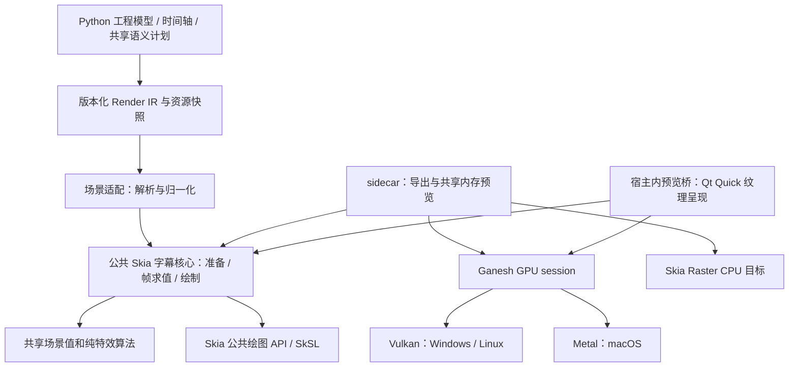

# 字幕渲染：Skia 跨平台后端架构与迁移实施计划

> 创建：2026-11-14；现状核对基线：`main` / `0c5b6264`。
>
> 状态：**实现已推进到 P04 的实验字幕闭环，生产默认仍为 D2D，完整迁移尚未完成；以逐项勾选及第 14 节证据为准。**
>
> 用户已明确目标：Windows、Linux 使用 Vulkan，macOS 使用 Metal；字幕绘制核心使用完全相同的源码；完整承接当前字幕渲染能力，最终替代 Direct2D。
>
> 用户补充：最终 CPU fallback 使用 **Skia CPU Raster**，不回退 QPainter；迁移对照为 **D2D GPU → Skia GPU**，CPU 验收对照为 **Skia CPU ↔ Skia GPU**，不建立 QPainter 画面对照。
> 文档最初建立时已清理前期 Skia 探针；当前已交付 P00 的清单和 GPU 采集工具，执行结果与未通过项见第 14 节。不得把“文档已写好”“P00 输入已采集”或“前期 OpenGL 试验通过”记作正式 Skia 后端已完成。

## 0. 接手方式与权威顺序

### 0.1 每次接手先做什么

1. 阅读 [AGENTS.md](../AGENTS.md)，执行 `git submodule status`、`git status --short`，确认当前源码和用户改动。
2. 阅读本文件的目标、职责表、阶段依赖和当前阶段；只推进依赖已满足的任务。
3. 核对实际代码与本文件的基线差异。本文描述的“当前代码”是上述提交的快照，不能覆盖后续已经完成的实现。
4. 在本文件中原地维护任务状态、实际提交、验证命令、结果和剩余问题。不要另建一套并行计划或不断追加实验报告。
5. 在当前分支开发，不创建新分支，不修改 SUG submodule 源码。发版是后续独立任务，不能因完成某个阶段就自行发版。

### 0.2 冲突如何处理

权威顺序：**用户当前明确指示 → AGENTS.md 当前约束 → 已核实的产品语义及测试证据 → 本实施计划 → 历史设计文档中的旧快照。**

尤其注意两处已经过时的历史说法：

- 旧 GPU 文档中的“G6 已停止、入口硬关闭”不代表当前状态。当前 Windows 交互会话默认启用 G6 DirectComposition，失败回退 G5。
- “CPU QPainter 永久作为正确性 oracle”不再成立。当前 GPU 是主渲染口径；布局争议仍按 `layout_semantics` 判断，不能把 D2D 的任何现状都自动认定正确。
- 当前代码仍保留 QPainter fallback，但用户已明确最终目标为 Skia Raster。本文要求在迁移完成后退役 QPainter **字幕渲染**路径；这不要求删除 Qt UI 绘图或用于展示像素的 QImage。

相关背景材料：

- [字幕渲染模块需求](字幕渲染模块-需求设计.md)
- [GPU 后端历史与 N3 逆向](字幕渲染-GPU后端逆向与实施计划.md)
- [N3 导入范围](N3项目导入兼容性与实施计划.md)
- [布局与 N3 语义](字幕布局-N3对齐改造计划.md)
- [SUG / Python 走字差异](SUG与字幕渲染模块-Python走字差异.md)
- [C++ sidecar 历史](字幕渲染核心C++化方案.md)

## 1. 最终交付与范围

### 1.1 必须实现的结果

| 维度 | 交付要求 |
|---|---|
| Windows | 原生 Vulkan 硬件 GPU 渲染；正式预览、导出和打包可用 |
| Linux | 原生 Vulkan 硬件 GPU 渲染；X11、Wayland 分别验收预览集成 |
| macOS | 原生 Metal 硬件 GPU 渲染；正式预览、导出和应用包可用 |
| 公共核心 | 字体几何、布局投影、走字、动画、粒子、装饰、图层绘制使用同一组源码；没有操作系统分支 |
| 功能 | 完整承接当前已支持的字幕能力及参数组合，不以基础文字演示替代完整迁移 |
| 兼容 | 现有 `.yurika`、`.sug`、`.lrc`、`.n3proj` 继续消费原有模型与导入规则 |
| 预览 / 导出 | 消费同一语义快照和公共绘制入口；保持同一时刻的字幕内容与布局一致 |
| 最终维护 | 三平台统一到 Skia；GPU 失败/关闭时回退 Skia CPU Raster；D2D 与 QPainter 字幕绘制路径在验收后退役 |
| 对照基线 | D2D GPU 对照 Skia GPU；Skia CPU 对照 Skia GPU；不以 QPainter 生成参考画面 |

初始硬件验收架构：Windows x64、Linux x64、macOS arm64。macOS x86_64、Linux arm64 等构建不得因“同源码”自动标为已支持；需要单独构建、打包和运行记录。若当前产品承诺了其他架构，在 P00 一并列为必须交付，不得静默缩减。

### 1.2 “一比一”是什么

**严格一致：** 项目字段解释、`legacy` / `n3_1074` 布局语义、行与假名锚点、字符和角色尺寸规则、显隐窗口、时间偏移、逐字区间、走字方向、动画阶段、粒子种子、组合图层顺序、预览与导出关系。

**完整覆盖：** 全局与逐行覆盖、角色、主副轨、上下假名、标题、导唱符、指示灯、音量柱、背景带、全部已支持的入退场 / 唱字 / 粒子 / 走字线能力。

**单独评估：** 抗锯齿、像素覆盖、模糊核和描边边缘。不能要求跨引擎每个像素机械相等，也不能用“引擎差异”豁免布局错位、缺层、缩小光晕或丢失效果。误差指标和视觉标准必须在对照前确定。

“核心同源码”不等于任意驱动上的位级像素一致，也不等于没有平台适配代码。平台代码必须被限制在设备、资源交接、同步、呈现和系统资源发现边界。

### 1.3 不在本次范围内

- 不重写编辑器、撤销系统、工程存储、SUG、N3 导入或整个 Python UI。
- 不改为 ASS/libass，不改动“离屏字幕层 + ffmpeg rawvideo”导出主方向。
- 不新增现有产品明确不支持的功能，例如 30fps 原样输出、假名独立字体、AVI。
- 假名继续沿用日文字体族，英数字体可独立；底层字体能力不能擅自扩大 UI/工程承诺。
- 不以重跑 4K 基准作为迁移任务；主要验收使用真实工程、1080p、60/120fps。
- 不为了统一后端而同步重写视频解码和音频时钟。预览宿主若需要调整背景合成，只修改呈现适配，保留背景与音频产品语义。
- 不长期维持“Windows 永远 D2D，其他平台永远 Skia”的两套功能实现。

## 2. 当前架构证据与具体改动面

以下是需要解决的已核实耦合，不是对现有 Windows 实现的泛化否定。

| 当前位置 | 当前职责 / 事实 | 迁移时的最小处理 |
|---|---|---|
| `krok_helper/subtitle_render/engine/layout/plan/` | 已有共享不可变语义计划，包含行窗口、分页、lane、时间区间等 | 继续作为宿主语义编排的事实源，不在 Skia 侧复制分页与窗口规则 |
| `engine/layout/plan/orchestrator.py`、`engine/layout/line/qt_geometry.py` | P05.3 已移除 orchestrator 对 Qt 逐字区间的隐式调用，现有调用者显式传旧 resolver；新快照端口可用 | P05.4 仍需将规范度量真正用于最终 IR，不能误认为换个 resolver 就已完成全部布局迁移 |
| `engine/render/render_ir.py`、`native/protocol.py` | IR、字体资源、角色 / 粒子 / 布局表已有去重与解析 | 复用协议入口，必要时小范围扩展并版本化；不创建另一套工程模型 |
| `native/subtitle_renderer/src/backends/qt/gpu_scene_projection.cpp` | 协议到 native 场景投影仍引用 Qt 字体、行布局和 ruby helper，不是纯字段拷贝 | 分离纯投影与旧几何兼容；P05 完成度量替换后收口；禁止 Skia 包含 Qt 后端私有头 |
| `src/model/render_types.h` | 混合场景值、后端诊断、帧结果、窗口目标等多种概念 | 按实际消费者渐进提取类型；不再给单个共享头无限追加字段 |
| `src/backends/render_backend.h` | 同时包含离屏渲染、呈现、窗口消息等接口 | 公共绘制核心不继承此接口；由薄的 sidecar 适配器兼容现有调用 |
| `src/runtime/gpu_backend_runtime.cpp` | 直接构造 `Direct2DGpuBackend`，有 WARP 专属选择语义 | 构造放到明确的后端工厂，软件设备策略与后端身份分开 |
| `src/runtime/gpu_preview_worker_pool.cpp` | 容器和共享资源逻辑直接使用 D2D 类型，不只是工厂里耦合 | 保留 D2D 旧路径；为 Skia 明确 session / 线程策略，不能只替换构造表达式 |
| `src/backends/direct2d/d2d_backend_configure.cpp` | 同时承担字体、几何、排版与多类资源装配 | Skia 从开始就分开字体、布局、素材、画笔和准备过程 |
| `src/backends/direct2d/d2d_backend_render.cpp`、`d2d_backend_internal.h` | 绘制、效果、资源、状态之间有较大共享面 | 不照搬为 `skia_backend_render.cpp` + 超大私有头 |
| `src/backends/direct2d/d2d_fx.*` | 多数粒子 / 几何 / 噪声 / 图样算法可独立；少量矩阵 API 绑定 D2D | 提取纯算法，由 D2D 和 Skia 共用，不复制出 `skia_fx` 镜像 |
| `src/backends/direct2d/native_preview_surface.*` | D3D11 / DXGI / DComp / HWND 呈现 | 限定为 Windows 旧 presenter；不把 HWND 当三平台窗口协议 |
| `native/subtitle_renderer/CMakeLists.txt` | 当前直接编入 D2D，非 Windows 直接失败 | 条件编入后端，增加公共 core / GPU / 宿主适配 target |
| `frontend/preview/preview_async.py`、`engine/renderer.py` | 预览调度、导出、回退和 native 路径选择 | 只增加能力选择与适配，保留用户时间轴、输出和取消语义 |
| Windows/macOS 构建脚本、release workflow | Windows 已收集 sidecar；macOS 尚无同等 Skia GPU 产品链路 | 明确收集库、Qt 插件、签名和运行时；补 Linux 构建入口 |

### 2.1 前期验证能说明什么

前期实验在 Windows OpenGL 上证明了 Skia GPU 路径可用；现有纯 C++ 特效核可以脱离 D2D 编译；原生字体轮廓、几何动画、粒子和烈焰图样合成可以运行。原生样例完成过 1,444 帧及倒序像素一致检查。

它没有证明完整 IR 兼容、完整布局、全部效果、Vulkan、Metal、三平台呈现、正式导出或打包。曾使用的 Aseprite Skia m124 预编译包不是正式依赖方案。Qt 绘图命令回放还包含预先生成的栅格效果，不能拿回放耗时当完整后端性能。

这些探针及专用依赖 / 产物已在本次文档任务中清理；后续从生产 target 和可维护测试继续，不依赖已删除的本机绝对路径。

## 3. 架构决策：同一核心、不同入口、明确的资源所有者

### 3.1 依赖图



箭头表示依赖 / 调用方向。`CORE` 不能依赖 `EX`、`HOST`、Qt、GPU 原生头或 IPC；纯特效算法不能反向依赖绘制器。

### 3.2 为什么不能只有“sidecar 加三个子窗口实现”

Windows 当前通过子 HWND 呈现，不能据此假设 macOS 的视图对象、Qt 对象指针或 Wayland surface 可以跨进程照传。跨进程纹理共享还涉及不同操作系统的句柄、同步和销毁协议，不能偷偷塞进字幕核心。

本计划采用两个产品入口，共用一个核心：

1. **sidecar 入口**：负责导出和 G5 型共享内存预览；拥有自己的 GPU session。先用它建立稳定的完整链路，保留进程隔离和导出故障恢复。
2. **宿主内直接预览入口**：作为 Qt Quick 原生模块加载到 PyQt 宿主，使用同一个核心，在 Qt 渲染线程上完成 GPU 纹理交接。Qt Quick 只承担呈现容器，不使用 Shapes 重写字幕效果。

两个入口不是两套效果实现。sidecar 可以选择 owned GPU 或 Raster 目标；CPU fallback 通过 Raster 输出像素到现有共享内存/像素显示容器。无需启动 Qt Quick GPU 场景图，也不调用 QPainter 字幕绘制。

宿主入口的拟定实现是一个很薄的 C++ QML 类型，由现有 Widgets 预览区域承载。只传场景快照、资源描述和时间请求，不传 Python 对象到渲染线程，不依赖 Python 每帧计算字形 / 粒子 / 图层。

**这是需要 P03 验证的设计，不是已验证事实。**

**P03.6 修订（2026-11-14，有实测证据）**：宿主内直画入口不是叠在旧 `QGraphicsView` 上的透明层，而是替换预览画布内容的一块不透明 `QQuickWidget` 画布：背景（视频经现有 Python `QMediaPlayer` 输出到 QML `VideoOutput`、图片、纯色、黑边）与 Skia 字幕在同一 Quick 场景合成，Widgets 控件正常叠放其上。原因与否决证据见 P03.6。P09.4 因此需在 Quick 画布内承接背景合成语义（contain/cover、图片序列、前黑/后黑分段与过渡），并保持与导出一致。 Qt 提供 Vulkan / Metal 纹理包装接口，不等于 Skia Ganesh 可以直接写入 Qt 当前命令缓冲。P03 必须实证设备一致性、提交顺序、image layout、同步、纹理寿命、嵌入预览、背景合成与窗口销毁；不能靠一张正确截图宣告解决。

如果 P03 证明所选公共接口在 Qt 6.11.0 下不可行，应在本文件修订宿主呈现适配设计并保留问题证据，不把平台分支塞进核心，也不把 G5 回读长期冒充 G6 同等交付。sidecar 离屏迁移可继续，最终直画验收不可勾选。

### 3.3 主要模块及所有权

| 模块 | 唯一负责 | 可以依赖 | 不能负责 |
|---|---|---|---|
| 宿主语义计划 | 源数据、时间偏移、页面 / lane、显示窗口、角色归一化、粒子 burst 规划 | 领域模型、度量接口 | GPU 设备、每帧绘图 |
| 场景适配 | JSON / Qt 配置转成经过验证的 typed scene | 协议、场景值 | 再定义分页、默认样式或效果公式 |
| 字体与度量 | 字体快照、face / axes / simulations、shaping、cluster 映射、规范度量 | 字体字节、Skia、固定的 FreeType / HarfBuzz | 枚举平台字体目录、决定页面时间 |
| 几何准备 | 行 / 字符 / ruby / 导唱符位置和不可变路径 | 语义 scene、规范度量 | 改写已经解析的时间区间、按行内容改变页级网格 |
| 帧求值 | 给定 scene 和 t，得到活跃图层、变换、裁切、粒子状态 | 纯算法、准备好的几何 | 看系统时钟、读文件、创建 GPU device |
| Skia 绘制 | 把帧状态画到给定 `SkCanvas` | 公共 Skia API、预备资源 | 创建窗口、发 IPC、选择 Vulkan / Metal |
| CPU Raster 目标 | 创建 CPU `SkSurface`、像素存储与交付 | core、Skia Raster、像素契约 | 另一套字体/布局/效果算法、GPU 初始化 |
| GPU session | context、GPU surface、上传、提交、同步、回读与 context 资源 | Ganesh 和所选原生 API | 字体 fallback、逐字时间与产品样式规则 |
| 宿主预览桥 | Qt 线程同步、纹理包装、背景叠放、时间请求与呈现 | core、GPU adapter、Qt Quick | 另一份字幕 layout / effect 实现 |
| sidecar 适配 | 现有命令、generation、共享内存、取消、诊断与 session 调度 | core、GPU adapter、runtime | 核心私有缓存和字形算法 |

### 3.4 不为“解耦”制造额外框架

- 不引入通用渲染命令虚拟机、每个 path 一个虚接口、万能 manager 或服务定位器。
- `SkCanvas` 已经是绘图边界，不再包一套与其逐方法同构的跨平台画布接口。
- 只为真实变化建立接口：度量来源、GPU session、素材读取、帧交付。普通纯函数和不可变数据不必虚拟化。
- 不同时建设 Ganesh / Graphite 两套执行模型。初期统一 Ganesh Vulkan / Metal；版本选择在 P01 锁定。
- 不复制所有旧模型。提取已有场景类型时保持一个定义，必要的过渡包含只为现有调用者服务，并记录退役条件。
- 不通过 `dynamic_cast` / backend 名称判断，让字体、效果、排版内部选择 Windows / Linux / macOS 行为。

## 4. 文件与构建边界

下面是目标职责布局，**不是要求第一天创建全部目录和空文件**。在对应阶段引入有真实代码和消费者的模块。

```text
native/subtitle_renderer/
  cmake/                         # Skia 导入、平台选源、依赖指纹
  src/
    model/                       # 共享场景值；与窗口/传输结果分离
    effects/                     # 后端无关纯算法；从既有 d2d_fx 渐进提取
    scene/                       # 协议到共享场景的投影
    backends/
      direct2d/                  # 过渡期保持可运行
      qt/                        # 迁移期旧实现，最终退役字幕绘制；不被 Skia core 包含
      skia/
        skia_backend.*           # 薄 sidecar facade，不放布局和特效公式
        core/
          scene_prepare.*        # 准备流程编排
          frame_evaluate.*       # 确定性帧状态编排
          frame_draw.*           # 图层绘制编排
          fonts/                 # face、shaping、glyph metrics / outline
          layout/                # 主字/ruby/竖排/锚点的几何投影
          paint/                 # fill、stroke、glow、shadow、clip
          elements/              # title、band、signal、scanline 等绘制组件
          assets/                # 不可变图片帧、sprite、资源标识
        gpu/
          ganesh_session.*       # 后端共同的 Ganesh surface / submit 契约
          vulkan/                # Vk context、布局/屏障/同步、拥有或借用设备
          metal/                 # .mm；设备、纹理、提交与寿命
        raster/                  # CPU surface/像素交付；调用同一 core
    preview/qt_skia/              # 宿主 QML 模块，Qt/Vulkan/Metal 纹理交接
    runtime/                     # 工厂、队列、取消、帧仓、进程级编排
    protocol/                    # JSON 和版本检查
    diagnostics/                 # 中立诊断投影
  tests/                         # 新增的 native 纯逻辑和公共核心测试
```

### 4.1 建议 target 与依赖约束

| target（拟定） | 内容 | 依赖限制 |
|---|---|---|
| `subtitle_scene` | 场景值、纯算法、通用几何数值 | 标准库；不链接 Qt、Skia GPU 或平台 SDK |
| `subtitle_skia_core` | 字体、CPU 准备、帧求值、SkCanvas 绘制 | `subtitle_scene`、Skia 公共 core/effects、字体依赖；无 Qt、Vulkan/Metal 头 |
| `subtitle_skia_gpu` | Ganesh session 与平台资源 | Skia Ganesh + Vulkan 或 Metal；不包含 UI 和协议 |
| `subtitle_skia_raster` | CPU surface、像素存储与交付 | core、Skia Raster；不能依赖 GPU adapter、Qt Quick 或 GPU loader |
| `subtitle_scene_adapter` | Qt/JSON 配置投影到 scene | Qt Core、必要的 Qt Gui 颜色/值适配、scene；不能包含具体后端私有头或执行字形绘制 |
| `subtitle_skia_backend` | sidecar 到公共 core 与执行目标的桥 | core、raster、可选 GPU、既有中立后端接口 |
| `subtitle_skia_preview` | 宿主内 QML 模块 | core、GPU、scene adapter、Qt Quick；不得链接导出流水线 |
| `krok_subtitle_renderer` | 现有可执行程序 | runtime、protocol、启用的后端；无宿主 UI 依赖 |

叶子目录不必各有独立库。target 的意义是让编译器约束依赖，而不是增加构建层级。

Skia GPU 库与 core API 可能来自同一静态包；“core 不依赖 GPU”指它不访问 GPU 原生接口、可在不初始化设备时完成准备和纯逻辑测试。构建检查不能只看链接库名称下结论，应同时检查包含路径、对象依赖和符号。

### 4.2 文件规模与入口规则

1. 一个模块按“为什么变化”划分：字体匹配变化不应要求改动画绘制；窗口同步变化不应触碰 ruby 布局。
2. `configure` 只组织“验证 → 字体/素材准备 → 几何 → 不可变 scene → 原子发布”，不内联各阶段算法。
3. `render` 只组织“选择快照 → 求值 → 图层绘制 → 提交/交付”，不解析 JSON、不枚举字体。
4. 不创建包含全部缓存、全部 helper 和所有可变状态的 `skia_backend_internal.h`。
5. 单文件约 400 行作为审视提示，超过 800 行必须记录职责为何仍内聚，或拆出有明确所有者的子模块；行数不是硬性正确性指标，禁止机械切碎函数来满足数字。
6. 私有头不跨模块引用。只有实际需要跨边界的契约放公共头；禁止为了绕开依赖规则把所有内容搬进 `common.h` / `utils.h`。
7. 新增一种粒子运动只应触及纯算法、必要规格及测试；新增一种平台 presenter 只应触及 GPU/Qt 适配及构建；新增一个产品字段才需要模型/序列化/解析等直接消费者。

### 4.3 架构检查进入测试

- 检查 core / scene / effects 中不存在 Qt、Windows、D2D、D3D、Vulkan、Metal、Objective-C 平台头和 OS 宏分支。
- 检查 core 不导入 protocol、runtime、preview、D2D/Qt 后端私有头。
- 在不同平台导出编译命令，确认 core 选用同一组源码；平台适配文件差异不算核心差异。
- 用实际编译和 target 依赖检查为主，简单文本扫描为辅；不只写会被包含链轻易绕过的正则断言。
- 架构检查失败作为持续集成失败处理，不能在每次新效果加入时临时扩大允许列表。

## 5. 数据、时间、字体与资源契约

### 5.1 三层数据，不建立第二套业务模型

1. **Render IR / 共享 scene**：完整的已归一化产品语义；来自现有宿主计划和序列化。
2. **PreparedScene**：不可变的字体 / 素材引用、字形 cluster 映射、行与 ruby 几何、静态绘制资源；不持有窗口或 `VkDevice` / `MTLDevice`。
3. **FrameState**：由 `PreparedScene + t_ms` 得到的临时可见项、变换、裁切和粒子状态；不包含 JSON，也不把每个像素动作编码成新的通用命令协议。

几何路径使用 `SkPath` 等公共对象可以直接留在 core 内。不要为避免 Skia 类型而手写另一套 path 树。GPU 纹理、surface 和 context 缓存放 session，不能藏进可跨设备复用的 PreparedScene。

### 5.2 接口形状（示意，不是已存在的 API）

```cpp
PreparedScene prepareScene(const RenderScene& scene,
                           const FontCatalogSnapshot& fonts,
                           const AssetSnapshot& assets);
FrameState evaluateFrame(const PreparedScene& scene, TimeMs t);
void drawFrame(SkCanvas& target,
               const PreparedScene& scene,
               const FrameState& frame);
```

core 不创建 device、不 submit、不 readback、不 present。调用方负责在正确 session/thread 上提供有效目标。实际实现可以合并帧求值与绘制的临时存储，接口不要求每帧分配巨大对象。

GPU 目标使用 Ganesh surface 的 canvas，CPU 目标使用 Raster surface 的 canvas；`prepareScene`、`evaluateFrame`、`drawFrame` 必须是同一份实现。任何只支持 GPU 的原生纹理或 shader 扩展都不得直接成为 core 的必需输入。

### 5.3 时间与语义不变量

- 只使用请求给出的 `t_ms` / frame index，不读取墙钟，不用“上一帧累加”决定粒子或图片帧。
- 显隐区间的端点包含规则、前黑/后黑、多轨时间偏移、pause/checkpoint 必须沿用当前权威逻辑，不在 adapter 再加一次偏移。
- 已解析的 `resolved_intervals` 是帧执行层的输入，Skia 不能按自己测得的新字宽擅自重新分配时间。
- 页级网格不能由当前行内容临时决定。ruby 和导唱符影响哪些范围，按 `layout_semantics` 和现有用户决策执行。
- layout / paint / viewport 变换顺序必须有固定契约；正文、假名、扫描线图片是否随 Utopia 变换不能凭实现方便决定。
- 预览缩放只改变约定的逻辑/物理投影，不偷偷改字号基准、粒子速度、时间轴或导出结果。

### 5.4 字体和度量：先保兼容，再消除隐式平台差异

字体进入核心时应已解析为内容标识，而不是让每个平台再次凭 family 字符串猜一个 face：

```text
FontResourceId = 字体内容摘要 + face index
FontInstanceId = FontResourceId + 规范化 axes + simulations + shaping 配置
GlyphRun       = glyph ids + positions + clusters + 原歌词单元映射
```

- 继续复用当前 OpenType 字体快照机制；保留 face、字重、模拟粗斜体、轴值、fallback 原因等信息。
- 统一采用锁定版本的 FreeType / HarfBuzz 路径处理规范度量和复杂文本；平台字体发现只负责生成资源快照。
- 不用 `SkFont::textToGlyphs` 的逐码点映射充当完整 shaping。覆盖组合字符、连字、variation selector、emoji 序列、韩文与混合角色；走字仍必须映射回项目的歌词单元。
- 不全局启用 / 禁用连字来“看起来差不多”；用现有字幕单元和语义决定 shaping 边界，并测试跨角色 / 跨计时单元的行为。
- 字体不存在时保留用户可解释的 fallback；同一字体文件存在的三平台必须使用同一字体实例。不能承诺未安装同一字体时画面自动一致，也不能擅自分发系统商业字体。
- 不按 `wchar_t` 长度或单个 UTF-16 code unit 推进字符；Windows 和 Unix 的宽字符大小不同。协议使用明确 UTF-8，内部 cluster / scalar 单位必须命名清楚。

当前宿主语义计划中有 Qt 字宽参与时间区间和页面偏移计算。P05 的顺序必须是：

1. 先用既有共享计划作为基线，隔离度量读取点，不重写时间与分页规则。
2. 在 core 提供无需 GPU 初始化的**批量度量能力**：输入字体实例、文本单元、样式和语义版本，输出 ink/advance/baseline/cluster 等值与字体指纹。
3. 由配置层一次性取回 `LayoutMetricSnapshot`，缓存后注入宿主共享计划；扩展当前仍直接调用 Qt 测量的入口。
4. 用同一份度量生成已解析区间和布局语义，再序列化最终 IR，准备 native scene。不能先画一帧再反向修时间。
5. sidecar 导出与宿主内预览使用同一度量实现和快照签名。配置期允许批量往返，播放热路径禁止逐字符 IPC 或 Python 度量。
6. Skia CPU 与 GPU 共用 native 度量和 PreparedScene；没有 GPU 也必须能启动度量与 Raster。Skia native 组件缺失或 ABI 不匹配应作为安装/加载错误明确报告，不能在最终产品中悄悄改走 QPainter 或 Qt 字体度量。

这里新增的是一个度量提供边界，不是第二套分页器。若因兼容校准仍需 Qt 度量作为参考，应记录过渡项、准确作用范围和移除门槛，不能把平台差异藏在 core 中。

### 5.5 像素、颜色和素材

- 内部约定一个显式 RGBA / premultiplied 表示及颜色空间；初始采用与现有产品相符的 SDR/sRGB 输出语义，不顺手迁移整套线性光合成。
- BGRA / RGBA、straight / premultiplied、上下方向、stride、DPR、裁切范围均是显式元数据，不根据平台猜测。
- 转换只发生在素材入口、GPU 目标适配、共享内存或编码出口；不能每个元素各做一次不一致的 unpremultiply。
- 0 alpha 的 RGB、细描边、半透明发光、PNG 和两种透明 MOV 都要专项检查。播放器黑底不代表 alpha 导出错误。
- 动画素材的帧选择使用项目时间及素材帧时长，支持随机 seek；首次解码、磁盘读取和大尺寸重采样不得出现在每帧绘制函数。
- Python 负责当前路径解析 / `preset:` 语义，native 素材读取边界消费规范化资源标识及路径，不自行再定义工程目录回退规则。
- 可以保留小尺寸原生 CPU 图样生成后上传的方式；“GPU 后端”不要求所有 CPU 准备都改成 shader。必须报告生成 / 上传成本，不能退回整帧 QPainter 后仍标为完整 GPU 迁移。

## 6. GPU session、并发、缓存与失败处理

### 6.1 设备选择与所有权

- Windows/Linux 只创建 Vulkan Ganesh context，macOS 只创建 Metal Ganesh context。OpenGL、MoltenVK、SwiftShader 不计入本计划的硬件 GPU 验收。
- sidecar session **拥有**设备和提交队列；宿主预览 session 在 P03 验证后**借用** Qt 所在设备及兼容队列。两种所有权必须使用不同构造入口 / 明确类型，不能依靠析构时猜测。
- 不能把 session A 创建的 GPU `SkImage` / surface 随意交给 session B。只有 CPU 路径和素材字节等明确可共享的资源可以跨 session 复用。
- 宿主内预览不自行创建另一个设备后把 texture handle 交给 Qt。若确需不同设备，必须有经过验证的显式共享协议，不能作为默认路径。
- Vulkan image 的 layout、queue family、使用范围、release/acquire 和 semaphore/fence；Metal texture 与 command buffer/queue 的使用顺序，都由 GPU/Qt 适配层负责。
- 原生 texture 的包装对象与底层 texture 分别拥有生命周期。Qt 纹理 wrapper 被销毁，不意味着底层 GPU 对象自动安全释放。

### 6.2 单 owner 线程起步

第一版每个 session 只有一个 GPU owner 线程。CPU 字体 / 几何 / 素材准备可以并行，但只能发布不可变结果，不能从准备线程调用同一个 Ganesh context。

不要直接把当前“多个 D2D backend + shared device resources”照搬成多个 Ganesh context 共用一个未同步队列。第一版优化依次是：缓存准备、减少重复绘制、有限在途帧、异步回读；只有测得瓶颈后才增加多 session，并证明设备资源和队列同步正确。

runtime 队列拥有任务生命周期和取消策略；session 拥有 GPU 对象；core 不拥有 worker 池。不得在 Skia 后端内部再创建一个外层 runtime 不知道的无限任务池。

### 6.3 配置发布和帧身份

帧至少关联：

```text
execution_target + execution_epoch + scene_revision + resource_revision + device_epoch
+ request_generation + t_ms + frame_index + viewport_revision
```

- 字段分别表达配置、素材、设备和请求身份，不用一个不断变化的整数代替全部概念。
- GPU → Raster 切换时推进 execution epoch，丢弃不匹配执行目标的缓存/迟到帧；Raster 的 device epoch 明确标为不适用，不能与仍在途的 GPU 帧混淆。
- `configure` 准备在旁路完成，通过验证后原子发布；失败保留上一份有效 scene 或明确失败，不发布半初始化对象。
- paint-only、geometry、font、asset、viewport 更新的失效范围分开。改变颜色不得必然整轨排版；更换字体也不能沿用旧字形缓存。
- 准备结束时重新检查 revision/generation，已被新配置淘汰的结果不可覆盖当前 scene。
- 呈现必须检索指定身份和时间的帧，不能“仓里没有就拿最新纹理顶上”。取消后的迟到帧不得重新上屏。
- sidecar generation 与宿主 presenter 的帧身份语义保持一致；不要求两种入口共享实际 GPU 资源。

### 6.4 每种缓存都要有主人和预算

| 缓存 | 所有者 | key 至少包含 | 失效 / 回收原则 |
|---|---|---|---|
| 字体实例 / shaping | 字体模块 | 内容摘要、face、axes、simulations、文本、方向、shaping 配置 | 字体注册/移除、内容或配置变化；有界 |
| 规范度量快照 | 配置层 | 字体指纹、文本单元、样式、语义版本 | 只供匹配的布局计划复用 |
| 布局 / 几何 | scene prepare | 语义计划签名、字体度量、逻辑尺寸、相关装饰几何 | 不因纯颜色变化失效；实际字体变化必须失效 |
| CPU 素材帧 | asset 模块 | 资源身份、内容/变更签名、帧号、解码参数 | 有界 LRU；动态图片不能每个 t 各存一张 |
| GPU 上传 / 画笔 / 中间层 | session | device epoch、素材/paint revision、目标约定 | context 内有效；resize 与 device lost 定向清理 |
| 可呈现帧仓 | 交付/presenter | 完整帧身份、目标大小和像素约定 | 固定容量、租约 pin；GPU 使用完成后归还 |

必须同时统计 Skia 自身 cache 和应用分配的纹理 / 中间层，避免只限制 Skia cache，却让外部 texture 无限增长。共享计数时标明是否存在重复计量。

**pin 不等于不可管理：** 缓存满且全部对象暂被在途帧引用时，执行有界背压 / 减少预读 / 丢弃过时预览请求；导出等待有界可回收槽。不能永久持锁重试逐出，也不能把一个永远无法逐出的 dead key 留在队头，使整个渲染器逐渐楔死。

每帧不应增长的计数必须纳入长时间测试：glyph 数、paint 数、upload 数、scratch 数、在途帧、未完成租约。不能只检查内存是否低于某个巨大上限。

### 6.5 销毁和恢复顺序

正常关闭：

1. 停止接收请求、取消未开始任务、使当前 generation 失效。
2. 在正确线程停止 presenter 消费，解除 Qt 回调，等待有界的交付 / GPU 完成条件。
3. 释放帧租约、Qt texture wrapper、render target、GPU 素材和 scratch。
4. 释放 Ganesh context。
5. 仅对拥有的 device/queue 执行销毁；借用的 Qt device 不得释放。
6. 释放 CPU scene/asset/font 快照；停止并回收 worker；最后销毁所属 Qt 对象和窗口。

Qt scene graph invalidation、窗口隐藏/重建、DPR 切换和设备丢失都是正式状态转换，不能只在进程退出时处理。

- sidecar GPU 卡死：沿用心跳、超时、终止进程与有限重试；不能无限重启。
- 宿主内 GPU 桥故障：可恢复错误转回 shared-memory / CPU 路径，明确记录原因。原生崩溃或驱动在调用内永久挂住并不保证能在进程内恢复。
- **进程隔离取舍必须记录：** 宿主内直画会使这条路径的 native 故障影响主程序，不能宣称仍保留 sidecar 的全部崩溃隔离。P03 必须评估；不可接受时需要另行完成跨进程 GPU 交付设计，不能掩盖风险。

### 6.6 诊断字段

至少报告：编译版本、Skia revision / build fingerprint、后端族、执行目标 `gpu|raster`、实际 GPU API（Raster 为无）、硬件/软件设备、适配器/驱动、owned/borrowed、core/IR/资源语义版本、字体来源、fallback 原因、帧身份、队列长度、丢帧、缓存命中/逐出、GPU/CPU 内存、准备/求值/绘制/提交/回读/IPC/呈现耗时。

渲染目标回退原因与缺字字体回退原因使用不同字段和所有者；不能用一个 `fallback=true` 混淆“仍在 GPU 但换了字体”和“已转 CPU Raster”。

区分 CPU 记录时间和 GPU 实际完成时间。硬件验收不允许以软件设备、fallback 或 `skip` 冒充通过。

### 6.7 最终回退链：Skia GPU → Skia CPU Raster

1. 用户关闭 GPU，或 GPU API/设备不可用时，选择 Skia Raster。发生可恢复 GPU 错误时，按有界策略重建或转 Raster，保留相同 scene、t 和输出格式。
2. Raster **不是软件 Vulkan / WARP / SwiftShader**，不创建 Ganesh GPU context。CPU-only 构建必须能在没有 Vulkan SDK/loader/驱动或 Metal device 的环境运行全部字幕效果。
3. GPU 模块使用可选加载或其他经实测可行的依赖隔离；不能让进程因为强制导入缺失的 `vulkan-1.dll` 等 GPU 库而在进入 CPU fallback 之前退出。
4. 所有效果都使用 CPU/GPU 共用的 SkCanvas/SkSL/图像滤镜能力；P01 和 P07 检查所选 Skia 构建中的 Raster/RuntimeEffect 能力。不得为 CPU 再复制一套特效公式。
5. PreparedScene 保存可被 Raster 消费的路径、字体与素材来源，不只保留 GPU texture。GPU 缓存失效不应使 CPU 没有可画素材。
6. GPU 不可用的预览使用 Raster 像素显示路径，可由 QImage 承载结果；QImage 是帧容器，不负责生成字幕。不得因 Qt Quick 也无法初始化 GPU 而使 fallback 失效。
7. CPU 与 GPU 共享时间轴、随机种子和配置失效规则。CPU 运行较慢时通过有界降频/丢弃过时预览请求处理，不能省略粒子、发光等效果；导出允许变慢但必须完整。
8. CPU/GPU 同场景的数值语义必须一致；画面按第 10 节的边缘/blur 容差验收。Raster 性能单独统计，不能拿它冒充 GPU 通过。
9. 原生 CPU 组件自身无法加载不是“无 GPU”。最终应给出明确中文诊断，修复包/依赖问题，不保留隐藏的 QPainter 第二回退。

## 7. 阶段依赖与里程碑

```text
P00 功能与对照基线
  -> P01 可复现依赖/三平台最小 GPU 与无 GPU Raster
  -> P02 公共类型/纯算法/生产边界
  -> P03 三平台最小宿主纹理交接（高风险早验证）
  -> P04 正式 IR -> sidecar -> GPU/Raster 预览/导出最小闭环
  -> P05 字体、规范度量、完整布局
  -> P06 完整基础绘制
  -> P07 全部动画/走字/粒子
  -> P08 标题/导唱/背景带/多轨组合补齐
  -> P09 正式直接预览与宿主集成
  -> P10 全格式正式导出
  -> P11 稳定性/性能/架构验证
  -> P12 打包、切换与 D2D 退役
```

P01/P03 的“某平台无法验证”要标注具体原因，允许继续不依赖它的公共功能，但不能关闭该平台的门槛，也不能在 P12 宣称三平台完成。P05 不通过，不应通过调整图片误差阈值硬推进后续效果。

| 里程碑 | 含义 | 不能据此宣称 |
|---|---|---|
| M0：P01–P03 | GPU API 和模块/宿主边界具备可行证据 | 完整字幕后端已完成 |
| M1：P04–P06 | 真实工程静态与基础走字链路稳定 | 全部动画兼容 |
| M2：P07–P08 | 完整绘制能力和组合样例覆盖 | 三平台产品体验、稳定性已通过 |
| M3：P09–P11 | 正式预览/导出/长时间运行通过 | 可以忽略打包和升级兼容 |
| M4：P12 | 三平台包验证并达到退役条件 | 未验收的架构或设备也支持 |

## 8. 可逐步执行的任务清单

每个任务完成时记录实际代码/测试位置和验证结果。阶段回退首先恢复后端选择或对应适配，不撤销无关产品改动。

### P00：功能与参考基线

**目的：** 明确“全部能力”是什么，避免迁移越写越偏。

- [x] P00.1 核对当前提交后的变化，更新第 2 节证据位置。
- [x] P00.2 以第 9 节为初始矩阵，枚举实际模型字段、属性入口、IR、D2D 分支与已有测试；列出不能遗漏的组合。
- [x] P00.3 从现有 corpus、回归 fixture 和可合法存储的真实工程中建立固定样本。敏感工程只记录本地执行方式，不提交用户媒体。
- [x] P00.4 固定字体内容身份、素材身份、画布、帧率、时间点和预览缩放，保存 D2D 基线图和几何/时间诊断；基线产物放测试产物目录，不把大批图片塞进源码。
- [x] P00.5 区分“D2D GPU 既有行为与产品语义的分歧”“N3/legacy 语义问题”“迁移新回归”；不生成 QPainter 参考图；已知差异建成命名用例。
- [x] P00.6 定义静帧、连续片段、随机 seek、全格式导出和长时间运行集合；确认没有加入用户已明确不做的 4K 补测。

**交付物：** 原地补全的能力矩阵、可复用 fixture / corpus 入口、版本化比较结果格式。

**门槛：** 每项已支持能力都有验收入口；没有以“复杂效果以后再说”省略功能。此阶段不改变生产默认后端。

### P01：依赖锁定与三平台最小硬件 GPU

**目的：** 把生产依赖、GPU 能力与 OpenGL 试验分开。

- [x] P01.1 选择同时具备所需 Ganesh Vulkan / Metal / RuntimeEffect 能力的官方 Skia revision；锁定 commit、依赖 commit/hash、编译器、SDK、GN 参数、CPU 架构和运行时。固定官方 m150 `29d30fe30aa2e86c44302297d063dd3190c2c880`，详见 `native/subtitle_renderer/skia.lock.json`。
- [x] P01.2 建立机器可读依赖锁和统一构建驱动 `scripts/build_skia_renderer.py`。下载包与 GN/Ninja 二进制分别校验 SHA-256，源码使用固定 Git commit；DEPS 校验上游 Git blob，避免 CRLF/LF 差异。仅显式导入四个 complete_static_lib 归档。
- [x] P01.3 Windows 固定 clang-cl 21.1.8 + 产品构建树使用的 MSVC 14.50.35717 STL/SDK + `/MD`；SDK 10.0.26100.0，兼容 Qt 6.11.0 的 MSVC 动态运行时策略。P01 的目标不链接 Qt；跨 Qt 对象边界与宿主模块 ABI 仍须在 P03 实测。
- [x] P01.4 CMake 以 `KROK_BUILD_LEGACY_SIDECAR` 控制原 Windows sidecar，保持原 Windows 默认构建；Skia 通过 `KROK_BUILD_SKIA` 独立启用，core、GPU、Raster 分开。仅 Metal target 启用 Objective-C++。
- [ ] P01.5 Windows/Linux owned Vulkan、macOS owned Metal 已实现并完成相同场景的绘制/回读；Windows 为真硬件，Linux 为 llvmpipe，macOS 两种架构为 Apple Paravirtual。Linux/macOS 真机硬件验收仍待完成，不关闭平台门槛。 macOS arm64 真硬件已通过（2026-11-14，Apple M4 Pro / macOS 26.6.2，见 §14.6）；Linux 原生硬件 Vulkan 仍待验证。
- [x] P01.6 增加实际 API/adapter/driver/软件设备诊断；Windows 真硬件通过，Linux CPU Vulkan 与 hosted 虚拟 Metal 在要求硬件时均正确拒绝，不做整帧 fallback。
- [ ] P01.7 三平台相同小样例已执行，构建/软件/虚拟/硬件结果分别记录；Windows 硬件通过，Linux/macOS 尚缺真机硬件结果，见 §14.5/§14.6。 macOS arm64 真硬件已通过（2026-11-14，Apple M4 Pro / macOS 26.6.2，见 §14.6）；Linux 原生硬件结果仍缺。
- [x] P01.8 增加 build fingerprint；依赖/参数变化必须使缓存失效；Windows Vulkan、CPU-only 与 Linux CPU-only 已完成干净构建/缓存复用；native 头变化强制全清。其余平台构建结果继续单独记录。
- [x] P01.9 Raster 目标调用同一 core；Windows/Linux CPU-only 已实际运行。Windows 两种构建中的 Raster 均在指定不存在的 Vulkan loader 时通过，GPU 同条件明确失败；RuntimeEffect/滤镜、Unicode 字体/输出路径、重复帧通过。后续完整字幕能力的 Raster 验收不由此关闭。

**交付物：** 可重复构建入口、锁定依赖、owned GPU session、Raster 目标、正式测试 target 中的 GPU/CPU 冒烟。

**门槛：** 本机 Windows 真正 Vulkan 成功；Linux Vulkan / macOS Metal 有明确运行状态；不能把 `MakeGL` 或旧 Aseprite 包结果用于通过本阶段。

### P02：公共类型、纯算法与生产入口边界

- [x] P02.1 按实际消费者分组 scene、字体/素材、paint、粒子、窗口、像素与诊断类型；删除旧总括头并更新所有消费者。28 个既有模型定义的字段/顺序/默认值不变；能力类型仅追加 API/执行目标字段。
- [x] P02.2 提取 `scene/paint_projection`、`style_projection`、`line_layout_projection`，由旧 adapter 实际调用；不包含 Qt backend 私有头。字体/ruby 测量和兼容编排留在旧 adapter，P05 后收口。
- [x] P02.3 `effects` 拥有确定性几何、噪声、粒子族、扫字线图样和图片装饰，命名空间中立；`d2d_fx` 仅保留原生矩阵转换。D2D 与 Skia core 的能力场景调用同一粒子求值实现。
- [x] P02.4 独立 `subtitle_scene`、`subtitle_scene_adapter`、`subtitle_session_runtime`、`subtitle_skia_backend`；递归包含检查、实际 CMake code model 和无 Qt/Skia 的 Linux 编译检查边界。
- [x] P02.5 类型化 `Direct2DOptions` / `SkiaOptions` 工厂及 `BackendSelection`；WARP 只属于 D2D，Skia 使用明确 GPU/Raster 目标。D2D 仍调用原构造器并保留原 worker/共享设备/预热策略。
- [x] P02.6 单 owner 创建/调用/销毁，1 个未完成任务额度、拒绝过量提交；复用取消/发布与准入规则。测试取消、异常后额度恢复、1,500 次连续任务、并发关闭和初始化失败。
- [x] P02.7 `SkiaBackend` 只桥接能力/诊断与 owned session，不包含布局/特效公式。字幕 configure/render 明确报 P04 未实现；不复用 D2D 私有预热方法，不伪装 fallback 成功。
- [x] P02.8 D2D 已按匹配工具链干净重建；129 场景 600 张前后参考帧逐像素一致，135 项协议与 6 项 D2D GPU 回归通过。原有乱序回访微差仍未豁免，详见 §14.7。

**门槛：** D2D 行为不回归；纯算法不依赖 Qt/D2D；Skia core 的依赖检查开始生效；runtime 不要求 Skia 提供 D2D 私有预热和共享资源方法。

### P03：尽早证明宿主 GPU 呈现边界

**目的：** 不等完整效果迁完才面对跨进程窗口和 GPU 互操作问题。

- [x] P03.1 在 Qt 6.11.0 原生 SDK 构建一个最小 Qt Quick 模块，确认 PyQt 宿主可以加载；补齐现有只安装 qtbase 的构建入口所需 Qt Quick 模块。Windows x64 已验证：`build_skia_renderer.py --qt-root` 构建 QML 模块 `Krok.SubtitleSkia`（`SkiaSubtitleItem : QQuickRhiItem`，MODULE 插件，QRhi 经 `Qt6::GuiPrivate`），PyQt6 6.11.0 宿主加载通过（`tests/test_subtitle_skia_preview.py`）；Qt 身份只进入本项目 native 指纹，不触发 Skia 重编；冒烟脚本补装 `qtdeclarative`。Linux gcc_64、macOS arm64/x64 的 Qt 6.11.0 SDK 构建及 PyQt 加载现已复验，详见 §14.8；Linux 真硬件门槛仍保留。
- [x] P03.2 在创建任何 Qt Quick 窗口/控件前选择 Windows/Linux Vulkan、macOS Metal；检查实际 `graphicsApi()`，拒绝悄悄使用 Windows 默认 D3D 或 OpenGL。宿主侧 `frontend/preview/quick_graphics_api.py` 负责选择与校验；`SkiaSubtitleItem` 在渲染线程按 `QRhi::backend()` 判定并经 `graphicsBackend` / `graphicsBackendAccepted` 回报，不接受时不绘制。实测（Windows x64，PyQt6 6.11.0）：`createWindowContainer` 内的 `QQuickView` 实际运行 Vulkan，`QVulkanInstance` 由 Qt 自行创建（PyQt6 未暴露该类，宿主无需创建）；强制 D3D11 时组件与宿主均拒绝。macOS Metal 与 Linux xcb/Wayland Vulkan 均已复验（§14.8）。Linux 还需在任何顶层 Widgets/Quick 窗口创建前请求 swap interval 0；设置责任在启动适配层，不在字幕 core。
- [x] P03.3 用 Skia 在同设备可用纹理绘制透明移动图样；实现 Vulkan / Metal 各自的设备借用与纹理包装，公共图样绘制代码不变。**Vulkan 已完成（Windows x64 实测）；Metal 已实现（`skia/gpu/metal_borrowed.*`，借用 Qt 的 MTLDevice/MTLCommandQueue 包装 MTLTexture），CI 托管 Mac（虚拟 Metal，arm64/x64）与真机 Apple M4 Pro 绘制检查均通过。** 设备所有权定为“Skia 借用 Qt 的设备”：`skia/gpu/vulkan_borrowed.*`（无 Qt 依赖）以 Qt 的 instance/device/queue 建 Ganesh context，**不声明任何可选特性与扩展**，Skia 只用核心 Vulkan，从而不依赖 Qt 未公开的设备启用集；所有调用在 Qt 渲染线程，与 Qt 同队列同线程提交。`SkiaSubtitleItem` 每帧包装 `colorTexture()` 的 VkImage，绘制 core 的 `drawMotionProbe`（仅依赖请求时间），提交并转到 `SHADER_READ_ONLY_OPTIMAL` 后 `setNativeLayout` 通知 Qt。实测透明图样正确合成在 QML 黑底上（覆盖 21%，400ms 两次截图变化 35%），无 CPU 回读。同步正确性的验证见 P03.4/P03.5。
- [x] P03.4 证明 GPU 提交顺序。Ganesh 若使用自己的命令缓冲，必须建立与 Qt sampling 的明确顺序；不得照抄 Qt 原生例子就假设 Skia 也写入 Qt 当前 command buffer。**Vulkan 已证明（Windows x64）；Metal 依据 Qt 6.11.0 `qrhimetal.mm`：帧命令缓冲区在 `endFrame()` 才 commit、全文件无显式 enqueue，Skia 在 `render()` 内 commit 必先入队；Qt 纹理为 Private 存储、默认 tracked hazard tracking，Metal 自动排序写后读；真机 Apple M4 Pro 上预览画面正确且随时间更新。** Skia 不写入 Qt 的 command buffer，而在 `render()` 内用自己的 command buffer 立即提交到同一 VkQueue，Qt 本帧采样该纹理的命令在帧末才提交，提交顺序天然在后。显式依赖由 Skia 自身的 barrier 建立（读 m150 源码确认）：flush 末尾转 `SHADER_READ_ONLY_OPTIMAL` 时 dstStage=`FRAGMENT_SHADER`、dstAccess=着色器读，覆盖其后 Qt 的片段采样（RAW）；下一帧按 Qt 报告的布局包装，转回颜色附件的 srcStage=`FRAGMENT_SHADER`，等待上一帧采样完成（WAR）。Qt 记录的布局与实际一致，故 Qt 不再插入冲突的转换。
- [x] P03.5 验证 Vulkan layout / queue family 与屏障、Metal 队列顺序和 wrapper 寿命；启用可用的验证层，处理所有同步/lifetime 错误。**Vulkan 已验证（Windows x64，Vulkan SDK 1.4.363.1）；Metal 在 CI 托管 Mac 上以 `MTL_DEBUG_LAYER=1` 运行预览测试通过（虚拟设备与真机 Apple M4 Pro 均通过）。**Metal 调试层生效已有正面对照**：`krok_metal_validation_probe` 在计算编码器上以越界偏移绑定缓冲区——只有验证层的 `MTLDebug*` 编码器代理检查该参数；`test_metal_preview_under_active_api_validation`（`KROK_METAL_VALIDATION=1`）要求探针不开层时正常退出、开层后被 `MTLDebug*` 断言中止，再在同一环境（错误为 assert 模式）运行绘制预览。CI 两种架构及干净机器复验均通过（[43563309723](https://github.com/karaoke-studio/karaoke-studio/actions/runs/43563309723)）。首版探针用零尺寸纹理，CI 证明 Metal 框架无论是否开层都会拦截（`MTLTextureDescriptorInternal`），不能作为对照，已替换。 Khronos 验证层（Core、Synchronization、Object lifetime、Thread safety）下运行 120+ 帧并中途 resize 重建纹理：零同步冲突、零 lifetime 错误；Skia 自持设备的冒烟同样零告警。测试屏蔽第三方隐式层（`VK_LOADER_LAYERS_DISABLE=~implicit~`），并以验证层的 `CURRENT-VALIDATION-ENABLED`（含 Synchronization）为正面对照（`tests/test_subtitle_skia_preview.py`，`KROK_VULKAN_VALIDATION=1` 时运行）。唯一报告的 `VUID-VkImageCreateInfo-initialLayout-12478` 经 API dump 归属于 Qt 6.11.0 QRhiVulkan 自己以 PREINITIALIZED+OPTIMAL 创建的 `QQuickRhiItem` 颜色纹理（用途 COLOR_ATTACHMENT|SAMPLED|TRANSFER_SRC|TRANSFER_DST，尺寸随组件），Skia 只包装不创建；测试按精确 VUID 列为 Qt 侧已知项，其余任何报告均失败。API dump 层挂载时进程退出阶段曾段错误，未挂载时均正常退出，暂记为调试层自身问题。
- [x] P03.6 在实际 Widgets 预览容器测试透明字幕、视频/静态背景、黑边、裁切、旋转、缩放、鼠标事件与布局层叠；不要只测独立窗口。**Windows 已验证；Mac（CI 43570585410，arm64/x64）视频、静态图与裁切均通过；WSLg 的显式 xcb/Wayland 也通过。** CI/验收脚本在隔离环境安装 `imageio-ffmpeg==0.6.0`，因此不再以缺少系统 ffmpeg 跳过 Mac 视频项。 结论：直画预览是**一块不透明的 Quick 画布**（`QQuickWidget`，正常层叠），黑边、背景与 Skia 字幕都在其中合成，悬浮播放窗的标题栏/传输条等控件照常叠在其上；画布 `WA_TransparentForMouseEvents`，输入落到下层面板，现有视频交互过滤器不变。视频仍由**现有 Python `QMediaPlayer`** 经 `setVideoOutput` 输出到 QML `VideoOutput`，播放器与时钟不重写。被否决方案及证据：在旧 `QGraphicsView` 上叠透明 `QQuickWidget`——正常层叠时透明处变黑、挡住背景；`WA_AlwaysStackOnTop` 时透明正确但盖住同窗口所有控件（实测 170/320 被盖），且 `setMask` 不生效（197/320）；`createWindowContainer` 的原生子窗口在 Windows 不能半透明叠在父窗口内容上。实测（真实 `PreviewPlayerWindow`）：Vulkan 下 4:3 视频 contain 加黑边、半透明字幕叠在播放中的视频上、传输条在上且命中正确。`tests/test_subtitle_skia_preview.py::test_quick_canvas_composites_background_and_subtitles_under_widgets` 覆盖静态图、溢出裁切（等同 KeepAspectRatioByExpanding）与 Python 播放器驱动的视频。旋转：预览容器本身不旋转；字幕视口的缩放/旋转/偏移属于 core 绘制（P06/P08），不在宿主层。图片序列、前黑/后黑分段与透明度过渡留给 P09.4；DPR/隐藏/重建已在 P03.7 补验。
- [x] P03.7 测试实际渲染循环、隐藏/重建、resize、进程内模拟 DPR 变化、scene graph invalidation 和关闭；选定生命周期流程的资源在创建线程释放。Windows、WSLg 双窗口系统、macOS arm64/x64 CI 均通过（§14.8）。QQuickWidget 实际在 GUI 线程渲染；QQuickView 的 basic/threaded 对照分别核对线程。隐藏保留 Qt device、释放场景图及 Skia 借用资源；完整设备释放通过关闭并重建整个宿主验证。同一存活 QQuickView 强制销毁并恢复 QRhi 的探针仍有同步错误，未验收；后续设备丢失恢复按 P09/P11 继续验证。
- [x] P03.8 在 WSLg 分别强制 `QT_QPA_PLATFORM=xcb` / `wayland`，断言子进程实际平台名，各完成图像/视频/生命周期与 Vulkan 同步验证。使用真实窗口系统，不使用 Xvfb 代替 Wayland。当前设备为 llvmpipe 软件 Vulkan，不能关闭 P01 的 Linux 真硬件门槛。默认 FIFO 下的隐藏重现卡住及启动前配置条件见 §14.8。
- [x] P03.9 已记录宿主内故障影响范围与工程选择（§14.8）：继续宿主内直画，同时保留 sidecar 的导出/隔离入口。P09 必须提供初始化失败回退及可选 G5/Raster 显示路径；不能宣称 Python 异常处理可恢复 native 崩溃或在驱动内永久阻塞。生产切换仍受 P09/P11/P12 门槛约束。

**门槛：** 核心无平台分支；实际 API 与要求一致；字幕目标正常路径不回读 CPU、不经整帧 QImage 交付；同设备纹理交接和销毁有证据。这里的“零回读”只指字幕呈现链路，不自动承诺视频解码全程零拷贝。

### P04：真实 IR 到 sidecar 的最小闭环

- [x] P04.1 独立 Skia sidecar 复用 schema 3、configure / frame / diagnostics / cancel 与 ring；启动后先做版本化选择。无效 schema、未知 `required_features`、缺失导唱符引用显式失败，失败配置保留上一有效场景。
- [x] P04.2 `PreparedScene` 准备真实字体路径，GPU/Raster 调用同一 `draw`；已实现静态实色与基础走字。限 legacy 单行居中底对齐、可打印 ASCII、静态字体快照；其他布局、shaping、描边、装饰、注音和动画明确拒绝，详见 §14.9。
- [x] P04.3 实现 RGBA straight / BGRA premultiplied、sRGB、top-left 和 stride 元数据，复用 ring 的 generation/frame/slot 检查。Unix 使用 Qt POSIX native IPC key，解决 Mac 默认 System V 分配限制；含 1080p 单帧及短导出验收，未补 4K。
- [x] P04.4 测试真实保存并重新加载的 `.yurika` + LRC 简单场景，经项目控制器/加载器、正式 IR、G5 预览和原有 ffmpeg 导出器输出 1.5 秒 MP4。是自动化生成的受支持工程，不代表已有完整歌曲工程已兼容。
- [x] P04.5 诊断和导出日志报告实际 API、设备、硬件标记、请求/实际目标及 fallback 原因；`fallback=none` 初始化失败直接失败。
- [x] P04.6 启动声明 backend、IR schema、selection version、编译执行目标、profile 和像素格式；客户端确认后才发送 `select_backend`，旧 sidecar 不进入配置。
- [x] P04.7 D2D 保持默认。Skia 使用独立可执行文件/解析入口和实验环境开关；预览/导出仍尊重现有 GPU 勾选，Skia 会话关闭 GPU 选择 Raster。
- [x] P04.8 相同 IR 完成 GPU/Raster 随机 seek、RGBA/BGRA、透明度和输出对照；Vulkan loader 注入失败、CPU-only 请求 GPU、产品 G5/MP4 的关闭 GPU及初始化失败均覆盖，不调用 QPainter 字幕绘制。

**门槛：** 在产品实际调用路径里成功，而非另一个绕过前端、协议、资源解析和导出器的 demo。

### P05：字体、规范度量与完整几何

- [ ] P05.1 实现字体内容身份、face/axes/simulations 和 fallback 资源消费，覆盖应用内注册字体和本地化 family 名称。字体实例、度量资源和单行绘制已消费显式资源；完整槽位/fallback 绘制与字体校准尚未完成，见 §14.10/§14.11。
- [ ] P05.2 实现 shaping 与歌词单元 / ruby checkpoint 的 cluster 映射；覆盖 CJK、Latin、韩文、emoji、组合字符和缺字。歌词单元 UTF-8 cluster、显式 fallback 度量和矢量字形绘制已接入；ruby checkpoint、完整 emoji 和绘制回退链待完成。
- [x] P05.3 提供不需要 GPU 初始化的批量度量；为宿主计划引入可注入的度量快照，解除 orchestrator 对 Qt 度量的隐式直连。原调用者显式传旧 resolver，正式 Skia IR 的规范度量切换仍属 P05.4，见 §14.10。
- [ ] P05.4 保留同一份时间/分页/窗口规则；用规范度量重新生成最终 IR，不让 native 再重分配 resolved intervals。legacy / n3_1074 单行及多行固定网格已接通，复用共享计划并校验最终几何/区间；完整避让布局和 D2D 画质验收仍未完成，见 §14.11/§14.13/§14.15。
- [ ] P05.5 横排、角色混排、主字/英数字体、stretch、粗斜体、字间距、空格、AllowBiting、N3 边距逐项对照。主字/英数独立实例见 §14.12；单行锚点与轮廓精度见 §14.13；行内角色字体和实色子集见 §14.14。完整 N3 布局、角色复杂外观与严格画质门槛仍待完成。
- [ ] P05.6 完成上/下 ruby、reading parts、空 pause、checkpoint、对齐、锚点、角色假名和 lower ruby 跟随规则。
- [ ] P05.7 完成竖排、RTL/逆序走字、标点/小假名位置、导唱符几何与共享页级网格；保留 semantic 版本区别。
- [ ] P05.8 测试字体更换/注册/移除后所有关联 key 失效；无 GPU 时 Raster 与规范度量仍可用，CPU/GPU 使用相同字体和几何结果。
- [ ] P05.9 在三平台相同字体资源上比较规范度量、cluster、时间区间和关键锚点，单独记录不同系统缺字 fallback 的环境差异。

**门槛：** 几何与时间断言先通过。不能用整张图 SSIM 较高掩盖字体错 face、字宽、ruby 或计时错误；不能为追求更“自然”的 shaping 擅自更改现有逐字效果语义。

### P06：完整基础绘制与合成

- [ ] P06.1 实现 before/after 的正文、描边、二重描边、装饰 paint；严格遵守启用开关，含 N3 `UseEdge2`。
- [ ] P06.2 实现实色、横/纵渐变、分层渐变、图片填充、角色局部/主字共享渐变范围和对应坐标系。
- [ ] P06.3 实现 glow/shadow、前后半径/偏移/浓度、外扩边界；不能把旧多级光晕直接换成默认 blur 后假设等价。
- [ ] P06.4 固定主字/ruby/导唱符/装饰层顺序、clip 与 transform 顺序；重叠字符和紧密咬合专项检查。
- [ ] P06.5 校准 SDR、sRGB、premultiplied、透明边缘与纹理方向，锁定具体 GPU format 和颜色空间配置，并记录在数据契约中。
- [ ] P06.6 建立受控的 scratch/layer 重用和 paint 缓存；同一帧不受前一帧使用历史影响。
- [ ] P06.7 每项单独及“角色＋ruby＋图片/渐变＋双描边＋发光”组合比较。
- [ ] P06.8 Skia Raster 与 Skia GPU 的全部静态 paint/clip/alpha/滤镜对照；不得引用 GPU-only texture 导致 Raster 缺图。

**门槛：** 所有静态画面能力可用，预览与导出静帧一致；临时图层和 paint 数不随固定场景播放持续增长。

### P07：全部出入场、唱字、粒子和走字线

本阶段分波完成，每波先补确定性状态测试，再补实际画面比较；使用共享纯算法和相同快照。

- [ ] P07.1 基础显隐、fade、slide、rise、char_fade、char_drip、spin_flip；全局/逐行覆盖、时长零值和阶段重叠规则。
- [ ] P07.2 tracking/wave/scatter/converge/stretch/glow、noise、assemble/dissolve；处理字符中心、行中心、geometry 与 glow 的联合变换。
- [ ] P07.3 普通 wipe/no_wipe、反向、共享计时块、空 pause、角色边界、Utopia、ruby Utopia、zoom_pulse、stroke_flash，含完成后的外层释放与下一字符接管。
- [ ] P07.4 全部已支持粒子种类与伴生层、sprite 覆盖、双色/跟随字体/复用配色、数量/速度、front/back、geometry/decor、逐字锚点及整行锚点。
- [ ] P07.5 普通高亮带、color/brighten/role、宽度与亮度/发光；与 Utopia/zoom_pulse/ruby 联动。
- [ ] P07.6 烈焰、水泡、自定义静态/动画图片走字线；图片选帧、缩放、偏移、tint/stroke/decor、素材缺失回退规则。
- [ ] P07.7 扫字线粒子沿锋面发射、reverse、emit 窗口、换字拖尾；分别验证粒子速度与该类不使用 time_scale 的规则。
- [ ] P07.8 入口前的提前粒子、正文结束后的粒子、页面切换、提前退场、前黑/后黑、seek 跳过出生时刻等边界。
- [ ] P07.9 三平台同一份 SkSL RuntimeEffect 验证。只有实际需要和有收益时才迁移 CPU 图样为 shader；不能同时改公式和后端又失去对照。
- [ ] P07.10 按 t 独立渲染、顺序渲染、倒序渲染和随机顺序渲染比较；重配/清缓存前后结果不依赖历史。
- [ ] P07.11 所有动画、粒子、SkSL、图样和装饰在 Raster 运行，并只对照 Skia GPU；单独统计 CPU 耗时，不降低画面能力。

**门槛：** 第 9 节所有现有动画与效果项目覆盖，并验证组合。只测粒子中心坐标或矩阵不算画面迁移完成。

### P08：全部元素与多源组合

- [ ] P08.1 标题窗口、淡入淡出、字体角色、文字/图片导唱符、标题不走字等已有语义。
- [ ] P08.2 指示灯、音量柱、shape/bitmap/vector 导唱、auto/role 配色与装饰、段首标记、正文渐变带拓宽。
- [ ] P08.3 行背景带三段/平铺、动态预设、五线谱/谱号/音符等独立层、显示窗口与装饰规则。
- [ ] P08.4 主副轨各自布局、分页、时间偏移、角色样式、多源顺序与 viewport 变换。
- [ ] P08.5 元素与入退场、走字、粒子、ruby 的组合测试；检查边界包围盒不会截光晕、拖尾或背景带。
- [ ] P08.6 复查全部产品字段进入了正确的配置/失效路径，避免“UI 保存成功，但 Skia 不消费”。
- [ ] P08.7 同一组合场景用 Skia Raster 对照 Skia GPU；不建立 QPainter 对照或 CPU 专属布局/元素实现。

**门槛：** 不再存在已知未迁移的当前字幕绘制能力；若有少量残项，应逐项列出，不能将该阶段勾为完成。

### P09：正式直接预览

- [ ] P09.1 将 P03 的纹理交接接入完整公共核心；宿主入口与 sidecar 的 scene prepare / frame draw 不产生分叉。API/表面配置必须按 §14.8 在启动阶段、所有顶层窗口创建前完成，不能在页面构造后补设。
- [ ] P09.2 接入现有播放/暂停/seek、generation、最新请求优先、预读和精确上屏时间；不把 QML 动画时钟引入字幕效果。按播放时钟有界提交与节流，不依赖 swap interval 决定字幕时间或限制请求数。
- [ ] P09.3 使用有界帧仓/纹理槽，正确管理 Qt 和 GPU 消费结束；不会显示错误 t 或过期 revision 的纹理。
- [ ] P09.4 合成视频、图片、图片序列与纯色背景；视频 contain/黑边、图片 cover/contain 与现有预览/导出保持一致。
- [ ] P09.5 保留现有音频时钟；独立音频仅适用于非视频背景，禁止因更换预览容器引入双时钟。
- [ ] P09.6 属性编辑、窗口缩放、真实多显示器 DPR、隐藏/显示、重建、关闭、项目切换、fallback 和恢复均使用正式 UI 路径验证；Qt device 重建采用完整宿主重建，不复用未验收的原窗口强制 purge 模式（§14.8）。
- [ ] P09.7 分别记录 Windows Vulkan、Linux X11/Wayland Vulkan、macOS Metal 的直画结果、回读计数、CPU 拷贝和事件行为。
- [ ] P09.8 无 GPU/Qt Quick 不可用时切到 Raster 像素显示容器；注入故障和用户开关，确认状态、时钟、t、效果和资源一致。

**门槛：** 正常字幕直画链路没有整帧 CPU 回读；回退可用且如实诊断；没有 QWidget/Qt Quick 容器叠放、视频背景、事件或生命周期回归。

### P10：全格式正式导出

- [ ] P10.1 Skia session 输出接入当前 rawvideo pipe，60/120fps 的 frame index -> t 公式沿用原规则。
- [ ] P10.2 MP4 的背景、音轨、前黑/后黑、包含/铺满、编码器选择、进度、取消、异常和部分文件处理通过。
- [ ] P10.3 透明/含背景 PNG 序列、命名、独立目录和重名拦截通过。
- [ ] P10.4 ProRes 4444、qtrle 两种透明 MOV 的像素/alpha/音频通过；用解码像素与支持 alpha 的合成环境验收。
- [ ] P10.5 RGB/alpha 转换、条带或 packed 回读若启用，逐项与全帧参考对照；不能沿用 D2D 格式假设。
- [ ] P10.6 有界异步回读/编码交付、导出取消、设备失败有限重试与 CPU fallback 均不乱帧、不重复帧、不漏帧。
- [ ] P10.7 抽样比较正式预览、GPU 离屏帧和编码前帧；编码损失与字幕绘制差异分开统计。
- [ ] P10.8 核对 Linux/macOS 工具发现、无 `.exe` 的可执行文件、权限和中文/日文路径；不能只改 renderer 路径却保留 ffmpeg 工具查找中的 Windows 假设。
- [ ] P10.9 GPU 与 Raster 分别导出所有格式，比较编码前字幕帧；GPU 中途失败后按既有取消/重试策略正确重渲染或恢复，不混用错误时间帧。

**门槛：** 产品已有输出格式和交接规则均保持；透明输出正确；不以视频播放器是否显示透明底作为唯一依据。

### P11：稳定性、性能与架构收口

- [ ] P11.1 真实 UI 负载持续播放、随机 seek、频繁 style/字体/图片/输出尺寸切换，覆盖字体和 GPU 缓存实际填满、逐出和重复使用。
- [ ] P11.2 至少一轮 30 分钟代表性播放与完整歌曲导出；短期循环仅作开发冒烟，不能替代该项。
- [ ] P11.3 测试所有帧槽被 pin、队列满、GPU 延迟、素材缺失、设备失效、sidecar 超时/退出、关闭期间任务仍在执行等状态。
- [ ] P11.4 记录缓存预算、峰值/稳态内存、未完成资源、队列长度、长期帧耗时分布；不存在工作集随固定负载持续增长或渐进楔死。
- [ ] P11.5 同一设备、工程、字体、尺寸和帧率对比 D2D；分别统计 configure、首次帧、稳态帧、求值、GPU完成、回读、IPC、呈现、导出总吞吐。
- [ ] P11.6 固定 60/120fps 代表性场景的验收预算，在观察结果前登记；未达实时的复杂工程明确记录，不能用轻量 demo 或缓存命令回放替代。
- [ ] P11.7 GPU 阶段不足、字体/布局重复计算、传输瓶颈分别定位；优化仅针对测得问题，不预先增加 GPU 多队列或通用并行框架。
- [ ] P11.8 架构检查、公共核心同源码、Qt 私有 API 禁入、文件职责、缓存归属和销毁顺序复核。
- [ ] P11.9 跑与改动相关的分组测试；跨模块切换前完成仓库要求的全量回归，GPU 并行偶发失败按 AGENTS.md 串行确认。
- [ ] P11.10 无 GPU 环境长时间运行 Raster、导出完整工程，并测试 GPU ↔ Raster 切换时缓存/scene 的生命周期；不把 CPU 速度慢误判为效果缺失可被接受。

**门槛：** 功能、长期运行和资源回收都通过；性能退化有明确处置结论；不能通过隐藏 diagnostics、关闭必要效果或扩大队列掩盖问题。

### P12：打包、默认切换与 D2D 退役

- [ ] P12.1 Windows 收集 Skia sidecar / 宿主模块 / 所需 Qt Quick 插件和运行时，保留现有 MSVC 运行时刷新步骤。
- [ ] P12.2 macOS 按架构收集 `.dylib` / QML 模块、正确 rpath，纳入应用签名/分发流程；原生 SDK 与 PyQt runtime 均为 6.11.0。
- [ ] P12.3 Linux 明确依赖与包形式、Vulkan loader/驱动要求、X11/Wayland Qt 插件、可执行权限和路径；不能宣称随包解决所有发行版驱动环境。
- [ ] P12.4 更改 runtime 收集范围时按现有机制更新 `RUNTIME_PROFILE`，校验增量更新与旧包升级；资产名和 manifest 名保持既有兼容契约。
- [ ] P12.5 在干净环境安装实际发布包，测试配置、预览、导出、重启、fallback、旧工程、升级；开发机源码运行不代替包验收。
- [ ] P12.6 只有 M3 和三平台包验收完成，才将自动选择策略切换为 Skia；保留用户手动关闭 GPU 的偏好和适用的环境变量覆盖。
- [ ] P12.7 达到第 12 节退役条件后删除 D2D 和 QPainter 字幕绘制实现、专属池/适配与构建依赖；保留需要的 Qt UI/像素显示，不保留隐藏的 QPainter 字幕回退。
- [ ] P12.8 更新 AGENTS.md 和相关既有文档的当前状态；停止把历史 GPU 文档中的旧默认策略作为事实。

**门槛：** 最终三平台同核心、指定 GPU API、功能完整，且实际分发包可以运行；Skia CPU fallback 在无 GPU 环境可用。发版操作仍按用户指示和现有发版流程单独执行。

## 9. 能力迁移矩阵与最小组合覆盖

以下为 P00 起始清单，状态全部是待迁移。现有测试列是定位入口，不代表它们已经能选择 Skia，也不代表仅靠这些文件就覆盖完整能力。P00 必须结合实际字段/分支补齐；后续新增产品能力也要更新本表。

| ID | 能力 | 必查边界/组合 | 主要实现阶段 | 现有参考入口 |
|---|---|---|---|---|
| F01 | 字体与 face | 现有主字/ruby/Latin 槽继承，假名沿用日文字体族；粗斜体、stretch、axes、本地化名、应用内字体、缺字 | P05 | `test_subtitle_render_font_resource.py`、`test_subtitle_render_font_resolution.py`、`test_subtitle_render_font_weight.py` |
| F02 | 普通横排 | ink/advance、字间距、空格、AllowBiting、角色字号、边距、居中/左右对齐 | P05 | `test_subtitle_render_gpu_backend.py`、布局与 N3 用例 |
| F03 | 分页/lane/网格 | 顶/中/底、短页、布局覆盖、跨行排挤、signal/ruby 高度边界、legacy/n3_1074 | P05 | `engine/layout/plan/`、`test_subtitle_render_layout_column.py` |
| F04 | 上下 ruby | auto/对齐/间距、reading parts、空 pause、checkpoint、lower ruby 跟随/独立样式 | P05/P07 | `test_subtitle_render_lower_ruby.py`、GPU ruby 用例 |
| F05 | 竖排/RTL | 标点、小假名、旋转、列布局、反向走字、ruby 与导唱符 | P05/P07 | GPU 竖排/逆序用例 |
| F06 | before/after 配色 | 正文/描边/二重描边/装饰，角色边界、前后不同半径和偏移 | P06 | `test_subtitle_render_gpu_style_patch.py`、GPU glow 用例 |
| F07 | 渐变/图片填充 | 横/纵/分层、色标、角色重启、主字/ruby 共用梯度、贴图缩放与原点 | P06 | GPU gradient/image fill 用例 |
| F08 | 描边/发光/阴影 | UseEdge2、round join、外扩、blur/浓度、叠放、裁切、透明边 | P06 | GPU stroke/glow/scratch 用例 |
| F09 | 基础走字 | no_wipe、正常/反向、共享块、暂停、完成后的装饰释放、紧密咬合 z-order | P07 | GPU wipe/release 用例 |
| F10 | 基础入退场 | none/fade/slide/rise/char_fade/char_drip/spin_flip、逐行覆盖 | P07 | `native/protocol.py` 支持枚举、GPU animation 用例 |
| F11 | 几何/光效入退场 | tracking/wave/scatter/converge/stretch/glow，中心原点、时长、回声/光晕 | P07 | `horizontal/transitions.py`、`d2d_fx.*` |
| F12 | Utopia | entry/exit/karaoke、完成字符与下一字接管、ruby、多角色、glow 过渡 | P07 | GPU Utopia 用例、`horizontal/utopia.py` |
| F13 | zoom_pulse/描边闪光 | 曲线、峰值、中心原点、尾部回落、与 scanline/ruby 联动 | P07 | transitions/scanline 与 GPU 用例 |
| F14 | noise/assemble/dissolve | mask、streak、正文/ruby/信号组合、缓存历史无关 | P07 | GPU noise 与 realization 用例 |
| F15 | 装饰粒子全种类 | sparkle/ripple/note/heart/petal/snow/snow_solid/feather/flame/lightning 及实现内部伴生种类 | P07 | `engine/render/effects/particles.py`、GPU particle 用例 |
| F16 | 粒子配色/装饰/速度 | 双色、跟随字体、role、图片填充、描边/装饰、front/back、数量与种子 | P07 | GPU particle image fill / role 用例 |
| F17 | 普通扫描高亮 | color/brighten/role、宽度/亮度/glow、主字/ruby/逆向 | P07 | `test_subtitle_render_scanline.py` |
| F18 | 烈焰/水泡走字线 | 动态时间、列宽/高度、缩放、随机访问、Utopia 与 zoom 组合 | P07 | scanline 与 GPU 用例 |
| F19 | 图片走字线 | static/GIF、帧时长、tint/stroke/decor、偏移/缩放、素材缺失与高亮带开关 | P07 | `test_subtitle_render_scanline_image.py` |
| F20 | 扫描线粒子 | 沿锋面出生、反向、emit_ms、前后字拖尾、sprite 变体 | P07 | `particles.py` 中 scanline 求值分支 |
| F21 | 导唱符 | 文字/矢量/图片、before/after、尺寸、基线、角色、非字体路径缓存 | P05/P08 | `test_subtitle_render_guide_animation.py`、GPU vector/bitmap 用例 |
| F22 | 标题 | 时间窗、淡入淡出、字体、Latin stretch、标题导唱符、恒 before | P08 | `test_subtitle_render_title_time_range.py`、`test_subtitle_render_title_guide_symbols.py` |
| F23 | 指示灯/音量柱 | 段首、独立开关、auto/role、全装饰、闪烁、真一组渐变、图片 | P08 | `test_subtitle_render_signal_field_effect.py`、GPU volume 用例 |
| F24 | 行背景带 | 三段/平铺、独立谱线/谱号/音符、动态选帧、角色与显示时段 | P08 | `test_subtitle_render_line_band.py`、GPU band 用例 |
| F25 | 多轨/角色/viewport | 独立时间/布局、source 顺序、标题顺序、旋转/缩放、paint-only 更新 | P08/P09 | GPU 多轨/role 用例、IR 与 style patch 用例 |
| F26 | 背景与音频 | 视频 contain、图片 cover/contain、序列、纯色、独立音频限制 | P09/P10 | `test_subtitle_render_preview_media.py`、`test_subtitle_render_background_model.py` |
| F27 | 输出格式 | MP4、两种 PNG 序列、ProRes4444/qtrle MOV、60/120fps、音频 | P10 | `test_subtitle_render_native_export.py`、`test_subtitle_render_export_preview.py` |
| F28 | 调度/取消/恢复 | 乱序帧、过期槽、generation、丢帧、关闭、设备故障、fallback | P04/P09–P11 | `test_subtitle_render_native_protocol.py`、GPU pool/ring 用例 |
| F29 | Skia CPU fallback | Raster 同核心、无 GPU/loader 启动、全效果、所有输出格式、用户开关/故障切换 | P01 起持续 | 新增正式 Raster 用例；参考画面只来自 Skia GPU |

### 9.1 枚举核对方法

P00/P07 至少对照以下三处，防止只列 UI 大类却漏掉原生内部效果：

1. `native/protocol.py::gpu_unsupported_features` 的 entry/exit/karaoke 支持值及逐行覆盖。
2. `engine/render/effects/particles.py` 的 burst 规划、sprite 表和全部求值分支；不要只测试暴露在下拉框里的 kind。
3. `d2d_backend_configure.cpp` / `d2d_backend_render.cpp` 的每个产品分支及对应的模型字段。

**最小组合不是全笛卡尔积：** 每个正交开关至少有独立覆盖；共享资源/共享坐标系/共享时间窗/共享 clip 的能力增加交互用例；历史缺陷保留针对性回归。不要机械生成数万张相同背景的图，也不要只测试单开关后宣称所有组合可用。

### 9.2 每项能力如何标为完成

完成记录至少包含：字段消费位置、纯语义/数值测试、GPU 画面测试、组合用例、已测平台/API、预览/导出结果、缓存失效/seek 边界、已知差异及理由。

只写“肉眼没问题”“pytest 全绿”“Windows demo 可运行”均不足以关闭一项跨平台能力。

## 10. 验证标准与持续集成

### 10.1 分层验证

| 层级 | 检查对象 | 判定方式 |
|---|---|---|
| A | 语义与结构 | 整数时间、页/lane、启用开关、资源/样式引用、图层顺序、schema，精确断言 |
| B | 规范几何/纯算法 | cluster、ink/advance、锚点、变换、粒子、frame index，数值断言 |
| C | 同后端确定性 | 同设备/版本/场景 t 的顺序、倒序、随机访问和清缓存，要求相同像素 |
| D | D2D GPU–Skia GPU / Skia CPU–Skia GPU / 跨 API 图像 | 占用范围、关键锚点、局部差异、光晕范围、颜色/alpha、视觉复核；不使用 QPainter 参考 |
| E | 产品链路 | 真正预览、音画时钟、输出、取消、升级与打包 |
| F | 运行质量 | 实际硬件、同步验证、缓存逐出、长期内存与时延、恢复/销毁 |

初始数值约束：纯特效在 1080 基准的坐标/尺寸误差原则上不超过 0.02px，alpha/比例误差不超过 1e-4；身份、粒子数量、种子、时间端点必须一致。极小透明度边界和 float/double 分歧若影响粒子存在数量，建立命名的边界用例后判定，不能整体放宽所有测试。

规范几何中的位置/间距原则上以 0.25 个逻辑像素以内作为初始检查目标，字体度量使用固定单位及更严格的内部断言。若原路径存在整数取整或刻意不同的 ink/advance 定义，先按语义建立对应规则；不得以“0.25px 以下”豁免规则错误。

以上不是预先保证迁移能直接通过的测量结果。P00 必须把基线与各用例的容许值记录好；变更阈值必须说明是采样/取整/抗锯齿差异还是功能变化。

### 10.2 图片对照不能只有一个分数

至少输出：

- RGBA 全范围差异与 alpha > 16 的占用 union/intersection；空帧单独判定，不能让空帧得到假失败或假通过。
- union 内 MAE、P95、最大差值、实际占用像素数，以及带底色的并排图和差异图。
- 关键元素的 bbox/锚点、透明光晕外扩范围；低 alpha 淡入淡出另取 alpha 总量和边缘检查。
- 对正文内部颜色、glyph 边缘和 glow 外区分别检查，避免大片透明背景稀释错误。
- 每个参考图记录提交、字体/素材摘要、语义版本、后端/API、GPU/驱动、尺寸与 t。

对 D2D/Skia 比较，不设置一个覆盖所有效果的通用 IoU/SSIM 阈值就结束。P00 为基础字形、低透明度、模糊/粒子、贴图等类别登记预算；P05/P06 未达到布局和颜色标准，不能等到 P11 用一个宽阈值放行。

P00 已在 `scripts/subtitle_gpu_baseline/policy.py` 和冻结 contract 中登记首版分类预算（在正式 Skia 实现前固定，不是测得的 Skia 通过结果）：

| 类别 | alpha IoU 下限 | bbox 边缘差上限（1080） | union MAE 上限 | union P95 上限 | alpha 总量相对差上限 |
|---|---|---|---|---|---|
| 基础文字 | 0.98 | 1px | 3 | 16 | 2% |
| 带装饰文字 | 0.97 | 2px | 5 | 24 | 3% |
| 粒子区域 | 0.95 | 2px | 6 | 32 | 3% |

跨引擎比较还必须满足时间/几何断言和视觉复核；混合场景应按元素/区域分别评估，不能挑最宽的一档覆盖整张图。低 alpha 的 union 小于 64 像素时不单靠 IoU 判定，仍检查 alpha 总量、元素存在性和位置。相同后端的稳定路径回访继续要求字节一致，现有 D2D 尾差不修改这个门槛；未来 Skia 比较器在 P04/P05 接入该策略。

### 10.3 测试组织

- 纯 C++ 算法和 core 准备测试：不需要 GPU，不依赖 QApplication，不加载字幕编辑 UI。
- CPU 画面测试运行同一 core 的 Skia Raster；参考只来自 Skia GPU。纯语义测试可以直接断言规格数值，不需要借助 QPainter。
- 无 GPU 的 CI 可使用已经在硬件 Skia GPU 上生成、带版本/字体/素材指纹的参考产物；不能因为执行环境没有 GPU 就改用旧 Painter 生成 expected。
- GPU 冒烟和资源同步测试：正式 CTest/pytest 入口，报告真实 API；软件实现只用于明确标识的非硬件检查。
- 产品兼容：复用现有 pytest fixture/corpus，逐步参数化到 D2D / Skia，不复制整份庞大的 GPU 测试文件。
- 现有测试里若包含 GPU–Painter 像素对照，只复用其场景输入与有意义的语义断言；新的 Skia 验收改为 D2D GPU–Skia GPU，Raster 验收改为 Skia GPU–Raster，不机械沿用 QPainter expected。
- D2D 专属 WARP、DXGI、DirectComposition 测试保留在其专属范围，不强行让 Metal 模拟这些概念。
- Qt 宿主、GPU context 和素材进程 fixture 有明确 scope/销毁顺序；不要为提速引入跨测试存活的无父顶层窗口。
- 对时序/缓存问题增加实际应用路径的覆盖。自动化短测没重现时扩大持续时间和真实负载，不质疑用户操作。

### 10.4 CI 矩阵

| job | 最低环境 | 必须输出 | 是否等价硬件通过 |
|---|---|---|---|
| architecture/core | 三平台编译器；无 GPU 可运行 | 依赖边界、同源码清单、纯逻辑结果 | 否 |
| raster/no-gpu | 三平台无可用 GPU device；含不装 Vulkan loader 的环境 | Skia Raster 完整能力、启动与导出、CPU/GPU 对照基线结果 | 否；它是 CPU 通过 |
| build/windows-vulkan | 锁定 MSVC/Qt/Skia | native + QML 模块、依赖指纹、加载检查 | 否 |
| build/linux-vulkan | 锁定发行版基线和 Qt | sidecar/模块、loader 与平台插件依赖 | 否 |
| build/macos-metal | 锁定 Xcode/SDK/Qt；arm64 | sidecar/模块、rpath/架构检查 | 否 |
| gpu/windows | 有硬件 Vulkan 的实际交互环境 | API/设备、画面、同步、正式预览/导出 | 是 |
| gpu/linux-x11 | 有硬件 Vulkan 的 X11 环境 | 同上 | 是，仅 X11 |
| gpu/linux-wayland | 有硬件 Vulkan 的 Wayland compositor | 同上、嵌入/事件/缩放 | 是，仅 Wayland |
| gpu/macos | 有 Metal GPU 的实际环境 | 同上 | 是 |
| packaged-app | 实际分发包/干净环境 | 加载、预览、导出、重启与旧工程 | 取决于实际设备和执行内容 |

现有 GitHub hosted runner 是否具备可用 GPU 必须实测，不能依据 runner 名称推断。缺 GPU 的 job 可以构建/运行纯逻辑；要求硬件的 job 应明确未通过或待执行，不能以 `skip` 冒充成功。

## 11. 构建、测试与日常执行约定

### 11.1 当前即可运行的仓库检查

在 PowerShell 的仓库根目录：

```powershell
git submodule status
git status --short
C:\Python314\python.exe -m pytest tests/test_subtitle_render_native_protocol.py -q
```

其他现有相关测试按改动选择，例如：

```powershell
C:\Python314\python.exe -m pytest tests/test_subtitle_render_font_resource.py tests/test_subtitle_render_font_resolution.py -q
C:\Python314\python.exe -m pytest tests/test_subtitle_render_scanline.py tests/test_subtitle_render_scanline_image.py -q
C:\Python314\python.exe -m pytest tests/test_subtitle_render_native_export.py tests/test_subtitle_render_export_preview.py -q
```

上述命令在迁移前主要验证现有实现；不能把其中旧的 Painter 对照计为本计划验收。迁移时只保留可复用的输入/规格断言，建立 GPU 参考和后端身份断言后，相关用例才能成为 Skia 通过证据；不增加 QPainter 参考测试。

### 11.2 P01 要提供的统一构建命令契约

`scripts/build_skia_renderer.py` 已实现。P01 构建独立 C++ 基础 target 和冒烟可执行文件，尚未接入生产字幕协议；此时 `--qt-root` 可选，只校验/记录 Qt SDK 6.11.0，不链接 Qt。后续 sidecar/宿主模块仍须遵守 Qt 版本契约。

```powershell
# Windows：驱动定位固定 MSVC/SDK，自行设置对应 INCLUDE/LIB，无需手动 vcvars。
C:\Python314\python.exe scripts/build_skia_renderer.py --platform windows --gpu-api vulkan --arch x64 --config Release --clean --smoke-font C:/Windows/Fonts/arial.ttf
C:\Python314\python.exe scripts/build_skia_renderer.py --platform windows --cpu-only --arch x64 --clean --smoke-font C:/Windows/Fonts/arial.ttf
# 第二次移除 --clean，验证依赖与项目对象缓存；命令其余部分保持一致。
```

```bash
# Linux：安装 Clang 21.1.8（如 Ubuntu 26.04 的 clang-21），P01 不需要 Qt。
python3 scripts/build_skia_renderer.py --platform linux --gpu-api vulkan --arch x64 --clean

# macOS：固定 Xcode 26.1.1 / macOS SDK 26.1；另支持 --arch x64。
DEVELOPER_DIR=/Applications/Xcode_26.1.1.app/Contents/Developer python3 scripts/build_skia_renderer.py --platform macos --gpu-api metal --arch arm64 --clean

# CPU-only：--cpu-only 与 --gpu-api 互斥；不得要求 Vulkan SDK/loader。
python3 scripts/build_skia_renderer.py --platform linux --cpu-only --arch x64 --clean --smoke-font /usr/share/fonts/truetype/dejavu/DejaVuSans.ttf
```

驱动必须做到：

1. 验证组合、Qt 版本、Skia/依赖锁、架构和编译器指纹；错误组合立即失败。生产 GPU 构建始终包含 Raster，另提供不依赖 GPU SDK/loader 的 `--cpu-only` 构建。
2. 三平台默认缓存均为 `~/.cache/krok-helper/skia-deps`，可传 `--cache-dir`。Windows 不放 `%LOCALAPPDATA%`：MSIX 打包工具经重定向层访问该目录，无法解析指向其他磁盘的 junction；源码和工具均校验。Windows GN 子脚本存在非 ASCII 路径编码问题，驱动拒绝非 ASCII 缓存路径。无需移动项目路径。
3. 缓存下 `src/skia` 为源码、`out/<platform>-<arch>-<api>` 为 GN 对象、`native/<platform>-<arch>-<api>` 为本项目对象/产物；CPU-only 的 api 段为 `raster`。不复用现有生产 `build/native-renderer`。
4. 显式导入所需 Skia 库和系统依赖，固定静态/动态库策略；不能依据目录 glob 意外链接另一版库。
5. 对共享头/工具链变化执行干净重建；遵守 AGENTS.md 关于中文 MSVC `/showIncludes` 和混用工具链对象的已知坑。
6. P01 当前产出 `krok_skia_raster_smoke` 和 GPU 构建中的 `krok_skia_gpu_smoke`，未提前提供生产 sidecar/宿主模块；后续复用相同 core，Qt Quick SDK 必须与 PyQt 的 Qt 6.11.0 匹配。
7. 输出可以被测试/打包消费的机器可读产物清单和 build fingerprint，不依靠多个脚本猜测路径。

传 `--smoke-font` 时运行相同能力场景，GPU 必须通过 `--require-hardware`；软件设备失败不会转 Raster。也可单独运行 `native/.../krok_skia_gpu_smoke FONT OUTPUT_PREFIX [--require-hardware] [--frames 120]`。不传硬件要求时允许明确记录软件 Vulkan，仅作软件逻辑证据。输出 PNG、原始预乘 RGBA、JSON；字体由调用方提供，不提交系统字体。

m150 GN 的 `skia_use_vma` 仅加入源码，Ganesh 默认 allocator 仍有 `SK_USE_VMA` 宏门控。Vulkan 构建显式添加该宏，避免初始化返回空；没有修改上游源码。CPU-only 不启用它，也不拉取 Vulkan Headers/VMA 依赖。

### 11.3 P04 要实现的选择与握手契约

拟定新后端选择变量：`KROK_SUBTITLE_GPU_BACKEND=auto|direct2d|skia`。它当前尚未实现，P04 必须同时加入 Python/native 支持、解析错误测试和文档更新。

- 迁移期间 `auto` 保持当前产品策略，不提前把未完成的 Skia 对所有用户默认打开。
- API 由构建目标决定，Windows/Linux Skia 仅 Vulkan，macOS Skia 仅 Metal；启动握手报告实际值。
- 不用旧的 WARP 开关偷偷选择软件 Vulkan。要求硬件的测试必须读取 `hardware`、API 和 fallback 结果。
- 执行目标拟定 `KROK_SUBTITLE_SKIA_TARGET=auto|gpu|raster`：auto 按 GPU 能力/用户偏好转 Raster；gpu 在强制验收时失败即报错；raster 完全不创建 GPU。该变量与前述后端选择均须在 P04 实现，不是当前可用功能。
- 尽量复用当前 GPU 预览/导出偏好、native renderer 路径覆盖和 generation 协议；真正新增的协议能力版本化并协商。
- 宿主内 preview 模块与 sidecar 都暴露同一 core build fingerprint，防止一个包里预览/导出混用不同提交。

### 11.4 每次提交前的最小检查

1. 当前阶段相关的纯逻辑和 GPU/产品用例。
2. 架构边界、后端身份和无整帧 fallback 的断言。
3. native 共享头变化后的干净构建；没有未退出的测试进程/窗口。
4. `git diff --check`；确认没有探针、媒体、下载依赖、生成图或日志混入提交。
5. 原地更新本文件任务状态和证据，不记录无法复现的“应该通过”。

全量 pytest 留给跨模块大改动收口、默认切换和发版前；相关用例通过后不无理由反复跑整套。

## 12. 默认切换、回退与 D2D 退役条件

### 12.1 切换之前

D2D 保持当前 Windows 正式路径，未迁移的旧 QPainter 路径暂不动；Skia 通过明确选择进入，并始终在 Skia 内部实现 GPU → Raster 回退。用户关闭 GPU 的偏好和已有环境覆盖仍生效。迁移期间不将 QPainter 作为 Skia 的隐式第二 fallback，也不生成 QPainter 对照图。

Skia 子集未覆盖的项目可以明确拒绝并给出中文原因，或按现有策略回退且报告实际后端。测试和能力矩阵中，这种情况不能算 Skia 原生支持。

### 12.2 最终退役必须全部满足

- [ ] 第 9 节实际能力清单全部完成，没有仅靠整帧 QPainter 实现的“Skia 已支持”条目。
- [ ] 现有工程格式、字段、布局语义与用户可见参数保持兼容；D2D GPU 与 Skia GPU 的差异已明确归类。
- [ ] Skia Raster 完整承接相同能力，CPU 验收只对照 Skia GPU；无 GPU/loader 环境正式预览/导出可用，无 QPainter 字幕调用。
- [ ] 三平台在指定硬件 GPU API 下完成直接预览和全格式导出，Linux X11/Wayland 分别通过。
- [ ] 核心使用同一源码集合，没有 OS/GPU 原生分支；平台适配和 Qt bridge 没有另一份字幕算法。
- [ ] P11 长时间播放、缓存逐出、取消/重配/关闭和代表性性能验收完成。
- [ ] 实际安装包、旧工程、旧偏好、升级和 fallback 通过；没有 Qt/CRT/动态库版本混用。
- [ ] 宿主内预览的故障隔离取舍已记录，不能宣称实现了尚未具备的恢复能力。
- [ ] 全量回归与发布前检查完成；已记录可追溯的通过提交和包指纹。

先切换默认并验证实际包，再在可单独审阅的改动中删除 D2D 和 QPainter 字幕绘制路径；不要把功能大迁移、默认切换、旧实现删除混成一个难以回退的巨大提交。删除旧 Painter 前，先迁走仍有消费者的语义/测量 helper，不能删掉共享规则后又在 Skia 中重造一份。

### 12.3 回退形状

- P00–P11：恢复会话后端选择即可回到当前 D2D/CPU；保留新 core 和独立测试，不要求回滚无关编辑器改动。
- 默认切换后发现问题：恢复选择策略或发布正常修复，不 force-push 已发布 tag，不更名存量更新资产。
- 删除旧渲染器后：代码恢复通过正常 Git 提交处理；不维持无人使用的私有兼容层。Skia Raster fallback 与硬件状态诊断仍存在；Skia 原生组件加载错误不静默转回旧引擎。

## 13. 风险清单、反证检查与未决事项

### 13.1 风险与处理

| ID | 风险 | 最早处理阶段 | 必须取得的证据 / 处理 |
|---|---|---|---|
| R01 | 相同 family 实际选到不同 face，或 Qt/FT 度量导致布局/时间不同 | P00/P05 | 字体摘要、cluster、规范度量、已解析时间与锚点对照 |
| R02 | Ganesh 与 Qt Quick 的纹理/提交互操作不满足约束 | P03 | 实际 API、同设备、同步验证、生命周期、视频背景与嵌入测试 |
| R03 | 宿主内 native 路径降低崩溃隔离 | P03/P09 | 实际故障范围、可恢复与不可恢复情况、G5 fallback 与设计结论 |
| R04 | 字体/几何/paint/GPU 对象身份混在一起，改一个参数全量重建或读旧资源 | P02/P05/P06 | 明确 key 和 revision，配置局部失效用例，CPU/GPU 缓存所有者 |
| R05 | 缓存填满和 pin 导致逐出死锁/长期增长 | P06/P11 | 填满后持续循环、背压、租约归还、内存/时延收敛 |
| R06 | AA/blur/gradient/alpha 改变画面但被整体分数掩盖 | P00/P06 | 分类误差预算、关键区域/光晕/alpha 检查与视觉复核 |
| R07 | 原生 API 细节渗入 core，后来为 Metal 重写特效 | P02 起持续 | target/include/同源码检查、SkSL 跨 API 测试 |
| R08 | 只测 Windows，其他平台最后才发现 loader/窗口/插件/路径问题 | P01/P03/P04 | 三平台早构建，硬件状态不虚报，Linux X11/Wayland 分开 |
| R09 | 正式包混入不同 Qt、CRT、Skia 或架构 | P01/P12 | 依赖锁、SDK/runtime 断言、两入口同指纹、干净包实测 |
| R10 | 为迁移顺便重写所有宿主业务逻辑导致范围失控 | P00 起持续 | 每个任务有直接消费者/职责依据；额外业务重构不混入 |
| R11 | 调度/IPC/解码成为瓶颈，却持续优化字形 GPU | P04/P11 | 分段计时与端到端实际吞吐，优化以证据为准 |
| R12 | 修改默认后端/失败策略破坏用户持久偏好 | P04/P12 | 显式选择、env/磁盘偏好优先级、升级与关闭/重开测试 |
| R13 | GPU loader/Qt Quick 失败导致 Raster 也无法启动，或 GPU-only 资源让 CPU 丢效果 | P01 起持续 | CPU-only 构建、缺 loader 环境、Raster 全能力对照 Skia GPU、像素显示备用入口 |

### 13.2 已做的架构反证检查

- **没有因为文件大就主张重写全部模块：** 现有共享语义计划、Render IR、字体资源、传输和取消机制都有真实消费者，应复用；需要改变的是所有权冲突和具体后端耦合。
- **没有把 `RenderBackend` 当现成完整抽象：** runtime worker 池仍存储 D2D 具体类型，并调用其预热/共享资源能力，因此只加 factory 不足以解耦。
- **没有把共享计划当最终字形清单：** 当前 Qt 度量仍参与计划生成，D2D 也继续解析字体几何，所以安排 P05 的度量边界。
- **没有把“Skia 支持 Metal/Vulkan”当 Qt 互操作保证：** Qt texture wrapping 与 Ganesh 的提交模型不是同一个保证，P03 单独实证。
- **没有要求全部 CPU 准备 shader 化：** CPU shaping、几何准备、小图样生成可以保留；实际绘制通过同一 core 同时支持硬件 GPU 和 Skia Raster，不维护 CPU 专属效果公式。
- **没有把早期样例当正式通过：** 已有实验不是本计划 M0–M4 的完成证据，探针也不作为生产架构依赖。

### 13.3 必须填写的阶段决策，不允许临时猜测

| 决策 | 负责人边界 | 最迟完成 | 当前状态 |
|---|---|---|---|
| 官方 Skia commit、依赖锁、编译参数和 CRT | 构建/依赖 | P01 | 已锁定并实际构建，见 §14.5 和 skia.lock.json |
| 各支持架构与 Linux 发行版/驱动基线 | 构建/产品能力 | P00/P01 | Windows x64、Ubuntu 26.04 x64、macOS ARM64/x64 已构建；Linux/macOS 真机 GPU 待验，发行版分发基线仍待 P12 |
| Qt 6.11.0 宿主纹理交接与同步实现 | GPU/Qt adapter | P03 | 选定路径已验证，证据及未通过的强制 purge 路径见 §14.8；P09 尚未正式接管产品预览 |
| 宿主内预览故障隔离与运行策略 | runtime/presenter | P03 | 已记录故障影响，保留 sidecar/G5 隔离入口，见 §14.8 |
| 规范度量、原生字体路径与 Qt 计划注入点 | 字体/共享语义计划 | P05 | 无 GPU 度量、字体身份与快照端口已实现；正式 IR 和布局宽度待 P05.4 校准 |
| 精确颜色空间/GPU format/alpha 转换配置 | paint/GPU/传输出口 | P06 | 需按当前画面校准并锁定 |
| 各类画面/性能容许值与例外 | 对照测试 | P00 起、对应阶段前 | 待样例登记，禁止完成后反向放宽 |
| native/宿主模块包收集与升级指纹 | 打包/更新 | P12 | 待实现 |

未决项有明确的发现阶段和关闭条件，不等于可以跳过。若缺少硬件环境或 P03 不通过，记录真实阻塞及可继续的独立任务，不宣告三平台完成。

## 14. 任务完成记录与下一步

### 14.1 阶段记录模板

每个阶段仅维护一份最新记录，避免把文档变成大量过时日志：

```text
阶段 / 当前提交：
已完成任务 ID：
代码与测试入口：
依赖与构建指纹：
已验证平台 / GPU API / 实际硬件：
执行命令及结果：
画面 / 语义 / 稳定性 / 性能证据：
已知差异、未通过项和具体原因：
回退方式：
下一任务 ID：
```

当前阶段状态：P00.1–P00.6 的输入清单、采集和分类已交付；**现有 D2D 严格回访仍有未通过项，未豁免，也不称“全部基线验收通过”**。P01 代码与可用环境验证已交付，Apple M4 Pro 真机已通过原验收包检查，Linux 真硬件门槛仍保留（§14.5/§14.6）。P02 已交付（§14.7）；P03 的选定宿主边界与可用环境验证已交付（§14.8），新增 Mac 生命周期项可用新版验收包在真机补验。P04 最小产品闭环已实现（§14.9）；P05 字体/度量底座与 P05.3 已交付（§14.10），P05.4 的单行最终 IR 和实际绘制已接入（§14.11），完整布局、ruby 与 D2D 严格画质预算尚未通过；P05–P12 仍在实施。本计划按仓库证据做了可执行性和架构反证检查；没有用户要求的独立评审/多轮批准流程，也没有声称获得独立评审批准。

P00 第一批记录（2026-11-14）：

- 计划提交 `47412fc5` 后复核：生产 native 和共享布局仍为原基线实现；本批只提取共享场景输入、增加基线工具的数据模块和测试，不改变产品渲染。
- `scripts/subtitle_render_corpus.py`：从旧对照 CLI 提取 3 组合成场景和本地真实 N3 输入。只共享输入；新 GPU 基线不继承旧 Painter 的误差阈值。
- `scripts/subtitle_gpu_baseline/`：登记 102 个场景、514 个静帧时间点，覆盖所有 entry/exit/karaoke/sing/paint 枚举；枚举覆盖和无 QPainter 绘制调用由测试检查。
- `tests/data/subtitle_gpu_baseline_contract.json`：冻结 14 类模型的字段与枚举；Style 当前 279 字段。模型增加字段或枚举必须显式复核这份输入清单。
- `inventory.py` 输出字段的 UI/协议引用点及 F01–F29 的源代码/测试入口，明确 F26–F29 为产品级集合，不能以透明字幕层静帧冒充背景、导出、调度和未来 Raster 已通过。
- 本批测试：`C:\Python314\python.exe -m pytest tests/test_subtitle_gpu_baseline.py tests/test_subtitle_render_native_benchmark.py -q`，30 passed。实际硬件 capture、字体/素材指纹和真实工程执行记录在下一批完成后补齐。

P00 GPU 基线工具入口：

```powershell
# 只生成机器可读字段、能力和测试集合清单，不创建 GPU。
C:\Python314\python.exe scripts/capture_subtitle_gpu_baseline.py --output-dir build/subtitle-gpu-inventory --inventory-only

# 全部合成场景 + 显式要求存在的本地真实 N3 样本；参考只由硬件 D2D 生成。
C:\Python314\python.exe scripts/capture_subtitle_gpu_baseline.py --output-dir build/subtitle-gpu-reference --include-real

# 连续片段与乱序回访，60/120fps 分开保存。
C:\Python314\python.exe scripts/capture_subtitle_gpu_baseline.py --output-dir build/subtitle-gpu-sequence-60 --case combined_effects --sequence-seconds 6 --fps 60
C:\Python314\python.exe scripts/capture_subtitle_gpu_baseline.py --output-dir build/subtitle-gpu-sequence-120 --case combined_effects --sequence-seconds 6 --fps 120
```

工具禁止覆盖非空目录，记录实际 sent IR、自包含资源化 IR、字体/图片内容指纹、native 二进制/源码指纹、Qt/编译器/驱动信息、RGBA premultiplied 无损压缩像素与 PNG、语义时间/布局表、alpha bbox、GPU 诊断和倒序/随机跳转差异。原生逐字坐标尚未由当前协议暴露，语义摘要明确标注这个范围限制，不冒充完整 glyph geometry dump。

每场景使用独立 generation，请求序号贯穿整个进程单调递增。需要自包含 IR 时会还原生产协议省略的 vector 表，但 sent IR 保持原样。实际硬件身份不符时立即失败；同时间点跳转像素不一致时保存差异并返回失败，不自动改变参考图或阈值。执行记录与 P00.3–P00.6 状态在正式采集后补齐。

P00 采集门槛校准（2026-11-14）：

- 真实 N3 场景从有效非空歌词行中选择，时间点按该行实际时间窗生成；移除了旧 corpus 对第 4 个物理行和固定 24 秒窗口的假设。对应空行/时间窗回归测试已加入。
- 仅传 `wait_realizations=True` 和预绘一轮不足以证明当前单 worker 路径已经发布 realization。未稳定采集中出现过 raw → baked 切换，较大像素差异不能认作 Skia 兼容差异。
- 采集器现在先发送可启用发布的首帧，再以有界等待检查实际 `realization_prewarm_complete`；超时明确失败。N3 网格、ruby pause、真实 N3 三个受影响样例复测，倒序/随机回访无差异。
- 工具相关回归：`tests/test_subtitle_gpu_baseline.py` + `tests/test_subtitle_render_native_benchmark.py`，42 passed。本阶段只定义长时间/全格式产品集合，未把其定义计为 P09–P11 产品验收通过。

P00 枚举与差异补审：

- 进一步核对模型的 `ScanlineEffect`、`ScanlineShape`、`LitStyle` 及灯/柱 appearance 枚举，补齐扫描线粒子、灯形、跟随颜色、variable Latin 与 grapheme/fallback 场景。当前合成登记为 **128 场景 / 597 时间点**，加本地真实 N3 为 **129 / 600**。
- 修正了输入清单里不合法的扫描线粒子值 `sparkle`，改用实际 `star`；为所有非 none 扫描线粒子增加“必须规划出 scanline burst”的测试，防止只贴能力标签而没有真正启用效果。
- 冻结输入覆盖 14 类、486 字段及主要枚举；UI/协议引用点和 F01–F29 入口单独输出。分类图像预算随 contract 冻结；不引用旧 Painter 预算。
- 首轮稳定预热采集的 103 场景 / 517 帧 / 1,034 回访中，仍观察到 volume（2 项）与 combined_effects（1 项）的同 baked 路径尾差，单项 1–6 个像素、最大通道差 1–2。`tests/data/subtitle_gpu_baseline_known_differences.json` 保存具体观测与二进制指纹，标记 **observed_not_waived**；原因尚未定位，严格采集仍报告失败，不能算 Skia 回归或自动放宽容差。
- 最新工具回归：45 passed；P00 最终采集使用补审后的完整登记，结果在下方追加。

### 14.2 P00 最终采集记录（2026-11-14）

正式 Skia 仍未开始实现；本阶段的 Python 代码是输入清单和采集工具，像素由当前 **C++ D2D sidecar** 生成。没有 QPainter 参考画面。

**运行环境与来源：**

- 采集核心工具提交 `8ebfb5c0`；生产 native/Python 绘制源码未在 P00 中修改。
- 生产 sidecar 在与本机构建树匹配的 MSVC 14.50 / Qt 6.11.0 环境执行 `--clean-first`，63/63 构建完成；构建日志在 `build/subtitle-gpu-baseline-rebuild.log`，各 manifest 保留编译器/Qt 配置与外部日志指纹。
- 实际设备为 NVIDIA GeForce RTX 3070 Ti Laptop GPU，D2D / D3D11 硬件设备，非 WARP；记录的 NVIDIA 驱动版本为 `32.0.15.9636`。
- 字体/图片内容寻址保存于各采集根目录 `resources/`；静帧最终集合有 9 个资源。系统字体和用户 N3 内容仅在本地忽略目录，不随源码推送。
- 字段清单进一步覆盖背景、屏幕、RenderJob 和前后黑配置，当前冻结 **18 类 / 542 字段**，Style 仍为 279 字段；输出格式直接消费产品 `OUTPUT_FORMATS`，不另造别名枚举。

| 集合 | 本地目录 | 参考帧 | 倒序/随机回访 | 严格结果 |
|---|---|---|---|---|
| 完整静帧，128 合成 + 1 真实 N3 | `build/subtitle-gpu-reference-p00-final/` | 600 | 1,200 | 7 项尾差，未通过 |
| 六秒 60fps 连续时间采样 | `build/subtitle-gpu-sequence-p00-60/` | 360 | 720 | 全部一致，通过 |
| 六秒 120fps 连续时间采样 | `build/subtitle-gpu-sequence-p00-120/` | 720 | 1,440 | 2 项尾差，未通过 |

以上是离线透明字幕时间采样，不代表已经跑过实时 UI 播放、编码全格式或 30 分钟压力测试。P09–P11 的产品门槛没有因此关闭。

**差异与限制：**

- 静帧尾差落在 `volume`、`lamp_shape_volume`、`volume_appearance_role`、`combined_effects`，每项 1–6 个像素、单通道最大差 1–2；120fps 的两项均为 `combined_effects` / 3767ms，同一个像素的通道最大差为 11。
- 上述均为现有 D2D 参考链路的同 baked 路径自对照，尚未定位更细的原因。不能称为 Skia 回归，不能自动归为合法误差；继续保留严格失败和差异证据。
- 具体 suite、t、变化范围、幅度、二进制与 manifest 指纹记录在 `tests/data/subtitle_gpu_baseline_known_differences.json`，状态 `observed_not_waived`，并有测试阻止它被当作阈值豁免。
- 之后采集还会记录差异帧前后的 native checksum，便于区分原始交付数据和像素规范化阶段；不追改已经冻结的历史证据。
- 原生逐字坐标当前未暴露；已有证据是 IR 的解析时间、布局表及实际 alpha bbox，不将其称为完整 glyph 几何 dump。P05 仍需细化几何诊断。

**产物完整性和回归：**

```powershell
C:\Python314\python.exe scripts/capture_subtitle_gpu_baseline.py --output-dir build/subtitle-gpu-reference-p00-final --verify-only
C:\Python314\python.exe scripts/capture_subtitle_gpu_baseline.py --output-dir build/subtitle-gpu-sequence-p00-60 --verify-only
C:\Python314\python.exe scripts/capture_subtitle_gpu_baseline.py --output-dir build/subtitle-gpu-sequence-p00-120 --verify-only
```

三组均通过字体/素材、PNG、无损压缩像素、解压长度/像素 SHA256 和差异证据的完整性校验，共 **1,680 参考帧、3,360 回访**。完整性通过不改写采集的严格通过/失败状态。

工具回归：`C:\Python314\python.exe -m pytest tests/test_subtitle_gpu_baseline.py tests/test_subtitle_render_native_benchmark.py -q`，47 passed。另抽查 ordinary ruby、组合特效和真实 N3 三张图，确认有对应字幕、假名和装饰；这只是抽查，不替代完整效果的未来人工/自动化验收。

收口回归加上 `tests/test_subtitle_render_native_protocol.py`，合计 **182 passed / 107.97s**。最终 `--inventory-only --include-real` 输出 29 类能力、129 个场景。没有运行 4K 补测，没有修改生产后端选择或 SUG submodule。

### 14.3 下一阶段入口

P00 输入和采集分类已具备，P01/P02 的代码与可用环境证据已落地。现有 D2D 差异继续作为未豁免问题携带，不能因为开始依赖构建或提取公共算法就将其改成通过。正式 Skia GPU / Raster 核心和 sidecar 均按 C++ 方案实施。下一代码主线为 **P04 真实 IR 到 sidecar 的最小闭环**；P03 的可用环境结果和受限模式见 §14.8，Linux 真硬件门槛仍保留。

### 14.4 实施顺序回顾

1. P00.1–P00.6：把本表对应到实际字段和回归样例，固定 D2D 对照和字体/素材身份。
2. P01.1–P01.4：锁定生产 Skia、搭建统一构建入口和独立 target，不再恢复旧探针工程。
3. P01.5–P01.9：在 Windows 原生 Vulkan 真硬件完成首次绘制/回读及指纹，验证无 GPU Raster；同时取得 Linux/macOS 构建和可运行环境状态。
4. P02 / P03：先落实实际边界并证明宿主纹理交接，再开始完整字体/效果迁移。

任何接手者都不应从“复制 D2D render/configure 两个大文件，然后逐行替换 API”开始。

### 14.5 P01 实施记录（2026-11-14）

已推送 `dd8814eb`（依赖锁）、`6db4e1e3`（C++ 基础层/统一驱动）、`5a69ce8a`（跨平台 DEPS 校验）、`52be0b74`（来源指纹/能力测试）、`f7f75ef3`（虚拟 Metal 独立记录）。后续收口结果在此原地补充。

源码分为 `src/skia/core`、`gpu`、`raster`、`validation`。core 当前是最小能力场景，**还不是完成字幕 IR/字体布局/效果迁移的生产核心**；GPU 平台代码不包含字幕公式，core/Raster 无 Qt 或原生 GPU 头。旧 D2D/Qt 源码未搬家、未复制，默认后端不变。

锁定官方 m150 commit 与 12 个必要依赖仓库；没有恢复旧 Aseprite 预编译包。Windows 使用 LLVM 21.1.8（安装包、clang-cl、lld-link 分别锁 SHA256）与 MSVC 14.50.35717 / Windows SDK 10.0.26100.0 / `/MD`。Linux 使用 Clang 21.1.8；macOS 固定 Xcode 26.1.1 / SDK 26.1。GN/Ninja 四组宿主包均锁下载和实际二进制摘要。

统一场景在 640×360 透明 RGBA8888 premul/sRGB 目标绘制路径、FreeType 字体与字形轮廓、PNG 图像、blur、SkSL RuntimeEffect，检查能力区域、预乘 alpha 和重复帧精确稳定。字体文件和输出路径可含空格/中文。场景不是 D2D 字幕兼容性或实时性能验收；该尺寸不是新增 4K 补测。

| 环境 | 当前实际证据 | 尚未完成 |
|---|---|---|
| Windows x64 / RTX 3070 Ti Laptop | Vulkan 与 CPU-only 干净构建/第二次缓存构建通过；7 项 native GPU/Raster 集成测试通过 | 原生字幕 IR、完整字体/特效和呈现仍在 P02 以后 |
| Ubuntu 26.04 x64 / WSL | Clang 21.1.8；Vulkan 与 CPU-only 干净/缓存构建通过；llvmpipe 软件 Vulkan 120 帧、缺 loader 的两种 Raster、Unicode 路径通过；GPU 缺 loader/要求硬件均正确失败 | 原生 Linux 硬件 Vulkan 未验证 |
| macOS ARM64 / GitHub hosted | Xcode 26.1.1 / SDK 26.1；Metal/CPU-only 干净与缓存构建、Raster 场景通过；Apple Paravirtual Metal 实际绘制/回读通过全部能力检查 | 当前为虚拟设备，硬件要求正确拒绝；真机门槛未过 |
| macOS ARM64 / 真机 Apple M4 Pro（macOS 26.6.2） | CI 预构建验收包（提交 `90ec1d81`）：Metal 真硬件冒烟 120 帧与 9 项能力检查通过；owned Metal 后端 hardware=1；Metal GPU 与 Raster 同核心对照通过；Qt Quick 预览在真 Metal 上绘制、动画与拒绝其他 API 均通过 | Linux 原生硬件 Vulkan |
| macOS x64 / GitHub hosted | Metal/CPU-only 干净与缓存构建、Raster 场景通过；Apple Paravirtual Metal 绘制/回读通过全部能力检查；要求硬件正确拒绝 | 真机硬件门槛未过 |

第一轮 macOS 任务：[43539927650](https://github.com/karaoke-studio/karaoke-studio/actions/runs/43539927650)；最终场景/缓存/虚拟设备补验：[43541333354](https://github.com/karaoke-studio/karaoke-studio/actions/runs/43541333354)。CI 的 job 成功只表示构建和 Raster 检查通过；硬件尝试的退出码、日志和 JSON 必须单独查看，不能据绿色 job 推断 Metal 真硬件已通过。

构建产物 `build-fingerprint.json` 分别记录依赖身份和 native 源码身份、编译器/SDK/GN/Ninja 摘要、精确参数、可执行文件摘要。请求指纹在编译前写入，失败编译也不能隐去工具链变化；native 源码/共享头变化自动全清本项目对象。编译期间输入变化时拒绝发布证据。传 `--smoke-font` 的成功构建还记录场景 JSON、字体、PNG/RGBA 摘要；仅编译时不会虚报 GPU 运行。

最终相关测试一次合跑 **52 passed / 3.68s**（`tests/test_skia_build.py` 22、`tests/test_subtitle_gpu_baseline.py` 23、`tests/test_subtitle_skia_native.py` 7）。native 文件通过 `KROK_SKIA_NATIVE_TEST_ROOT` 指定缓存的 `native` 目录后执行，不调用 QPainter。覆盖缺 loader 时两种 Raster 独立运行、GPU 明确失败、Unicode 字体和输出路径、各 120 帧重复一致、GPU/Raster 相同源码摘要及 shader/PNG 内部区域对照。

Windows 最终依赖指纹：Vulkan `2c67109d22c8543a868449eb78404d12e60768b46347e2b267bf5edb99007966`，CPU-only `67b418178730c73305ff6aae43f7937cbbb5de1dd3189de5710d34809229351e`；Linux Vulkan `ef94e25d7a2ca93ba2dd45b4227ace35046e2a4763163f1535302e9a5e0ab0a8`、CPU-only `1b6ad6f46a8e280521bf11247cf60c4e89e7948642f3b98c66a14fae386f2d44`。第二次构建的 GN 与本项目 Ninja 均报告 `no work to do`。本机日志位于 `build/skia-p01-*-final.log`、`build/skia-p01-*-cached.log`、`build/skia-p01-combined-tests.log`，不入库；Linux 额外 5 项 native 检查记录在 `build/skia-p01-linux-final/native-checks.json`。

核对跨系统源码身份时修复了 `Path` 在 Windows/Linux 的大小写排序差异（`f5fd2f67`）；摘要现在统一按相对 POSIX 路径排序，并有回归用例。Windows、Linux、macOS ARM64/x64 的 GPU 与 CPU-only 共 **8 个构建**已重建本项目 target，同源摘要全部一致：`ac2fd912d0afd808f8807faba1a8261ee70a47b8db8731b5b52eaeb8719435a2`。此修正只使本项目对象/来源指纹失效，无需再编译 Skia 依赖。macOS 同源摘要/缓存复验任务：[43543333680](https://github.com/karaoke-studio/karaoke-studio/actions/runs/43543333680)，两种架构均成功，虚拟 Metal 绘制/回读继续通过；硬件要求继续正确拒绝。CI 的 `clean` 输入可强制重编全部依赖，默认复用校验后的缓存；native 来源变化仍会自动清理本项目对象。

LLVM `--coff-imports` 检查 Windows Raster 可执行文件：依赖 MSVCP140/VCRUNTIME140/UCRT 动态运行时，无 Qt、Vulkan loader 导入；没有沿用旧 `/MT` 探针。Vulkan loader 仅由 GPU adapter 动态打开。

现有 D2D CMake 默认配置已重新通过，未改变生产路径。P00 的 D2D 严格回访差异仍未豁免。P01 小样例不关闭 P03 的 Qt 纹理互操作门槛，也不关闭后续字幕功能、30 分钟压力或正式打包门槛。

### 14.6 macOS 实机验收：CI 预构建验收包 + 一键脚本

（2026-11-14 改版。旧流程要求测试者安装锁定的 Xcode 26.1.1、Qt SDK 并自行编译 Skia，负担过重；构建可复现性已由 CI 在锁定工具链上证明，测试者只需提供真实 Metal GPU 的运行结果。）

- **CI 负责构建**：`skia-foundation.yml` 的 Mac 任务在 Xcode 26.1.1 / SDK 26.1、Qt 6.11.0 SDK（aqtinstall 固定提交）下构建 Metal 与 CPU-only 目标及 `Krok.SubtitleSkia` 预览模块，打包为产物 `mac-validation-arm64` / `mac-validation-x64`（tar.gz 保留可执行位，附 SHA-256 清单、构建指纹与 CMake code model）。
- **CI 自检可移植性**：`bundle-check` 任务在无 Qt SDK、无构建缓存的干净 Mac 上运行一键脚本；托管机为虚拟 Metal，使用 `--allow-virtual-gpu`，只允许硬件门槛未过。首次通过：[43560806767](https://github.com/karaoke-studio/karaoke-studio/actions/runs/43560806767)（提交 `90ec1d81`，两种架构功能项全部通过，含 Apple Metal 调试层下的预览测试；虚拟设备被硬件检查正确拒绝）。
- **测试者只运行** `scripts/mac_hardware_check.py <下载的验收包>`：校验清单、去除 quarantine、在 `build/mac-hardware-check/venv` 安装 PyQt6 6.11.0 及测试/字体/歌词解析依赖（包括 `charset-normalizer`），依次运行 Metal 真硬件冒烟、Raster 冒烟、owned 后端测试、预览测试（含带正面对照的 Metal API 验证测试）与原生能力测试；P04 新包还运行真实 IR、G5 和短 MP4 测试，P05 新包按 manifest 的 `text_metrics_schema=1` 增加无 GPU 字体度量测试。生成 `build/mac-hardware-check-results.zip`。系统信息只收集白名单字段，不含序列号与硬件 UUID。退出码：0 = 全部通过；1 = 功能项失败；2 = 功能通过但不是真硬件。

可直接转给测试者（或其 Codex/Claude）的说明，提交号与运行号随最新一次通过的 CI 更新：

```text
需要：一台真实的 Mac（Apple Silicon 或 Intel）、已登录的桌面会话、Python 3.11 或更高版本、git、一个 GitHub 账号（下载 Actions 产物要登录）。不需要 Xcode、Qt 或编译。

1. git clone --recursive https://github.com/karaoke-studio/karaoke-studio.git
   cd karaoke-studio
   git checkout 4d7837ad
2. 打开 https://github.com/karaoke-studio/karaoke-studio/actions/runs/43617970560 ，在页面底部的 Artifacts 里下载 mac-validation-arm64（Apple Silicon）或 mac-validation-x64（Intel）。
3. 在仓库根目录运行：
   python3 scripts/mac_hardware_check.py ~/Downloads/mac-validation-arm64.zip
   （Intel 机型换成 x64 的文件。）运行大约 5 到 10 分钟，期间会弹出几个小窗口，请保持登录、不要锁屏。
4. 把生成的 build/mac-hardware-check-results.zip 发回来。脚本最后打印的退出码和结果摘要也一并附上。

只运行上述步骤，不要修改仓库文件，不要创建分支、提交或推送。如果某一步报错，原样贴回完整的错误信息。
```

**首次真机结果（2026-11-14）**：Apple M4 Pro（arm64，20 核 GPU，Metal 4 家族），macOS 26.6.2 (25G83)，Python 3.14.7；仓库与验收包均为 `90ec1d81`（CI 运行 43560806767）。退出码全部为 0：Metal 真硬件冒烟（hardware=true，120 帧，9 项能力检查）、Raster 冒烟、owned Metal 后端（hardware=1）、原生能力测试 7 通过 1 跳过（Vulkan 专用）、Qt Quick 预览 5 通过 1 跳过（Vulkan 验证专用），`MTL_DEBUG_LAYER=1` 下预览同样通过。结果包与日志保存在维护者本地，不入库。macOS x64 不在初始硬件验收范围（§1.1），未做真机。

### 14.7 P02 实施与 D2D 回归证据（2026-11-14）

实现提交：`69c93e9b`（类型/投影/纯算法）、`33b1656f`（工厂/单 owner 执行/薄 facade）、`94876f55`（两种 Mac 架构的 Metal owner 生命周期检查）、`716ae5d5`（关闭后线程 ID 复用保护）。全部直接在 `main` 分批提交/推送，未改 SUG submodule、生产后端默认值或用户 GPU/G6 偏好。

**模块归属与变更范围：**

- `model`：将原 953 行 `render_types.h` 的既有定义按 paint、字体/素材、粒子、文字行、样式、场景、窗口、像素和诊断分组，更新所有实际引用并删除旧总括头。对照 `a8bcc14f`，28 个既有结构体的定义 token 完全一致（字段/顺序/默认值未变）；`BackendCaps` 仅追加 `api` / `executionTarget`。D2D 现有 JSON 握手不变，新增字段的协议化留到 P04。`wstring` 等旧表示先保留；P05 仍须落实字体/Unicode/度量边界，不能据此宣称字幕跨平台一致性已全部完成。
- `scene`：独立 paint、已归一化样式、行布局值投影，旧 `gpu_scene_projection` 真正调用这些函数。新 target 只依赖 Qt Core/Gui 与 scene；`KROK_BUILD_SCENE_ADAPTER` 可独立启用。Qt 字体/ruby/布局兼容编排继续由旧 adapter 负责，未整文件迁移或把私有 Qt 头带入 core。`style_projection.cpp` 约 470 行，保留一个完整样式值映射的内聚职责；不包含字体测量/绘制或场景生命周期。
- `effects`：几何、噪声、扫字线图样、图片装饰各自拥有纯实现；粒子按装饰、火焰/能量、下落、扫字线运动族分文件，共用私有不可变数值上下文和参数。各 `.cpp` 最长约 353 行。`d2d_fx.cpp` 现仅约 15 行，保留 D2D 矩阵包装。Skia core 的验证场景新增共享粒子绘制，实际调用与 D2D 相同的求值函数。
- 工厂与执行：`Direct2DOptions` / `SkiaOptions` 是明确的选择值，WARP 仅为 D2D adapter 类型；现有 D2D runtime 经工厂调用原构造器，worker 池仍拥有自己的共享设备、follower、realization 和尺寸缓存策略。未把这些私有方法扩展到 Skia。公共准入函数与原判定等价，公共取消状态替代内部 Qt 容器，既有调用契约不变。
- `OwnerBackendSession`：在同一 owner 线程创建、调用、销毁 backend/device；运行中任务也占唯一额度，超额提交明确返回拒绝；释放额度后再完成回调。公共取消对象串行化取消与成功发布，取消期间完成的计算不能作为成功结果发布。关闭从外部控制线程执行，支持幂等/并发关闭；用存活状态保护 owner 身份判断，避免线程退出后的 ID 复用导致误拒绝关闭。回调应短且不阻塞，不能在 owner 回调同步 join 自身。真实设备卡死、进程重启、长期负载等门槛仍属于 P11。
- `SkiaBackend`：约 80 行，仅适配 owned GPU/Raster 能力和诊断；默认不宣告 glyph/native preview 协议支持。字幕 configure/render 明确报未实现（P04），GPU 不可用不假装 CPU 成功，Raster 不创建 GPU。Skia 诊断不沿用 D2D realization/cache 的默认开启状态。P03 的 Qt presenter 与 P04 的 IR 接入都尚未开始。

**D2D 不回归的实际检查：**

1. 在重建前使用原有 D2D 二进制采集 129 场景（含真实 N3）/600 张参考帧；源代码编辑与二进制身份分别记录，以实际 exe SHA、IR、字体/素材和无损像素为比较依据。首次采集遇到旧后端 `realization_ready` 主动丢帧，工具只对该明确原因有限重试并记录每次事件，不改生产逻辑、不忽略其他失败。
2. 纯特效前后求值器分别编译，以原实现为参考，对几何动画、全部粒子族/图样、速度/seed/sweep、噪声和图片装饰产生 **5,938,256 字节**样本，逐字节相同；SHA256 均为 `cc5e92e7920f2883c491a12f13e4df64e4d7f3c03d0954e237142a4b04bf1692`。本机证据在 `build/skia-p02-legacy-fx/`。
3. 共享头变化后使用本构建树对应的 MSVC 14.50 / Qt 6.11.0，完成 **88/88** 干净构建；最终复验日志 `build/skia-p02-rebuild-closed.log`。
4. 提取后和工厂/取消整合后，分别重新采集全部场景；两轮对照均为 **600/600 参考帧逐像素相同**，IR 摘要相同。工具 `scripts/compare_subtitle_gpu_baselines.py` 保持严格比较，不引入新误差预算。结果为 `build/skia-p02-d2d-extraction-comparison.json` 与 `build/skia-p02-d2d-final-comparison.json`。
5. **独立乱序回访并非全绿**：前态 4 个微差，后态两次均为 5 个。原有 4 点完全同样复现；额外的 `combined_effects@3700ms` 是 P00 已记录的 1 像素/最大通道差 2 的回访点，未豁免、未修改阈值。前后参考帧一致与各自乱序稳定性是不同检查，不能混写为“所有 D2D 基线验收通过”。两套 600 帧产物完整性均通过。
6. 协议回归 **135 passed**；定向 D2D GPU 回归 **6 passed / 16.84s**，涵盖硬件/WARP、1,000 帧设备/共享 ring 复用、worker 池边界与乱序帧标识、取消代际、尺寸/换色后的预热恢复。未加入 QPainter 参考绘制，未做 4K 补测。

**公共核心与平台检查：**

- `tests/test_subtitle_native_architecture.py` 递归追踪项目内包含链，禁止 model/effects/core/raster 的 Qt/平台依赖，禁止 adapter 导入后端私有头，检查 owner runtime 只使用公开契约。
- `tests/test_subtitle_skia_native.py` 读取统一驱动生成的实际 CMake code model，检查 scene/session/core/raster 不依赖 GPU adapter、Qt adapter 或生产 sidecar；同时执行缺 loader、Unicode 路径、120 帧和 GPU/Raster 对照。此组加架构检查为 **13 passed**。
- 架构、Skia native、构建驱动和基线工具相关 Python 测试最终为 **60 passed / 4.49s**；连同上述协议与 D2D GPU 回归，共 **201 项 passed**，不包含另行执行的 CTest。
- `subtitle_scene_tests` 验证所有粒子族、溢出 seed、随机时间顺序、几何/像素操作；`subtitle_owner_session_tests` 验证单线程生命周期、背压、取消、异常后额度恢复、1,500 次连续提交、并发关闭、关闭后连续 50 个新控制线程重复关闭和构造失败；`subtitle_skia_backend_tests` 验证实际工厂/能力/诊断、未实现能力报错、跨线程调用拒绝。三组通过统一驱动的 CTest 执行；Linux 还完成不需要 Qt/Skia SDK 的 scene/runtime 独立编译。
- Windows Vulkan / CPU-only、Linux Vulkan / CPU-only 均构建并通过 3 组 CTest。Windows GPU 工厂为真实 RTX 3070 Ti Laptop；WSL 的 GPU 工厂明确报告 llvmpipe/`hardware=0`。两种构建的 Raster 在缺 loader 时继续有效；GPU 请求不得隐式转 Raster。
- macOS ARM64/x64 的 Metal/CPU-only、CTest、共享粒子场景、缓存复用和 owner Metal 工厂均通过。工作流：[43548283757](https://github.com/karaoke-studio/karaoke-studio/actions/runs/43548283757)、[43548558063](https://github.com/karaoke-studio/karaoke-studio/actions/runs/43548558063)，以及包含线程 ID 修正的最终复验 [43549757178](https://github.com/karaoke-studio/karaoke-studio/actions/runs/43549757178)。设备仍为 Apple Paravirtual，`hardware=0`；真机门槛保留，不因 CI 成功而关闭。
- 最终上述 8 个 GPU/CPU-only 构建的源码身份完全相同：`f23c911affa7f84251e6a03bf0265aa7ad840febfdbdc77af730dde4e9a86edf`。指纹已纳入共享 model/effects/scene/runtime、公开工厂和 native 测试；不会因只检查 `src/skia` 而漏掉共享头变化。

本阶段未切换用户生产路径，未接通 Skia 字幕 IR 或 Qt 直接呈现。下一阶段从 **P03.1** 开始，先证明同设备纹理交接，再进入完整字幕绘制迁移。

### 14.8 P03 宿主呈现、生命周期与故障边界（2026-11-14）

实现提交：`6b16713d`（生命周期、线程归属、真实窗口系统检查、Mac 视频工具与验收包）、`1ade35d9`（干净 CI 的产物目录）、`bfd8c0b3`（Linux 呈现配置与默认关闭调试日志）。未切换生产 D2D 默认路径，仍是公共运动图样的验证入口，不代表真实字幕 IR、字体、出入场/粒子/走字线、正式预览与导出已经迁完。

**实际验收范围：**

| 环境 | 绘制与窗口系统 | 生命周期与验证 |
|---|---|---|
| Windows x64 / RTX 3070 Ti Laptop | PyQt/Qt SDK 6.11.0，Vulkan；不透明 Quick 画布、视频/静态图、黑边、裁切、控件层叠与事件通过 | 最终整组 **21 passed / 1 Metal 专用 skip**；4 组生命周期图像检查另行通过；Khronos Core/Sync/Lifetime/Thread Safety 生效 |
| WSLg / 显式 xcb | 实际平台名断言为 xcb，Vulkan llvmpipe | 图像组 **20 passed / 2 skipped**，验证层组 **21 passed / 1 skipped** |
| WSLg / 显式 Wayland | 实际平台名断言为 wayland，Vulkan llvmpipe；启动前呈现配置后通过 | 图像组 **20 passed / 2 skipped**，验证层组 **21 passed / 1 skipped** |
| macOS ARM64 / x64 CI | Metal 虚拟设备；静态图、裁切、Python QMediaPlayer 视频背景全部通过 | 各 **21 passed / 1 Vulkan 专用 skip**，含 4 组生命周期与带正面对照的 Metal API 验证 |

最终 Mac 工作流 [43570585410](https://github.com/karaoke-studio/karaoke-studio/actions/runs/43570585410) 的两个构建任务及两个无 SDK/缓存的 `bundle-check` 均成功；前一轮 [43569053515](https://github.com/karaoke-studio/karaoke-studio/actions/runs/43569053515) 也已通过完整视频和生命周期测试。验收包新增测试用 DPR 控制库，`mac_hardware_check.py` 会执行新用例并归档日志。托管 Mac 的硬件检查仍明确拒绝虚拟 GPU，不能用绿色 job 关闭硬件门槛；原 Apple M4 Pro 结果见 §14.6，新包可直接按该节补验新增项。

`skia_preview_lifecycle.py` 每个子进程至少运行 12 秒：创建两代完整宿主，每代 3 次 resize/隐藏/重现与场景重建，再切换进程内屏幕缩放 2.0/1.5/1.0，核对物理像素尺寸、图样继续运动和最终销毁。原生 renderer 在创建、同步、绘制、初始化与释放时检查 owner 线程；仅在显式启用 `krok.subtitle.skia.preview.debug=true` 时记录生命周期，逐项核对每个 renderer 在同一线程释放。测试控制库仅在 native tests 开启时构建，用 Qt 6.11.0 私有 API 触发该进程的真实 DPR 变化事件，不修改系统显示设置，也不代表真实跨显示器测试已经完成。

**必须保留的呈现条件：**

1. `quick_graphics_api.select_quick_graphics_api()` 在任何顶层 Widgets/Quick 窗口创建前调用；Windows/Linux 选择 Vulkan，macOS 选择 Metal。Linux 同时请求 `QSurfaceFormat.swapInterval=0`，由 Qt/驱动选择支持的低延迟呈现方式。此配置属于宿主初始化适配，不进入 core、不修改字幕 t 或导出帧率；P09 必须按播放时钟有界提交，不能依靠垂直同步限帧。
2. 默认 FIFO 在 WSLg/lavapipe 的 QQuickWidget 隐藏重现后可卡住。原生栈为 `QWidgetRepaintManager -> QPlatformBackingStore::rhiFlush -> QRhi::endFrame -> libvulkan_lvp -> wl_display_dispatch_queue`，位于 GUI 线程。初始化前设置 swap interval 0 后，完整 Wayland 图像与同步检查通过；在已经创建的窗口上补设格式的对照未解决问题。此证据不代替真实 Linux 硬件测试。
3. 选定隐藏策略是保留 Qt device、失效并重建场景图/借用的 Skia context；关闭整个宿主才释放 Qt device。QQuickWidget 在 GUI 线程渲染，即使请求 threaded 也不会因此变成后台渲染；QQuickView 对照才分别验证 basic/真正的渲染线程。不可依环境变量取值声称采用了某种线程模型。这里只证明独立顶层测试宿主；正式工作台可能共享顶层 backing store，不能推断仅删除字幕控件就完成设备恢复，P09 必须核对真实容器与工程状态保留。
4. Python 中直接调用线程化 QQuickView 的隐藏转换会出现互锁；同一 Qt DLL 的纯 C++ 宿主及 Qt 事件队列执行隐藏的对照可退出。探针通过 Qt 队列执行 show/hide/close，避免持有 Python 执行状态同步等待渲染清理；渲染线程的通知也排队到 GUI。
5. 图像采集与验证层检查分开运行：前者用 Qt 的测试用读回检查画面；Vulkan 验证组传 `--no-readback`，检查正常无整帧 CPU 读回的呈现链路，并核对实际成功绘制次数。仍只允许任务 P03.5 已归因的精确 Qt VUID，**不豁免任何 SYNC 错误**。额外截图通道及同一存活 QQuickView 上强制 purge/恢复 QRhi 的探针曾出现交换链同步错误，未验收；不能将这些模式写成受支持的恢复策略。

**P03.9 的故障影响与工程选择：**

| 故障 | 影响范围与后续责任 |
|---|---|
| 不支持的 API、模块加载/初始化失败、能正常返回的绘制异常 | 可以诊断并停止该预览；P04/P09 接通明确状态和回退到 sidecar GPU 或同核心 Skia Raster，不能只显示透明帧而宣称成功 |
| 宿主模块访问违规、abort、Qt/驱动在 native 调用中永久等待 | 与主窗口处于同一进程，可影响整个六步工作台；Python try/except、GUI QTimer 不能保证恢复。上面的 Wayland 调用栈即说明了 GUI 级影响范围 |
| sidecar 自有 GPU session 故障 | 维持独立进程边界，按超时/取消/有限重试恢复；不能据此声称宿主直画也有同等隔离 |

工程选择是继续宿主内零回读直画，同时保留 sidecar 导出与隔离显示入口；P09 必须允许初始化失败回退及显式选择隔离路径，P11/P12 仍需完成压力、设备丢失与正式切换门槛。GPU/Raster 回退都使用相同 Skia 字幕核心；QImage/Widgets 只负责显示像素，不恢复 QPainter 字幕绘制。

本机证据：`build/skia-p03-windows-verified.log`、`build/skia-p03-lifecycle-tests.log`、`build/skia-p03-lifecycle-visual.log`；Linux 四轮为 `build/skia-p03-linux-{xcb,wayland}-{visual,validation}-final.log`，退出码汇总 `build/skia-p03-linux-final-windowing.json`；卡住时的原生栈 `build/skia-p03-wayland-stack.log`。最终关闭默认 debug 后另复验 Wayland 的 Vulkan 生命周期用例通过；当前 Windows/Linux GPU 与两种 Mac 架构 GPU/Raster 的 native 源码身份为 `f64256f45aec9a6e76a777c0a14576c5d6ec452d1df79f27a7d073f16203ae9d`。

复验入口（先按 P01 构建并设置 `KROK_SKIA_NATIVE_TEST_ROOT`）：

```bash
# Linux：使用真实 WSLg/桌面会话，在两个独立进程中核对实际平台。
QT_QPA_PLATFORM=xcb KROK_VULKAN_VALIDATION=1 python -m pytest --noconftest tests/test_subtitle_skia_preview.py tests/test_subtitle_skia_preview_lifecycle.py -q
QT_QPA_PLATFORM=wayland KROK_VULKAN_VALIDATION=1 python -m pytest --noconftest tests/test_subtitle_skia_preview.py tests/test_subtitle_skia_preview_lifecycle.py -q
# 去掉 KROK_VULKAN_VALIDATION 后另跑图像检查；Windows 使用相同测试文件及 Vulkan SDK。
```

Linux Qt SDK 6.11.0 需要 `qtbase qtdeclarative icu` 归档及 xkb/Vulkan 开发头、xcb cursor 等平台库；P01 只需离屏核心的环境并不足以直接编译/运行 Qt Quick。当前 Linux 设备仍为软件 Vulkan，真硬件门槛未关闭；P09 的正式应用容器、多显示器与恢复路径、P11 长时间负载仍未验收。本节为 P03 交付记录，当前阶段见 §14.9。

### 14.9 P04：真实 IR、独立 sidecar、G5 与短视频闭环

实现提交：`7101aaeb`（公共准备/绘制核心与版本化 sidecar）、`4b761bab`（产品预览/导出）、`95026357`（Unix POSIX 传帧及资源销毁）、`576aac77`（产品失败回退与可移植验收依赖）。**D2D 仍为默认，P04 是受限实验入口，不能替代完整 D2D 字幕后端。**

职责与入口：

- `src/skia/core/prepared_scene.*`：无 Qt、平台分支、设备句柄和文件路径；接字体字节与值输入，准备 `SkPath`，按 IR 的 resolved intervals 和 display window 做基础走字。GPU/Raster 共用这一实现。
- `src/scene/skia_ir_projection.*`：复用 schema 3 解析、样式和布局值投影，验证受支持子集；`backends/skia/scene_input.*` 消费旧模型边界的 Unicode 字体路径并读字节。P05 仍需消除 Qt 字体度量依赖，提供完整 shaping、规范度量、fallback、N3 和 ruby 几何。
- `backends/skia/skia_backend.*`：owned Vulkan/Metal 或 Raster surface、准备事务与像素回读；`commands/skia`：选择/诊断、帧/批次、取消与 ring。`OwnerBackendSession` 保证设备创建/调用/销毁在同一线程；传帧对象由该 owner 保留并最终释放。新代码拆分成小模块，未扩展 D2D 大文件。
- `native/skia_backend.py`：独立 sidecar 解析及握手；`frontend/preview/skia_async.py`：有界 latest-request worker，经原有 G5 画布显示；导出复用 `iter_native_rgba_frames` 与原来的 MP4 编码/背景/清理流程。QImage 负责共享像素显示，不负责字幕绘制。P03 的 Quick 直画验证模块没有在 P04 冒充生产零回读入口，正式接入留给 P09。

当前 profile 是 `p04_ascii_solid_wipe`：仅 **legacy、单行居中底对齐、可打印 ASCII、显式静态字体快照、实色 before/after 与基本逐字走字**。不支持的 CJK/shaping、N3 几何、多行/竖排/RTL、注音、角色混排、导唱符、描边/装饰、标题、粒子、出入场与走字线均显式失败；完整迁移按 P05–P08 继续。配置失败不发布半成品，也不调用 QPainter 兜底。

实验入口（不保存到工程，不改变默认后端）：

```powershell
# Windows GPU 构建；Linux 对应 --gpu-api vulkan，macOS 对应 --gpu-api metal。
C:\Python314\python.exe scripts/build_skia_renderer.py --gpu-api vulkan --qt-root C:\Users\18007\AppData\Local\krok-helper\qt\6.11.0\msvc2022_64
# CPU-only 也可带 --qt-root，产出不链接 Vulkan/Metal 的同名 Skia sidecar。
$env:KROK_SUBTITLE_RENDER_BACKEND='skia'
$env:KROK_SUBTITLE_SKIA_TARGET='gpu'        # 或 raster
$env:KROK_SUBTITLE_SKIA_FALLBACK='none'     # 验收禁止回退；允许同核心 CPU 时用 raster
$env:KROK_SUBTITLE_SKIA_REQUIRE_HARDWARE='1'
# 可选：KROK_SUBTITLE_SKIA_RENDERER 指向具体的 krok_skia_subtitle_renderer。
# 应用内现有 GPU 预览/导出勾选仍有效：关闭即 Skia Raster。
C:\Python314\python.exe app.py
```

Windows/Linux 的源码构建缓存依然使用 P01 的 ASCII 路径规则。Unix 的 Skia ring 使用 `QSharedMemory::platformSafeKey(..., PosixRealtime)` 并传输 `QNativeIpcKey::toString()`；Python 按该 native key 连接，D2D 普通键不变。Mac 初轮短导出被默认 System V 的系统大小限制拒绝，修复后 1080p 单帧和批次导出通过；没有通过调大系统内核参数规避。接口依据见 [Qt native IPC keys](https://doc.qt.io/qt-6.11/qnativeipckey.html)。

自动化验收：

```powershell
$env:QT_QPA_PLATFORM='windows'
$env:KROK_TEST_SKIA_SIDECAR="$env:USERPROFILE\.cache\krok-helper\skia-deps\native\windows-x64-vulkan\krok_skia_subtitle_renderer.exe"
C:\Python314\python.exe -m pytest tests/test_subtitle_skia_protocol.py -q
```

Linux 另设 `QT_QPA_PLATFORM=xcb` / `wayland` 分进程测试；软件设备测试必须显式 `KROK_SUBTITLE_SKIA_REQUIRE_HARDWARE=0`，不能由程序自动假装硬件。新模块支持 `--noconftest`，用完整产品 IR/项目加载/预览/导出调用路径，测试数据为真实保存并重新读取的简单 `.yurika`/LRC，未修改用户原工程。

验收结果与界限：

- Windows RTX 3070 Ti Laptop、Vulkan：**27 项通过**；包含 GPU/Raster 同 IR、seek 重复帧确定性、透明实色、RGBA/BGRA 转换、非整齐宽度 stride、过期槽拒绝、取消后重配、CPU-only、Unicode 字体文件路径、1080p、真实 G5、90 帧 MP4、GPU 初始化失败/关闭 GPU、未支持内容失败后的半成品清理。独立 owned 字幕用例在启用正面对照的 Vulkan 同步验证层下通过。
- Linux Ubuntu 26.04 / WSLg / llvmpipe Vulkan：**xcb 与 Wayland 各 27 项通过**；GPU 与 CPU-only 均已构建。这里是软件 Vulkan 功能证据，Linux 真硬件门槛仍开着。
- macOS：最新 [43577203050](https://github.com/karaoke-studio/karaoke-studio/actions/runs/43577203050)（提交 `576aac77`）的 ARM64/x64 构建及两个无 SDK/缓存的 `bundle-check` **四个任务全部成功**。两种架构的 P04 产品测试各 **23 passed, 4 skipped**；跳过三项 Vulkan 专用故障注入，以及无系统 ffmpeg 时的失败半成品清理用例，GPU/Raster 的正常短 MP4 均使用已安装的 imageio-ffmpeg 实际完成，没有跳过。回传包确认 `functional_passed=true`、`hardware_gate_passed=false`，托管虚拟 Metal 没被当成物理硬件。前轮免 SDK 包暴露的 `charset-normalizer` 缺项已显式补齐，不能把构建机的隐式传递依赖当成测试机保证。
- 相关单元/边界/字体回归 **168 passed, 2 skipped**；最终导出器、预览调度、native 导出、架构与构建回归合跑 **413 passed**。D2D 全量原生重建后 **3 项 GPU/DirectComposition 回归通过**，使用 GPU 自身路径作对照，未建立 QPainter 画面 oracle。既有 P00 严格回访差异仍未豁免。

本机日志：`build/p04-protocol-tests.log`、`build/p04-linux-tests.log`、`build/p04-regression.log`、`build/p04-final-regression.log`、`build/p04-d2d-regression.log`、`build/p04-vulkan-validation.log`。Windows/Linux GPU/Raster 与 Mac 构建的 native 源码身份：`046ad19671e12cb356e0af9f4457641bc55c7fd275309fef23d31306be780ed2`。Mac 使用托管虚拟 Metal；新版 P04 和生命周期仍需用 §14.6 的新验收包在真实 Mac 补验，不能沿用旧 M4 Pro 的 P01/P03 结果关闭新门槛。下一任务是 **P05.1–P05.3**，先做字体实例资源、shaping 与规范度量入口，不直接跳到完整特效或宣布退役 D2D。

### 14.10 P05 首批：字体实例、HarfBuzz 塑形与无 GPU 度量（2026-11-14）

**交付范围是 P05.1/P05.2 的底座和 P05.3，不是完整 P05。** 本节记录该批提交的历史状态，后续实际绘制接入见 §14.11。该批次的字幕绘制仍是 §14.9 的 `p04_ascii_solid_wipe`，CJK、ruby、N3、多行及特效门禁保持关闭。生产 D2D 默认、二进制和字体几何路径未切换。提交：`5214ff05`（度量底座与计划端口）、`246421f7`（跨平台字体样例和比较）、`5a5a9eb8`（进程启动与渲染策略分离）、`d1cdc3fa`（塑形后缺字判定与 CI 样例去重）。

实现边界：

- `src/skia/text/font_instance.*`：不可变字体字节、实际 SHA-256、collection face、实际轴坐标（含默认值）、字号、stretch 和合成粗斜体组成身份。轴名、重复轴、范围、非有限值均检查；使用空 font manager 从显式字节创建 face，不依赖系统隐式 fallback。
- `src/skia/text/shaped_cell.*`：FreeType 字体与锁定的 HarfBuzz/ICU 塑形，返回 glyph、位置、UTF-8 byte cluster、advance、基线度量与实际路径 ink bounds。按现有作者定义的歌词单元分别塑形：单元内允许 ligature/组合，单元间不擅自合并计时。完整 ruby checkpoint 分配尚未实现。
- 缺字按**塑形结果**决定，按显式字体链逐个尝试整个单元；若没有完整 face 则明确报错。仅检查 cmap 会误拒绝能合成为预组合字形的文本，已有专门回归。彩色 glyph 无轮廓时标记 `outline_available=false`；不据此承诺完整 emoji 绘制。
- m150 的 HarfBuzz advance 路径会重复乘 `SkFont::scaleX`，因此塑形使用单位水平缩放，再对输出 advance、坐标和路径统一缩放一次。度量使用无 hinting、linear metrics 与 subpixel，CPU/GPU 构建复用同一代码。
- `commands/skia/text_commands.*`：`measure_text` / `text_measured`、`metrics_schema=1` 的批量协议；字体读文件和摘要核对在 Qt 边界，核心无 Qt/平台头。限制字体字节、run、cell 和文本总量，并提供进度心跳。该命令在创建渲染 session 前执行，响应明确 `execution_target=cpu_metrics`、`gpu_initialized=false`。
- `native/skia_process.py` 只负责新 sidecar 定位、启动和 Qt 动态库路径；`skia_backend.py` 负责渲染选择；`skia_text.py` 只协商度量能力。无效的 GPU 选择环境变量、不可用 Vulkan loader 均不阻断纯 CPU 度量。Windows 构建复制上游 ICU 的 `icudtl.dat` 到 sidecar 旁并记录摘要，其他系统使用静态 ICU 数据。
- `engine/text/metric_snapshot.py`：不可变单元/行快照，检查有限值、UTF-8 cluster、歌词单元与样式身份；缓存身份包含物理字体身份和度量值。`layout/plan/orchestrator.py` 移除 Qt 逐字度量 import，要求调用者显式提供 `char_intervals`，并将度量身份纳入计划缓存。现有 Qt/D2D 调用者传入原 resolver，保持既有行为；缓存保留 resolver 强引用，避免对象 id 重用误命中。

**advance 不等于既有 N3 布局宽度。** `LineMetric.capture(..., layout_widths=...)` 要求调用者显式提供校准后的宽度策略；当前没有把原始 advance 偷换成 N3 的字宽。P05.4 下一步应校准 ink/advance、空格、stretch 和字间距，再让规范快照真正驱动正式 IR；同时打通 PreparedScene 的 glyph/path 消费，才可扩大绘制 profile。随后完成横排/角色、ruby、竖排/RTL、页级网格及其 GPU 对照。仅新增 resolver 或通过文本度量测试不能关闭这些项。

验证：

- Windows Vulkan 与 CPU-only、Linux Vulkan 与 CPU-only 均重新构建，四种构建各 3 项 CTest 通过。Mac arm64/x64 的 Metal 与 CPU-only 构建亦通过；这些构建的 native 源码身份均为 `537219b650189c0c8fa8e21a4bbd5b80d7964d25655b4c46be43885744c29450`。
- Windows 真实 Qt 平台：字体度量、P04 协议、架构边界与进度测试合计 **63 通过**；Linux WSLg X11/Wayland 各 **48 通过、2 跳过**。跳过的是依赖 Windows 实际字体的变量字体/CJK/emoji 环境样例，便携合成字体样例在各平台执行。
- Mac CI [43582803210](https://github.com/karaoke-studio/karaoke-studio/actions/runs/43582803210)（`d1cdc3fa`）：arm64/x64 的 P04 协议与 P05 字体度量各 **44 通过、6 跳过**，Quick 预览与原生能力组各 **21 通过、1 跳过**。协议/度量组跳过项为既有平台专用用例及 2 项 Windows 字体环境样例；并非跳过便携字体、变量轴、组合字符或 CPU-only 对照。
- 上述运行的 **5 个任务全部成功**：两个 Mac 构建、两个无 SDK/构建缓存的验收包自检、一个相同字体的跨架构度量比较。验收包已包含独立的 `text_metrics` 步骤；§14.6 的一键说明已更新到该提交与运行。托管机的虚拟 Metal 被硬件闸正确拒绝，`--allow-virtual-gpu` 仅允许该硬件门槛未过，不能据此关闭真机验收。
- 相关 Python 回归 **419 通过**；D2D 共享 realization 与 G6 零回读专项 **3 通过**。没有修改 D2D 渲染实现，也没有运行 QPainter 画面对照。
- 自生成固定字体含 CJK/韩文、组合字符、ligature 和本地化 family；另生成变量字体验证轴插值。覆盖内容更换但路径不变、相同内容换路径、应用内注册/移除/重注册、合成粗斜体、stretch、显式 fallback、缺字报错与错误后继续服务、CPU-only/GPU 构建相同度量。
- `scripts/compare_skia_text_metrics.py` 对字体身份、glyph id、cluster 与数量精确比较，几何误差上限 `1e-4` 像素，拒绝 NaN/Inf。固定样例在 Windows、Linux X11、Linux Wayland、Mac arm64/x64 间实际最大误差 **0**（Mac 两架构的比较由 CI 单独执行，再与 Windows/Linux 下载样例交叉核对）。单独的理论轮廓断言按 SkFont 64px 归一化与 FreeType 26.6 坐标的一量子解释，不放宽平台间比较。

本机日志：`build/p05-final-text.log`、`build/p05-linux-tests.log`、`build/p05-d2d-regression.log`、`build/skia-p05-build.log`、`build/skia-p05-cpu-build.log`、`build/p05-linux-build.log`。Linux 仍是 llvmpipe；正式 Linux 硬件 GPU、Mac 新功能真机与完整 P05 验收仍保留。

### 14.11 P05.4 首批：规范度量实际驱动最终 IR 与字幕绘制（2026-11-14）

**已接通单行产品链路，完整 P05.4/P05 尚未验收。** 提交 `4d377a39`（最终 IR 与字形消费）、`22433bbc`（统一 GPU 覆盖策略及实字体对照）。生产 D2D 仍为默认，原 D2D C++ 实现和可执行文件未改；新 Skia 客户端不再调用旧 P04 的 native advance 排字路径。

本批能力为 `p05_resolved_horizontal`：legacy、单行居中底对齐、主字/Latin 同一字体槽、实色 before/after、基础走字；已能实际绘制字体覆盖的 CJK、Latin、韩文、组合字符及单元内连字。后续独立字体槽见 §14.12。多行/N3/竖排/RTL、角色混排、ruby、导唱符、复杂动画/粒子/走字线仍明确拒绝；位图/彩色无矢量轮廓字形不冒充已支持。完整 fallback 绘制与多槽位布局继续按 P05.1/P05.2/P05.5–P05.7 实施，原 P04 ASCII profile 仅保留协议兼容测试。

配置链路与模块边界：

1. `native/skia_fonts.py` 只做平台字体发现、物理快照与实例决策；`SkiaTextMetricsProcess` 在独立 CPU 连接批量度量，不创建 GPU。新增设计空间 advance/bearing 与像素墨迹分开返回，不能把保守的 raster bounds 当作 side bearing。
2. `engine/text/skia_width.py` 用规范度量生成整数单元宽度/路径偏移。原 `truncate_div`、`nicokara_layout_width`、`nicokara_char_geometry_left_offset` 原样移入无 Qt 的 `layout/line/width_policy.py`，旧 Qt 调用点导入同一函数，未改原表达式。设计 bearing 目前来自 em 尺度的轮廓边界，更多字体、轴与复杂单元仍须校准，不能称已覆盖所有 D2D/N3 情形。
3. `engine/render/skia_ir.py` 把快照注入现有 `LayoutPlanResolvers`，复用共享时间/窗口/分页元数据和区间分配；单行页避让通过原规则的早退分支，不另造分页器。`build_render_ir(..., layout_plan_builder=...)` 是配置端口，默认调用者保持原路径。快照预索引歌词/样式身份，避免整轨逐行反复扫描全部度量。
4. 最终 schema 3 IR 追加 `required_features=[p05_resolved_horizontal]` 与 `skia_layout.version=1`：字体内容摘要、实例 run、完整 metrics/glyph/cluster 快照、最终 origin/baseline/wipe 边界；计时仍是原 `resolved_intervals` 的唯一来源。legacy **按实际墨迹包络居中**，不是按 advance 或单元总宽居中；负字间距的步进按旧 GPU 规则钳制。
5. `backends/skia/resolved_input.*` 在配置期核对字体字节与摘要、重新塑形并逐字段校验快照（glyph/cluster 精确，数值 `1e-4`），验证完整整数区间及有限坐标。缺失/失配/不支持的配置失败且保留上一场景，不悄悄回到 Qt 度量或旧 P04 排字。
6. `SkiaBackend::configureResolved` 接收独立的 `core/ResolvedSubtitleInput`，避免向旧 `RenderScene` 塞入 Skia 私有状态。路径准备/物理 DPR 转换仅在配置发生，GPU/Raster 共用 `PreparedScene::draw`；帧热路径不测量、不塑形、不分配字幕时间。

GPU 覆盖策略：原表面已经请求单采样，但 Ganesh 默认 `fInternalMultisampleCount=4` 会在内部路径缓冲使用 MSAA，实测边缘只出现 3 档非全透明/不透明覆盖。`gpu/context_options.h` 为 owned/borrowed Vulkan/Metal 统一禁用内部 MSAA 和距离场路径近似，使用精细覆盖；未修改平台或 core 绘制分支。Skia 内部可能按路径选择缓存 mask，这不代表整帧 CPU 栅格化；首次准备、上传和缓存成本仍需在 P11 测量，不提前承诺性能达标。

验证记录：

- Windows 产品/文本/最终 IR/架构/进度测试 **82 通过**；相关布局、字体、协议和导出回归 **487 通过、15 跳过**。测试把旧计划 builder、Qt 字宽和 QPainter 路径测量设为失败，Skia 产品配置及实际 GPU/Raster 绘制仍通过。
- Linux WSLg X11/Wayland 各 **64 通过、5 跳过**；跳过为 2 项 Windows 字体环境样例和 3 项 D2D GPU 对照。固定字体的度量、glyph、cluster、最终坐标/基线/走字边界和解析区间在 Windows/X11/Wayland 的实际最大差 **0**。
- Mac [43602269846](https://github.com/karaoke-studio/karaoke-studio/actions/runs/43602269846)（`22433bbc`）：arm64/x64 的产品 IR、度量与最终布局各 **60 通过、9 跳过**，预览/原生能力组各 **21 通过、1 跳过**。固定字体的 `canonical-metrics.json` 和 `resolved-layout.json` 跨架构精确身份/cluster/区间及数值比较均通过，实际最大误差 **0**。
- 最终 Mac CI **5 个任务全部成功**：两种架构构建、两种干净环境验收包、一个跨架构比较；manifest 追加 `resolved_layout_schema=1`，一键脚本据此执行最终布局用例。下载的 Mac arm64 样例与 Windows/Linux 再次逐项比较，两份样例的实际最大差均为 **0**；两个 Mac 架构的 Metal/Raster 构建指纹也已核对为下述相同源码身份。§14.6 已更新到该提交与验收包，供真机补验。
- Windows borrowed 预览、生命周期与原生能力 **29 通过、1 跳过**；Vulkan 同步验证层已实际启用并通过正面对照。Linux X11/Wayland 的 borrowed 预览与生命周期各 **21 通过、1 跳过**，同步验证层同样实际启用；跳过项为 Metal 验证。
- Windows 生成字体、Arial、Meiryo 三组 D2D GPU 几何冒烟均通过；既有 D2D 共享 realization / G6 零回读专项另 **3 通过**。这些冒烟不等价于 P00 的完整跨后端画质验收。
- 覆盖真实组合字符与连字绘制、共享时间块按规范单元宽度分时、缺失/失配字体与 cluster、非有限坐标、非法区间、事务配置、GPU/Raster 同 IR、DPR 1/1.5/2、随机 seek、空轨/空行、source/style 时间偏移与前黑偏移。没有做 QPainter 画面对照或 4K 补测。

**严格画质门槛仍未过，未放宽预算。** `build/p05-4-arial-budget.json` 的 Arial 50px / 640×360 / `AWi` 已唱完样例，按 P00 固定 alpha 阈值 16、预乘 RGBA 比较：alpha IoU **0.971068**（要求 ≥0.98），union channel MAE **3.578746**（≤3），P95 **17**（≤16），alpha 总量相对差 **0.679%**（≤2%）。禁用内部 MSAA 前同样例 MAE 为 6.238199、P95 为 32；画面覆盖更细，但固定阈值下的 IoU 不能混用其他阈值的约 0.99 诊断值。已查看两张 GPU 输出，内容与锚点一致，边缘差异继续保留为具名待验项。后续先扩大实字体/字号与布局校准，再完成 P05 其余几何；不得凭几何冒烟通过宣布 D2D 可退役。

native 源码身份：`15a3e54db5dfaef988372e6ee0ec12a683269bc6828f4f19b95d3006875bc5e2`。本机日志：`build/p05-4-native-tests.log`、`build/p05-4-regression.log`、`build/p05-4-linux-tests.log`、`build/p05-4-preview-tests.log`、`build/p05-4-linux-preview.log`、`build/p05-4-d2d-regression.log`；GPU 实字体诊断图为 `build/p05-4-d2d.png` / `build/p05-4-skia.png`。Linux 仍为 llvmpipe，托管 Mac 仍为虚拟 Metal；新功能不能沿用旧 M4 Pro 的 P01/P03 结果关闭真机门槛。

### 14.12 P05.5 首批：主字/英数独立实例与内容无关的主字基线（2026-11-14）

**本批交付字体槽子集，不关闭整个 P05.5/P05。** 实现提交 `7f23a2b1`；补充实装字体和实例引用比较测试 `8e6b09bd`。仍是 legacy 单行居中底对齐、实色与基础走字；角色、N3/多行/竖排/RTL、ruby、完整 fallback、动画/粒子/走字线等门禁保留。生产 D2D 默认和 C++ 绘制实现未变。

实现：

- `engine/text/font_slots.py` 接管原 Qt metrics 模块中**原样提取**的英数分类及字号/字重/斜体继承函数，Qt 调用点重新导入同一函数。仍按整个作者歌词单元分类：`fi`、预组合 `á` 走英数槽，`a + U+0301`、`字A`、空格和标点沿用原主字分类；不为迁就字体重拆单元或改变 UTF-8 cluster。
- Skia 支持英数独立 family、字号、字重、斜体和 50%–200% 水平 stretch。family 未另选时可继承主字，同时单独改变字号/字重/斜体；合成粗斜体和实际 axes 仍是显式实例决策，未让各平台凭 family 再猜 face。空格继续使用主字槽的单元规则，假名不增加独立字体族。
- `engine/text/skia_metrics.py` 在配置期按字体实例/文本去重：一个字体实例只解析一次，相同实例中的相同单元只塑形一次，整轨只做一次批量 IPC。测量、整数单元宽度、时间快照与最终坐标各有边界，不把 transport 或 GPU 句柄塞入共享语义计划。
- 批量响应新增独立的 `font_metrics`（主 face 的身份、ascent/descent/leading），即使 `cells=[]` 也返回。基线始终由行样式的**主字字体**决定，不能因全行都是英数、英数字号变大或首字字体变化而移动。字体含非有限基线度量会明确失败。
- 快照签名同时包含各实例的物理字体度量身份：全英数行的主字字体内容被替换时，即使英数字形度量完全相同，也会更新基线并失效旧计划缓存。测试覆盖了主字体文件变化而 family/项目样式未变的情况。
- Skia 布局子协议升为 **v2**：根级 `runs` 表，逐单元 `run_index`；禁止逐字重复完整字体配置。native 校验实例引用的整数性/范围，以及原有字体摘要、glyph/cluster 和数值快照；失败保留旧场景，不重分配时间。客户端要求 ready 的 `resolved_layout_schema=2`，旧 sidecar 在选择 GPU 前即被拒绝；原 D2D schema 3 与 P04 协议测试路径保持不变。

验证与范围：

- Windows 首轮相关组合 **105 通过**；新增实装字体复验后，字体槽与离散实例比较针对性用例 **25 通过**（含此前用例），生成字体与 Meiryo/Arial 两组混排 GPU 几何对照均通过。后者包括主字 50px、英数 80px、150% stretch 和下伸字母 `g`。这是几何回归，不代替严格画质预算。
- Linux X11/Wayland 各 **86 通过、6 跳过**；相关字体/布局/协议/导出回归 **487 通过、15 跳过**，既有 D2D shared realization/G6 零回读专项另 **3 通过**。
- 固定字体的单实例、最终布局和双字体三份样例已在 Windows/X11/Wayland 比较，字体身份、glyph/cluster、实例引用与解析区间精确一致，几何数值最大误差 **0**。`run_index` 是离散身份，比较器不对它应用像素容差。
- Mac CI [43606520555](https://github.com/karaoke-studio/karaoke-studio/actions/runs/43606520555)（`7f23a2b1`）**5 个任务全部成功**：arm64/x64 构建、两个干净环境验收包、跨架构三份样例比较。产品/文本/最终布局/字体槽各 **82 通过、10 跳过**，预览/原生能力各 **21 通过、1 跳过**；实装 Windows 字体追加对照不在该 Mac 运行范围，见后续测试提交。
- 下载的 Mac arm64 三份样例已用补强后的离散实例比较器与 Windows/Linux 再比较，实际最大误差也均为 **0**。两个 Mac 架构的 Metal/Raster 构建指纹均核对为本节同一源码身份；Windows/Linux GPU 和 CPU-only 重新构建的 CTest 各 3 项通过。§14.6 的真机补验说明已更新到本次原生实现提交与验收包，不能沿用旧 M4 Pro 结果关闭新门槛。
- 覆盖了无 GPU 批量主字基线、全英数行/英数大小变化时基线稳定、GPU/Raster 混排像素比较、随机 seek、重复歌词批量去重、合成实例、无效/缺失/小数字体索引拒绝及旧布局协议拒绝。新测试同时进入 Mac 验收包；manifest 的 `resolved_layout_schema=2` 使一键脚本增加 `font_slots` 步骤。

**P00 画质门槛继续开放，不调阈值。** 复查 §14.11 的同一 Arial 样例，Skia GPU 与 Skia Raster 的 alpha **逐字节一致，差异像素数 0**；RGBA 仅有 208 像素的颜色舍入差异。两者对 D2D 都保留同一 alpha IoU **0.971068**、P95 **17**，union channel MAE 分别约 **3.579 / 3.586**。此样例 D2D 有 17 档 alpha、Skia 有 201 档；这些是实测诊断，不能推广为所有路径的固定行为，也不能仅凭它们认定全部差异只有量化原因。故不再把该样例当作 Vulkan 专有缺陷反复调整 GPU 参数；继续在 P05 内补齐字体/几何校准，严格预算未过前不宣布可替代 D2D。证据：`build/p05-5-coverage-diagnosis.json`、`build/p05-5-raster.png`。

native 源码身份：`b53f73f466b01bbf159362712446f8b8b311f8e52d36b2ec5bc1a2c8f4319495`。本机日志：`build/p05-5-native-tests.log`、`build/p05-5-slot-final.log`、`build/p05-5-linux-tests.log`、`build/p05-5-regression.log`、`build/p05-5-mixed-d2d.log`、`build/p05-5-d2d-regression.log`。Linux 仍是 llvmpipe；未做 4K、QPainter 画面对照或关闭新 Mac 真机门槛。

### 14.13 P05.5 第二批：单行定位、N3 单元网格与设计轮廓精度（2026-11-15）

**本批仍为完整 P05 的子集。** 实现提交 `2661874c`（字体轮廓精度）、`59de016c`（单行定位）。扩展后的规范链路支持 legacy / n3_1074 单行横排、左/中/右 × 顶/中/底、水平和纵向边距、per_row 与逐行偏移、布局覆盖，保留主字/英数独立实例、实色和基础走字。多行页级网格、角色、ruby、竖排/RTL、完整 fallback 和全部特效仍明确拒绝；不能把单行 N3 支持等同于完整 N3 兼容，也不能据此关闭 P05。生产 D2D 默认和 C++ 绘制实现未变。

实现边界：

- `engine/layout/line/alignment.py` 原样提取既有 lane/对齐/偏移解析，旧 Qt 调用点重新导入相同函数。新 `skia_placement.py` 只消费共享计划的布局样式、页元数据、规范度量和画布尺寸，返回最终水平偏移与基线；不包含 Qt 字体测量、IPC 或 GPU 句柄，不重做计时。
- legacy 以实际墨迹包络定位；主字 ascent/descent 决定行框，保留无实际注音时仍存在的样式注音预留，负预留截到 0。N3 以整数单元网格定位，行高使用主字 em 字号及按主字度量比例向下取整的 descent，不套用 legacy 的注音预留。两种语义不能共用一个“看起来居中”的公式。
- 使用共享计划解析后的 layout override 和 center override。短页底对齐可以消费 `line_alignments` 的尾部槽，但单 lane 的 `line_offsets_x` 仍取槽 0；per_row 的 X/Y 偏移只应用一次，center override 仅覆盖横向锚点及 row X，不抹掉 row Y。零宽单元不额外消耗字间距，与既有 GPU 单元推进规则一致。
- `skia_ir.py` 在配置期生成最终 `origin_x` / `baseline_y` / wipe 边界；native 仍校验字体/塑形快照并消费原解析区间，不在帧循环排版。布局 schema 仍为 v2，新增 `p05_single_line_placement` 握手能力；缺少该能力的旧 sidecar 会在后端选择前被拒绝，避免新布局被旧门禁或旧算法静默处理。旧 P04 profile 保持原来的 legacy 居中底对齐兼容范围。

本轮定位矩阵暴露并修复了一个此前居中样例掩盖的精度缺陷：

- 锁定版本的 `SkFont::getPath` 默认先归一到 **64px** 生成路径；反复按字号放大并不能恢复被舍入的字体轮廓。生成字体的 45px 墨迹可变成约 44.995px，随后既有 N3 整数单元宽度截断少 1px，两个单元便积累成 2px 锚点偏差。
- 新 `src/skia/text/glyph_outline.*` 通过锁定依赖中的 **FreeType 公开接口** 在 `units_per_EM` ppem、无 hinting 下读取 26.6 设计轮廓，保留变量字体的分数设计单位，再统一缩放为路径。没有引入第二套依赖版本、Skia 私有接口、逐平台字体引擎或取整补丁；CMake 仅增加同一锁定 FreeType 的私有头路径。合成粗斜体保持显式实例策略，度量与 GPU/Raster 绘制消费同一规范路径。
- 字体几何身份升为 `skia-m150-hb-ft-v2`，使旧轮廓度量缓存失效。TTF 整数边界、CFF 字体轮廓和变量轴分数轮廓有独立回归；TTF/CFF 已知坐标要求 1e-4px，而变量字体使用公开 26.6 设计量化的明确上限，不借放宽定位预算修补误差。
- COLR 字形即使带有非空单色基底，也不能把基底当作完整彩色结果。新增便携 COLRv0 字体先复现该误判，再用公开颜色层/paint 查询标记为需要彩色绘制；当前绘制仍明确拒绝。GPU 和 Raster 均验证拒绝后原场景像素不变。

本地验证：

- Windows Skia/架构/进度组合 **127 通过**，随后新增的两项彩色字形事务验证使轮廓专项 **8 通过**。九种位置分别对照 legacy / N3 的 D2D GPU，共 **18 组**，alpha bbox 边缘差不超过既有 1px；这是定位回归，不是最终画质验收。GPU/Raster 的 DPR 1.5 与回访 seek 也覆盖两种布局语义。
- Linux X11/Wayland 各 **105 通过、9 跳过**；新增事务验证后轮廓专项另 **8 通过**。Windows/X11/Wayland 的规范字体度量、最终布局、双字体、单行九锚点四份 JSON，字体身份、glyph/cluster、实例索引和区间精确一致，几何数值最大误差 **0**。
- Windows/Linux 的 Vulkan 与 CPU-only 均干净重建，各 CTest **3/3 通过**。既有 D2D shared realization 与 G6 零回读专项 **3 通过**。字体/布局/传输/导出相关回归最终并行 **487 通过、15 跳过**。首轮与构建同时执行时为 **486 通过、15 跳过、1 失败**：固定请求次数估算一秒吞吐的调度用例超出次数上限；随后串行单跑和整组复验均通过。保留首次结果，不改生产调度或放宽测试断言。
- Mac CI [43611797825](https://github.com/karaoke-studio/karaoke-studio/actions/runs/43611797825)（`59de016c`）**5 个任务全部成功**：arm64/x64 的 Metal/Raster 构建、两个干净环境验收包、跨架构四份样例比较。产品/字体/定位组合各 **103 通过、13 跳过**，预览/原生能力各 **21 通过、1 跳过**。13 项跳过为 Vulkan 故障注入、Windows D2D 对照和实装 Windows 字体等平台专用项；便携 TTF/CFF/变量/COLR 字体、无 GPU 度量和 GPU/Raster 对照均执行。
- 新测试已进入 Mac 验收包；manifest 新增 `single_line_placement=1`，一键脚本据此运行定位和轮廓测试，跨架构比较新增 `placement-layout.json`。两个干净 Mac 的功能项全部通过，托管虚拟 Metal 的真硬件门槛被正确保留。已下载的 arm64 四份规范样例与 Windows/X11/Wayland 再比较，几何最大误差也均为 **0**；Mac 两架构的 Metal/Raster 构建指纹均核对为本节同一源码身份。§14.6 的朋友验收说明已更新到本轮提交与验收包。

**P00 严格画质预算仍未过。** 用新轮廓再次运行同一 Arial 50px / 640×360 / `AWi` 样例，alpha 阈值仍为 16：Skia GPU / Raster 对 D2D 的 IoU 均为 **0.971068**、P95 均为 **17**，union channel MAE 约 **3.575 / 3.583**，alpha 总量差均约 **0.679%**。本次修复解决单元设计几何精度，没有关闭该抗锯齿/覆盖画质差异，也没有修改 P00 阈值；不能宣布已经可以替代 D2D。

native 源码身份：`0588887388e7f062fbdfbf9c2292c12cf66e6c6a9d5225c96c16acc727a8f494`。本机日志：`build/p05-placement-native.log`、`build/p05-placement-linux-xcb.log`、`build/p05-placement-linux-wayland.log`、`build/p05-placement-linux-outline.log`、`build/p05-placement-regression.log`、`build/p05-placement-regression-final.log`、`build/p05-placement-d2d.log`、`build/p05-placement-arial-budget.json`。Linux 仍为 llvmpipe，Mac 新功能需新版验收包真机补验；未做 4K 或 QPainter 画面对照。

### 14.14 P05.5 第三批：行内角色字体、度量身份与逐字实色（2026-11-15）

**本批交付行内角色基础子集，仍不关闭 P05/P06。** 实现提交 `d58c437a`；首字角色和标签过期断言补强 `5c54885a`，新诊断中文化 `328484ea`。legacy / n3_1074 的单行正文现可消费角色主字/英数字体、字号、字重、斜体和 stretch，逐字显示角色的 before/after 实色（含 alpha），并支持歌手方案后再叠加字符角色。未知标签按既有模型语义继承行样式。多行页级网格、ruby、竖排/RTL、完整 fallback、角色描边/渐变/装饰及动画/粒子/走字线仍明确拒绝；生产 D2D 默认和 C++ 实现未变。

实现：

- 将既有 `style_for_role_in_layout` 原样移到纯 `engine/style/style_semantics.py`，旧 `engine/text/layout.py` 继续导出同名入口。角色覆盖字体和外观，字间距、空格宽度、AllowBiting、ruby 间距/对齐仍取活动布局；不新增第二份角色继承规则。
- `skia_metrics.py` 在配置期先解析行样式，再缓存角色样式，最后使用原英数槽分类。相同字体实例/单元仍整轨一次批量去重。角色再大、首字角色不同或整行都是角色，都不改用角色字体去决定行基线；行主字字体仍是页级基线口径。N3 方案显式清空全局 Latin 槽时，沿用模型既有的继承/清空规则。
- `LineMetric` 与 `TextMetricSnapshot` 的匹配键新增逐字角色标签。相同文本、同一布局但角色不同的行可以具有不同宽度和源区间分配，不能因文本一样而报快照冲突或复用另一角色的时间。`None` 与空标签按既有无角色语义归一；原区间分配器和分页/显示计划仍共用，native 不重新分配时间。
- Skia Qt/IR 边界复用既有协议解析的歌手/角色样式，配置期按解析缓存去重为字符样式索引；只验证实际使用的角色。`resolved_input` 在边界把 before/after 实色物化到每个 `ResolvedCell`，`PreparedScene` 不再保留一份会覆盖所有角色的行颜色，也不解析角色名、方案字典或平台字体。旧 P04 构造入口也将行颜色物化为单元颜色，保持原兼容测试行为。
- 规范字体只认已校验摘要和实例参数的 `skia_layout.fonts/runs`，不依赖 D2D 兼容字段中的字体提示。仅改颜色的方案可能清空旧提示；这不应阻止已有显式字体资源的 Skia 绘制。旧 P04 原始配置仍要求其原字体提示，不借此放开 P04 字体查找。
- 布局 schema 仍为 v2；新增 `p05_inline_roles` 握手能力，旧 sidecar 在选择执行目标前明确拒绝。角色中实际使用的描边、渐变或装饰仍逐项经过既有能力门禁，拒绝配置后保留原场景像素，不默默丢效果或退到 QPainter。

本地验证：

- Windows Skia/架构/进度组合 **148 通过**；新增角色文件 **19 项**，覆盖双字体角色、合成实例、N3 Latin 清空继承、未知角色、歌手叠加角色、整行基线稳定、同文不同角色快照、逐字 alpha/颜色、DPR 1.5、GPU/Raster、回访 seek、三类未支持外观的事务拒绝和旧能力握手拒绝。后续补强的首字大角色与标签过期断言，在 Windows/Linux 各 **3 项复验通过**，不改 native 源码。
- legacy / N3 两组 D2D GPU 角色几何比较均满足原有 **1px** alpha bbox 门槛。便携应用字体比较为 D2D 提供显式完整字体槽，避免仅改颜色的旧兼容方案清空物理字体提示后改选系统字体；没有修改 D2D 或放宽门槛。仅改色角色、无提示的继承分支由 Skia 产品测试单独覆盖。这是几何回归，不是完整画质验收。
- Linux X11/Wayland 各 **124 通过、11 跳过**；相同字体的规范度量、最终布局、双字体、定位和角色五份 JSON 已与 Windows 比较，字体身份、glyph/cluster、实例索引和区间精确一致，几何最大误差 **0**。Linux 仍是 llvmpipe，不能代替真实 Vulkan 硬件验收。
- 相关 Python 渲染/传输/导出/构建回归 **406 通过**，字体/布局回归 **68 通过、15 跳过**，既有 D2D shared realization 与 G6 零回读另 **3 通过**。Windows/Linux Vulkan 和 CPU-only 均干净重建，各 CTest **3/3 通过**。
- Mac CI 与验收包新增角色文件、`roles-layout.json` 比较及 `inline_roles=1` manifest 标志，一键脚本据此增加 `inline_roles` 步骤。第一轮 CI [43614736444](https://github.com/karaoke-studio/karaoke-studio/actions/runs/43614736444)（`d58c437a`）5 项全部成功；arm64/x64 产品/文本/角色组合各 **120 通过、15 跳过**，预览/原生能力各 **21 通过、1 跳过**，两个干净环境验收包功能项全部通过。15 项跳过为 Vulkan 故障注入、Windows D2D/实装字体等平台专用项；角色便携字体与 GPU/Raster 测试均执行。该轮 arm64 五份样例与 Windows/Linux 再比较均为 **0**，两架构 Metal/Raster 源码身份均为 `6d960374915d7dfded3ea250927787a020d39f2762f8bbd866ec6cef25a6e2de`。
- 收尾补强与中文诊断后的角色专项，Windows **19 通过**、Linux **17 通过、2 跳过**；四种本机构建再次干净重建、CTest 各 **3/3 通过**。最终 Mac CI [43615588038](https://github.com/karaoke-studio/karaoke-studio/actions/runs/43615588038)（`328484ea`）**5 项全部成功**，两架构产品组合各 **120 通过、15 跳过**、预览各 **21 通过、1 跳过**，两个干净环境验收包功能项全部通过，真硬件门槛正确保留。最终 arm64 五份样例与 Windows/Linux 再比较均为 **0**，两架构 Metal/Raster 指纹均核对为本节最终源码身份。§14.6 的朋友验收入口已更新到该轮提交和验收包。

**严格画质门槛仍按 §14.13 保留，本轮没有修改覆盖策略或放宽 P00 阈值。** 角色实色支持不代表描边、渐变、特效或完整 D2D 替代已完成。下一步仍在 P05 内推进多行/页级几何与 ruby，并继续完成字体/画质校准，不能越过门槛宣布旧后端退役。

最终 native 源码身份：`88b2fb3b69fc7f5983bb672dbbfafc8c97950d9d94fdaa3de8736c0018c1914c`。本机证据：`build/p05-roles-native.log`、`build/p05-roles-linux-xcb.log`、`build/p05-roles-linux-wayland.log`、`build/p05-roles-final.log`、`build/p05-roles-linux-final.log`、`build/p05-roles-regression.log`、`build/p05-roles-python-regression.log`、`build/p05-roles-d2d.log`、`build/p05-roles-d2d-regression.log`；原生构建日志为 `build/p05-roles-{build,cpu-build,linux-build}.log`。未做 4K 或 QPainter 画面对照；新 Mac 功能需本轮验收包真机补验。

### 14.15 P05 固定行网格首批：横排多行、共享分页与显示时段（2026-11-15）

**本批为多行固定网格子集，不关闭 P05.4/P05.7。** 实现提交 `4d7837ad`。支持 legacy / n3_1074 横排、最多 32 行网格、完整页和短页、顶中底位置、左右/居中/per_row 定位、逐行偏移、持久化页计划、空行与逐页布局覆盖。复用既有角色字体/实色和基础走字。必须开启 `allow_inter_page_line_overlap`、关闭 `auto_fill_section_time`；asymmetric 模式还要求 `smart_horizontal=none`。不满足时明确失败，不修改用户设置或静默省略效果。跨页避让/碰撞收口、段内填充、ruby、竖排/RTL、完整 fallback 与特效仍待完成；生产 D2D 默认与 C++ 实现未变。

实现边界：

- 新 `engine/layout/display/skia_schedule.py` 只组装共享 `DisplayResolutionPorts` / `AnimationGuardPorts`：继续由既有 show-time 求解器处理分页、短页 reflow、提前/延后、同页同步、页内退出顺序和手工显示时段覆盖，没有实现第二个分页器。无几何避让的模式复用共享早返回分支；仍需测量的碰撞/段内填充端口明确报错，不能传空几何冒充完成。字体度量和计划只在配置期生成。
- `skia_placement.py` 的入口改为 `place_horizontal_line`，单行回归保留。每行网格取行样式的主字 ascent/descent；legacy 以主字行高加 gap 为步长，顶部保留样式 ruby allowance，N3 以 em 框加 gap 为步长。角色字形可溢出，但不参与改动单行的网格步长。legacy 单行居中的 ruby allowance 规则与多行居中规则分开，保持既有 GPU 语义。
- 消费共享显示计划的最终 lane，而非自行按行号取模。非对称底部短页的对齐和 X 偏移使用共享尾部槽位；per_row 的第一/二行 Y 仅作用于对应 lane，其余 lane 不套用第一行 Y。布局覆盖和作者偏移各应用一次。所有最终字形位置、wipe 边界和区间仍在 IR 配置期物化。
- native Skia 投影保留实际 lane，按每行解析后的网格验证范围；旧 P04 原始输入仍拒绝多行。新增 `p05_fixed_row_grid` 能力握手。Skia 入口在共享解析器之前验证 lane 为 0–31 的整数，拒绝负数、小数、字符串和 null，避免共享兼容解析器把负数归零；拒绝配置后旧场景保持可渲染，不修改共享解析器或 D2D。
- 帧绘制核心无需新增多行排版逻辑：仍只消费已经解析的单元路径、颜色、时间和行显示窗口，Vulkan/Metal/Raster 共享同一核心。

本机验证：

- Windows Skia/架构/进度组合 **174 通过**，其中多行网格 **26 项**。新增 `tests/test_subtitle_skia_grid.py` 覆盖页/短页/覆盖/空行、同步显示计划、基线与二维包络、GPU/Raster/DPR 1.5、角色溢出、无效 lane 和旧能力拒绝。负数 lane 测试先复现共享解析器归零行为，再补上 Skia 边界校验通过；不更改旧解析策略。
- 三行整页、两行短页、一行短页 × 顶/中/底 × legacy/N3，共 **18 组 D2D GPU 对照**；每行二维 alpha bbox 的四条边均满足原有 **1px** 门槛，不只比较整幅图的总包络。固定网格和角色溢出测试均不拿实际墨迹高度决定相邻行的基线。
- Linux X11/Wayland 各 **148 通过、13 跳过**。六份规范样例（单字体、最终布局、双字体、定位、角色、多行网格）的字体身份、glyph/cluster、实例索引、区间精确一致；Windows/X11/Wayland 几何最大误差 **0**。
- Windows/Linux Vulkan 与 CPU-only 均干净重建，各 CTest **3/3 通过**。相关渲染/传输/导出/构建/布局回归 **411 通过**，包含一次 `tracks-window-refresh` 在线程结束时触及已销毁窗口的 warning；对应布局用例真实 Windows 单跑 **1 通过、无 warning**。本轮未修改该 UI 线程路径。D2D shared realization/G6 零回读专项另 **3 通过**。
- Mac CI [43617970560](https://github.com/karaoke-studio/karaoke-studio/actions/runs/43617970560)（`4d7837ad`）**5 项全部成功**：arm64/x64 构建和产品测试、跨架构六份样例比较、两个干净环境验收包。产品/字体/网格组合各 **144 通过、17 跳过**，预览/原生能力各 **21 通过、1 跳过**；17 项跳过为 Vulkan 故障注入、Windows D2D/实装字体等平台专用用例，便携网格与 GPU/Raster 测试均执行。
- 验收包 manifest 新增 `fixed_row_grid=1`，一键脚本的新增步骤在两个干净 Mac 均退出 **0**，功能项全部通过；托管虚拟 Metal 的真硬件门槛正确保留。§14.6 的朋友说明已更新到本轮提交与验收包。下载的 arm64 六份规范样例与 Windows/X11/Wayland 再比较，几何最大误差也均为 **0**；两架构 Metal/Raster 构建指纹均核对为本节同一 native 源码身份。

**严格画质预算仍按 §14.13 保留，不以网格几何通过代替全部画质通过。** 本批不是完整 N3 布局兼容，也不宣布 Skia 可以替代当前 D2D；下一块需接入规范碰撞几何，再按共享求解器完成避让/段内填充与 ruby。

native 源码身份：`a78a07f84c779d0f7910c934c4c5afbcf5fc966d2e7e8b81857ffd3a4bb5c025`。本机证据在 `build/p05-grid-*`；未做 4K 或 QPainter 画面对照，Linux 仍是 llvmpipe，Mac 新功能真机门槛继续保留。

## 15. 前期探针清理范围

本次获用户明确授权清理的是本会话新增的 Skia 试验，不包括既有 D2D/native 探针、基准脚本、生产构建或 Sayatoo 安装。

- 源码：`native/skia_probe/`。
- 脚本/测试：`scripts/build_skia_probe.ps1`、`scripts/probe_skia_renderer.py`、`tests/test_skia_probe.py` 及它们的专用 `.pyc`。
- 专用产物：本会话在 `build/` 下创建的 `skia-probe*`、`skia-native-scene`、`skia-native-effects` 目录和专用日志/构建命令文件；执行删除使用逐项核实后的明确清单，不递归删除整个 `build/`。
- 专用依赖：探针目录中的 Aseprite Skia 包、JSON 单头和隔离安装的 Python 包随对应目录清理；不卸载全局 Python 依赖，不清理共享字体快照目录。

清理后确认：无探针源文件/脚本引用，无相关运行进程，生产 D2D 源码和构建不受影响，Git 仅留下本计划及必要入口指针。

## 16. 官方接口依据与版本注意

以下链接是核对接口能力的依据，不代替项目的版本锁和实际测试：

- [Skia Canvas / GPU surface 接入](https://skia.org/docs/user/api/skcanvas_creation/)：GPU context/device 由集成方准备，公共绘图 API 与其分开。
- [Skia 构建说明](https://skia.org/docs/user/build/)：GN 与依赖/编译参数；生产版本须在 P01 固定到具体 commit。
- [Ganesh Vulkan context](https://github.com/google/skia/blob/main/include/gpu/ganesh/vk/GrVkDirectContext.h)、[Ganesh Metal context](https://github.com/google/skia/blob/main/include/gpu/ganesh/mtl/GrMtlDirectContext.h)：两种原生 GPU API 的接入边界。
- [SkSL / RuntimeEffect](https://skia.org/docs/user/sksl/)：自定义效果使用公共 Skia shader 能力，避免维护各平台 shader 版本。
- [Qt 6.11 QSGRendererInterface](https://doc.qt.io/qt-6.11/qsgrendererinterface.html)：设备/队列等资源的访问条件与线程要求。
- [Qt 6.11 Vulkan 纹理包装](https://doc.qt.io/qt-6.11/qnativeinterface-qsgvulkantexture.html)、[Metal 纹理包装](https://doc.qt.io/qt-6.11/qnativeinterface-qsgmetaltexture.html)：wrapper 不拥有底层对象；场景图初始化和渲染线程约束。
- [Qt 6.11 QQuickWindow](https://doc.qt.io/qt-6.11/qquickwindow.html)、[Metal Texture Import 示例](https://doc.qt.io/qt-6.11/qtquick-scenegraph-metaltextureimport-example.html)：呈现集成和纹理生命周期的参考。

Qt 在线 6.11 文档可能展示 6.11 的后续补丁版；项目仍固定 **6.11.0 binding + runtime + native SDK**。实际使用的 API 必须核对 6.11.0 SDK/源码，不能因在线文档存在某接口就升级产品 Qt 或引用新增补丁 API。Skia `main` 链接也会变化，P01 锁定后应补上对应固定 revision 的依据。


